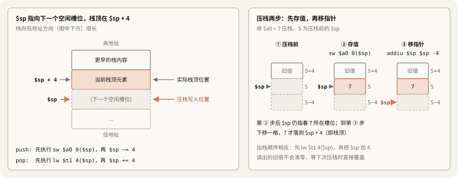
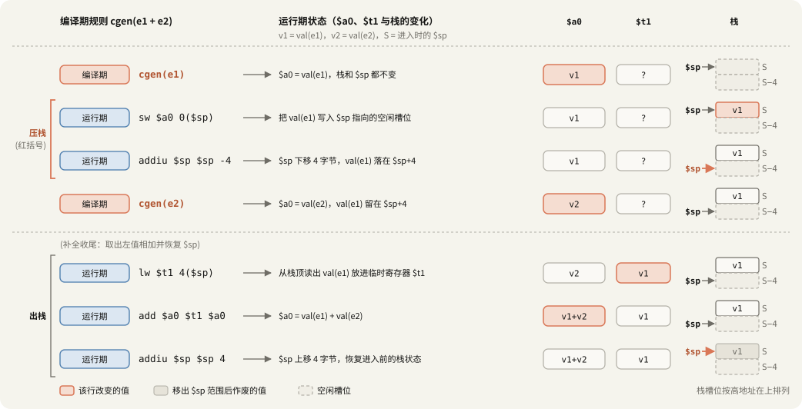
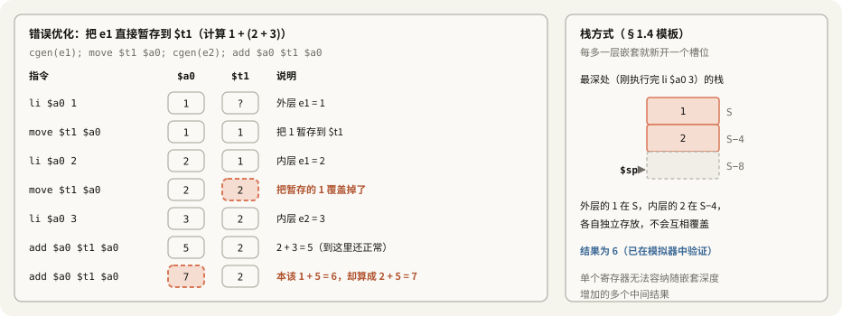

# 11.1 带累加器的栈机器与表达式代码生成

接续 [[10.6 栈式机器模型与寄存器机器对比]]，本章讨论如何把带累加器的栈机器落实到 MIPS 上，按语法制导模板依次生成表达式、函数调用、固定临时槽位以及面向对象布局与分派表的目标代码。

> [!info] 本章约定与验证背景
> - 本章所有栈图统一按 CS143 幻灯片习惯将**高地址画在上方**，使“`$sp` 下移 4 字节”与 AR 布局方向一致；文中标注的幻灯片编号对应 Richmond CS331 镜像版 `lecture12.pdf`。
> - 补充框中的验证数据来自一个按讲义模板实现的 Python 代码生成器与 11 指令 MIPS 模拟器（`li lw sw addiu add sub move beq b jal jr`），已对 `sumto(0..7)`、`fib(1..15)` 及 2,000 个随机三函数程序完成栈推拉与固定临时槽位双版本核对；对象布局、vtable 与 `push`/`call` 行为则在 Ubuntu 24.04 x86-64 上使用 `gcc/g++ 13.3` 实测。

## 1. 目标机器：带累加器的栈机器

代码生成器产生的代码，重点落在带累加器的栈机器（stack machine with accumulator）上。为了让结果能在真实硬件上跑起来（比如 MIPS 处理器或 SPIM 模拟器），我们用 MIPS 指令和寄存器来模拟这套栈机器。

MIPS 是典型的精简指令集计算机（RISC），大多数运算指令直接操作寄存器，读写内存则统一走 `load` 和 `store` 指令。它有 32 个 32 位通用寄存器，我们这套模型只用到其中三个：

- `$a0` 充当累加器，保存当前表达式算出来的值
- `$sp` 保存栈在内存中的下一个空闲槽位地址
- `$t1` 是临时寄存器，用来暂存从栈里取出的左操作数

按 MIPS 的标准约定，栈保存在内存中并向低地址方向增长。正因为 `$sp` 指着下一个还没写入数据的位置，当前真正的栈顶元素反而在 `$sp + 4` 处：



**读图**：左边是把栈画成高地址在上，槽位顺序和指针指向一目了然。右边展示了把 `$a0 = 7` 压栈的两个步骤：因为先存值（②），7 写进了 `$sp` 原来指着的空闲槽位；直到移指针（③）把 `$sp` 减 4 后，7 才落在 `$sp + 4` 成为新的栈顶。要是颠倒顺序先减 `$sp`，7 就会写进 `S - 4` 且 `$sp` 仍指着它，“栈顶在 `$sp + 4`”的约定就破了。

这么定偏移量写起来很直接：压栈就是先把 `$a0` 存进 `0($sp)`，再把 `$sp` 减 4；出栈则是从 `4($sp)` 读回数据，再把 `$sp` 加 4。其余指令细节可查阅 SPIM 文档。

> [!note] 补充：“下一个空闲槽位”是本课的约定
> - 幻灯片第 5 页把 `$sp` 定义为“下一次压栈将要写入的未分配槽位地址”。栈向低地址增长是 MIPS 的标准约定，但让 `$sp` 指着空槽位而不是已用槽位，是这门课自己定下的简化规则。
> - 真实的 MIPS 编译器通常在函数入口用一条 `addiu $sp, $sp, -N` 一次性划出整块栈帧，然后用正偏移（如 `sw $ra, N-4($sp)`）往里写，此时 `$sp` 指着已分配区域最底端的那个字。x86-64 的 `push` 也是先减后写：在 Ubuntu x86-64 上实测 `pushq $42`，会先让 `rsp` 减 8，再把 42 写到 `[rsp]` 处。
> - 这里一开始只用了三个寄存器，到了 [[11.2 函数定义、极简 AR 与调用序列]] 还会加入 `$fp`（帧指针）和 `$ra`（返回地址）。另外按 MIPS 标准调用约定，`$a0` 原本是第 1 个参数寄存器，这门课把它借来当累加器，幻灯片第 5 页也提到“用其他寄存器也可以”。

## 2. 整数语言文法与入口约定

先把类型系统、对象这些包袱放一边，用一个只支持整数和整型运算的小语言来看代码生成。它的上下文无关文法如下：

$$
\begin{aligned}
P &\to D;\ P \mid D \\
D &\to \text{def } \mathrm{id}(\mathrm{ARGS}) = E; \\
\mathrm{ARGS} &\to \mathrm{id},\ \mathrm{ARGS} \mid \mathrm{id} \\
E &\to \mathrm{int} \mid \mathrm{id} \mid \text{if } E_1 = E_2 \text{ then } E_3 \text{ else } E_4 \\
  &\quad \mid E_1 + E_2 \mid E_1 - E_2 \mid \mathrm{id}(E_1, \dots, E_n)
\end{aligned}
$$

语言约定第一个定义的函数作为程序入口，相当于 C/C++ 里的 `main` 例程。把课件里的斐波那契示例换成 C++ 写法（保留原图重点标出的两处递归调用）：

```cpp
// 约定第一个定义的函数 f 为程序入口（相当于 main 例程）
int fib(int x) {
    if (x == 1) return 0;
    if (x == 2) return 1;
    return fib(x - 1) + fib(x - 2);
    //     ^^^^^^^^^^   ^^^^^^^^^^
    //     原图重点标注：算完左边的 fib(x - 1) 后得先压栈保存，再算右边的 fib(x - 2)
}
```

## 3. `cgen(e)` 不变性与常量生成

定义代码生成函数 $\mathrm{cgen}(e)$，它的输出就是表达式 $e$ 对应的 MIPS 目标代码。为了能让任意深度的嵌套表达式安全拼接，每条 $\mathrm{cgen}(e)$ 必须守住两条规约：

1. 执行完生成的代码后，表达式 $e$ 的结果留在 `$a0` 中。
2. `$sp` 和栈上原本存着的所有内容都保持原样。

求值整数常量 $i$ 最简单，直接把常量装进累加器就行，栈完全不用动：

$$
\mathrm{cgen}(i) = \texttt{li \$a0 } i
$$

这里要注意课件的配色约定（红字表示编译期，蓝字表示运行期）：左边的 $\mathrm{cgen}(i)$ 是编译器在编译期调用的生成规则，右边的 `li $a0 i` 才是写进输出文件、等程序跑起来后由 MIPS 硬件在运行期执行的指令。

## 4. 加法表达式 `cgen(e1 + e2)`

按前面的规约，生成 $e_1 + e_2$ 的代码时立刻会碰到一个冲突：$\mathrm{cgen}(e_1)$ 把结果放进了 `$a0`，紧接着跑 $\mathrm{cgen}(e_2)$ 时也会把结果放进 `$a0`，前一个值会被直接覆盖。因此在算 $e_2$ 之前，必须先把 `$a0` 压到栈里保存。

前半段生成规则如下（将中间两条运行期指令括成一组压栈动作）：

$$
\begin{aligned}
\mathrm{cgen}(e_1 + e_2) ={} & \mathrm{cgen}(e_1) \qquad && \text{[编译期]} \\
& \left[\begin{array}{l}
  \texttt{sw \$a0 0(\$sp)} \\
  \texttt{addiu \$sp \$sp -4}
\end{array}\right. \qquad && \text{[运行期：压栈保存 } e_1 \text{ 结果]} \\
& \mathrm{cgen}(e_2) \qquad && \text{[编译期]}
\end{aligned}
$$

走到 $\mathrm{cgen}(e_2)$ 结束时，`$a0` 里放着 $e_2$ 的值，而 $e_1$ 的值就待在当前栈顶 `4($sp)`。要把加法算完并恢复 `$sp` 满足规约，后面还要把 `4($sp)` 读进临时寄存器 `$t1`，相加写回 `$a0`，再把 `$sp` 加 4 弹栈。把编译期展开和运行期栈状态串起来看：



**读图**：橙色标签行是编译器递归展开的位置，蓝色标签行是直接输出的运行期指令，和原课件的红蓝配色一致。右侧三列是执行完该行后的状态，橙色高亮格表示这一行改过的值。`cgen(e2)` 把 `$a0` 写成 `v2` 时，`v1` 依然安稳待在栈槽位 `S` 里；最后一行结束后 `S` 里其实还留着 `v1`，但 `$sp` 已经指回 `S`，逻辑上它就是下一个会被覆盖的空槽位。

最后三条指令执行完，`$a0` 拿到了 $e_1 + e_2$ 的结果，`$sp` 和栈底旧内容也完全恢复，整条加法表达式依然符合 $\mathrm{cgen}$ 的规约。



> [!note] 补充：为什么不直接把 `e1` 放进 `$t1`，而要走栈？
> 幻灯片 16–18 先试了一个看似省事的优化：“直接 `move $t1 $a0` 把 `e1` 留在 `$t1`，不就省掉压栈和出栈了吗？”紧接着就用嵌套加法给出了反例。上图算 `1 + (2 + 3)` 时，内层加法一动 `$t1` 就把外层的 `1` 覆盖成 `2`，最终算出 `7` 而不是 `6`；同样算 `3 + (7 + 5)` 会得出 `19` 而不是 `15`。表达式嵌套越深，同时存活的中间值越多，单个寄存器装不下，所以才需要能随深度扩展的栈。到 [[11.4 临时变量的编译期固定槽位分配]] 我们还会发现，其实在编译期就能算出每层最多需要几个槽位。
>
> 顺便留意 `addiu` 里的 `u`：虽然它代表 unsigned，但立即数 `-4` 照样做符号扩展，所以 `addiu $sp $sp -4` 能正确减 4。这里的 `u` 只意味着“不触发有符号溢出异常”（幻灯片第 7 页），相对地 `add` 和 `sub` 在有符号溢出时会触发异常。

---

上一篇：[[10.6 栈式机器模型与寄存器机器对比]] | 下一篇：[[11.2 函数定义、极简 AR 与调用序列]]

来源：[[16.AI编译器/学习日记/0.2十一月/11_03#一、代码生成器|11_03 §一]]。
