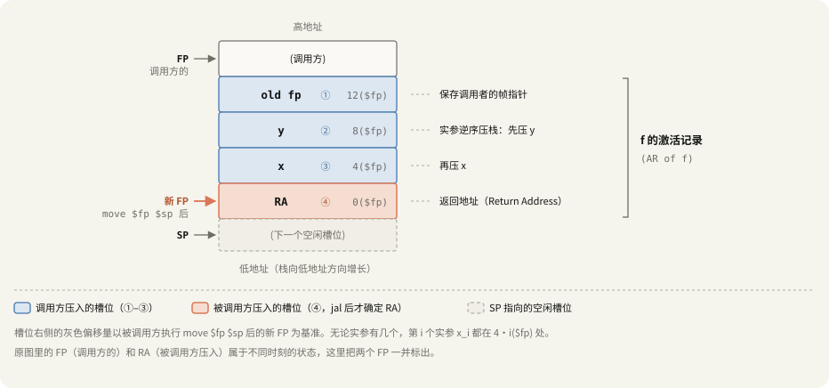
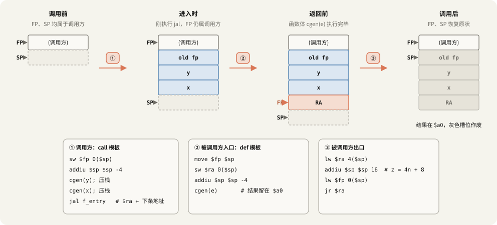

# 11.2 函数定义、极简 AR 与调用序列

完成了整数常量和加法的代码生成后，文法中还剩下**变量引用 `id`** 与**函数调用 `id(E1, ..., En)`**（以及减法和 `if`）：

$$
E \to \mathrm{int} \mid \underline{\mathrm{id}} \mid \text{if } E_1 = E_2 \text{ then } E_3 \text{ else } E_4 \mid E_1 + E_2 \mid E_1 - E_2 \mid \underline{\mathrm{id}(E_1, \dots, E_n)}
$$

> [!warning] 纠偏：下划线标出的两个表达式是“接下来”才要处理的
> 前面真正给出生成规则的只有整数常量和加法（减法和 `if` 也走同一套思路）。文法里画了下划线的变量引用 `id` 和函数调用 `id(E1, ..., En)` 都要依赖激活记录（AR）的布局，因此必须先定下 AR 结构，再依次给出函数调用、函数定义和变量引用的代码模板；幻灯片第 34 页也明确写着“变量引用是最后一个拼图”。
>
> 减法只需把加法模板里的 `add` 换成 `sub $a0 $t1 $a0`（计算 `$t1 - $a0` 即 `e1 - e2`）。`if` 表达式的模板如下（幻灯片第 22 页），[[11.3 综合实例：递归函数 sumto 的完整代码生成]] 里的 `beq`、`true1`、`false1`、`endif1` 就是套这个模板出来的：
>
> ```text
> cgen(if e1 = e2 then e3 else e4) =
>     cgen(e1)
>     sw    $a0 0($sp)
>     addiu $sp $sp -4
>     cgen(e2)
>     lw    $t1 4($sp)
>     addiu $sp $sp 4
>     beq   $a0 $t1 true_branch
> false_branch:
>     cgen(e4)
>     b     end_if
> true_branch:
>     cgen(e3)
> end_if:
> ```

## 1. 极简激活记录（AR）的取舍

函数调用和函数定义生成什么样的代码，取决于激活记录（AR）怎么排布。好在这个整数小语言足够简单，AR 可以比 [[10.3 激活记录（AR）与调用栈链]] 的通用模型精简不少：

| AR 组成部分 | 在本语言中的处理 | 原因 |
| --- | --- | --- |
| 返回值（Result） | 不存入 AR | 结果永远留在累加器 `$a0` 中 |
| 实参（Actual parameters） | 存入 AR，按 `x_n, ..., x_1` 逆序压栈 | 本语言没有其他局部变量，形参就是全部变量 |
| 控制链（Control link） | 不需要 | 栈规约保证退出时 `$sp` 与进入时完全一致 |
| 返回地址（RA）与当前帧指针（`$fp`） | 需要保留 | 分别用于跳回调用点、定位当前 AR 中的参数 |

也就是说，对这门语言而言，一份 AR 里放进调用方的帧指针、实参和返回地址就够了。

> [!note] 补充：`old fp` 在内容上就是控制链
> `old fp` 存的值指向调用方的 AR，单看指针内容它和通用模型里的控制链是一回事。幻灯片第 24 页之所以说“不需要控制链”，有两层原因：退出时 `$sp` 仅靠栈规约就能自动回到进入前的位置；同时语言里没有嵌套作用域的非局部变量，运行期不用沿着链表往外层 AR 找变量。之所以还要保存 `old fp`，是因为被调用方会把 `$fp` 寄存器改写为自己的 AR（幻灯片第 26 页）；等返回后，调用方还得继续靠 `4($fp)` 读取自己的参数，必须把原来的 `$fp` 恢复回来。这和 x86-64 上 `push rbp` 保存上一帧基址指针是同一件事（见 [[10.3 激活记录（AR）与调用栈链]]）。

## 2. `f(x, y)` 的 AR 布局与逆序压栈

以调用 `f(x, y)` 为例，对应的 C++ 形式和压栈顺序如下：

```cpp
int f(int x, int y) {
    return x + y;
}

int main() {
    int res = f(x, y);
    //          ^  ^
    //          原图重点标注：按逆序压栈，先压入 y，再压入 x
    return 0;
}
```

结合 `FP`、`SP` 和 `RA`（返回地址）标注，调用 `f(x, y)` 时栈上的 AR 布局如下：



**读图**：蓝色槽位 ①–③ 由调用方压入，橙色槽位 ④ 由被调用方压入。左侧标出的 `FP` 是刚跳进函数时调用方的旧指针，而 `RA` 是被调用方执行前几条指令后才压进去的，两者并非同一时刻的画面；因此图里把被调用方执行完 `move $fp $sp` 后的**新 FP** 一并画了出来，它直接指向 `RA` 槽位（幻灯片第 35 页：“帧指针永远指向栈上的返回地址”）。槽位右侧的灰色偏移量就是以这个新 FP 为基准的，后面 [[11.3 综合实例：递归函数 sumto 的完整代码生成]] 里的 `4($fp)` 取 `x`、`0($fp)` 存 `RA` 就是这么算出来的。

把参数按 `x_n, ..., x_1` 从右往左压栈，第一个参数 `x` 会落在紧邻 `RA` 的位置，无论函数有几个参数，开头几个实参相对于当前激活记录 `FP` 的偏移都是固定的。

> [!warning] 纠偏：`x` 靠近的是栈“顶”，而不是栈“底”
> 按栈的术语，栈底（bottom）是栈开始生长的那一端（高地址），栈顶（top）才是最近一次压入的那一端（低地址）。最后压进去的 `x` 和 `RA` 靠近的是栈顶，口头上常说的“底部”其实只是指图纸的下方。幻灯片第 31 页也特意强调：“帧指针指向栈帧的顶部，而不是底部。”`FP` 指着的 `RA` 槽位正是这份 AR 的栈顶。

> [!note] 补充：变量引用规则与逆序压栈的用意
> 最后一个没展开的表达式 `id` 只需要一条指令（幻灯片第 35 页）：对第 $i$ 个形参 $x_i$，有 $\mathrm{cgen}(x_i) = \texttt{lw \$a0 } z\texttt{(\$fp)}$，其中 $z = 4i$ 在编译期就已经算死。
> - 正因为实参是逆序压栈的，$x_1$ 永远在 `4($fp)`、$x_2$ 永远在 `8($fp)`，不管这个函数总共有几个参数，前面几个参数的偏移都不会变。
> - 不用 `$sp` 而改用 `$fp` 当基准，是因为求值过程中每次把中间结果压栈都会移动 `$sp`，导致参数到 `$sp` 的距离一直在变（幻灯片第 34 页）。
> - C 语言的 `cdecl` 调用约定同样从右往左压参，道理一致：哪怕是 `printf(fmt, ...)` 这种每次传参个数不固定的变参函数，也能在固定偏移处稳定找到第一个参数 `fmt`。

## 3. 调用序列与 `jal` 指令

为了让上面的 AR 真正搭起来并顺利跳过去执行，调用方（caller）和被调用方（callee）需要配合执行一段指令，这就是**调用序列**（calling sequence）。

MIPS 里专门用一条新指令完成跳转和记录返回地址：

```text
jal label
```

它的动作分两步：跳转到 `label` 处的函数入口，同时把下一条指令的地址存入寄存器 `$ra`。

这点和 x86 等架构不太一样。x86 上的 `call` 指令会顺手把返回地址直接压进内存栈里，而 MIPS 的 `jal` 只把它放进 `$ra` 寄存器。如果 `f` 内部还会再调用别的函数（比如 `fib(x - 1)`），不把 `$ra` 转存到栈上的 `RA` 位置，下一次 `jal` 就会把外层的返回地址冲掉。



**读图**：这里拆出了幻灯片第 33 页的四个瞬间。① 调用方压入 `old fp`、`y`、`x` 并用 `jal` 跳进来，此时 `FP` 还是调用方的；② 被调用方先用 `move $fp $sp` 把 `FP` 对齐到当前空槽位，然后把 `$ra` 存进去；③ 函数体跑完后读回 `RA`，一条 `addiu $sp $sp 16` 一次性弹掉 `z = 4n + 8 = 16` 字节（2 个参数 + RA + old fp），接着 `lw $fp 0($sp)` 恢复调用方的 `FP` 并执行 `jr $ra` 返回。调用结束后 `FP` 和 `SP` 都回到原点，只把返回值留在了 `$a0` 里，说明一次函数调用整体上也遵守了 `cgen` 规约。

> [!warning] 纠偏：把返回地址直接压栈反而是少数派
> 幻灯片第 28 页曾提到“其他架构的 `call` 指令把返回地址压栈”，但那主要是 x86 系列的做法。ARM 的 `BL` 把返回地址存进链接寄存器（LR，AArch64 中是 X30），RISC-V 的 `jal` 存进 `ra` 寄存器，绝大多数 RISC 架构都跟 MIPS 一样放寄存器里。这样做的好处是，不再调用别的函数的叶子函数（leaf function）可以省掉把返回地址存栈的开销；课程模板为了统一简洁，所有函数一律保存了 `$ra`。
> - 在 Ubuntu x86-64 上实测，C 函数里 `__builtin_return_address(0)` 的值正好等于保存好的 `rbp + 8`，印证了 x86 `call` 会把返回地址直接压在 `push rbp` 之前。
> - 真实的 MIPS 硬件带有分支延迟槽（branch delay slot），`jal` 放进 `$ra` 的其实是再下一条指令的地址（`jal` 地址 + 8）。SPIM 在关闭延迟槽模拟时，才会像讲义描述的那样回到紧邻的下一条指令。

> [!note] 补充：调用方与定义方的完整生成模板（幻灯片 29、31）
> ```text
> cgen(f(e1, ..., en)) =          # 调用方
>     sw    $fp 0($sp)            # 保存 old fp
>     addiu $sp $sp -4
>     cgen(en)                    # 从最后一个实参开始逆序求值并压栈
>     sw    $a0 0($sp)
>     addiu $sp $sp -4
>     ...
>     cgen(e1)
>     sw    $a0 0($sp)
>     addiu $sp $sp -4
>     jal   f_entry               # 到这里一共压了 4n + 4 字节
>
> cgen(def f(x1, ..., xn) = e) =  # 被调用方
> f_entry:
>     move  $fp $sp               # FP 对齐到即将存放 RA 的槽位
>     sw    $ra 0($sp)
>     addiu $sp $sp -4
>     cgen(e)                     # 结果留在 $a0，$sp 在这行前后保持一致
>     lw    $ra 4($sp)
>     addiu $sp $sp z             # z = 4n + 8：RA + n 个实参 + old fp
>     lw    $fp 0($sp)
>     jr    $ra
> ```
> 之所以由被调用方来保存 `$ra`，是因为只有执行完 `jal` 之后 `$ra` 才算真正生成（幻灯片第 32 页）。出口处 `lw $ra 4($sp)` 能精准取回 `RA`，靠的正是 `cgen(e)` 遵守规约把 `$sp` 还原回了刚进函数体时的位置。

---

上一篇：[[11.1 带累加器的栈机器与表达式代码生成]] | 下一篇：[[11.3 综合实例：递归函数 sumto 的完整代码生成]]

来源：[[16.AI编译器/学习日记/0.2十一月/11_03#二、函数定义|11_03 §二]]。
