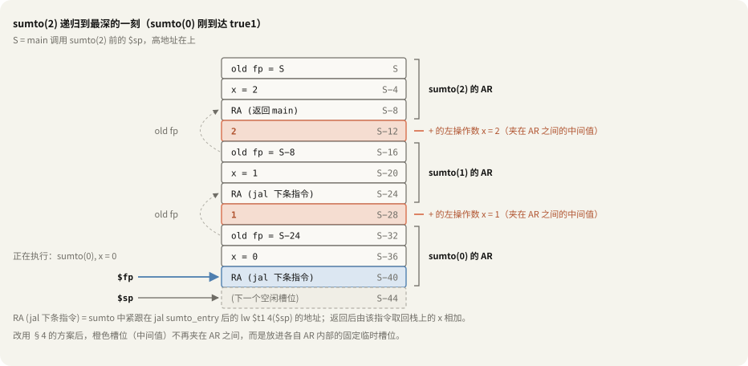

# 11.3 综合实例：递归函数 sumto 的完整代码生成

用带条件判断和递归的累加函数 `sumto` 把 [[11.1 带累加器的栈机器与表达式代码生成]] 和 [[11.2 函数定义、极简 AR 与调用序列]] 的所有模板完整串起来走一遍。

## 1. 源码与入口、条件判断的 MIPS 推导

`sumto` 的 C++ 写法如下（标出了关键子表达式）：

```cpp
int sumto(int x) {
    if (x == 0) return 0;
    else return x + sumto(x - 1);
    //          ^   ^^^^^^^^^^^^
    //   条件 x == 0、真分支 0、假分支左值 x、假分支递归调用 sumto(x - 1)
}
```

对照定好的 AR 布局，手写推导出的 MIPS 入口与判断部分代码如下（原笔记在进入 `false1` 后写到 `s...` 处截断）：

```text
sumto_entry:
    move  $fp $sp          # 设置当前帧指针（caller 刚压完 x，所以 x 在 4($fp)）
    sw    $ra 0($sp)       # 把返回地址 RA 存进 0($fp)
    addiu $sp $sp -4       # $sp 下移，指向下一个空闲槽位

    lw    $a0 4($fp)       # 读出参数 x 到 $a0
    sw    $a0 0($sp)       # 压栈保存左值 x，准备和 0 比较
    addiu $sp $sp -4
    li    $a0 0            # 把右值 0 装进 $a0
    lw    $t1 4($sp)       # 弹出左值 x 到临时寄存器 $t1
    addiu $sp $sp 4
    beq   $a0 $t1 true1    # 若 0 == x，跳转到 true1 分支

false1:                    # else 分支：计算 x + sumto(x - 1)
    lw    $a0 4($fp)       # 先把 x 读入 $a0
    s...                   # 原图在此截断，接下来是 sw $a0 0($sp) 压栈保存 x，再去算 sumto(x - 1)
```

这段指令把前面的规约全串起来了：因为 caller 压栈顺序是 `old fp`、`x`，所以 callee 刚进函数执行 `move $fp $sp` 时，参数 `x` 正好落在 `4($fp)`，而接下来压入的返回地址 `RA` 刚好占住 `0($fp)`。

## 2. `sumto(2)` 递归最深处的栈快照



**读图**：这是模拟器跑 `sumto(2)` 时，最内层 `sumto(0)` 刚抵达 `true1` 那一刻的内存快照。每层调用的 AR 占 `old fp`、`x`、`RA` 三格，夹在两层 AR 中间的橙色格子 `2` 和 `1`，正是 `x + sumto(x - 1)` 压栈暂存的左操作数 `x`，在递归调用返回前一直待在那里等待相加。顺着左侧的 `old fp` 弧线，每次返回都会把 `FP` 抬回上一层的 `RA` 槽位。

## 3. 完整 MIPS 汇编与模板效率观察

> [!note]- 补充：`s...` 后面的完整 MIPS 代码（幻灯片 41）
> 按讲义模板生成的 `false1` 到结尾完整代码如下（在配套验证中，输出与幻灯片 41 逐 token 一致，模拟器跑 `sumto(0..7)` 依次得到 `0, 1, 3, ..., 28`，结束时 `$sp` 和 `$fp` 均恢复原值）：
>
> ```text
> false1:
>     lw    $a0 4($fp)        # x
>     sw    $a0 0($sp)        # (原图截断处) 压栈保存 + 号左边的 x
>     addiu $sp $sp -4
>     sw    $fp 0($sp)        # 准备递归调用：压入 old fp
>     addiu $sp $sp -4
>     lw    $a0 4($fp)        # 计算实参 x - 1：先取 x
>     sw    $a0 0($sp)        #   压栈保存 - 号左边的 x
>     addiu $sp $sp -4
>     li    $a0 1
>     lw    $t1 4($sp)
>     sub   $a0 $t1 $a0       #   得到 x - 1
>     addiu $sp $sp 4
>     sw    $a0 0($sp)        # 压入实参 x - 1
>     addiu $sp $sp -4
>     jal   sumto_entry       # 递归调用，结果放在 $a0
>     lw    $t1 4($sp)        # 取出一直等在栈上的左操作数 x
>     add   $a0 $t1 $a0       # 计算 x + sumto(x - 1)
>     addiu $sp $sp 4
>     b     endif1
> true1:
>     li    $a0 0             # x == 0 时返回 0
> endif1:
>     lw    $ra 4($sp)        # 函数定义模板收尾
>     addiu $sp $sp 12        # z = 4·1 + 8
>     lw    $fp 0($sp)
>     jr    $ra
> ```
> 正如幻灯片第 43 页指出的那样，直接拼模板的执行效率很低——刚把 `x` 从栈帧读进 `$a0` 就立刻又压回栈里，后面还要再弹出来，全是机械拼接带来的冗余访存与反复的 `$sp` 推拉。这一痛点直接引出了 [[11.4 临时变量的编译期固定槽位分配]]。

---

上一篇：[[11.2 函数定义、极简 AR 与调用序列]] | 下一篇：[[11.4 临时变量的编译期固定槽位分配]]

来源：[[16.AI编译器/学习日记/0.2十一月/11_03#三、最小实例|11_03 §三]]。
