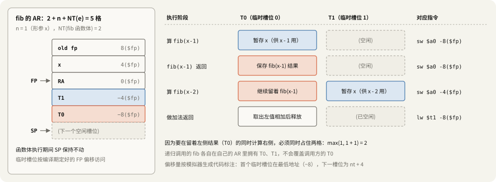

# 11.4 临时变量的编译期固定槽位分配

前面的 `sumto` 和加法模板每次都要靠 `addiu $sp $sp -4` 和 `+4` 在运行时来回挪动栈顶。换个思路：把临时值（temporaries）也直接放进 AR 里，由代码生成器在编译期为每个临时值在 AR 中分配一个**固定位置**（fixed location），算表达式时就不用反复推拉 `$sp` 了。

## 1. 临时槽位需求 $\mathrm{NT}(e)$ 的递推计算

以斐波那契函数为例，标出每一处表达式计算所需的临时槽位数：

```cpp
// 整个函数体共需 2 个临时槽位（2 temporaries）
int fib(int x) {
    if (x == 1) return 0;            // 比较 x == 1：需 1 个临时槽位（暂存 x）
    if (x == 2) return 1;            // 比较 x == 2：需 1 个临时槽位（复用前面的即可）
    return fib(x - 1) + fib(x - 2);
    //         ^^^^^  ^     ^^^^^
    //         需 1 个│     需 1 个（此时 fib(x-1) 结果还占着第 1 个，共需 2 个）
    //                └─ 需 1 个临时槽位保存 fib(x - 1) 的结果
}
```

记 $\mathrm{NT}(e)$ 为求值表达式 $e$ 所需的临时槽位数量。算加法 $e_1 + e_2$ 时满足两条规则：

- 需要的槽位数至少等于 $\mathrm{NT}(e_1)$，先算左半边时得装得下。
- 需要的槽位数至少等于 $\mathrm{NT}(e_2) + 1$，因为 $e_1$ 算完后结果要占住 1 个槽位，留给 $e_2$ 用的还剩 $\mathrm{NT}(e_2)$ 个。

算 $e_1$ 时用过的临时槽位，在 $e_1$ 求值结束后可以腾出来给 $e_2$ 复用，所以最终需求是两者取大：

$$
\mathrm{NT}(e_1 + e_2) = \max\big(\mathrm{NT}(e_1),\ \mathrm{NT}(e_2) + 1\big)
$$

套回上面的 `fib`：算 `fib(x - 1)` 时里头的 `x - 1` 需要 1 个槽位，算完后这个返回值自己占 1 个槽位，再去算 `fib(x - 2)` 里的 `x - 2` 又需要 1 个槽位，结果就是 $\max(1, 1 + 1) = 2$。

## 2. AR 布局与槽位随时间复用



**读图**：右边表格前三列对应复用时间线，最后一列补上了实际操作该槽位的指令。左边则标出了这些槽位在 AR 里的具体位置：两个临时槽位接在 `RA` 下方，整块 AR 一共占 $2 + n + \mathrm{NT}(e) = 5$ 格（幻灯片第 56 页），函数入口直接把 `$sp` 一次拉到底。执行函数体期间 `$sp` 纹丝不动，临时槽位全部通过编译期算好的 `-8($fp)`、`-4($fp)` 固定偏移来读写。

## 3. 改写后的 `cgen(e, nt)` 模板与实测对比

> [!note] 补充：改写后的模板与省下的指令数
> 代码生成函数多传一个参数 `nt`，表示“下一个可用临时槽位相对于 `$fp` 的偏移”（幻灯片 58–60）：
>
> ```text
> cgen(e1 + e2, nt) =
>     cgen(e1, nt)
>     sw    $a0 nt($fp)       # 用固定槽位取代 push
>     cgen(e2, nt + 4)        # e2 从下一个槽位开始用
>     lw    $t1 nt($fp)
>     add   $a0 $t1 $a0       # 不再需要 pop
> ```
>
> - 按幻灯片第 57 页的布局，Temp 1 位于最低地址处，所以函数体从 `nt = -4·NT(e)` 起步、每次加 4 向上递增；在 `fib` 中就是 `T0 = -8($fp)`、`T1 = -4($fp)`。入口处用 `addiu $sp $sp -(4 + 4·NT(e))` 一次性留出 `RA` 和全部临时槽位，出口弹出 `z = 4n + 8 + 4·NT(e)` 字节。
> - 函数调用的临时槽位需求只需 $\mathrm{NT}(f(e_1, \dots, e_n)) = \max(\mathrm{NT}(e_1), \dots, \mathrm{NT}(e_n))$，因为算好的实参直接压进新调用方的 AR 里，不占当前 AR 的临时槽位（幻灯片第 52 页）。`if` 语句则是 $\max(\mathrm{NT}(e_1), 1 + \mathrm{NT}(e_2), \mathrm{NT}(e_3), \mathrm{NT}(e_4))$。由于每个节点的 `NT` 只取决于子节点，从下往上遍历一遍 AST 就能算完。
> - 在模拟器对比测试中，换用这套模板跑 `fib(15)`，总执行指令数从 43,841 条降到 35,777 条（减少了 18%），专门用来挪动 `$sp` 的指令从 12,940 条降到 4,876 条，`fib` 函数生成的代码也从 54 行缩到 44 行。剩下的 `$sp` 移动只出现在调用前把 `old fp` 和实参压进新 AR 的阶段。工业级编译器会在此基础上更进一步，把临时值优先放进物理寄存器，寄存器不够用时才溢出（spill）到 AR 槽位里（幻灯片 39、44，详见 [[12.3 寄存器溢出、乐观着色与代码改写]]）。

---

上一篇：[[11.3 综合实例：递归函数 sumto 的完整代码生成]] | 下一篇：[[11.5 面向对象代码生成：对象布局与分派表]]

来源：[[16.AI编译器/学习日记/0.2十一月/11_03#四、临时变量（Temporaries）|11_03 §四]]。
