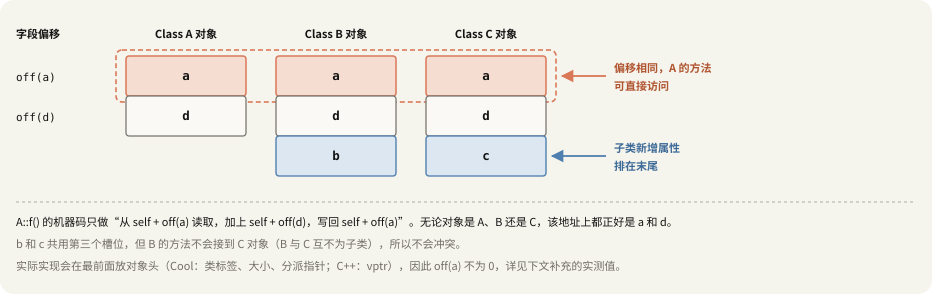
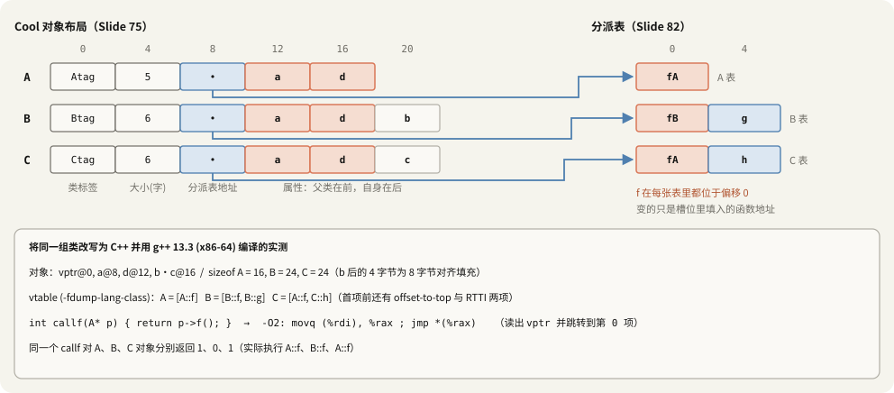

# 11.5 面向对象代码生成：对象布局与分派表

面向对象语言的实现可以拆成两块：前面讲过的基础代码生成，再加上处理对象与继承的机制（`OO implementation = Basic code generation + More stuff`）。

面向对象有一个最核心的替换原则：如果 `B` 是 `A` 的子类，那么任何期待 `A` 类对象的地方，都可以直接放一个 `B` 类对象进去。这意味着为 `A` 类编译好的方法代码，不需要做任何修改就能直接作用在 `B` 类对象上。要让这件事成立，代码生成器得解决两个问题：

1. 对象在内存里怎么表示？
2. 动态分派（dynamic dispatch）怎么实现？

## 1. 继承与固定偏移的对象内存布局

先看第一个问题。把课件里的 `A`、`B`、`C` 三个类改写成 C++（保留两条关键标注）：

```cpp
class A {
public:
    int a = 0;
    int d = 1;
    virtual int f() { return a = a + d; }
};

class B : public A {
public:
    int b = 2;
    int f() override { return a; }
    virtual int g() { return a = a - b; }
};

class C : public A {
public:
    int c = 3;
    virtual int h() { return a = a * c; }
};
// 关键标注：
// 1. 所有类中的所有方法（f、g、h）都引用了属性 a
// 2. 为了让 A 的方法在 A、B、C 对象上都能正常工作，属性 a 在每个对象里必须处于相同的“位置”
```

解决办法是把对象放在连续内存中，让每个属性在对象内部占据固定偏移（同一类的所有对象里，属性位置完全一致）。当某个方法被调用时，当前对象就是 `self`（对应 C++ 里的 `this` 指针），方法读写属性时直接按固定偏移去访问 `self` 指向的那块内存。

子类只要把自己的新增属性接在父类属性后面，就能保证继承下来的字段偏移完全不变（与 [[8.4 对象创建 new T 与类属性展平]] 中 $\mathrm{class}(C)$ 的顶层祖先优先展平顺序完全一致）：



**读图**：橙色虚线框标出了三类对象的 `a` 落在完全相同的偏移位置。`b` 和 `c` 虽然占着同一个第三槽位，但 `B` 和 `C` 互不为子类，`B` 的方法绝不会收到 `C` 的对象，因此共用这个偏移毫无问题（幻灯片第 76 页）。继承链再往下拉长也遵循同一规则：只要下一层子类把新增字段接在前一层父类末尾即可（幻灯片第 77 页）。

> [!note] 补充：真实对象前面还有对象头
> - Cool 语言的对象最前面固定有 3 个字的对象头（幻灯片 71–73）：偏移 0 是类标签（class tag），偏移 4 是对象大小（以字为单位），偏移 8 是分派表指针。所以在上面的例子里，`a` 实际在偏移 12，`d` 在 16，`b` 和 `c` 在 20。
> - 把本节的 C++ 代码用 `g++ 13.3`（x86-64）编译实测，对象开头是一个 8 字节的 `vptr`（位于偏移 0），后面紧跟着 `a`（偏移 8）、`d`（偏移 12）、`b` 或 `c`（偏移 16）。`sizeof(A)` 为 16，而 `B` 和 `C` 实际字段只占 20 字节，但受 `vptr` 的 8 字节对齐要求影响，总大小填充到 24 字节（参见 [[10.5 字长、内存对齐与结构体填充]]）。无论对象头占几个字节，父类布局放在最前面、子类追加在后面的规律完全一样。

## 2. 分派表（Dispatch Table）与动态分派

解决属性偏移的这套思路，搬到方法上也一样管用（幻灯片 80–84）。编译器为每个类生成一张**分派表（dispatch table）**，里面按固定编号存放各个方法的入口地址，并确保重写的方法 $f$ 在父类和所有子类的表里占着同一个槽位编号 $O_f$。每个对象的对象头里带有一个指向所属类分派表的指针。

于是调用 `e.f()` 只需要一套固定指令：算出 `e` 得到对象地址 `x`，顺着 `x` 的分派表指针取出第 $O_f$ 号槽位里的函数地址，把 `self = x` 传进去跳转执行即可（动态语义对应 [[8.4 对象创建 new T 与类属性展平]] 中的 $\mathrm{impl}(X, f)$）。



**读图**：`f` 在 `A`、`B`、`C` 三张分派表里都排在偏移 0，只有重写了 `f` 的 `B` 把表里第 0 格换成了 `B::f`，`A` 和 `C` 依然填着 `A::f`；新增的 `g` 和 `h` 则接在后面的偏移 4 位置。下方框里是用 `g++` 编译同款 C++ 类的实测结果：C++ 里的 `vtable` 正好就是这里的分派表，`p->f()` 在 `-O2` 下编译成先读 `vptr` 再跳到第 0 项的两条机器指令，同一段代码传入 `A`、`B`、`C` 对象时会分别执行 `A::f`、`B::f`、`A::f`。

## 3. 本章参考资料

- Alex Aiken, Stanford CS143 课程幻灯片 *Code Generation*（Lecture 12，Richmond CS331 镜像 `lecture12.pdf`）
- James R. Larus, *"Assemblers, Linkers, and the SPIM Simulator"*, Patterson & Hennessy *Computer Organization and Design* 附录 A：SPIM 指令与寄存器惯例
- *MIPS32 Architecture for Programmers, Volume II*：`JAL`、`ADDIU`、`ADD` 指令定义（分支延迟槽与溢出异常语义）
- *Itanium C++ ABI, Virtual Table Layout*：`g++` 遵循的虚表布局（`offset-to-top`、RTTI 与虚函数指针顺序）
- 前置章节：[[10.3 激活记录（AR）与调用栈链]]、[[10.6 栈式机器模型与寄存器机器对比]]

---

上一篇：[[11.4 临时变量的编译期固定槽位分配]] | 下一篇：[[12.1 寄存器复用与干涉图（RIG）]]

来源：[[16.AI编译器/学习日记/0.2十一月/11_03#五、面向对象代码生成（协同代码生成）|11_03 §五]]。
