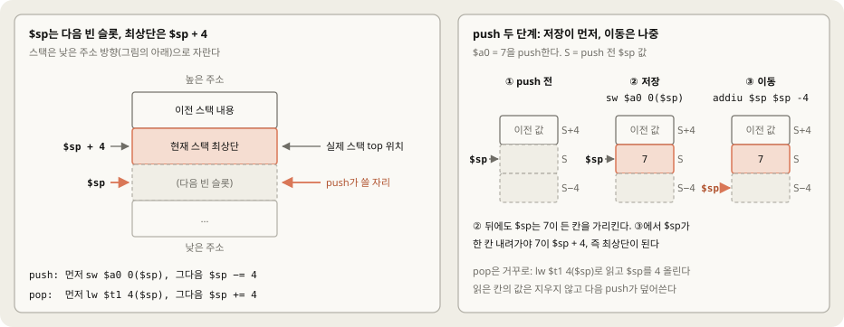
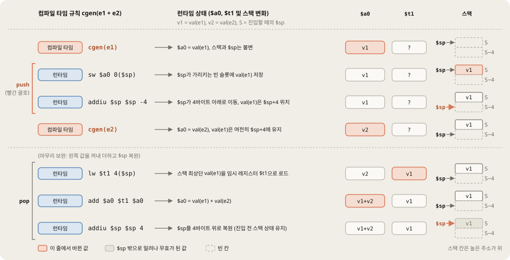
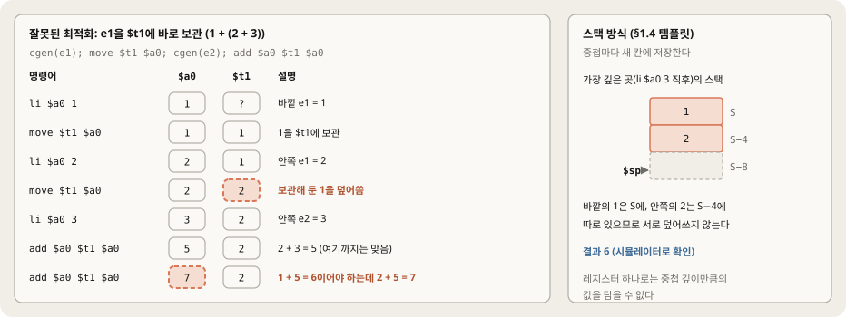
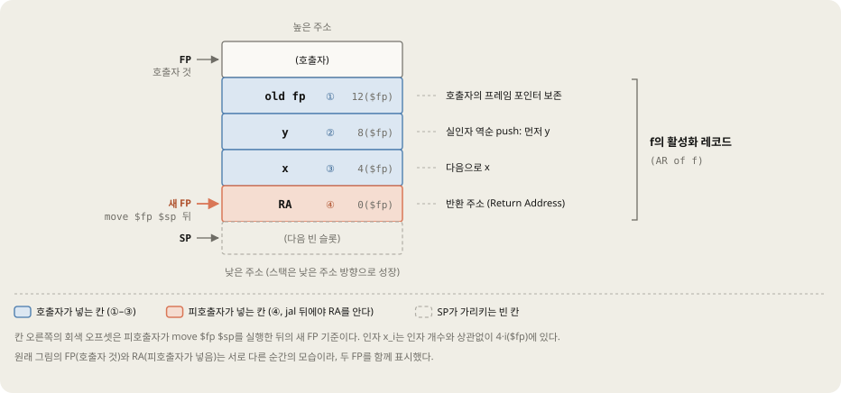
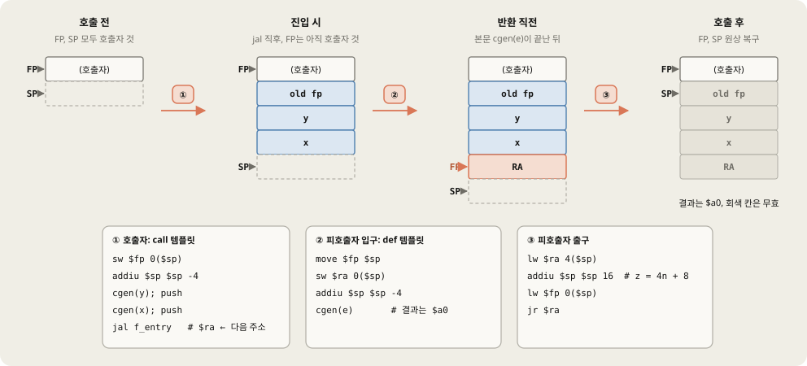
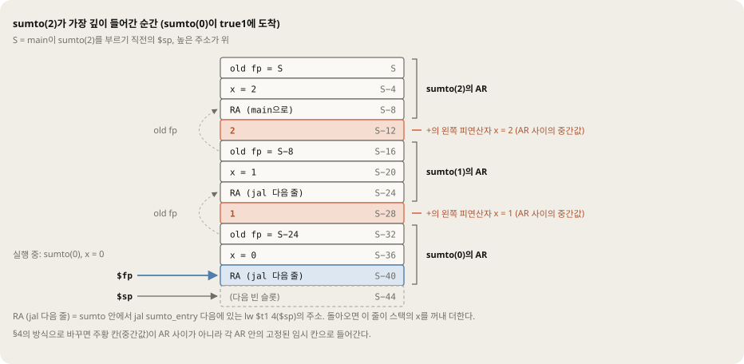
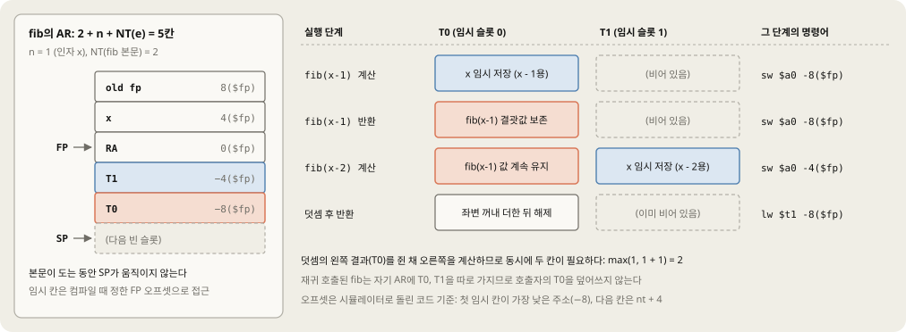
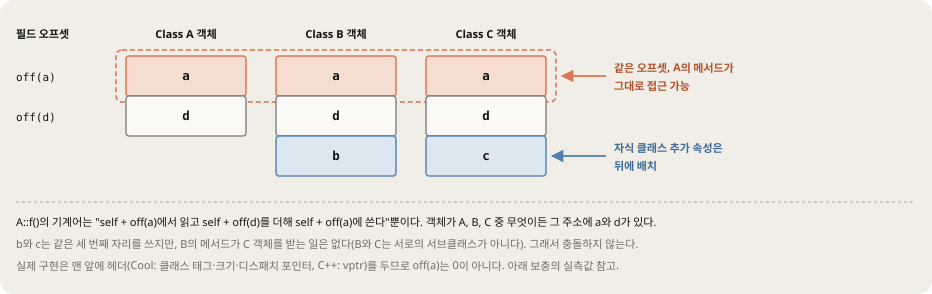
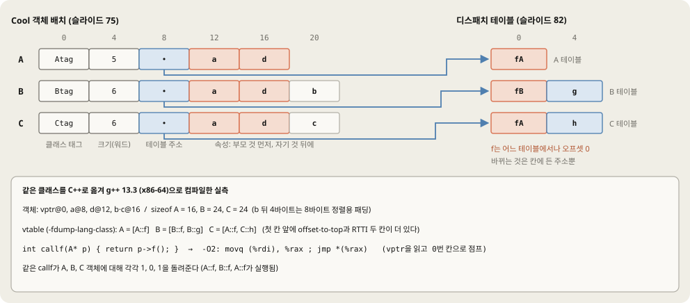

# 코드 생성 전략

> [!info] 이 노트를 읽는 법
> - 본문 문장은 처음 노트 그대로다. 굵은 글씨 두 곳(§2.3 "호출 시퀀스", §4 "고정 위치")만 렌더링이 깨지지 않도록 굵게 표시하는 범위에서 괄호 속 영어를 뺐다. ASCII 그림 다섯 개(§1.1, §1.4, §2.2, §4, §5)는 같은 내용의 SVG로 바꿨다. 그 밖에 새 그림 네 개, 그림 아래의 **그림 읽기** 한 단락, `> [!note] 보충`과 `> [!warning] 바로잡기` 상자를 덧붙였다. 덧붙인 내용은 §6 표에 모았다.
> - 스택 그림은 모두 슬라이드처럼 높은 주소를 위에 그렸다. 원래 §1.1의 ASCII 그림은 낮은 주소가 위였다. 하지만 §1.4의 "4바이트 아래로 이동"이라는 표현이나 §2.2 그림과 방향을 맞추려고 뒤집었다.
> - 앞 노트 [`11_02_runtime.md`](11_02_runtime.md) §9의 스택 머신을 MIPS 위에 구현하는 이야기다. 슬라이드 번호는 CS143 코드 생성 강의(Richmond CS331 미러의 lecture12.pdf)를 따랐다.
> - 이 머신에는 SPIM도 MIPS 툴체인도 없다. 그래서 강의 템플릿 그대로 코드를 만드는 작은 생성기와, 여기 쓰인 명령어 11개(`li lw sw addiu add sub move beq b jal jr`)만 아는 시뮬레이터를 Python으로 짜서 확인했다.
>   - 생성기가 만든 `sumto` 코드는 슬라이드 41의 코드와 토큰 단위로 같았다.
>   - `sumto(0..7)`과 `fib(1..15)`는 push/pop 방식과 §4의 임시 칸 방식 모두 정답을 냈고, `$sp`와 `$fp`도 원래 값으로 돌아왔다.
>   - 함수 세 개짜리 무작위 프로그램 2,000개도 두 방식 모두 Python 인터프리터와 결과가 같았다.
>   - 객체 배치와 vtable, x86-64의 `push`와 `call`은 이 머신(Ubuntu 24.04, gcc/g++ 13.3)에서 직접 컴파일해 확인했다.

## 1. 코드 생성기

### 1.1 타깃 머신: 누산기를 갖춘 스택 머신

코드 생성기가 만들어 내는 코드는 누산기를 갖춘 스택 머신(stack machine with accumulator)에 초점을 맞춘다. 생성한 코드를 실제 머신(예: MIPS 프로세서나 SPIM 시뮬레이터)에서 실행하려면, MIPS 명령어와 레지스터를 이용해 이 스택 머신 명령어를 시뮬레이션해야 한다.

MIPS는 전형적인 축소 명령어 집합 컴퓨터(RISC)다. 대부분의 연산은 피연산자와 결과에 레지스터를 쓰며, 메모리에 있는 값을 쓰려면 `load`와 `store` 명령어를 거쳐야 한다. 32비트 범용 레지스터 32개 가운데 여기서는 다음 세 개만 사용한다.

- `$a0`: 누산기(accumulator) 역할을 하며 현재 표현식의 결괏값을 보관한다.
- `$sp`: 스택 포인터로서 메모리상 스택의 다음 빈 슬롯 주소를 가리킨다.
- `$t1`: 임시 레지스터로, 스택에서 꺼낸 왼쪽 피연산자를 잠시 담아 두는 데 쓴다.

MIPS 표준 관례에 따라 스택은 메모리에 두며 낮은 주소 방향으로 자란다. `$sp`가 아직 데이터가 쓰이지 않은 다음 빈 공간을 가리키기 때문에, 실제 스택의 최상단(top)은 `$sp + 4` 주소에 놓인다.



**그림 읽기**: 왼쪽은 원래 ASCII 그림을 높은 주소가 위로 오게 뒤집은 것이다. 칸의 순서와 화살표가 가리키는 칸은 그대로다. 오른쪽은 `$a0 = 7`을 push하는 두 단계다. 저장(②)을 먼저 하므로 `$sp`가 가리키던 빈 칸에 7이 들어가고, 이동(③)을 마친 뒤에야 7이 `$sp + 4`, 곧 최상단이 된다. 순서를 바꿔 `$sp`부터 내리면 7이 S−4에 쓰이고 `$sp`도 그 칸을 가리키게 되어 "최상단은 `$sp + 4`"라는 약속이 깨진다.

이 방식으로 오프셋을 잡으면 조작이 단순해진다. 스택에 값을 넣을(push) 때는 먼저 `0($sp)`에 `$a0`을 저장한 뒤 `$sp`를 4만큼 줄이고, 꺼낼(pop) 때는 `4($sp)`에서 값을 읽어 온 뒤 `$sp`를 4만큼 늘리면 된다. 세부 명령어 규격은 SPIM 문서를 참고하면 된다.

> [!note] 보충: "다음 빈 슬롯"은 이 강의의 약속이다
> - 슬라이드 5도 `$sp`에 "다음 push가 들어갈, 아직 할당되지 않은 칸의 주소"를 둔다고 적는다. 스택이 낮은 주소로 자라는 것은 MIPS의 표준 관례지만, `$sp`가 빈 칸을 가리키는 것은 이 강의가 정한 방식이다.
> - 실제 MIPS용 컴파일러는 함수 입구에서 `addiu $sp,$sp,-N`으로 프레임을 한 번에 잡고, `sw $ra,N-4($sp)`처럼 양수 오프셋으로 저장한다. 즉 `$sp`가 이미 할당한 영역의 맨 아래 워드를 가리킨다. x86-64의 `push`도 같은 방식이다. 이 머신에서 `pushq $42`를 실행해 보니 `rsp`가 먼저 8 줄고, 그 자리(`[rsp]`)에 42가 들어 있었다. MIPS 쪽은 툴체인이 없어 직접 돌려 보지 못했다.
> - 레지스터는 여기서 세 개로 시작하지만 §2부터 `$fp`(프레임 포인터)와 `$ra`(반환 주소)가 더해진다. `$a0`은 MIPS 관례에서 원래 첫 번째 인자 레지스터인데, 이 강의는 누산기로 쓴다. 슬라이드 5는 "다른 레지스터를 써도 된다"고 덧붙인다.

### 1.2 정수 언어 문법과 진입점 규약

타입 시스템이나 객체 같은 복잡한 요소를 빼고, 정수와 정수 연산만 있는 작은 언어로 코드 생성을 살펴보자. 이 언어의 문맥 자유 문법(CFG)은 다음과 같다.

$$
\begin{aligned}
P &\to D;\ P \mid D \\
D &\to \text{def } \mathrm{id}(\mathrm{ARGS}) = E; \\
\mathrm{ARGS} &\to \mathrm{id},\ \mathrm{ARGS} \mid \mathrm{id} \\
E &\to \mathrm{int} \mid \mathrm{id} \mid \text{if } E_1 = E_2 \text{ then } E_3 \text{ else } E_4 \\
  &\quad \mid E_1 + E_2 \mid E_1 - E_2 \mid \mathrm{id}(E_1, \dots, E_n)
\end{aligned}
$$

언어 규약상 첫 번째로 정의된 함수 `f`가 프로그램의 진입점(C/C++의 `main` 루틴)이 된다. 슬라이드의 피보나치 예제를 C++로 옮기고 핵심 주석을 그대로 살리면 다음과 같다.

```cpp
// 첫 번째로 정의된 함수가 프로그램 진입점(main 루틴에 해당)이 된다
int fib(int x) {
    if (x == 1) return 0;
    if (x == 2) return 1;
    return fib(x - 1) + fib(x - 2);
    //     ^^^^^^^^^^   ^^^^^^^^^^
    //     원본 강조 표시: 왼쪽 fib(x - 1)을 계산한 뒤 스택에 먼저 보존해야 오른쪽 fib(x - 2)를 계산할 수 있다
}
```

### 1.3 `cgen(e)` 불변 조건과 상수 생성

표현식 $e$에 대응하는 MIPS 코드를 생성하는 함수 $\mathrm{cgen}(e)$를 정의하자. 아무리 깊이 중첩된 표현식이라도 안전하게 이어 붙일 수 있으려면, 각 $\mathrm{cgen}(e)$가 만들어 내는 코드는 두 가지 규약을 반드시 지켜야 한다.

1. 코드 실행이 끝나면 $e$의 결괏값이 `$a0`에 들어 있어야 한다.
2. `$sp`와 스택에 원래 들어 있던 내용은 손상 없이 그대로 보존되어야 한다.

순수 스택 머신의 불변 조건과 같은 원리다. 하위 표현식이 결과 저장소(`$a0`)만 갱신하고 기존 스택 공간을 건드리지 않아야 중첩된 식을 차례대로 조립할 수 있다.

가장 단순한 경우는 정수 상수 $i$다. 상수를 곧바로 누산기에 적재하면 되므로 스택은 건드릴 필요가 없다.

$$
\mathrm{cgen}(i) = \texttt{li \$a0 } i
$$

여기서 슬라이드의 색상 구분(빨간색은 컴파일 타임, 파란색은 런타임)을 짚고 넘어가야 한다. 왼쪽의 $\mathrm{cgen}(i)$는 컴파일러가 컴파일 타임에 호출하는 코드 생성 규칙이고, 오른쪽의 `li $a0 i`는 목적 파일에 기록되어 프로그램 실행 시점(런타임)에 MIPS 프로세서가 수행하는 명령어다.

### 1.4 덧셈 표현식 `cgen(e1 + e2)`

앞의 규약에 따라 $e_1 + e_2$의 코드를 생성하다 보면 곧바로 충돌에 부딪힌다. $\mathrm{cgen}(e_1)$이 결과를 `$a0`에 넣어 둔 직후, $\mathrm{cgen}(e_2)$가 실행되면서 자신의 결과를 다시 `$a0`에 덮어써 버리기 때문이다. 따라서 $e_2$를 계산하기 전에 `$a0` 값을 스택에 대피시켜 두어야 한다.

슬라이드 스크린샷은 $\mathrm{cgen}(e_2)$까지만 전개된 전반부 템플릿을 보여 준다(원본에서는 가운데 두 런타임 명령어를 빨간 괄호로 묶어 하나의 push 동작으로 표시했다).

$$
\begin{aligned}
\mathrm{cgen}(e_1 + e_2) ={} & \mathrm{cgen}(e_1) \qquad && \text{[컴파일 타임]} \\
& \left[\begin{array}{l}
  \texttt{sw \$a0 0(\$sp)} \\
  \texttt{addiu \$sp \$sp -4}
\end{array}\right. \qquad && \text{[런타임: } e_1 \text{ 결과를 스택에 push]} \\
& \mathrm{cgen}(e_2) \qquad && \text{[컴파일 타임]}
\end{aligned}
$$

$\mathrm{cgen}(e_2)$가 끝난 시점에 `$a0`에는 $e_2$의 값이, 현재 스택 최상단인 `4($sp)`에는 $e_1$의 값이 놓여 있다. 덧셈을 마치고 `$sp`를 원래대로 되돌려 규약을 맞추려면, 뒤이어 `4($sp)`의 값을 임시 레지스터 `$t1`로 불러와 `$a0`과 더하고 `$sp`를 4만큼 올려 pop해야 한다. 컴파일 타임 전개와 런타임 스택 변화를 한눈에 엮으면 다음과 같다.



**그림 읽기**: 주황 태그 줄은 컴파일러가 재귀로 펼치는 자리이고, 파란 태그 줄은 그대로 출력되는 런타임 명령어다. 슬라이드의 빨강·파랑 구분과 같다. 오른쪽 세 열은 그 줄을 실행한 직후의 상태이고, 주황으로 칠한 칸이 그 줄에서 바뀐 값이다. `cgen(e2)` 줄에서 `$a0`가 v2로 덮여도 v1은 스택 칸 S에 남아 있다. 마지막 줄 뒤에도 S에는 v1이 그대로 있지만 `$sp`가 다시 S를 가리키므로, 이제는 다음 push가 덮어쓸 빈 칸이다.

마지막 세 명령어까지 실행되면 `$a0`에는 $e_1 + e_2$의 합이 담기고 `$sp`와 기존 스택 내용도 진입 전과 같아지므로, 복합 표현식 전체가 여전히 $\mathrm{cgen}$ 규약을 만족한다.



> [!note] 보충: 왜 `$t1`에 바로 두지 않고 스택을 쓰나
> 슬라이드 16–18은 "e1의 결과를 `move $t1 $a0`으로 `$t1`에 바로 두면 push/pop이 필요 없지 않나?"라는 최적화를 시도하고, 곧바로 반례를 든다. 위 그림처럼 `1 + (2 + 3)`에서 안쪽 덧셈이 `$t1`을 다시 쓰는 순간 바깥에서 보관한 1이 사라져 결과가 7이 된다. 시뮬레이터로 돌려도 잘못된 방식은 7, 스택 방식은 6이었다. `3 + (7 + 5)`도 잘못된 방식에서는 15가 아니라 19가 나온다. 식이 중첩될수록 동시에 살아 있어야 하는 중간값이 늘어나는데, 레지스터 하나에는 하나밖에 담을 수 없다. 그래서 깊이만큼 늘어나는 저장소인 스택을 쓴다. 필요한 칸 수를 사실 컴파일 타임에 셀 수 있다는 점을 이용하는 것이 §4의 개선이다.
>
> 명령어 이름도 하나 짚어 두자. `addiu`의 `u`는 "unsigned"지만 즉치값은 부호 확장된다. 그래서 `addiu $sp $sp -4`가 제대로 4를 뺀다. `u`가 뜻하는 것은 오버플로 예외를 내지 않는다는 것뿐이다(슬라이드 7). 반대로 `add`와 `sub`는 부호 있는 오버플로가 나면 예외를 낸다.

## 2. 함수 정의

앞에서 표현식 수준의 변수 참조와 함수 호출까지 살폈다. 아래 문법에서 강조된 두 표현식 이후, 이제 함수 정의와 호출 양측의 규약을 다룬다.

$$
E \to \mathrm{int} \mid \underline{\mathrm{id}} \mid \text{if } E_1 = E_2 \text{ then } E_3 \text{ else } E_4 \mid E_1 + E_2 \mid E_1 - E_2 \mid \underline{\mathrm{id}(E_1, \dots, E_n)}
$$

> [!warning] 바로잡기: 밑줄 친 두 식은 "이제부터" 다룰 식이다
> 앞에서 코드를 만든 식은 정수 상수와 덧셈뿐이다. 강의는 뺄셈과 `if`도 같은 방식으로 다룬다(아래 참고). 밑줄 친 변수 참조 `id`와 함수 호출 `id(E1, …, En)`은 아직 코드를 만들지 않은 두 식이다. 둘 다 AR 배치에 기대므로, 강의는 AR부터 정한 뒤 함수 호출, 함수 정의, 변수 참조 순서로 템플릿을 만든다. 슬라이드 34도 "변수 참조가 마지막 구성 요소"라고 적는다.
>
> 뺄셈은 덧셈 템플릿에서 `add`를 `sub $a0 $t1 $a0`으로 바꾸기만 하면 된다(`$t1 − $a0`이므로 e1 − e2). `if`의 템플릿은 다음과 같다(슬라이드 22). §3의 `sumto` 코드에 나오는 `beq`, `true1`, `false1`, `endif1`이 바로 여기서 나온다.
>
> ```text
> cgen(if e1 = e2 then e3 else e4) =
>     cgen(e1)
>     sw    $a0 0($sp)
>     addiu $sp $sp -4
>     cgen(e2)
>     lw    $t1 4($sp)
>     addiu $sp $sp 4
>     beq   $a0 $t1 true_branch
> false_branch:
>     cgen(e4)
>     b     end_if
> true_branch:
>     cgen(e3)
> end_if:
> ```

### 2.1 단순화된 활성화 레코드(AR)의 구성

함수 호출과 함수 정의에 어떤 코드를 생성할지는 활성화 레코드(AR)의 배치에 달려 있다. 다행히 이 정수 언어는 구조가 단순해서 일반 모델보다 AR을 훨씬 간소하게 잡을 수 있다.

| AR 구성 요소 | 이 언어에서의 처리 | 이유 |
| --- | --- | --- |
| 반환값 (Result) | AR에 저장하지 않음 | 결과는 항상 누산기 `$a0`에 담긴다 |
| 실인자 (Actual parameters) | AR에 저장 (`x_n, ..., x_1` 역순 push) | 별도 지역 변수가 없어 매개변수가 유일한 변수다 |
| 제어 링크 (Control link) | 필요 없음 | 스택 규약상 종료 시 `$sp`가 진입 시점과 동일하다 |
| 반환 주소(RA)와 프레임 포인터(`$fp`) | 유지 필요 | 호출 지점 복귀 및 현재 AR 내 인자 접근에 사용한다 |

요컨대 이 언어에서는 호출자의 프레임 포인터, 실인자, 반환 주소만 있으면 AR 역할이 충분하다.

> [!note] 보충: old fp는 내용상 제어 링크다
> `old fp`의 값은 호출자 AR을 가리키므로, 내용만 보면 일반 모델의 제어 링크와 같은 포인터다. 슬라이드 24가 "제어 링크가 필요 없다"고 한 데는 두 이유가 있다. 돌아갈 때 `$sp`는 스택 규약만으로 진입 전 값으로 돌아온다. 또 비지역 변수가 없으니 실행 중에 다른 AR을 거슬러 찾아갈 일도 없다. 그런데도 `old fp`를 저장하는 것은 피호출자가 `$fp` 레지스터를 자기 AR로 바꿔 버리기 때문이다(슬라이드 26). 돌아간 뒤 호출자가 자기 인자를 다시 `4($fp)`로 읽으려면 `$fp`를 되돌려야 한다. x86-64에서 `push rbp`로 저장하는 이전 `rbp`가 같은 일을 한다([`11_02_runtime.md`](11_02_runtime.md) §6 보충).

### 2.2 `f(x, y)`의 AR 배치와 역순 push

함수 `f(x, y)`를 호출하는 상황을 C++ 코드로 옮기고 인자 push 순서를 표시하면 다음과 같다.

```cpp
int f(int x, int y) {
    return x + y;
}

int main() {
    int res = f(x, y);
    //          ^  ^
    //          원본 강조 표시: 역순 push 규약에 따라 y를 먼저 넣고, 그다음 x를 넣는다
    return 0;
}
```

슬라이드의 `FP`, `SP` 및 손글씨 `RA`(반환 주소) 주석을 합쳐 `f(x, y)` 호출 시 스택에 쌓이는 AR 배치를 그리면 아래와 같다.



**그림 읽기**: 파란 칸 ①–③은 호출자가, 주황 칸 ④는 피호출자가 넣는다. 원래 그림의 `FP`는 호출 직후까지 유지되는 호출자의 FP다. 그런데 `RA`는 피호출자가 첫 명령어들을 실행한 뒤에야 생기므로, 두 표시는 서로 다른 순간의 모습이다. 그래서 피호출자가 `move $fp $sp`를 실행한 뒤의 **새 FP**를 함께 그렸다. 새 FP는 RA 칸을 가리킨다(슬라이드 35: "프레임 포인터는 항상 스택의 반환 주소를 가리킨다"). 칸 오른쪽의 회색 오프셋은 이 새 FP 기준이며, §3의 "`x`는 `4($fp)`, `RA`는 `0($fp)`"가 바로 이 숫자다.

인자를 `x_n, ..., x_1` 순서로 오른쪽부터 push하면 첫 번째 인자 `x`가 스택 바닥(낮은 주소) 쪽에 놓인다. 덕분에 인자 개수가 몇 개이든 앞쪽 인자들이 현재 활성화 레코드 바닥으로부터 일정한 오프셋에 자리 잡게 된다.

> [!warning] 바로잡기: `x`는 스택의 "바닥"이 아니라 "꼭대기" 쪽이다
> 스택 용어에서 바닥(bottom)은 스택이 시작된 높은 주소 쪽이고, 꼭대기(top)는 가장 최근에 push한 낮은 주소 쪽이다. 마지막에 push한 `x`는 꼭대기 쪽에 있다. §1.1이 `$sp + 4`를 "최상단"이라 부른 것과 같은 뜻이다. 본문의 "바닥"은 그림의 아래쪽을 가리킨 말로 읽으면 된다. 슬라이드 31도 "프레임 포인터는 프레임의 바닥이 아니라 꼭대기를 가리킨다"고 적는다. FP가 가리키는 RA 칸이 이 AR의 꼭대기다.

> [!note] 보충: 변수 참조의 코드와 역순 push의 이유
> 남은 식 `id`의 코드는 한 줄이다(슬라이드 35). i번째 형식 인자 x_i에 대해 `cgen(x_i) = lw $a0 z($fp)`이고 z = 4·i다. z는 컴파일 타임에 정해진다.
> - 인자를 역순으로 push했기 때문에 x_1은 언제나 `4($fp)`, x_2는 `8($fp)`에 있다. 인자가 몇 개든 앞쪽 인자의 위치는 변하지 않는다.
> - `$sp`가 아니라 `$fp`를 기준으로 삼는 이유도 여기 있다. 중간값을 push할 때마다 `$sp`가 움직이므로, `$sp`에서 인자까지의 거리는 계속 바뀐다(슬라이드 34).
> - C의 cdecl 호출 규약이 인자를 오른쪽부터 push하는 것도 같은 이유다. `printf(fmt, ...)`처럼 인자 개수가 호출마다 다른 함수도 첫 인자 `fmt`는 고정된 위치에서 찾을 수 있다.

### 2.3 호출 시퀀스와 `jal` 명령어

위 AR을 실제로 구성하고 함수 본문으로 점프했다가 돌아오려면, 호출자(caller)와 피호출자(callee) 양쪽이 맞춰 실행하는 명령어 묶음이 필요하다. 이를 **호출 시퀀스**(calling sequence)라고 한다.

MIPS에서는 점프와 반환 주소 기록을 위해 새 명령어 하나를 사용한다.

```text
jal label
```

이 명령어는 `label` 위치로 점프하면서, 바로 다음 명령어의 주소를 `$ra` 레지스터에 저장한다.

이 지점은 x86 같은 다른 아키텍처와 다르다. 다른 아키텍처의 `call` 명령어는 반환 주소를 메모리 스택에 직접 push하지만, MIPS의 `jal`은 `$ra` 레지스터에만 저장한다. 따라서 `f` 안에서 또 다른 함수(예: 앞의 `fib(x - 1)`)를 호출할 수 있다면, `$ra` 값을 스택의 `RA` 슬롯에 미리 옮겨 두어야 다음 `jal`이 이전 반환 주소를 덮어쓰지 않는다.



**그림 읽기**: 슬라이드 33의 네 순간이다.
- ① 호출자가 `old fp`, `y`, `x`를 push하고 `jal`로 뛰어든다. 이때까지 FP는 호출자의 것이다.
- ② 피호출자가 `move $fp $sp`로 FP를 지금의 빈 칸에 맞추고, 그 칸에 `$ra`를 저장한다.
- ③ 피호출자가 RA를 다시 읽고 z = 4n + 8 = 16바이트(인자 두 칸, RA, old fp)를 한 번에 pop한다. 그러면 `$sp`가 old fp 칸을 가리키므로 `lw $fp 0($sp)`로 호출자의 FP를 되살리고 `jr $ra`로 돌아간다.

호출 후의 FP와 SP는 호출 전과 같고 결과는 `$a0`에만 남는다. 함수 호출 하나도 cgen 규약을 지키는 셈이다.

> [!warning] 바로잡기: 반환 주소를 스택에 push하는 쪽이 오히려 소수다
> 본문은 슬라이드 28의 "다른 아키텍처에서는 `call` 명령어가 반환 주소를 스택에 저장한다"를 따랐다. 하지만 이것은 x86 계열 이야기다. ARM의 `BL`은 링크 레지스터(LR, AArch64에서는 X30)에, RISC-V의 `jal`은 `ra` 레지스터에 반환 주소를 넣는다. 대부분의 RISC는 MIPS처럼 레지스터에 둔다. 덕분에 다른 함수를 부르지 않는 말단(leaf) 함수는 반환 주소를 스택에 저장하지 않아도 된다. 이 강의의 템플릿은 단순하게 하려고 모든 함수에서 저장한다.
> - x86-64 쪽은 이 머신에서 확인했다. `__builtin_return_address(0)`과 `rbp + 8`에 든 값이 같았다. `call`이 push한 반환 주소가 저장된 `rbp` 바로 위에 있다는 뜻이다.
> - 실제 MIPS 하드웨어에는 분기 지연 슬롯이 있다. 그래서 `jal`이 `$ra`에 바로 다음 명령어가 아니라 그다음 명령어의 주소(`jal` 주소 + 8)를 넣는다. 지연 슬롯을 흉내 내지 않도록 설정한 SPIM에서는 강의 설명대로 바로 다음 명령어로 돌아온다.

> [!note] 보충: 호출 쪽과 정의 쪽 템플릿 (슬라이드 29, 31)
>
> ```text
> cgen(f(e1, …, en)) =            # 호출자
>     sw    $fp 0($sp)            # old fp
>     addiu $sp $sp -4
>     cgen(en)                    # 마지막 인자부터
>     sw    $a0 0($sp)
>     addiu $sp $sp -4
>     …
>     cgen(e1)
>     sw    $a0 0($sp)
>     addiu $sp $sp -4
>     jal   f_entry               # 여기까지 AR은 4n + 4바이트
>
> cgen(def f(x1, …, xn) = e) =    # 피호출자
> f_entry:
>     move  $fp $sp               # FP = RA가 들어갈 칸
>     sw    $ra 0($sp)
>     addiu $sp $sp -4
>     cgen(e)                     # 결과는 $a0, $sp는 이 줄 전후로 같다
>     lw    $ra 4($sp)
>     addiu $sp $sp z             # z = 4n + 8: RA + 인자 n개 + old fp
>     lw    $fp 0($sp)
>     jr    $ra
> ```
>
> `$ra` 저장이 피호출자 몫인 이유는 `jal`을 실행해야 비로소 `$ra`가 정해지기 때문이다(슬라이드 32). `lw $ra 4($sp)`가 RA를 정확히 찾는 것은 `cgen(e)`가 cgen 규약대로 `$sp`를 진입 때 값으로 돌려놓기 때문이다.

## 3. 최소 예제

조건 분기와 재귀 호출이 포함된 합산 함수 `sumto`로 코드 생성 전 과정을 따라가 보자. C++로 옮긴 형태는 다음과 같다(원본에서 밑줄로 짚은 핵심 하위 표현식을 그대로 표기했다).

```cpp
int sumto(int x) {
    if (x == 0) return 0;
    else return x + sumto(x - 1);
    //          ^   ^^^^^^^^^^^^
    //   조건 x == 0, 참 분기 0, 거짓 분기 좌변 x, 거짓 분기 재귀 호출 sumto(x - 1)
}
```

앞 절의 AR 배치에 맞춰 손으로 유도한 MIPS 진입부와 조건 분기 코드는 다음과 같다(원본 손글씨는 `false1` 진입 뒤 `s...`에서 잘려 있다).

```text
sumto_entry:
    move  $fp $sp          # 현재 프레임 포인터 설정 (호출자가 x를 방금 넣었으므로 x는 4($fp))
    sw    $ra 0($sp)       # 반환 주소 RA를 0($fp)에 저장
    addiu $sp $sp -4       # $sp를 아래로 내려 다음 빈 슬롯 확보

    lw    $a0 4($fp)       # 인자 x를 $a0으로 로드
    sw    $a0 0($sp)       # 0과 비교하기 위해 좌변 x를 스택에 push
    addiu $sp $sp -4
    li    $a0 0            # 우변 0을 $a0에 적재
    lw    $t1 4($sp)       # 스택에서 좌변 x를 꺼내 $t1에 저장
    addiu $sp $sp 4
    beq   $a0 $t1 true1    # 0 == x이면 true1 분기로 점프

false1:                    # else 분기: x + sumto(x - 1) 계산
    lw    $a0 4($fp)       # 먼저 x를 $a0으로 로드
    s...                   # 원본 절단 지점: 이어서 sw $a0 0($sp)로 x를 push한 뒤 sumto(x - 1) 계산
```

이 코드 한 덩어리에 앞선 규약이 전부 맞물려 있다. 호출자가 `old fp` 다음에 `x`를 push하고 들어왔으므로, 피호출자가 첫 줄에서 `move $fp $sp`를 실행하는 순간 인자 `x`는 정확히 `4($fp)`에 위치하며, 뒤이어 저장하는 `RA`가 `0($fp)`에 들어앉는다.



**그림 읽기**: 시뮬레이터에서 `sumto(2)`를 돌리다가, 가장 깊은 `sumto(0)`이 `true1`에 막 도착한 순간의 메모리다. 각 호출의 AR은 `old fp`, `x`, `RA` 세 칸이다. AR 사이에 낀 주황 칸 2와 1은 `x + sumto(x - 1)`의 왼쪽 피연산자 `x`다. 재귀 호출 전에 push되어 호출이 돌아올 때까지 기다린다. 왼쪽 곡선처럼 `old fp`는 호출자의 RA 칸을 가리키므로, 반환할 때마다 FP가 한 AR씩 위로 돌아간다.

> [!note]- 보충: `s...` 뒤로 이어지는 나머지 코드 (슬라이드 41)
> 강의 템플릿대로 코드를 만드는 생성기를 짜서 돌려 보니, 출력이 슬라이드 41의 전체 코드와 토큰 단위로 같았다. 아래는 `false1`부터 끝까지다. 시뮬레이터에서 `sumto(0)`부터 `sumto(7)`까지 0, 1, 3, …, 28이 나왔고, `$sp`와 `$fp`도 원래 값으로 돌아왔다.
>
> ```text
> false1:
>     lw    $a0 4($fp)        # x
>     sw    $a0 0($sp)        # (원본 절단 지점) + 의 왼쪽 x를 push
>     addiu $sp $sp -4
>     sw    $fp 0($sp)        # 호출 시작: old fp
>     addiu $sp $sp -4
>     lw    $a0 4($fp)        # 인자 x - 1 계산: x
>     sw    $a0 0($sp)        #   - 의 왼쪽 x를 push
>     addiu $sp $sp -4
>     li    $a0 1
>     lw    $t1 4($sp)
>     sub   $a0 $t1 $a0       #   x - 1
>     addiu $sp $sp 4
>     sw    $a0 0($sp)        # 인자 x - 1을 push
>     addiu $sp $sp -4
>     jal   sumto_entry       # 재귀 호출, 결과는 $a0
>     lw    $t1 4($sp)        # 기다리던 왼쪽 x를 꺼내
>     add   $a0 $t1 $a0       # x + sumto(x - 1)
>     addiu $sp $sp 4
>     b     endif1
> true1:
>     li    $a0 0             # x == 0이면 0
> endif1:
>     lw    $ra 4($sp)        # 함수 정의 템플릿의 마무리
>     addiu $sp $sp 12        # z = 4·1 + 8
>     lw    $fp 0($sp)
>     jr    $ra
> ```
>
> 슬라이드 43의 지적처럼 효율은 나쁘다. `x`를 읽자마자 스택에 넣었다가 다시 읽는 일이 되풀이된다. 템플릿을 기계적으로 이어 붙인 결과다.

## 4. 임시 변수 (Temporaries)

앞의 `sumto`와 덧셈 템플릿에서는 중간값을 잠깐 둘 때마다 런타임에 `addiu $sp $sp -4`와 `+4`로 스택 꼭대기를 계속 밀고 당겼다. 발상을 바꿔서 임시 값(temporaries)도 AR 안에 넣는다고 생각하면, 코드 생성기가 컴파일 타임에 각 임시 값마다 AR 내부의 **고정 위치**(fixed location)를 배정해 줄 수 있다.

피보나치 함수를 예로 들면, 원본 슬라이드는 파란 펜으로 각 표현식 계산에 필요한 임시 슬롯 수를 직접 적었다.

```cpp
// 함수 본문 전체에 총 2개의 임시 슬롯(2 temporaries)이 필요하다
int fib(int x) {
    if (x == 1) return 0;            // x == 1 비교: 임시 슬롯 1개 필요 (x 임시 저장)
    if (x == 2) return 1;            // x == 2 비교: 임시 슬롯 1개 필요 (앞 슬롯 재사용)
    return fib(x - 1) + fib(x - 2);
    //         ^^^^^  ^     ^^^^^
    //         1개 필요│    1개 필요 (fib(x-1) 결과가 첫 슬롯을 점유 중이므로 총 2개 필요)
    //                 └─ fib(x - 1) 결과를 담을 임시 슬롯 1개 필요
}
```

표현식 $e$를 계산하는 데 필요한 임시 슬롯 개수를 $\mathrm{NT}(e)$라 두자. 덧셈 $e_1 + e_2$를 계산할 때는 두 조건을 동시에 만족해야 한다.

- 최소한 $\mathrm{NT}(e_1)$개 이상의 임시 슬롯이 있어야 왼쪽 식을 계산할 수 있다.
- 최소한 $\mathrm{NT}(e_2) + 1$개 이상의 임시 슬롯이 있어야 한다. $e_1$의 결괏값이 슬롯 1개를 차지한 상태에서 $e_2$를 계산하려면 $\mathrm{NT}(e_2)$개가 추가로 필요하기 때문이다.

$e_1$을 계산하는 동안 썼던 임시 슬롯들은 $e_1$ 계산이 끝난 뒤 $e_2$가 그대로 재사용할 수 있다. 따라서 전체 필요량은 둘 중 큰 값으로 정해진다.

$$
\mathrm{NT}(e_1 + e_2) = \max\big(\mathrm{NT}(e_1),\ \mathrm{NT}(e_2) + 1\big)
$$

위 `fib` 코드에 대입해 보면, `fib(x - 1)` 내부의 `x - 1`에 1개, `fib(x - 2)` 내부의 `x - 2`에 1개가 필요하므로 $\max(1, 1 + 1) = 2$가 되어 손글씨 주석의 `2 temporaries`와 정확히 일치한다. 시간 흐름에 따른 슬롯 재사용은 다음과 같다.



**그림 읽기**: 오른쪽 표의 앞 세 열은 원래 ASCII 표 그대로이고, 마지막 열은 그 단계에서 임시 칸을 쓰는 명령어다. 왼쪽은 그 칸들이 AR 어디에 있는지 보여 준다. 임시 칸 두 개가 RA 아래에 붙어 AR이 다섯 칸(2 + n + NT(e), 슬라이드 56)이 되고, 함수 입구에서 `$sp`를 한 번에 그만큼 내린다. 본문을 도는 동안에는 `$sp`를 움직이지 않고, `-8($fp)`, `-4($fp)`처럼 컴파일 타임에 정한 주소로 읽고 쓴다.

> [!note] 보충: 바뀐 템플릿과 실제로 줄어든 명령어 수
> 코드 생성 함수에 "다음 빈 임시 칸의 위치" `nt`를 인자로 하나 더 넘긴다(슬라이드 58–60).
>
> ```text
> cgen(e1 + e2, nt) =
>     cgen(e1, nt)
>     sw    $a0 nt($fp)       # push 대신 고정 칸에 저장
>     cgen(e2, nt + 4)        # e2는 그다음 칸부터 쓴다
>     lw    $t1 nt($fp)
>     add   $a0 $t1 $a0       # pop이 없다
> ```
>
> - 슬라이드 57의 그림처럼 Temp 1이 가장 낮은 주소에 있다. 그래서 함수 본문은 `nt = −4·NT(e)`에서 시작해 4씩 올라간다. fib에서는 T0 = `−8($fp)`, T1 = `−4($fp)`다. 함수 입구는 `addiu $sp $sp -(4 + 4·NT(e))`로 RA 칸과 임시 칸을 한꺼번에 잡고, 출구에서 pop하는 z는 `4n + 8 + 4·NT(e)`가 된다.
> - 함수 호출의 NT는 `max(NT(e1), …, NT(en))`뿐이다. 계산한 인자는 현재 AR의 임시 칸이 아니라 새로 만드는 피호출자 AR에 push되기 때문이다(슬라이드 52). `if`는 `max(NT(e1), 1 + NT(e2), NT(e3), NT(e4))`다. NT는 자식의 값으로 부모의 값을 정하므로 AST를 아래에서 위로 한 번 훑으면 계산된다.
> - 같은 생성기에 이 템플릿을 넣어 시뮬레이터로 돌렸다. `fib(15)`의 실행 명령어 수는 43,841개에서 35,777개로 18% 줄었다. `$sp`를 움직이는 명령어는 12,940개에서 4,876개로 줄었고, `fib` 함수의 코드는 54줄에서 44줄이 됐다. 남은 `$sp` 이동은 호출할 때 old fp와 인자를 새 AR에 push하는 부분이다. 실제 컴파일러는 한 걸음 더 나아가 임시 값을 레지스터에 두고, 레지스터가 모자랄 때만 AR로 내린다(슬라이드 39, 44).

## 5. 객체지향 코드 생성

객체지향 언어(OO) 구현은 앞서 다룬 기본 코드 생성에 객체와 상속을 처리하는 추가 장치들을 얹는 구조다(`OO implementation = Basic code generation + More stuff`).

객체지향의 핵심 치환 원칙은 분명하다. `B`가 `A`의 서브클래스라면, `A` 타입 객체가 기대되는 자리 어디에든 `B` 타입 객체를 넘길 수 있어야 한다. 이는 `A` 클래스용으로 컴파일된 메서드 코드가 전혀 수정 없이 `B` 클래스 객체에서도 그대로 동작해야 함을 뜻한다. 이를 구현하려면 코드 생성기가 두 가지 질문에 답해야 한다.

1. 객체를 메모리상에서 어떻게 표현할 것인가?
2. 동적 디스패치(dynamic dispatch)를 어떻게 구현할 것인가?

먼저 첫 번째 문제부터 보자. 슬라이드의 `A`, `B`, `C` 클래스 상속 예제를 C++로 옮기고 원본 주석을 남기면 다음과 같다.

```cpp
class A {
public:
    int a = 0;
    int d = 1;
    virtual int f() { return a = a + d; }
};

class B : public A {
public:
    int b = 2;
    int f() override { return a; }
    virtual int g() { return a = a - b; }
};

class C : public A {
public:
    int c = 3;
    virtual int h() { return a = a * c; }
};
// 원본 핵심 주석:
// 1. 모든 클래스의 모든 메서드(f, g, h)가 속성 a를 참조한다
// 2. A의 메서드가 A, B, C 객체 모두에서 올바르게 동작하려면, 속성 a가 각 객체 안에서 동일한 "위치"에 있어야 한다
```

해법은 객체를 연속된 메모리에 배치하고, 각 속성을 객체 내부의 고정된 오프셋에 저장하는 것이다(같은 클래스에 속한 모든 객체에서 속성 위치는 동일하다). 메서드가 호출될 때 대상 객체는 `self`(C++의 `this` 포인터)가 되며, 메서드 내부의 필드 접근은 결국 `self`가 가리키는 메모리 시작 주소에 고정 오프셋을 더해 읽고 쓰는 작업이 된다.

자식 클래스가 부모 클래스의 속성 배치를 그대로 앞에 두고 자기만의 추가 속성만 뒤쪽에 붙이면, 물려받은 필드의 오프셋이 모든 서브클래스에서 변하지 않는다.



**그림 읽기**: 원래 ASCII 그림 그대로이고, 주황 점선 띠는 세 객체의 `a`가 같은 오프셋이라는 점을 강조한다. `b`와 `c`는 같은 세 번째 자리를 쓰지만, B와 C는 서로의 서브클래스가 아니라서 B의 메서드에 C 객체가 들어오는 일이 없다. 그러니 문제가 되지 않는다(슬라이드 76). 상속 사슬이 길어져도 같다. A₂가 A₁을, A₃가 A₂를 상속하면 각 단계는 앞 단계의 배치 뒤에 자기 속성을 덧붙일 뿐이다(슬라이드 77).

> [!note] 보충: 실제 객체에는 헤더가 먼저 온다
> - Cool 객체는 앞 세 워드가 헤더다(슬라이드 71–73). 오프셋 0에 클래스 태그, 4에 객체 크기(워드 수), 8에 디스패치 포인터가 있다. 그래서 위 예에서 `a`는 12, `d`는 16, `b`와 `c`는 20에 놓인다.
> - 본문의 C++ 코드를 g++ 13.3(x86-64)으로 컴파일해 재 보면 오프셋 0에 vptr(8바이트)이 오고 `a`는 8, `d`는 12, `b`와 `c`는 16에 있다. `sizeof`는 A가 16, B와 C가 24다. B와 C의 실제 내용은 20바이트지만, vptr 때문에 객체 전체가 8바이트 정렬을 따라야 해서 24로 늘어난다. 헤더 크기만 다를 뿐, 부모 배치를 앞에 그대로 두고 뒤에 덧붙인다는 원리는 같다.

> [!note] 보충: 두 번째 질문(동적 디스패치) 미리 보기
> 속성과 똑같은 요령을 메서드에도 쓴다(슬라이드 80–84). 클래스마다 메서드 진입 주소를 모은 **디스패치 테이블**을 하나씩 만들고, 메서드 f의 칸 번호 O_f를 부모와 모든 자식 테이블에서 같게 둔다. 객체의 디스패치 포인터는 자기 클래스의 테이블을 가리킨다. 그래서 `e.f()`는 기계어 한 벌로 끝난다. e를 계산해 객체 x를 얻고, x의 테이블에서 O_f번 칸의 주소를 읽어, `self = x`로 호출하면 된다.



**그림 읽기**: f는 세 테이블 모두 오프셋 0에 있다. 오버라이드한 B만 그 칸에 B의 f를 넣고, A와 C는 A의 f를 가리킨다. 새로 생긴 g와 h는 각자 뒤(오프셋 4)에 붙는다. 아래 띠는 같은 클래스를 g++로 컴파일해 본 결과다. C++의 vtable이 바로 이 디스패치 테이블이다. `p->f()`는 vptr을 읽고 0번 칸으로 점프하는 기계어 두 줄이 되었고, 같은 함수가 A, B, C 객체에 대해 각각 A::f, B::f, A::f를 실행했다.

## 6. 덧붙인 내용 요약

| 위치 | 덧붙인 것 | 핵심 |
| --- | --- | --- |
| §1.1 | 그림 `cg-stack-sp` (ASCII 변환), 보충 | `$sp`는 빈 칸, 최상단은 `$sp + 4`. push는 저장이 먼저다. 빈 칸을 가리키는 `$sp`는 이 강의의 약속이고, 실제 MIPS 컴파일러와 x86은 마지막으로 쓴 칸을 가리킨다 |
| §1.4 | 그림 `cg-add-trace` (ASCII 변환) | 명령어마다 `$a0`, `$t1`, 스택이 어떻게 바뀌는지 |
| §1.4 | 그림 `cg-t1-clobber`, 보충 | `$t1`에 바로 두면 `1 + (2 + 3)`이 7이 된다. `addiu`의 `u`는 오버플로 검사를 안 한다는 뜻이다 |
| §2 | 바로잡기 | 밑줄 친 `id`와 호출은 앞으로 다룰 식이다. 뺄셈과 `if` 템플릿 |
| §2.1 | 보충 | old fp는 내용상 제어 링크지만, 강의에서는 `$fp` 복원용으로만 쓴다 |
| §2.2 | 그림 `cg-ar-fxy` (ASCII 변환) | 호출자 FP와 새 FP를 구분하고, 새 FP 기준 오프셋을 표시 |
| §2.2 | 바로잡기, 보충 | `x`는 스택의 꼭대기 쪽이다. `cgen(x_i) = lw $a0 4i($fp)`, 역순 push와 cdecl |
| §2.3 | 그림 `cg-calling-seq`, 바로잡기, 보충 | 호출의 네 순간. 반환 주소를 스택에 넣는 것은 x86 계열이고 ARM과 RISC-V는 링크 레지스터를 쓴다. 지연 슬롯. 호출 쪽과 정의 쪽 템플릿 |
| §3 | 그림 `cg-sumto-stack`, 접힌 보충 | 가장 깊은 순간의 스택(시뮬레이션). `s...` 뒤의 나머지 코드(슬라이드 41과 일치 확인) |
| §4 | 그림 `cg-temps` (ASCII 변환), 보충 | fib의 AR과 T0, T1의 위치. `cgen(e, nt)` 템플릿, NT의 나머지 규칙. `fib(15)` 실행 명령어 18% 감소 |
| §5 | 그림 `cg-object-layout` (ASCII 변환), 보충 | Cool의 세 워드 헤더와 g++ 실측 오프셋(vptr@0, `a`@8) |
| §5 | 보충, 그림 `cg-dispatch` | 디스패치 테이블 미리 보기와 g++ vtable 실측 |

## 7. 참고 자료

- Alex Aiken, Stanford CS143 강의 슬라이드 Code Generation. 미러: `facultystaff.richmond.edu/~dszajda/classes/cs331/Fall_2017/lecture_slides/lecture12.pdf` (이 노트의 슬라이드 번호 기준)
- James R. Larus, "Assemblers, Linkers, and the SPIM Simulator", Patterson & Hennessy *Computer Organization and Design* 부록 A: SPIM 명령어와 레지스터 관례
- MIPS32 Architecture for Programmers, Volume II: `JAL`, `ADDIU`, `ADD`의 정의(분기 지연 슬롯, 오버플로 예외)
- Itanium C++ ABI, "Virtual Table Layout": g++가 따르는 vtable 배치(offset-to-top, RTTI, 가상 함수 포인터 순서)
- 앞 노트 [`11_02_runtime.md`](11_02_runtime.md): 활성화 레코드, 제어 링크, 스택 머신의 불변식
