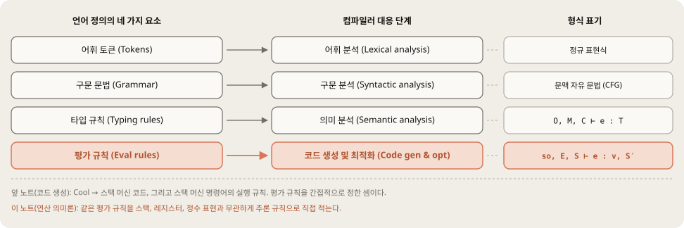
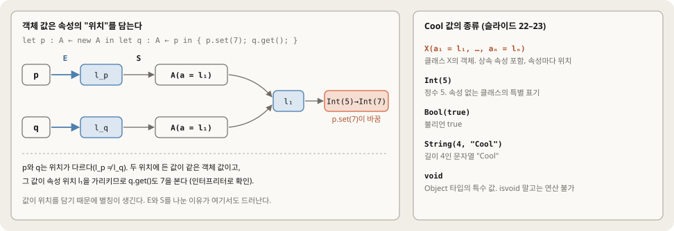
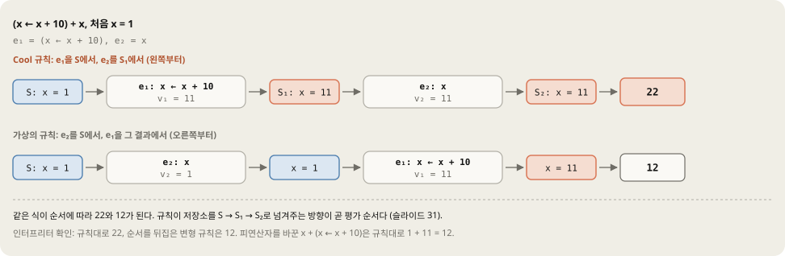
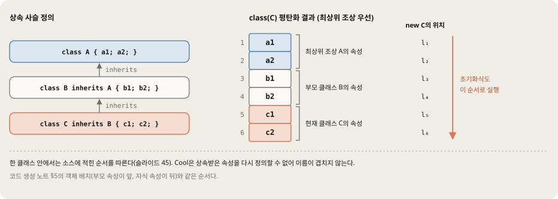
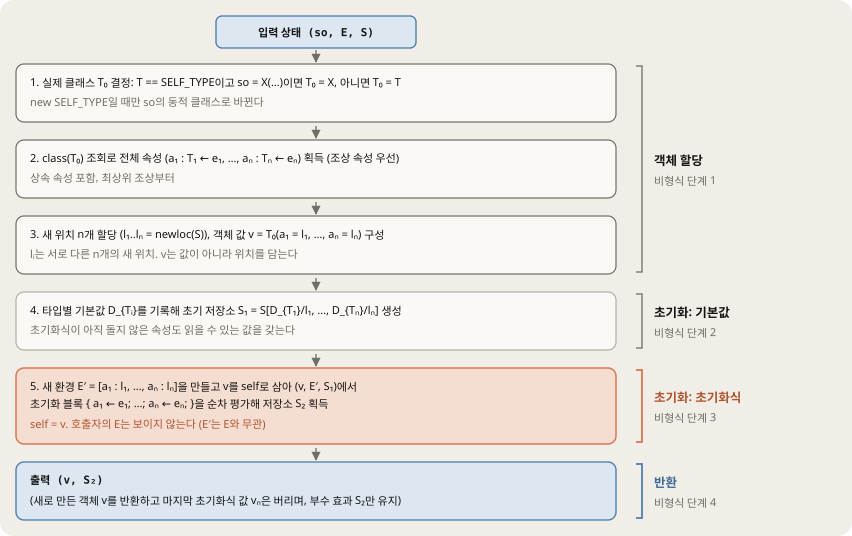

# COOL 언어 연산 의미론 개요

> [!info] 이 노트를 읽는 법
> - 본문 문장은 처음 노트 그대로다. 굵은 글씨 두 곳(§1 "연산 의미론", §3.4 "최상위 조상 우선")만 렌더링이 깨지지 않도록 굵게 표시하는 범위에서 괄호 속 영어를 뺐고, 맨 끝에 남은 빈 글머리표 하나를 지웠다. ASCII 그림 네 개(§1, §2, §3.4의 두 개)는 같은 내용의 SVG로 바꿨다. 그 밖에 새 그림 여섯 개, 그림 아래의 **그림 읽기** 한 단락, `> [!note] 보충` 상자를 덧붙였다. 덧붙인 내용은 §4 표에 모았다.
> - 앞 노트 [`11_02_codegen.md`](11_02_codegen.md)가 스택 머신 코드로 간접 정의한 평가 규칙을, 기계와 무관한 추론 규칙으로 다시 적는 이야기다. 판단과 추론 규칙의 표기는 11/5 노트의 타입 규칙([`11_05.md`](../11_05/11_05.md) §39)과 같다. 슬라이드 번호는 CS143 연산 의미론 강의(Richmond CS331 미러의 lecture13.pdf)를 따랐다.
> - 규칙을 글자 그대로 옮긴 작은 인터프리터를 Python으로 짜서 확인했다. $\mathrm{so}$, $E$, $S$를 따로 들고 다니고, 저장소는 규칙마다 새로 만들며, 위치는 $\mathrm{newloc}$으로 할당한다.
>   - 슬라이드 36의 `{ x ← 7 + 5; 4; }`는 `Int(4)`와 `[l → 12]`가 나왔다.
>   - 규칙 하나를 일부러 틀리게 바꾼 변형 여섯 개로, 노트가 말하는 차이가 실제로 나는지 봤다. 대입을 $S[v/l]$에 하면 우변 안의 대입이 사라진다. 덧셈을 오른쪽부터 하면 `(x ← x + 10) + x`가 22가 아니라 12가 된다. 기본값 단계를 빼면 초기화식이 빈 위치를 읽다가 멈춘다. 초기화식에 호출자의 $E$를 주면 바깥 지역 변수가 보인다. $\mathrm{newloc}(S)$를 글자 그대로 n번 부르면 모든 속성이 한 위치를 쓴다. 메서드 호출에서 받는 객체를 먼저 평가하면 결과가 달라진다.
>   - 그 밖에 $\mathrm{class}(C)$의 순서, `new SELF_TYPE`, 별칭, 가리기, `while`까지 25개 검사가 모두 통과했다.
>   - C와 C++의 평가 순서, 초기화 순서는 이 머신의 gcc/g++ 13.3(x86-64)으로 컴파일해 확인했다. Java는 이 머신에 없어 명세로만 적었다.

## 1. 의미론 개요

어휘 분석과 구문 분석은 프로그램의 외형적 구조를, 타입 검사는 타입 간 정합성을 다룬다. 하지만 그것만으로는 충분하지 않다. 언어를 온전히 정의하려면 **모든 Cool 표현식**이 평가될 때 어떤 일이 벌어지는지를 규정해야 하며, 이것이 곧 표현식의 "의미(meaning)"다.

프로그래밍 언어의 전체 정의는 크게 네 부분으로 나뉘며, 이는 컴파일러의 프런트엔드부터 백엔드까지 각 단계와 그대로 대응한다.

**그림 읽기**: 왼쪽 두 열은 원래 ASCII 그림 그대로이고, 오른쪽 열에 각 요소를 적는 형식 표기를 덧붙였다. 위 세 줄은 앞선 노트들에서 다뤘다. 정규 표현식이 렉서의 명세, 문맥 자유 문법이 파서의 명세, $O, M, C \vdash e : T$가 타입 검사기의 명세였다. 마지막 줄이 이 노트의 주제다. 타입 판단과 같은 꼴의 추론 규칙으로 "무엇이 계산되는가"를 적는다.

앞선 코드 생성 장에서 우리는 이미 평가 규칙을 간접적으로 제시한 셈이다. Cool을 스택 머신 코드로 컴파일한 뒤 스택 머신의 명령어 규칙에 따라 실행하도록 정의했기 때문이다. 이는 분명 완전한 명세이지만, 언어 명세로 쓰기에는 **부족한 점**이 있다.

어셈블리어나 특정 머신 구현에 기대어 의미를 설명하면 언어 본연의 뜻과 무관한 하위 구현 세부 사항이 대거 섞여 들어간다.

- 스택 머신을 쓸지 말지 여부
- 스택이 자라는 방향
- 정수의 내부 비트 표현 방식
- 특정 아키텍처의 고유 명령어 집합

우리가 필요한 것은 **완전하면서도 과도하게 제약적이지 않은(not overly restrictive)** 언어 규격이다. "표현식이 무엇으로 계산되어야 하는가"와 "하드웨어 위에서 이를 어떻게 구현할 것인가"를 분리해 두어야, 서로 다른 아키텍처의 컴파일러가 자유롭게 최적화를 적용할 수 있다. 의미론을 기술하는 형식적 방법에는 여러 가지가 있고 표현력은 모두 동등하지만, 각자 잘 맞는 용도가 다르다. 여기서는 컴파일러 구현 직관과 가장 맞닿아 있는 **연산 의미론**(Operational Semantics)을 사용한다.

> [!note] 보충: 참조 구현이 명세가 되면 생기는 일, 그리고 다른 두 의미론
> - 슬라이드 8–9: 높은 수준의 명세 없이 언어를 만들면 결국 "참조 구현에서 돌려 본 결과가 정답"이 된다. 그런데 참조 구현에도 버그가 있고, 처음 구현할 때의 우연한 선택이 남는다. 달리 정의할 방법이 없으니 그 버그와 우연까지 의도치 않게 언어의 일부가 된다.
> - 의미론을 적는 방법은 크게 셋이다(슬라이드 10–12).
>   - 연산(operational) 의미론: 추상 기계 위의 실행 규칙으로 적는다. 슬라이드는 "아주 고수준의 코드 생성"으로 생각하라고 한다. 구현을 명세하는 데 가장 쓸모 있어서 Cool이 이것을 쓴다.
>   - 표시적(denotational) 의미론: 프로그램을 입력에서 출력으로 가는 수학적 함수로 옮긴다. 우아하지만 함수들이 사는 알맞은 공간부터 정의해야 해서, 구현을 정하는 데는 필요 없는 복잡함이 따른다.
>   - 공리적(axiomatic) 의미론: "X를 만족하는 상태에서 시작하면 Y를 만족하는 상태로 끝난다"는 논리식으로 적는다. 호어 논리처럼 많은 프로그램 검증 시스템의 기반이다.
> - 이 강의의 규칙은 식 하나가 최종 값에 이르는 결과를 한 번에 판단하는 **큰 걸음**(big-step, natural semantics) 방식이다. 식을 한 단계씩 고쳐 쓰는 작은 걸음(small-step) 방식도 있다. 실제 언어 명세로는 WebAssembly가 작은 걸음 규칙으로, Standard ML이 큰 걸음 규칙으로 정의되어 있다.

## 2. 형식화된 연산 의미론

타입 검사와 마찬가지로, 여기서도 논리 추론 규칙(logical rules of inference)이라는 형식 표기법을 도입한다.

타입 검사에서 사용한 타입 판단(typing judgment)을 떠올려 보자.

$$
\mathrm{Context} \vdash e : C
$$

이는 "주어진 문맥 $\mathrm{Context}$에서 표현식 $e$는 타입 $C$를 가진다"는 뜻이다. 평가 판단(evaluation judgment)도 이와 아주 비슷한 꼴을 쓴다.

$$
\mathrm{Context} \vdash e : v
$$

이는 "주어진 문맥 $\mathrm{Context}$에서 표현식 $e$를 평가하면 값 $v$가 된다"는 뜻이다. 이를 가로선 위아래의 추론 규칙으로 적으면, 예를 들어 덧셈 평가는 다음과 같이 나타낸다.

$$
\frac{\mathrm{Context} \vdash e_1 : 5 \qquad \mathrm{Context} \vdash e_2 : 7}{\mathrm{Context} \vdash e_1 + e_2 : 12}
$$

가로선 위가 전제이고 아래가 결론이다. 현재 문맥에서 $e_1$이 `5`로, $e_2$가 `7`로 평가된다면, $e_1 + e_2$는 `12`로 평가된다고 추론한다.

하지만 단순히 $\mathrm{Context}$ 하나만 두어서는 변수 읽기와 대입을 처리할 수 없다. 대입식 `y ← x + 1`을 생각해 보자. `x`의 현재 값을 읽어 와야 하고, 계산 결과를 `y`의 자리에 써넣어야 하며, 같은 이름의 변수 가리기(shadowing)나 별칭(aliasing) 문제도 정확히 구분해야 한다. 이를 위해 실행 시점의 변수 문맥을 두 계층으로 나눈다.

- 환경(Environment, $E$): 변수가 메모리 **어디에(where)** 있는지를 추적한다($\text{vars} \to \text{memory locations}$).
- 저장소(Store, $S$): 메모리 안에 **무엇이(what)** 들어 있는지를 추적한다($\text{memory locs} \to \text{values}$).

![환경 E와 저장소 S의 두 단계 조회. 변수 이름 x, y는 E를 거쳐 메모리 위치 l\_x, l\_y로, 위치는 S를 거쳐 저장된 값 v\_x, v\_y로 간다. v\_y는 대입 후 v\_x + 1로 갱신된다. 오른쪽은 x = 5, y = 0에서 y ← x + 1을 평가한 전후다. E는 그대로이고 S만 l\_y의 값이 0에서 6으로 바뀐 새 저장소 S′ = S\[6/l\_y\]가 된다](assets/os-env-store.svg)

**그림 읽기**: 왼쪽은 원래 ASCII 그림 그대로이고, 파란 화살표가 $E$, 회색 화살표가 $S$다. 오른쪽은 `x = 5`, `y = 0`일 때 `y ← x + 1`의 전후다. $E$는 그대로이고, $l_y$의 값만 6으로 바뀐 새 저장소 $S' = S[6/l_y]$가 생긴다. $S[v/l]$은 §3.2부터 쓰는 표기로, 위치 $l$의 값만 $v$로 바꾸고 나머지는 $S$와 같은 저장소를 뜻한다(슬라이드 21). 저장소를 고쳐 쓰는 것이 아니라 새로 만든다는 점이 중요하다. 그래야 한 규칙 안에 $S$, $S_1$, $S_2$를 서로 다른 순간의 저장소로 나란히 적을 수 있다.

변수 환경 $E$는 현재 스코프에 어떤 변수들이 살아 있는지, 그리고 그 변수들이 각각 어느 메모리 위치에 놓여 있는지를 기록하며 보통 다음과 같이 적는다.

$$
E = [a : l_1,\ b : l_2]
$$

"이름 $\to$ 위치"와 "위치 $\to$ 값"을 두 단계로 떼어 놓는 이유는 분명하다. 변수의 스코프 바인딩($E$)은 블록이나 함수에 진입할 때 정해져 바뀌지 않지만, 그 위치에 담긴 값($S$)은 실행 도중 대입문에 의해 얼마든지 바뀔 수 있기 때문이다.

> [!note] 보충: Cool에서 $E$가 바뀌는 곳
> 본문의 "블록이나 함수에 진입할 때"를 Cool에 맞춰 적으면 이렇다. Cool의 `{ e1; ...; en; }` 블록은 새 이름을 만들지 않는다. $E$에 새 바인딩이 생기는 곳은 식 안에서 이름을 도입하는 구문, 곧 `let`, `case` 분기, 메서드 호출의 형식 인자, 그리고 `new`가 만드는 속성 환경이다([`11_05.md`](../11_05/11_05.md) §11). `let`의 규칙(슬라이드 40)을 §3의 판단 꼴로 미리 보면 다음과 같다.
>
> $$
> \frac{\mathrm{so},\ E,\ S \vdash e_1 : v_1,\ S_1 \qquad l_{\mathrm{new}} = \mathrm{newloc}(S_1) \qquad \mathrm{so},\ E[l_{\mathrm{new}}/\mathrm{id}],\ S_1[v_1/l_{\mathrm{new}}] \vdash e_2 : v_2,\ S_2}{\mathrm{so},\ E,\ S \vdash \texttt{let}\ \mathrm{id} : T \leftarrow e_1\ \texttt{in}\ e_2 : v_2,\ S_2}
> $$
>
> - $\mathrm{newloc}(S_1)$은 $S_1$에서 아직 쓰지 않은 위치를 돌려준다. 메모리 할당 함수에 해당한다.
> - $E[l_{\mathrm{new}}/\mathrm{id}]$는 $\mathrm{id}$만 새 위치로 바꾼 환경이다. 바깥에 같은 이름이 있어도 본문 $e_2$에서는 새 위치가 보이고, 바깥 위치의 값은 그대로다. 이것이 가리기다. `let x : Int ← 1 in { let x : Int ← 2 in x; x; }`를 인터프리터로 돌리면 위치가 두 개 생기고 결과는 바깥 `x`의 1이다.
> - 바뀐 환경은 $e_2$를 평가하는 동안에만 쓰인다. `let` 식 전체의 판단에는 원래 $E$가 그대로 있다.

## 3. COOL 언어 연산 의미론의 세부 규칙

Cool에서는 표현식을 평가할 때 $E$와 $S$뿐만 아니라 현재 메서드를 실행 중인 대상 객체 `self`($\mathrm{so}$, self object)도 알아야 한다. 게다가 표현식 평가가 메모리를 변경하는 부수 효과를 낼 수 있으므로, 평가 판단의 결론에는 **평가 후 갱신된 저장소**까지 함께 적는다.

$$
\mathrm{so},\ E,\ S \vdash e : v,\ S'
$$

이는 "현재 객체 $\mathrm{so}$, 변수 환경 $E$, 초기 저장소 $S$ 아래에서 표현식 $e$를 평가하면 결과값 $v$와 새 저장소 $S'$가 나온다"고 읽는다.

**그림 읽기**: ⊢ 왼쪽의 세 칸은 평가를 시작할 때 주어지는 것이고, 오른쪽 두 칸은 평가가 끝나고 나오는 것이다. $\mathrm{so}$와 $E$는 출력 쪽에 없다. 식 하나를 평가하는 동안 `self`가 다른 객체로 바뀌지 않고, 이름과 위치의 대응도 그대로이기 때문이다(슬라이드 25–26). `self`의 속성 값이 대입으로 바뀔 수는 있지만, 그 값은 $S$에 있으니 $S'$에 반영된다. 또 이 판단은 평가가 끝날 때만 성립한다. 끝나지 않는 식에는 판단을 만족하는 $v, S'$가 없다. 그래서 슬라이드 24는 판단을 늘 "만약 $e$의 평가가 끝난다면"으로 읽으라고 한다. 아래 표는 11/5 노트의 타입 판단과 나란히 놓은 것이다. 타입 검사의 $C$는 "이 코드가 쓰인 클래스"라서 컴파일 타임에 하나로 정해지지만, 실행 때의 $\mathrm{so}$는 그 클래스의 하위 클래스 객체일 수 있다. §3.4의 `new SELF_TYPE`이 이 차이를 이용한다.

### 3.1 리터럴과 `self`

불리언, 정수, 문자열 리터럴과 `self`는 메모리를 건드리지 않으므로 결론의 저장소도 원래의 $S$가 그대로 유지된다.

$$
\frac{}{\mathrm{so},\ E,\ S \vdash \texttt{true} : \mathrm{Bool}(\texttt{true}),\ S}
\qquad
\frac{}{\mathrm{so},\ E,\ S \vdash \texttt{false} : \mathrm{Bool}(\texttt{false}),\ S}
$$

$$
\frac{i \text{ is an integer literal}}{\mathrm{so},\ E,\ S \vdash i : \mathrm{Int}(i),\ S}
\qquad
\frac{s \text{ is a string literal} \quad n \text{ is the length of } s}{\mathrm{so},\ E,\ S \vdash s : \mathrm{String}(n, s),\ S}
$$

키워드 `self`는 현재 문맥의 자기 객체 $\mathrm{so}$ 자체로 평가된다.

$$
\frac{}{\mathrm{so},\ E,\ S \vdash \texttt{self} : \mathrm{so},\ S}
$$

여기서 $\mathrm{Bool}(\texttt{true})$, $\mathrm{Int}(i)$, $\mathrm{String}(n, s)$는 Cool의 값을 단순 비트열이 아니라 타입 태그와 길이 정보를 갖춘 런타임 객체 형태로 감싸 표현한 것이다.

**그림 읽기**: 오른쪽은 슬라이드 22–23의 값 표기다. 일반 객체는 $X(a_1 = l_1, \dots, a_n = l_n)$으로 적는데, 속성마다 값이 아니라 위치를 둔다는 점이 핵심이다. 위치만 알면 값은 $S$에서 찾을 수 있으니 이것으로 객체가 완전히 정해진다. `Int`, `Bool`, `String`은 속성이 없는 클래스로 보고 간단한 표기를 따로 쓴다. `void`는 `Object` 타입의 특수 값으로, `isvoid` 검사 말고는 아무 연산도 할 수 없다. 왼쪽은 객체 값이 위치를 담기 때문에 생기는 별칭이다. `q ← p`는 객체 값을 복사하지만 그 안의 위치 $l_1$도 그대로 복사되므로, `p`와 `q`는 같은 속성 칸을 공유한다. §2에서 말한 별칭 문제는 이렇게 $E$와 $S$의 두 단계로 정확히 표현된다.

### 3.2 변수 참조와 대입

식별자 $\mathrm{id}$(`x`, `y`, `foo` 등)를 읽을 때는 먼저 환경 $E$에서 메모리 위치 $l_{\mathrm{id}}$를 찾은 다음, 그 위치를 저장소 $S$에 넣어 값 $v$를 꺼낸다.

$$
\frac{E(\mathrm{id}) = l_{\mathrm{id}} \qquad S(l_{\mathrm{id}}) = v}{\mathrm{so},\ E,\ S \vdash \mathrm{id} : v,\ S}
$$

변수 읽기 역시 메모리를 수정하지 않으므로 저장소는 $S$ 그대로다. 반면 대입식 $\mathrm{id} \leftarrow e$(예: `x ← 1 + 1`)는 저장소를 바꾼다.

$$
\frac{\mathrm{so},\ E,\ S \vdash e : v,\ S_1 \qquad E(\mathrm{id}) = l_{\mathrm{id}} \qquad S_2 = S_1[v / l_{\mathrm{id}}]}{\mathrm{so},\ E,\ S \vdash \mathrm{id} \leftarrow e : v,\ S_2}
$$

여기서 저장소가 이어지는 순서에 주의해야 한다. 먼저 초기 저장소 $S$에서 우변 $e$를 평가해 값 $v$와 중간 저장소 $S_1$을 얻는다. 그다음 환경에서 $\mathrm{id}$의 위치 $l_{\mathrm{id}}$를 찾고, $S$가 아니라 **$S_1$ 위에서** $l_{\mathrm{id}}$의 내용을 $v$로 덮어써 최종 저장소 $S_2 = S_1[v / l_{\mathrm{id}}]$를 만든다. 만약 $S[v / l_{\mathrm{id}}]$로 적어 버리면 $e$를 평가하는 도중 일어난 다른 부수 효과들이 모두 사라지고 만다. Cool에서 대입문은 하나의 표현식이므로 결괏값으로 $v$를 돌려준다.

![x ← { y ← 3; y + 1; }의 저장소 흐름. 처음 S에서 l\_x, l\_y는 모두 0이다. 우변을 평가하는 동안 y ← 3이 일어나 S₁에서 l\_y는 3이 되고 v = Int(4)가 나온다. 맞는 규칙은 S₁ 위에 덮어써 S₂에서 l\_x = 4, l\_y = 3이다. 틀린 규칙 S\[v/l\_x\]는 처음 S에 덮어써서 l\_y가 0으로 남아 y ← 3이 사라진다](assets/os-assign-thread.svg)

**그림 읽기**: 위 줄이 규칙 그대로의 흐름이다. ① 우변 `{ y ← 3; y + 1; }`을 평가하는 동안 $l_y$가 3인 $S_1$이 생기고 값은 `Int(4)`다. ②와 ③에서 그 $S_1$의 $l_x$만 4로 바꾼 것이 $S_2$다. 아래 줄은 $S_2 = S[v/l_x]$로 잘못 적은 경우다. 값 4는 제대로 들어가지만 출발점이 처음 $S$라서, 우변 안에서 일어난 `y ← 3`이 없던 일이 된다. 규칙의 아래 첨자 하나가 부수 효과를 지키는 셈이다.

### 3.3 덧셈과 평가 순서

덧셈 규칙은 평가 순서가 부수 효과 전파에 어떻게 반영되는지를 잘 보여 준다.

$$
\frac{\mathrm{so},\ E,\ S \vdash e_1 : v_1,\ S_1 \qquad \mathrm{so},\ E,\ S_1 \vdash e_2 : v_2,\ S_2}{\mathrm{so},\ E,\ S \vdash e_1 + e_2 : v_1 + v_2,\ S_2}
$$

좌변 $e_1$을 $S$에서 평가해 $S_1$을 만들고, 우변 $e_2$는 반드시 그 $S_1$을 물려받아 평가한 뒤 $S_2$를 내놓는다. 두 전제의 사슬이 Cool의 **왼쪽에서 오른쪽(left-to-right)** 평가 순서를 고정하므로, $e_1$ 안에서 대입이 일어나면 뒤따르는 $e_2$는 변경된 값을 보게 된다.

**그림 읽기**: 두 줄 모두 같은 식이다. 위 줄은 규칙대로 $e_1$의 대입이 먼저 일어나서 $e_2$가 바뀐 11을 읽는다. 아래 줄처럼 $e_2$를 먼저 평가하는 규칙이었다면 $e_2$는 아직 1을 읽는다. 슬라이드 31의 설명을 옮기면 이렇다. $e_1$은 식 전체와 같은 저장소 $S$에서 평가되니 맨 먼저다. $e_2$는 $e_1$이 만든 $S_1$에서 평가되니 그다음이다. 결론의 저장소가 $S_2$이니 $e_2$가 마지막이다. 결론의 값 $v_1 + v_2$는 `Int(n1 + n2)`를 줄여 쓴 것이다.

> [!note] 보충: C는 이 순서를 일부러 정하지 않는다
> - C 표준은 피연산자와 함수 인자의 평가 순서를 정하지 않는다(unspecified). 컴파일러가 레지스터 사용에 유리한 순서를 고를 수 있게 남겨 둔 것으로, §1의 "과도하게 제약적이지 않은" 명세를 더 밀고 나간 선택이다. 대신 같은 프로그램이 컴파일러마다 다르게 돌 수 있다.
> - 이 머신의 gcc 13.3(x86-64)으로 확인했다. 불릴 때마다 전역 변수에 기록을 남기는 `f()`와 `g()`로 `f() + g()`를 계산하면 f가 먼저였다. 그런데 `h(f(), g())`는 `-O0`, `-O2` 모두 g가 먼저였다.
> - Cool은 규칙이 저장소를 넘겨주는 방향으로 순서를 못 박았다. Java도 명세에서 왼쪽부터 평가한다고 정한다. 순서를 고정하면 이식성을 얻고 그만큼 최적화의 자유를 내준다. 물론 결과가 같다는 것을 증명할 수 있으면 컴파일러는 순서를 바꿔도 된다. 부수 효과가 없는 두 식이 그런 경우다.

> [!note] 보충: 순차식 규칙과 첫 유도 트리
> §3.4 `new` 규칙의 마지막 전제가 쓰는 블록 $\{ e_1; \dots; e_n; \}$의 규칙이다(슬라이드 33). 저장소를 $S \to S_1 \to \dots \to S_n$으로 넘기며 앞에서부터 차례로 평가하고, 값은 마지막 것만 쓰되 부수 효과는 모두 모은다.
>
> $$
> \frac{\mathrm{so},\ E,\ S \vdash e_1 : v_1,\ S_1 \qquad \mathrm{so},\ E,\ S_1 \vdash e_2 : v_2,\ S_2 \qquad \cdots \qquad \mathrm{so},\ E,\ S_{n-1} \vdash e_n : v_n,\ S_n}{\mathrm{so},\ E,\ S \vdash \{ e_1;\ \dots;\ e_n; \} : v_n,\ S_n}
> $$
>
> 슬라이드 34–36은 이 규칙에 대입과 덧셈 규칙을 엮어 `{ x ← 7 + 5; 4; }`의 유도 트리를 만든다.

![{ x ← 7 + 5; 4; }의 유도 트리. E = \[x : l\], 처음 S = \[l → 0\]. 맨 위에서 7과 5가 Int(7), Int(5)로 평가되고 저장소는 그대로다. 덧셈 규칙으로 7 + 5는 Int(12). E(x) = l과 \[l → 12\] = \[l → 0\]\[Int(12)/l\]로 대입 규칙이 x ← 7 + 5 : Int(12), \[l → 12\]를 낸다. 4는 바뀐 저장소 \[l → 12\]에서 평가되고, 순차식 규칙이 마지막 값 Int(4)와 저장소 \[l → 12\]를 결과로 낸다](assets/os-derivation.svg)

**그림 읽기**: 아래에서 위로 읽으면 "결론을 얻으려면 무엇이 필요한가"이고, 위에서 아래로 읽으면 실제 계산 순서다. 맨 위의 7과 5는 리터럴 규칙으로 바로 성립한다. 파란 `[l → 0]`은 덧셈까지 그대로 전달되고, 대입 규칙의 $S_2 = S_1[v/l]$에서 주황 `[l → 12]`로 바뀐 뒤 순차식의 두 번째 식 4로 넘어간다. 인터프리터도 같은 결과(`Int(4)`, `[l → 12]`)를 냈다.

> [!note]- 보충: 나머지 기본 규칙 (if, while)
> 조건식과 반복문도 같은 저장소 넘겨주기로 적는다(슬라이드 32, 37–38). `if`의 거짓 가지 규칙은 $e_2$ 자리에 $e_3$이 들어간 대칭형이다.
>
> $$
> \frac{\mathrm{so},\ E,\ S \vdash e_1 : \mathrm{Bool}(\texttt{true}),\ S_1 \qquad \mathrm{so},\ E,\ S_1 \vdash e_2 : v,\ S_2}{\mathrm{so},\ E,\ S \vdash \texttt{if}\ e_1\ \texttt{then}\ e_2\ \texttt{else}\ e_3\ \texttt{fi} : v,\ S_2}
> $$
>
> $$
> \frac{\mathrm{so},\ E,\ S \vdash e_1 : \mathrm{Bool}(\texttt{false}),\ S_1}{\mathrm{so},\ E,\ S \vdash \texttt{while}\ e_1\ \texttt{loop}\ e_2\ \texttt{pool} : \mathrm{void},\ S_1}
> $$
>
> $$
> \frac{\mathrm{so},\ E,\ S \vdash e_1 : \mathrm{Bool}(\texttt{true}),\ S_1 \qquad \mathrm{so},\ E,\ S_1 \vdash e_2 : v,\ S_2 \qquad \mathrm{so},\ E,\ S_2 \vdash \texttt{while}\ e_1\ \texttt{loop}\ e_2\ \texttt{pool} : \mathrm{void},\ S_3}{\mathrm{so},\ E,\ S \vdash \texttt{while}\ e_1\ \texttt{loop}\ e_2\ \texttt{pool} : \mathrm{void},\ S_3}
> $$
>
> - `if`: 조건 $e_1$을 먼저 평가해 $S_1$을 만들고, 고른 가지를 $S_1$에서 평가한다. 조건의 결과가 `Bool`이라는 것은 타입 검사가 보장한다.
> - `while`: 조건이 거짓이면 결과는 `void`이고 저장소는 조건을 평가한 $S_1$이다. 참이면 본문을 $S_1$에서 평가해 $S_2$를 얻고, 같은 `while` 식을 $S_2$에서 다시 평가한다. 반복을 "다른 상태에서 자기 자신을 평가"하는 것으로 표현한 것이다. 본문의 값 $v$는 버리고 부수 효과만 남긴다.
> - 끝나지 않는 `while`은 유도 트리가 유한하게 닫히지 않으므로 판단 자체가 성립하지 않는다. §3 그림 아래에서 말한 "평가가 끝날 때만"이 바로 이 경우다.

### 3.4 객체 생성 `new T`

비형식적으로 보면 `new T`를 실행할 때는 네 단계를 거친다.

1. 클래스 `T` 객체의 모든 속성을 담을 메모리 위치를 할당한다(본질적으로 새 객체 할당).
2. 각 속성에 타입별 기본값을 채워 넣는다.
3. 초기화 표현식을 평가해 해당 속성 위치에 결과값을 써넣는다.
4. 새로 할당한 객체를 반환한다.

상속받은 속성까지 한꺼번에 다루기 위해 임의의 클래스 $A$에 대한 표기 $\mathrm{class}(A)$를 정의한다. 이는 **상속받은 속성을 포함해** 클래스 $A$가 갖는 모든 속성 $a_i$, 선언 타입 $T_i$, 초기화식 $e_i$를 나열한 튜플이다.

$$
\mathrm{class}(A) = (a_1 : T_1 \leftarrow e_1,\ \dots,\ a_n : T_n \leftarrow e_n)
$$

나열 순서는 **최상위 조상 우선**(greatest ancestor first)을 따른다. `C inherits B`, `B inherits A` 같은 상속 사슬을 따라가면 `class(C)`는 `A`, `B`, `C`의 속성을 차례대로 펼쳐 놓는다.

**그림 읽기**: 왼쪽 세 줄, 가운데 여섯 칸, 괄호 설명은 원래 ASCII 그림 그대로다. 오른쪽에는 `new C`가 이 순서대로 위치 $l_1, \dots, l_6$을 할당하고 초기화식도 이 순서로 실행한다는 점을 덧붙였다. 인터프리터에서 `c1`의 초기화식을 `a1 + b2`로 두면, 이미 초기화된 1과 4를 읽어 5가 된다. 슬라이드 45가 $\mathrm{class}$를 "함수"라고 부르는 것은 클래스 이름을 받아 속성 목록을 돌려주는 표 조회라는 뜻이다. 실행 중에 바뀌지 않는다.

이제 $\mathrm{class}(T_0)$를 써서 `new T`의 전체 형식 추론 규칙을 적을 수 있다.

$$
\frac{
  \begin{array}{l}
  T_0 = \text{if } (T == \text{SELF\_TYPE} \text{ and } \mathrm{so} = X(\dots)) \text{ then } X \text{ else } T \\
  \mathrm{class}(T_0) = (a_1 : T_1 \leftarrow e_1,\ \dots,\ a_n : T_n \leftarrow e_n) \\
  l_i = \mathrm{newloc}(S) \quad \text{for } i = 1, \dots, n \\
  v = T_0(a_1 = l_1,\ \dots,\ a_n = l_n) \\
  S_1 = S[D_{T_1} / l_1,\ \dots,\ D_{T_n} / l_n] \\
  E' = [a_1 : l_1,\ \dots,\ a_n : l_n] \\
  v,\ E',\ S_1 \vdash \{ a_1 \leftarrow e_1;\ \dots;\ a_n \leftarrow e_n; \} : v_n,\ S_2
  \end{array}
}{
  \mathrm{so},\ E,\ S \vdash \text{new } T : v,\ S_2
}
$$

규칙의 각 줄을 실행 흐름으로 풀어 보면 앞의 네 단계와 정확히 맞아떨어진다.

**그림 읽기**: 각 상자의 검은 글씨는 원래 ASCII 흐름도 그대로이고, 회색 줄은 그 단계가 왜 필요한지 덧붙인 설명이다. 오른쪽 괄호는 §3.4 첫머리의 비형식 네 단계와의 대응이다. 슬라이드 47도 "앞의 세 단계가 객체를 할당하고, 나머지가 초기화한다"고 나눈다. 5단계에서 판단의 맨 앞자리가 $\mathrm{so}$에서 $v$로 바뀌는 곳을 눈여겨보자. 초기화식 안의 `self`는 `new`를 실행한 객체가 아니라 지금 만들어지는 객체다.

이 규칙에는 놓치기 쉬운 세 가지 세부가 숨어 있다.

- `SELF_TYPE`은 런타임에 현재 객체 `so`의 실제 동적 클래스 `X`로 풀린다. 덕분에 자식 클래스가 부모로부터 물려받은 `new SELF_TYPE` 메서드를 호출해도 자식 클래스 `X`의 인스턴스가 만들어진다.
- 초기화 블록은 호출자의 $E$가 아니라 새로 만든 환경 $E'$ 아래서 평가된다. 속성 초기화식 안에서는 현재 새 객체의 속성만 참조할 수 있고 바깥의 지역 변수는 볼 수 없기 때문이다.
- 초기화식을 돌리기 전에 모든 속성에 기본값 $D_{T_i}$(`Int`는 `0`, `Bool`은 `false`, `String`은 빈 문자열 등)를 먼저 채워 $S_1$을 만들어 둔다. 그래서 앞쪽 속성의 초기화식이 뒤쪽 속성을 읽거나 `self`의 메서드를 부르더라도 미정의 상태가 아닌 확정된 기본값을 읽게 된다.

> [!note] 보충: 규칙을 글자 그대로 읽을 때 걸리는 두 곳
> - $l_i = \mathrm{newloc}(S)$, $i = 1, \dots, n$: $S$는 n번 내내 같으니, $\mathrm{newloc}$을 함수로 보면 n번 모두 같은 위치를 돌려준다. 뜻은 "서로 다른 새 위치 n개"다. 인터프리터에서 글자 그대로 구현해 보니 모든 속성이 한 위치를 써서, `a ← 1; b ← 2`를 마친 뒤 `a`를 읽으면 2가 나왔다.
> - 초기화식이 없는 속성(아래 그림의 `o : A;`)은 규칙의 초기화 블록에서 그 대입을 빼고 읽으면 된다. 그 속성은 $S_1$에 넣은 기본값을 그대로 갖는다. 기본값은 `Int(0)`, `Bool(false)`, `String(0, "")`이고 그 밖의 클래스는 `void`다(슬라이드 44).

**그림 읽기**: 왼쪽 표의 각 열은 초기화 블록의 대입을 하나씩 실행한 뒤의 저장소이고, 주황 칸이 그 대입이 쓴 칸이다. `a`의 초기화식은 아직 0인 `b`를 읽어 1이 되고, `c`는 `self.getb()`를 거쳐 역시 0을 읽는다. 마지막 `b ← 5`가 실행되어야 `b`가 5가 된다. 셋째 글머리표가 말한 "확정된 기본값"이 바로 이 0이다. 기본값 단계를 뺀 변형 인터프리터는 `a`의 초기화식에서 값이 없는 위치를 읽다가 멈췄다. 오른쪽은 첫째 글머리표의 예다. `copy`는 `P`에 적힌 메서드지만 `C` 객체에서 불리면 $\mathrm{so}$가 `C` 객체이므로 $T_0 = C$가 되고, `n`과 `m`을 모두 가진 `C`가 새로 생긴다. 처음 `C` 객체가 $l_1, l_2$를 쓰고 있으니 새 객체는 $l_3, l_4$를 받는다.

> [!note] 보충: 다른 언어의 객체 초기화
> 슬라이드 48은 객체 초기화의 의미가 복잡한 것이 Cool만의 일이 아니라고 말한다.
> - Java도 필드를 먼저 0, `false`, `null`로 채운 뒤 초기화식을 적힌 순서대로 실행한다. 그래서 `this.b`로 뒤쪽 필드를 읽으면 Cool처럼 기본값 0이 나온다. 다만 이름만으로 뒤쪽 필드를 읽는 `int a = b + 1;`은 "illegal forward reference" 컴파일 오류로 막는다.
> - C++에는 이런 기본값 단계가 없다. 멤버는 선언 순서대로 초기화되고, 아직 초기화되지 않은 멤버를 읽는 것은 미정의 동작이다. `A() : a(b + 1), b(5) {}`를 g++ 13.3에 `-Wall`로 넣으면 "member 'A::b' is used uninitialized" 경고가 나온다. 이번 실행에서는 우연히 `a = 1`이 나왔지만 보장된 값이 아니다.

> [!note] 보충: 다음 규칙 미리 보기, 메서드 호출
> 슬라이드 41은 `new`와 함께 동적 디스패치를 가장 복잡한 두 연산으로 꼽는다. `e0.f(e1, ..., en)`의 규칙(슬라이드 51)은 `new`와 뼈대가 같다.
>
> $$
> \frac{
>   \begin{array}{l}
>   \mathrm{so},\ E,\ S \vdash e_1 : v_1,\ S_1 \quad \mathrm{so},\ E,\ S_1 \vdash e_2 : v_2,\ S_2 \quad \cdots \quad \mathrm{so},\ E,\ S_{n-1} \vdash e_n : v_n,\ S_n \\
>   \mathrm{so},\ E,\ S_n \vdash e_0 : v_0,\ S_{n+1} \\
>   v_0 = X(a_1 = l_1,\ \dots,\ a_m = l_m) \\
>   \mathrm{impl}(X, f) = (x_1,\ \dots,\ x_n,\ e_{\mathrm{body}}) \\
>   l_{x_i} = \mathrm{newloc}(S_{n+1}) \quad \text{for } i = 1, \dots, n \\
>   E' = [a_1 : l_1,\ \dots,\ a_m : l_m][l_{x_1}/x_1,\ \dots,\ l_{x_n}/x_n] \\
>   S_{n+2} = S_{n+1}[v_1/l_{x_1},\ \dots,\ v_n/l_{x_n}] \\
>   v_0,\ E',\ S_{n+2} \vdash e_{\mathrm{body}} : v,\ S_{n+3}
>   \end{array}
> }{
>   \mathrm{so},\ E,\ S \vdash e_0.f(e_1,\ \dots,\ e_n) : v,\ S_{n+3}
> }
> $$
>
> - 인자 $e_1, \dots, e_n$을 왼쪽부터 먼저 평가하고, 받는 객체 $e_0$는 그다음에 평가한다(슬라이드 49). 인터프리터로 확인했다. 받는 쪽 식이 `k ← k * 10 + 1`, 인자 쪽 식이 `k ← k * 10 + 2`를 실행하게 하면 규칙대로는 `k = 21`이고, 받는 쪽을 먼저 평가하는 변형은 12다. Java와 C++17은 반대로 받는 쪽을 먼저 평가한다. g++ 13.3에서도 `recv().m(arg())`는 `recv()`가 먼저였다.
> - $\mathrm{impl}(X, f) = (x_1, \dots, x_n, e_{\mathrm{body}})$는 동적 클래스 $X$에서, 상속받은 것까지 포함해 $f$의 형식 인자와 본문을 찾는다. $\mathrm{class}$처럼 함수다(슬라이드 50).
> - 본문은 $\mathrm{so} = v_0$, 그리고 $v_0$의 속성과 형식 인자만 담은 새 환경 $E'$에서 평가된다. `new`처럼 호출자의 $E$는 보이지 않는다. 형식 인자마다 새 위치를 할당하는 것이 활성화 레코드의 인자 칸에 해당한다. 규칙에 프레임이라는 개념은 드러나지 않고 $\mathrm{newloc}$ 속에 숨어 있다(슬라이드 52).
> - 타입 검사를 통과한 프로그램에서는 $\mathrm{impl}(X, f)$가 정의되지 않는 일이 없다. 하지만 `void`에 대한 디스패치, 0으로 나누기, 범위를 벗어난 `substr`, 힙 부족은 타입 검사가 막지 못한다. 이때는 세그폴트가 아니라 오류 메시지를 내고 깔끔하게 멈춰야 한다(슬라이드 53–54).

## 4. 덧붙인 내용 요약

| 위치 | 덧붙인 것 | 핵심 |
| --- | --- | --- |
| §1 | 그림 `os-four-parts` (ASCII 변환) | 네 요소와 컴파일러 단계, 각 요소를 적는 형식 표기 |
| §1 | 보충 | 참조 구현이 명세가 되면 버그와 우연까지 언어가 된다. 연산·표시적·공리적 의미론. 큰 걸음과 작은 걸음 |
| §2 | 그림 `os-env-store` (ASCII 변환) | 두 단계 조회. `y ← x + 1`은 $E$를 그대로 두고 새 저장소 $S[6/l_y]$를 만든다 |
| §2 | 보충 | Cool에서 $E$가 바뀌는 곳(`let`, `case`, 형식 인자, `new`). `let` 규칙, $E[l/\mathrm{id}]$와 가리기 |
| §3 | 그림 `os-judgment` | 판단의 입력과 출력, 타입 판단 $O, M, C$와의 대응, 끝나는 평가에서만 성립 |
| §3.1 | 그림 `os-object-value` | 객체 값은 속성의 위치를 담는다. 그래서 별칭이 생긴다. 값의 종류와 `void` |
| §3.2 | 그림 `os-assign-thread` | $S_1[v/l]$이어야 우변 안의 대입이 남는다. 틀린 규칙과 비교 |
| §3.3 | 그림 `os-add-order`, 보충 | 같은 식이 순서에 따라 22와 12가 된다. C는 순서를 정하지 않는다(gcc는 인자를 오른쪽부터) |
| §3.3 | 보충, 그림 `os-derivation`, 접힌 보충 | 순차식 규칙과 `{ x ← 7 + 5; 4; }`의 유도 트리. `if`, `while` 규칙 |
| §3.4 | 그림 `os-class-flatten` (ASCII 변환) | 평탄화 순서가 곧 위치 할당 순서이자 초기화 순서다 |
| §3.4 | 그림 `os-new-flow` (ASCII 변환) | 단계마다 이유 한 줄, 비형식 네 단계와의 대응 |
| §3.4 | 보충, 그림 `os-new-example` | $\mathrm{newloc}(S)$는 서로 다른 n개. 초기화식 없는 속성. 기본값이 먼저인 이유와 `new SELF_TYPE`(인터프리터 실행 결과) |
| §3.4 | 보충 두 개 | Java와 C++의 객체 초기화. 디스패치 규칙 미리 보기: 인자가 먼저, 받는 쪽이 나중. 프레임은 $\mathrm{newloc}$ 속에 있다. 런타임 오류 |

## 5. 참고 자료

- Alex Aiken, Stanford CS143 강의 슬라이드 Operational Semantics of Cool. 미러: `facultystaff.richmond.edu/~dszajda/classes/cs331/Fall_2017/lecture_slides/lecture13.pdf` (이 노트의 슬라이드 번호 기준)
- Alex Aiken, *The Cool Reference Manual*, Operational Semantics 장: `case`, 정적 디스패치, 산술과 비교까지 포함한 전체 규칙
- Glynn Winskel, *The Formal Semantics of Programming Languages* (MIT Press, 1993): 연산·표시적·공리적 의미론 교과서
- WebAssembly Core Specification, Execution 장: 작은 걸음 축약 규칙으로 쓴 실제 언어 명세
- Robin Milner 외, *The Definition of Standard ML (Revised)* (MIT Press, 1997): 큰 걸음 규칙으로 쓴 언어 정의
- 평가 순서: ISO C11 §6.5와 §6.5.2.2(unspecified), Java Language Specification §15.7과 §15.12.4(왼쪽부터, 받는 쪽 먼저), C++17 [expr.call](받는 쪽이 인자보다 먼저). 필드 초기화: JLS §8.3.3(forward reference), §12.5
- 앞 노트 [`11_02_codegen.md`](11_02_codegen.md): 같은 Cool 식을 스택 머신 코드로 옮긴 코드 생성 템플릿
- 11/5 노트 [`11_05.md`](../11_05/11_05.md): 바인딩 구문(§11)과 타입 판단 $O, M, C$(§39)
