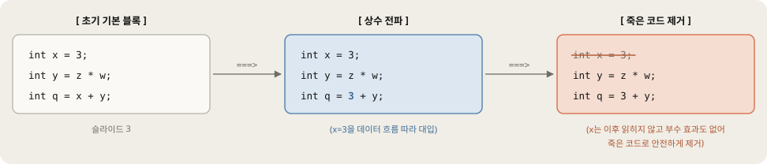

# 컴파일러 원리 학습 기록: 중간 코드와 프로그램 최적화

> [!info] 이 노트를 읽는 법
> - 본문 문장은 처음 노트 그대로다. 굵은 글씨 14곳만 렌더링이 깨지지 않도록 괄호 속 영어를 굵은 범위 밖으로 옮겼다(`**용어(English)**를` → `**용어**(English)를`). ASCII 그림 12개는 같은 내용의 SVG로 바꿨고, 그중 여러 개는 옆이나 아래에 설명 패널을 덧붙였다. 그 밖에 새 그림 세 개, 그림 아래의 **그림 읽기**, `> [!note] 보충`과 `> [!warning] 바로잡기` 상자를 넣었다. 덧붙인 내용은 §7 표에 모았다.
> - 앞 노트 [`11_02_codegen.md`](11_02_codegen.md)는 AST에서 곧바로 MIPS 코드를 만들었다. 이 노트는 그 사이에 중간 언어를 두고, 그 위에서 코드를 고치는 이야기다. 슬라이드 번호는 CS143 강의 두 개, Richmond CS331 미러의 lecture14.pdf(Intermediate Code & Local Optimizations)와 lecture15.pdf(Global Optimization)를 따랐다. 슬라이드의 CFG는 문장 하나가 노드 하나인데, 이 노트의 그림은 원래 ASCII 그림처럼 여러 문장을 한 상자에 묶어 그렸다. 간선 옆의 값은 그 간선 위, 곧 앞 상자의 출구에서 본 값이다.
> - 확인한 것:
>   - 상수 전파 규칙 1–8과 생존성 규칙 1–4를 글자 그대로 옮긴 Python 솔버로 슬라이드 39, 50, 82의 최종 값을 그대로 얻었다. 갱신 순서를 무작위로 수백 가지 바꿔도 고정점은 하나였다. 내부를 ⊤으로 초기화한 변형은 루프 예제에서 `A := 2 * X`의 X를 ⊤으로 남겼고, 규칙 3을 뺀 변형은 진입점에서 X가 살아 있다고 잘못 판정했다.
>   - 슬라이드 60–78의 지역 최적화 열 단계를 패스 함수로 짜서 한 단계씩 돌렸다. 매 단계 슬라이드와 같은 코드가 나왔고, 무작위 x 500개로 결과 g가 처음과 같음을 확인했다.
>   - 피홀 규칙 네 개를 작은 MIPS 부분집합 시뮬레이터 위에서 돌렸다. 점프 대상 조건을 빼면 결과가 달라지는 프로그램을 실제로 만들었다.
>   - 대수적 단순화와 상수 폴딩은 이 머신의 gcc 13.3(x86-64)으로 컴파일해 어셈블리를 확인했다.

## 1. 컴파일에서 중간 코드의 역할

중간 코드(Intermediate Representation, IR / Intermediate Language, IL)는 원시 언어와 타깃 머신 아키텍처 사이에 놓이는 추상 표현이다.

추상화 계층 관점에서 중간 코드는 원시 언어와 타깃 기계어의 중간 지점에 자리 잡는다.
- 원시 언어보다 실행 및 배치 세부 정보를 더 많이 드러낸다(명시적 임시 변수, 평탄화된 표현식, 선형화된 저수준 제어 흐름).
- 타깃 기계어보다 물리 하드웨어 제약을 덜 묶어 둔다(구체적인 물리 레지스터, 명령어 파이프라인 세부 사항, 호출 규약에 종속되지 않는다).

### 1.1 디커플링과 아키텍처 복잡도

$M$개의 원시 언어를 $N$개의 타깃 아키텍처로 직접 컴파일하려면 $M \times N$개의 독립된 컴파일러를 구현해야 한다. 통일된 중간 표현을 도입하면 프런트엔드는 원시 언어를 IR로 번역하는 일만 맡고($M$개), 백엔드는 IR을 각 하드웨어 명령어로 번역하는 일만 맡으므로($N$개), 전체 시스템 구현 복잡도가 $M + N$으로 줄어든다.


**그림 읽기**: 왼쪽은 원래 ASCII 그림의 첫 번째 방식이다. 원래 그림은 줄 세 개로 줄여 그렸지만, 원시 언어와 타깃의 모든 쌍에 번역기가 하나씩 필요하다는 뜻이므로 점선까지 아홉 개를 다 그렸다. 오른쪽은 두 번째 방식이다. 파란 화살표의 왼쪽 묶음이 프런트엔드, 오른쪽 묶음이 백엔드다. 맨 아래 줄은 실제 예다. Clang(C/C++), rustc, swiftc는 모두 LLVM IR을 내놓고, LLVM 백엔드가 그것을 여러 타깃의 기계어로 옮긴다.

> [!note] 보충: 실제로는 IR이 하나가 아니다
> - 슬라이드 9: 거의 모든 실제 컴파일러에 중간 언어가 있고, 어떤 컴파일러는 소스와 타깃 사이에 중간 언어를 여러 단계 둔다. 강의는 그중 "고수준 어셈블리" 수준의 IR 하나만 다룬다.
> - GCC는 GENERIC → GIMPLE(3-주소 꼴) → RTL(기계에 가까운 레지스터 전송 언어) 순으로 내려간다. rustc는 LLVM IR 앞에 MIR을, swiftc는 SIL을 둔다. 소유권이나 참조 카운팅 같은 언어 고유의 정보는 공통 IR로 내려가면 사라지므로, 그 정보가 필요한 최적화는 언어별 IR에서 먼저 한다.
> - $M + N$은 이상적인 셈이다. IR 하나가 모든 언어와 모든 타깃을 잘 담아야 하는데, 현실에서는 그 사이에서 정보가 빠진다. MLIR은 이 문제를 "IR을 하나로 고정하지 말고, 추상화 수준이 다른 여러 방언(dialect)을 한 틀에서 정의해 단계적으로 낮추자"로 푼다. AI 컴파일러에서 텐서 연산 수준의 `linalg`에서 루프 수준의 `affine`, `scf`를 거쳐 `llvm` 방언으로 내려가는 것이 이 구조다.

추상화 수준의 전환 흐름은 다음과 같다.

![추상화 수준의 전환 흐름. 소스 코드(Source Code)는 추상화 수준이 가장 높고 하위 배치 세부 정보가 부족하다. 중간 코드(IR / TAC)는 양쪽 절충으로 소스보다 구체적이고 타깃 코드보다 추상적이다. 타깃 코드(Target Code)는 추상화 수준이 가장 낮고 물리 레지스터와 하드웨어 제약이 가득하다. 오른쪽 열은 같은 식 x + y \* z가 각 단계에서 어떻게 보이는지 보여 준다. 소스는 int res = x + y \* z, 3-주소 코드는 t1 := y \* z와 t2 := x + t1, x86-64 gcc 13.3 -O2 출력은 imul esi, edx와 lea eax, \[rsi+rdi\]이다](assets/opt-abstraction-levels.svg)

**그림 읽기**: 왼쪽 두 열의 검은 글씨는 원래 ASCII 그림 그대로이고, 각 단계의 특징을 회색으로 한 줄씩 덧붙였다. 오른쪽 열은 §1.2의 식 `x + y * z`가 각 단계에서 어떻게 보이는지다. 3-주소 코드에서는 슬라이드 11처럼 임시 이름 `t1`, `t2`가 생긴다. 마지막 칸은 `int f(int x, int y, int z) { return x + y * z; }`를 이 머신의 gcc 13.3 `-O2`로 컴파일한 실제 출력이다. 가상 레지스터 `t1`이 물리 레지스터 `esi`로 정해졌고, 덧셈은 주소 계산 명령 `lea`가 맡았다. 이런 결정은 타깃마다 다르므로 IR에는 드러나지 않는다.

### 1.2 3-주소 코드(Three-Address Code, TAC)

3-주소 코드는 중간 코드에서 가장 널리 쓰이는 형태다. 각 3-주소 명령어는 최대 세 개의 피연산자만 가지며 기본 형식은 다음과 같다.

$$x := y \text{ op } z$$
$$x := \text{op } y$$

여기서 $y$와 $z$는 가상 레지스터이거나 리터럴 상수다.

> [!note] 보충: "3-주소"라는 이름과 생성 방법
> - 명령마다 주소가 최대 셋(피연산자 둘, 목적지 하나)이라서 3-주소 코드라고 부른다(슬라이드 11–12). 명령 하나가 연산 하나만 하니 하위 식마다 이름이 생긴다.
> - 3-주소 코드 생성은 앞 노트의 스택 머신 코드 생성과 거의 같다(슬라이드 13–14). 다른 점은 IL 레지스터를 얼마든지 쓸 수 있다는 것뿐이다. $\mathrm{igen}(e, t)$를 "$e$의 값을 계산해 레지스터 $t$에 넣는 코드"라 하면 덧셈은 이렇게 된다.
>
> $$\mathrm{igen}(e_1 + e_2,\ t) = \mathrm{igen}(e_1,\ t_1);\ \ \mathrm{igen}(e_2,\ t_2);\ \ t := t_1 + t_2 \qquad (t_1, t_2\text{는 새 레지스터})$$
>
> - 스택 머신과 달리 중간 결과를 넣고 빼며 `$sp`를 옮길 필요가 없다. 레지스터가 무한하다는 가정 덕분에 생성은 단순해지고, 실제 레지스터 몇 개에 맞추는 일은 레지스터 할당(lecture16)으로 미룬다.

소스 코드에서 여러 겹으로 중첩된 복잡한 표현식은 3-주소 코드로 내려오면서(lowering) 순차적으로 실행되는 단일 연산들의 나열로 분해되며, 각 하위 표현식마다 고유한 임시 이름이 붙는다.

```cpp
// C++ 소스 코드 수준의 복합 표현식
int res = x + y * z;

// 컴파일러가 낮춘 3-주소 코드 (대응하는 C++ 의사 코드)
int t1 = y * z;   // 하위 표현식에 이름을 붙이고 곱셈을 먼저 계산
int t2 = x + t1;  // 최상위 덧셈 계산
```

### 1.3 중간 언어 문법 규격

3-주소 코드 기반의 단순화된 중간 언어는 다음과 같은 문맥 자유 문법(CFG)으로 정의할 수 있다.

$$\begin{aligned}
P &\to S \; P \mid S \\
S &\to \text{id} := \text{id} \text{ op } \text{id} \\
  &\mid \text{id} := \text{op } \text{id} \\
  &\mid \text{id} := \text{id} \\
  &\mid \text{push } \text{id} \\
  &\mid \text{id} := \text{pop} \\
  &\mid \text{if } \text{id} \text{ relop } \text{id} \text{ goto } L \\
  &\mid L: \\
  &\mid \text{jump } L
\end{aligned}$$

문법 규칙 설명은 다음과 같다.
- 식별자 $\text{id}$는 보통 가상 레지스터 이름에 대응하며 즉치 상수로 바뀔 수도 있다.
- 대표적인 이항 연산자 $\text{op}$는 $+, -, \times$이고, 관계 비교 연산자 $\text{relop}$에는 $<, \le, =, \ne$ 등이 포함된다.
- 제어 흐름은 레이블($L:$), 무조건 점프($\text{jump } L$), 조건 분기($\text{if } \dots \text{ goto } L$)로 표현한다. 프로시저 호출 시 인자 전달은 스택 연산($\text{push} / \text{pop}$)이나 레지스터 규약을 통해 이루어진다.

> [!note] 보충: 슬라이드 18의 문법과 다른 점
> - 슬라이드의 첫 규칙은 $P \to S\,P \mid \varepsilon$이다. 본문의 $P \to S\,P \mid S$와는 빈 프로그램을 허용하느냐만 다르고, 문장의 나열이라는 뜻은 같다.
> - 슬라이드 10에 따르면 이 IL은 "고수준 어셈블리"다. 레지스터 이름을 쓰되 개수에 제한이 없고, 대부분의 opcode는 MIPS 명령 하나에 대응하지만 `push`처럼 여러 명령으로 풀리는 고수준 opcode도 있다. 앞 노트에서 `push`가 `sw $a0 0($sp)`와 `addiu $sp $sp -4` 두 명령이었던 것과 같다.

---

## 2. 프로그램 최적화의 시점과 본질

### 2.1 최적화 수행 단계별 비교

컴파일러는 여러 단계에서 최적화를 수행할 수 있지만, 각 단계의 장단점이 뚜렷하다.

- **추상 구문 트리(AST) 단계**:
  - 장점: 머신에 완전히 독립적이다.
  - 단점: 추상화 수준이 너무 높아 평탄화된 제어 흐름과 레지스터가 드러나지 않으므로 저수준 최적화를 적용하기 어렵다.
- **타깃 어셈블리어 단계**:
  - 장점: 실제 머신을 직접 상대하므로 하드웨어 특화 최적화 기회(명령어 융합, 전용 주소 지정 모드 등)를 포착하기 쉽다.
  - 단점: 특정 머신에 강하게 종속된다. 타깃 칩이 바뀌면 최적화 로직을 처음부터 다시 작성해야 한다.
- **중간 코드(IR) 단계**:
  - 양쪽의 장점을 절충한다. 플랫폼 독립성을 유지하면서도 복잡한 문법 설탕을 풀어내 변수 정의·사용 사슬과 점프 경로를 선명하게 드러낸다. 상수 폴딩, 죽은 코드 제거, 루프 불변 코드 이동 등 대다수의 범용 최적화가 이 계층에서 이루어진다.

### 2.2 기본 블록(Basic Block)

기본 블록은 프로그램 지역 최적화의 가장 기본적인 처리 단위다. 형식적 정의는 **다음 제약을 만족하는 최대 길이의 연속 명령어 시퀀스**(Maximal sequence of instructions)다.
- 시퀀스 내부에는 어떠한 레이블도 들어갈 수 없다(레이블은 첫 번째 명령어 위치에만 올 수 있다).
- 시퀀스 내부에는 어떠한 점프나 분기도 들어갈 수 없다(점프 명령어는 마지막 명령어 위치에만 올 수 있다).

기본 블록의 핵심은 **단일 진입·단일 출구**(Single-Entry, Single-Exit)를 갖는 직선형 코드 구간이라는 점이다. 프로그램이 일단 기본 블록의 첫 줄에 들어가면 끝까지 순서대로 실행될 뿐, 중간 지점으로 뛰어 들어오거나 중간에서 딴길로 빠져나갈 수 없다.


**그림 읽기**: 가운데 파란 상자와 오른쪽 두 설명은 원래 ASCII 그림 그대로다. 아래 출구는 원래 화살표 하나였는데, 문장 4가 조건 분기라서 두 갈래로 나눠 그렸다. z ≤ 0이면 바로 아래 블록으로 떨어지고(fall-through), z > 0이면 `L_END`로 점프한다. 둘 다 블록의 마지막 문장에서 일어나므로 "출구는 끝 하나"라는 정의와 맞는다. 왼쪽 점선 두 개가 정의가 금지하는 것이다(슬라이드 19–20). 문장 2에 레이블이 붙어 있으면 바깥에서 문장 2로 뛰어들 수 있으니 문장 1과 2는 다른 블록이어야 한다. 문장 2가 점프라면 문장 3과 4는 다음 블록이다.


**그림 읽기**: 명령어 나열을 블록으로 나누려면 리더(leader)만 찾으면 된다. 리더는 블록의 첫 명령이 될 수밖에 없는 명령으로, 프로그램의 첫 명령, 점프의 대상(레이블이 붙은 명령), 점프나 분기 바로 다음 명령의 세 종류다. 리더에서 다음 리더 직전까지가 한 블록이다(용 책 §8.4의 방법). 오른쪽은 슬라이드 23의 CFG다. 슬라이드 22의 정의대로, 블록 A의 마지막 명령에서 블록 B의 첫 명령으로 실행이 넘어갈 수 있으면 A → B 간선을 긋는다. B2의 자기 간선이 루프이고, §5.2의 역방향 간선이 바로 이런 간선이다. 슬라이드 22의 농담처럼 "CFG"는 문맥 자유 문법(§1.3)과 제어 흐름 그래프(§4.2)에 함께 쓰이는 약어다.

> [!note] 보충: 블록 안에서 보이는 것, 블록 밖까지 봐야 하는 것 (슬라이드 21)
> `L: t := 2 * x; w := t + x; if w > 0 goto L'`에서 (3)은 반드시 (2) 뒤에 실행되므로 `w := t + x`를 `w := 3 * x`로 바꿀 수 있다. 블록 안의 실행 순서가 보장되기 때문이다. 그러면 이제 (2) `t := 2 * x`도 지울 수 있을까? `t`가 이 블록 밖 어디선가 쓰이는지에 달렸고, 그것은 이 블록만 봐서는 알 수 없다. 이 질문에 답하는 도구가 §6의 생존성 분석이다.

### 2.3 "프로그램 최적화"에 대한 공학적 진실

"프로그램 최적화(Program Optimization)"라는 말은 공학적으로는 다소 과장된 표현이다.

컴파일러가 생성하는 코드는 수학적 의미에서 진정한 "최적해(Optimal)"가 아니다. 임의의 입력에 대해 어떤 코드가 명령어 사이클 수나 코드 크기 면에서 절대적으로 최소임을 증명하는 일은 대개 결정 불가능 문제이거나 이론적 복잡도가 극도로 높다.

더 정확한 이름은 **"프로그램 개선"**(Program Improvement)이다. 컴파일러 최적화기는 결국 프로그램의 관측 가능한 동작(Observable Behavior)을 바꾸지 않으면서 코드를 더 빠르게, 메모리와 전력을 덜 쓰도록 고쳐 쓰는 검증된 휴리스틱 규칙 모음이다.

> [!note] 보충: "최적"이 원리적으로 불가능한 이유, 그리고 최적화의 세 단위
> - 결정 불가능성은 정지 문제로 바로 보인다. 아무 프로그램 P에 대해 "P를 출력 없이 실행한 뒤 끝난다"는 프로그램을 만들자. 이 프로그램과 같은 일을 하는 가장 짧은 코드는 P가 멈추면 `return` 한 줄이고, 멈추지 않으면 `L: jump L` 한 줄이다. 진짜 "최적" 컴파일러가 있다면 출력을 보고 정지 여부를 판정할 수 있으니 모순이다. 그래서 컴파일러 개선에는 끝이 없다는 뜻으로 이것을 "컴파일러 작성자 완전 고용 정리"(Full Employment Theorem)라고 부른다.
> - 슬라이드 26–27은 최적화를 범위에 따라 셋으로 나눈다. 지역(local) 최적화는 기본 블록 하나, 전역(global) 최적화는 함수 하나의 CFG 전체, 프로시저 간(inter-procedural) 최적화는 함수 경계를 넘는 범위를 다룬다. "전역"은 프로그램 전체가 아니라 함수 전체를 뜻하니 이름이 잘못 붙은 셈이다. 대부분의 컴파일러가 지역 최적화를, 많은 컴파일러가 전역 최적화를, 소수만 프로시저 간 최적화를 한다. 프로시저 간 최적화는 구현이 어렵고, 효과의 대부분은 앞의 둘에서 나오기 때문이다. 이 노트의 §3–§4.1이 지역, §4.2–§6이 전역 최적화다.
> - 슬라이드 28–29: 연구 문헌의 가장 정교한 최적화는 일부러 구현하지 않는 경우가 많다. 구현이 어렵거나, 컴파일 시간이 너무 길거나(며칠이 걸리기도 한다), 효과가 작기 때문이다. 목표는 최소 비용으로 최대 효과를 얻는 것이다.

---

## 3. 지역 최적화(Local Optimization)와 피홀 최적화

지역 최적화는 단일 기본 블록(One basic block) 범위 안에서만 동작하며, 함수 전체나 프로시저 간 복잡한 제어 흐름 그래프를 분석할 필요가 없다.

### 3.1 대수적 단순화(Algebraic Simplifications)

수학적 대수 항등식을 이용해 불필요한 계산을 없애거나 비용이 큰 연산을 비용이 작은 연산으로 치환(연산 강도 감소, Strength Reduction)한다. 아래 코드는 모두 C++ 의미로 나타냈다.

```cpp
// 1. 불필요한 계산 제거: 0을 더하거나 1을 곱해도 값이 바뀌지 않으므로 문장 자체를 삭제
x = x + 0;   // 삭제
x = x * 1;   // 삭제

// 2. 특수 상수 연산 단순화
x = x * 0;   // 단순화: x = 0;

// 3. 수학 라이브러리 함수 호출 회피 (연산 강도 감소)
y = std::pow(y, 2);  // 단순 제곱으로 치환: y = y * y;

// 4. 곱셈·나눗셈을 시프트 연산으로 강도 감소 (정수형 가정)
x = x * 8;   // 단순화: x = x << 3;

// 15를 곱하는 연산을 시프트와 뺄셈으로 변환: 15 * x = (16 - 1) * x = (x << 4) - x
int t = x << 4;
x = t - x;
```

> [!NOTE] 실제 하드웨어에서의 트레이드오프
> 과거에는 곱셈을 시프트로 바꾸는 것이 철칙처럼 여겨졌지만, 현대 프로세서에서는 항상 유리한 것이 아니다. 최신 x86/ARM CPU에는 다단 파이프라인 하드웨어 곱셈기가 내장되어 있어 32/64비트 정수 곱셈이 보통 1~3클록 사이클이면 끝난다. 곱셈 한 번을 억지로 시프트와 뺄셈 여러 개로 쪼개면 명령어 디코딩 대역폭과 실행 포트를 더 많이 점유할 뿐 아니라 마이크로명령어 스케줄링까지 흐트러질 수 있다. 따라서 컴파일러 백엔드는 타깃의 명령어 사이클과 지연 시간표를 조회한 뒤 대수적 강도 감소를 적용할지 결정한다.

> [!warning] 바로잡기: 나눗셈은 부호가 있으면 시프트 하나로 끝나지 않는다
> 주석 4의 제목은 "곱셈·나눗셈"이지만 예는 곱셈뿐이다. 나눗셈은 조심해야 한다. C와 C++의 정수 나눗셈은 0 쪽으로 버리고, 산술 오른쪽 시프트는 음의 무한대 쪽으로 버린다. 그래서 음수에서 결과가 다르다. 이 머신에서 돌려 보니 `-1 / 8`은 `0`, `-1 >> 3`은 `-1`이었고, `-9 / 8`은 `-1`, `-9 >> 3`은 `-2`였다. `x / 8 → x >> 3`은 `x`가 unsigned이거나 음수가 아님을 알 때만 맞다. gcc 13.3 `-O2`는 `int`의 `x / 8`에 대해 음수일 때만 7을 먼저 더하는 코드를 낸다.
>
> ```text
> int x / 8:                     unsigned x / 8:
>   test   edi, edi                mov  eax, edi
>   lea    eax, 7[rdi]             shr  eax, 3
>   cmovns eax, edi
>   sar    eax, 3
> ```
>
> 곱셈은 이런 문제가 없다. 기계에서 정수 곱셈은 $2^{32}$로 나눈 나머지로 계산되고, 이 값은 부호와 상관없이 왼쪽 시프트와 비트까지 같다.

> [!note] 보충: gcc 13.3(x86-64)에서 직접 본 결과
> | 소스 | `-O2` 출력 | 읽을 거리 |
> | --- | --- | --- |
> | `int`: `x * 8` | `lea eax, 0[0+rdi*8]` | 시프트 대신 주소 계산(`rdi * 8`)을 쓴다 |
> | `int`: `x * 15` | `sal eax, 4` / `sub eax, edi` | 슬라이드 31의 변환 그대로다. 그런데 `-Os`에서는 `imul eax, edi, 15` 한 줄이다 |
> | `int`: `x * 0` | `xor eax, eax` | 0으로 단순화 |
> | `double`: `pow(y, 2)` | `mulsd xmm0, xmm0` | `-ffast-math` 없이도 바뀐다. 제곱은 곱셈 한 번과 결과가 정확히 같기 때문이다 |
> | `double`: `x * 1.0` | (명령 없음) | 그대로 돌려준다 |
> | `double`: `x + 0.0` | `addsd`가 남음 | `-0.0 + 0.0 = +0.0`이라 항등식이 아니다. `x + (-0.0)`은 지워졌다 |
> | `double`: `x * 0.0` | `mulsd`가 남음 | `x`가 NaN, 무한대, 음수면 결과가 `+0.0`이 아니다 |
>
> - `x * 15`가 `-O2`(속도)와 `-Os`(크기)에서 다르게 나오는 것이 위 NOTE의 "비용표를 보고 결정한다"의 실례다. 슬라이드 34도 요즘 기계에서는 시프트와 곱셈의 차이가 거의 없고, 옛 기계에서 중요한 최적화였다고 덧붙인다.
> - 슬라이드 31은 이 예들에서 `x`가 `int`라고 가정한다. 부동소수점에서는 위 표처럼 대수 항등식 상당수가 성립하지 않으므로, 컴파일러는 `-ffast-math` 같은 옵션으로 허락받았을 때만 그런 변환을 한다.
> - 슬라이드 32–33: `x := x * 0`을 `x := 0`으로 바꿔도 실행 시간은 같을 수 있다. 그래도 바꾸는 이유는 상수 대입이 생겨야 다음 단계의 상수 전파가 시작되기 때문이다. 반면 거듭제곱 `**`는 보통 기계 명령이 아니라 라이브러리 호출이라 `y * y`로 바꾸면 거의 확실히 빨라진다.

### 3.2 컴파일 타임 상수 폴딩(Constant Folding)

$x := y \text{ op } z$ 꼴의 대입문에서 피연산자 $y$와 $z$가 모두 컴파일 타임에 알 수 있는 리터럴 상수라면, 연산자 $\text{op}$ 계산을 컴파일 단계에서 미리 끝내 버리고 런타임 CPU 사이클을 낭비하지 않는다.

```cpp
// 소스 코드의 상수 계산
int seconds = 60 * 60 * 24;

// 컴파일러가 상수 폴딩을 수행한 결과:
int seconds = 86400;
```

> [!note] 보충: 상수 폴딩이 여는 길과 함정 (슬라이드 36–43)
> - 조건 분기도 접힌다. `if 2 < 0 jump L`은 조건이 늘 거짓이니 지우고, 조건이 늘 참이면 `jump L`로 바꾼다. 그러면 어떤 블록에는 아무 데서도 들어오지 않게 된다. 시작 블록에서 도달할 수 없는 기본 블록을 지우는 것이 제어 흐름 최적화다(슬라이드 41). 코드가 작아지고, 남은 코드가 캐시에 더 잘 모여 빨라지기도 한다.
> - 도달할 수 없는 코드는 생각보다 흔하다(슬라이드 42–43). `#define DEBUG 0` 아래의 `if (DEBUG) { ... }`, 프로그램이 쓰지 않는 라이브러리 함수, 그리고 다른 최적화가 남긴 코드다.
> - 크로스 컴파일러에는 함정이 있다(슬라이드 38–40). 컴파일러는 기계 X에서 돌고 만든 코드는 기계 Y에서 돈다. X에서 `1.5 + 3.7`을 `5.2`로 접었는데 Y의 부동소수점 구현이 다르면, Y에서 직접 계산한 값(예: `5.19`)과 달라진다. 반올림이 매번 같아야 하는 알고리즘에서는 프로그램 결과가 바뀐다. 슬라이드는 컴파일러 안에서 부동소수점 수를 문자열로 들고 정밀도를 잃지 않게 계산한 뒤, 반올림은 Y에 맡기는 방법을 소개한다. GCC는 타깃의 부동소수점 형식을 소프트웨어로 흉내 내어 접고, 수학 함수는 MPFR 라이브러리로 정확히 반올림해 접는다.
> - 이 머신의 gcc 13.3은 `60 * 60 * 24`를 `-O0`에서도 `mov eax, 86400`으로 냈다. C의 상수식은 최적화 단계가 아니라 프런트엔드에서 이미 접힌다.

### 3.3 피홀 최적화(Peephole Optimization)

피홀 최적화는 주로 어셈블리어나 저수준 IR 명령어 시퀀스에 적용된다.

최적화기는 아주 작은 "관찰 창"(보통 연속한 2~4개 명령어)을 유지하면서 명령어 스트림 위를 작은 구멍(peephole)처럼 훑고 지나간다. 창 안에 들어온 명령어 시퀀스가 알려진 비효율 패턴과 일치하면 더 짧고 빠른 등가 시퀀스로 바꿔 치기한다.


**그림 읽기**: 왼쪽은 원래 ASCII 그림 그대로다. 오른쪽은 창 안의 두 명령에 아래 패턴 1을 적용한 결과다. AT&T 문법은 원본이 앞, 대상이 뒤다. 둘째 명령 `movq %rax, %rcx` 뒤에는 `%rcx`와 `%rax`가 같은 값이므로 셋째 명령 `movq %rcx, %rax`는 아무것도 바꾸지 않는다. 그래서 지운다. 셋째 명령에는 레이블이 없어 점프 대상이 아니라는 조건도 만족한다. `%rax`는 `ret`이 돌려줄 값이라 살아 있다. 그러니 이 삭제는 §6의 죽은 코드 제거가 아니라, 이미 들어 있는 값을 다시 넣는 명령을 지우는 것이다. 창은 이제 한 칸 내려가 다음 명령들을 본다.

피홀 최적화 규칙은 형식적으로 다음과 같이 쓸 수 있다.

$$i_1, \dots, i_n \to j_1, \dots, j_m \quad (m \le n)$$

우변(rhs)은 좌변(lhs)과 동일한 의미를 가지면서 더 간결해진 버전이다.

> [!note] 보충: $m \le n$은 슬라이드에 없는 조건이다
> 슬라이드 81은 우변이 좌변의 "개선된 버전"이라고만 한다. 대개 짧아지지만 꼭 그렇지는 않다. §3.1의 `x * 15 → (x << 4) - x`를 피홀 규칙으로 적으면 명령 하나가 둘이 되는 $m > n$ 규칙이다. 중요한 것은 길이가 아니라 비용이다. 다만 아래 4번의 반복이 반드시 끝나려면 규칙을 적용할 때마다 엄격히 줄어드는 양이 있어야 한다. 명령 수가 줄거나, 길이가 같다면 비용이 줄어야 한다. 비용이 그대로인 규칙과 그 역규칙이 함께 있으면 둘이 서로를 되돌리며 끝나지 않는다. §5.4가 상수 전파의 종료를 "값이 위로만 움직인다"로 증명하는 것과 같은 논리다.

#### 대표적인 치환 패턴과 안전 경계

1. **중복 데이터 이동 제거**:
   ```cpp
   // 어셈블리 형태:
   // move $a, $b
   // move $b, $a  ===>  move $a, $b

   // C++ 대응 의미:
   a = b;
   b = a;  // 중복 대입이므로 보통 제거 가능
   ```
   - **안전 경계**: 이 변환이 성립하려면 두 번째 명령어 `b = a`가 외부 점프의 대상 주소(Not the target of a jump)가 아니어야 한다. 다른 기본 블록에서 두 번째 명령어로 바로 뛰어 들어오는 분기가 있다면 이를 삭제했을 때 프로그램 상태가 달라진다.

2. **연속 상수 누적 병합**:
   ```cpp
   // 어셈블리 형태:
   // addiu $a, $a, i
   // addiu $a, $a, j  ===>  addiu $a, $a, (i + j)

   // C++ 대응 의미:
   a += 2;
   a += 3;
   // 피홀 병합 결과:
   a += 5;
   ```

3. **기본 블록 최적화를 피홀 규칙으로 하향 구현**:
   원래 기본 블록 분석이 필요하던 단순 지역 최적화 중 상당수는 저수준 피홀 치환 패턴으로 쪼개 넣을 수 있다. 예를 들어 보자.
   - 규칙 1(0 덧셈을 이동으로 변환): `addiu $a, $b, 0` $\to$ `move $a, $b`
   - 규칙 2(자기 복사 제거): `move $a, $a` $\to$ 빈 명령어(삭제)

   코드 `addiu $a, $a, 0`을 만나면 먼저 규칙 1이 이를 `move $a, $a`로 바꾸고, 뒤따르는 스캔에서 규칙 2가 곧바로 작동해 명령어 자체가 완전히 지워진다.

4. **고정점 반복(Fixed-Point Iteration)**:
   피홀 최적화는 한 번 훑고 끝낼 수 없다. 한 패턴이 치환되고 나면 앞뒤의 원래 무관하던 명령어들이 새로 맞닿아 또 다른 최적화 창을 만들어 내기 때문이다. 따라서 창을 끝까지 밀고 나가도 어떤 규칙도 더 이상 발동하지 않을 때까지 여러 차례 반복 스캔해야 한다.

> [!note] 보충: 규칙 네 개를 작은 엔진으로 돌려 본 결과
> 위 패턴 1, 2와 3의 규칙 1, 2를 작은 MIPS 부분집합 시뮬레이터 위에서 돌렸다. 한 번의 스캔에서는 방금 바뀐 명령을 다시 보지 않고 다음으로 넘어가게 했다.
> - `addiu $a, $a, 0`은 첫 스캔에서 `move $a, $a`로, 둘째 스캔에서 빈 명령이 되었다. 셋째 스캔에서 아무 규칙도 발동하지 않아 멈췄다.
> - `addiu $a,$a,2; addiu $a,$a,3; addiu $a,$a,-5`는 `+5`로 합쳐지고, 다시 `+0`으로 합쳐지고, `move $a,$a`를 거쳐 사라졌다. 바꾸는 스캔 네 번에 확인하는 스캔 한 번이 들었다. 4번이 말한 "새로 맞닿은 창"이 이런 연쇄다.
> - 패턴 2에는 조건이 하나 더 있다. MIPS `addiu`의 즉치는 16비트 부호 있는 값(−32768 … 32767)이라, `i + j`가 이 범위를 넘으면 합칠 수 없다. `30000 + 30000`은 그대로 두었다. 둘째 명령이 점프 대상이 아니어야 한다는 조건도 패턴 1과 같다.
> - 점프 대상 조건을 빼면 실제로 틀린다. `b ← 5; c ← 0; a ← b;` 다음에 `L: b ← a; a ← a + 1; c ← c + 1;`을 `c < 3`인 동안 반복하는 프로그램은 끝에 `b = 7`이다. `L`이 붙은 `move $b, $a`는 바로 앞의 `move $a, $b`와 패턴 1의 꼴을 이룬다. 조건을 지키는 엔진은 이것을 그대로 두고, 조건을 뺀 변형은 지워서 `b = 5`가 되었다. 처음 지날 때는 중복이지만, 루프로 다시 들어올 때는 `a`가 바뀐 뒤라 중복이 아니다.
> - 길이가 같은 교환 규칙 `add $a, $b, $c → add $a, $c, $b`만 넣고 고정점까지 돌리면, 여섯 번 스캔해도 두 꼴을 오가며 끝나지 않았다.

---

## 4. 기본 블록 최적화와 블록 간 확장

### 4.1 기본 블록 내부의 상수 전파와 죽은 코드 제거

기본 블록 안에서는 **상수 전파**(Constant Propagation)와 **죽은 코드 제거**(Dead Code Elimination)가 짝을 이루어 동작하는 경우가 많다. 상수 전파가 알려진 리터럴 값을 뒤로 밀어 넣어 식 계산과 조건 판별을 돕고, 뒤따라 죽은 코드 제거가 쓸모를 다한 중간 변수를 치워 낸다.



**그림 읽기**: 원래 ASCII 그림 그대로이고(슬라이드 3), 바뀐 곳만 색으로 표시했다. 가운데 파란 `3`이 상수 전파로 들어간 값이고, 오른쪽의 줄 그은 회색 줄이 지워진 문장이다. 원래 그림에서 빈 줄이었던 자리다. 상수 전파만으로는 명령 수가 줄지 않는다. 상수 전파가 `x`의 마지막 사용을 없앴기 때문에 죽은 코드 제거가 할 일이 생긴다. 이렇게 한 최적화가 다음 최적화의 기회를 만드는 것이 지역 최적화의 기본 모습이다(슬라이드 58).

1. **상수 전파(Constant Propagation)**:
   컴파일러가 기본 블록을 스캔해 `x = 3`이 상수 정의임을 확인한다. `x`에 새 값이 대입되기 전에 뒤따르는 문장 `q = x + y`가 `x`를 참조하므로, 피연산자를 리터럴 `3`으로 바로 치환해 `q = 3 + y`로 바꾼다.
2. **죽은 코드 제거(Dead Code Elimination)**:
   치환이 끝난 뒤 컴파일러는 변수의 생존성(Liveness)을 점검한다. 현재 기본 블록과 이후 전체 프로그램 경로 어디에서도 변수 `x`를 읽는 명령어가 없고 대입문 자체에 부수 효과(I/O 연산, 메모리 배리어, 전역 상태 변경 등)가 없다면, `int x = 3;`은 죽은 코드가 되므로 명령어 스트림에서 제거해 레지스터 할당 부담과 메모리 비용을 줄인다.

> [!note] 보충: 슬라이드의 나머지 지역 최적화 세 가지 (슬라이드 44–57)
> - **단일 대입 형식**(single assignment form): 모든 레지스터가 대입문 왼쪽에 많아야 한 번 나오도록 고쳐 쓴다. `x := z + y; a := x; x := 2 * x`는 `b := z + y; a := b; x := 2 * b`가 된다(`b`는 새 레지스터). 한 블록 안에서는 쉽고, 루프가 끼면 복잡해진다. 이것을 함수 전체에 대해 한 것이 LLVM IR이 쓰는 SSA 형식이다.
> - **공통 부분식 제거**(common subexpression elimination, CSE): 단일 대입 형식인 블록에서 오른쪽이 같은 두 대입은 같은 값을 계산한다. 그래서 `x := y + z; …; w := y + z`의 둘째 줄을 `w := x`로 바꾼다. 단일 대입 형식이 아니면 그 사이에 `y`나 `z`가 바뀌지 않았는지 따로 확인해야 한다.
> - **복사 전파**(copy propagation): `w := x`가 있으면 이후의 `w` 사용을 `x`로 바꾼다. 그 자체로는 아무것도 빨라지지 않지만, 상수 폴딩과 죽은 코드 제거의 기회를 만든다. 복사하는 것이 상수면 상수 전파라고 부른다.
> - 슬라이드 58–59: 최적화 하나하나는 하는 일이 작다. 최적화 컴파일러는 "요령 주머니"를 뒤져 적용할 수 있는 것을 적용하고, 바뀐 코드에서 다시 찾기를 더는 바뀌지 않을 때까지 되풀이한다. 컴파일 시간을 줄이려고 중간에 멈출 수도 있다. 아래 그림이 슬라이드의 큰 예제다.


**그림 읽기**: 슬라이드 60–77의 순서 그대로이고, 주황 줄이 직전 단계에서 바뀐 줄이다. 패스를 함수로 짜서 차례로 돌린 결과가 열 단계 모두 슬라이드와 글자까지 같았다. ③에서 `c := x`와 `b := 3`이 복사되어 ④의 폴딩과 ⑤의 CSE가 가능해진다. `d := c * c`가 `a`와 같은 계산임이 드러나는 것도 ③ 덕분이다. ⑦에서 `g`만 결과로 쓰인다고 보고 거꾸로 훑으면 `b`, `c`, `d`, `e`가 죽는다. 다섯 가지 기본 패스만 고정점까지 돌리면 ⑦의 세 줄에서 멈춘다(세 바퀴). ⑧의 `a + a → 2 * a`와 ⑨의 "`f`를 대입한 뒤 상수끼리 묶기"는 별도의 규칙이 있어야 하고, 이 둘을 넣으면 네 바퀴 만에 ⑩에 이른다. 슬라이드 78은 ⑧–⑩을 지금의 컴파일러 대부분이 찾지 못한다고 했지만, gcc 13.3은 이 블록을 `x * x`에 12를 곱하는 세 명령으로 만들었다. 12를 곱할 때도 `lea`로 3을 곱하고 `sal`로 4를 곱해 곱셈 명령을 하나 아꼈다.

### 4.2 최적화를 제어 흐름 그래프(CFG) 전체로 확장

기본 블록 최적화는 분기 없는 직선 코드만 다룬다. 상수 전파를 제어 흐름 그래프(CFG) 전체로 넓히면 변수의 값이 여러 분기를 따라 흐르다가 합류 지점에서 만나게 된다.

이때 상수를 안전하게 전파할 수 있는지는 합류 지점 이전 모든 경로의 일관성에 달려 있다.


**그림 읽기**: 상자, 제목, 아래 설명은 원래 ASCII 그림 그대로이고, 간선 옆의 값을 덧붙였다. 간선의 값은 그 간선을 지나는 순간 X의 추상 값(§5.1)이고, 합류 지점의 값은 들어오는 간선 값들의 $lub$(§5.3)다. 왼쪽은 두 간선이 모두 3이라 3이 남고, 오른쪽은 4와 3이 만나 ⊤이 된다. 슬라이드 19와 39의 결과와 같고, 솔버도 같은 값을 냈다. 불안전한 쪽이라도 X를 모르게 되는 것은 합류 지점부터다. 각 가지 안의 3과 4는 여전히 상수이니, 가지 안에서 X를 쓰는 곳이 있었다면 그곳은 치환할 수 있다.

대응하는 C++ 논리를 비교하면 다음과 같다.

```cpp
// 1. 안전한 전파 사례: 어느 분기로 들어가든 x는 항상 3을 유지
int x = 3;
if (b > 0) {
    y = z + w;
} else {
    y = 0;
}
int a = 2 * x;  // 합류 지점의 모든 경로에서 x == 3이므로 int a = 2 * 3;으로 안전하게 치환 가능

// 2. 불안전한 전파 사례: 분기 내부에서 x를 덮어씀
int x = 3;
if (b > 0) {
    y = z + w;
    x = 4;      // 분기 안에서 x 값 변경
} else {
    y = 0;
}
int a = 2 * x;  // 이곳에 도달하는 x는 런타임 분기 방향에 좌우되므로 상수 치환 불가
```

### 4.3 전역 상수 전파의 필요충분조건

프로그램의 특정 지점에서 변수 $x$의 사용을 상수 $k$로 치환하려면 다음 핵심 조건 $(**)$를 만족해야 한다.

$$\text{변수 } x\text{의 해당 사용 지점에 도달하기 전, 가능한 모든 경로의 마지막 대입이 모두 } x := k\text{여야 한다.} \quad (**)$$

이 조건을 검증하기는 만만치 않다. "모든 경로"에는 조건 분기들의 다양한 조합뿐 아니라 루프 본문을 예측할 수 없는 횟수만큼 되돌아 실행하는 경로까지 포함되기 때문이다. 조건 $(**)$의 성립 여부를 판정하려면 제어 흐름 그래프 전체에 걸친 **전역 데이터 흐름 분석**(Global Dataflow Analysis)이 필요하다.

> [!note] 보충: "모른다"는 언제나 안전한 답이다 (슬라이드 12–14)
> 조건 $(**)$를 정확히 판정하는 것은 일반적으로 불가능하다. 그래도 괜찮은 이유는, 분석이 "성립한다"고 답할 때만 늘 옳으면 되기 때문이다. 확신이 없으면 "모른다"고 답하고 최적화를 하지 않으면 된다. 실제로 데이터 흐름 분석은 CFG의 모든 경로를 실행될 수 있는 경로로 취급하므로, 실행될 수 없는 경로 때문에 "모른다"가 나오기도 한다.
>
> ```text
> if (B > 0) X := 3 else X := 4
> if (B > 0) A := X        // 이곳에 올 때는 늘 B > 0이었으므로 X = 3
> ```
>
> 둘째 `if`의 참 가지에 오는 실행은 모두 첫 `if`에서도 참을 골랐으니 `X`는 늘 3이다. 하지만 CFG에는 "첫 `if`는 거짓, 둘째는 참"인 경로도 있다. 솔버는 이 경로까지 합쳐 `A := X`에서 $lub(3, 4) = 	op$을 냈다. 틀린 답이 아니라 덜 정확한 답이다.

---

## 5. 전역 상수 전파의 동작 원리: 데이터 흐름 분석과 반격자

프로그램의 모든 지점마다 변수 상태를 엄밀하게 계산하기 위해, 컴파일러는 각 변수에 추상 값 영역(Abstract Values)을 도입하고 반격자(Semi-Lattice) 모델을 세워 반복적으로 고정점을 구한다.

### 5.1 추상 값의 세 가지 상태 정의

프로그램의 임의의 실행 지점에서 분석 대상 변수 $X$는 다음 세 상태 중 하나를 갖는다.

| 추상 값 | 용어 | 의미 설명 |
|:---:|:---:|:---|
| $\bot$ | **Bottom** | 아직 코드가 실행되지 않음 / 정적 분석상 현재 제어 흐름이 도달하지 않음("So far as we know, control never reaches this point") |
| $c$ | **Constant** | 변수 $X$가 이 지점에서 확실히 상수값 $c$를 가짐($X = c$) |
| $\top$ | **Top** | 변수 $X$가 상수가 아님(분기 충돌, 알 수 없는 외부 입력, 또는 동적 런타임 변수) |

> [!note] 보충: 값이 붙는 곳은 문장 사이다
> 슬라이드 19와 22는 이 값을 문장마다 두 개씩 둔다. $C(s, x, \text{in})$은 문장 $s$ 바로 앞, $C(s, x, \text{out})$은 바로 뒤에서 $x$의 값이다. 그래서 "`X := 3` 뒤, 분기 조건 `B > 0` 앞에서 X = 3"처럼 프로그램 지점은 문장과 문장 사이에 놓인다. 아래 그림들은 여러 문장을 한 상자로 묶었으므로 상자 사이의 간선에 값을 적었다.

### 5.2 왜 $\bot$를 도입해야 하는가: 루프와 순환 의존성 깨기

프로그램에 루프(역방향 간선, back-edge)가 있으면 선행 노드와 후행 노드 사이의 의존 관계가 서로 물려 교착 상태에 빠진다.


**그림 읽기**: 상자와 화살표는 원래 ASCII 그림 그대로이고, 원래 그림에 없던 출구(A ≥ B)를 덧붙였다. 주황색이 순환 `Y := 0 → A := 2 * X → Y := 0`이다. 아래 상자의 ①과 ②는 바로 아래 두 글머리표를 식으로 적은 것이다. 슬라이드 43은 이것을 "자기 자신에 의존하는 선행 문장의 정보를 어떻게 얻는가"라는 질문으로 던진다. 사이클이 없는 CFG라면 위상 정렬 순서로 한 번 훑을 때 모든 선행 문장이 먼저 계산되므로 그것으로 끝난다. 사이클이 있으면 그런 순서가 없다.

노드 `Y := 0`을 분석할 때 문제를 보자.
- `Y := 0`의 상태는 선행 노드인 위쪽 블록 `X := 3`과 아래쪽 루프 역방향 간선 `A := 2 * X`에 의존한다.
- 그런데 반대로 아래쪽 블록 `A := 2 * X`의 상태 역시 자신의 선행 노드인 `Y := 0`에 의존한다.

둘이 서로를 원인으로 삼고 있다. 사이클이 존재하기 때문에 위상 정렬 순서로 한 번 훑어 계산을 끝낼 수 없으며, **모든 프로그램 지점은 어느 시점에나 명확한 상태 값을 하나씩 가지고 있어야 한다**.

순환 의존성을 끊는 열쇠는 초깃값 부여다.
- **프로그램 총 진입점**은 $\top$으로 초기화한다(함수 인자나 전역 상태 같은 외부 입력은 컴파일 타임에 알 수 없기 때문이다).
- **프로그램 내부의 나머지 모든 지점**은 전부 $\bot$로 초기화한다(낙관적 가정: 아직 제어 흐름이 닿지 않았고 충돌도 일어나지 않았다).


**그림 읽기**: ①이 원래 ASCII 그림의 내용이다. 진입점만 ⊤이고, 역방향 간선을 포함한 나머지는 모두 ⊥이다. ②와 ③은 슬라이드 46–50의 진행이다. ②에서 `Y := 0`의 입구를 계산할 때 역방향 간선은 아직 ⊥이다. $lub(3, \bot) = 3$이니 "이 간선으로는 아직 아무것도 오지 않았다"고 보고 위쪽에서 온 3만 반영한다. 그 3이 루프를 한 바퀴 돌아 역방향 간선에 3을 실어 오면 $lub(3, 3) = 3$이라 아무것도 바뀌지 않고, ③의 고정점이 된다. 낙관적 가정이 순환을 한 바퀴 돌며 확인된 것이다. ④는 "모르니까 ⊤으로 시작하자"는 비관적 초기화를 솔버로 돌려 본 결과다. 역방향 간선이 ⊤으로 시작하면 `Y := 0`의 입구가 ⊤이 되고, 그 ⊤이 루프를 돌아 다시 역방향 간선의 ⊤을 정당화한다. ④도 규칙 1–8을 모두 만족하는 고정점이지만 ③보다 덜 정확하다. ⊥에서 시작해 값을 위로만 올리면, 규칙을 만족하는 해 가운데 가장 정확한 해(최소 고정점)에 닿는다.

### 5.3 반격자 부분 순서와 합류 연산(Least Upper Bound, $lub$)

추상 값 사이에 부분 순서(partial order)를 정의해 계층으로 세우면 상수 전파 반격자(Constant Propagation Semi-Lattice)가 된다.

$$\bot < c < \top$$

- $\top$은 격자의 최대 원소(Greatest value)로서 가장 보수적인 비상수 상태를 나타낸다.
- $\bot$은 격자의 최소 원소(Least value)로서 아직 정보가 모이지 않은 낙관적 초깃값을 나타낸다.
- 구체적인 상수 $c$들은 모두 중간 계층에 놓이며 서로 간에는 크기를 비교할 수 없다(Incomparable).


**그림 읽기**: 왼쪽은 원래 ASCII 그림 그대로다(슬라이드 53–55). 선은 위아래 관계가 있는 원소끼리만 잇는다. 상수끼리는 선이 없으니 비교할 수 없다. 두 값의 $lub$는 두 값에서 선을 따라 위로 올라가 처음 만나는 공통 원소다. 파란 선이 $lub(\bot, 1) = 1$이고, 주황 선은 1과 2가 처음 만나는 곳이 ⊤뿐이라 $lub(1, 2) = \top$임을 보여 준다(슬라이드 56). 오른쪽 아래의 "높이 2"가 §5.4 종료 증명의 핵심이다.

> [!note] 보충: 교재마다 위아래가 반대다
> - CS143은 "아직 모름(도달하지 않음)"을 아래 $\bot$에, "상수 아님"을 위 $\top$에 두고 합류에 $lub$(join)를 쓴다. 용 책(Aho 외, *Compilers* 2판 §9.3–9.4)과 Kildall(1973)의 전통은 반대다. 아직 정의되지 않음(UNDEF)을 $\top$에, 상수 아님(NAC)을 $\bot$에 두고 합류에 meet($\wedge$)를 쓴다. 그림을 위아래로 뒤집은 것일 뿐 계산은 같다. 다른 교재나 논문을 읽을 때는 기호보다 뜻을 먼저 확인하자. LLVM의 SCCP 구현은 기호 대신 unknown, constant, overdefined 같은 이름을 쓴다.
> - 이 구조를 반격자라고 부르는 것은 분석이 $lub$ 하나만 쓰기 때문이다. 이 구조에는 $ot$과 $	op$이 모두 있어서 어느 두 원소에도 최소 상계와 최대 하계가 다 있으니 격자이기도 하다. 상수들이 한 층에 평평하게 놓여 평평한 격자(flat lattice)라고도 부른다.

이 부분 순서 위의 최소 상계(Least Upper Bound, $lub$)를 다음과 같이 정의한다.

$$\begin{aligned}
lub(\bot, c) &= c       && \text{(미도달 분기는 제약을 주지 않으므로 확정된 값을 유지)} \\
lub(c, c) &= c          && \text{(여러 경로에서 같은 상수가 합류하면 그대로 유지)} \\
lub(c_1, c_2) &= \top \quad (c_1 \ne c_2) && \text{(상수 간 충돌이 생기면 최상위 원소로 승격)} \\
lub(\top, v) &= \top    && \text{(동적·미지 경로가 섞이면 곧바로 최상위 원소로 고정)}
\end{aligned}$$

$lub$를 쓰면 모든 선행 문장이 현재 문장 $s$의 입구로 합류하는 상태 방정식을 간결하게 적을 수 있다.

$$C(s, x, \text{in}) = lub \{ C(p, x, \text{out}) \mid p \text{는 } s\text{의 선행 문장} \}$$

> [!note] 보충: 나머지 반쪽, 문장 안의 규칙 5–8 (슬라이드 28–32)
> 위 식은 규칙 1–4를 $lub$ 하나로 묶은 것으로, 선행 문장의 출구와 현재 문장의 입구를 잇는다. 같은 문장의 입구에서 출구를 정하는 규칙도 필요하다.
>
> $$
> \begin{aligned}
> C(s, x, \text{out}) &= \bot \quad \text{if } C(s, x, \text{in}) = \bot && \text{(규칙 5)} \\
> C(x := c,\ x, \text{out}) &= c \quad (c\text{는 상수}) && \text{(규칙 6)} \\
> C(x := f(\dots),\ x, \text{out}) &= \top && \text{(규칙 7)} \\
> C(y := \dots,\ x, \text{out}) &= C(y := \dots,\ x, \text{in}) \quad (x \ne y) && \text{(규칙 8)}
> \end{aligned}
> $$
>
> - 규칙 5가 6과 7보다 먼저다. 입구가 $\bot$이면 대입문이라도 출구는 $\bot$이다(슬라이드 30). 도달하지 않는 문장 뒤도 도달하지 않기 때문이다. 그래서 처음에 $ot$으로 채워 둔 내부 지점은 진입점에서 값이 실제로 흘러올 때만 바뀐다.
> - 규칙 7은 상수 대입이 아닌 모든 대입을 다룬다. `x := y + 1`처럼 오른쪽이 상수로 계산될 수 있어도 이 규칙대로면 $	op$이다. 이 규칙들은 변수 $x$ 하나만 따라가기 때문이다. 실제 구현은 모든 변수를 함께 분석해 오른쪽 피연산자가 상수면 접어서 그 상수를 출구 값으로 쓴다.
> - 규칙 8은 $x$를 건드리지 않는 문장으로, 분기 조건 `B > 0`도 여기에 든다.

### 5.4 알고리즘 종료성(Termination)의 형식적 보장

단순히 "상태가 변하지 않을 때까지 반복 순회한다(Repeat until nothing changes)"고 적어 두는 것만으로는 루프가 반드시 멈춘다는 수학적 보장이 되지 않는다.

$lub$를 도입하면 종료 증명이 깔끔해진다.
1. **단조 증가(Monotonicity)**: 모든 프로그램 지점은 $\bot$에서 출발하며, $lub$ 연산을 적용할 때마다 상태 값이 **단조 증가할 뿐** 결코 뒤로 물러서지 않는다.
2. **유한한 전이 횟수(Finite Height)**: 상태 전이 경로가 $\bot \to c \to \top$ 한 갈래뿐이므로, 각 프로그램 지점에서 단일 변수의 상태는 최대 2번까지만 바뀔 수 있다.
3. **전체 수렴 상한**: 제어 흐름 그래프에 $N$개의 문장이 있고 분석 대상 변수가 $V$개라면, 프로그램 전체를 통틀어 상태 갱신은 최대 $2 \times N \times V$번만 일어난다. 따라서 반복 분석은 반드시 유한한 횟수 안에 고정점(Fixed Point)에 도달해 종료한다.

> [!warning] 바로잡기: 상한은 $2 \times N \times V$가 아니라 $4 \times N \times V$다
> 2번의 "최대 2번"은 프로그램 지점 하나에 대한 것인데, 문장 하나에는 지점이 입구와 출구 두 개다. 그래서 문장 $N$개, 변수 $V$개면 지점은 $2NV$개이고, 갱신은 최대 $2 \times 2NV = 4NV$번이다. 슬라이드 58도 "갱신 횟수 = 계산하는 $C(\dots)$ 값의 수 × 2 = 문장 수 × 4"라고 적는다. 솔버에서 실제로 $2N$을 넘는 경우가 나왔다. §4.2 불안전한 예(문장 6개, 변수 X 하나, $2N = 12$)를 무작위 순서로 돌리자, 오른쪽 가지가 먼저 계산되어 `A := 2 * X`의 입구와 출구가 각각 $\bot \to 3 \to \top$으로 두 번씩 바뀌었고 갱신이 모두 13번 일어났다. 결론, 곧 유한한 횟수 안에 끝나고 프로그램 크기에 선형이라는 점은 그대로다.

---

## 6. 생존성 분석(Liveness Analysis)과 죽은 코드 제거

전역 상수 전파가 끝나면 사용 지점에 상수가 직접 대입된다. 예를 들어 `A := 2 * X`가 `A := 2 * 3`으로 바뀌고 나면, 기존 대입문 `X := 3`은 존재 이유를 잃으므로 제거해야 한다.

대입문을 안전하게 지울 수 있는지 판별하는 핵심 도구가 **생존성 분석**(Liveness Analysis)이다.

### 6.1 변수의 "생존(Live)"과 "사멸(Dead)"

직관적으로 **생존(Live)이란 해당 변수의 값이 미래에 읽힐 가능성이 있음**(May be used in the future)을 뜻한다.
- 어떤 변수가 가진 값이 이후 실행 경로의 어느 문장에서든 피연산자로 쓰일 가능성이 있다면 그 변수는 **살아 있다(Live)**.
- 반대로 그 값이 읽히기 전에 새 대입으로 곧바로 덮어써지거나, 이후 프로그램이 끝날 때까지 다시는 읽히지 않는다면 현재의 대입은 **죽은 코드**(Dead)다.


**그림 읽기**: 오른쪽 설명은 원래 ASCII 그림 그대로이고(슬라이드 63), 왼쪽에 각 지점에서 X가 살아 있는지를 덧붙였다. 이 값은 §6.4의 규칙으로 아래에서 위로 계산한다. `y := X` 뒤에는 X를 쓰는 곳이 없다고 보면 false다. `y := X`는 X를 읽으니 그 앞은 true다. `X := 4`는 X를 덮어쓰기만 하고 읽지는 않으니 그 앞은 false다. `X := 3` 앞도 같은 이유로 false다. `X := 3` 바로 뒤가 false라는 것이 §6.3의 "대입 직후 죽어 있다"이고, 그래서 이 문장을 지울 수 있다.

C++ 코드로 보면 다음과 같다.

```cpp
int x = 3;  // 첫 번째 대입: 죽은 코드 (한 번도 읽히지 않고 덮어써짐)
x = 4;      // 두 번째 대입: 생존 (다음 줄로 값이 흘러감)
int y = x;  // 여기서 x를 읽어 사용
```

### 6.2 생존성의 형식적 정의

변수 $x$가 문장 $s$에서 **생존**(Live)하려면 다음 세 조건을 동시에 만족해야 한다.
1. 변수 $x$를 사용하는 어떤 문장 $s'$가 존재한다($\exists s', s' \text{ uses } x$).
2. 제어 흐름 그래프에서 $s$로부터 $s'$로 도달할 수 있는 경로가 존재한다(Path from $s$ to $s'$).
3. 그 경로 위에 **변수 $x$에 대한 중간 대입이 하나도 없어야 한다(No intervening assignment to $x$)**.


**그림 읽기**: 왼쪽은 원래 ASCII 그림 그대로다. 오른쪽은 경로가 둘인 경우다. 정의의 조건 2와 3은 "그런 경로가 하나라도 있다"는 뜻이다. 경로 A에는 `x := 7`이 끼어 있어 `s`의 값이 `s'`에 닿지 못한다. 그래도 경로 B에는 쓰기가 없으니 x는 `s`에서 살아 있다. 이렇게 "어떤 경로에서라도 그럴 수 있으면 참"인 분석을 may 분석이라 하고, 그래서 §6.4의 합류 연산이 논리합이다. 반대로 상수 전파의 조건 $(**)$는 "모든 경로에서"를 요구하는 must 분석이다. 경로 A만 있었다면 `s` 직후 x는 죽어 있고, `x := 2`는 §6.3에 따라 지울 수 있다.

### 6.3 죽은 코드 제거(Dead Code Elimination) 판정 기준

생존성 분석 결과를 손에 쥐면 죽은 코드 제거 기준은 아주 명쾌해진다.

> 대입문 $x := \dots$에 대해, **대입 직후 시점에 변수 $x$가 죽어 있고(Dead after assignment)** 그 문장 자체에 외부로 관측 가능한 부수 효과(`volatile` 메모리 쓰기, 시스템 콜, I/O 출력 등)가 없다면, 해당 문장은 죽은 코드이므로 프로그램에서 완전히 제거할 수 있다.

> [!note] 보충: 죽은 코드 제거는 한 번으로 끝나지 않는다
> - 죽은 문장을 지우면 그 문장이 읽던 변수가 새로 죽을 수 있다. 생존성을 다시 계산하고 지우기를 더는 바뀌지 않을 때까지 되풀이한다. §4.1 보충 그림의 ⑩에서 `f := 2 * a`가 죽은 것도 ⑨에서 `g`가 `f` 대신 `a`를 읽게 된 뒤다.
> - 부수 효과가 있는 대입은 대입만 지운다. `x := f()`에서 x가 죽어 있어도 `f()` 호출은 남겨야 한다.
> - 생존성 정보는 다음 강의(lecture16)의 레지스터 할당에서 다시 쓰인다. 두 변수가 동시에 살아 있는 지점이 있으면 둘에게 같은 레지스터를 줄 수 없다.

### 6.4 생존성 분석의 데이터 흐름 방정식과 역방향 전파

생존성 분석은 본질적으로 상수 전파보다 더 단순한 구조를 가진다.
- **불리언 속성**(Boolean property)이다. 어느 지점에서든 변수는 살아 있거나(`true`) 죽어 있거나(`false`) 둘 중 하나다.
- 상수 전파가 코드 실행 순서를 따라 앞으로 흘러가는 **순방향 분석**(Forward Analysis)인 반면, 생존성 분석은 "미래의 사용 지점"에서 "현재의 정의 지점"으로 거슬러 올라가는 전형적인 **역방향 데이터 흐름 분석**(Backward Dataflow Analysis)이다.

#### 합류 규칙(Rule 1: 후행 노드들이 선행 노드의 출구로 합류)

여러 후행 분기를 가진 문장 $p$에서, 후행 경로 중 어느 하나라도 변수 $x$가 살아 있다면 문장 $p$ 실행이 끝나는 출구 지점에서도 변수 $x$는 살아 있어야 한다.

출구에서의 생존 상태는 모든 후행 문장 입구 상태의 **논리합**($\bigvee$)으로 결정된다.

$$L(p, x, \text{out}) = \bigvee \{ L(s, x, \text{in}) \mid s \text{는 } p\text{의 후행 문장} \}$$


**그림 읽기**: 왼쪽은 원래 ASCII 그림 그대로이고(슬라이드 68), 예시 값을 덧붙였다. s1의 입구가 true이면 s2, s3과 상관없이 p의 출구는 true다. 오른쪽은 바로 아래 문단이 말로만 적은 "문장 안의 규칙"이다(슬라이드 69–71). 규칙 2가 사용(gen), 규칙 3이 정의(kill)에 해당한다. `x := x + 1`처럼 x를 읽으면서 덮어쓰는 문장은 오른쪽에서 x를 읽으므로 규칙 2가 적용되어 입구가 true다. 규칙 3은 오른쪽 식이 x를 읽지 않을 때만 쓴다.

출구의 생존 정보가 정해지면, 이어서 문장 $p$ 자체가 $x$를 정의(Kill)하는지 아니면 사용(Gen)하는지를 반영해 역방향으로 $L(p, x, \text{in})$을 계산하고, CFG 전체에서 고정점에 도달할 때까지 역방향 반복을 돌린다.

> [!note] 보충: 규칙 2–4를 식으로, 그리고 슬라이드의 예제
>
> $$
> \begin{aligned}
> L(s, x, \text{in}) &= \text{true} \quad (s\text{가 오른쪽에서 } x\text{를 읽을 때}) && \text{(규칙 2)} \\
> L(x := e,\ x, \text{in}) &= \text{false} \quad (e\text{가 } x\text{를 읽지 않을 때}) && \text{(규칙 3)} \\
> L(s, x, \text{in}) &= L(s, x, \text{out}) \quad (s\text{가 } x\text{를 건드리지 않을 때}) && \text{(규칙 4)}
> \end{aligned}
> $$
>
> 알고리즘은 상수 전파와 같은 틀이다(슬라이드 72). 모든 지점을 false로 두고, 규칙 1–4 중 하나를 어기는 문장을 골라 고치기를 반복한다. 값은 false에서 true로만 바뀌므로 지점마다 많아야 한 번 바뀌고, 반드시 끝난다(슬라이드 83–84). 모든 변수를 한꺼번에 다루면 집합 식으로 적을 수 있다. $\mathrm{use}(s)$는 $s$가 오른쪽에서 읽는 변수, $\mathrm{def}(s)$는 $s$가 대입하는 변수의 집합이다.
>
> $$\mathrm{in}(s) = \mathrm{use}(s) \cup \bigl(\mathrm{out}(s) - \mathrm{def}(s)\bigr), \qquad \mathrm{out}(s) = \bigcup_{t \in \mathrm{succ}(s)} \mathrm{in}(t)$$


**그림 읽기**: 슬라이드 73–82의 예제를 솔버로 돌린 결과다. 간선의 값은 최종값이고, 원 숫자는 그 값이 true로 바뀐 순서다. 처음에는 모두 false다. ① `if (X == 10)`이 X를 읽으니 그 입구가 true가 된다. 그러면 ② 바로 앞 `X := 0`의 출구와 ③ 루프를 돌아오는 `X := X + 1`의 출구가 규칙 1로 true가 된다. ④ `X := X + 1`도 X를 읽으니 입구가 true이고, ⑤ 그래서 `if`의 출구도 true다. `X := 0`의 입구만 false로 남는다. X를 덮어쓰니 그 전의 X 값은 아무도 읽지 않는다. 슬라이드와 같은 결과이고, 갱신 순서를 무작위로 바꿔도 결과는 같았다. 순서가 달라도 정보는 늘 사용 지점에서 위로, 실행과 반대 방향으로 퍼진다.

> [!note] 보충: 두 분석 나란히 보기 (슬라이드 85–86)
>
> | | 상수 전파 | 생존성 분석 |
> | --- | --- | --- |
> | 묻는 것 | 이 지점에서 x가 늘 상수 c인가 | 이 지점의 x 값이 앞으로 읽힐 수 있는가 |
> | 방향 | 순방향: 선행의 출구 → 후행의 입구 | 역방향: 후행의 입구 → 선행의 출구 |
> | 값과 순서 | $\bot < c < \top$ | false < true |
> | 합류 | 선행 문장 출구들의 $lub$ | 후행 문장 입구들의 논리합 |
> | 경로 조건 | 모든 경로에서(must) | 어떤 경로에서라도(may) |
> | 초깃값 | 진입점 $\top$, 나머지 $\bot$ | 모두 false |
> | 지점마다 최대 변화 | 2번 | 1번 |
> | 결과를 쓰는 곳 | 상수 치환, 상수 폴딩 | 죽은 코드 제거, 레지스터 할당 |
>
> 슬라이드 86의 말처럼 다른 전역 분석도 대부분 둘 중 한 방향이고, 이웃한 지점 사이의 국소 규칙으로 전역 정보를 쌓는다는 방법은 같다.

---

## 7. 덧붙인 내용 요약

| 위치 | 덧붙인 것 | 핵심 |
| --- | --- | --- |
| §1.1 | 그림 `opt-mn-decoupling` (ASCII 변환), 보충 | 번역기 M × N = 9개 대 M + N = 6개. 실제 컴파일러는 IR을 여러 단계 둔다(GCC의 GIMPLE과 RTL, rustc MIR, MLIR 방언) |
| §1.1 | 그림 `opt-abstraction-levels` (ASCII 변환) | 같은 식 `x + y * z`의 소스, 3-주소 코드, gcc 출력 |
| §1.2 | 보충 | "3-주소"의 뜻, $\mathrm{igen}(e, t)$와 무한한 레지스터 |
| §1.3 | 보충 | 슬라이드 문법은 빈 프로그램을 허용한다. `push`는 고수준 opcode |
| §2.2 | 그림 `opt-basic-block` (ASCII 변환) | 두 갈래 출구, 금지된 진입과 탈출 |
| §2.2 | 그림 `opt-cfg-build`, 보충 | 리더 세 종류로 블록을 나누고 CFG를 만든다. 블록 안의 정보만으로는 지울 수 없는 문장(슬라이드 21) |
| §2.3 | 보충 | 최적이 결정 불가능한 이유(정지 문제), 지역·전역·프로시저 간 최적화, 비용 대비 효과 |
| §3.1 | 바로잡기 | 부호 있는 나눗셈은 시프트 하나로 안 된다(`-1 / 8 = 0`, `-1 >> 3 = -1`) |
| §3.1 | 보충 | gcc 13.3 실측: `x * 15`는 `-O2`에서 시프트와 뺄셈, `-Os`에서 `imul`. 부동소수점 항등식의 함정 |
| §3.2 | 보충 | 분기 폴딩과 도달할 수 없는 블록 제거, 크로스 컴파일의 부동소수점 문제, `-O0`에서도 접히는 상수식 |
| §3.3 | 그림 `opt-peephole-window` (ASCII 변환) | AT&T 순서. 지울 수 있는 이유는 "이미 같은 값"이기 때문 |
| §3.3 | 보충 두 개 | $m \le n$은 필수가 아니고, 종료에는 엄격히 줄어드는 비용이 필요하다. 엔진 실행: 연쇄, 즉치 범위, 점프 대상 반례(`b = 7` 대 `5`), 끝나지 않는 교환 규칙 |
| §4.1 | 그림 `opt-local-cp-dce` (ASCII 변환) | 바뀐 곳 표시. 한 최적화가 다음 기회를 만든다 |
| §4.1 | 보충, 그림 `opt-local-chain` | 단일 대입 형식, CSE, 복사 전파. 슬라이드 60–78의 열 단계(실행으로 검증), gcc는 최종형까지 간다 |
| §4.2 | 그림 `opt-global-safe-unsafe` (ASCII 변환) | 간선의 값과 합류 지점의 $lub$ |
| §4.3 | 보충 | 보수적 근사. 실행될 수 없는 경로 때문에 생기는 $\top$ |
| §5.1 | 보충 | 값은 문장 사이의 지점에 붙는다 |
| §5.2 | 그림 `opt-loop-backedge` (ASCII 변환) | 순환 의존을 식 두 줄로 |
| §5.2 | 그림 `opt-init-states` (ASCII 변환) | 초기화 → 전파 → 고정점. $	op$으로 초기화하면 덜 정확한 고정점에 머문다 |
| §5.3 | 그림 `opt-lattice` (ASCII 변환), 보충 | $lub$ 읽는 법과 높이 2. 용 책은 위아래가 반대(UNDEF = $\top$, NAC = $\bot$) |
| §5.3 | 보충 | 문장 안의 규칙 5–8. 규칙 7은 보수적이다 |
| §5.4 | 바로잡기 | 상한은 $4 \times N \times V$(입구와 출구). 솔버에서 $2N$을 넘는 13번 갱신이 나왔다 |
| §6.1 | 그림 `opt-live-dead` (ASCII 변환) | 지점마다 생존 값 |
| §6.2 | 그림 `opt-live-def` (ASCII 변환) | 경로 하나면 충분하다(may). 상수 전파는 must |
| §6.3 | 보충 | 죽은 코드 제거의 반복, 호출은 남긴다, 레지스터 할당 |
| §6.4 | 그림 `opt-live-rule1` (ASCII 변환) | 규칙 1 예시와 규칙 2–4 |
| §6.4 | 보충, 그림 `opt-liveness-example`, 보충 | 규칙 2–4의 식과 집합 식, 슬라이드 73–82 예제의 갱신 순서, 두 분석 비교표 |

## 8. 참고 자료

- Alex Aiken, Stanford CS143 강의 슬라이드 Intermediate Code & Local Optimizations, Global Optimization. 미러: `facultystaff.richmond.edu/~dszajda/classes/cs331/Fall_2017/lecture_slides/lecture14.pdf`, `lecture15.pdf` (이 노트의 슬라이드 번호 기준). 다음 강의 lecture16은 생존성을 쓰는 레지스터 할당이다.
- Aho, Lam, Sethi, Ullman, *Compilers: Principles, Techniques, and Tools* (2판, 2006): §8.4 기본 블록과 흐름 그래프(리더), §8.5 기본 블록 최적화, §8.7 피홀 최적화, §9.2 데이터 흐름 분석(생존 변수), §9.3 데이터 흐름 분석의 기초(반격자), §9.4 상수 전파(UNDEF와 NAC 표기)
- Gary A. Kildall, "A Unified Approach to Global Program Optimization", POPL 1973: 격자 위의 반복 데이터 흐름 분석
- Mark N. Wegman, F. Kenneth Zadeck, "Constant Propagation with Conditional Branches", ACM TOPLAS 1991: 분기 조건까지 접어 도달하지 않는 가지를 함께 찾는 상수 전파(SCCP)
- William M. McKeeman, "Peephole Optimization", Communications of the ACM, 1965: 피홀 최적화를 처음 제안한 논문
- Henry S. Warren, *Hacker's Delight* (2판, 2012) 10장: 상수로 나누기를 시프트와 곱셈으로 바꾸는 방법과 부호 있는 나눗셈의 보정
- Andrew W. Appel, *Modern Compiler Implementation in ML*: 컴파일러 작성자 완전 고용 정리, 생존성 분석과 레지스터 할당
- 앞 노트 [`11_02_codegen.md`](11_02_codegen.md): IR 없이 AST에서 곧바로 만든 스택 머신 코드
