# 컴파일러 원리 학습 기록: 레지스터 할당, 캐시 및 자동 메모리 관리

> [!info] 이 노트를 읽는 법
> - 본문 문장은 붙여 넣은 그대로다. 고친 곳은 두 종류다. 첫째, 굵은 글씨 10곳이 마크다운에서 굵게 표시되지 않아 고쳤다. 9곳은 `**용어(English)**를` 꼴이라 `**용어**(English)를`로 바꿨고, `$\ge k$`로 끝나던 한 곳은 수식을 굵은 글씨 밖으로 뺐다. 둘째, §8.2의 `$A     o B$`는 붙여 넣으면서 `\t`가 탭 문자로 바뀐 것이라 `$A \to B$`로 되돌렸다.
> - ASCII 그림 8개는 원래 라벨을 모두 담은 SVG로 바꿨다. §2.1의 간섭 그래프는 붙여 넣는 과정에서 사선이 깨져 있어, 슬라이드의 생존 집합에서 간선을 다시 계산해 그렸다. 새 그림은 4개다: §1.2 생존 구간, §2.2 단순화와 선택 과정, §6.2 체니 알고리즘, §8 참조 카운팅. 그림마다 아래에 **그림 읽기**가 있다.
> - 슬라이드 번호는 CS143 Lecture 16(레지스터 할당, 캐시)과 Lecture 17(자동 메모리 관리)의 Richmond 미러 PDF 기준이다.
> - 바로잡기는 네 곳이다: §1.3 LLVM의 할당기, §2.2 "다항 시간 알고리즘이 존재하지 않는다", §3.3 "콜드 미스", §5.2 "보조 공간이 이론상 무한".
> - 확인한 방법:
>   - **레지스터 할당:** 슬라이드 규칙을 그대로 옮긴 Python 스크립트(생존성 → RIG → 단순화/선택 → 스필)로 슬라이드 12, 23, 39, 45–48, 56, 61의 값을 다시 얻었다. 레지스터로 바꾼 코드는 2000번의 무작위 실행에서 원래 코드와 같은 값을 냈다.
>   - **GC:** 마크-스윕, 포인터 반전, 체니 복사를 3000개의 무작위 힙에서 서로 비교했다.
>   - **캐시:** 이 머신(Xeon E5-2686 v4, gcc 13.3)에서 메모리 지연과 §3.3의 루프를 직접 쟀다.
>   - **C++:** `shared_ptr` 순환과 긴 리스트 해제를 실제로 컴파일해 돌렸다.
>   - **원문:** GCC `ira.cc`, LLVM `TargetPassConfig.cpp`와 `RegAllocGreedy.cpp`, Boehm GC 문서를 내려받아 읽었다.
> - 이 노트와 앞의 11_02 노트들을 묶은 애니메이션 두 개가 같은 폴더에 있다. [`middleend-flow.html`](middleend-flow.html)은 중간 코드와 최적화, [`backend-flow.html`](backend-flow.html)은 실행 환경, 코드 생성, 레지스터 할당, 메모리 관리를 다룬다. 프런트엔드 편 [`../11_05/frontend-flow.html`](../11_05/frontend-flow.html)과 같은 방식으로 → 키가 한 단계씩 진행한다.

## 1. 레지스터 할당(Register Allocation)

컴파일러의 중간 표현(IR)에서 프런트엔드와 최적화기는 통상 **무한한 개수의 가상 임시 변수**(Temporaries / Virtual Registers)를 가정한다. 이러한 설계는 중간 코드 생성과 다양한 데이터 흐름 최적화를 극도로 단순화하지만, 코드가 저수준 기계어로 출력될 시점에 이르면 현실의 하드웨어 제약이 즉각 드러난다. 실제 CPU의 물리 레지스터 수는 극히 제한적이다(통상 10여 개에서 수십 개 수준).

### 1.1 핵심 모순과 재사용 전략

레지스터 할당의 본질은 무한한 가상 임시 변수를 유한한 $k$개의 물리 하드웨어 레지스터로 매핑하면서, 프로그램의 계산 결과와 실행 의미론을 온전히 보존하는 데 있다(다대일 매핑).

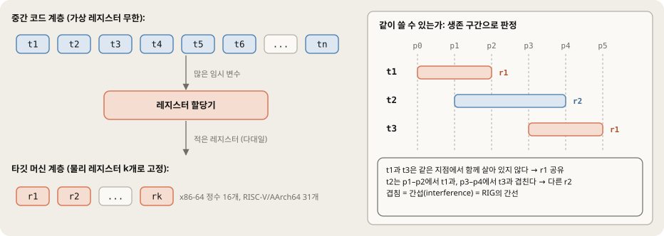

**그림 읽기**: 왼쪽은 원래 ASCII 그림 그대로다. 오른쪽은 아래의 기본 판정 준칙을 막대로 그린 것이다. 세로 점선 p0–p5가 프로그램의 지점이고, 막대는 그 변수가 살아 있는 구간이다. 어느 세로선에서도 t1과 t3이 함께 걸리지 않으므로 둘은 r1 하나를 번갈아 쓴다. t2는 두 막대와 모두 겹치므로 다른 레지스터가 필요하다. 겹치는 쌍마다 간선을 그으면 §2.1의 간섭 그래프가 된다.

이러한 다대일 매핑을 지탱하는 핵심 기둥은 **생존성 분석**(Liveness Analysis)이다.
- 임시 변수가 "사멸(Dead)" 상태가 되면(이후 다시는 읽히지 않음), 해당 변수가 점유하던 물리 레지스터는 즉시 회수되어 새로운 임시 변수에 할당될 수 있다.
- **기본 판정 준칙**: 두 임시 변수 $t_1$과 $t_2$가 동일한 물리 레지스터를 공유하기 위한 필요충분조건은, **프로그램의 임의의 실행 지점에서 둘 중 최대 하나만 생존 상태(At most one is live)에 있는 것**이다. 반대로 $t_1$과 $t_2$의 생존 구간이 어느 한 곳에서라도 겹친다면, 두 변수는 **간섭**(Interference, 충돌)을 일으키므로 결코 동일한 물리 레지스터를 공유할 수 없다.

> [!note] 보충: "필요충분"이 성립하려면 붙는 전제
> 슬라이드 11은 이 준칙을 "한 번에 하나만 살아 있으면 같은 레지스터를 쓸 수 있다"와 "동시에 살아 있으면 쓸 수 없다"로 적는다. 실제 할당기에서는 양쪽에 예외가 하나씩 있다.
> - **죽은 정의:** `t := x + 1; y := 5; z := t * 2`에서 `y`가 이후에 읽히지 않으면 `y`는 어느 지점에서도 살아 있지 않다. 그래서 동시에 살아 있는 지점이 없고, 슬라이드 방식의 RIG에는 간선이 하나도 생기지 않는다. 세 변수를 모두 r1에 넣어도 준칙에 어긋나지 않는다. 그런데 그렇게 하면 `y := 5`가 아직 살아 있는 `t`를 덮어써서, x = 7일 때 z가 16이 아니라 10이 된다(`regalloc.py`로 재현). 그래서 Chaitin 계열 할당기는 "정의하는 순간, 그 문장 뒤에 살아 있는 모든 변수와 간섭한다"는 간선을 따로 넣는다. 보통은 죽은 코드 제거가 `y := 5`를 지우지만, 반환값을 버리는 함수 호출처럼 지울 수 없는 정의는 남는다.
> - **같은 값의 복사:** `t2 := t1` 뒤에 둘이 함께 살아 있어도 값이 같으면 한 레지스터를 써도 된다. 이런 쌍을 합치는 것이 레지스터 병합(coalescing)이고, §1.3 바로잡기에 인용한 GCC IRA 주석의 "register coalescing"이 이것이다.
>
> 정리하면 이 준칙은 "모든 정의가 이후에 읽히고, 동시에 살아 있는 두 변수의 값이 다를 수 있다"는 전제에서 필요충분이다.

### 1.2 코드 재사용 예시 (C++ 및 저수준 매핑 대조)

다음 연속된 3-주소 코드 구간을 살펴본다.

```cpp
// 원본 로직 (독립된 임시 변수 사용)
int a = c + d;
int e = a + b;
int f = e - 1;
```

첫 번째 행 이후 변수 $a$는 두 번째 행에서만 읽힌 뒤 생명주기가 종료(사멸)하고, 변수 $e$는 세 번째 행에서만 읽힌 뒤 마찬가지로 사멸한다고 가정한다. 이때 변수 $a$, $e$, $f$의 생존 구간은 쌍마다 서로 겹치지 않으므로, 컴파일러는 이들을 모두 동일한 물리 레지스터 $r_1$에 매핑할 수 있다.

```cpp
// 유한한 물리 레지스터로의 매핑 (r1 재사용)
// c는 r2, d는 r3, b는 r4에 위치한다고 가정
r1 = r2 + r3;  // a 계산 후 r1에 저장
r1 = r1 + r4;  // e 계산 시 r1 재사용
r1 = r1 - 1;   // f 계산 시 r1 재사용
```

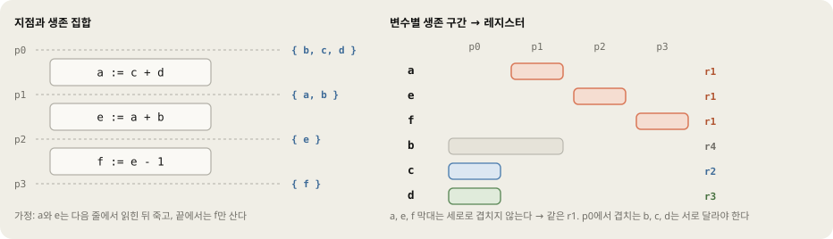

**그림 읽기**: 왼쪽은 세 줄의 앞뒤 지점 p0–p3과 각 지점의 생존 집합이다. 슬라이드 7처럼 a와 e는 다음 줄에서 읽힌 뒤 죽고, 프로그램 끝에서는 f만 산다고 놓았다. 오른쪽은 같은 정보를 변수별 막대로 바꾼 것이다. a는 p1, e는 p2, f는 p3에서만 살아 있으므로 세 막대가 세로로 겹치지 않는다. 그래서 본문 코드처럼 셋 다 r1을 쓴다. 한 줄 안에서 `r1 = r1 + r4`처럼 r1을 읽고 곧바로 r1에 쓰는 것도 문제없다. 읽기가 쓰기보다 먼저 일어나고, 읽힌 a는 그 줄 뒤에 죽기 때문이다.

### 1.3 역사적 발전: 휴리스틱에서 그래프 채색까지

레지스터 할당의 역사는 컴파일러 자체의 역사만큼 오래되었다. 1950년대 최초의 FORTRAN 컴파일러부터 엔지니어들은 할당 전략을 고안하려 시도했으나, 당시에는 단편적이고 주먹구구식인 휴리스틱 규칙에 의존했다.

1980년 그레고리 체이틴(Gregory Chaitin) 등이 레지스터 할당을 **그래프 채색 문제**(Graph Coloring)로 엄밀히 정식화하면서 이 분야는 진정한 전기를 맞이했다. 이 기법은 전역적 시야와 논리적 엄밀성을 갖추어 현대 산업용 컴파일러(GCC, LLVM 등)의 표준 기반이 되었다.

> [!warning] 바로잡기: GCC는 그래프 채색이지만 LLVM은 아니다
> - **GCC:** 할당기 IRA(`gcc/ira.cc`)의 첫 주석이 스스로를 "regional register allocator performing graph coloring … based on Chaitin-Briggs algorithm"이라고 설명한다. GCC에 대해서는 본문이 맞다.
> - **LLVM:** 최적화 빌드에서 그리디 할당기(`RegAllocGreedy.cpp`)를 쓴다. `TargetPassConfig::createTargetRegisterAllocator`는 `Optimized`이면 `createGreedyRegisterAllocator()`를, 아니면 `createFastRegisterAllocator()`를 돌려준다. 그리디 할당기는 간섭 그래프를 칠하지 않는다. 생존 구간(live interval)을 우선순위 큐에 넣어 차례로 레지스터를 배정하고, 자리가 없으면 다른 구간을 밀어내거나(evict) 구간을 쪼갠다(split). 그래프 채색 계열인 PBQP 할당기는 `-regalloc=pbqp`로 골랐을 때만 쓴다.
> - **JIT 컴파일러:** 컴파일 시간이 중요해서 선형 스캔(linear scan, Poletto와 Sarkar, 1999) 계열을 많이 쓴다.
> - **연도:** 슬라이드 9는 "1980년 IBM 연구진"이라고만 적는다. 논문은 Chaitin 등의 "Register allocation via coloring"(Computer Languages, 1981)과, 스필까지 다룬 Chaitin의 SIGPLAN '82 논문이다.

---

## 2. 그래프 채색 알고리즘(Graph Coloring & Kempe 휴리스틱)

### 2.1 레지스터 간섭 그래프(Register Interference Graph, RIG)

그래프 채색 할당법의 핵심은 레지스터 간섭 그래프(RIG)를 구축하는 것이다.
- **노드(Nodes)**: 프로그램 내의 모든 가상 임시 변수를 나타낸다.
- **간선(Edges)**: 두 임시 변수가 프로그램의 어느 한 지점에서 동시에 생존 상태(생존 구간 중첩)에 있다면, 두 노드 사이에 무방향 간선을 연결하여 동일 레지스터에 할당될 수 없음을 나타낸다.
- **채색 방안**: 타깃 머신에 $k$개의 물리 레지스터가 있다면, 그래프를 채색하는 것은 각 노드에 $k$가지 색상 중 하나를 지정하되 인접한 노드끼리는 같은 색을 칠할 수 없도록 배정하는 것과 대응된다.

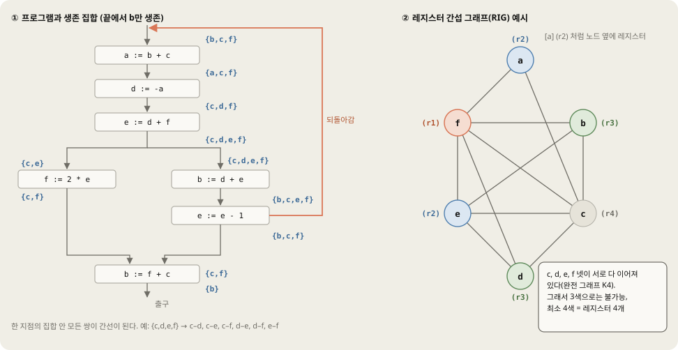

**그림 읽기**: 원래 ASCII 그림은 붙여 넣는 과정에서 a 아래의 사선이 깨져 있었다. 그래서 왼쪽처럼 슬라이드 12의 프로그램과 생존 집합에서 간선을 다시 계산해 오른쪽에 그렸다. 노드 위치와 괄호 안의 레지스터는 원래 그림 그대로다.
- **간선 만드는 법:** 한 지점의 생존 집합에 함께 들어 있는 두 변수마다 간선을 하나 긋는다. 결과는 간선 11개다. 슬라이드 15처럼 b와 c는 이어져 있어 같은 레지스터를 못 쓰고, b와 d는 이어져 있지 않아 같은 r3을 쓴다.
- **원래 그림과 다른 곳:** 원래 ASCII에는 d–f 간선이 없었다. 하지만 `{c,d,f}`와 `{c,d,e,f}`에 d와 f가 함께 있으므로 간선이 있어야 한다. a의 이웃은 c와 f 둘뿐이다.
- **왜 4색인가:** 오른쪽 아래 상자처럼 c, d, e, f가 서로 모두 이어진 K4이고, b, c, e, f도 K4다. 그래서 3색으로는 칠할 수 없다. 여섯 노드의 모든 색 배정을 다 시도해 보니 최소 색 수는 4였다(슬라이드 20). 본문의 "레지스터가 3개뿐이라면 직접 할당을 완료할 수 없다"는 이 뜻에서 맞다.

위 그래프가 4가지 색상으로 유효하게 채색될 수 있다면, 해당 프로그램은 4개의 물리 레지스터를 갖춘 머신에서 스필(메모리 방출) 없이 실행될 수 있음을 뜻한다. 만약 머신에 레지스터가 3개뿐이라면, 이 그래프는 직접 할당을 완료할 수 없다.

### 2.2 계산 복잡도와 켐프(Kempe) 단순화 휴리스틱

그래프의 $k$-채색 문제는 $k \ge 3$일 때 전형적인 **NP-완전(NP-Hard/NP-Complete)** 난제로, 다항 시간 내에 최적해를 구하는 알고리즘이 존재하지 않는다. 공학적으로는 휴리스틱 알고리즘(켐프 휴리스틱)을 사용해야 한다.

> [!warning] 바로잡기: "존재하지 않는다"가 아니라 "알려져 있지 않다"
> 다항 시간 알고리즘이 없다는 것은 아직 증명되지 않았다. P ≠ NP라면 없지만, 그것이 증명되지 않았다. 슬라이드 25도 "NP-hard … No efficient algorithms are known"이라고 적는다. 정확히는 "k색으로 칠할 수 있는가"라는 판정 문제가 NP-완전이고, 가장 적은 색 수를 찾는 최적화 문제가 NP-난해다.
>
> Chaitin 등(1981)은 어떤 그래프든 어떤 프로그램의 간섭 그래프로 나타날 수 있음을 보였다. 그래서 레지스터 할당 자체가 이 난이도를 물려받는다. 반대로 SSA 형태의 프로그램(φ 함수를 없애기 전)에서 나온 간섭 그래프는 chordal 그래프(현 그래프)라서 최적 채색을 다항 시간에 구할 수 있다(Hack, Grund, Goos, 2006).

> **켐프의 관찰 정리(Kempe's Heuristic)**:
> 그래프에 인접 이웃 노드의 수가 $k$개 미만인 노드 $t$가 존재한다고 가정하자(즉 차수 $d(t) < k$). 최악의 경우라도 $t$의 모든 이웃 노드가 서로 다른 색상으로 칠해지더라도, 사용 가능한 전체 색상 수가 $k$개이므로 $t$에 할당할 수 있는 색상이 반드시 최소 하나는 남게 된다.
> 
> 따라서 노드 $t$와 그에 연결된 간선을 그래프에서 안전하게 제거하여 스택에 푸시할 수 있다. 남아 있는 서브그래프가 $k$-채색 가능하다면, 원래 그래프 역시 반드시 $k$-채색 가능하다.

알고리즘 흐름은 다음과 같다.
1. **단순화(Simplify)**: 차수가 $k$ 미만인 노드를 반복적으로 탐색하여 그래프에서 제거하고 스택에 푸시한다.
2. **선택/채색(Select)**: 그래프가 완전히 빌 때까지 노드를 제거한 뒤, 역순으로 스택에서 팝하면서 각 노드에 이웃과 겹치지 않는 색상을 배정한다.

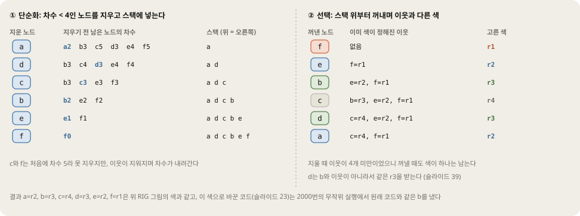

**그림 읽기**: 슬라이드 28–40의 과정을 표 두 개로 옮겼다.
- **왼쪽 (단순화):** 각 줄은 지우기 직전 남은 노드의 차수이고, 굵은 파란 글씨가 그 줄에서 지운 노드다. c와 f는 처음에 차수 5라서 바로 지울 수 없다. a와 d가 빠지면서 차수가 4, 3으로 내려가 지울 수 있게 된다. 지우는 순서는 여러 가지가 가능하고, 여기서는 슬라이드의 순서를 따랐다.
- **오른쪽 (선택):** 스택 맨 위의 f부터 꺼내며, 이미 색이 정해진 이웃과 다른 가장 작은 번호의 색을 고른 결과다.

이 색으로 슬라이드 12의 코드를 바꾸면 슬라이드 23의 `r2 := r3 + r4; r3 := -r2; …`가 그대로 나온다.

### 2.3 스필(Spilling)과 낙관적 채색(Optimistic Coloring)

그래프를 단순화하던 중 어느 단계에서 **남아 있는 모든 노드의 차수가** $\ge k$가 되면 알고리즘이 교착 상태에 빠진다. 이는 물리 레지스터가 부족함을 의미하며, 일부 변수를 메모리 스택 프레임으로 **스필**(Spill)해야 한다.

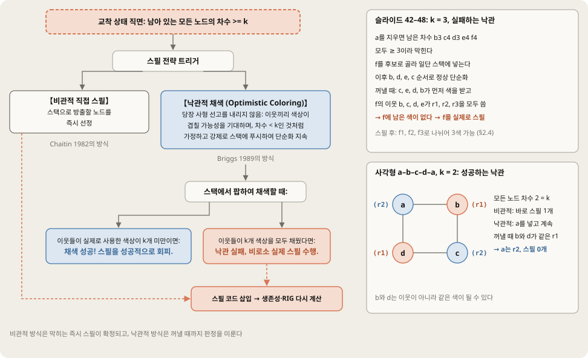

**그림 읽기**: 왼쪽 상자와 화살표는 원래 ASCII 그림 그대로다. 두 갈래의 출처와, 실패한 뒤에 일어나는 일(아래 주황 상자, §2.4)을 덧붙였다. 비관적 방식은 Chaitin의 원래 할당기(1982)이고, 낙관적 방식은 Briggs 등(1989, 1994)이 고친 것이다. 오른쪽 두 상자는 예다.
- **위, 슬라이드 42–48 (k = 3):** 낙관이 실패해 f를 실제로 스필한다.
- **아래, 낙관이 이기는 가장 작은 예:** 네 노드가 모두 차수 2라서 k = 2이면 처음부터 막힌다. 비관적 방식은 여기서 바로 하나를 스필한다. 낙관적 방식은 a를 일단 스택에 넣는다. 꺼낼 때 a의 이웃 b와 d는 서로 이웃이 아니라서 같은 색을 받고, a에게 남은 색이 생겨 스필이 0개가 된다.

두 예 모두 `regalloc.py`로 확인했다.

### 2.4 실제 스필 시 코드 재작성 비용

변수 $f$의 스필이 최종 확정되면, 컴파일러는 현재 함수의 스택 프레임에 해당 변수를 위한 메모리 슬롯(주소 $fa$)을 할당하고, 원본 명령어 스트림에서 $f$를 읽고 쓰는 모든 연산을 메모리 접근으로 재작성해야 한다.

```cpp
// 원본 3-주소 코드
f = a + b;
c = f * 2;

// 변수 f 스필 후 기계어 강하 로직
int t_reg = a + b;
mov [fa], t_reg;      // f에 쓸 때: 스택 메모리에 저장 (store fa, f)

// ... 중간에 다른 로직 실행 ...

mov t_reg2, [fa];     // f를 읽을 때: 스택 메모리에서 다시 로드 (load f, fa)
c = t_reg2 * 2;
```

변수가 스필되고 나면, 해당 변수의 개별 생존 구간은 load와 store 직전 직후의 극히 짧은 구간으로 압축되므로 RIG 상의 간섭 간선이 대폭 줄어든다. 이후 컴파일러는 간섭 그래프를 다시 구축하고 채색 알고리즘을 재실행한다.

> [!note] 보충: 스필한 뒤 실제로 달라지는 것 (슬라이드 49–65)
> - **새 이름:** 슬라이드는 load와 store를 `f := load fa`, `store f, fa`로 적고, 이 명령을 넣을 때마다 새 이름 f1, f2, f3을 붙인다(슬라이드 53). 이름을 나눠야 각 조각이 서로 다른 레지스터를 받을 수 있다.
> - **다시 계산한 생존 집합:** `{c,d,f1}`, `{c,f2}`, `{c,f3}`처럼 f의 각 조각은 load 바로 뒤나 store 바로 앞 한 지점에만 나타난다(슬라이드 56). 그 결과 f1은 c, d와만 간섭하고, f2와 f3은 c와만 간섭한다. 새 RIG는 3색으로 칠해진다(슬라이드 61).
> - **확인:** 스크립트로 같은 생존 집합과 간선을 얻었다. 레지스터 3개와 메모리 칸 `fa`로 바꾼 코드는 2000번의 무작위 실행에서 원래 코드와 같은 b를 냈다.
> - **명령 표기:** 본문 C++ 코드의 `mov [fa], t_reg`는 Intel 문법이라 대상이 앞에 온다. 주석의 `store fa, f`는 슬라이드의 `store f, fa`와 피연산자 순서만 다르다.
> - **무엇을 스필할까:** 휴리스틱으로 정한다(슬라이드 62–65). 간섭이 가장 많은 것, 정의와 사용이 적은 것, 안쪽 루프 밖에 있는 것을 고른다. 무엇을 골라도 프로그램은 맞게 돌고 성능만 달라진다.

---

## 3. 캐시 관리와 현대 메모리 계층 구조

### 3.1 하드웨어 스토리지 계층의 피라미드 격차

프로세서의 클록 주파수는 극도로 높은 반면, 메인 메모리 접근에는 오랜 대기 시간이 소요된다. 전력 장벽(Power Wall)으로 인해 온칩 대용량 고속 SRAM 탑재가 제한되면서 계단식 피라미드 구조가 형성되었다.

| 계층 | 접근 지연시간(전형적 사이클) | 용량 범위 |
|:---|:---:|:---:|
| **레지스터(Registers)** | 1 cycle | 수백 바이트 ~ 수 킬로바이트 |
| **온칩 캐시(Cache L1/L2/L3)** | 3 ~ 20 cycles | 수십 KB ~ 수십 MB |
| **메인 메모리(Main Memory)** | 20 ~ 100+ cycles | 수 GB ~ 수십 GB |
| **외부 저장장치(SSD / NVMe)** | 100,000 ~ 5,000,000 cycles | 수백 GB ~ 수 TB |

캐시 미스(Cache Miss)는 수십에서 수백 사이클에 달하는 파이프라인 정지(Stall)를 유발하므로, 현대 프로세서는 2~3단계의 캐시를 두어 지연을 완충한다.

> [!note] 보충: 표의 숫자와 이 머신에서 잰 숫자
> 표는 슬라이드 67(레지스터 1, 캐시 3, 메인 메모리 20–100, 디스크 0.5–5M 사이클)을 바탕으로 한 것인데, 이 값은 오래전 기준이다. 이 머신은 Xeon E5-2686 v4다. L1d 32 KiB와 L2 256 KiB는 코어마다 있고, L3 45 MiB는 공유한다. 여기서 무작위 순서로 포인터를 따라가며 load 하나가 끝나기까지 걸린 시간을 쟀다(`cache.c`, 틱은 2.3 GHz TSC 기준).
>
> | 작업 집합 | 시간 | TSC 틱 | 대략 어디서 오나 |
> |---|---:|---:|---|
> | 16 KiB | 1.8 ns | 4 | L1 |
> | 128 KiB | 6.0 ns | 14 | L2 |
> | 1 MiB | 26 ns | 60 | L3 |
> | 8 MiB | 61 ns | 140 | L3 + TLB 미스 |
> | 32 MiB | 132 ns | 303 | L3 일부 + TLB 미스 |
> | 1 GiB | 259 ns | 595 | DRAM + 페이지 테이블 탐색 |
>
> - **메인 메모리:** 지금의 서버에서는 수백 사이클이 걸린다. 표의 "20 ~ 100+"보다 여러 배 크다.
> - **읽을 때 주의:** 무작위 접근에서는 캐시 미스와 함께 TLB 미스도 일어난다. 그래서 위 숫자를 캐시 계층 하나의 값으로 읽으면 안 된다.
> - **측정 환경:** 가상 머신에서 잰 값이라 절대값은 몇십 % 흔들릴 수 있다.

### 3.2 레지스터 및 캐시 관리에 대한 컴파일러의 역할 대비

- **레지스터 관리**: 컴파일러가 탁월한 성능을 발휘한다. 생존성 분석과 그래프 채색을 통해 인간 프로그래머가 직접 작성한 어셈블리보다 훨씬 뛰어난 레지스터 할당 전략을 생성한다.
- **캐시 관리**: 컴파일러의 역할이 상대적으로 수동적이다. 캐시 라인 스래싱, 세트 연관 충돌, 동적 메모리 점프 패턴 등은 컴파일 시점에 정적으로 추론하기 극히 어렵다. 캐시 친화적 최적화는 여전히 프로그래머 자신의 데이터 구조 설계(데이터 지향 설계 DOD, 행 우선 접근, 블록 분할 순회 등)에 크게 의존한다.

### 3.3 전형적인 캐시 스래싱(Cache Thrashing) 예시

```cpp
// 1,000,000개 정수 원소(약 4MB) 순회, 외부 루프 10회 반복
for (int j = 0; j < 10; ++j) {
    for (int i = 0; i < 1000000; ++i) {
        a[i] *= b[i];
    }
}
```

위 루프에서 작업 집합(Working Set) 크기는 일반적인 L1/L2 캐시 용량을 초과한다. 내부 루프가 한 번 완료될 때마다 이전에 캐시되었던 배열 원소들이 전부 축출된다. 외부 루프가 다음 반복 $j+1$로 진입할 때 $a[0]$과 $b[0]$을 읽으면서 다시 콜드 미스가 발생한다. **루프 타일링**(Loop Tiling / Blocking)을 통해 큰 배열을 캐시 내에 수용 가능한 작은 블록 단위로 쪼개어 순회해야 이러한 반복 축출로 인한 성능 재앙을 막을 수 있다.

> [!warning] 바로잡기: "콜드 미스"가 아니라 "용량 미스"
> 캐시 미스는 보통 세 가지로 나눈다(3C 모델).
> - **강제 미스**(compulsory, cold): 처음 보는 블록이라 생긴다.
> - **용량 미스**(capacity): 캐시가 작아 쫓겨났던 블록을 다시 읽을 때 생긴다.
> - **충돌 미스**(conflict): 같은 집합으로 몰려 쫓겨난 블록을 다시 읽을 때 생긴다.
>
> `j+1`번째 바퀴에서 `a[0]`을 읽을 때의 미스는 `j`번째 바퀴에서 이미 읽었다가 쫓겨난 블록이므로 용량 미스다. 콜드 미스는 `j = 0`인 첫 바퀴에서만 일어난다. 또 작업 집합은 배열 하나가 아니라 `a`와 `b` 두 개라서 약 8 MB다.

> [!note] 보충: 슬라이드의 해법은 루프 교환이고, 지금 CPU에서는 결과가 다르다
> - **슬라이드의 해법:** 슬라이드 72는 두 루프의 순서를 바꾸는 **루프 교환**(loop interchange)을 제시한다. `i`를 바깥에 두면 `a[i]`와 `b[i]`를 한 번 가져와서 10번 연달아 쓴다. 슬라이드는 "첫 참조만 미스, 다음 아홉 번은 히트, 10배 넘게 빠를 수도 있다"고 한다.
> - **타일링과의 관계:** 본문의 타일링은 이것을 일반화한 것이다. `i`를 캐시에 들어가는 크기의 덩어리로 자르고(strip-mining), 덩어리마다 `j` 루프를 돈다.
> - **실제 측정:** 이 머신에서 세 버전을 쟀다(`cache.c`, gcc 13.3, 타일 하나는 4096칸 = 32 KiB). 칸의 값은 세 번 실행한 범위이고, 세 버전의 계산 결과는 모두 같았다.
>
> | N | 옵션 | 원래 (j 바깥) | 루프 교환 (i 바깥) | 타일링 |
> |---|---|---:|---:|---:|
> | 10⁶ (8 MB) | `-O2` | 14.5–15.1 ms | 25.7–26.8 ms | 14.2–14.7 ms |
> | 10⁶ (8 MB) | `-O3` | 10.4–11.2 ms | 8.0–15.3 ms | 4.8–8.9 ms |
> | 10⁷ (80 MB) | `-O2` | 124–149 ms | 120–135 ms | 66–73 ms |
> | 10⁷ (80 MB) | `-O3` | 105–122 ms | 71–81 ms | 47–53 ms |
>
> - **10배는 나지 않았다:** 원래 루프는 주소를 차례로 훑으므로 하드웨어 프리페처가 다음 블록을 미리 가져온다. 그래서 미스 지연을 매번 기다리지 않고 메모리 대역폭만큼의 속도로 돈다. N = 10⁶이면 8 MB가 이 머신의 L3(45 MB)에 다 들어가서 차이가 더 작다.
> - **루프 교환의 효과는 옵션에 따라 달랐다:** `-O2`에서는 같거나 느렸고, `-O3`의 80 MB에서는 약 1.4배 빨랐다. 같은 `a[i]`에 곱셈 10번을 연달아 하므로 각 곱셈이 앞 곱셈의 결과를 기다린다(의존 사슬). 이 비용이 메모리에서 아낀 시간을 깎아 먹는다.
> - **타일링이 가장 빨랐다:** 바깥 순서를 유지해 벡터화와 프리페치를 살리면서 메모리 왕복만 줄인다. 80 MB에서 약 2배 빨랐다.
> - **컴파일러는 바꾸지 않았다:** gcc 13.3의 `-O3`에는 루프 교환 패스(`-floop-interchange`)가 켜져 있다. 그런데 원래 루프에 대해 아무 변환도 보고하지 않았다(`-fopt-info-loop`). 안쪽 루프가 이미 연속 주소를 훑고 있어서 교환할 이유를 찾지 못한 것으로 보인다. 슬라이드 69의 "컴파일러는 캐시 관리를 잘 못한다"와 맞는 결과다.

---

## 4. 자동 메모리 관리 기술(Automatic Memory Management)

C와 C++ 등 시스템 프로그래밍 언어에서 수동 힙 메모리 관리는 치명적 결함의 주요 원인이 된다.
- 메모리 해제를 잊어 발생하는 **메모리 누수(Memory Leak)**.
- 해제 후에도 포인터로 접근하여 발생하는 **댕글링 포인터(Dangling Pointer / Use-After-Free)**.
- 포인터 경계 초과로 인접 데이터 구조를 오염시키는 문제.
- **심각한 시공간적 불일치**: 메모리 오염은 한 모듈에서 발생하고, 프로그램 비정상 종료(크래시)는 한참 뒤 전혀 상관없는 다른 코드 영역에서 터져 나와 디버깅이 극도로 까다롭다.

이러한 문제를 근본적으로 방지하기 위해 자동 메모리 관리 기술은 1950년대 LISP와 함께 탄생했으며, 1990년대 Java의 부흥과 함께 주류 산업계에 안착했다.

### 핵심 판정: "도달 가능성"으로 "미래 미사용" 근사 대체

이론적으로 어떤 객체가 "미래에 프로그램에 의해 다시 읽힐 것인가"를 판정하는 문제는 튜링 정지 문제와 동치이며, 수학적으로 결정 불가능하다.

따라서 모든 가비지 컬렉션 시스템은 실용적이고 보수적인 기준인 **도달 가능성 분석**(Reachability Analysis)을 채택한다.

> 프로그램은 포인터 체인을 통해 찾아갈 수 있는 객체만 사용할 수 있다. 어떤 객체가 메모리 그래프 상에서 어떠한 루트(Roots)로부터도 도달할 수 없다면, 프로그램이 미래에 해당 객체를 읽을 가능성은 전혀 없다. 따라서 해당 객체는 가비지(쓰레기)이며 안전하게 회수할 수 있다.

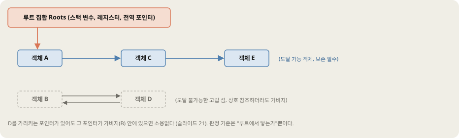

**그림 읽기**: 원래 ASCII 그림 그대로다. 파란 객체는 루트에서 화살표를 따라 닿으므로 보존한다. 회색 점선 객체는 서로를 가리키지만 루트에서 시작하는 길이 없어 가비지다. 슬라이드 15의 정의는 "레지스터가 x를 가리키거나, 도달 가능한 객체 y가 x를 가리키면 x는 도달 가능하다"이다. 정의가 자기 자신을 쓰므로, 루트에서 출발해 포인터를 따라가는 탐색으로 계산한다.

> [!note] 보충: 도달 가능해도 다시 안 쓰일 수 있다 (슬라이드 16–18)
> `x ← new A; y ← new B; x ← y; if alwaysTrue() then x ← new A else x.foo() fi`에서 `x ← y` 직후에 GC가 돈다고 하자. 그 뒤로 y는 쓰이지 않는다고 가정한다.
> - **첫 A:** 아무도 가리키지 않아 회수된다.
> - **B:** x로 닿으므로 남는다. 하지만 `alwaysTrue()`가 늘 참이면 x는 곧 새 A로 바뀌므로 B는 다시 쓰이지 않는다.
>
> 도달 가능성은 "미래에 쓰일 수 있다"의 안전한 근사일 뿐이다. 그래서 GC가 있는 언어에서도, 다 쓴 큰 자료 구조를 가리키는 변수를 그대로 두면 사실상 메모리가 샌다. 슬라이드 92의 예는 IR을 만든 뒤에도 AST를 가리키고 있는 컴파일러의 변수다.

---

## 5. 고전적 가비지 컬렉션: 마크-스윕(Mark and Sweep)

마크-스윕 알고리즘은 두 개의 독립된 단계로 구성되며, 통상 힙 메모리가 고갈되었을 때 트리거된다.

### 5.1 알고리즘 실행 흐름

1. **마크 단계(Mark Phase)**:
   루트 집합(Roots: 레지스터, 현재 호출 스택 프레임의 지역 포인터, 전역 변수)에서 출발하여 객체 간 포인터 참조를 따라 그래프 순회(깊이 우선 탐색 DFS 또는 너비 우선 탐색 BFS)를 수행하며, 방문한 모든 활성 객체의 `mark bit`를 0에서 1로 설정한다.
2. **스윕 단계(Sweep Phase)**:
   힙 공간 전체를 선형 스캔한다.
   - 객체의 `mark bit == 1`이면 생존 객체이므로 다음 GC를 위해 플래그를 다시 0으로 리셋한다.
   - 객체의 `mark bit == 0`이면 도달 불가능한 가비지이므로 해당 메모리 블록을 프리 리스트(Free List)에 연결한다.

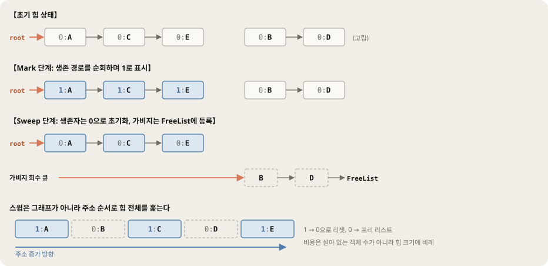

**그림 읽기**: 위의 세 줄은 원래 ASCII 그림 그대로이고, 각 객체 왼쪽 칸이 mark bit다. 마크 단계는 루트에서 포인터를 따라가므로 A, C, E만 1이 된다. B에서 D로 가는 포인터는 B가 닿지 않는 객체라 아무 역할을 하지 않는다.

맨 아래 줄은 스윕이 실제로 움직이는 순서다. 스윕은 그래프를 따라가지 않는다. 힙의 맨 앞 주소부터 객체 크기만큼씩 건너뛰며 모든 객체를 본다(슬라이드 28). Cool 객체에 크기 필드가 있는 이유가 이것이다. 그래서 마크 비용은 살아 있는 객체 수에, 스윕 비용은 힙 전체 크기에 비례한다. 슬라이드 29의 예(객체 A–F, 마크 뒤 1 0 1 0 0 1)도 `gc.py`에서 같은 값이 나왔다.

### 5.2 알고리즘 세부 사항과 치명적 난제: 메모리 고갈 시 스택 공간의 출처

마크-스윕 알고리즘은 개념적으로 단순하지만, 공학적 구현에서 닭이 먼저냐 달걀이 먼저냐 하는 심각한 딜레마에 부딪힌다.
- **트리거 시점**: GC는 **시스템 메모리가 이미 고갈되었을 때** 호출된다.
- **보조 공간 딜레마**: 마크 단계에서 객체 그래프를 순회할 때, 명시적 작업 목록(`todo list`)을 사용하든 재귀 함수 호출 스택을 사용하든, 필요한 최대 보조 공간은 이론상 무한하다(최악의 경우 전체 생존 객체 수에 비례). 메모리가 바닥난 위급 상황에서 시스템은 이 `todo` 큐를 위한 추가 메모리를 전혀 확보할 수 없다.
- **해결 방안**: 실제 구현에서는 쇼어-웨이트(Schorr-Waite) 포인터 반전 알고리즘(Pointer Reversal)을 도입하여, 객체 자체의 포인터 필드를 임시로 활용해 되추적 경로를 기록함으로써 $O(1)$의 추가 보조 공간만으로 제자리 그래프 순회를 수행한다. 또한 이 알고리즘은 극심한 외부 단편화(External Fragmentation)를 초래한다.

> [!warning] 바로잡기: 보조 공간은 "무한"이 아니라 "미리 정할 수 없다", 단편화는 마크-스윕의 성질
> - **"무한"이 아니다:** 슬라이드 31의 표현은 "the size of the todo list is unbounded so we cannot reserve space for it a priori"다. 힙이 유한하니 todo 목록도 객체 수를 넘지 않는다. 문제는 그 크기가 힙 모양에 따라 달라서 미리 떼어 둘 수 없다는 것이다. `gc.py`에서 자식이 1000개인 객체 하나는 todo를 1000칸까지 채웠다. 길이 1000인 연결 리스트는 todo 1칸으로 충분했지만, 재귀로 짜면 호출이 1000단계 쌓인다.
> - **단편화의 주어:** 마지막 문장의 "이 알고리즘"은 바로 앞의 포인터 반전이 아니라 마크-스윕이다. 포인터 반전은 순회 방법일 뿐 메모리 배치를 바꾸지 않는다. 단편화는 마크-스윕이 객체를 옮기지 않고 빈칸을 프리 리스트에 모으기 때문에 생긴다. 그래서 슬라이드 50은 이웃한 빈 블록을 합치라고 한다. 객체를 옮기지 않는다는 같은 성질이 §7의 보수적 GC에서는 장점이 된다(슬라이드 51).

> [!note] 보충: 포인터 반전의 "O(1)"이 뜻하는 것과 실제 구현
> - **원리:** 슬라이드 34–49의 포인터 반전은 깊이 우선 탐색의 스택을 객체 안에 숨긴다. 자식으로 내려갈 때 그 필드가 부모를 가리키도록 뒤집고, 올라올 때 원래 값으로 되돌린다.
> - **O(1)의 뜻:** 따로 드는 공간은 포인터 두어 개뿐이다. 하지만 객체마다 "지금 몇 번째 필드로 내려갔는지"를 적을 칸이 필요하다. 필드가 n개면 log₂ n 비트이고, 보통 헤더의 남는 비트를 쓴다. 그래서 O(1)은 "객체 수와 무관한 추가 공간"이라는 뜻이다.
> - **확인:** `gc.py`에서 이 방법으로 마크한 결과가 todo 목록 방식과 3000개의 무작위 힙에서 모두 같았다. 끝난 뒤에는 모든 포인터 필드가 원래 값으로 돌아와 있었다.
> - **실제 구현:** Boehm GC는 포인터 반전 대신 명시적인 마크 스택을 쓰고, 스택이 넘치면 다시 훑는 방식으로 처리한다(`docs/gcdescr.md`의 "mark stack overflows"). 흔히 드는 이유는 두 가지다. 포인터 반전은 순회하는 동안 객체가 잠시 망가진 상태가 되어 병렬·병행 GC와 함께 쓰기 어렵고, 필드를 두 번씩 고쳐 쓰므로 느리다.

---

## 6. 고전적 가비지 컬렉션: 스톱-앤-카피(Stop & Copy)

단편화와 보조 공간 문제를 해결하기 위해 스톱-앤-카피 알고리즘은 공간을 시간 및 정돈도와 맞바꾸는 전략을 취한다.

### 6.1 양분 공간 분할과 범프 할당(Bump Allocation)

해당 알고리즘은 사용 가능한 힙 메모리를 절반으로 분할한다.
- **활성 영역(Old Space / From-Space)**: 런타임 객체 할당에 사용된다.
- **예비 영역(New Space / To-Space)**: 평소에는 비어 있는 대기 상태이며, GC 진행 중에 복사되는 생존 객체를 수용한다.


**그림 읽기**: 원래 ASCII 그림 그대로다. 활성 영역에서 heap pointer 왼쪽은 모두 사용 중이고 오른쪽은 모두 비어 있다. 그래서 새 객체를 넣을 빈칸을 찾을 필요가 없다. 예비 영역은 GC가 돌 때만 쓴다.

활성 영역의 미할당 공간은 완전히 연속적이므로, 새 객체를 할당할 때 프리 리스트를 탐색할 필요 없이 힙 포인터를 크기만큼 전진시키기만 하면 된다(**범프 포인터, Bump Pointer**).

```cpp
// 범프 할당: 단 한 번의 포인터 덧셈으로 완료되며, 스택 할당에 필적하는 속도를 제공
void* alloc(size_t size) {
    void* p = heap_pointer;
    heap_pointer += size;
    return p;
}
```

> [!note] 보충: 실제 범프 할당에는 비교가 하나 더 있다
> 본문의 `alloc`은 공간이 남았는지 보지 않는다. 실제로는 `if (heap_pointer + size > heap_limit) collect();`처럼 한계를 확인하고, size를 정렬 단위(보통 8 또는 16바이트)로 올려 맞춘다. 그래도 빠른 경로는 덧셈 하나, 비교 하나, 저장 하나다. 멀티스레드 런타임은 스레드마다 작은 구역(HotSpot의 TLAB, thread-local allocation buffer)을 미리 떼어 주고 그 안에서 이렇게 할당해, 스레드끼리 경쟁하지 않게 한다.

### 6.2 회수 메커니즘과 포워딩 포인터(Forwarding Pointer)

활성 영역의 공간이 고갈되면 다음 절차를 진행한다.
1. 모든 애플리케이션 스레드를 일시 정지한다(Stop).
2. 루트 집합에서 출발하여 도달 가능한 객체들을 스캔한다. 도달 가능한 객체를 발견할 때마다 예비 영역(New Space)의 앞부분으로 연속해서 복사하고 빈틈없이 밀착 배치한다.
3. **핵심 기술: 포워딩 포인터(Forwarding Pointer)**:
   객체가 복사되어 이동한 후, 원래 옛 객체의 자리에는 예비 영역의 새 복사본 주소를 기록해 둔다. 나중에 다른 포인터가 옛 주소를 참조하여 순회해 오면, 이 포워딩 포인터를 통해 "이 객체는 이미 이전되었음"을 인지하고 자신의 참조를 새 주소로 즉시 갱신한다.
4. 복사가 완료되면 기존 활성 영역에 남아 있던 모든 내용(가비지)은 일괄 폐기된다. 이후 활성 영역과 예비 영역의 역할을 맞바꾸고(Swap Space), 애플리케이션 실행을 재개한다.

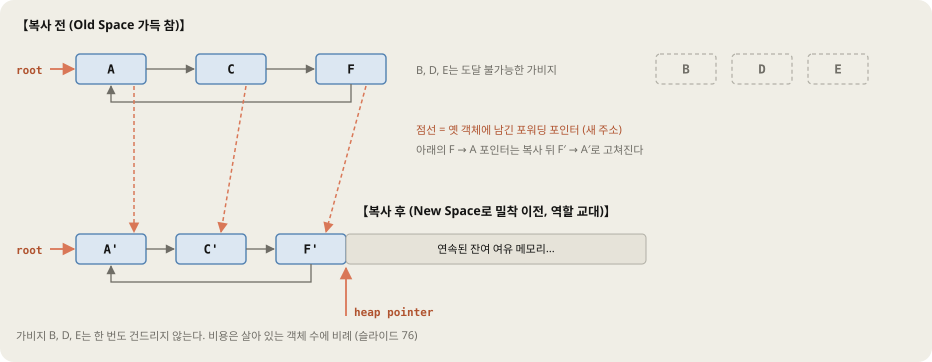

**그림 읽기**: 위아래 두 줄과 heap pointer는 원래 ASCII 그림 그대로다.
- **아래 꺾인 선:** 원래 그림의 아래 꺾인 선은 슬라이드 55와 72에 있는 F → A 포인터로 그렸다. 복사본에서도 같은 모양(F′ → A′)이 되어야 하므로, 이 순환이 포워딩 포인터가 왜 필요한지 보여 준다.
- **주황 점선:** 옛 객체 자리에 남긴 포워딩 포인터다.
- **가비지 B, D, E:** 복사도 스캔도 하지 않는다. 그래서 수거 비용은 살아 있는 객체 수에 비례하고, 가비지가 많을수록 상대적으로 싸다(슬라이드 76).

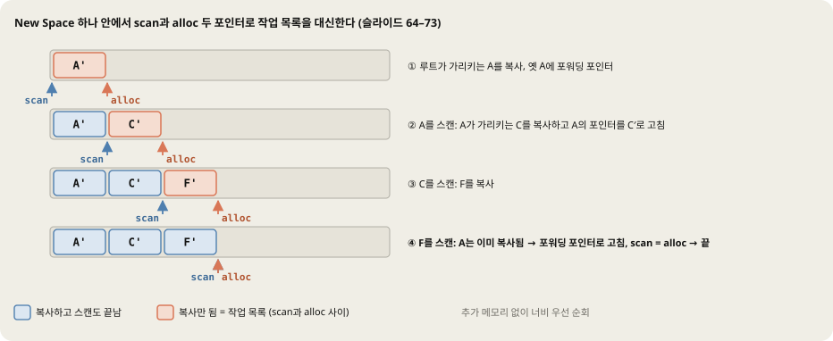

**그림 읽기**: 본문 2단계의 "스캔"을 실제로 어떻게 하는지가 이 그림이다. §5.2의 보조 공간 문제가 여기서도 생기는데, 체니(Cheney, 1970) 알고리즘은 New Space 자체를 작업 목록으로 쓴다.
- **두 포인터:** alloc은 다음 복사본이 들어갈 자리이고, scan은 아직 포인터 필드를 고치지 않은 첫 복사본이다.
- **한 단계:** scan이 가리키는 객체의 포인터 필드를 하나씩 본다. 대상이 아직 복사되지 않았으면 alloc 자리에 복사하고 옛 자리에 포워딩 포인터를 남긴다. 이미 복사됐으면 필드를 포워딩 포인터 값으로 고친다.
- **끝나는 조건:** scan과 alloc 사이(주황)가 남은 일이고, 둘이 만나면 끝난다.

객체는 루트에서 가까운 순서(너비 우선)로 놓인다. `gc.py`는 슬라이드 66–73과 같은 A, C, F 순서를 냈다. 3000개의 무작위 힙에서도 복사본 그래프가 원래의 도달 가능한 그래프와 같은 모양이었다.

- **핵심 장점**: 단편화 제로(모든 생존 객체가 메모리 한쪽에 조밀하게 정렬됨), 극도로 낮은 할당 오버헤드.
- **대가**: 물리 힙 메모리 공간의 무려 50%를 상시 예비용으로 낭비한다.

> [!note] 보충: 50%를 아끼는 방법들
> 슬라이드 52도 "프로그램은 공간의 절반만 쓸 수 있다"고 인정하고, 더 정교한 방법은 더 많이 쓸 수 있다고 덧붙인다. 대표적인 것이 세대별(generational) GC다(슬라이드 94). 새로 만든 객체는 대부분 금방 죽는다. 그래서 젊은 객체 구역만 작게 두 칸으로 나눠 복사 방식으로 자주 거두고, 오래 산 객체는 마크-스윕이나 압축 같은 다른 방식으로 드물게 거둔다. 예비 공간은 젊은 구역 크기만큼만 있으면 된다.

---

## 7. 보수적 가비지 컬렉션(Conservative Collection)

Java나 Go처럼 GC를 기본 지원하는 언어는 객체 헤더에 정확한 타입 메타정보가 포함되어 있어, 런타임에 어떤 필드가 정수이고 어떤 필드가 포인터인지 명확히 구별할 수 있다(정확한 GC, Exact / Precise GC). 반면 C/C++처럼 타입 반영(Reflection)이나 런타임 메타정보가 없는 시스템 언어에서 메모리는 단순한 원시 바이트(Raw Bytes)의 연속 배열에 불과하다.

### 7.1 C/C++에서 GC 도입의 본질적 장애물

C/C++에서 연속된 두 메모리 블록은 연결 리스트 노드(데이터 + 포인터)일 수도 있고, 단순히 연속된 두 개의 64비트 정수일 수도 있다. 런타임은 바이너리 형태만 보고 그 실질적 타입을 판별할 수 없다.

```cpp
struct Data {
    uint64_t account_balance; // 계좌 잔액 수치
    void*    next_ptr;        // 다음 객체를 가리키는 포인터
};
```

만약 `account_balance` 정수 수치가 우연히 유효한 힙 메모리 주소(예: `0x7fff8040`)와 정확히 일치한다면, 전통적인 가비지 컬렉터는 이것이 유효한 포인터인지 아니면 우연의 일치로 동일한 계좌 잔액 수치인지 전혀 구별할 수 없다.

### 7.2 보수적 판정 기준과 이동 불가 제약

유명한 **뵘 GC**(Boehm GC)로 대표되는 보수적 가비지 컬렉터는 실용적인 절충안을 제시한다.

> **"잘못 남길지언정, 잘못 죽이지는 않는다" 원칙**:
> 메모리 내의 특정 워드(Word)가 **포인터처럼 보인다면**, 이를 포인터로 간주하여 처리한다:
> 1. 하드웨어 주소 지정 정렬 요건을 만족해야 한다(예: 64비트 시스템에서 주소는 반드시 8의 배수여야 하므로 최하위 3비트가 `000`이어야 함).
> 2. 해당 값이 현재 힙 데이터 세그먼트에 매핑된 유효 합법 주소 범위 내에 위치해야 한다.
> 
> 위 조건을 만족하는 메모리 단위는 모두 잠재적인 활성 참조로 취급하고, 이를 따라 계속해서 객체를 추적한다.

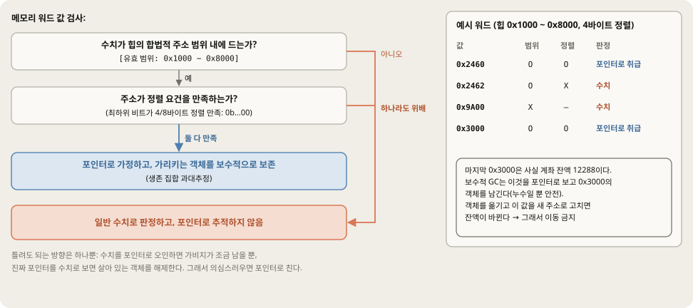

**그림 읽기**: 왼쪽은 원래 ASCII 그림을 순서도로 그린 것이다. 원래 그림은 두 조건을 나란히 적었고, 어느 쪽을 먼저 보든 결과는 같다. 오른쪽은 이 규칙으로 워드 네 개를 판정한 예다.
- **0x2462:** 범위 안이지만 4의 배수가 아니라서 수치로 본다.
- **0x9A00:** 힙 범위 밖이라서 수치로 본다.
- **0x3000:** §7.1의 `account_balance`처럼 사실은 정수인데 두 조건을 모두 통과해 포인터로 취급된다. 그래서 그 주소의 객체가 회수되지 않고 남는다. 메모리를 조금 낭비할 뿐 프로그램을 망가뜨리지는 않는다.

반면 이 객체를 옮기면서 이 워드를 새 주소로 고치면 잔액이 바뀐다. 아래 본문의 "이동 불가"가 이것이다.

- **치명적 제약: 객체를 결코 이동할 수 없다!**
  그 값이 진짜 포인터인지 아니면 평범한 정수인지 100% 확신할 수 없기 때문이다. 만약 객체를 복사 이전하고 원래 메모리의 값을 새 주소로 덮어써 버린다면, 만약 그 수치가 사용자의 은행 계좌 잔액이었을 경우 치명적인 프로그램 데이터 훼손이 발생한다. 따라서 **보수적 가비지 컬렉션은 반드시 제자리 마크-스윕(In-Place Mark and Sweep) 방식만 사용해야 하며, 스톱-앤-카피나 메모리 압축(Compaction) 알고리즘은 절대 사용할 수 없다**.

> [!note] 보충: 실제 Boehm GC의 판정과 "절대"의 범위
> - **정렬 조건:** Boehm GC 문서(`docs/gcdescr.md`)에 따르면 정렬 조건은 값이 아니라 **위치**에 대한 것이다. 타입 정보가 없는 구역에서는 8바이트로 정렬된(64비트) 모든 칸을 후보 포인터로 본다. 후보 값은 먼저 대략의 힙 경계와 비교하고, 그다음 그 주소가 실제로 할당된 힙 블록인지 확인한다.
> - **내부 포인터:** 값이 객체의 시작 주소가 아니어도 된다. 기본 설정에서는 객체 중간을 가리키는 내부 포인터(interior pointer)도 그 객체를 살린다. C에서는 `p = buf + 3`처럼 배열 가운데를 가리키는 포인터만 남는 경우가 흔하기 때문이다. 이를 끄는 `GC_set_all_interior_pointers(0)`은 다중 상속 때문에 C++에는 대개 맞지 않는다고 문서가 적는다.
> - **블랙리스트:** 잘못 짚은 값의 피해를 줄이는 장치다. 힙 바로 바깥이나 아직 할당하지 않은 페이지를 가리키는 값이 보이면, 그 페이지는 나중에 포인터가 없는 작은 객체에만 내준다.
> - **"절대"의 범위:** "절대 이동할 수 없다"는 모든 워드가 모호할 때의 이야기다. Bartlett의 mostly-copying GC(1988)는 스택과 레지스터만 보수적으로 보고, 힙 객체는 정확한 타입 정보로 본다. 스택의 모호한 값이 가리키는 페이지만 제자리에 고정하고, 나머지 객체는 복사한다.

---

## 8. 참조 카운팅(Reference Counting)

메모리가 소진될 때까지 기다렸다가 일괄 정지 스캔하는 방식과 달리, 참조 카운팅은 메모리 회수 비용을 매 포인터 대입 연산 시점에 분할 상환(Amortized)하는 실시간 관리 방식이다.

### 8.1 기본 동작 규칙

각 객체 내부에 정수형 참조 카운터(Reference Count, `rc`)를 유지한다.
- 객체 생성 시 `rc`는 1로 초기화된다.
- 해당 객체를 가리키는 새로운 포인터가 생길 때마다 `rc += 1`.
- 기존 포인터가 스코프를 벗어나거나 다른 곳을 가리키도록 재할당될 때마다 `rc -= 1`.
- 객체의 `rc == 0`이 되는 즉시, 해당 객체는 그 자리에서 즉각 소멸되고 메모리가 해제된다.

대입문 `x = y`에 대해 컴파일러는 저수준에서 다음과 같은 연산 로직을 삽입한다.

```cpp
// 포인터 x가 원래 객체 o를 가리키고, 포인터 y가 객체 p를 가리킨다고 가정
// 대입문: x = y; 는 저수준에서 다음 카운팅 연산으로 변환된다:

rc(p) = rc(p) + 1;     // 1. 새로 참조되는 객체의 카운터를 먼저 1 증가
rc(o) = rc(o) - 1;     // 2. 대체되는 기존 객체의 카운터를 1 감소

if (rc(o) == 0) {      // 3. 기존 객체가 모든 참조를 잃었는지 검사
    free(o);           // 0이면 즉시 재귀적으로 메모리 해제
}

x = y;                 // 4. 실제 포인터 대입 수행
```

> [!NOTE] 순서는 반드시 "증가 후 감소"여야 한다
> 위 로직에서 반드시 `p`에 대한 증가를 먼저 수행한 뒤 `o`에 대한 감소를 수행해야 한다. 프로그램에서 자가 대입 `x = x`가 발생할 경우, 감소를 먼저 수행하여 카운터가 우연히 0이 되면 객체가 재할당되기도 전에 예기치 않게 조기 파괴되는 참사가 일어난다.

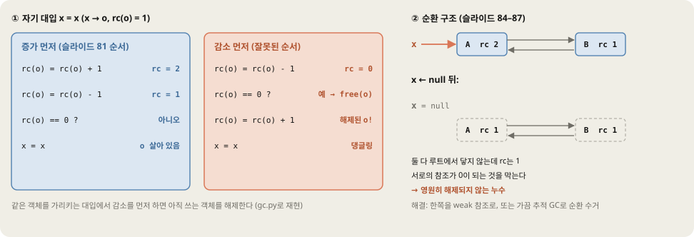

**그림 읽기**: 왼쪽 두 열은 바로 위 [!NOTE]의 자기 대입 `x = x`를 두 순서로 실행한 것이다. o를 가리키는 것이 x 하나뿐(rc = 1)이라고 하자.
- **감소를 먼저:** rc가 0이 되어 o가 해제되고, 이어지는 증가는 해제된 메모리를 건드린다.
- **증가를 먼저:** rc가 2를 거쳐 1로 돌아와 안전하다.

`gc.py`로 두 순서를 그대로 실행해 확인했다. 오른쪽은 §8.2 단점의 순환 참조다(슬라이드 84–87). x가 null이 되면 A의 rc는 2에서 1로 내려갈 뿐 0이 되지 않는다. A와 B는 루트에서 닿지 않는 가비지인데도, 서로의 참조 때문에 rc가 1로 남는다.

### 8.2 장단점 및 C++ 현대적 실천

- **장점**:
  - **결정론적 즉시 회수(Deterministic Reclamation)**: 참조가 소멸하는 순간 메모리 해제가 즉시 발생하므로 눈에 띄는 일시 정지(Stop-the-World)가 거의 없다. 시스템 프로그래밍의 RAII(Resource Acquisition Is Initialization) 자원 관리 패러다임과 완벽하게 부합한다.
- **단점**:
  - **순환 참조 데드락(Circular References)**: 두 객체가 서로를 강하게 참조하고 있다면($A \to B$ 및 $B \to A$), 외부 스택 포인터가 완전히 끊겨 도달 불가능해져도 두 객체의 `rc`는 여전히 1로 남아 메모리가 영구적으로 누수된다.
  - **성능 오버헤드(Performance Overhead)**: 평범한 포인터 대입마다 증가, 감소 및 제로 분기 검사가 수반된다. 특히 멀티스레드 환경에서는 이러한 모든 변경이 비용이 큰 멀티코어 **원자적 연산**(Atomic Operations)이어야 하므로 심각한 캐시 일관성 폭풍(Cache Coherence Storm)과 버스 경합을 유발한다.

```cpp
// C++ 표준 라이브러리의 실천 대조
#include <memory>

struct Node {
    std::shared_ptr<Node> next;
    std::weak_ptr<Node>   prev; // 순환 참조를 끊고 메모리 누수를 방지하기 위해 반드시 weak_ptr 사용
};
```

> [!note] 보충: C++로 돌려 본 결과와 단점 두 가지
> - **순환:** 위 `Node`에서 `prev`까지 `shared_ptr`로 두고 두 노드를 서로 이었다. 지역 변수 둘이 사라진 뒤에도 두 객체가 살아 있었다(소멸자 호출 0번). `prev`를 `weak_ptr`로 바꾸면 둘 다 해제되었다(`rc.cpp`). 순환은 서로를 기다리며 멈추는 데드락이 아니라, 해제되지 않는 누수다. 슬라이드 88의 해법은 두 가지다. 프로그래머가 순환을 끊거나(약한 참조), 가끔 추적 GC를 돌려 순환만 거둔다. CPython이 참조 카운팅에 순환 수집기를 덧붙인 것이 뒤의 방식이다.
> - **연쇄 해제:** "일시 정지가 거의 없다"에는 예외가 있다. 객체 하나의 rc가 0이 되면, 그 객체가 가리키던 객체들의 rc도 연달아 줄어 한꺼번에 해제될 수 있다. 노드 100만 개짜리 `shared_ptr` 연결 리스트의 머리를 놓자 소멸자가 재귀로 100만 단계 호출되었고, 8 MB 스택을 넘어 세그멘테이션 오류로 죽었다(10만 개까지는 정상). 해제할 것이 많으면 그만큼 멈추고, 재귀로 해제하면 스택까지 위험하다.
> - **원자적 연산:** 이 비용 때문에 Rust는 스레드 사이에 공유하지 않는 `Rc`와 공유하는 `Arc`를 다른 타입으로 나눈다. libstdc++의 `shared_ptr`은 한 타입이지만, 스레드 라이브러리가 활성인지 실행 중에 확인해(`__gthread_active_p`) 아니면 원자적이 아닌 덧셈을 쓴다(`ext/atomicity.h`).

---

## 9. 덧붙인 내용 요약

| 위치 | 덧붙인 것 | 확인한 방법 |
|---|---|---|
| §1.1 | 다대일 매핑 그림, "필요충분"의 두 예외(죽은 정의, 같은 값의 복사) | 죽은 정의 예를 실행해 z = 16 대신 10이 나오는 것을 재현 |
| §1.2 | 세 줄 예의 생존 구간 그림 | 슬라이드 7의 가정으로 생존 집합 계산 |
| §1.3 | 바로잡기: GCC는 Chaitin-Briggs 그래프 채색, LLVM은 그리디 할당기 | `ira.cc`, `TargetPassConfig.cpp`, `RegAllocGreedy.cpp` 원문 |
| §2.1 | 슬라이드 12 프로그램의 생존 집합과 RIG(간선 11개), 최소 4색 | 생존성 계산이 슬라이드 12와 일치, 모든 색 배정 전수 검사 |
| §2.2 | 바로잡기: NP-완전의 정확한 뜻, SSA 간섭 그래프; 단순화·선택 과정 그림 | 슬라이드 28–40의 순서와 색, 슬라이드 23 코드 재현 |
| §2.3 | 두 스필 전략 그림, 낙관이 실패하는 예와 이기는 예 | k = 3 슬라이드 예와 k = 2 사각형 예 실행 |
| §2.4 | 스필 뒤 생존 집합과 새 RIG | 슬라이드 56, 61 재현, 레지스터 3개 코드의 무작위 실행 2000번 |
| §3.1 | 이 머신의 메모리 지연 측정 | `cache.c` 포인터 추적 |
| §3.3 | 바로잡기: 콜드 미스가 아니라 용량 미스; 루프 교환·타일링 측정 | `cache.c`, gcc 13.3 `-O2`/`-O3`, `-fopt-info-loop` |
| §4 | 도달 가능성 그림, 도달 가능하지만 안 쓰이는 객체(슬라이드 16) | 슬라이드 예 |
| §5.1–5.2 | 마크-스윕 그림, 바로잡기: 보조 공간과 단편화, 포인터 반전의 공간 | 무작위 힙 3000개에서 세 방식 비교, Boehm GC 문서 |
| §6 | 반공간·복사 그림, 체니 알고리즘 그림, 범프 할당과 세대별 GC | 슬라이드 66–73의 순서 재현, 무작위 힙 3000개 |
| §7.2 | 보수적 판정 순서도와 예시 워드, Boehm GC의 실제 판정, mostly-copying | Boehm GC `gcdescr.md`, `gcinterface.md` |
| §8 | 증가·감소 순서와 순환 그림, C++ 순환·연쇄 해제 실험 | `gc.py`, `rc.cpp` (g++ 13.3) |

## 10. 참고 자료

- CS143 Lecture 16 "Register Allocation", Lecture 17 "Automatic Memory Management" (Richmond 미러 `facultystaff.richmond.edu/~dszajda/classes/cs331/Fall_2017/lecture_slides/`)
- G. J. Chaitin, M. A. Auslander, A. K. Chandra, J. Cocke, M. E. Hopkins, P. W. Markstein, "Register allocation via coloring", *Computer Languages* 6, 1981
- G. J. Chaitin, "Register allocation & spilling via graph coloring", SIGPLAN '82
- P. Briggs, K. D. Cooper, L. Torczon, "Improvements to graph coloring register allocation", *ACM TOPLAS* 16(3), 1994: 낙관적 채색
- M. Poletto, V. Sarkar, "Linear scan register allocation", *ACM TOPLAS* 21(5), 1999
- S. Hack, D. Grund, G. Goos, "Register allocation for programs in SSA-form", CC 2006
- GCC `gcc/ira.cc` 첫 주석, LLVM `llvm/lib/CodeGen/RegAllocGreedy.cpp`, `TargetPassConfig.cpp`
- C. J. Cheney, "A nonrecursive list compacting algorithm", *CACM* 13(11), 1970
- H. Schorr, W. M. Waite, "An efficient machine-independent procedure for garbage collection in various list structures", *CACM* 10(8), 1967
- J. F. Bartlett, "Compacting garbage collection with ambiguous roots", DEC WRL Research Report 88/2, 1988
- Boehm GC 문서 `docs/gcdescr.md`, `docs/gcinterface.md` (github.com/ivmai/bdwgc)
- Richard Jones, Antony Hosking, Eliot Moss, *The Garbage Collection Handbook* (2판, 2023)
- 앞 노트 [`11_02_optimization.md`](11_02_optimization.md): 이 노트가 쓰는 생존성 분석
