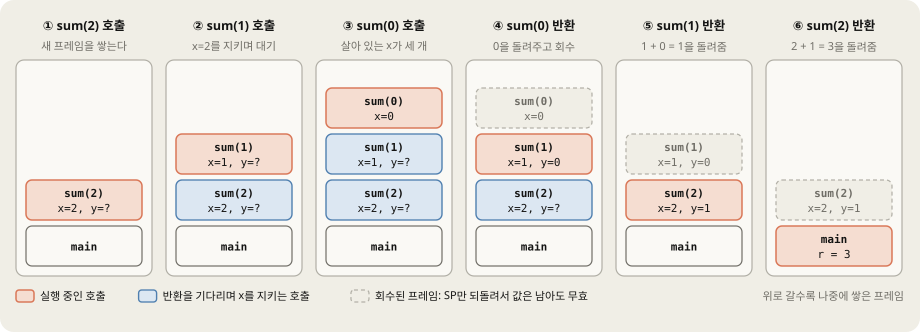
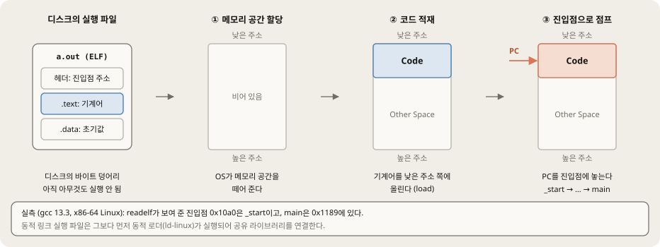
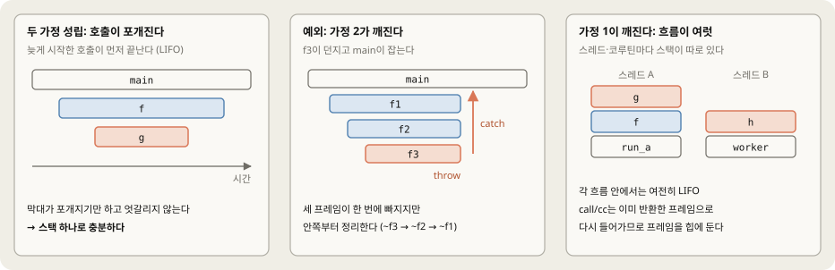
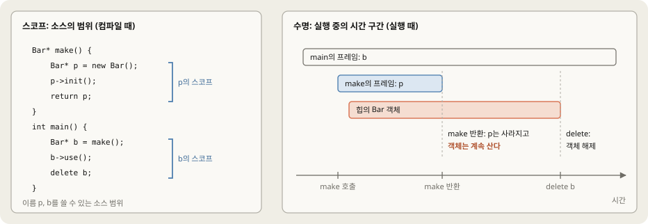
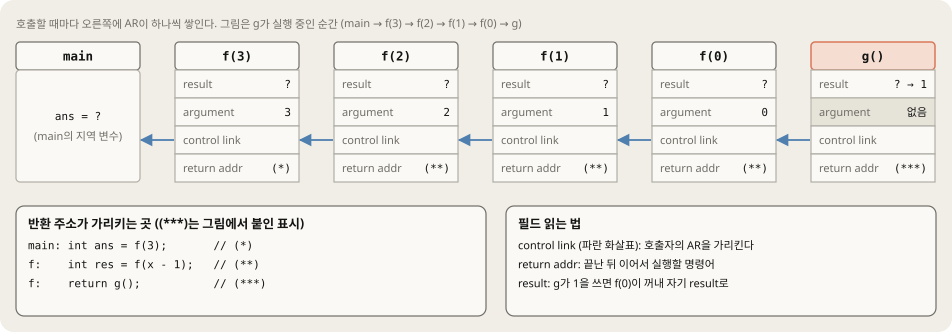
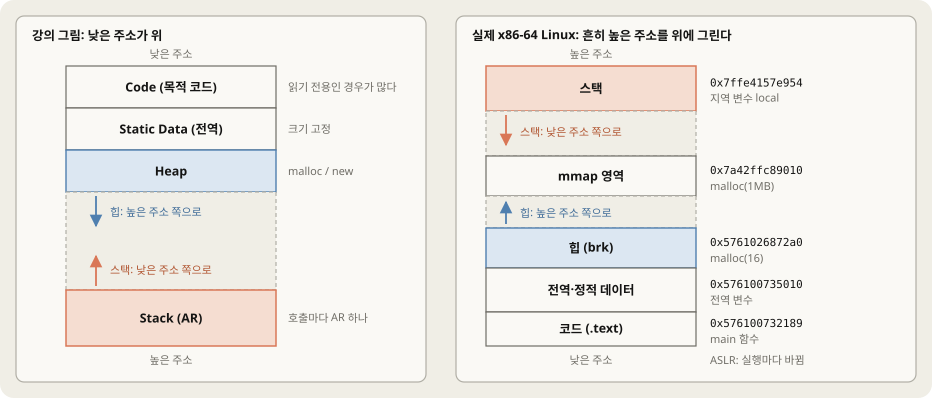
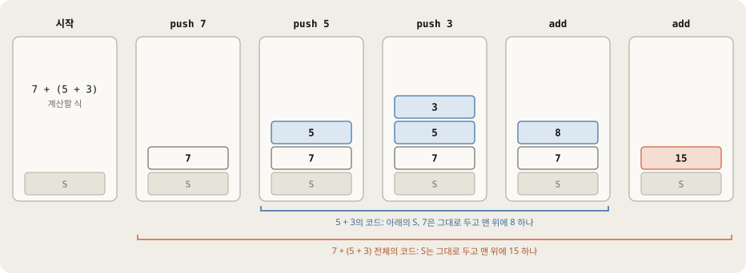
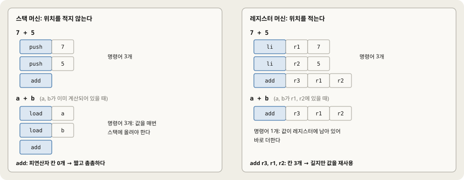

# 11월 2일 학습 기록: 런타임 조직과 스택 머신

> [!info] 이 노트를 읽는 법
> - 본문은 처음 노트 그대로다. 그림 10개(`assets/rt-*.svg`), 그림 아래의 **그림 읽기** 한 단락, `> [!note] 보충`과 `> [!warning] 바로잡기` 상자만 덧붙였다. 덧붙인 내용만 보려면 §10 표를 보면 된다.
> - 같은 날의 5강 노트 [`11_02.md`](11_02.md)와는 다른 파일이다.
> - 보충에 적은 수치는 이 머신(Ubuntu 24.04, x86-64, gcc 13.3)에서 직접 컴파일해 확인했다. 재귀 `sum`의 디스어셈블(`-O0`, `-O2`)과 호출별 프레임 주소, `readelf`로 본 진입점, 영역별 실제 주소, 구조체 `sizeof`와 `offsetof`, 예외가 프레임을 정리하는 순서, UBSan 정렬 검사, 스택 상한까지 재귀하기가 그 대상이다. §9의 불변식은 Python으로 만든 작은 스택 머신에서 무작위 중첩 덧셈 2,000개로 확인했다.
> - 주소 값은 ASLR 때문에 실행할 때마다 바뀐다. 그림에는 한 번 실행한 값을 적었다.

## 1. 프런트엔드에서 백엔드로: 왜 런타임 시스템부터 살피는가?

```text
프런트엔드 단계 (완료):
├── 어휘 분석 (Lexical analysis)   ┐
├── 구문 분석 (Parsing)            ├─ 언어 정의 강제 (enforce language definition)
└── 의미 분석 (Semantic analysis)  ┘

백엔드 단계 (다음 단계):
├── 최적화 (Optimization)
└── 코드 생성 (Code generation)
```

코드 생성을 본격적으로 다루기 전에, 먼저 우리가 무엇을 만들어 내야 하는지부터 짚고 넘어가야 한다. 실행 파일의 구조를 짜는 데에는 이미 널리 쓰이는 표준 기법들이 자리 잡고 있다.

어휘, 구문, 의미 분석을 묶어 컴파일러 프런트엔드라고 부른다. 메모의 "enforce language definition"이라는 표현처럼, 프런트엔드의 역할은 명확하다. 코드가 언어의 규칙을 지켰는지 따져 보고, 어긴 코드를 걸러내는 것이다.

의미 분석을 통과하면 이제 최적화와 코드 생성이라는 백엔드 단계로 넘어간다. 이 시점에는 구문 트리를 어셈블리 명령어로 바로 번역하는 법부터 궁금해지기 쉽지만, 소스 코드를 기계어 명령어로 한 줄씩 옮기는 것만으로는 부족하다. 함수를 호출할 때 인자는 어디에 둘지, 재귀 호출로 생긴 지역 변수 복사본들이 서로 덮어쓰지 않게 하려면 어떻게 할지, 동적으로 할당한 메모리는 누가 관리할지 같은 문제는 컴파일 시점에 전부 고정할 수 없다. 결국 실행 시점을 받쳐 주는 런타임 메커니즘이 먼저 깔려 있어야 한다.

---

## 2. 런타임 조직이 해결해야 하는 세 가지 문제

의미 분석 단계에서는 "변수 `x`의 타입이 무엇이고 덧셈에 쓸 수 있는가"를 확인한다. 코드 생성 단계에서는 한 걸음 더 나아가 "`x`의 값은 어디에 저장되며, 이번 덧셈을 할 때 어느 `x`를 읽어야 하는가"까지 답해야 한다.

런타임 조직은 프로그램이 실행되는 동안 함수 호출과 데이터 저장을 어떻게 배치하고 운용할지 다루는 영역이다.

| 핵심 주제 | 구체적으로 해결할 질문 |
| --- | --- |
| 런타임 자원 관리 (Management of run-time resources) | 레지스터와 메모리를 언제 누구에게 내어 줄 것인가? 어떤 값을 보존하고, 다 쓴 공간은 어떻게 회수·재사용할 것인가? |
| 정적 구조와 동적 구조의 대응 관계 | 소스 코드의 함수 정의 하나, 변수 선언 하나가 실행 중 어느 호출과 어느 데이터 인스턴스에 대응되는가? |
| 저장소 구성 (Storage organization) | 코드, 전역 변수, 지역 변수, 동적 생성 객체는 각각 메모리 어디에 놓이는가? |

### 2.1 재귀 함수로 살펴보기

```cpp
int sum(int n)
{
    int x = n;

    if (n == 0)
        return 0;

    int y = sum(n - 1);
    return x + y;
}
```

`sum(2)`를 호출하면 반환값은 3이 된다. 인라인이나 지역 변수 제거 같은 컴파일러 최적화는 일단 빼고, 일반적인 스택 기반 구현으로 따라가 보자.

`sum(2)`는 먼저 `sum(1)`을 부르고, `sum(1)`은 다시 `sum(0)`을 부른다. 가장 안쪽 호출에 도달한 시점에는 바깥의 두 호출이 아직 끝나지 않은 채 결과를 기다리고 있다.

### 2.2 자원 관리: 다른 함수를 부를 때 내 데이터는 어떻게 지키는가?

`sum(2)`에서 `x`는 2다. `sum(1)`을 호출한 뒤에도 이 값은 남아 있어야 한다. 돌아온 뒤에 `x`와 재귀 호출의 반환값을 더해야 하기 때문이다.

`sum(1)` 역시 값이 1인 자기만의 `x`를 가진다. 이 값이 바깥쪽 `sum(2)`의 `x`를 덮어써 버리면, `sum(2)`로 복귀했을 때 올바른 결과를 낼 수 없다.

그래서 일반적인 스택 구현은 다음과 같은 절차를 따른다.

- 함수 호출에 진입할 때 이번 호출을 위한 스택 프레임을 만들고, 필요한 데이터와 복귀 정보를 저장한다.
- 다른 함수를 호출하기 전에, 복귀 후에도 계속 써야 하는 값을 보존한다.
- 함수가 반환할 때 이번 호출의 스택 프레임을 해제해 공간을 다시 쓸 수 있게 한다. 이때 메모리를 일일이 0으로 지우기보다는 스택 포인터를 되돌리는 방식으로 처리하는 것이 보통이다.



**그림 읽기**: 프레임은 위로 쌓이고 위에서부터 회수된다. ②–④ 동안 `sum(2)`의 `x = 2`는 그대로 남아 있다가 ⑥에서 돌아온 `y = 1`과 더해진다. 회색 점선 프레임은 0으로 지우지 않고 스택 포인터만 되돌린 것이라, 다음 호출이 그 자리를 덮어쓰기 전까지 옛 값이 메모리에 남아 있다.

레지스터도 마찬가지로 저장과 복원 규약을 지켜야 한다. 호출 이후에도 써야 하는 값이 있는데 피호출 함수가 그 레지스터를 덮어쓸 수 있다면, 미리 대피시켜 두어야 한다.

물론 실행 중에 별도의 "런타임 관리자"가 붙어 앉아 변수 위치를 그때그때 정한다는 뜻은 아니다. 레지스터 할당은 컴파일러가 담당하며, 스택 프레임을 잡고 풀거나 값을 대피·복원하는 작업 역시 컴파일러가 호출 규약에 맞춰 생성한 명령어를 프로그램이 실행하면서 수행한다. 반면 힙 메모리 할당은 보통 할당자(allocator)를 호출해 처리한다.

### 2.3 정적 구조와 동적 구조의 대응: `x`가 왜 여러 개 존재하는가?

소스 코드 안에는 `sum` 정의도 하나뿐이고 `int x = n;` 선언도 딱 한 줄뿐이다. 하지만 `sum(0)` 본문이 실행되는 순간에는 살아 있는 `x`가 세 개나 공존한다.

| 아직 끝나지 않은 호출 | 해당 호출의 `x` | 현재 상태 |
| --- | --- | --- |
| `sum(2)` | 2 | `sum(1)`의 반환 대기 중 |
| `sum(1)` | 1 | `sum(0)`의 반환 대기 중 |
| `sum(0)` | 0 | 곧 `0`을 반환할 예정 |

여기서 말하는 '정적'과 '동적'은 소스 코드상의 구조와 실제 실행 시점의 인스턴스를 가르는 구분이다.

- 정적(Static): 프로그램을 돌리지 않고 소스 코드만 봐도 알 수 있는 구조다. 예를 들어 `sum`에는 매개변수 `n`이 하나 있고, 지역 변수 `x`를 선언했으며, `return x + y`의 `x`는 바로 그 선언을 가리킨다.
- 동적(Dynamic): 프로그램이 실제로 실행될 때 만들어지는 호출과 데이터다. `sum(2)`를 호출하면 재귀 과정에서 아직 종료되지 않은 호출 세 개가 겹치고, 각각 값이 2, 1, 0인 `x`를 따로 갖는다.

즉, "이 `x`가 어느 선언을 가리키는가"는 컴파일 시점의 스코프 분석으로 정해지지만, "지금 이 순간 어느 `x`를 읽어야 하는가"는 현재 호출 상태에 달려 있다. 소스 코드에는 선언이 하나라도, 실행 중에는 변수가 여러 벌 생길 수 있다.

하나의 함수 정의가 여러 번의 호출에 대응하고, 하나의 지역 변수 선언이 동시에 존재하는 여러 변수 인스턴스에 대응한다. 각 호출은 같은 기계어 코드를 공유하되 각자의 상태는 따로 들고 있어야 한다. 한 번의 호출을 관리하는 데 필요한 매개변수, 지역 변수, 복귀 위치 등의 묶음을 활성화 레코드(Activation Record)라고 하며, 일반적인 스택 구현에서는 이것이 하나의 스택 프레임이 된다. 물론 일부 정보는 레지스터에 놓이기도 한다.

그렇다면 똑같은 `return x + y;` 명령어가 어떻게 현재 호출에 속한 `x`를 찾아갈까? 컴파일러는 "현재 스택 프레임 기준 주소 + 고정 오프셋" 방식을 쓸 수 있다. 예를 들어 `x`를 프레임 기준 주소보다 4바이트 앞쪽에 배치했다면 다음과 같다.

> `x`의 주소 = 현재 스택 프레임 기준 주소 - 4

오프셋은 컴파일 시점에 고정되고, 현재 프레임 기준 주소만 호출마다 바뀐다. 덕분에 똑같은 기계어 코드로도 각 호출이 자기 `x`를 정확히 찾아 읽는다. 이 오프셋은 이해를 돕기 위한 예시일 뿐이며, 실제 배치는 타깃 아키텍처와 컴파일러에 따라 달라지고 별도의 프레임 포인터를 쓰지 않는 경우도 있다.

![정적 구조와 동적 구조의 대응. 소스에는 int x 선언이 하나뿐이고 return x + y의 x를 읽는 기계어도 load \[FP − 4\] 한 벌뿐이다. 실행 중에는 sum(0), sum(1), sum(2) 프레임마다 x가 하나씩 있고, 같은 명령어가 지금 FP가 가리키는 sum(0) 프레임의 x를 읽는다](assets/rt-static-dynamic.svg)

**그림 읽기**: 왼쪽의 선언 하나가 오른쪽 프레임 세 개로 이어진다(점선). 명령어 `load [FP − 4]`는 한 벌뿐이고, 지금 FP가 `sum(0)`의 프레임을 가리키므로 `x = 0`을 읽는다. `sum(1)`로 돌아가면 FP가 `sum(1)`의 프레임으로 바뀌어 같은 명령어가 `x = 1`을 읽는다.

> [!note] 보충: gcc로 직접 재 본 프레임
> - 위 `sum`을 gcc 13.3 `-O0`으로 컴파일해 디스어셈블하면 프레임 기준 레지스터 `rbp`를 기준으로 `n`은 `rbp-20`, `x`는 `rbp-8`, `y`는 `rbp-4`에 놓인다. 예시의 `-4`가 `-8`로 바뀌었을 뿐, 모든 호출이 같은 오프셋을 쓴다는 원리는 같다.
> - 호출마다 `&x`와 `rbp`를 출력해 보면 `rbp`가 `…140 → …110 → …0e0`으로 48바이트씩 작아진다. 안쪽 호출일수록 낮은 주소에 프레임이 놓인다는 뜻이다. 48바이트는 `call`이 넣은 반환 주소 8, 저장한 호출자의 `rbp` 8, 지역 변수 공간 32를 합한 값이다. 출력용 `printf`를 넣은 이 버전에서는 스택 보호용 값이 `rbp-8`을 차지해 `x`가 `rbp-16`으로 밀렸지만, 세 호출 모두 `-16`으로 같았다.
> - `-O2`로 컴파일하면 재귀가 반복문으로 바뀌어 프레임도 `x`도 사라진다. 본문이 최적화를 "일단 빼고" 따라간 이유다.

반환할 때는 `sum(0)`이 먼저 0을 돌려주고, `sum(1)`이 자기 `x`로 1을 계산해 돌려주며, 마지막으로 `sum(2)`가 자기 `x`로 3을 계산해 끝낸다.

### 2.4 저장소 구성: 서로 다른 데이터는 어디에 두는가?

프로그램 전체로 보면 데이터마다 살아 있어야 하는 기간이 다르기 때문에, 성격에 맞는 저장 영역을 나누어 쓴다.

| 대상 | 일반적인 저장 위치 | 유지 기간 |
| --- | --- | --- |
| `sum`의 컴파일된 기계어 코드 | 코드 영역 (Code) | 일반적인 프로그램에서는 실행 내내 메모리에 상주 |
| 전역 변수, `static` 변수 | 정적 데이터 영역 | 프로그램 전체 실행 기간 |
| 매 `sum` 호출의 매개변수, 지역 변수 | 스택 프레임 (또는 레지스터) | 해당 호출 기간 (지역 객체는 스코프의 제약도 받음) |
| `new`로 동적 생성한 객체 | 힙 영역 (Heap) | 생성 후 해제·소멸 시점까지 (함수 반환 이후에도 유지 가능) |

예를 들어 `sum(1)`이 반환하고 나면 그 안의 지역 변수는 더 이상 필요 없으니 스택 프레임을 회수해도 된다. 반대로 전역 변수는 이후 코드에서도 계속 써야 하므로 호출이 끝났다고 같이 지울 수 없다. 함수 안에서 `new`로 만들어 호출자에게 넘겨주는 객체 역시 함수 반환 뒤까지 살아남아야 한다.

결국 앞의 세 가지는 서로 맞물려 돌아간다. 스택을 쓰는 것은 저장소 구성에 속하고, 스택 프레임을 만들고 회수하는 일은 자원 관리에 속하며, 현재 스택 프레임을 기준으로 이번 호출의 `x`를 찾아가는 과정이 정적 선언과 동적 데이터의 대응을 설명한다.

---

## 3. 프로그램은 어떻게 멈춘 파일에서 실행 상태로 넘어가는가?

프로그램의 실행은 처음부터 사용자 코드가 쥐고 있는 것이 아니라 운영체제(OS)의 통제 아래에서 시작된다. 프로그램이 호출되면 운영체제는 다음 세 단계를 순서대로 밟는다.

1. 프로그램이 쓸 메모리 공간을 할당한다.
2. 실행 코드를 그 공간의 일부 영역에 적재(load)한다.
3. 진입점(entry point, 예를 들어 `main` 함수)으로 제어 흐름을 점프시킨다.

컴파일만 막 끝낸 실행 파일은 디스크에 놓인 바이트 덩어리일 뿐이다. 운영체제가 공간을 떼어 주고 코드를 올려 `main`으로 점프해 준 순간에야 CPU 제어권이 프로그램으로 넘어오고, 미리 약속된 런타임 메커니즘이 이후의 함수 호출과 메모리 관리를 맡게 된다.



> [!note] 보충: 진입점은 보통 `main`이 아니다
> 본문의 "예를 들어 `main` 함수"는 C/C++ 프로그래머 입장에서 본 진입점이다. 실행 파일 헤더에 적힌 진짜 진입점은 C 런타임의 `_start`다. 그림 아래의 실측처럼 `readelf -h`의 `Entry point address`는 `_start`의 주소(0x10a0)이고 `main`(0x1189)과 다르다. `_start`는 스택에 놓인 `argc`, `argv`를 정리해 `__libc_start_main`을 부르고, 이 함수가 전역 객체 생성자 같은 초기화를 마친 뒤 `main`을 호출한다. `main`이 반환하면 그 값으로 `exit`를 부른다. 또 리눅스는 파일 전체를 한꺼번에 메모리로 복사하지 않는다. 세그먼트를 주소 공간에 매핑만 해 두고, 처음 접근할 때 페이지 단위로 읽어 온다.

---

## 4. 메모리 공간의 기본 분할과 도식화 관례

운영체제가 공간을 할당하고 코드를 적재한 직후의 메모리 구조는 보통 다음과 같이 그린다.

```text
             +-----------------------+
             |         Code          |  낮은 주소 (Low Address): 코드 영역
Memory  -->  +-----------------------+
             |                       |
             |      Other Space      |  그 외 공간
             |                       |
             |                       |
             +-----------------------+  높은 주소 (High Address)
```

컴퓨터 구조나 컴파일러 교재에서 메모리 배치를 그릴 때는 암묵적인 관례가 있다.
- 낮은 주소(Low Address)를 위쪽에 둔다.
- 높은 주소(High Address)를 아래쪽에 둔다.
- 가로선으로 데이터 종류별 영역을 구분한다.

> [!warning] 바로잡기: 낮은 주소를 위에 그리는 것은 교재마다 다르다
> 이 강의(CS143) 슬라이드와 OSTEP은 낮은 주소를 위에 그리지만, CS:APP처럼 높은 주소를 위에 그리는 교재도 많다. 그런 그림에서는 스택이 위에서 아래로 자라는 것처럼 보인다. 그림의 위아래는 관례일 뿐이니, 먼저 어느 쪽이 낮은 주소인지 확인하고 "스택은 낮은 주소 쪽으로, 힙은 높은 주소 쪽으로 자란다"처럼 주소를 기준으로 기억하는 편이 안전하다. 두 관례를 나란히 놓은 그림은 §7-3에 있다.

운영체제가 처음 해 주는 일은 전체 공간을 확보하고 낮은 주소 쪽 `Code` 영역에 기계어 명령어를 올려 두는 것까지다. 아래쪽에 남은 넓은 `Other Space`는 이후 정적 데이터, 힙, 스택 같은 런타임 영역으로 다시 쪼개진다.

이런 그림을 볼 때 한 가지 놓치지 말아야 할 전제가 있다. 네모 반듯한 한 덩어리 상자로 그린 것은 이해를 돕기 위한 단순화라는 점이다. 실제 하드웨어나 가상 메모리 환경에서는 모든 메모리 영역이 물리적으로나 가상 주소상으로 꼭 빈틈없이 연속되어 있을 필요가 없다. 중간에 빈 주소 구간이 끼어 있거나 분산 매핑되어 있어도 무방하다. 이 전제를 염두에 두면, 뒤에서 스택과 힙이 서로 반대 방향에서 자란다는 설명을 볼 때도 고정 크기 상자라는 착각에 빠지지 않는다.

---

## 5. 런타임 구조

### 1. 코드 생성의 두 가지 목표

컴파일러가 런타임 구조를 설계할 때 바라보는 목표는 크게 두 가지, 정확성(Correctness)과 속도(Speed)다. 코드 생성이 까다로워지는 이유도 단순히 맞게만 돌아가게 만드는 데서 그치지 않고, 정확하면서도 빠르게 돌아가게 만들려 하기 때문이다.

정확성만 챙기면 된다면 구현은 훨씬 단순해진다. 모든 변수를 메모리에 넣고, 함수를 부를 때마다 레지스터를 모조리 백업해 두며, 재사용 최적화를 아예 안 하면 그만이다. 하지만 속도를 내기 시작하면 값을 되도록 레지스터에 붙잡아 두고, 호출 오버헤드를 줄이고, 메모리를 알뜰하게 재사용해야 한다. 그러다 보니 변수의 수명, 레지스터 점유 상태, 스택 프레임 배치를 정교하게 추적해야 하는 복잡함이 따라온다.

### 2. 런타임 구조의 두 가지 기본 가정

가장 기본적인 언어 모델은 두 가지 가정을 전제로 출발한다.
1. 실행은 순차적이다. 제어 흐름은 정해진 순서에 따라 프로그램의 한 지점에서 다음 지점으로 이동한다.
2. 프로시저(함수)가 호출되면, 제어 흐름은 언제나 호출 지점 바로 다음 위치로 돌아온다.

전통적인 호출 스택(Stack) 모델이 성립하는 이유가 바로 이 두 가정 덕분이다. 실행이 한 줄기 순서대로 이어지고 호출이 끝나면 반드시 호출했던 자리로 복귀하므로, 함수의 활성화와 종료가 깔끔하게 후입선출(LIFO) 구조를 이룬다. 따라서 스택 하나만 있으면 활성화 레코드를 차곡차곡 쌓았다가 내릴 수 있다.

하지만 현대 언어에서는 이 가정들이 깨지는 경우가 있다.
- 동시성(병행) 프로그램에서는 첫 번째 가정이 깨질 수 있다. 여러 스레드나 코루틴이 동시에 진행되면 단일 순차 흐름이 아니므로, 실행 흐름마다 별도의 스택이나 컨텍스트가 필요하다.
- 예외(Exception)나 `call/cc`(call-with-current-continuation) 같은 고급 제어 구조는 두 번째 가정을 깬다. 예외가 던져지면 중간에 쌓인 여러 호출 층을 한꺼번에 뛰어넘어 바깥쪽 `catch` 지점으로 바로 점프한다. `call/cc`는 아예 현재 실행 컨텍스트를 통째로 저장해 두었다가 전혀 다른 위치에서 여러 번 다시 실행할 수도 있어, 단순한 복귀용 스택 프레임만으로는 감당하기 어렵다.



> [!note] 보충: 예외는 LIFO를 지키고, `call/cc`는 깬다
> 예외는 중간 호출을 건너뛰지만 순서를 어기지는 않는다. `main → f1 → f2 → f3`에서 `f3`이 던진 예외를 `main`이 잡게 해 보면, 각 함수의 지역 객체 소멸자가 `f3 → f2 → f1` 순서로 불렸다. 위에서부터 차례로 걷어 내는 것이므로 스택으로 구현할 수 있다(스택 되감기, stack unwinding). 반면 `call/cc`로 저장한 컨티뉴에이션은 이미 반환한 호출로 다시 들어갈 수 있다. 반환했다고 프레임을 버리면 안 되므로, 프레임을 힙에 두거나 스택을 통째로 복사해 두는 식으로 구현한다. 지역 변수를 붙잡은 클로저가 함수보다 오래 살 때도 같은 문제가 생겨서, 붙잡힌 변수는 보통 힙으로 옮긴다.

### 3. 수명(Lifetime)과 스코프(Scope)

변수 `x`의 수명(Lifetime)이란 프로그램이 실행되는 동안 `x`가 유효하게 정의되어 있는 실행 구간을 뜻한다. 여기서 헷갈리기 쉬운 두 개념을 짚고 넘어가야 한다.
- 수명(Lifetime)은 동적인(실행 시점, run-time) 개념이다.
- 스코프(Scope)는 정적인(컴파일 시점) 개념이다.

스코프는 "소스 코드의 어느 범위 안에서 `x`라는 이름을 불러 쓸 수 있는가"를 따지며, 컴파일 시점에 구문 트리와 심볼 테이블만 보고도 결정할 수 있다. 반면 수명은 "실제 실행 중에 `x`를 위해 잡힌 메모리가 언제부터 유효하고 언제 회수 가능한가"를 다룬다.

둘이 항상 같이 움직이지는 않는다. 함수 안에서 `new`로 힙 메모리를 할당하고 그 주소를 지역 포인터 `p`에 담았다고 해 보자. 이름 `p`의 스코프는 함수가 끝나면서 사라지지만, 힙에 만들어진 객체 자체는 해제되기 전까지 함수 반환 뒤에도 계속 살아남는다. 반대로 스택에 놓이는 지역 변수는 스코프와 수명이 대체로 일치한다. 정적 스코프와 동적 수명을 정확히 구분해야 각 데이터를 스택, 정적 영역, 힙 중 어디에 둘지 정할 수 있다.



**그림 읽기**: 왼쪽은 소스의 줄 범위, 오른쪽은 실행 시간이다. `make`가 반환하는 순간 `p`가 든 프레임은 사라지지만 힙의 `Bar` 객체는 `delete b`까지 산다. 반대 방향으로 어긋나는 예도 있다. C++ `static` 지역 변수는 스코프가 함수 안인데 수명은 프로그램 전체다(§7-1).

---

## 6. 활성화 레코드 (Activation Record)

### 1. 활성화 레코드란 무엇인가?

하나의 프로시저 활성화(즉, 한 번의 함수 호출)를 관리하는 데 필요한 정보 전체를 활성화 레코드(Activation Record, AR) 또는 스택 프레임(Frame)이라고 부른다.

프로시저 `F`가 프로시저 `G`를 호출하면, `G`가 끝날 때까지 `F`는 일시 정지(suspended) 상태에 놓인다. `G`의 실행이 끝나 제어권이 돌아와야 `F`가 멈췄던 지점부터 이어서 달릴 수 있다. 이 때문에 `G`의 활성화 레코드에는 `G`만의 정보뿐 아니라 `F`와 `G`의 정보가 섞여 들어가며, 크게 두 가지를 담는다.
- `G` 자신의 실행을 마치는 데 필요한 정보 (매개변수, 지역 변수, 임시 계산 공간 등)
- `F`의 실행을 재개하는 데 필요한 정보 (`G`가 끝난 뒤 어디로 돌아갈지, `F`의 프레임은 어디서 찾을지 등)

### 2. 구체적 예시: 재귀 호출에서의 AR 구조

아래 C++ 코드는 중첩 호출과 재귀 호출이 섞여 있는 예시다. `(*)`와 `(**)`는 각 호출이 끝난 뒤 바로 이어서 실행해야 할 복귀 지점을 표시해 둔 것이다.

```cpp
int g() {
    return 1;
}

int f(int x) {
    if (x == 0) {
        return g();
    } else {
        int res = f(x - 1); // (**) 재귀 호출 반환 후 이어서 실행할 위치
        return res;
    }
}

int main() {
    int ans = f(3); // (*) 최초 호출 반환 후 이어서 실행할 위치
    return 0;
}
```

`f(3)`을 실행하면 호출 사슬은 `main -> f(3) -> f(2) -> f(1) -> f(0) -> g()` 순서로 이어진다. 이때 `f`가 한 번 호출될 때마다 만들어지는 활성화 레코드(`AR for f`)는 다음과 같은 네 칸 구조로 볼 수 있다.

```text
+--------------------+
| result             |  반환값 (Result)
+--------------------+
| argument           |  인자 (Argument)
+--------------------+
| control link       |  제어 링크 (Control link)
+--------------------+
| return address     |  반환 주소 (Return address)
+--------------------+
```

각 필드가 맡는 역할은 분명하다.
- `result`: 이번 호출이 계산해 낸 반환값을 둔다. 호출자가 복귀한 뒤 약속된 이 위치에서 결과를 꺼내 간다.
- `argument`: 호출자가 넘겨준 실인자를 저장한다. 처음 `f(3)`을 부를 때는 `3`이 들어가고, 재귀가 깊어질수록 새로 생기는 `AR for f`마다 `2`, `1`, `0`이 따로 담기므로 서로 덮어쓰지 않는다.
- `control link`(제어 링크, 흔히 동적 링크라고도 함): 호출자(caller)의 활성화 레코드를 가리킨다. 예를 들어 `f(2)`의 AR 안 `control link`는 `f(3)`의 AR을 가리키고, `f(3)`의 링크는 `main`의 AR을 가리킨다. 안쪽 호출이 끝날 때 이 링크를 따라가면 잠시 멈춰 있던 이전 프레임의 기준 주소를 되찾을 수 있다.
- `return address`: 현재 함수가 끝난 뒤 CPU가 어느 명령어로 돌아가야 하는지 기록한다. `main`이 부른 `f(3)`의 반환 주소는 `(*)`를 가리키고, `f(3)` 안에서 재귀로 부른 `f(2)`의 반환 주소는 `(**)`를 가리킨다. 제어 링크와 반환 주소가 있는 덕분에 같은 함수 `f`가 여러 겹 겹쳐 호출되더라도 매 층마다 자기 호출 지점으로 정확히 복귀할 수 있다.



**그림 읽기**: 오른쪽으로 갈수록 나중에 쌓인 AR이다. 파란 화살표(control link)를 왼쪽으로 따라가면 호출 사슬을 거꾸로 밟는다. `f(3)`만 반환 주소가 `(*)`이고 재귀로 불린 `f`들은 모두 `(**)`다. `g`가 `result`에 1을 쓰고 반환하면 `f(0)`이 그 값을 꺼내 자기 `result`에 쓰고, 같은 일이 `f(3)`까지 이어진다.

> [!note] 보충: 실제 머신의 AR은 이 네 칸과 다르다
> 네 칸의 순서와 내용은 설계 선택이다. `result`를 맨 앞에 두면 호출자가 자기 프레임 기준의 고정 오프셋으로 결과를 찾을 수 있다는 정도의 이유가 있을 뿐이다. 실제 x86-64 리눅스(System V ABI)는 정수 인자 여섯 개까지를 레지스터(`rdi`, `rsi`, `rdx`, `rcx`, `r8`, `r9`)로 넘기고 결과는 `rax`로 돌려준다. §2.1의 `sum`을 디스어셈블해도 인자는 `edi`로 들어오고(`-O0`에서는 곧바로 `rbp-20`에 복사해 둔다) 결과는 `eax`로 나간다. 메모리의 프레임에는 `call`이 넣은 반환 주소와 저장된 호출자의 `rbp`가 있는데, 이 저장된 `rbp`가 제어 링크 역할을 한다.

---

## 7. 전역 변수와 힙 자료구조 다루기

### 1. 전역 변수: 왜 활성화 레코드에 넣을 수 없는가?

전역 변수는 어디서 참조하든 항상 똑같은 객체를 가리킨다. 따라서 특정 함수의 활성화 레코드(AR) 안에 넣어 둘 수 없다. 활성화 레코드는 함수가 불릴 때 생겼다가 반환되면 사라지고, 같은 함수가 여러 번 호출되면 프레임도 여러 벌 생기기 때문이다. 프로그램 전체에서 유일해야 하는 데이터가 수명이 짧은 스택 프레임에 묶여서는 안 된다.

그래서 컴파일러는 전역 변수에 고정 주소를 단 한 번 할당한다. 이처럼 고정 주소를 부여받는 변수를 "정적 할당(statically allocated)" 변수라고 한다. 언어에 따라 전역 변수 외에도 정적 할당되는 값이 더 있을 수 있는데, C++의 `static` 지역 변수나 문자열 리터럴이 대표적이다.

### 2. 힙(Heap): 자신을 만든 함수보다 오래 사는 데이터

어떤 값의 수명이 자신을 생성한 프로시저의 수명보다 길다면, 이 역시 활성화 레코드에 담아 둘 수 없다. 아래 C++ 코드를 보자.

```cpp
Bar* foo() {
    return new Bar();
}
```

```text
foo의 활성화 레코드 (반환 즉시 해제됨)
+-------------------------+
| ...                     |
| (Bar cannot live here)  |  X  여기에 Bar를 두면 foo가 반환될 때 함께 날아간다
+-------------------------+
```

`foo`가 반환되면 `foo`의 활성화 레코드는 회수되지만, 새로 만든 `Bar` 객체는 그 뒤에도 계속 살아남아야 한다. 동적 메모리 할당을 지원하는 언어들이 힙(Heap) 영역을 따로 두어 이런 동적 데이터를 관리하는 이유다.

### 3. 메모리의 네 영역과 스택·힙의 마주 보는 성장

지금까지 나온 데이터 종류를 모두 모으면, 실행 중인 프로그램의 메모리는 대체로 네 구역으로 나뉜다.
- 코드 영역(Code area): 목적 코드(기계어)가 들어간다. 많은 언어에서 크기가 고정되어 있고 읽기 전용이다.
- 정적 영역(Static area): 코드가 아니면서 고정 주소를 갖는 데이터(예: 전역 데이터)가 들어간다. 크기가 고정되어 있으며 읽기 전용이거나 읽기/쓰기가 가능하다.
- 스택(Stack): 현재 활성화된 각 프로시저마다 활성화 레코드를 하나씩 보관한다. 각 AR은 대개 크기가 고정되어 있고 지역 변수, 인자 등을 담는다.
- 힙(Heap): 나머지 모든 동적 데이터를 보관한다. C에서는 `malloc`과 `free`(C++에서는 `new`와 `delete`)로 직접 관리하고, Java에서는 `new`로 동적 할당한 뒤 가비지 컬렉션(GC)이 수거해 간다.

문제는 실행 중에 힙과 스택이 둘 다 자란다는 점이다. 자칫 한쪽이 너무 커져서 다른 쪽 영역을 침범하면 안 된다. 이를 막기 위해 쓰는 전형적인 해법은 힙과 스택을 가용 메모리 공간의 양 끝에 배치하고 서로 마주 보는 방향으로 자라게 하는 것이다.

```text
               +---------------------------+  낮은 주소 (Low Address)
               |           Code            |  코드 영역 (목적 코드, 보통 읽기 전용)
               +---------------------------+
               |        Static Data        |  정적 영역 (전역 데이터 등, 고정 크기)
               +---------------------------+
               |           Heap            |  힙 영역 (동적 할당)
               |             |             |
               |             v             |  높은 주소 방향으로 성장
               |                           |
               |        (Free Space)       |  여유 공간
               |                           |
               |             ^             |  낮은 주소 방향으로 성장
               |             |             |
Memory  ---->  |           Stack           |  스택 영역 (활성화 레코드 / 스택 프레임)
               +---------------------------+  높은 주소 (High Address)
```

동적으로 커지는 두 영역을 양 끝에 세워 마주 보며 자라게 해 두면, 가운데 비어 있는 여유 공간을 필요에 따라 어느 쪽이든 유연하게 쓸 수 있다. 힙의 끝과 스택의 끝이 실제로 맞닿을 때에야 비로소 메모리가 바닥나는 셈이라, 처음부터 힙과 스택의 상한선을 딱 잘라 두어 공간을 놀리는 낭비를 피할 수 있다.



> [!note] 보충: 실제 리눅스 프로세스에서 재 보면
> 한 프로그램에서 각 영역의 주소를 출력해 보면 코드 < 전역 < 힙 < 지역 변수 순서는 강의 그림과 같다(위 오른쪽 그림). `readelf -l`로 보면 코드 세그먼트는 읽기·실행(`R E`), 전역 데이터는 읽기·쓰기(`RW`)로 매핑된다. 다른 점은 세 가지다.
> - 힙과 스택 사이에 mmap 영역이 있다. 큰 `malloc`(이번 실험에서는 1MB)과 공유 라이브러리가 여기에 놓인다.
> - 스택은 힙과 맞닿을 때까지 자라지 않는다. 메인 스레드 스택의 상한은 `ulimit -s`로 정하고 이 머신의 기본값은 8MB(8192KB)다. 프레임마다 1KB를 쓰는 재귀를 돌려 보니 약 8MB를 쓴 시점에서 segmentation fault로 끝났다. 스레드를 만들면 스레드마다 크기가 정해진 스택을 따로 받는다.
> - ASLR 때문에 각 영역의 시작 주소가 실행할 때마다 바뀌고, 영역 사이에 큰 빈 구간이 있다. §4에서 말한 "꼭 연속일 필요는 없다"가 실제로 이렇다.

---

## 8. 메모리 정렬 (Alignment)

### 1. 워드 크기와 주소 지정 방식

현대의 대부분 머신은 32비트 또는 64비트 아키텍처를 쓴다.
- 1바이트(byte)는 8비트(bit)다.
- 1워드(word)는 4바이트(32비트 머신) 또는 8바이트(64비트 머신)다.
- 머신은 바이트 단위 주소 지정(byte addressable)이거나 워드 단위 주소 지정(word addressable) 방식을 따른다.

요즘 주류 CPU는 대부분 바이트 단위로 주소를 매기지만, 하드웨어가 메모리 버스에서 데이터를 실어 나를 때는 여전히 워드 경계에 맞춰 읽고 쓰는 편이 훨씬 자연스럽다.

### 2. 워드 정렬이란 무엇이며, 왜 어기면 느려지는가?

데이터의 시작 주소가 워드 경계에 딱 맞을 때(시작 바이트 주소가 워드 크기로 나누어떨어질 때), 그 데이터는 워드 정렬(word aligned)되었다고 말한다.

대부분의 머신은 정렬 제약을 두거나, 정렬이 어긋난 데이터에 접근할 때 적지 않은 성능 손실을 물린다. 정렬되지 않은 데이터에 접근하는 것은 정렬된 데이터보다 훨씬 느리다. 예를 들어 4바이트 정수가 두 워드의 경계에 걸쳐 놓여 있으면 CPU가 메모리를 두 번 읽어서 반쪽씩 이어 붙여야 할 수 있고, 규제가 엄격한 일부 아키텍처에서는 아예 하드웨어 예외가 발생한다.

### 3. 구체적 예시: 문자열 패딩 (Padding)

32비트 머신(1워드 = 4바이트)에 문자열 `"Hello"`를 저장하는 상황을 생각해 보자.
- 문자열 `"Hello"`(끝의 `\0` 널 문자를 제외했을 때)는 5바이트를 차지한다.
- 이어지는 다음 워드가 워드 경계에서 깔끔하게 시작하게 하려면, 문자열 뒤에 3바이트의 패딩(padding) 문자를 덧붙여 8바이트(2워드)를 채워야 한다.
- 이 패딩 바이트는 문자열의 일부가 아니라, 그저 정렬을 맞추기 위해 비워 둔 미사용 메모리다.

4바이트 워드 격자로 그려 보면 메모리 배치는 다음과 같다.

```text
|<-------- Word 1 (4B) -------->|<-------- Word 2 (4B) -------->|
+-------+-------+-------+-------+-------+-------+-------+-------+
|  'H'  |  'e'  |  'l'  |  'l'  |  'o'  |  pad  |  pad  |  pad  |
+-------+-------+-------+-------+-------+-------+-------+-------+
  byte0   byte1   byte2   byte3   byte4   byte5   byte6   byte7
                                          |<-- 3바이트 미사용 패딩 -->|
```

참고로 C/C++처럼 끝의 `'\0'`까지 포함하는 문자열이라면 `"Hello\0"`가 총 6바이트이므로 2바이트만 패딩을 넣어도 8바이트 경계에 맞는다. 3바이트를 채우든 2바이트를 채우든 원리는 같다. 몇 바이트의 빈 공간을 감수하는 대신, 뒤에 오는 모든 데이터와 명령어가 워드 경계에 맞춰 빠르게 읽히도록 보장하는 것이다.

![정렬. 4바이트 int가 주소 4에서 시작하면 워드 하나에 들어가 한 번에 읽힌다. 주소 6에서 시작하면 두 워드에 걸쳐 두 번 읽어 이어 붙여야 한다. 아래는 gcc 13.3 실측 구조체 배치다. char c\[5\] 뒤에 int가 오면 3바이트 패딩이 들어가 x가 8에서 시작하고 크기는 12다. char가 오면 패딩이 없고 크기는 6이다](assets/rt-alignment.svg)

> [!note] 보충: 패딩 크기는 다음에 올 데이터가 정한다
> - "Hello" 예시는 "다음 데이터를 워드 경계에서 시작한다"는 단순한 모델이다. C/C++ 컴파일러는 다음에 놓일 데이터의 정렬 요구(`alignof`)에 맞출 만큼만 채운다. 그림 아래쪽처럼 `char c[5]` 뒤에 `int`가 오면 3바이트를 채워 `int`를 8에서 시작하지만(`sizeof` 12), `char`가 오면 정렬 요구가 1이라 패딩 없이 5에 바로 붙인다(`sizeof` 6). `char` 배열 자체의 정렬 요구는 1이다.
> - 요즘 x86-64는 정렬되지 않은 일반 load/store도 하드웨어가 처리하고, 캐시 라인이나 페이지 경계에 걸칠 때 손해가 커진다. 그래도 C/C++에서 어긋난 포인터로 읽는 것은 미정의 동작이다. 주소 % 4 == 2인 곳을 `int*`로 읽는 코드를 UBSan(`-fsanitize=alignment`)으로 돌리면 `load of misaligned address … which requires 4 byte alignment`를 보고한다. SSE의 `movaps`처럼 정렬을 요구하는 명령은 어긋난 주소에서 예외를 낸다.

---

## 9. 스택 머신 (Stack Machines)

### 1. 스택 머신의 실행 모델

스택 머신(Stack Machine)에서는 유일한 저장소가 스택이다. 레지스터 머신처럼 범용 레지스터를 여러 개 두고 이름을 붙여 쓰지 않는다.

일반적인 연산 명령 $r = F(a_1, \dots, a_n)$은 항상 다음 세 단계로 동작한다.
1. 스택 맨 위에서 피연산자 $n$개($a_1, \dots, a_n$)를 꺼낸다(pop).
2. 꺼낸 피연산자들로 연산 $F$를 계산한다.
3. 계산 결과 $r$을 다시 스택 맨 위에 넣는다(push).

### 2. 구체적 예시: 두 명령어로 `7 + 5` 계산하기

가장 기본적인 명령어 두 개를 살펴보자.
- `push i`: 정수 `i`를 스택 맨 위에 쌓는다.
- `add`: 스택 위에서 정수 두 개를 꺼내 더한 뒤, 그 결과를 다시 스택 위에 쌓는다.

이 두 명령어로 `7 + 5`를 계산하는 프로그램을 쓰면 다음과 같다.

```text
push 7
push 5
add
```

실행하는 동안 스택이 어떻게 변하는지 단계별로 그려 보면 아래와 같다(`S`는 이 식을 계산하기 전부터 스택 아래쪽에 들어 있던 기존 내용을 뜻한다).

```text
[Init]          [push 7]        [push 5]        [add: 7 + 5 = 12]
                                +----+
                +----+          |  5 | --+
                |  7 |          |  7 | --+-> (+) -> +----+
+----+          +----+          +----+              | 12 |
======          ======          ======              ======
|  S |          |  S |          |  S |              |  S |
+----+          +----+          +----+              +----+
```

이 흐름에는 뒤쪽 코드 생성 단계에서 아주 요긴하게 써먹는 불변 성질이 하나 숨어 있다. 어떤 표현식을 계산하고 나면 결과값은 스택 맨 위에 남고, 그 아래에 있던 원래 내용 `S`는 손상되지 않고 그대로 보존된다는 점이다. 식이 아무리 복잡하게 중첩되어 있더라도, 하위 표현식 하나를 계산할 때마다 기존 스택에 남기는 흔적은 딱 하나, 맨 위에 얹힌 결괏값뿐이다.



**그림 읽기**: 파란 괄호 구간(`push 5`, `push 3`, `add`)이 하위 식 `5 + 3`의 코드다. 이 구간 전후로 아래의 `S, 7`은 그대로이고 맨 위에 8 하나만 늘었다. 식 전체(주황 괄호)도 `S` 위에 15 하나만 남긴다.

> [!note] 보충: 이 불변식 덕분에 코드를 재귀적으로 만들 수 있다
> 덧셈 식 `e1 + e2`의 코드는 "`e1`의 코드, `e2`의 코드, `add`"로 만들 수 있다. 하위 식의 코드가 각각 맨 위에 값 하나만 남긴다는 보장이 있으니, `add`는 하위 식이 얼마나 깊든 정확히 그 두 값을 꺼낸다. Python으로 이 규칙대로 코드를 만들어 무작위 중첩 덧셈 2,000개를 실행해 보니, 모든 식과 모든 하위 식에서 기존 스택은 그대로이고 맨 위에 값 하나만 늘었다.

### 3. 스택 머신과 레지스터 머신 비교

스택 머신 명령어의 가장 도드라진 특징은 피연산자나 결과가 놓일 위치를 명령어 안에 따로 적지 않는다는 것이다. 어차피 위치는 언제나 스택 맨 위이기 때문이다.

이를 레지스터 머신(Register Machine)과 나란히 놓고 보면 차이가 바로 드러난다.
- 레지스터 머신은 피연산자와 결과를 담을 레지스터를 일일이 지정해야 한다. 예: $\text{add } r_1, r_2, r_3$
- 스택 머신은 레지스터 번호나 주소 없이 그저 `add` 한 단어만 쓰면 된다.

덕분에 스택 머신 코드는 훨씬 간결하고 프로그램 크기가 작다(compact). 대신 모든 계산마다 값을 스택에 넣었다 꺼내는 과정을 거쳐야 하므로 실행되는 명령어 수와 스택 접근 횟수는 레지스터 머신보다 많아질 수 있다. 그래서 JVM 바이트코드나 WebAssembly처럼 코드 크기와 이식성이 중요한 가상 머신은 스택 기반을 택하는 경우가 많고, 실제 물리 CPU나 고성능 컴파일러 백엔드는 레지스터 기반 구조를 주로 사용한다.



> [!note] 보충: 스택 코드도 결국 레지스터로 간다
> 스택 형식은 배포와 검증에 유리한 포맷에 가깝다. HotSpot의 C2나 V8의 TurboFan 같은 최적화 컴파일러는 바이트코드를 그대로 실행하지 않고 SSA 형태의 중간 표현으로 바꾼 뒤 레지스터를 할당한다. 반대로 Lua 5.0 이후의 VM과 Android의 Dalvik은 레지스터 기반 가상 머신이다. 가상 머신이라고 모두 스택 기반인 것은 아니다.

---

## 10. 덧붙인 내용 요약

| 위치 | 덧붙인 것 | 핵심 |
| --- | --- | --- |
| §2.2 | 그림 `rt-sum-calls` | 프레임이 쌓이고 회수되는 여섯 순간. 회수는 SP만 되돌린다 |
| §2.3 | 그림 `rt-static-dynamic`, 보충 | 선언 1개와 인스턴스 3개. gcc `-O0`에서 `x`는 `rbp-8`, 프레임은 48바이트 간격, `-O2`에서는 프레임이 사라진다 |
| §3 | 그림 `rt-os-load`, 보충 | 실제 진입점은 `_start`이고 `__libc_start_main`을 거쳐 `main`이 불린다 |
| §4 | 바로잡기 | 낮은 주소를 위에 그리는 것은 교재마다 다른 관례다 |
| §5-2 | 그림 `rt-lifo`, 보충 | 예외는 안쪽부터 걷어 내므로 LIFO가 유지되고, `call/cc`는 프레임을 힙에 둬야 한다 |
| §5-3 | 그림 `rt-scope-lifetime` | 스코프는 소스의 범위, 수명은 실행 시간의 구간이다 |
| §6-2 | 그림 `rt-ar-chain`, 보충 | 제어 링크와 반환 주소. 실제 x86-64는 인자와 결과를 레지스터로 주고받는다 |
| §7-3 | 그림 `rt-layout-conventions`, 보충 | 두 그림 관례와 실측 주소, mmap 영역, 8MB 스택 상한, ASLR |
| §8-3 | 그림 `rt-alignment`, 보충 | 패딩은 다음 데이터의 `alignof`가 정한다. 어긋난 접근은 C/C++에서 미정의 동작이다 |
| §9-2 | 그림 `rt-stack-invariant`, 보충 | 하위 식마다 맨 위에 값 하나만 남긴다는 불변식이 재귀적 코드 생성의 근거다 |
| §9-3 | 그림 `rt-stack-vs-register`, 보충 | `add`의 피연산자 칸 0개와 3개. 스택 코드도 최적화 컴파일러에서는 SSA와 레지스터로 바뀐다 |

## 11. 참고 자료

- Alex Aiken, Stanford CS143 강의 슬라이드 Runtime Organization. 미러: `facultystaff.richmond.edu/~dszajda/classes/cs331/Fall_2017/lecture_slides/lecture11.pdf`
- System V Application Binary Interface, AMD64 Architecture Processor Supplement: 인자 레지스터와 반환값 규약
- Randal E. Bryant, David R. O'Hallaron, *Computer Systems: A Programmer's Perspective* 3판, 3.7절(프로시저)과 9.7절(리눅스 가상 메모리)
- Remzi H. Arpaci-Dusseau, Andrea C. Arpaci-Dusseau, *Operating Systems: Three Easy Pieces* 13장(주소 공간)
- glibc `sysdeps/x86_64/start.S`: `_start`가 `__libc_start_main`을 부르는 코드
- Roberto Ierusalimschy, Luiz Henrique de Figueiredo, Waldemar Celes, "The Implementation of Lua 5.0" (2005): 레지스터 기반 VM으로 바꾼 이유
