# 11월 4일 학습 기록: 상향식 구문 분석과 핸들 식별(LR 구문 분석 기초)

스탠퍼드 CS143 제8강(Bottom-Up Parsing, Handles, and LR Parsing Intro)을 정리한다. 제7강 마지막에 다룬 시프트-리듀스(Shift-Reduce) 모델을 바탕으로, 상향식 구문 분석의 핵심 문제를 살펴본다. 스택 최상단의 기호를 보고 언제 시프트하고 언제 리듀스해야 할까? 이 강의로 CS143의 구문 분석 부분이 끝난다. [11/3 7강 노트](../11_03/11_03_lecture7.md)에 이어지는 내용이다.

> [!info] 학습 범위와 핵심 질문
> - 스택(Stack)은 시프트한 터미널과 리듀스로 얻은 논터미널을 저장한다. 입력 버퍼에는 아직 읽지 않은 터미널이 남아 있으며, 세로선 `|`는 스택과 입력의 경계를 나타낸다.
> - 시프트(Shift)는 다음 토큰을 스택에 넣고, 리듀스(Reduce)는 스택 최상단의 생성 규칙 우변을 좌변 논터미널로 바꾼다.
> - 스택 최상단이 어떤 규칙과 일치하더라도 즉시 리듀스하면 분석을 이어 갈 수 없게 될 수 있다. 올바른 리듀스 위치를 어떻게 정의하고 기계적으로 판별할 것인가?

> [!info] 이 노트를 읽는 법
> - 본문은 내가 이해한 내용을 다듬은 것이다. `> [!warning] 바로잡기`는 처음 이해가 틀리거나 빠진 부분이고, `> [!note] 보충`은 덧붙인 부분이다. 바로잡은 내용만 보려면 §33 표를 보면 된다.
> - **움직이는 그림은 두 개다.** 기존 [`ll-lr-parsing.html`](../11_03/ll-lr-parsing.html)에 8강 내용을 이어 붙여, 기법이 막히고 보완되는 흐름으로 다시 엮었다. 새로 만든 [`parser-pipeline.html`](parser-pipeline.html)은 토큰 스트림에서 의미 분석까지 구현 흐름만 보여 준다. 쓰는 법은 §0.2에 있다.
> - 슬라이드는 Aiken의 강의를 옮긴 University of Richmond 판(2017) Lecture 8의 텍스트 130장과 대조했다. 슬라이드 번호는 이 판 기준이다. 슬라이드 89의 DFA 그림은 글자의 좌표를 뽑아 상태 번호 1–11이 어느 상자에 붙는지 복원했다(§27.1).
> - 집합, 상태, 표, 실행 추적은 모두 Python으로 만든 LR(0)·SLR(1)·LALR(1)·LR(1) 표 생성기와 대조했다. 항목 18개, ε 전이 15개, 기호 전이 12개, 부분집합 구성으로 얻은 DFA가 CLOSURE·GOTO로 얻은 11개 상태와 같은 것까지 확인했다.
> - §20의 정리(유효 항목 = DFA 상태의 항목)는 정의대로도 확인했다. 우측 최우선 유도를 나열해 생존 접두부와 유효 항목을 직접 모은 결과가, 길이 5 이하 99개 접두부 모두에서 DFA의 결과와 같았다. 정해진 길이까지의 전수 조사이므로 증명을 대신하지는 않는다.
> - **Bison 실물은 실행하지 못했다.** §25와 §30의 결과는 직접 만든 표 생성기에 Bison의 우선순위 규칙을 넣은 시뮬레이션이다. 실물 확인은 11/7 계획에 그대로 남겨 둔다.
> - **애니메이션과 SVG는 실제 브라우저와 렌더러로 보지 못했다.** 직접 만든 JavaScript 부분집합 해석기와 DOM 스텁, 글자 겹침 검사기와 배치 미리보기로만 확인했다. 자세한 내용은 §0.2에 적었다.

## 0. 8강 한눈에 보기

8강은 "언제 리듀스하나"라는 질문 하나를 끝까지 파고든다. 답이 나올 때마다 새 문제가 생기고, 그것을 메우는 도구가 하나씩 붙는다.

| 순서 | 질문 | 답 | 위치 |
|---|---|---|---|
| 1 | 우변이 보이면 바로 줄이면 되나? | 아니다. 핸들일 때만 줄인다 | §2–§4 |
| 2 | 핸들을 어떻게 알아보나? | 일반 문법에서는 효율적인 방법이 없다. 문법을 제한하고 추정한다 | §5, §6 |
| 3 | 분석기가 볼 수 있는 것은? | 스택뿐이다. 스택이 생존 접두부인지 본다 | §7, §8 |
| 4 | 그 검사를 기계로 할 수 있나? | 생존 접두부 전체는 정규 언어다 | §9–§13 |
| 5 | 어떤 기계인가? | 항목을 상태로 하는 NFA | §14–§16 |
| 6 | NFA를 실행 중에 어떻게 돌리나? | 부분집합 구성으로 DFA를 미리 만든다 | §17–§21 |
| 7 | DFA로 동작을 정하면? | LR(0). 충돌이 두 곳에서 난다 | §22, §23 |
| 8 | 충돌을 줄이려면? | 다음 토큰이 Follow에 있을 때만 줄인다: SLR(1) | §24, §26, §27 |
| 9 | 매번 DFA를 다시 돌리는 비용은? | 상태를 스택에 같이 넣는다: 표 기반 분석기 | §28, §29 |
| 10 | 모호한 문법은? | SLR도 안 된다. 우선순위 선언으로 충돌 칸을 고른다 | §25, §30 |

용어는 11/3 노트와 조금 다르다. 이 노트의 **우측 최우선 유도**는 11/3 노트의 최우단 유도, **터미널**과 **논터미널**은 단말 기호와 비단말 기호와 같은 말이다.

### 0.1 계획 점검

11/3 노트에서 다음 주로 잡았던 8강을 11/4에 봤다. 그래서 다음 주 강의 칸에는 9강(Overview of Semantic Analysis: 범위, 기호 표, 타입)을 넣는다. 11/4 칸의 미니 lexer는 이 노트에 한 기록이 없어 다음 주로 다시 미룬다. 이미 했다면 지우면 된다. 표는 11/3 노트 §0.1에 이어 적은 것이다.

| 날짜 | 주제 | 할 일 | 시간 |
|---|---|---|---|
| 11/6 금 | 손으로 풀기 (이월 + 신규) | 11/3 7강 노트 §17의 Q7–Q9. **이 노트 §32의 Q9–Q11은 답을 보지 않고 종이에 풀기** | 3h |
| 11/7 토 | C++와 Bison 실습 (이월 + 신규) | 이월 항목에 더해 §25와 §30의 문법을 Bison으로 돌린다. `bison --report=all`로 오토마톤을 출력해 §18.5와 비교하고, `-Wcounterexamples`로 충돌의 반례를 본다 | 4h |
| 11/8 일 | 재귀 하강 파서 구현 (이월), 복습 | 11/3 6강 노트 §6.4의 문법으로 구현(2h). 틀린 점검 질문 다시 풀기, 주간 회고(1h) | 3h |
| 다음 주 | 표 기반 파서, 9강 | LL(1) 구동기(11/3 7강 노트 §1.5) 다음에 SLR(1) 구동기를 §29.1 의사 코드로 C++ 구현. 표는 §28.5 알고리즘으로 손으로 만들어 넣는다(2h). 미니 lexer(이월). 9강 | - |

SLR(1) 구동기는 직접 구현할 과제이므로 이 노트에는 의사 코드와 표만 둔다.

### 0.2 애니메이션 쓰는 법

두 페이지는 다루는 것이 다르다. 첫째는 **왜 기법이 바뀌었나**, 둘째는 **지금 컴파일러에서 어떻게 돌아가나**다.

**애니메이션 1: [`ll-lr-parsing.html`](../11_03/ll-lr-parsing.html), 파싱 기법의 전환.** 11/3에 만든 7강 애니메이션 아홉 장 뒤에 8강 여덟 장을 붙였다. 장마다 맨 위에 "막힌 점 → 보완" 카드가 있고, 그 위의 띠는 지금 어느 고리에 있는지 보여 준다. 1–9장은 그대로라 11/3 노트의 링크도 그대로 쓸 수 있다. [claude.ai 게시본](https://claude.ai/artifact/XJ5kgGZ9wjU238B3WZB8XV)도 같은 주소로 갱신했다(비공개).

| 장 | 막힌 점 | 보완 | 노트 위치 |
|---|---|---|---|
| [10. 핸들](../11_03/ll-lr-parsing.html#handle) | 우변이 보여도 줄이면 막힐 수 있다 | 우측 최우선 유도를 거꾸로 따라가는 지점, 핸들에서만 줄인다 | §2–§5 |
| [11. 생존 접두부](../11_03/ll-lr-parsing.html#viable) | 핸들을 일반적으로 알아볼 방법이 없다 | 스택이 아직 가능한 모양인지부터 본다. 항목과 접두부 사슬 | §7–§13 |
| [12. 항목 NFA](../11_03/ll-lr-parsing.html#nfa) | 그 모양을 어떻게 검사하나 | 항목을 상태로 한 NFA에 스택을 넣는다 | §14–§16 |
| [13. 부분집합 구성](../11_03/ll-lr-parsing.html#dfa) | NFA는 갈래가 많아 실행 중에 고르기 어렵다 | 가능한 항목을 집합으로 묶어 DFA를 미리 만든다 | §17–§21 |
| [14. LR(0)과 SLR(1)](../11_03/ll-lr-parsing.html#slr) | 완료 항목만 보고 줄이면 두 상태에서 충돌 | 다음 토큰이 Follow에 있을 때만 줄인다 | §22–§24, §27 |
| [15. 쌍 스택](../11_03/ll-lr-parsing.html#cache) | 매 단계 DFA를 바닥부터 다시 돌린다 | 상태를 기호와 함께 스택에 넣고 표를 조회한다 | §26, §28, §29 |
| [16. 우선순위 선언](../11_03/ll-lr-parsing.html#prec) | 모호한 문법은 SLR로도 충돌한다 | 충돌 칸마다 무엇을 남길지 선언한다 | §25, §30 |
| [17. SLR 다음](../11_03/ll-lr-parsing.html#next) | Follow는 문맥을 모른다 | 항목에 미리보기를 넣은 LR(1), 상태를 합친 LALR(1) | §6 |

**애니메이션 2: [`parser-pipeline.html`](parser-pipeline.html), 토큰에서 의미 분석까지.** 역사 설명 없이, 렉서가 내놓은 토큰 스트림이 표 기반 파서의 기호·상태 쌍 스택을 거쳐 AST가 되고, 의미 분석기가 그 AST에서 이름을 찾고 타입을 매기는 과정을 한 줄로 보여 준다. 문법은 `let x = 2 * (y + 3);` 같은 문장을 받는 작은 언어이고 SLR(1) 충돌이 없다. 위쪽 띠가 지금 단계(렉서, 파서, AST, 의미 분석)를 표시한다. [claude.ai에도 게시](https://claude.ai/artifact/RHzbx2oNE9Rny8rhBZUy4J)했다(비공개).

| 단계 | 화면 | 노트 위치 |
|---|---|---|
| 토큰 스트림 | 소스 위치가 붙은 토큰. 파서가 미리보기로 하나씩 당겨 온다 | §7.1 |
| 표 기반 파서 | 맨 위 상태의 ACTION 행 조회, 리듀스 후 GOTO 조회, 상태·기호·값 세 칸 스택 | §28, §29.1 |
| AST 구성 | 리듀스마다 의미 동작 `$$ = …`가 실행되고 노드가 생긴다. `E → T` 같은 리듀스는 노드를 만들지 않는다 | §29.2 |
| 의미 분석 | 넘겨받은 AST를 후위 순회하며 기호 표를 채우고 타입을 매긴다. 문법은 맞지만 뜻이 틀린 입력을 여기서 잡는다 | 9강 예고 |

두 페이지 모두 **재생**을 누르면 처음부터 이어서 돌아가고, Space는 재생과 일시 정지, ←와 →는 한 단계 이동이다. 애니메이션 2에서는 입력을 바꿀 수 있다. `let x = 2 * (z + 3);`(선언하지 않은 이름), `let b = true; let x = b + 1;`(타입 오류), `let x = 2 * (y + );`(구문 오류)를 꼭 돌려 보기를 권한다. 앞의 둘은 파서를 통과하고 의미 분석에서 걸리며, 마지막 것은 파서에서 멈춰 AST가 넘어가지 않는다.

> [!note] 애니메이션을 어떻게 검사했나
> 브라우저도 JS 엔진도 없어 다음 방법으로 확인했다.
> - 두 페이지의 스크립트를 직접 만든 JavaScript 부분집합 해석기와 DOM 스텁으로 실행했다. 애니메이션 1은 17장 157프레임 전부를, 애니메이션 2는 입력 66개의 1,710프레임을 끝까지 그려 태그 짝, 중복 id, `undefined`·`NaN`이 화면에 새어 나오는지 검사했다.
> - 애니메이션 1의 새 장면 데이터는 Python 표 생성기의 결과로 만들었다. 데이터를 만드는 단계에서 NFA 상태 집합과 DFA 상태, LR(0)·SLR(1) 표의 모든 칸, 충돌 칸 두 개, 쌍 스택 추적의 강의 상태 번호(1, 3, 11, 3, 4, 5, 2)를 표 생성기 결과와 맞춰 보도록 했다.
> - 애니메이션 2의 렉서, 파서, 의미 분석기는 같은 일을 하는 Python 구현과 입력 657개에서 단계별로 비교했다. 정상 29개, 의미 오류 243개, 구문 오류 272개, 어휘 오류 113개이고, 토큰 위치, 스택, 의미 값, AST, 기호 표, 진단 메시지까지 모두 같았다. AST 그림 877장에서 노드끼리 겹치거나 그림 밖으로 나가는 경우도 없었다.
> - 재생, 단계 이동, 입력 변경, 해시 링크, 키보드 조작을 확인했다. 엔진과 데이터에 일부러 넣은 오류 9개는 모두 잡혔고, 화면 배치만 바꾸는 오류 2개는 잡히지 않았다. 브라우저 없이는 배치를 검사할 수 없기 때문이다.
>
> 화면 배치와 실제 움직임은 보지 못했다. 어긋나 보이면 알려 주면 고치겠다.

---

**제1부: 핸들**

## 1. 시프트-리듀스 모델 복습: 스택 관점

상향식 분석기의 구성은 스택과 남은 입력으로 표현한다. 세로선 바로 왼쪽이 스택 최상단이다.

```text
[스택 바닥 ... 스택 최상단] | [아직 읽지 않은 입력 토큰 ...]
```

### 1.1 두 가지 기본 동작의 형식화

1. 시프트(Shift): 남은 입력에서 터미널 하나를 읽어 스택에 넣는다. 토큰 하나를 소비한다.
   $$\alpha \mid x \, \omega \quad\Longrightarrow\quad \alpha \, x \mid \omega$$

2. 리듀스(Reduce): 스택 최상단의 기호열이 생성 규칙 $A \to \beta$의 우변과 일치할 때, $|\beta|$개의 기호를 꺼내고 좌변 논터미널 $A$를 넣는다. 입력은 소비하지 않는다.
   $$\alpha \, \beta \mid \omega \quad\Longrightarrow\quad \alpha \, A \mid \omega \qquad (\text{규칙 } A \to \beta)$$

슬라이드 3이 덧붙이는 점은 리듀스가 **0개 이상**을 꺼낸다는 것이다. $A \to \varepsilon$이면 아무것도 꺼내지 않고 $A$만 넣는다.

---

## 2. 리듀스할 수 있다는 것과 리듀스해야 한다는 것의 차이

처음에는 다음과 같이 생각하기 쉽다.

> "스택 최상단에 어떤 생성 규칙의 우변이 나타나면 바로 리듀스하면 된다."

이렇게 우변과 일치할 때마다 탐욕적으로 리듀스하면, 이후의 입력을 처리할 수 없는 상태에 빠질 수 있다.

### 2.1 대표적인 반례

다음 산술 표현식 문법을 보자.

$$
\begin{aligned}
E &\to T + E \mid T \\
T &\to \text{int} * T \mid \text{int} \mid (E)
\end{aligned}
$$

입력은 `int * int + int`이다. 처음 토큰을 시프트한다.

$$\text{구성 0:} \quad \mid \text{int} * \text{int} + \text{int}$$
$$\Downarrow \text{Shift}$$
$$\text{구성 1:} \quad \text{int} \mid * \text{int} + \text{int}$$

스택 최상단의 `int`는 규칙 $T \to \text{int}$의 우변과 일치한다. 여기서 리듀스하면 다음과 같다.

$$\text{int} \mid * \text{int} + \text{int} \quad\Longrightarrow\quad T \mid * \text{int} + \text{int}$$

이제 스택에는 $T$가 있고, 다음 입력은 `*`이다. 생성 규칙의 우변을 확인해 보자.

- $E \to T + E$: $T$ 뒤에는 $+$가 필요하다.
- $E \to T$: 단일 논터미널을 표현식으로 바꾼다.
- $T \to \text{int} * T$: `*` 앞에는 논터미널 $T$가 아니라 터미널 `int`가 필요하다.
- $T \to (E)$: 괄호로 둘러싼 표현식이다.

우변에 $T * \dots$ 형태를 포함한 규칙은 없다. 첫 번째 `int`를 너무 일찍 $T$로 바꾸었기 때문에, 뒤의 `*`를 포함해 올바른 $T$를 구성할 수 없게 된다.

> [!warning] 잘못된 리듀스(Fatal Mistake)
> 스택 최상단이 생성 규칙의 우변과 일치하는 것은 올바른 리듀스의 필요조건일 뿐, 충분조건이 아니다.
> 너무 일찍 리듀스하면 시작 기호 $E$까지 돌아가는 유도 경로가 끊어진다.

같은 입력에서 줄이면 안 되는 곳과 줄여야 하는 곳이 어떻게 갈리는지는 11/3 노트의 그림으로 다시 본다.


---

## 3. 우측 최우선 유도의 역과정과 핸들(Handle)

$\alpha, X, \omega, \beta$ 같은 기호가 추상적으로 보일 수 있지만, 핵심은 단순하다.

> 상향식 구문 분석은 우측 최우선 유도(Rightmost Derivation)를 역순으로 재생하는 과정이다.

강의는 이것을 Important Fact #1이라 부른다(7강에서 처음 나왔다).

### 3.1 정방향 유도와 역방향 리듀스 비교

같은 문법을 사용한다.

$$
\begin{aligned}
E &\to T + E \mid T \\
T &\to \text{int} * T \mid \text{int} \mid (E)
\end{aligned}
$$

목표 입력은 `int * int + int`이다.

#### 정방향: 가장 오른쪽 논터미널부터 전개

우측 최우선 유도는 매 단계에서 가장 오른쪽 논터미널을 전개한다.

1. $E$
2. $\Longrightarrow T + \mathbf{E}$
3. $\Longrightarrow T + \mathbf{T}$
4. $\Longrightarrow \mathbf{T} + \text{int}$
5. $\Longrightarrow \text{int} * \mathbf{T} + \text{int}$
6. $\Longrightarrow \text{int} * \text{int} + \text{int}$

사용한 규칙은 차례로 $E \to T+E$, $E \to T$, $T \to \text{int}$, $T \to \text{int}*T$, $T \to \text{int}$이다.

#### 역방향: 입력에서 시작 기호로 리듀스

위 과정을 정확히 역순으로 진행한다.

- 가운데 `int`를 $T$로 바꾼다: $\text{int} * T + \text{int}$.
- `int * T` 전체를 $T$로 바꾼다: $T + \text{int}$.
- 마지막 `int`를 $T$로 바꾼다: $T + T$.
- 오른쪽 $T$를 $E$로 바꾼다: $T + E$.
- $T + E$ 전체를 $E$로 바꾼다: $E$.

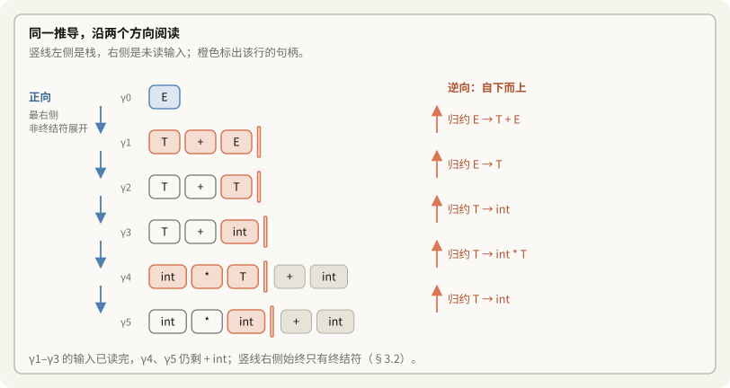

### 3.2 왜 $\omega$는 터미널만으로 이루어지는가?

형식적으로는 다음과 같다.

$$S \Longrightarrow_{\text{rm}}^* \alpha X \omega \Longrightarrow_{\text{rm}} \alpha \beta \omega$$

정방향 유도의 마지막 단계에 대입하면 다음 대응을 얻는다.

- 전개 전: $\underbrace{\text{int} *}_{\alpha}\ \mathbf{X}\ \underbrace{+ \text{int}}_{\omega}$, 여기서 $X = T$이다.
- 적용 규칙: $X \to \beta$, 즉 $T \to \text{int}$이며 $\beta$는 `int`이다.
- 전개 후: $\underbrace{\text{int} *}_{\alpha}\ \mathbf{\beta}\ \underbrace{+ \text{int}}_{\omega}$.

> [!question] 왜 $X$ 오른쪽의 $\omega$는 터미널만 포함하는가?
> 우측 최우선 유도이기 때문이다. $X$보다 오른쪽에 있던 논터미널은 이미 먼저 전개되어 터미널이 되었다.
> $X$는 현재 문장 형태에서 가장 오른쪽 논터미널이므로, 그 오른쪽의 $\omega$는 터미널열이다.

### 3.3 핸들(Handle)이란?

$\text{int} * \mathbf{int} + \text{int}$에는 `int`가 세 번 나타나지만, 다음에 리듀스할 대상은 가운데 `int`이다.

핸들은 현재 우측 문장 형태(Right-Sentential Form)에서 생성 규칙의 우변과 일치하며, 이를 좌변 논터미널로 바꾸었을 때 우측 최우선 유도를 올바르게 한 단계 되돌리는 부분 문자열이다.

> [!note] 보충: 핸들은 문자열이 아니라 "규칙과 위치"다
> 슬라이드 8은 $S \Rightarrow^*_{rm} \alpha X\omega \Rightarrow_{rm} \alpha\beta\omega$일 때 **생성 규칙 $X \to \beta$를** $\alpha\beta\omega$의 핸들이라 부르고, 슬라이드 9는 "특정 위치에서 특정 규칙을 쓰는 것"이라고 덧붙인다. `int * int + int`에서 세 `int`는 문자열로는 같지만 핸들은 $\alpha = $ `int *` 뒤의 것 하나뿐이다. 문자열만 보고 고를 수 없다는 점이 §5의 어려움으로 이어진다.

스택 모델에 대응시키면 다음과 같다.

$$\underbrace{\text{int} *}_{\text{스택 아래쪽 } \alpha} \quad \underbrace{\text{int}}_{\text{최상단 핸들 } \beta} \quad \mid \quad \underbrace{+ \text{int}}_{\text{남은 입력 } \omega}$$

핸들 $\beta$가 스택 최상단에 놓인 시점에서, 올바른 동작은 이를 $X$로 리듀스하는 것이다.

```text
문장 형태:   α          β    |    ω
          [아래쪽]   [최상단]   [남은 터미널]
                       ^
                       핸들(Handle)
                  최상단 β를 X로 리듀스
```

### 3.4 왜 핸들은 스택 최상단에서 리듀스되는가?

상향식 리듀스는 우측 최우선 유도를 거꾸로 따라간다.

- 정방향 유도는 가장 오른쪽 논터미널을 전개한다.
- 역과정에서는 해당 단계에 대응하는 핸들을 리듀스한다.
- 입력을 왼쪽부터 시프트하면서 핸들을 완성하면, 그 핸들은 스택 최상단에 놓인다.
- 이 시점에 리듀스하므로 스택 중간을 뒤져 기호를 바꿀 필요가 없다.

> [!note] 보충: Important Fact #2와 귀납 논증
> 슬라이드 11은 이것을 "시프트-리듀스 분석에서 핸들은 스택 맨 위에만 나타나고 안쪽에는 나타나지 않는다"라고 적고, 슬라이드 12가 리듀스 횟수에 대한 귀납으로 설명한다.
> - 처음에는 스택이 비어 있어 성립한다.
> - 핸들을 줄인 직후 스택 맨 위는 가장 오른쪽 논터미널이다. 우측 최우선 유도이므로 다음 핸들은 그 논터미널보다 오른쪽에 있다.
> - 그래서 시프트만 몇 번 하면 다음 핸들에 닿는다.
>
> 결과적으로 세로선은 왼쪽으로 움직일 필요가 없다(슬라이드 13). 위 그림의 다섯 줄에서 핸들의 오른쪽 끝이 모두 세로선과 맞닿아 있는 것이 이 사실이다.

---

## 4. 언제 시프트하고 언제 리듀스하는가?

핸들을 기준으로 판단 원칙을 정리할 수 있다.

| 동작 | 조건 | 의미 |
|---|---|---|
| 리듀스(Reduce) | 핸들이 스택 최상단에 완성되었다. | 최상단 기호열이 규칙 $X \to \beta$와 일치하고, 현재 우측 문장 형태의 올바른 핸들이다. |
| 시프트(Shift) | 핸들이 아직 스택 최상단에 완성되지 않았다. | 핸들의 일부가 남은 입력에 있거나, 현재 최상단이 더 긴 핸들의 접두부에 불과하다. |

### 4.1 반례의 올바른 처리 경로

$\text{int} \mid * \text{int} + \text{int}$에서 첫 번째 `int`는 $T \to \text{int}$와 일치하지만 현재의 핸들은 아니다.

$$E \Longrightarrow_{\text{rm}} T + E \Longrightarrow_{\text{rm}} T + T \Longrightarrow_{\text{rm}} T + \text{int} \Longrightarrow_{\text{rm}} \text{int} * T + \text{int} \Longrightarrow_{\text{rm}} \text{int} * \text{int} + \text{int}$$

이 유도를 되짚으면 첫 핸들이 두 번째 `int`임을 알 수 있다. 따라서 첫 토큰 뒤에서 리듀스하지 않고 시프트를 계속해야 한다.

---

## 5. 핸들 식별의 어려움과 해결 방향

원칙을 알더라도, 실행 중인 분석기가 스택 최상단이 핸들인지 어떻게 알 수 있는지는 별개의 문제다. CS143은 다음 두 가지를 제시한다(슬라이드 10, 14).

```text
어려운 점:
- 일반적인 핸들 식별에 알려진 효율적인 알고리즘이 없다.

해결의 단서:
- 핸들을 추정하는 유용한 휴리스틱이 있다.
- 일부 CFG에서는 이 휴리스틱이 항상 올바르게 작동한다.
```

### 5.1 일반적인 CFG에서의 핸들 식별

임의의 문맥 자유 문법(Arbitrary CFG)에서는 핸들 식별이 전체 유도 문맥에 의존한다. 모든 CFG의 각 시프트-리듀스 단계에서 핸들을 곧바로 결정하는 일반적인 선형 시간 결정적 방법은 알려져 있지 않다.

일반 CFG를 처리하는 CYK나 Earley 같은 동적 계획법 기반 분석 알고리즘은 최악의 경우 $O(n^3)$ 시간이 필요하다.

> [!note] 보충: 범용 알고리즘이 하는 일은 다르다
> CYK와 Earley는 핸들을 한 번에 고르지 않고, 가능한 부분 분석을 표에 전부 기록한다. 그래서 모호한 문법도 받는다. Earley(1970)는 모호하지 않은 문법에서는 $O(n^2)$로 줄어든다. 결정적 분석기는 이 표 대신 스택 하나만 들고 가므로 $O(n)$이지만, 문법을 가린다.

### 5.2 항상 올바르게 작동하는 문법 부분집합

핸들을 추정하는 휴리스틱도 문법을 특정 부분집합으로 제한하면 정확성을 보장할 수 있다. 언어의 문법이 그 범위에 속한다면, 백트래킹 없이 $O(n)$ 시간에 동작하는 결정적 상향식 분석기를 만들 수 있다. 강의가 쓸 휴리스틱에 대해 이 부분집합이 SLR 문법이다(슬라이드 10). 슬라이드 80은 거꾸로 정의한다. **SLR 문법은 SLR 휴리스틱이 핸들을 정확히 찾는 문법이다.**

---

## 6. 문법의 포함 관계와 구현상의 선택

강의의 문법 포함 관계를 정리하면 다음과 같다(슬라이드 17, "Strict containment relations here").

```text
모든 CFG
  모호하지 않은 CFG
    LR(k)
      LALR(k)
        SLR(k)
```

### 6.1 포함 관계 해설

$$\text{SLR}(k) \subset \text{LALR}(k) \subset \text{LR}(k) \subset \text{Unambiguous CFGs} \subset \text{All CFGs}$$

안쪽으로 갈수록 제약이 커지고 구성 방법은 단순해지지만, 처리할 수 있는 문법의 범위도 줄어든다.

1. 모든 CFG: 모호한 문법과 비결정성이 큰 문법을 포함한다. 모두를 결정적 시프트-리듀스 분석기로 직접 처리할 수는 없다.
2. 모호하지 않은 CFG: 각 문장에 구문 트리가 하나만 존재한다. 그러나 모호하지 않다는 사실만으로 유한한 미리보기를 사용하는 결정적 상향식 분석이 가능해지는 것은 아니다.
3. LR(k):
   - L: Left-to-right scanning, 입력을 왼쪽에서 오른쪽으로 읽는다.
   - R: Rightmost derivation in reverse, 우측 최우선 유도를 역순으로 구성한다.
   - k: 최대 $k$개 토큰을 미리 보고 판단한다.
   - 해당 문법에서는 시프트 여부와 리듀스할 규칙을 모호함 없이 결정할 수 있다.
4. LALR(k), Look-Ahead LR:
   - 슬라이드 16은 LALR을 "LR보다 메모리 효율적인 변형"이자 "대부분의 파서 생성기가 쓰는 부류"로 소개한다. 개발 당시에는 LR 파서의 메모리 요구량이 비실용적이었다는 설명이 붙어 있다.
   - 정규 LR(1)은 상태 수와 메모리 사용량이 커질 수 있다.
   - LALR(1)은 LR(0) 코어가 같은 LR(1) 상태를 합쳐 상태 수를 SLR(1) 수준으로 줄인다.
   - LR(1)보다 처리 범위는 좁지만, 많은 실용 문법을 비교적 작은 표로 처리한다. Yacc와 Bison에서 널리 쓰이는 방식이다.
5. SLR(k), Simple LR:
   - 전역적인 Follow 집합으로 리듀스 조건을 제한한다.
   - 구성이 단순하지만 처리 범위가 좁아 충돌이 발생하기 쉽다.

> [!note] 보충: 각 띠에 실제로 속하는 문법
> "포함 관계가 진짜로 엄격한가"는 띠마다 예를 하나씩 들면 확인된다. 표 생성기로 충돌을 세어 보았다.

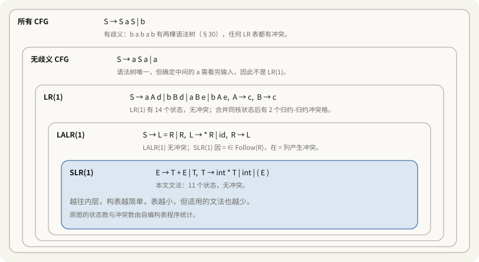

| 문법 | SLR(1) | LALR(1) | LR(1) | 비고 |
|---|---|---|---|---|
| 이 노트의 산술식 | 충돌 0, 상태 11 | 충돌 0, 상태 11 | 충돌 0, 상태 20 | LALR은 LR(1) 20개를 11개로 합친다 |
| $S \to L = R \mid R$, $L \to *R \mid \text{id}$, $R \to L$ | 시프트-리듀스 1칸 | 충돌 0 | 충돌 0 | Follow(R)에 `=`가 들어 있어서 생긴다(§24.2) |
| $S \to aAd \mid bBd \mid aBe \mid bAe$, $A \to c$, $B \to c$ | 리듀스-리듀스 2칸 | 리듀스-리듀스 2칸 | 충돌 0 | 코어가 같은 두 상태를 합치면 미리보기가 섞인다 |
| $S \to aSa \mid a$ | 시프트-리듀스 1칸 | 같음 | 같음 | 모호하지 않다. 가운데를 알려면 끝까지 봐야 한다 |
| $S \to SaS \mid b$ | 시프트-리듀스 1칸 | 같음 | 같음 | 모호하다(§30.2) |

이 포함 관계는 **문법**의 이야기다. **언어**로 보면 LR(k) 언어는 모두 LR(1) 문법으로 다시 쓸 수 있다는 것이 Knuth(1965)의 결과다. 문법이 SLR이 아니면 언어를 포기할 것이 아니라 문법을 고쳐 볼 여지가 있다.

---

**제2부: 생존 접두부와 항목**

## 7. 핸들 식별의 출발점: 스택과 생존 접두부(Viable Prefix)

강의는 우선 스택에 담긴 기호열에 주목한다(슬라이드 18).

```text
- 핸들을 어떻게 검출할지는 자명하지 않다.
- 각 단계에서 분석기는 전체 입력 대신 스택과 제한된 미리보기를 이용한다.
- 어떤 ω에 대해 α | ω가 올바른 시프트-리듀스 구성이면 α는 생존 접두부이다.
```

### 7.1 분석기가 볼 수 있는 정보

분석기는 이미 스택에 들어온 $\alpha$와 바로 다음의 몇 개 토큰만으로 판단해야 한다. 앞으로 이어질 수천 줄의 입력 전체를 미리 해석할 수는 없다. 따라서 스택 기호열의 성질에서 핸들 식별의 단서를 찾아야 한다.

실제 구현에서도 그렇다. Bison이 만든 파서는 미리보기 토큰이 필요할 때만 렉서(`yylex`)를 불러 토큰을 하나 당겨 온다. 애니메이션 2의 토큰 띠가 이 모습이다.

### 7.2 구성 표현: $\alpha \mid \omega$

$$\alpha \mid \omega$$

- $\alpha$: 시프트한 터미널과 리듀스한 논터미널의 혼합열이다. $\alpha \in (V_N \cup V_T)^*$이며, 세로선 바로 왼쪽이 최상단이다.
- $\omega$: 아직 읽지 않은 터미널열이다. $\omega \in V_T^*$이다.

```text
스택                         남은 입력
[α: 바닥 ... 최상단]    |    [ω: 아직 읽지 않은 토큰]
                      경계
```

### 7.3 생존 접두부의 정의

> [!important] 생존 접두부(Viable Prefix)
> 어떤 터미널열 $\omega$에 대해 $\alpha \mid \omega$가 올바른 시프트-리듀스 분석 과정의 구성이 될 수 있다면, $\alpha$를 생존 접두부라고 한다.

즉, 올바른 상향식 분석에서 실제 스택 내용이 될 수 있는 기호열이다. 적절한 나머지 입력과 함께라면 시작 기호까지 리듀스할 가능성이 남아 있다. 슬라이드 19의 말로는 "$\alpha$가 생존 접두부라는 것은 스택 맨 위까지 아직 실수하지 않았다는 뜻일 뿐"이다.

---

## 8. 생존 접두부의 세 가지 성질

강의는 다음 세 가지로 설명한다(슬라이드 19).

- 핸들의 오른쪽 끝을 넘지 않는다.
- 스택의 끝부분이 현재 구성 중인 핸들의 접두부다.
- 스택이 생존 접두부를 유지하는 동안에는 구문 오류가 검출되지 않은 상태다.

> [!warning] 바로잡기: "핸들의 접두부를 포함한다"보다 "끝부분이 핸들의 접두부다"
> 처음에는 두 번째 성질을 "현재 구성 중인 핸들의 접두부를 포함한다"라고 적었다. 포함은 스택 어디에 있어도 된다는 뜻으로 읽힌다. 실제로는 스택을 $\gamma\beta_1$로 나눴을 때 **맨 위 쪽** $\beta_1$이 핸들의 접두부다(§8.2). 슬라이드 19의 "it is a prefix of the handle"도 이 뜻이다.

### 8.1 핸들의 오른쪽 끝을 넘지 않는다

$\alpha \beta \mid \omega$에서 $\beta$가 현재 우측 문장 형태의 핸들이라면, 올바른 다음 동작은 $\beta$를 $A$로 리듀스하는 것이다.

핸들을 완성한 뒤 $\omega$의 토큰까지 계속 시프트하면, 리듀스할 시점을 지나친다. 리듀스는 스택 맨 위에서만 일어나므로, 안쪽에 묻힌 핸들은 다시는 줄일 수 없다. 따라서 올바른 스택 접두부는 해당 핸들의 오른쪽 끝을 넘어가지 않는다.

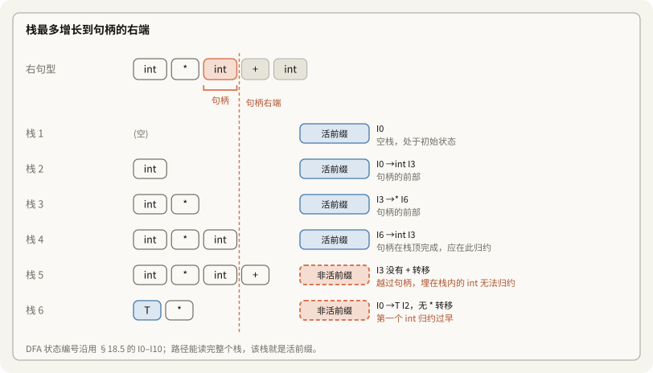

### 8.2 미완성 핸들을 이어 갈 수 있는 접두부

스택 내용은 다음과 같이 나눌 수 있다.

$$\alpha = \gamma \, \beta_1$$

- $\gamma$: 이전에 처리한 문맥으로, 터미널과 논터미널을 포함한다.
- $\beta_1$: 현재 핸들 $\beta = \beta_1\beta_2$의 접두부이다.

뒤의 $\beta_2$를 시프트하거나 필요한 논터미널을 구성하면 핸들을 완성할 수 있다.

```text
우측 최우선 유도: S =>* γ A ω => γ β1 β2 ω
                                  [핸들 β]

현재 구성:       [γ  β1] | [β2  ω]
                  스택      남은 입력
                생존 접두부
```

### 8.3 오류 검출의 경계

스택이 생존 접두부라는 것은 현재까지의 스택 구성이 문법상 가능한 형태라는 뜻이다. 전체 입력이 올바르다는 보장은 아니지만, 아직 그 접두부만으로는 오류가 검출되지 않았다.

다음 토큰에 대해 올바른 시프트나 리듀스가 모두 불가능하면 구문 오류를 보고한다. 이때 이후 입력을 끝까지 읽거나 백트래킹할 필요가 없다.

> [!note] 보충: 잘못된 토큰은 스택에 들어가지 않는다
> LR 계열 분석기는 문법에 맞게 이어 갈 수 없는 토큰을 **시프트하기 전에** 멈춘다. 다만 SLR과 LALR은 Follow나 합친 미리보기 때문에, 멈추기 전에 쓸데없는 리듀스를 몇 번 더 할 수 있다. 정규 LR(1)은 그런 리듀스도 하지 않는다. 11/3 7강 노트 §5.6에서 LL(1)도 올바른 접두부까지만 읽는다는 것을 확인했다.

---

## 9. 상향식 분석의 정리: 생존 접두부 집합은 정규 언어다

강의의 Important Fact #3은 다음과 같다(슬라이드 20).

> [!important] 생존 접두부의 정규성
> 임의의 문맥 자유 문법에 대해, 그 문법의 생존 접두부 전체가 이루는 집합은 정규 언어(Regular Language)이다.

슬라이드의 메모는 "거의 모든 상향식 분석 도구가 이 사실에 기대고 있다"이다.

### 9.1 언어 전체가 비정규인데 접두부 집합은 왜 정규인가?

프로그래밍 언어에는 임의 깊이의 괄호 중첩처럼 유한 상태만으로 처리할 수 없는 구조가 있다. 그러나 스택에는 완성된 부분 구조가 이미 논터미널로 리듀스되어 들어 있으므로, 입력 언어 전체를 직접 판별하는 것과 스택 접두부를 판별하는 것은 다른 문제다.

괄호 문법 $S \to (S) \mid \epsilon$을 생각해 보자.

- 언어 전체에서는 여는 괄호와 닫는 괄호를 정확히 짝지어야 한다.
- 스택의 생존 접두부에는 여러 개의 `(`, 그 뒤에 놓인 $S$, 또는 막 완성된 `(S)` 같은 형태가 나타난다.
- 접두부의 모양을 판별하는 자동기는 중첩 깊이 전체를 직접 세지 않는다. 중첩 정보는 분석 스택이 보존한다.

따라서 언어 자체의 비정규성과 생존 접두부 집합의 정규성은 서로 모순되지 않는다.

> [!note] 보충: 이 문법의 생존 접두부를 정확히 쓰면
> 표 생성기로 DFA를 만들면 상태가 다섯 개이고, 길이 8 이하의 생존 접두부 23개가 모두 다음 정규식에 맞았다.
> $$(^* \quad\mid\quad (^*S \quad\mid\quad (^+S)$$
> 닫는 괄호는 많아야 하나다. `(S)`가 완성되면 바로 $S$로 줄이기 때문이다. `((S))`처럼 닫는 괄호가 둘 쌓인 스택은 생존 접두부가 아니다.

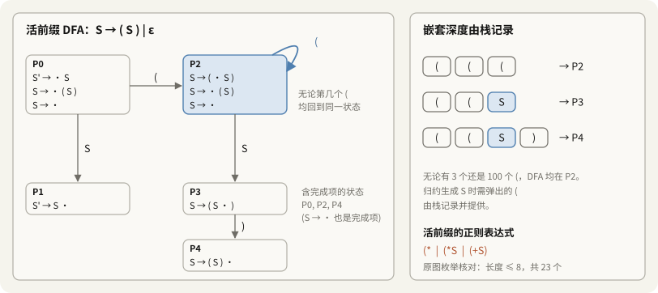

### 9.2 구현에 주는 의미

1. 생성 규칙의 수와 각 우변의 길이는 유한하다. 각 규칙에서 점이 놓일 수 있는 위치도 유한하다.
2. 생존 접두부를 판별하는 DFA를 구성할 수 있다.
3. 기호를 추가할 때 상태를 갱신하고 그 상태를 스택에 저장하면, 최상단 상태로 현재 접두부의 정보를 확인할 수 있다(§28).

---

## 10. 상향식 분석의 반복 과정

```text
생존 접두부
    |
    | 필요한 기호를 시프트하거나 하위 규칙을 리듀스
    v
스택 최상단에 핸들 완성
    |
    | 핸들을 좌변 논터미널로 리듀스
    v
새로운 생존 접두부 ----> 다음 단계 반복
```

1. 미완성 단계: 스택에 규칙의 접두부가 있고, 남은 입력에서 필요한 기호를 시프트한다.
2. 핸들 완성 단계: 필요한 우변이 스택 최상단에 모인다.
3. 리듀스 단계: 핸들을 꺼내 좌변 논터미널을 넣는다. 이 논터미널은 바깥 규칙을 구성하는 새 요소가 된다.

---

## 11. LR(0) 항목(Item)과 진행 위치를 나타내는 점

생존 접두부의 인식 진행 상태를 표현하기 위해 생성 규칙에 점을 넣은 LR(0) 항목을 사용한다(슬라이드 22, 23).

```text
항목은 생성 규칙 우변의 어느 위치에 점을 넣은 것이다.

T -> (E)의 항목:
  T -> .(E)
  T -> (.E)
  T -> (E.)
  T -> (E).

X -> ε의 유일한 항목:
  X -> .

이 항목들을 LR(0) 항목이라고 한다.
```

### 11.1 점 $\cdot$의 의미: 이미 인식한 부분과 앞으로 필요한 부분

$$A \to \alpha \cdot \beta$$

1. 점 왼쪽의 $\alpha$: 이미 인식했고 스택에 놓인 기호열이다.
2. 점 오른쪽의 $\beta$: 앞으로 인식해야 하는 기호열이다.
3. 점이 끝에 도달한 $A \to \alpha\beta\cdot$: 우변 전체를 인식한 완료 항목이다. 이 규칙으로 리듀스할 후보가 된다.

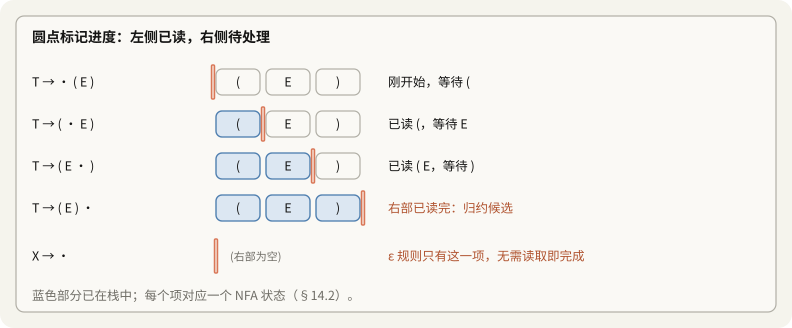

### 11.2 개별 항목의 기대와 항목 집합의 여러 가능성

개별 항목에서는 점 바로 뒤의 기호가 다음에 필요한 기호를 정확히 지정한다.

예를 들어 $S \to (S \cdot )$는 이 유도 경로에서 다음에 필요한 입력이 닫는 괄호라는 뜻이다. 다른 기호가 오면 이 경로는 이어질 수 없다. 슬라이드 26의 말로는 "보고 싶은 것을 못 볼 수도 있다".

분석기 상태 전체에는 여러 항목이 함께 들어갈 수 있다. 다음은 왼쪽 재귀 문법 $E \to E + T \mid E * T \mid \dots$에서 나오는 예다.

$$\left\{ \begin{aligned}
E &\to E \cdot + T \quad (\text{다음 기호 } +) \\
E &\to E \cdot * T \quad (\text{다음 기호 } *)
\end{aligned} \right\}$$

다음 입력이 +이면 덧셈 경로로, *이면 곱셈 경로로 진행한다. 같은 상태에서 시프트와 리듀스가 경쟁하면 뒤에서 다룰 시프트-리듀스 충돌 문제가 생긴다.

### 11.3 $T \to (E)$의 항목별 의미

| LR(0) 항목 | 점의 위치 | 의미 |
|---|---|---|
| $T \to \cdot (E)$ | 맨 앞 | 규칙을 시작했으며 여는 괄호가 필요하다. |
| $T \to (\cdot E)$ | 여는 괄호 다음 | 여는 괄호를 인식했으며 표현식 $E$가 필요하다. |
| $T \to (E \cdot )$ | $E$ 다음 | 여는 괄호와 $E$를 인식했으며 닫는 괄호가 필요하다. |
| $T \to (E)\cdot$ | 맨 끝 | 우변 전체를 인식했으며 $T \to (E)$로 리듀스할 후보이다. |

빈 생성 규칙 $X \to \epsilon$의 항목은 $X \to \cdot$ 하나뿐이다. 입력을 읽지 않아도 우변 인식이 완료된 상태다.

### 11.4 $\epsilon$ 생성 규칙의 특수한 경우

$X \to \epsilon$의 우변에는 기호가 없다.

$$X \to \cdot$$

따라서 이 항목이 활성화되면 새로운 입력을 시프트할 필요 없이 리듀스 후보가 된다. §9.1의 괄호 문법에서 시작 상태 P0와 P2가 모두 $S \to \cdot$를 가져 리듀스 후보가 있는 것이 이 경우다.

---

## 12. 예제: 입력 (int)의 스택과 항목

강의의 예제는 생존 접두부, 스택, 항목의 대응을 보여 준다(슬라이드 26).

```text
입력: (int)
문법:
  E -> T + E | T
  T -> int * T | int | (E)

가능한 구성: (E | )
- (E는 T -> (E)의 우변 접두부이다.
- 닫는 괄호를 시프트하면 우변을 완성한다.
- T -> (E.)는 (E를 인식했고 )를 기다린다는 뜻이다.
```

### 12.1 구성의 변화

1. 시작: $\mid (\text{int})$
2. 여는 괄호 시프트: $(\ \mid \text{int})$
3. int 시프트: $(\ \text{int} \mid )$
4. $T \to \text{int}$로 리듀스: $(\ T \mid )$
5. $E \to T$로 리듀스: $(\ E \mid )$

현재 구성은 다음과 같다.

$$\underbrace{(\ E}_{\text{스택}} \ \mid \ \underbrace{)}_{\text{입력}}$$

SLR(1) 구동기로 돌린 단계도 이와 같았다. 4와 5에서 줄이는 근거는 `)`가 Follow(T)와 Follow(E)에 있다는 것이다(§24).

### 12.2 항목은 어떻게 다음 동작을 안내하는가?

1. 스택의 기호열 (E는 $T \to (E)$ 우변의 진접두부이다.
2. 대응하는 항목은 다음과 같다.
   $$T \to (E \cdot )$$
3. 점 왼쪽의 (E는 이미 인식한 부분이고, 오른쪽의 닫는 괄호는 아직 필요한 부분이다. 이 규칙을 지금 리듀스할 수는 없다.
4. 다음 입력이 닫는 괄호이므로 시프트한다.
   $$(\ E \mid ) \quad\xrightarrow{\text{Shift } )}\quad (\ E\ ) \mid$$
5. 항목이 $T \to (E)\cdot$가 되어, 이 예제에서는 $T \to (E)$로 리듀스한다.

> [!tip] 생존 접두부 인식과 점의 이동
> - 기호 하나를 인식하면 해당 항목의 점이 오른쪽으로 한 칸 이동한다.
> - 점 뒤에 기호가 남아 있으면 그 규칙의 우변은 아직 미완성이다. 시프트하거나 하위 규칙의 리듀스 결과를 기다려야 한다.
> - 점이 끝에 도달하면 완료 항목이 된다. 실제 리듀스 여부는 분석 방식의 판단 규칙에 따른다.

---

## 13. 스택의 내부 구조: 중첩된 대기 관계와 접두부 사슬

강의는 스택에 여러 생성 규칙 우변의 접두부가 함께 놓일 수 있다고 설명한다(슬라이드 28–30).

```text
스택에는 여러 우변 접두부가 있을 수 있다.
  Prefix_1 Prefix_2 ... Prefix_(n-1) Prefix_n

Prefix_i가 X_i -> α_i의 우변 접두부라고 하자.
- Prefix_i는 이후 필요한 부분이 완성되면 X_i로 리듀스된다.
- α_(i-1)의 아직 없는 부분은 X_i로 시작한다.
- 따라서 어떤 β에 대해 다음 규칙이 있다.
  X_(i-1) -> Prefix_(i-1) X_i β

재귀적으로 Prefix_(k+1)...Prefix_n은
α_k의 아직 없는 뒷부분을 구성한다.
```

왜 접두부 여러 개가 이어져 있으며, 서로 어떤 관계를 가질까?

### 13.1 함수 호출 스택과 중첩 작업의 비유

함수 호출 스택을 생각하면 이해하기 쉽다.

- 함수 A는 실행 도중 B를 호출하고, B의 반환값을 기다린다.
- B도 C를 호출하고 기다린다.
- 최상단의 C가 끝나야 B가 이어서 실행되고, B가 끝나야 A가 계속된다.

분석 스택에서도 각 $\text{Prefix}_i$는 일부만 인식한 상위 규칙을 나타낸다. 상위 규칙은 논터미널 $X$가 필요해서 대기하고, 더 안쪽의 규칙이 그 $X$를 구성한다. 안쪽 규칙의 리듀스 결과가 바깥 규칙에 필요한 요소가 된다. 슬라이드 30의 말로는 "언제나 맨 위 접두부에서만 일하고, 리듀스할 때마다 바로 아래 접두부가 한 칸 길어진다".

### 13.2 입력 (int * int)로 살펴보기

문법은 다음과 같다.

$$
\begin{aligned}
E &\to T + E \mid T \\
T &\to \text{int} * T \mid \text{int} \mid (E)
\end{aligned}
$$

여는 괄호, int, *를 시프트한 구성은 다음과 같다.

$$\underbrace{(\ \text{int} *}_{\text{스택}} \ \mid \ \underbrace{\text{int}\ )}_{\text{남은 입력}}$$

스택의 세 기호를 규칙 관점에서 보면 세 접두부의 연결로 해석할 수 있다(슬라이드 31, 32).

```text
스택 바닥 --------------------------------------------> 최상단
기호열:        (                 ε                int *
구조:      [Prefix_1]        [Prefix_2]         [Prefix_3]
규칙:       T -> (E)          E -> T           T -> int * T
항목:       T -> (.E)         E -> .T          T -> int * .T
의미:       ( 인식, E 대기    아직 비어 있음    int * 인식, T 대기
```

1. $\text{Prefix}_1 = \text{"("}$:
   - $T \to (E)$의 접두부이다.
   - 여는 괄호를 인식했으며, 앞으로 $E)$가 필요하다.
2. $\text{Prefix}_2 = \epsilon$:
   - 바깥 규칙에 필요한 $E$를 만들기 위해 $E \to T$를 고려한다.
   - 아직 이 규칙의 기호를 인식하지 않았으므로 접두부는 빈 문자열이다.
   - 다음에 필요한 논터미널은 $T$이다.
3. $\text{Prefix}_3 = \text{"int *"}$:
   - $T \to \text{int} * T$를 진행 중이다.
   - int *를 인식했고, 마지막 $T$를 기다린다.
   - 뒤의 int를 $T$로 리듀스하면 이 규칙을 완성할 수 있다.

$$\text{스택 기호열} = \text{Prefix}_1 + \text{Prefix}_2 + \text{Prefix}_3 = \text{"("} + \epsilon + \text{"int *"} = \text{"( int *"}$$

스택 내용이 여러 우변 접두부의 연결로 표현된다는 설명이 이와 대응한다.

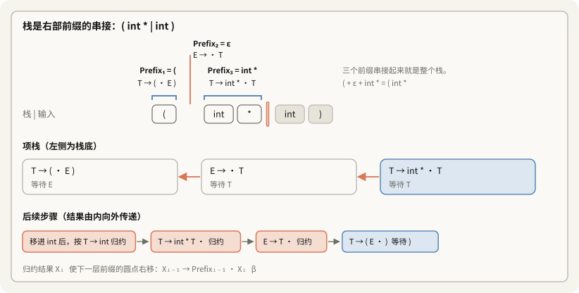

> [!note] 보충: 왜 하필 $E \to T$이고 $E \to T + E$가 아닌가
> 슬라이드 31은 Prefix₂를 $E \to T$의 접두부로 고른다. $E \to T + E$의 빈 접두부로 봐도 스택 `( int *`까지는 똑같이 설명된다. 둘 중 무엇이 맞는지는 뒤의 입력이 정한다. 입력이 `( int * int )`이면 `)` 앞에 `+`가 없으므로 $E \to T$가 실제로 쓰인다. 이렇게 같은 스택을 여러 사슬로 설명할 수 있다는 것이 §14에서 NFA가 필요한 이유이고, 여러 사슬을 한꺼번에 들고 가는 것이 §18의 항목 집합이다.

### 13.3 왜 가운데에 $X_i$가 놓이는가?

강의의 핵심 식은 다음과 같다.

$$X_{i-1} \to \text{Prefix}_{i-1}\ \mathbf{X_i}\ \beta$$

> [!important] 첨자와 중첩 깊이
> - 작은 첨자의 $X_1$ 등은 스택 아래쪽에 있는 바깥 규칙을 뜻한다.
> - 큰 첨자의 $X_n$ 등은 스택 최상단에 가까운 안쪽 규칙을 뜻한다.
> - 바깥 규칙은 안쪽 규칙의 결과를 기다리고, 리듀스 결과는 안쪽에서 바깥쪽으로 전달된다.

상위 규칙의 현재 진행 위치는 다음과 같다.

$$X_{i-1} \to \text{Prefix}_{i-1} \cdot \mathbf{X_i}\ \beta$$

상위 규칙은 접두부를 이미 인식했으며 $X_i$가 필요하다. 입력에는 터미널만 있으므로 $X_i$를 직접 읽을 수는 없다. 하위 규칙 $X_i \to \alpha_i$가 필요한 부분을 인식한 후 $X_i$로 리듀스해야 한다.

리듀스 결과를 받으면 상위 항목은 다음 상태가 된다.

$$X_{i-1} \to \text{Prefix}_{i-1} X_i \cdot \beta$$

$X_i$는 하위 규칙의 결과이면서 상위 규칙의 구성 요소인 셈이다.

### 13.4 생존 접두부 인식의 핵심 아이디어

강의의 설명은 다음과 같이 정리할 수 있다(슬라이드 33).

> [!important] 생존 접두부 인식
> 1. 생성 규칙 우변의 부분 접두부들이 이어진 기호열을 인식한다.
> 2. 각 부분은 이후 완성되어 앞선 규칙의 아직 없는 뒷부분을 구성할 수 있어야 한다.

대기 관계가 문법에 따라 이어질 수 있다면 올바른 접두부이다. 어떤 입력 때문에 가능한 모든 관계가 끊어지면 구문 오류를 검출할 수 있다.

---

**제3부: 생존 접두부 인식기**

## 14. 생존 접두부 인식기 구성: 생성 규칙에서 NFA로

생존 접두부 집합은 정규 언어이므로 유한 오토마타로 인식할 수 있다. 이 오토마타에는 분석 스택의 기호열을 바닥부터 입력한다(슬라이드 35). 터미널과 논터미널이 모두 전이 기호가 된다.

CS143은 다음 여섯 가지 구성 규칙을 제시한다(슬라이드 37–41).

```text
1. 문법 G에 증강 생성 규칙 S' -> S를 추가한다.
2. G의 모든 항목을 NFA 상태로 만든다. 추가한 규칙도 포함한다.
3. E -> α.Xβ에 대해 기호 전이를 추가한다.
   E -> α.Xβ  --X-->  E -> αX.β
4. X가 논터미널이고 X -> γ가 있으면 ε 전이를 추가한다.
   E -> α.Xβ  --ε-->  X -> .γ
5. 모든 상태를 수용 상태로 둔다.
6. 시작 상태는 S' -> .S이다.
```

### 14.1 규칙 1: 증강 생성 규칙 $S' \to S$

원래 문법의 시작 기호 $S$와 새로운 논터미널 $S'$를 연결한다.

원래 시작 기호는 다른 규칙의 우변에도 나타날 수 있다. 예를 들어 $E$는 $E \to T+E$에도 등장한다. 따라서 스택에서 $E$를 얻었다는 사실만으로 전체 입력 분석이 끝났다고 판단할 수 없다.

$S'$는 다른 우변에 등장하지 않는 새 시작 기호이다. 완료 항목 $S' \to S\cdot$와 입력 끝을 함께 확인하면 전체 분석의 성공을 판별할 수 있다. 슬라이드 41은 이유를 더 짧게 적는다. "시작 상태에 편하게 이름을 붙이려고".

### 14.2 규칙 2: NFA 상태는 모든 LR(0) 항목

각 NFA 상태는 점이 있는 생성 규칙 하나이다.

- 점 왼쪽은 이미 인식한 기호이다.
- 점 오른쪽은 앞으로 필요한 기호이다.
- 우변의 각 경계 위치에 점을 놓아 항목을 만든다.
- 우변의 길이가 $m$이면 $m+1$개의 항목이 생긴다.

### 14.3 규칙 3: 기호를 인식하는 전이

$$E \to \alpha \cdot X \beta \xrightarrow{\quad X \quad} E \to \alpha X \cdot \beta$$

현재 항목은 $X$를 기다린다. $X$는 int, + 같은 터미널일 수도, $T$ 같은 논터미널일 수도 있다.

스택 기호열에서 $X$를 읽으면 점을 그 오른쪽으로 이동한다. 즉, $X$를 인식한 진행 상태로 바뀐다.

### 14.4 규칙 4: $\epsilon$ 전이와 하위 규칙의 활성화

$$E \to \alpha \cdot X \beta \xrightarrow{\quad \epsilon \quad} X \to \cdot \gamma \qquad (X \in V_N,\ X \to \gamma)$$

#### (1) 입력에서 논터미널을 직접 읽을 수 없다

$E \to \alpha \cdot X\beta$는 논터미널 $X$가 필요하다는 뜻이다. 그러나 실제 입력은 int, +, 여는 괄호 같은 터미널뿐이다.

#### (2) 스택에서 $X$를 얻는 방법

$X \to \gamma$의 우변을 구성한 뒤 리듀스해야 한다. 그래서 $X$를 생성할 수 있는 모든 규칙을 확인하고, 각 규칙의 시작 항목 $X \to \cdot\gamma$를 활성화한다.

#### (3) 왜 $\epsilon$ 전이인가?

하위 규칙을 고려하기 시작하는 것만으로는 새로운 스택 기호를 읽지 않는다. 따라서 전이에 입력 기호가 필요하지 않다.

상위 작업이 결과물 $X$를 요청하고, 하위 작업이 $\gamma$를 구성할 준비를 하는 것에 비유할 수 있다.

```text
[E -> α . X β]    상위 규칙: X 대기
        |
        | ε: 기호를 소비하지 않고 하위 규칙 활성화
        v
[X -> . γ]        하위 규칙: γ 인식 준비
```

슬라이드 47은 여기서 NFA의 추측 능력이 결정적이라고 강조한다. 이 문법은 좌측 인수 분해도 하지 않았는데, $E \to \cdot T + E$와 $E \to \cdot T$ 중 무엇이 스택에 나타날지 미리 알 필요가 없다. NFA가 "언제나 옳게 고른다"고 치면 되기 때문이다.

### 14.5 규칙 5: 왜 모든 상태가 수용 상태인가?

여기서 오토마타의 입력은 전체 소스 코드가 아니라 현재 스택의 기호열이다. 따라서 "수용"은 프로그램이 완성되었다는 뜻이 아니다.

- 수용: 스택 기호열을 모두 읽은 뒤 도달 가능한 상태가 남아 있다. 현재 스택은 생존 접두부이다.
- 거부: 기호열을 읽는 도중 가능한 전이가 모두 사라진다. 해당 기호열은 생존 접두부가 아니다.

자동차 조립 과정에 비유하면, 섀시만 조립한 상태나 바퀴까지 장착한 상태도 모두 올바른 중간 상태일 수 있다. 완성차만 통과시키는 검사가 아니라, 현재 조립 단계가 가능한지 검사하는 것이다.

어떤 상태에서 문법상 허용되지 않는 부품에 해당하는 기호가 오면 다음 전이가 없어 거부한다. NFA에서는 개별 경로 하나가 막히는 것만으로 거부하지 않으며, 가능한 모든 경로가 막혀야 한다.

> [!important] 수용의 의미
> 점이 처음이나 중간에 있어도 올바른 규칙 진행 상태를 나타낸다. 생존 접두부 인식기는 이런 미완성 상태도 수용한다. 이는 전체 입력을 수용하는 분석기의 Accept 동작과 구분해야 한다.

### 14.6 규칙 6: 시작 상태 $S' \to \cdot S$

분석 시작 시 스택은 비어 있다. 아직 기호를 인식하지 않았으며, 전체 문법의 시작 기호 $S$를 구성해야 하는 상태다.

---

## 15. 예제 문법의 생존 접두부 NFA 구성

앞의 여섯 규칙을 표현식 문법에 적용한다(슬라이드 42–61).

### 15.1 대상 문법

$$
\begin{aligned}
S' &\to E \\
E &\to T + E \mid T \\
T &\to \text{int} * T \mid \text{int} \mid (E)
\end{aligned}
$$

### 15.2 1단계: 모든 LR(0) 항목 나열

모든 생성 규칙의 각 경계에 점을 놓으면 총 18개 항목이 나온다.

| 생성 규칙 | LR(0) 항목 | 상태 번호 |
|---|---|---|
| $S' \to E$ | $S' \to \cdot E$<br>$S' \to E\cdot$ | 1(시작)<br>2(증강 규칙 완료) |
| $E \to T+E$ | $E \to \cdot T+E$<br>$E \to T\cdot+E$<br>$E \to T+\cdot E$<br>$E \to T+E\cdot$ | 3<br>4<br>5<br>6 |
| $E \to T$ | $E \to \cdot T$<br>$E \to T\cdot$ | 7<br>8 |
| $T \to \text{int}*T$ | $T \to \cdot\text{int}*T$<br>$T \to \text{int}\cdot*T$<br>$T \to \text{int}*\cdot T$<br>$T \to \text{int}*T\cdot$ | 9<br>10<br>11<br>12 |
| $T \to \text{int}$ | $T \to \cdot\text{int}$<br>$T \to \text{int}\cdot$ | 13<br>14 |
| $T \to (E)$ | $T \to \cdot(E)$<br>$T \to (\cdot E)$<br>$T \to (E\cdot)$<br>$T \to (E)\cdot$ | 15<br>16<br>17<br>18 |

강의의 NFA에서 각 상자는 이 항목 하나에 대응한다. 이 표의 번호는 내가 붙인 것이다. 강의 그림의 NFA 상태에는 번호가 없다.

### 15.3 2단계: 모든 $\epsilon$ 전이 구하기

점 바로 뒤가 논터미널이면 그 논터미널의 모든 시작 항목으로 $\epsilon$ 전이를 만든다.

#### 1. $E$를 기다리는 항목

- 1: $S' \to \cdot E$
- 5: $E \to T+\cdot E$
- 16: $T \to (\cdot E)$

$E$를 시작하는 항목은 3의 $E \to \cdot T+E$와 7의 $E \to \cdot T$이다.

따라서 1, 5, 16에서 각각 3과 7로 $\epsilon$ 전이를 연결한다. 이 부분에는 $3 \times 2 = 6$개의 $\epsilon$ 전이가 생긴다.

#### 2. $T$를 기다리는 항목

- 3: $E \to \cdot T+E$
- 7: $E \to \cdot T$
- 11: $T \to \text{int}*\cdot T$

$T$를 시작하는 항목은 다음 세 개다.

- 9: $T \to \cdot\text{int}*T$
- 13: $T \to \cdot\text{int}$
- 15: $T \to \cdot(E)$

따라서 3, 7, 11에서 각각 9, 13, 15로 전이를 만든다. 이 부분에는 $3 \times 3 = 9$개의 $\epsilon$ 전이가 생긴다. 합하면 $\epsilon$ 전이는 **15개**다. 슬라이드 43의 완성된 NFA에 적힌 ε 라벨도 15개다.

### 15.4 3단계: 기호 전이 구하기

기호를 읽을 때마다 점을 한 칸 옮긴다. 완료 항목 6개를 뺀 12개 항목에서 기호 전이가 하나씩 나가므로 모두 12개다.

1. 증강 규칙:
   $$S' \to \cdot E \xrightarrow{E} S' \to E\cdot$$
2. 덧셈:
   $$E \to \cdot T+E \xrightarrow{T} E \to T\cdot+E \xrightarrow{+} E \to T+\cdot E \xrightarrow{E} E \to T+E\cdot$$
3. 단일 항:
   $$E \to \cdot T \xrightarrow{T} E \to T\cdot$$
4. 곱셈:
   $$T \to \cdot\text{int}*T \xrightarrow{\text{int}} T \to \text{int}\cdot*T \xrightarrow{*} T \to \text{int}*\cdot T \xrightarrow{T} T \to \text{int}*T\cdot$$
5. 정수:
   $$T \to \cdot\text{int} \xrightarrow{\text{int}} T \to \text{int}\cdot$$
6. 괄호:
   $$T \to \cdot(E) \xrightarrow{(} T \to (\cdot E) \xrightarrow{E} T \to (E\cdot) \xrightarrow{)} T \to (E)\cdot$$

### 15.5 생존 접두부 NFA 구조

다음 Mermaid 도식은 항목 상태와 모든 전이를 나타낸다.

> [!warning] 바로잡기: 처음 그림에는 ε 전이 3개가 빠져 있었다
> 처음 Mermaid 도식의 ε 전이는 12개였다. §15.3대로 세면 15개여야 한다. 빠진 것은 $E \to T+\cdot E \xrightarrow{\epsilon} E \to \cdot T$, $T \to \text{int}*\cdot T \xrightarrow{\epsilon} T \to \cdot\text{int}$, $T \to \text{int}*\cdot T \xrightarrow{\epsilon} T \to \cdot(E)$ 세 개다. 셋이 없으면 `int + int`(5에서 7로 가야 한다)나 `int * ( int )`(11에서 15로 가야 한다) 같은 스택을 거부하게 된다. 아래 도식에 채워 넣었다.

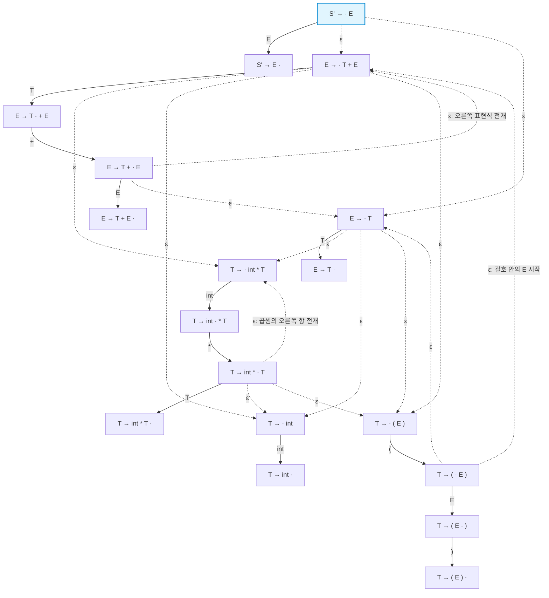

---

## 16. 실행 예제: NFA는 스택 ( int *를 어떻게 검사하는가?

시프트-리듀스 분석기의 현재 스택이 여는 괄호, int, *라고 하자.

1. 시작 상태는 $S' \to \cdot E$이다.
2. $\epsilon$ 전이로 필요한 하위 규칙을 활성화한다.
   $$S' \to \cdot E \xrightarrow{\epsilon} E \to \cdot T \xrightarrow{\epsilon} T \to \cdot(E)$$
   표현식 $E$를 기다리는 상태에서 여는 괄호를 읽을 수 있는 경로로 이어진다.
3. 스택의 첫 기호인 여는 괄호를 읽는다.
   $$T \to \cdot(E) \xrightarrow{(} T \to (\cdot E)$$
4. 괄호 안의 표현식을 위해 다시 $\epsilon$ 전이를 따른다.
   $$T \to (\cdot E) \xrightarrow{\epsilon} E \to \cdot T \xrightarrow{\epsilon} T \to \cdot\text{int}*T$$
5. 두 번째 기호 int를 읽는다.
   $$T \to \cdot\text{int}*T \xrightarrow{\text{int}} T \to \text{int}\cdot*T$$
6. 세 번째 기호 *를 읽는다.
   $$T \to \text{int}\cdot*T \xrightarrow{*} T \to \text{int}*\cdot T$$
7. 스택 기호를 모두 읽었고 도달 가능한 상태가 남아 있다. 모든 NFA 상태가 수용 상태이므로 이 기호열은 생존 접두부로 수용된다.

이는 전체 프로그램의 분석 완료가 아니라, 현재 스택 구성이 문법상 가능하다는 판정이다.

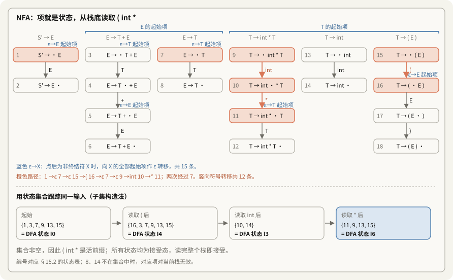

> [!note] 보충: 위 경로는 NFA가 "맞게 추측한" 한 갈래다
> 2단계에서 $E \to \cdot T + E$로 가도 `( int *`까지는 똑같이 읽힌다. 그림 아래 띠처럼 가능한 상태를 **전부** 들고 가면 추측이 필요 없다. 이 집합이 각각 §18.5의 $I_0, I_4, I_3, I_6$과 같다는 것이 다음 절의 출발점이다. 반대로 스택이 `( int +`이면 `int` 다음 집합 {10, 14}에 `+` 전이가 없어 집합이 비고, 생존 접두부가 아니다.

---

## 17. 다음 단계: NFA를 DFA로 바꾸는 이유

지금까지 생존 접두부 인식 NFA를 구성했다. 하지만 $\epsilon$ 전이와 여러 분기 때문에 한 기호를 읽을 때 가능한 상태가 여러 개 생긴다.

예를 들어 $S' \to \cdot E$에서는 $E \to \cdot T+E$와 $E \to \cdot T$를 모두 고려해야 한다.

실행 중에 경로 하나를 추측하는 대신, 부분집합 구성법(Subset Construction)으로 가능한 상태들을 한꺼번에 묶는다.

- $\epsilon$ 전이로 도달 가능한 항목들을 포함하는 항목 집합(Item Set)을 구성한다.
- 항목 집합 하나를 DFA 상태 하나로 사용한다.
- 기호를 읽으면 해당 집합 전체를 다음 집합으로 결정적으로 이동시킨다.

이 결과가 LR(0) 항목 집합의 정규 모음(Canonical Collection of LR(0) Items)이며, LR 분석표 구성의 기반이 된다(슬라이드 67).

---

## 18. NFA에서 DFA로: 항목 집합과 부분집합 구성법

NFA의 여러 가능한 상태를 항목 집합으로 묶으면 결정적 상태 전이를 얻는다.

```text
NFA 관점                         DFA 관점
상태 하나 = LR(0) 항목 하나       상태 하나 = LR(0) 항목 집합
ε 전이와 여러 가능 경로           기호별 결정적 전이
여러 상태를 동시에 추적            집합에 붙인 상태 번호로 추적
```

### 18.1 렉서의 부분집합 구성법과 비교

렉서에서 배운 NFA-DFA 변환과 알고리즘은 같다. NFA 상태의 이름이 숫자에서 점을 포함한 문법 항목으로 바뀌었을 뿐이다(10/27 노트의 부분집합 구성).

| 비교 항목 | 렉서의 부분집합 구성법 | LR(0) 항목 집합 DFA | 공통점과 차이 |
|---|---|---|---|
| NFA 상태 | 정규식에서 유도한 상태 노드 | 점을 넣은 생성 규칙 | 둘 다 NFA 상태이다. |
| 초기 상태 $D_0$ 또는 $I_0$ | NFA 시작 상태의 $\epsilon$-closure | $S' \to \cdot E$의 CLOSURE | 모두 $\epsilon$ 전이의 도달 가능 집합이다. |
| 입력 알파벳 | 소스 코드의 문자 | 터미널 토큰과 논터미널 | LR 생존 접두부 인식기는 논터미널도 전이 기호로 쓴다. |
| 새 상태 생성 | 해당 문자 전이 후 폐포 계산 | 점을 기호 너머로 이동한 뒤 폐포 계산 | 새로운 집합이면 새 상태 번호를 부여한다. |
| 결과 표 | 렉서 DFA 전이표 | LR 분석표의 기초가 되는 전이 정보 | LR에서는 추가로 리듀스와 수용 동작을 채운다. |
| DFA의 검사 대상 | 소스 코드의 문자 스트림 | 현재 분석 스택의 기호열 | 검사하는 대상이 다르다. |

### 18.2 여러 규칙을 한 상태에 묶는 의미

항목 집합은 현재 가능한 유도 경로들의 목록이다. 어느 한 경로를 미리 선택하지 않는다.

쇼핑 목록에 사과, 바나나, 우유가 함께 적혀 있다고 생각해 보자. 과일 구역으로 들어가면 사과와 바나나에 해당하는 가능성만 남기는 식이다. 새 기호를 읽으면 그 기호와 양립하는 항목들로 목록을 결정적으로 갱신한다.

### 18.3 폐포(CLOSURE) 계산

1. 시작 항목들을 집합 $I$에 넣는다.
2. $A \to \alpha\cdot X\beta \in I$이고 $X$가 논터미널이면, 모든 $X \to \gamma$에 대해 $X \to \cdot\gamma$를 넣는다.
3. 더 이상 새 항목이 추가되지 않을 때까지 반복한다.

CLOSURE는 NFA의 ε-closure를 항목 언어로 다시 쓴 것이다. 2번이 §14.4의 ε 전이 규칙 그대로다.

#### 예제: 초기 상태 $I_0$ 구성

$$
\begin{aligned}
S' &\to E \\
E &\to T + E \mid T \\
T &\to \text{int} * T \mid \text{int} \mid (E)
\end{aligned}
$$

- 시작 항목은 $S' \to \cdot E$이다.
- 점 뒤가 $E$이므로 $E \to \cdot T+E$, $E \to \cdot T$를 추가한다.
- 새 항목의 점 뒤가 $T$이므로 $T$의 세 시작 항목을 추가한다.
- 이제 더 추가할 항목이 없어 폐포가 완성된다.

```text
상태 0 (I0)
  S' -> . E
  E  -> . T + E
  E  -> . T
  T  -> . int * T
  T  -> . int
  T  -> . (E)
```

빈 스택에서 시작 기호 $E$를 기다리는 동시에, 그 $E$를 만들 수 있는 덧셈, 곱셈, 괄호, 정수 경로를 한 상태에 담는다.

### 18.4 상태 전이(GOTO) 계산

항목 집합 $I$와 기호 $X$에 대해 다음과 같이 계산한다.

1. $A \to \alpha\cdot X\beta$ 형태의 모든 항목을 찾는다.
2. 점을 옮겨 $A \to \alpha X\cdot\beta$를 만든다.
3. 그렇게 얻은 집합의 CLOSURE를 계산한다.

그 결과가 $\text{GOTO}(I,X)$이다.

#### 상태 전이 예제

상태 0에서 int를 읽는 항목은 다음 두 개다.

- $T \to \cdot\text{int}*T$
- $T \to \cdot\text{int}$

따라서 다음 집합을 얻는다.

$$\{T \to \text{int}\cdot*T,\ T \to \text{int}\cdot\}$$

점 뒤가 터미널이거나 끝이므로 폐포로 추가할 항목이 없다.

상태 0에서 여는 괄호를 읽으면 $T \to (\cdot E)$를 얻는다. 점 뒤가 논터미널 $E$이므로 $E$와 $T$의 시작 항목들을 폐포에 추가한다.

### 18.5 전체 항목 집합 DFA

아래 도식의 상태 번호 $I_0$–$I_{10}$은 내가 붙인 것이다. 강의 그림의 번호(1–11)와의 대응은 §27.1에 있다. 표 생성기로 만든 DFA와 상태 11개, 전이 18개가 모두 같았고, §15의 NFA에 부분집합 구성을 직접 돌린 결과도 같은 11개 집합이었다.

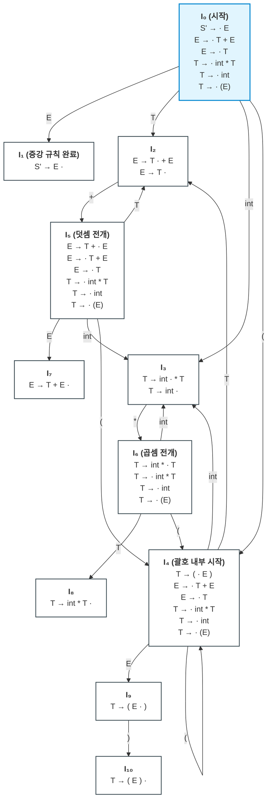

이 DFA에는 $\epsilon$ 전이가 없다. 모든 전이는 특정 터미널 또는 논터미널 하나에 대응한다. NFA 상태가 18개인데 DFA 상태는 11개다. 부분집합 구성이 상태를 늘리기만 하는 것은 아니다. $\{1, 3, 7, 9, 13, 15\}$처럼 늘 함께 다니는 항목은 한 상태로 합쳐진다.

---

## 19. 유효 항목(Valid Item)의 형식적 정의

DFA를 구성한 뒤에는, 어떤 항목이 현재 접두부에 대해 유효한지 정의할 수 있다(슬라이드 68).

```text
우측 최우선 유도로 다음이 성립하면,
  S' =>* αXω => αβγω
항목 X -> β.γ는 생존 접두부 αβ에 대해 유효하다.

αβ를 분석한 뒤의 유효 항목들은
항목 스택 최상단에 있을 수 있는 가능성을 나타낸다.
```

### 19.1 식과 현재 분석 구성의 대응

$$S' \Longrightarrow_{\text{rm}}^* \alpha X \omega \Longrightarrow_{\text{rm}} \alpha \beta \gamma \omega$$

- $\alpha\beta$: 현재 스택의 기호열이자 생존 접두부이다. $\beta$는 최상단에 놓인다.
- $\omega$: 우측 최우선 유도에서 $X$ 오른쪽에 있는 터미널열이다.
- $X \to \beta\gamma$: 가장 오른쪽 논터미널 $X$를 전개한 규칙이다.

### 19.2 유효 항목의 의미

$X \to \beta\gamma$에서 $\beta$는 이미 인식한 부분이고, $\gamma$는 앞으로 입력을 읽거나 하위 규칙을 리듀스하여 구성해야 할 부분이다.

따라서 다음 항목은 현재 진행 상황을 표현한다.

$$X \to \beta \cdot \gamma$$

위의 우측 최우선 유도 관계가 존재하면 이 항목은 생존 접두부 $\alpha\beta$에 대해 유효하다.

> [!important] 유효 항목은 문법으로 뒷받침되는 가능성이다
> 현장에 남은 단서로 가능한 상황을 추론하는 것과 비슷하다. 추측이 아니라 실제 문법 유도로 설명할 수 있어야 한다.
>
> 스택이 숫자와 +까지 인식한 상태라면, $E \to T+\cdot E$는 다음 표현식을 기다리는 합리적인 후보이다. 반면 이 산술 문법에서 다음에 while이 와야 한다는 가정은 생성 규칙으로 뒷받침되지 않는다.
>
> 유효 항목은 현재 스택을 설명하는 올바른 유도 경로를 나타낸다.

---

## 20. DFA 상태와 유효 항목 집합의 동등성

실행 중에 새 기호를 넣을 때마다 가능한 우측 최우선 유도를 모두 만들어 볼 수는 없다. 이 간극을 DFA가 메운다.

### 20.1 동등성 정리

> [!important] DFA와 유효 항목
> 항목 $I$가 생존 접두부 $\alpha$에 대해 유효할 필요충분조건은, 생존 접두부 인식 DFA가 $\alpha$를 읽고 도달한 상태 $s$에 $I$가 포함되는 것이다.

두 관점은 같은 집합을 나타낸다(슬라이드 69의 "exactly").

- 수학적 관점: $\alpha$에 대해 올바른 우측 최우선 유도로 뒷받침되는 항목 전체.
- 구현 관점: $\alpha$를 읽은 뒤 도달한 DFA 상태에 들어 있는 항목 전체.

> [!note] 보충: 정의대로 세어 본 결과
> 우측 최우선 유도를 직접 나열해서 생존 접두부와 유효 항목을 모았다. 문장 형태의 길이를 11 이상 허용하자 길이 5 이하 생존 접두부 99개가 DFA가 받아들이는 기호열과 정확히 같았고, 각 접두부의 유효 항목 집합도 DFA 상태의 항목과 모두 같았다. 상한을 9로 낮추면 접두부 99개는 다 나오는데 유효 항목 일부가 빠졌다. 짧은 접두부라도 그 항목을 뒷받침하는 유도는 길 수 있다는 뜻이고, DFA가 그 긴 유도를 미리 계산해 둔다는 뜻이기도 하다.

### 20.2 구현에서 얻는 이점

실행 중에 유도 트리를 다시 구성하지 않아도 된다. 가능한 항목들은 DFA를 구성할 때 미리 계산되어 있다.

1. 스택의 각 위치에 상태 번호를 저장한다.
2. 새 기호를 인식하면 표를 조회해 다음 상태로 이동한다.
3. 현재 상태의 항목 집합으로 가능한 시프트와 리듀스 후보를 확인한다.
4. 미리보기와 해당 분석 방식의 규칙으로 실제 동작을 선택한다.

---

## 21. 하나의 항목이 무한히 많은 접두부에 유효할 수 있다

강의에서는 다음 예를 든다(슬라이드 70, 71).

```text
항목 T -> (.E)는 다음 접두부들에 모두 유효하다.
  (
  ((
  (((
  ((((
  ...
```

왜 같은 항목이 서로 다른 깊이의 접두부에 유효할까?

### 21.1 자동기 관점: 상태 그래프의 순환

앞의 DFA에서 $I_4$에는 $T \to (\cdot E)$가 들어 있고, 여는 괄호를 읽으면 다시 $I_4$로 돌아가는 자기 순환이 있다.

- 첫 번째 여는 괄호: $I_0 \xrightarrow{(} I_4$.
- 두 번째 여는 괄호: $I_4 \xrightarrow{(} I_4$.
- 여는 괄호 100개: 같은 순환을 반복한 뒤 여전히 $I_4$에 있다.

그러므로 같은 항목이 이 모든 생존 접두부에 대해 유효하다.

### 21.2 중첩 구조에서 같은 진행 상태를 재사용

양파를 한 겹씩 벗길 때마다 "안쪽에 또 한 겹이 있다"는 설명이 반복되는 것과 비슷하다.

첫 번째 괄호를 읽어도, 100번째 괄호를 읽어도 현재 국소적인 요구는 같다. 여는 괄호를 보았고 내부 표현식 $E$를 기다린다.

DFA는 순환으로 이 진행 상태를 재사용한다. 중첩 깊이를 보존하고 나중에 되돌아갈 수 있게 하는 역할은 분석 스택이 맡는다(§9.1 그림).

---

**제4부: LR(0)과 SLR(1)**

## 22. LR(0) 분석기의 동작 규칙

현재 스택이 $\alpha$, 다음 입력 토큰이 $t$, 생존 접두부 DFA가 $\alpha$를 읽고 도달한 상태가 $s$라고 하자.

```text
현재 구성: [스택 α] | [다음 토큰 t ...]
                |
                v
           DFA 상태 s
          유효 항목 집합
```

LR(0)은 다음 기준으로 동작을 정한다(슬라이드 73).

```text
리듀스 X -> β의 후보:
  s에 X -> β.가 있다.

시프트의 후보:
  s에 X -> β.tω가 있다.
  즉, s에 t로 표시된 전이가 있다.
```

강의는 이것을 "아주 약하지만 SLR과 매우 비슷한 알고리즘"으로 먼저 소개한다(슬라이드 72).

### 22.1 리듀스 규칙

상태 $s$에 완료 항목 $X \to \beta\cdot$가 있으면, LR(0)은 다음 입력으로 리듀스 조건을 제한하지 않는다.

스택에서 $\beta$를 꺼내고 $X$를 넣는 리듀스를 지정한다. 이 지정이 다른 동작과 충돌하지 않아야 LR(0) 분석표로 사용할 수 있다.

### 22.2 시프트 규칙

상태 $s$에 $X \to \beta\cdot t\omega$가 있으면 $t$를 읽는 전이가 있다. 입력이 $t$일 때 이를 스택에 넣고 해당 전이의 다음 상태로 이동한다.

---

## 23. LR(0)의 두 가지 충돌

LR(0)의 0은 리듀스를 결정할 때 미리보기 정보를 사용하지 않는다는 뜻이다. 시프트할 때는 어느 전이를 탈지 정하려고 다음 토큰을 보지만, "줄일까 읽을까"는 상태만으로 정한다. 현재 상태의 항목만으로 리듀스를 지정하므로 다음 두 충돌이 발생할 수 있다(슬라이드 74).

### 23.1 리듀스-리듀스 충돌(Reduce/Reduce Conflict)

같은 상태에 완료 항목 두 개가 있는 경우다.

$$\{X \to \beta\cdot,\quad Y \to \omega\cdot\}$$

서로 다른 생성 규칙으로 리듀스하라는 동작이 겹친다. 분석기는 $X$로 리듀스할지 $Y$로 리듀스할지 결정할 수 없다.

### 23.2 시프트-리듀스 충돌(Shift/Reduce Conflict)

같은 상태에 완료 항목과 터미널을 기다리는 항목이 함께 있는 경우다.

$$\{X \to \beta\cdot,\quad Y \to \omega\cdot t\delta\}$$

하나는 지금 리듀스하라고 하고, 다른 하나는 다음 토큰 $t$를 시프트하라고 한다. 입력이 $t$일 때 두 동작이 경쟁한다. 슬라이드의 말로는 "다음 입력이 $t$일 때만 문제".

### 23.3 앞에서 구성한 DFA의 실제 충돌

#### 충돌 1: 상태 $I_2$

```text
상태 I2
  E -> T .        리듀스 후보: E -> T
  E -> T . + E    시프트 후보: +
```

스택 최상단이 $T$이고 다음 입력이 +일 때, $T$를 $E$로 바꿀지 +를 시프트할지 결정할 수 없다(슬라이드 75).

#### 충돌 2: 상태 $I_3$

```text
상태 I3
  T -> int .      리듀스 후보: T -> int
  T -> int . * T  시프트 후보: *
```

스택 최상단이 int이고 다음 입력이 *일 때도 같은 문제가 생긴다(슬라이드 76). 표 생성기로 세어도 LR(0) 충돌 상태는 이 둘뿐이다. $I_1$의 $S' \to E\cdot$은 수락이고, 시프트 항목이 없어 충돌하지 않는다.

> [!warning] LR(0)의 제한
> LR(0)으로 직접 처리할 수 있는 문법의 범위는 좁다. 실용적인 범용 프로그래밍 언어 문법을 처리하려면 더 정교한 판단 정보가 필요하다.

---

## 24. SLR(1) 분석기와 Follow 집합

SLR(Simple LR)은 LR(0)의 판단 규칙을 개선한다. 같은 LR(0) 항목 집합 DFA를 쓰면서 리듀스 조건을 제한해 충돌을 줄인다. 슬라이드 77의 표현으로는 "작은 휴리스틱 하나를 더해 충돌하는 상태를 줄인다".

### 24.1 다음 토큰 하나를 확인한다

현재 스택이 $\alpha$, DFA 상태가 $s$, 다음 입력이 $t$라고 하자(슬라이드 78).

```text
리듀스 X -> β의 조건:
  s에 X -> β.가 있다.
  t ∈ Follow(X)이다.

시프트 조건:
  s에 X -> β.tω가 있다.
```

DFA의 상태와 전이는 그대로 두고, 다음 토큰과 Follow 집합을 리듀스 판단에 추가한다.

### 24.2 왜 $\text{Follow}(X)$를 확인하는가?

$\beta$를 $X$로 리듀스한다면 다음 입력 토큰 $t$는 문법상 $X$ 뒤에 올 수 있어야 한다. 그 가능한 터미널들을 모은 것이 $\text{Follow}(X)$이다. 슬라이드 79는 "$\beta \mid t$를 $X \mid t$로 바꾸는데 $t$가 $X$ 뒤에 올 수 없다면 말이 안 된다"라고 설명한다.

- $t \in \text{Follow}(X)$이면 해당 리듀스를 후보로 허용한다.
- $t \notin \text{Follow}(X)$이면 그 리듀스를 금지한다.

Follow 집합은 문법 전체에서 계산한 정보이므로, 모든 문법의 충돌을 해결해 주는 것은 아니다.

> [!note] 보충: Follow가 "너무 넓은" 예
> $S \to L = R \mid R$, $L \to *R \mid \text{id}$, $R \to L$에서 `=`는 Follow(R)에 들어간다. $S \to L = R$의 $L$이 $L \to *R$로 펼쳐지면 $R$ 바로 뒤에 `=`가 오기 때문이다. 그런데 스택이 $L$뿐인 상태 $\{S \to L\cdot = R,\ R \to L\cdot\}$에서는 $R$ 뒤에 `=`가 올 수 없다. 그 $R$은 문장 전체이기 때문이다. SLR은 이 문맥을 모르고 `=` 칸에 리듀스를 넣어 시프트와 충돌한다. 항목에 미리보기를 붙인 LR(1)과 LALR(1)은 이 칸을 비운다(§6.1 표). 슬라이드 130이 말하는 "Follow 집합보다 정확하다"가 이것이다.

### 24.3 두 충돌을 Follow 집합으로 해결

이 문법의 Follow 집합은 다음과 같다(슬라이드 81).

$$
\begin{aligned}
\text{Follow}(E) &= \{ \$,\; ) \} \\
\text{Follow}(T) &= \{ \$,\; ),\; + \}
\end{aligned}
$$

#### 1. $I_2$의 충돌 해결

- $E \to T\cdot$: $t \in \text{Follow}(E)$일 때 리듀스한다.
- $E \to T\cdot+E$: $t = +$이면 시프트한다.

$$\text{Follow}(E) \cap \{+\} = \{\$,\; )\} \cap \{+\} = \emptyset$$

따라서 +이면 시프트하고, 입력 끝 또는 닫는 괄호이면 리듀스한다. 두 동작의 조건이 겹치지 않는다.

#### 2. $I_3$의 충돌 해결

- $T \to \text{int}\cdot$: $t \in \text{Follow}(T)$일 때 리듀스한다.
- $T \to \text{int}\cdot*T$: $t = *$이면 시프트한다.

$$\text{Follow}(T) \cap \{*\} = \{\$,\; ),\; +\} \cap \{*\} = \emptyset$$

따라서 *이면 시프트하고, 입력 끝, 닫는 괄호 또는 +이면 리듀스한다.

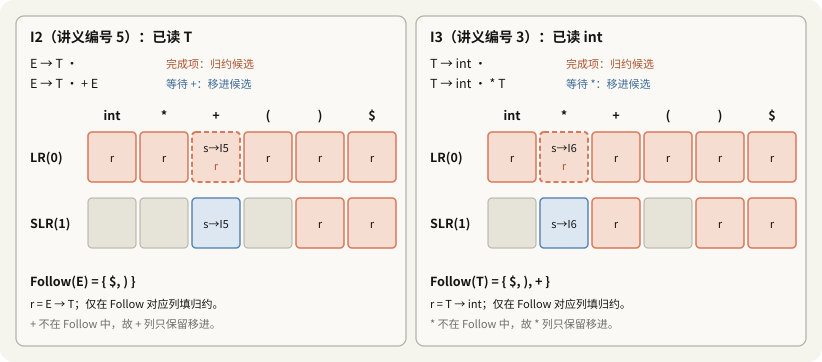

> [!important] 판정
> 이 문법의 LR(0) 충돌은 SLR(1)의 조건으로 모두 제거된다. 따라서 이 문법은 SLR(1) 문법이다.

빈칸이 생긴다는 점도 보자. LR(0) 행은 모든 열이 리듀스로 차 있었는데, SLR(1) 행에서는 `int`, `(` 같은 열이 빈칸, 곧 오류가 된다. Follow는 충돌만 줄이는 것이 아니라 오류도 더 일찍 잡는다.

---

## 25. 모호한 문법과 SLR의 한계: 우선순위 선언

많은 문법은 SLR이 아니며, 모호한 문법도 모두 여기에 포함된다. 우선순위 선언을 추가하면 충돌을 선택 규칙으로 해결해 더 많은 문법을 분석할 수 있다(슬라이드 82).

### 25.1 모호한 산술 표현식 문법

$$E \to E+E \mid E*E \mid (E) \mid \text{int}$$

항목 집합에는 다음 항목들이 함께 나타날 수 있다(슬라이드 83).

$$\{E \to E*E\cdot,\quad E \to E\cdot+E\}$$

스택 최상단의 $E*E$는 리듀스 후보이고, 다음 입력 +는 시프트 후보이다.

이 문법에서는 $E$ 뒤에 +와 *가 모두 올 수 있다.

$$\text{Follow}(E) = \{\$,\; +,\; *,\; )\}$$

따라서 +에 대한 시프트와 리듀스가 겹치며 SLR만으로 충돌을 제거하지 못한다. 표 생성기로 세면 이런 칸이 네 개다. $E + E$ 다음과 $E * E$ 다음 상태에서 각각 `+`와 `*` 칸이다.

### 25.2 우선순위 선언으로 충돌 해결

"*의 우선순위가 +보다 높다"는 규칙을 추가한다.

이 상태에서는 스택의 곱셈을 먼저 묶어야 하므로 $E*E$를 $E$로 리듀스하도록 선택한다. 분석표에서 +에 해당하는 칸의 경쟁 동작 중 Reduce를 채택하는 것이다. 슬라이드 83의 메모대로, 이 리듀스는 `*`를 트리의 더 아래에 놓는다.

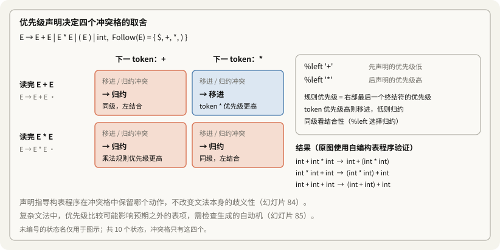

> [!note] 보충: 나머지 세 칸도 같은 비교로 정해진다
> 우선순위만으로는 네 칸 중 둘(서로 다른 연산자끼리)만 정해진다. 같은 연산자끼리인 `E + E` 다음 `+`와 `E * E` 다음 `*`는 결합 방향이 정한다. `%left`는 리듀스(왼쪽으로 묶기), `%right`는 시프트다. Bison 매뉴얼의 규칙은 "규칙의 우선순위는 우변의 마지막 단말의 것"이고, 토큰 쪽이 높으면 시프트, 낮으면 리듀스다. 이 규칙을 표 생성기에 넣어 돌린 결과가 그림 오른쪽 세 줄이다. 11/3 7강 노트 §14.3의 "기본값 시프트"는 이 네 칸을 전부 시프트로 채우므로 `2 * 3 + 4`가 14가 된다.

### 25.3 우선순위 선언이라는 용어의 주의점

강의는 이 선언이 실제로는 충돌 해결 지침임을 지적한다(슬라이드 84).

문법의 모호함이 수학적으로 사라지는 것은 아니다. 분석표 생성기에 특정 충돌에서 어떤 동작을 남길지 알려 주는 것이다. 예를 들어 해당 상태에서 +를 만나면 Shift 대신 Reduce를 선택하도록 표를 정한다.

슬라이드 84는 이어서, 이 예처럼 자연스러운 문법에서는 충돌 해결이 원하는 우선순위와 같은 효과를 내지만 문법이 복잡해지면 여러 부분이 얽혀 의도와 다르게 작동할 수 있다고 경고한다. 슬라이드 85의 권고는 도구가 출력하는 오토마톤을 직접 보고, 충돌이 기대대로 해결됐는지 확인하라는 것이다. Bison에서는 `--report=all`이 그 출력이다.

---

## 26. SLR(1) 구문 분석의 전체 알고리즘

```text
1. G의 생존 접두부 DFA를 M이라고 한다.
2. 초기 구성은 | x1 ... xn $이다.
3. S | $에 도달할 때까지 반복한다.
   - 현재 구성을 α | ω라고 한다.
   - 스택 α를 M에 입력한다.
   - M이 α를 거부하면 구문 오류를 보고한다.
   - M이 α를 수용하고 항목 집합 I에 도달하면,
     다음 입력 a에 대해 다음을 적용한다.
       X -> β.aγ ∈ I이면 시프트한다.
       X -> β. ∈ I이고 a ∈ Follow(X)이면 리듀스한다.
       어느 것도 가능하지 않으면 구문 오류를 보고한다.
```

슬라이드 86은 이것을 "Naïve SLR Parsing Algorithm"이라고 부른다. §28에서 고칠 비효율을 이름에 미리 적어 둔 셈이다.

### 26.1 전체 실행 반복문

1. 스택을 비우고 입력 토큰열 뒤에 끝 기호 $\$$를 붙인다.
2. 현재 스택 $\alpha$를 생존 접두부 DFA $M$으로 검사하여 항목 집합 $I$를 얻는다.
3. 다음 입력 $a$를 확인한다.
   - $X \to \beta\cdot a\gamma \in I$이면 $a$를 시프트한다.
   - $X \to \beta\cdot \in I$이고 $a \in \text{Follow}(X)$이면 $\beta$를 $X$로 리듀스한다.
   - 둘 다 불가능하면 구문 오류를 보고한다.
4. 시작 기호와 입력 끝이 확인되면 수용한다.

### 26.2 실제 구현에서는 왜 "M이 α를 거부하는지" 다시 검사하지 않는가?

추상 알고리즘은 매번 스택을 DFA에 입력하고 거부 여부를 검사한다. 그러나 올바른 분석표를 따라 동작하는 구현에서는 생존 접두부 불변식이 이미 유지된다.

> [!important] 생존 접두부 불변식
> 이전 단계에서 허용된 Shift 또는 Reduce만 수행했다면, 현재 스택은 생존 접두부이다. 따라서 스택을 다시 DFA에 넣어 거부 여부를 검사할 필요가 없다.

실제 오류는 현재 스택의 합법성과 별개로, 다음 토큰 $a$에 대해 허용된 시프트와 리듀스가 모두 없을 때 검출된다. 슬라이드 87도 그 줄에 "필요 없다: 아래의 검사가 언제나 오류를 잡는다. 잘못된 스택은 결코 만들어지지 않는다"라고 적어 둔다.

### 26.3 SLR(k)와 실용적인 미리보기 길이

- $k$는 판단에 사용하는 미리보기 토큰 수이다.
- 주어진 미리보기와 판단 규칙으로도 충돌이 남으면 해당 문법은 그 분석 방식에 속하지 않는다(슬라이드 88).
- 실무에서는 한 토큰 미리보기가 널리 사용된다("In practice k = 1"). 필요에 따라 우선순위 선언이나 LALR(1) 등 다른 구성 방식을 사용한다.
- 미리보기 길이를 늘리면 분석표와 구성 비용이 커질 수 있으므로, 단순히 $k$를 늘리는 것이 항상 적절한 해결책은 아니다.

---

## 27. 전체 실행 예제: SLR로 `int * int $` 분석하기

스택, DFA 상태, Follow 집합이 실제로 어떻게 함께 작동하는지 추적한다(슬라이드 89–121).

### 27.1 준비: 상태 번호와 항목 집합

이 절에서는 강의의 1부터 11까지 상태 번호를 사용한다. 앞 절의 $I_0$부터 시작하는 번호와 구분해야 한다.

Follow 집합:

- $\text{Follow}(E) = \{\$,\; )\}$
- $\text{Follow}(T) = \{\$,\; ),\; +\}$

주요 상태:

- 상태 1: 시작 상태. $S' \to \cdot E$와 $E$, $T$의 시작 항목들을 포함한다.
- 상태 2: $S' \to E\cdot$. 다음 입력이 $\$$이면 수용한다.
- 상태 3: $\{T \to \text{int}\cdot*T,\ T \to \text{int}\cdot\}$. int를 인식했다.
- 상태 4: $\{T \to \text{int}*T\cdot\}$. 곱셈 우변을 완성했다.
- 상태 5: $\{E \to T\cdot,\ E \to T\cdot+E\}$. $T$를 인식했다.
- 상태 6: $E \to T+\cdot E$와 그 폐포. 덧셈의 오른쪽 표현식을 기다린다.
- 상태 7: $\{E \to T+E\cdot\}$. 덧셈 우변을 완성했다.
- 상태 8: $T \to (\cdot E)$와 그 폐포. 괄호 안의 표현식을 기다린다.
- 상태 9: $T \to (E\cdot)$. 닫는 괄호를 기다린다.
- 상태 10: $T \to (E)\cdot$. 괄호 우변을 완성했다.
- 상태 11: $T \to \text{int}*\cdot T$와 그 폐포. 곱셈의 오른쪽 항을 기다린다.

> [!warning] 바로잡기: 상태 10이 빠져 있었다
> 처음 목록에는 상태 10이 없었다. 슬라이드 89의 그림에서 글자의 좌표를 뽑아 번호와 상자를 짝지었더니, 10은 $T \to (E)\cdot$ 상자 옆에 있었다. 나머지 번호 1–9, 11도 처음 목록과 모두 맞았다. 그림의 선은 텍스트로 읽을 수 없어 상자와 번호의 거리로 판단했다.

§18.5의 번호와 강의 번호의 대응은 다음과 같다.

| §18.5 | $I_0$ | $I_1$ | $I_2$ | $I_3$ | $I_4$ | $I_5$ | $I_6$ | $I_7$ | $I_8$ | $I_9$ | $I_{10}$ |
|---|---|---|---|---|---|---|---|---|---|---|---|
| 강의 | 1 | 2 | 5 | 3 | 8 | 6 | 11 | 7 | 4 | 9 | 10 |

### 27.2 실행 추적표(Execution Trace)

세로선 왼쪽이 스택이고 오른쪽이 남은 입력이다.

| 단계 | 현재 구성 | DFA 상태 | 항목 및 Follow 판정 | 동작 |
|---|---|---|---|---|
| 1 | $\mid \text{int} * \text{int}\ \$$ | 1 | int를 기다리는 항목이 있다. | int 시프트 |
| 2 | $\text{int} \mid * \text{int}\ \$$ | 3 | $* \notin \text{Follow}(T)$이므로 리듀스 금지. | * 시프트 |
| 3 | $\text{int} * \mid \text{int}\ \$$ | 11 | int를 기다리는 항목이 있다. | int 시프트 |
| 4 | $\text{int} * \text{int} \mid \$$ | 3 | $\$ \in \text{Follow}(T)$. | $T \to \text{int}$로 리듀스 |
| 5 | $\text{int} * T \mid \$$ | 4 | 곱셈 우변 완료, $\$ \in \text{Follow}(T)$. | $T \to \text{int}*T$로 리듀스 |
| 6 | $T \mid \$$ | 5 | $\$ \in \text{Follow}(E)$. | $E \to T$로 리듀스 |
| 7 | $E \mid \$$ | 2 | 시작 기호 인식, 입력 끝 확인. | ACCEPT |

> [!note] 보충: 슬라이드의 오타
> 6단계의 근거를 슬라이드 117은 "$ ∈ Follow(E)"로, 같은 표를 다시 그린 슬라이드 118과 121은 "$ ∈ Follow(T)"로 적었다. 줄이는 규칙이 $E \to T$이므로 확인할 것은 Follow(E)다. 이 표가 맞다. 이 입력에서는 `$`가 두 집합에 모두 있어 결과는 같지만, 다음 토큰이 `+`였다면 달라진다.

### 27.3 단계별 상세 분석

#### 1단계: 빈 스택

구성은 $\mid \text{int}*\text{int}\ \$$이다. 빈 기호열을 읽은 DFA는 상태 1에 있다. int를 읽는 전이가 있으므로 Shift한다.

#### 2단계: 첫 번째 시프트-리듀스 경쟁

구성은 $\text{int} \mid *\text{int}\ \$$이다. 상태 1에서 int를 읽으면 상태 3에 도달한다.

상태 3에는 다음 두 항목이 있다.

- $T \to \text{int}\cdot$: 리듀스 후보.
- $T \to \text{int}\cdot*T$: * 시프트 후보.

다음 토큰은 *이며, $* \notin \text{Follow}(T)$이다. 따라서 리듀스를 금지하고 *를 시프트한다. §2.1의 "치명적인 실수"를 피하는 곳이 정확히 여기다.

#### 3단계: 곱셈의 오른쪽 항 읽기

구성은 $\text{int} * \mid \text{int}\ \$$이다. 상태 경로는 $1 \xrightarrow{\text{int}} 3 \xrightarrow{*} 11$이다.

상태 11은 오른쪽 항을 기다리며 int를 읽을 수 있으므로 Shift한다.

#### 4단계: 두 번째 int 리듀스

구성은 $\text{int}*\text{int} \mid \$$이다.

$$1 \xrightarrow{\text{int}} 3 \xrightarrow{*} 11 \xrightarrow{\text{int}} 3$$

다시 상태 3이지만 이번 다음 입력은 $\$$이다. $\$ \in \text{Follow}(T)$이며 * 시프트는 불가능하다.

따라서 $T \to \text{int}$로 리듀스한다. 최상단 int를 $T$로 바꾸어 스택은 $\text{int}*T$가 된다.

#### 5단계: 곱셈 전체 리듀스

구성은 $\text{int}*T \mid \$$이다.

$$1 \xrightarrow{\text{int}} 3 \xrightarrow{*} 11 \xrightarrow{T} 4$$

상태 4에는 $T \to \text{int}*T\cdot$만 있고, $\$ \in \text{Follow}(T)$이다.

우변의 세 기호를 꺼내고 $T$를 넣는다. 스택은 $T$가 된다.

#### 6단계: $T$를 표현식 $E$로 리듀스

구성은 $T \mid \$$이다. 상태 1에서 $T$ 전이를 따르면 상태 5에 도달한다.

상태 5에는 $E \to T\cdot$와 $E \to T\cdot+E$가 있다. 다음 입력은 +가 아니라 $\$$이고, $\$ \in \text{Follow}(E)$이므로 $E \to T$로 리듀스한다.

#### 7단계: 수용

구성은 $E \mid \$$이다. 상태 1에서 $E$를 읽으면 $S' \to E\cdot$가 있는 상태 2에 도달한다. 입력 끝이므로 ACCEPT한다.

#### 전체 실행 시뮬레이션

일곱 단계를 기호·상태 쌍 스택(§28.2)으로 한 장에 그렸다. 각 줄에서 주황 쌍이 리듀스로 꺼낼 우변이고, 언제나 맨 위에 있다. 움직이는 판은 [애니메이션 1의 14장](../11_03/ll-lr-parsing.html#slr)과 [15장](../11_03/ll-lr-parsing.html#cache)에 있다.

![기호·상태 쌍 스택으로 int * int $를 분석하는 일곱 단계. 상태 번호는 강의 그림의 1–11이다. 1에서 int 시프트, 3에서 * 시프트(* 는 Follow(T)에 없다), 11에서 int 시프트, 3에서 $를 보고 T → int 리듀스 후 GOTO[11, T] = 4, 4에서 T → int * T 리듀스 후 GOTO[1, T] = 5, 5에서 E → T 리듀스 후 GOTO[1, E] = 2, 2에서 수락](../01.十月/assets/10_31/l8-slr-run.svg)

### 27.4 실행 과정에서의 역할 분담

1. DFA는 현재 스택의 기호열을 상태 번호로 요약한다. 이 번호가 현재 가능한 문법 진행 상황을 나타낸다.
2. Follow 집합은 SLR의 리듀스 후보를 제한한다. 다음 토큰과 비교하여 이 문법에서 발생한 시프트-리듀스 경쟁을 해결한다.

---

**제5부: 표 기반 구현**

## 28. SLR의 구현 최적화: 추상 자동기에서 표 기반 분석기로

앞의 추상 SLR 알고리즘은 현재 상태를 알아내기 위해 매번 스택 전체를 다시 읽는다. 이를 상태 캐싱과 표 조회로 바꾸면, Yacc나 Bison 같은 분석기 생성기에서 사용하는 표 기반 분석 구조(Table-Driven Parsing Architecture)를 얻는다.

고정된 문법에 대한 결정적 분석에서 상태 조회를 상수 시간에 수행하고, 전체 입력을 선형 시간에 처리하는 것이 목표다.

### 28.1 생존 접두부를 매번 다시 검사하는 비용

추상 알고리즘은 각 구성 $\alpha \mid \omega$에서 스택의 기호열 $\alpha$ 전체를 생존 접두부 DFA $M$에 넣어 현재 상태 $s$를 계산한다. 슬라이드 122는 "바뀌는 것은 스택 맨 위뿐인데 매번 DFA를 처음부터 다시 돈다"라고 지적한다.

```text
스택 바닥 ------------------------------------------> 최상단
[이미 확인한 긴 접두부와 상태 전이 경로] [새로 넣은 기호]
             반복 계산되는 부분               새 부분
```

#### 1. 점근 시간 복잡도

입력 길이를 $n$이라고 하자.

- 시프트와 리듀스의 총횟수는 일반적인 고정 문법의 결정적 분석에서 $O(n)$이다.
- 각 단계의 스택 깊이는 최대 $O(n)$이 될 수 있다.
- 매 단계에서 스택 바닥부터 다시 검사하면 다음 비용이 발생할 수 있다.

$$T(n) = \sum_{i=1}^{O(n)} O(i) = O(n^2)$$

원래 선형으로 처리할 수 있는 분석에 불필요한 이차 시간 비용이 추가되는 것이다.

> [!note] 보충: 실제로 세어 보면
> 이 문법은 오른쪽 재귀라 `int * int * … * int`를 끝까지 시프트한 뒤에야 줄이기 시작한다. 스택이 입력 길이만큼 깊어지는 최악의 경우다.
>
> | 입력 | 토큰 수 | 동작 수 | 다시 돌릴 때 DFA 전이 수 |
> |---|---|---|---|
> | `int * … * int` (int 10개) | 19 | 31 | 291 |
> | 같은 꼴 (int 100개) | 199 | 301 | 29,901 |
> | 같은 꼴 (int 1000개) | 1,999 | 3,001 | 2,999,001 |
>
> 동작 수는 10배씩, 전이 수는 약 100배씩 는다. 쌍 스택에서는 동작마다 표를 한두 번 볼 뿐이다.

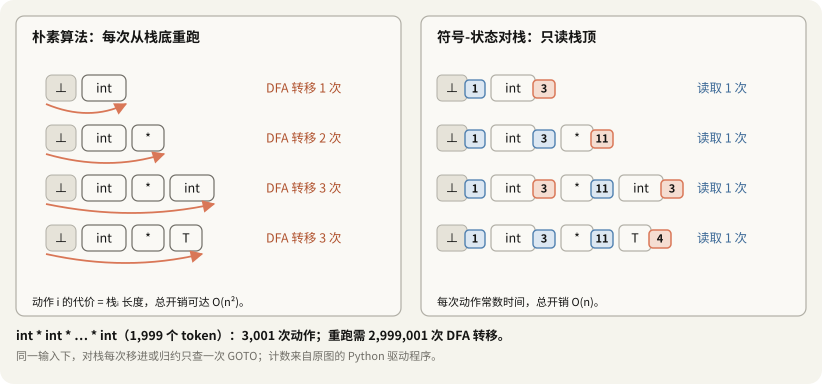

#### 2. 캐시 없는 중복 계산

책을 한 페이지 더 읽을 때마다 첫 페이지부터 다시 훑어 현재 위치를 확인하는 것과 같다. 이전 접두부를 읽고 도달한 상태는 이미 알고 있다. 그 결과를 저장하면 같은 경로를 다시 계산할 필요가 없다.

### 28.2 기호-상태 쌍 스택과 상태 캐싱

현재 상태 확인 비용을 $O(|\alpha|)$에서 $O(1)$로 줄이기 위해 기호와 상태를 함께 저장한다(슬라이드 123, 124).

#### 1. 형식적 정의

$$\text{Stack} = \langle \text{any}, s_0 \rangle\,
\langle X_1, s_1 \rangle\,
\langle X_2, s_2 \rangle \dots
\langle X_m, s_m \rangle$$

- $\text{any}$: 스택 바닥의 더미 기호.
- $s_0$: DFA 시작 상태.
- $X_i \in V_N \cup V_T$: 스택에 넣은 문법 기호.
- $s_i$: $s_{i-1}$에서 $X_i$를 읽은 뒤의 상태.

#### 2. 구조적 불변식

$1 \le k \le m$인 모든 위치에서 다음이 성립한다.

$$s_k = \hat{\delta}(s_0, X_1X_2\dots X_k)$$

즉, 각 스택 항목의 상태는 스택 바닥부터 그 위치까지 읽었을 때 DFA가 도달하는 상태와 같다.

> 상태 번호는 해당 접두부에 꽂아 둔 책갈피와 같다. 현재 상태는 $\text{top}(\text{Stack}).\text{state} = s_m$에서 바로 얻는다. 스택을 다시 읽지 않고 $O(1)$에 확인할 수 있다.

리듀스가 이 불변식을 깨지 않는 이유도 같다. 우변 $k$쌍을 꺼내면 드러나는 $s_{m-k}$는 꺼낸 기호들과 무관하게 이미 맞는 값이다. 거기서 좌변 $X$로 한 번만 이동하면 된다.

### 28.3 GOTO 함수와 GOTO 표

#### 1. 형식적 정의

DFA 전이 함수가 $\delta: S \times (V_T \cup V_N) \to S$일 때 다음과 같이 표를 정의한다(슬라이드 125).

$$\text{goto}[i,A] = j \iff \delta(s_i,A) = s_j$$

- 상태 인덱스: $i \in \{0,1,\dots,|S|-1\}$.
- 전이 기호: $A \in V_N \cup V_T$.
- ACTION과 GOTO를 분리한 일반적인 구현에서는 GOTO가 논터미널 $A \in V_N$에 대한 전이를 저장한다.

이 표는 자동기의 전이 관계를 배열로 저장한 것이다. ACTION 표와 함께 LR 분석기의 실행을 제어한다.

### 28.4 쌍 스택에서의 네 가지 동작

다음 동작들은 앞의 상태 불변식을 유지한다(슬라이드 126).

#### 1. 시프트(Shift $j$)

현재 최상단 상태가 $s_m$, 다음 터미널이 $a$라고 하자.

1. 입력 기호 $a$를 소비한다.
2. 전이 상태 $j = \text{goto}[s_m,a]$를 얻는다.
3. 기호-상태 쌍을 넣는다.

$$\text{Push}(\langle a,j\rangle)$$

ACTION과 GOTO를 분리한 구현에서는 Shift 항목에 목적 상태 $j$가 들어 있다.

#### 2. 리듀스(Reduce $X \to \alpha$)

생성 규칙 우변 길이가 $|\alpha| = k$라고 하자.

1. 최상단에서 $k$개의 쌍을 꺼낸다.
   $$\text{Pop}(k)$$
2. 새로 드러난 최상단 상태를 $s_{\text{base}}$라고 한다.
3. 좌변 논터미널 $X$로 이동할 상태를 조회한다.
   $$s_{\text{new}} = \text{goto}[s_{\text{base}},X]$$
4. 결과 쌍을 넣는다.
   $$\text{Push}(\langle X,s_{\text{new}}\rangle)$$

함수 호출의 반환 과정에 비유할 수 있다. 우변을 꺼내면 하위 작업을 시작하기 전의 상태가 드러난다. GOTO를 조회해 $X$를 넣으면, 상위 규칙이 하위 작업의 결과를 받아 다음 위치로 진행한다.

한 번의 리듀스는 우변 길이 $k$에 비례하는 팝 연산을 수행한다. 문법이 고정되어 있으면 최대 우변 길이도 상수이므로, 각 동작을 상수 시간으로 취급하고 전체 분석을 $O(n)$에 수행할 수 있다.

#### 3. 수용(Accept)과 오류(Error)

- Accept: 시작 기호를 인식한 수용 상태에서 입력 끝 $\$$를 확인하면 성공을 선언한다.
- Error: 현재 상태와 다음 입력에 해당하는 동작이 없으면 구문 오류 처리를 실행한다.

### 28.5 SLR(1) ACTION 표 구성 알고리즘

분석기 생성기는 LR(0) 항목 집합의 정규 모음과 Follow 집합으로 ACTION 표를 만든다(슬라이드 127).

#### 알고리즘: SLR(1) 분석표 구성

입력:

- 증강 문법 $G'$.
- LR(0) 항목 집합의 정규 모음 $\mathcal{C} = \{I_0,I_1,\dots,I_m\}$.
- 생존 접두부 DFA의 전이 함수.
- 각 논터미널의 Follow 집합.

출력은 ACTION 표와 GOTO 표이다.

각 항목 집합 $I_i$와 터미널 $a \in V_T \cup \{\$\}$에 대해 다음 규칙으로 표를 채운다.

1. 시프트:
   $X \to \alpha\cdot a\beta \in I_i$이고 $\text{goto}[i,a] = j$이면,
   $$\text{ACTION}[i,a] = \text{shift }j$$
   보통 $S_j$로 줄여 쓴다.
2. 리듀스:
   $X \to \alpha\cdot \in I_i$이고 $X \neq S'$이면, 모든 $a \in \text{Follow}(X)$에 대해,
   $$\text{ACTION}[i,a] = \text{reduce }X \to \alpha$$
   해당 규칙 번호가 $k$이면 $r_k$로 줄여 쓴다.
3. 수용:
   $S' \to S\cdot \in I_i$이면,
   $$\text{ACTION}[i,\$] = \text{accept}$$
   보통 acc로 줄여 쓴다.
4. 오류:
   위 규칙으로 지정되지 않은 칸에는,
   $$\text{ACTION}[i,a] = \text{error}$$
   를 둔다. 실제 구현에서는 빈 칸이나 특정 오류 코드를 사용할 수 있다.

한 칸에 두 동작이 들어가면 그 문법은 SLR(1)이 아니다. 이 문법으로 채운 표는 다음과 같다.

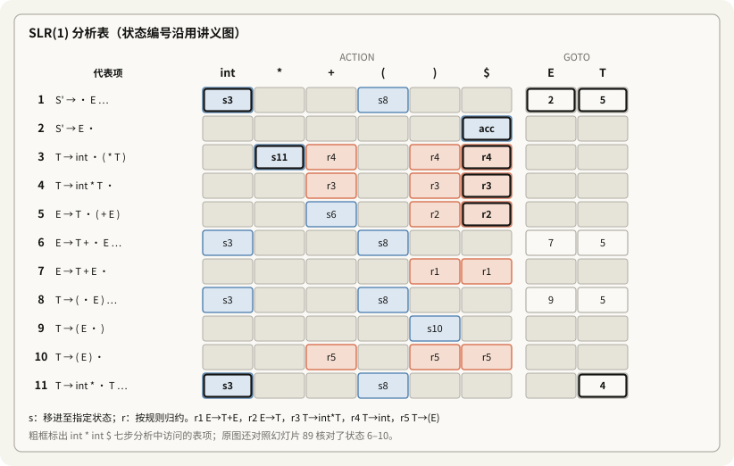

### 28.6 표 기반 제어 흐름

```text
                  남은 입력 버퍼
                   a1 a2 ... $
                        |
                        | 다음 토큰 a
                        v
분석 스택 -------> LR 실행기 <-------> ACTION / GOTO 표
<dummy,s0>          최상단 상태 sm     ACTION[sm,a] -> 동작
<X1,s1> ...                           GOTO[s_base,X] -> 다음 상태
<Xm,sm>
```

현재 최상단 상태와 다음 토큰으로 ACTION을 조회한다. 리듀스 후에는 새로 드러난 상태와 좌변 논터미널로 GOTO를 조회한다. 매번 전체 스택에 대해 DFA를 재실행할 필요가 없다.

---

## 29. 표 기반 LR 분석기의 주 반복문과 의미 동작

강의 마지막 부분은 LR 실행기의 의사 코드와, 구문 인식에 쓰이는 상태 정보 및 의미 계산에 쓰이는 값의 역할을 구분한다(슬라이드 128, 129).

### 29.1 일반적인 표 기반 LR 분석 알고리즘

```text
Let I = w$ be initial input
Let j = 0
Let DFA state 1 have item S' -> .S
Let stack = ⟨dummy, 1⟩

repeat
  case action[top_state(stack), I[j]] of
    shift k:
      push ⟨I[j++], k⟩

    reduce X -> A:
      pop |A| pairs,
      push ⟨X, goto[top_state(stack), X]⟩

    accept:
      halt normally

    error:
      halt and report error
```

#### 실행 의미

1. 초기화:
   - 입력은 $I = w\$$, 입력 위치는 $j = 0$이다.
   - $S' \to \cdot S$를 포함한 상태 1을 시작 상태로 사용한다.
   - 스택은 $\langle \text{dummy},1\rangle$로 초기화한다.
2. 반복:
   다음 표 항목을 조회한다.
   $$\text{action}[\text{top\_state}(\text{stack}),I[j]]$$
   - Shift $k$: $I[j]$를 소비하고 $\langle I[j],k\rangle$를 넣는다. 입력 위치를 하나 증가시킨다.
   - Reduce $X \to A$: $|A|$개의 쌍을 꺼낸 뒤, 드러난 상태로 GOTO를 조회한다. $\langle X,\text{goto}[\text{top\_state}(\text{stack}),X]\rangle$를 넣는다.
   - Accept: 시작 기호와 입력 끝을 확인하고 성공적으로 종료한다.
   - Error: 현재 상태에서 입력을 처리할 수 없으므로 오류를 보고한다.

`goto[top_state(stack), X]`의 `top_state`는 **꺼낸 뒤의** 맨 위다. 꺼내기 전 상태로 조회하는 것이 구현에서 가장 흔한 실수다. 다음 주 C++ 구현의 점검 항목으로 적어 둔다.

### 29.2 구문 인식에서 스택 기호를 읽지 않는 이유와 의미 동작

강의는 위 알고리즘이 DFA 상태와 입력만으로 구문 동작을 결정한다는 점을 지적한다. 그러나 의미 동작을 실행하려면 스택에 함께 저장한 값이 필요하다.

#### 1. 순수 구문 인식에서 사용하는 정보

- 동작 선택: 최상단 상태와 다음 입력 기호.
- 리듀스 시 팝 횟수: 생성 규칙 우변의 길이 $|A|$.
- 다음 상태: 팝 후 드러난 상태와 좌변 논터미널 $X$.

어떤 기호를 꺼내는지 그 이름을 직접 확인할 필요는 없다.

> [!important] 구문 인식과 스택 기호
> 순수하게 문법의 수용 여부만 판단한다면, 상태 번호만 저장한 정수 스택으로도 LR 분석을 수행할 수 있다. 기호열의 문법적 정보는 상태가 요약하고 있다.

#### 2. 실제 컴파일러에서 값을 함께 저장하는 이유

컴파일러의 목적은 입력의 문법 적합성만 검사하는 데 그치지 않는다. 추상 구문 트리(AST)를 만들고 의미 값을 계산해야 한다. 슬라이드 129의 표현으로는 "스택 기호를 버리는 것은 프로그램을 버리는 것"이다.

- 상태와 함께 보관하는 슬롯에는 의미 값의 공용체(Semantic Value Union)나 하위 AST 노드의 포인터 등을 저장한다.
- $X \to A$로 리듀스할 때 구문 실행기는 $|A|$개의 슬롯을 꺼내고 다음 상태를 계산한다.
- 의미 동작은 그 슬롯들의 값이나 하위 트리를 사용한다.
- Bison의 `$1`, `$2`, `$3`에 해당하는 값으로 새 부모 노드를 구성하고, 결과 `$$`를 좌변 기호 $X$의 값으로 스택에 넣는다.

DFA 상태는 구문상 가능한 진행을 제어한다. 함께 저장한 의미 값은 AST 구성과 이후의 번역 작업에 사용된다.

![리듀스 E → T + E가 의미 값을 다루는 방법. 왼쪽은 리듀스 직전의 세 스택이다. 상태 스택 1, 5, 6, 7, 기호 T, +, E, 값 Num 2, 없음, Num 3. 리듀스는 세 칸을 꺼내고 의미 동작 $$ = Add($1, $3)를 실행한 뒤 GOTO[1, E] = 2를 넣는다. 오른쪽은 리듀스 직후로 상태 1, 2와 값 Add(Num 2, Num 3)다. 기호 칸은 구문 판단에 쓰이지 않아 점선으로 그렸다](../01.十月/assets/10_31/l8-semantic-stack.svg)

> [!note] 보충: Bison이 실제로 쌓는 것
> Bison의 기본 C 골격(`yacc.c`)은 상태 스택 `yyss`와 의미 값 스택 `yyvs`를 나란히 둔다(위치 추적을 켜면 `yyls`도). 기호 스택은 따로 없다. 상태가 기호를 대신하고, 값 스택이 슬라이드의 "기호"가 하던 일, 곧 프로그램을 들고 다니는 일을 한다. 규칙에 동작을 적지 않으면 기본 동작은 `$$ = $1`이다. 그래서 `E → T` 같은 리듀스는 새 노드를 만들지 않고 값을 그대로 올려 보낸다. 파스 트리보다 AST가 작은 이유가 여기 있고, [애니메이션 2](parser-pipeline.html)에서 직접 볼 수 있다.

---

## 30. SLR(1) 판정 비교: 한쪽 재귀와 모호한 양쪽 재귀

Alex Aiken 교수는 구조가 비슷하지만 성질이 다른 두 문법으로 폐포, DFA 전이, Follow 집합, 시프트-리듀스 충돌 검사를 비교한다. 이 예는 Richmond 판 슬라이드에는 없어 강의 영상과는 대조하지 못했다. 아래 상태와 집합은 표 생성기로 확인했다.

### 30.1 사례 A: 한쪽 재귀 문법은 SLR(1)

#### 1. 문법과 Follow 집합

$$
\begin{aligned}
S' &\to S \\
S &\to Sa \mid b
\end{aligned}
$$

왼쪽 재귀 문법이며 언어는 $ba^*$이다. 각 문장에 대한 구문 트리가 하나뿐이므로 모호하지 않다.

Follow 집합을 계산한다.

- $\text{Follow}(S') = \{\$\}$.
- $S \to Sa$에서 $S$ 뒤에 $a$가 오므로 $a \in \text{Follow}(S)$이다.
- $S' \to S$로부터 입력 끝 $\$$도 전달된다.
- 따라서 $\text{Follow}(S) = \{\$,\; a\}$이다.

#### 2. DFA 상태 구조

초기 상태:

$$I_0 = \{S' \to \cdot S,\quad S \to \cdot Sa,\quad S \to \cdot b\}$$

- $b$를 읽으면 $\{S \to b\cdot\}$로 이동한다.
- $S$를 읽으면 $I_1$로 이동한다.

핵심 상태:

$$I_1 = \{S' \to S\cdot,\quad S \to S\cdot a\}$$

$a$를 읽으면 $\{S \to Sa\cdot\}$로 이동한다. 상태는 모두 4개다.

#### 3. 충돌 검사와 판정

$I_1$에는 증강 규칙 완료 항목과 $a$ 시프트 항목이 함께 있다.

- $S' \to S\cdot$: 다음 입력이 $\$$이면 Accept.
- $S \to S\cdot a$: 다음 입력이 $a$이면 Shift.

$$\text{Follow}(S') \cap \{a\} = \{\$\} \cap \{a\} = \emptyset$$

조건이 겹치지 않는다. $\$$이면 수용하고 $a$이면 시프트한다. 나머지 상태에서도 충돌이 없으므로 이 문법은 SLR(1)이다.

### 30.2 사례 B: 양쪽 재귀 문법은 SLR(1)이 아니다

#### 1. 문법과 모호성

우변의 오른쪽에도 $S$를 추가한다.

$$
\begin{aligned}
S' &\to S \\
S &\to SaS \mid b
\end{aligned}
$$

이는 $E \to E+E \mid \text{id}$와 같은 형태다. 입력 b a b a b는 왼쪽으로 묶은 $(bab)ab$와 오른쪽으로 묶은 $ba(bab)$라는 두 구문 트리를 갖는다.

Follow 집합은 다음과 같다.

$$\text{Follow}(S') = \{\$\}$$
$$\text{Follow}(S) = \{\$,\; a\}$$

첫 번째 $S$ 뒤에는 $a$가 오고, 마지막 $S$는 좌변의 Follow 집합을 물려받는다.

#### 2. DFA 전이와 충돌 상태

1. 초기 상태에서 $S$를 읽으면 다음 집합에 도달한다.
   $$\{S' \to S\cdot,\quad S \to S\cdot aS\}$$
2. $a$를 읽고 폐포를 계산하면 다음과 같다.
   $$\{S \to Sa\cdot S,\quad S \to \cdot SaS,\quad S \to \cdot b\}$$
3. 논터미널 $S$를 인식하면 다음 충돌 상태에 도달한다.

```text
시프트-리듀스 충돌 상태
  S -> S a S .    SaS를 S로 리듀스할 후보
  S -> S . a S    다음 a를 시프트할 후보
```

#### 3. SLR(1) 조건의 중복

- 완료 항목 $S \to SaS\cdot$는 다음 토큰이 $\text{Follow}(S) = \{\$,\; a\}$에 있으면 리듀스를 허용한다.
- $S \to S\cdot aS$는 다음 토큰이 $a$이면 시프트를 허용한다.

$$\text{Follow}(S) \cap \{a\} = \{\$,\; a\} \cap \{a\} = \{a\} \neq \emptyset$$

> [!danger] 해결되지 않는 시프트-리듀스 충돌
> 이 상태에서 다음 입력이 $a$이면 시프트와 리듀스 조건이 동시에 성립한다.
>
> 현재 $SaS$를 $S$로 리듀스하면 왼쪽 결합을 선택하고, $a$를 시프트하여 오른쪽 표현식을 기다리면 오른쪽 결합을 선택한다.
>
> Follow 집합으로 이 충돌을 제거할 수 없으므로 이 문법은 SLR(1)이 아니다. 모호한 문법이므로 LALR(1)과 LR(1)로 가도 같은 칸이 충돌한다(표 생성기로 확인).

### 30.3 두 사례의 비교

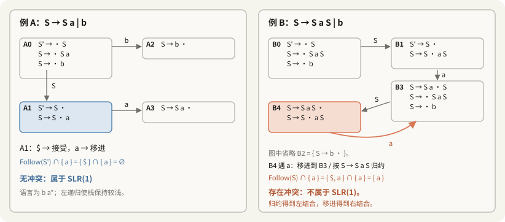

| 비교 기준 | 사례 A | 사례 B |
|---|---|---|
| 생성 규칙 | $S \to Sa \mid b$ | $S \to SaS \mid b$ |
| 문법 성질 | 한쪽으로 확장하며 모호하지 않다. | 양쪽으로 재귀하며 모호하다. |
| 핵심 경쟁 상태 | $\{S' \to S\cdot,\ S \to S\cdot a\}$ | $\{S \to SaS\cdot,\ S \to S\cdot aS\}$ |
| 경쟁 동작 | 증강 규칙의 수용과 $a$ 시프트 | $S$로 리듀스와 $a$ 시프트 |
| 조건의 교집합 | $\text{Follow}(S') \cap \{a\} = \emptyset$ | $\text{Follow}(S) \cap \{a\} = \{a\}$ |
| 판정 | 충돌이 없어 SLR(1)이다. | 시프트-리듀스 충돌로 SLR(1)이 아니다. |
| 구현에서의 대응 | 표 기반으로 바로 분석한다. | 우선순위나 결합 규칙으로 충돌을 해결하거나 문법을 다시 작성한다. |

사례 B에 `%left 'a'`를 선언하면 충돌 칸이 리듀스로 정해져 $(bab)ab$가 되고, `%right 'a'`이면 시프트로 정해져 $ba(bab)$가 된다. §25와 같은 처방이다.

---

## 31. 8강 정리: 헷갈리는 구분

이로써 CS143의 구문 분석 부분을 마쳤다. 다음 9강은 의미 분석(범위, 기호 표, 타입)이다.

| 구분 | A | B | 한 줄로 |
|---|---|---|---|
| 우변 일치 / 핸들 | 스택 끝이 어떤 우변과 같다 | 줄여도 시작 기호로 돌아갈 수 있다 | 앞은 필요조건일 뿐이다 (§2) |
| 생존 접두부 / 문장 | 스택에 놓일 수 있는 모양 | 입력 전체 | 앞은 정규 언어, 뒤는 일반적으로 아니다 (§9) |
| NFA 수용 / 분석기 수락 | 스택이 아직 가능한 모양이다 | 입력 전체가 문법에 맞다 | 모든 NFA 상태가 수용 상태다 (§14.5) |
| NFA 상태 / DFA 상태 | 항목 하나 | 항목 집합 하나 | 18개가 11개로 묶인다 (§18.5) |
| 항목 / 유효 항목 | 점을 찍은 규칙 | 지금 스택에 대해 유도로 뒷받침되는 항목 | 뒤의 것이 DFA 상태의 내용이다 (§20) |
| LR(0) / SLR(1) | 완료 항목이면 항상 리듀스 | 다음 토큰이 Follow에 있을 때만 | DFA는 같고 표만 다르다 (§24) |
| SLR(1) / LALR(1) / LR(1) | 전역 Follow | 합친 상태의 미리보기 | 상태마다 정확한 미리보기 | 상태 수는 11, 11, 20 (§6.1) |
| 단순 알고리즘 / 표 기반 | 매번 DFA를 바닥부터 | 맨 위 상태만 | $O(n^2)$와 $O(n)$ (§28) |
| ACTION / GOTO | 상태와 터미널 → 동작 | 상태와 논터미널 → 상태 | GOTO는 리듀스 뒤에만 본다 (§28.5) |
| 상태 / 의미 값 | 구문 판단에 쓴다 | AST와 번역에 쓴다 | 기호는 둘 다에 필요 없다 (§29.2) |
| 우선순위 선언 / 문법 고치기 | 충돌 칸의 선택을 정한다 | 충돌 자체를 없앤다 | 앞은 모호함을 그대로 둔다 (§25.3) |

## 32. 점검 질문

답을 펼치기 전에 먼저 답해 본다. Q9–Q11은 종이에 푸는 문제다.

> [!question]- 1. 스택 맨 위가 어떤 규칙의 우변과 같은데도 줄이면 안 되는 예를 들고, 왜 안 되는지 말해 보세요.
> `int | * int + int`에서 `int`를 $T$로 줄이면 `T * int + int`가 되는데, $T$ 바로 뒤에 `*`가 오는 규칙이 없어 시작 기호로 돌아갈 수 없다. 그 `int`는 핸들이 아니다. 핸들은 두 번째 `int`다.

> [!question]- 2. 핸들의 정의를 우측 최우선 유도로 적고, 왜 핸들 오른쪽에는 터미널만 있는지 설명하세요.
> $S \Rightarrow^*_{rm} \alpha X\omega \Rightarrow_{rm} \alpha\beta\omega$일 때 $\alpha$ 뒤 위치의 $X \to \beta$가 핸들이다. 우측 최우선 유도에서 $X$는 그 시점의 가장 오른쪽 논터미널이므로, 그 오른쪽 $\omega$는 이미 다 전개된 터미널이다.

> [!question]- 3. 핸들이 스택 안쪽에 나타나지 않는다는 사실은 어떻게 증명하나요? 그 결과 무엇이 단순해지나요?
> 리듀스 횟수에 대한 귀납이다. 핸들을 줄인 직후 맨 위는 가장 오른쪽 논터미널이고, 다음 핸들은 그보다 오른쪽에 있으므로 시프트만으로 닿는다. 그래서 세로선이 왼쪽으로 갈 일이 없고, 시프트와 리듀스 두 동작만으로 충분하다.

> [!question]- 4. 생존 접두부를 정의하고, `int * int +`가 이 문법의 생존 접두부가 아닌 이유를 두 가지 방식으로 설명하세요.
> 어떤 $\omega$에 대해 $\alpha \mid \omega$가 올바른 구성이 될 수 있으면 $\alpha$는 생존 접두부다. 첫째, 핸들인 두 번째 `int`를 지나쳐 시프트했으므로 핸들의 오른쪽 끝을 넘었다. 둘째, DFA로 $I_0 \to I_3 \to I_6 \to I_3$까지 간 뒤 $I_3$에 `+` 전이가 없다.

> [!question]- 5. 괄호 언어는 정규가 아닌데 그 생존 접두부는 왜 정규인가요?
> 스택에는 완성된 부분이 이미 $S$로 줄어 있어서, 스택의 모양은 `(`의 나열 뒤에 $S$ 또는 $S)$가 붙는 것뿐이다. 깊이를 세는 일은 DFA가 아니라 스택이 한다. DFA는 `(`를 몇 개 읽든 같은 상태에 머문다.

> [!question]- 6. NFA의 ε 전이는 무엇을 뜻하고, 왜 입력 기호를 소비하지 않나요?
> $E \to \alpha\cdot X\beta$가 $X$를 기다리는데 입력에는 $X$가 직접 나오지 않으므로, $X$를 만들 규칙의 시작 항목 $X \to \cdot\gamma$를 활성화한다는 뜻이다. 하위 규칙을 고려하기 시작할 뿐 스택 기호를 읽은 것이 아니라서 ε이다.

> [!question]- 7. 이 노트의 NFA에서 ε 전이와 기호 전이는 각각 몇 개인가요? 계산 근거를 말해 보세요.
> ε 전이는 $E$를 기다리는 3개 항목 × $E$의 시작 항목 2개 = 6, $T$를 기다리는 3개 × $T$의 시작 항목 3개 = 9, 합 15개다. 기호 전이는 완료 항목이 아닌 항목 12개에서 하나씩, 12개다.

> [!question]- 8. 유효 항목과 DFA 상태의 관계를 말하고, 이 정리가 구현에 왜 중요한지 설명하세요.
> 항목이 생존 접두부 $\alpha$에 대해 유효할 필요충분조건은 DFA가 $\alpha$를 읽고 도달한 상태에 그 항목이 있는 것이다. 덕분에 실행 중에 유도를 만들어 볼 필요 없이, 미리 만든 DFA 상태만 보면 가능한 시프트와 리듀스를 안다.

> [!question]- 9. [종이] $S \to (S) \mid \varepsilon$의 LR(0) DFA를 그리고 SLR(1) 표를 만드세요. `( ( ) )`를 추적하세요.
> 상태 5개: P0 $\{S'\to\cdot S, S\to\cdot(S), S\to\cdot\}$, P1 $\{S'\to S\cdot\}$, P2 $\{S\to(\cdot S), S\to\cdot(S), S\to\cdot\}$, P3 $\{S\to(S\cdot)\}$, P4 $\{S\to(S)\cdot\}$. Follow(S) = $\{), \$\}$. P0과 P2: `(` 시프트, `)`와 `$`에 $S\to\varepsilon$ 리듀스. P3: `)` 시프트. P4: `)`와 `$`에 $S\to(S)$ 리듀스. P1: `$` 수락. 충돌 없음.
>
> 추적: `|(())$` 시프트 → `(|())$` 시프트 → `((|))$` $S\to\varepsilon$ → `((S|))$` 시프트 → `((S)|)$` $S\to(S)$ → `(S|)$` 시프트 → `(S)|$` $S\to(S)$ → `S|$` 수락.

> [!question]- 10. [종이] 이 노트의 문법으로 `( int ) + int $`를 SLR(1) 표(강의 번호)로 추적하세요.
> 1 `(` s8 → 8 `int` s3 → 3 `)` r4 (GOTO[8,T]=5) → 5 `)` r2 (GOTO[8,E]=9) → 9 `)` s10 → 10 `+` r5 (GOTO[1,T]=5) → 5 `+` s6 → 6 `int` s3 → 3 `$` r4 (GOTO[6,T]=5) → 5 `$` r2 (GOTO[6,E]=7) → 7 `$` r1 (GOTO[1,E]=2) → 2 `$` 수락. 표 생성기의 추적과 같다.

> [!question]- 11. [종이] $S \to SaS \mid b$의 충돌 칸에 `%left 'a'`와 `%right 'a'`를 각각 적용하면 `b a b a b`의 트리가 어떻게 되나요?
> 충돌은 $\{S\to SaS\cdot, S\to S\cdot aS\}$ 상태의 `a` 칸이다. 규칙과 토큰의 우선순위가 같으므로 결합 방향이 정한다. `%left`는 리듀스를 골라 $(bab)ab$, `%right`는 시프트를 골라 $ba(bab)$다.

> [!question]- 12. LR(0)에서 충돌하던 $I_2$와 $I_3$가 SLR(1)에서 풀리는 이유를 집합 연산으로 보이세요.
> $I_2$: $\text{Follow}(E) \cap \{+\} = \{\$, )\} \cap \{+\} = \emptyset$. $I_3$: $\text{Follow}(T) \cap \{*\} = \{\$, ), +\} \cap \{*\} = \emptyset$. 리듀스 칸과 시프트 칸이 겹치지 않는다.

> [!question]- 13. SLR(1)은 아니지만 LALR(1)인 문법의 예를 들고, SLR이 실패하는 원인을 말해 보세요.
> $S \to L = R \mid R$, $L \to *R \mid \text{id}$, $R \to L$. 상태 $\{S \to L\cdot = R, R \to L\cdot\}$에서 `=`가 Follow(R)에 있어 리듀스와 시프트가 겹친다. 하지만 이 상태의 $R$은 문장 전체라 실제로는 뒤에 `=`가 올 수 없다. Follow는 문법 전체에서 모은 것이라 이 문맥을 모른다. LR(1)·LALR(1)의 미리보기는 이 상태에서 `$`뿐이다.

> [!question]- 14. "우선순위 선언"이 우선순위를 정의하는 것이 아니라는 말은 무슨 뜻인가요?
> 문법은 여전히 모호하다. 선언은 표 생성기가 충돌한 칸에서 시프트와 리듀스 중 무엇을 남길지 정하는 규칙일 뿐이다. 단순한 문법에서는 결과가 원하는 우선순위와 같지만, 복잡한 문법에서는 의도하지 않은 칸까지 같은 비교가 적용될 수 있어 오토마톤을 직접 확인해야 한다.

> [!question]- 15. 단순 SLR 알고리즘이 $O(n^2)$가 될 수 있는 이유와, 쌍 스택이 그것을 $O(n)$으로 만드는 이유를 말해 보세요.
> 동작마다 스택 전체를 DFA에 다시 넣으므로 비용이 스택 길이에 비례하고, 오른쪽 재귀 입력에서는 스택이 입력 길이만큼 깊어진다. 쌍 스택은 각 위치까지의 상태를 저장하므로 맨 위 상태만 보면 된다. 리듀스 후에도 드러난 상태는 이미 맞는 값이고 GOTO 한 번이면 된다.

> [!question]- 16. 리듀스할 때 GOTO는 어느 상태로 조회하나요? 그 이유는?
> 우변 길이만큼 꺼낸 **뒤에** 드러난 상태다. 좌변 $X$는 그 상태에서 기다리던 기호이고, 꺼낸 우변은 그 상태 위에 쌓였던 것이기 때문이다.

> [!question]- 17. 구문 판단에 스택 기호가 필요 없다면 컴파일러는 왜 값을 함께 쌓나요? `E → T` 리듀스는 AST에 무엇을 남기나요?
> 구문 판단은 상태가 다 하지만, AST를 만들려면 각 기호가 나타내는 하위 트리나 값이 필요하다. 그것이 `$1`, `$2`이고 결과가 `$$`다. `E → T`는 기본 동작 `$$ = $1`로 하위 노드를 그대로 올리므로 새 노드를 만들지 않는다.

> [!question]- 18. 모호하지 않은데 LR(1)이 아닌 문법의 예를 드세요.
> $S \to aSa \mid a$. 각 문장에 트리가 하나뿐이지만, 가운데 `a`를 $S$로 줄일 위치를 알려면 남은 `a`의 개수를 끝까지 세야 해서 어떤 유한한 미리보기로도 정할 수 없다. 표 생성기로는 LR(1)에서 시프트-리듀스 1칸이 나왔다.

---

## 33. 바로잡은 내용 요약

처음 노트는 대부분 정확했다. 표, 집합, 추적, DFA 전이 18개에서 틀린 것은 찾지 못했다. 바로잡은 것은 다음 세 가지다.

| 위치 | 처음 이해 | 바로잡은 내용 |
|---|---|---|
| §15.5 | NFA 도식의 ε 전이 12개 | 15개여야 한다. $E\to T+\cdot E \to E\to\cdot T$, $T\to\text{int}*\cdot T \to T\to\cdot\text{int}$, $T\to\cdot(E)$ 세 개를 채웠다. 슬라이드 43의 ε 라벨도 15개다 |
| §27.1 | 강의 상태 목록에 10이 없음 | 슬라이드 89의 좌표로 10 = $T\to(E)\cdot$임을 확인했다. 나머지 번호도 대조했다 |
| §8 | 생존 접두부는 핸들의 접두부를 "포함한다" | 스택의 **끝부분**이 핸들의 접두부다 |

주요 보충 내용:

| 위치 | 보충 |
|---|---|
| §0.1, §0.2 | 계획 점검, 두 애니메이션의 사용법과 검사 내용 |
| §3.3, §3.4 | 핸들은 규칙과 위치다. Important Fact #2의 귀납 논증 |
| §5.1 | 범용 알고리즘(CYK, Earley)이 하는 일 |
| §6.1 | 포함 관계의 각 띠에 속하는 실제 문법과 충돌 수, 언어와 문법의 구분 |
| §8.3 | 잘못된 토큰은 시프트되지 않는다. SLR·LALR의 추가 리듀스 |
| §9.1 | 괄호 문법의 생존 접두부 정규식과 DFA |
| §13.2 | 같은 스택을 여러 사슬로 설명할 수 있다는 점 |
| §16 | 상태 집합으로 따라가면 DFA 상태가 된다 |
| §20.1 | 유효 항목 정리를 정의대로 전수 확인 |
| §24.2 | Follow가 너무 넓은 예($L = R$ 문법) |
| §25.2 | 나머지 충돌 칸과 결합 방향, Bison의 비교 규칙 |
| §27.2 | 슬라이드 118, 121의 Follow 오타 |
| §28.1 | 다시 돌리는 비용을 실제로 센 표 |
| §29.1, §29.2 | GOTO 조회 시점, Bison의 `yyss`·`yyvs`와 기본 동작 `$$ = $1` |
| §30 | 사례 B의 `%left`·`%right` 결과 |

---

## 34. 참고 자료

- [University of Richmond CMSC 331 Lecture 8](https://facultystaff.richmond.edu/~dszajda/classes/cs331/Fall_2017/lecture_slides/lecture08.pdf): Aiken의 슬라이드를 옮긴 판. 이 노트의 대조 대상. 슬라이드 번호는 이 판 기준이다. [Lecture 9](https://facultystaff.richmond.edu/~dszajda/classes/cs331/Fall_2017/lecture_slides/lecture09.pdf)는 의미 분석 개요다
- [Stanford CS143 Compilers](https://web.stanford.edu/class/cs143/): 인증서 오류로 이번에도 받지 못함
- D. E. Knuth, "On the Translation of Languages from Left to Right", *Information and Control* 8 (1965), 607–639: LR(k)의 원 논문
- F. DeRemer, [*Practical Translators for LR(k) Languages*](https://dspace.mit.edu/handle/1721.1/149384), MIT 박사 학위 논문(1969): SLR과 LALR을 제안
- A. V. Aho, S. C. Johnson, J. D. Ullman, ["Deterministic Parsing of Ambiguous Grammars"](https://dblp.org/rec/journals/cacm/AhoJU75), *CACM* 18(8) (1975): 모호한 문법과 충돌 해결 규칙
- Bison 매뉴얼: [Precedence](https://www.gnu.org/software/bison/manual/html_node/Precedence.html), [LR Table Construction](https://www.gnu.org/software/bison/manual/html_node/LR-Table-Construction.html)(`%define lr.type`), [Understanding](https://www.gnu.org/software/bison/manual/html_node/Understanding.html)(`--report`)
- Aho, Lam, Sethi, Ullman, *Compilers: Principles, Techniques, and Tools* (2판) 4.5–4.7절: 핸들, LR(0) 항목, SLR, LR(1), LALR
- 애니메이션: [파싱 기법의 전환](https://claude.ai/artifact/XJ5kgGZ9wjU238B3WZB8XV)(11/3 게시본 갱신), [토큰에서 의미 분석까지](https://claude.ai/artifact/RHzbx2oNE9Rny8rhBZUy4J)(새 게시본). 둘 다 비공개
- 함께 읽기: [11/3 7강 노트](../11_03/11_03_lecture7.md) §11–§15(시프트-리듀스, 충돌), [10/27 노트](../10_27/10_27.md)(부분집합 구성), [11/2 노트](../11_02/11_02.md) §6(우선순위 선언)
