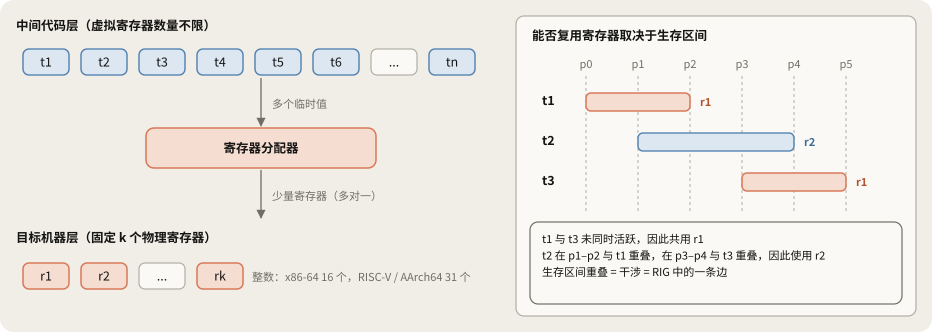
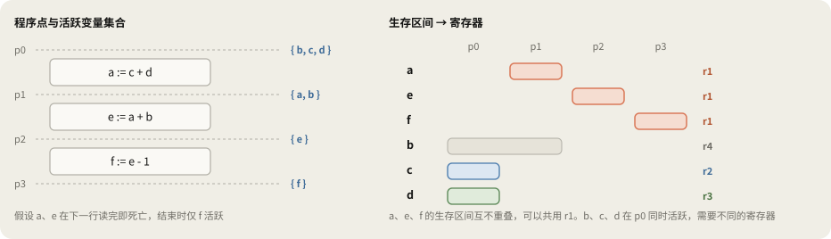
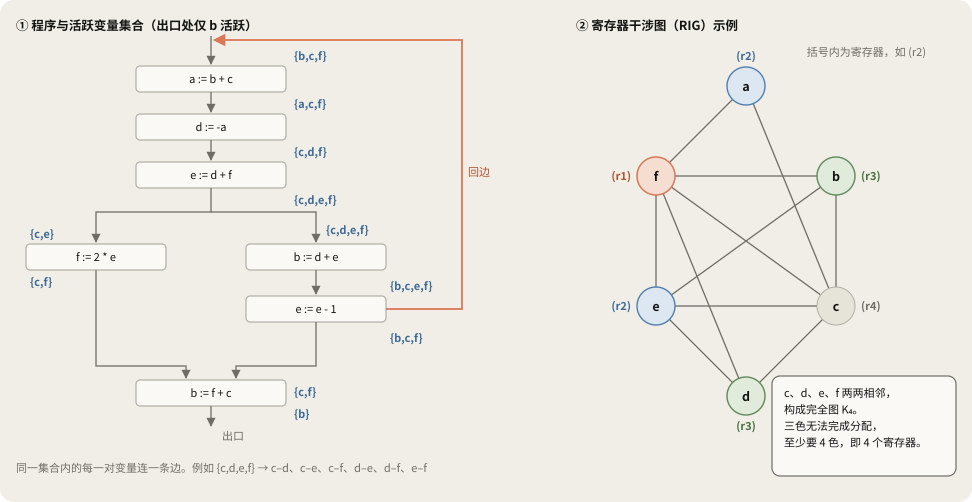

# 12.1 寄存器复用与干涉图（RIG）

编译器的前端和优化器通常假定中间表示（IR）拥有任意数量的**虚拟临时变量**（也称虚拟寄存器，参见 [[9.1 中间代码的解耦价值与三地址码（TAC）]]）。这个假设简化了中间代码生成和数据流优化。到生成机器码时，编译器必须使用目标 CPU 提供的物理寄存器，数量通常只有十几个到几十个。

> [!info] 本章验证背景
> 本章对应 CS143 第 16 讲 *Register Allocation*（里士满大学镜像课件页码）。核心算法与实验均已完成实测验证：
> - **寄存器分配**：用 Python 按课件规则复现活跃性分析、干涉图、简化、选择和溢出，得到课件第 12、23、39、45–48、56、61 页的结果；分配寄存器后的代码在 2000 次随机执行中与原代码结果一致。
> - **缓存**：在 Xeon E5-2686 v4 和 GCC 13.3 环境中测量内存访问延迟及循环分块/交换性能。
> - **工业实现资料**：对照查阅了 GCC 的 `ira.cc` 以及 LLVM 的 `TargetPassConfig.cpp` 与 `RegAllocGreedy.cpp`。

## 1. 多对一映射与寄存器复用

寄存器分配把虚拟临时变量映射到有限的 $k$ 个物理寄存器，同时保留程序的计算结果和执行语义。同一物理寄存器可以在不同时间存放不同的临时值。



**读图**。左侧给出多对一映射，右侧用横条表示各变量的生存区间。竖虚线 p0–p5 对应程序点。t1 和 t3 从未同时活跃，可以轮流使用 r1。t2 分别与两者重叠，需要另一个寄存器。把每一对重叠的变量连起来，就得到后文的干涉图。

这种复用依赖**活跃性分析**（Liveness Analysis，见 [[9.7 活跃性分析与全局死代码消除]]）。一个临时值在后续执行中不会再被读取时，它所占的寄存器就可以分配给新的值。在课件的简化模型中，$t_1$ 和 $t_2$ 要共享物理寄存器，任一程序点至多有一个值活跃。如果两个值在某个程序点同时活跃，它们就产生**干涉**（Interference），需要各自的寄存器。

> [!note] 共享判据成立的前提
> 课件第 11 页用“是否同时活跃”判定两个变量能否共享寄存器。实际分配器还要处理两种情况。
>
> - **死定义**。在 `t := x + 1; y := 5; z := t * 2` 中，假设 `y` 从未被读取，而且只检查这些定义所对应的临时值。三个值没有同时活跃，按课件方法构造的干涉图在它们之间也没有边。如果都映射到 r1，`y := 5` 就会覆盖仍然活跃的 `t`。当 x = 7 时，z 会从正确的 16 变成 10，配套验证用 `regalloc.py` 复现了这个结果。因此，Chaitin 系列分配器会让一个定义与该语句之后仍然活跃的变量形成干涉。死代码消除通常会删除 `y := 5`，但带副作用的函数调用可能必须保留，哪怕它的返回值无用。
> - **同值复制**。执行 `t2 := t1` 后，即使两者都活跃，只要它们需要保存的是同一个值，就可以共用寄存器。分配器将这对变量合到一起的操作称为**寄存器合并**（Coalescing），也是下节所引 GCC IRA 注释里的 register coalescing。
>
> 把判据当作充要条件，需要假定每个定义随后都会被读取，而且同时活跃的两个变量可能持有不同的值。

## 2. 三地址代码中的复用

```cpp
// 原始逻辑使用独立的临时变量
int a = c + d;
int e = a + b;
int f = e - 1;
```

假设 `a` 只在第二行读取，`e` 只在第三行读取，执行完这段代码后只有 `f` 仍然活跃。三个值的生存区间两两不重叠，可以映射到同一个物理寄存器 $r_1$。

```cpp
// 复用物理寄存器 r1，假设 c、d、b 分别位于 r2、r3、r4
r1 = r2 + r3;  // 计算 a，结果存入 r1
r1 = r1 + r4;  // 计算 e，复用 r1
r1 = r1 - 1;   // 计算 f，复用 r1
```



**读图**。左侧列出三条语句前后的 p0–p3 和对应的活跃变量集合，右侧按变量画出生存区间。a 只在 p1 活跃，e 只在 p2 活跃，f 只在 p3 活跃。`r1 = r1 + r4` 先从 r1 读出 a，再把 e 写入 r1。a 在这条语句之后已经死亡，覆盖它是安全的。

## 3. 从早期启发式到图着色

1950 年代的早期 FORTRAN 编译器已经使用启发式规则分配寄存器。1980 年前后，Gregory Chaitin 等人将寄存器分配形式化为**图着色问题**（Graph Coloring）。图着色由此成为全局寄存器分配的一类基础算法，GCC 的 IRA 就采用了这条路线。

> [!warning] GCC 与 LLVM 的分配策略
> - **GCC**。`gcc/ira.cc` 开头将 IRA 描述为基于 Chaitin–Briggs 算法的区域图着色分配器。
> - **LLVM**。按源码实现，`TargetPassConfig::createTargetRegisterAllocator` 在 `Optimized` 为真时返回 `createGreedyRegisterAllocator()`，否则返回 `createFastRegisterAllocator()`。贪心分配器（`RegAllocGreedy.cpp`）按优先队列处理生存区间，必要时逐出（evict）已有区间或拆分（split）当前区间。PBQP 分配器属于图着色相关路线，可用 `-regalloc=pbqp` 选择。
> - **JIT 编译器**。编译时间敏感的实现常用线性扫描（Linear Scan），可参看 Poletto 和 Sarkar 1999 年的论文。
> - **时间线**。课件第 9 页提到 1980 年的 IBM 研究团队。相关论文包括 1981 年发表的 *Register allocation via coloring*，以及 Chaitin 在 SIGPLAN 1982 发表的、进一步处理溢出的论文。

## 4. 寄存器干涉图（Register Interference Graph，RIG）

- **节点**代表虚拟临时变量。
- **无向边**连接在某个程序点同时活跃的两个变量，表示它们不能使用同一个物理寄存器。
- **颜色**对应物理寄存器。目标机器有 $k$ 个可用寄存器时，要给每个节点分配 $k$ 种颜色之一，并让相邻节点颜色不同。



**读图**。根据左侧程序的活跃变量集合严格计算全部干涉边，括号中标出对应分配的寄存器编号：

- 对每个程序点，将活跃变量集合里的每一对变量连起来，去重后得到 11 条边。b 和 c 相邻，不能共享。b 和 d 不相邻，可以共用 r3，与课件第 15 页一致。
- d 和 f 同时出现在 `{c,d,f}` 与 `{c,d,e,f}` 中，因此有 d–f 这条边。a 的邻居只有 c 和 f。
- c、d、e、f 构成完全图 $K_4$，b、c、e、f 也构成一个 $K_4$。任意 $K_4$ 都需要四种颜色。穷举六个节点的着色可验证最少需要四种颜色，与课件第 20 页一致。

这个例子可以用四个寄存器完成无溢出分配。只有三个寄存器时，当前干涉图没有合法的三色分配。

---

上一篇：[[11.5 面向对象代码生成：对象布局与分派表]] | 下一篇：[[12.2 图着色与 Kempe 简化启发式]]

来源：[[16.AI编译器/学习日记/0.2十一月/11_06#1. 寄存器分配（Register Allocation）|11_06 §1、§2.1]]。
