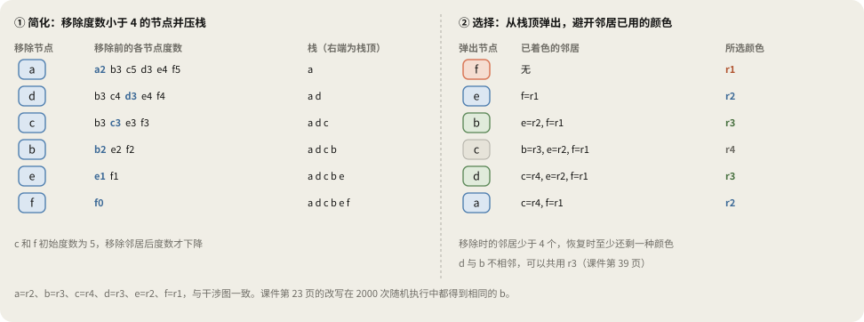

# 12.2 图着色与 Kempe 简化启发式

建立好 [[12.1 寄存器复用与干涉图（RIG）|寄存器干涉图（RIG）]] 之后，寄存器分配就转化为了图的 $k$ 着色问题。由于一般图的 $k$ 着色属于 NP 完全问题，编译器在实际工程中采用 **Kempe 简化启发式**，以线性级别的高效栈式流程完成着色求解。

## 1. 计算复杂度与 SSA 特殊情形

对一般图，固定 $k \ge 3$ 时，判定是否可以用 $k$ 种颜色着色是 **NP 完全**问题。求最少颜色数是 **NP 困难**的优化问题。

> [!warning] 多项式时间算法的已知结论
> 课件第 25 页写的是“目前没有已知的高效算法”。要断言一般问题不存在多项式时间算法，还需要证明 $P \ne NP$。
>
> Chaitin 等人（1981）证明，任意图都可以构造成某个程序的干涉图，所以一般的寄存器分配继承了这个难度。SSA 形式在消除 $\phi$ 函数之前构成特殊情形：其干涉图属于**弦图**（Chordal Graph），可在多项式时间内求最优着色（Hack、Grund 和 Goos，2006）。

## 2. Kempe 简化与选择流程

> **Kempe 启发式的依据**。若节点 $t$ 的度数 $d(t) < k$，就算它的每个邻居都使用不同的颜色，也至少有一种颜色留给 $t$。由此可以先移除 $t$ 及其相连的边，把它压入栈。如果剩余子图可以用 $k$ 种颜色着色，恢复 $t$ 之后原图也可以。

算法分为两个对称阶段：

1. **简化（Simplify）**。反复找出度数小于 $k$ 的节点，将其与关联边从图中移除并压栈。
2. **选择（Select）**。图清空后按栈的逆序恢复节点，为每个节点选择一种已着色邻居未使用的颜色。

**读图**。图中的两张表对应课件第 28–40 页。左表列出每次移除前各节点的度数，粗体蓝字标出本轮移除的节点。c 和 f 最初度数为 5，移除相邻的 a 和 d 后，部分节点的度数降为 4 再降到 3，简化得以继续推进。图采用课件中的一种移除顺序。右表从栈顶的 f 开始恢复，每次选最小编号的可用颜色。

按这个着色结果改写课件第 12 页的代码，可以得到第 23 页的指令 `r2 := r3 + r4; r3 := -r2; …`。

当某一步剩余节点的度数全部 $\ge k$ 时，单纯的简化规则会卡住，需要进入 [[12.3 寄存器溢出、乐观着色与代码改写]] 的溢出与乐观着色流程。

---

上一篇：[[12.1 寄存器复用与干涉图（RIG）]] | 下一篇：[[12.3 寄存器溢出、乐观着色与代码改写]]

来源：[[16.AI编译器/学习日记/0.2十一月/11_06#2.2 计算复杂度与 Kempe 简化|11_06 §2.2]]。
