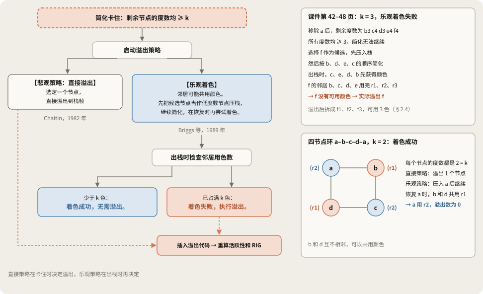

# 12.3 寄存器溢出、乐观着色与代码改写

当 Kempe 简化遇到所有剩余节点度数都 $\ge k$ 时，简单移除判据失效。编译器需要判断该节点是“确实无法着色”还是“邻居复用了同一种颜色仍有空余”，若确实无色可选，则将该变量**溢出（Spill）**到栈帧内存中，改写代码并迭代重算干涉图。

## 1. 溢出（Spilling）与乐观着色

简化进行到某一步时，剩余节点的度数可能全部 $\ge k$。此时已无法用低度数节点的判据继续。如果恢复节点时确实没有可用颜色，编译器就要把该变量**溢出**到栈帧中的内存槽。



**读图**。左侧给出了两种处理路径：Chaitin（1982）的策略在简化卡住时直接决定溢出；Briggs 等人（1989、1994）的**乐观着色（Optimistic Coloring）**先将候选节点压栈继续简化，等到恢复该节点时再统计邻居实际用了多少种颜色。下方橙色框给出着色失败后执行的代码改写和重新分析。

- **上方，$k = 3$**。课件第 42–48 页中，恢复 f 时三个颜色都已被邻居使用，因此 f 确实溢出。
- **下方，$k = 2$**。四节点环上的每个节点初始度数都是 2。直接策略会立刻溢出一个节点；乐观策略先压入 a，恢复它时发现 b 和 d 不相邻，可以用同一种颜色，因此仍有颜色给 a，最终没有溢出。

配套脚本 `regalloc.py` 验证了上述两个例子。

## 2. 溢出后的代码改写

确定 f 要溢出后，编译器在当前函数的栈帧为它分配槽位 $fa$。写 f 的地方在计算后存入该槽位，读 f 的地方先从该槽位加载。

```cpp
// 原始三地址代码
f = a + b;
c = f * 2;

// f 溢出后的伪代码，混合展示三地址运算与机器指令
int t_reg = a + b;
mov [fa], t_reg;      // 写 f 时，把值存到栈槽（store fa, f）

// ... 执行其他逻辑 ...

mov t_reg2, [fa];     // 读 f 时，从栈槽重新加载（load f, fa）
c = t_reg2 * 2;
```

改写后，原值长期保存在栈里，寄存器临时值只在加载之后或存储之前的短区间内活跃，干涉边通常会减少。编译器据此重新构建干涉图并再次着色。

> [!note] 课件第 49–65 页的改写细节
> - **临时值重新命名**。课件把内存操作写成 `f := load fa` 和 `store f, fa`，并引入 f1、f2、f3 等新变量（第 53 页）。独立命名后，各片段可以使用不同的寄存器。
> - **重新计算活跃变量集合**。`{c,d,f1}`、`{c,f2}`、`{c,f3}` 中的 f1、f2、f3 各自只在紧贴加载或存储的位置活跃（第 56 页）。f1 只与 c、d 干涉，f2 和 f3 只与 c 干涉。新图可以用三色完成着色（第 61 页）。
> - **验证记录**。脚本得到了相同的活跃变量集合和干涉边。用三个寄存器和槽位 `fa` 改写的代码，在 2000 次随机执行中都得到了与原代码一致的 b。
> - **指令写法**。`mov [fa], t_reg` 使用目标在前的 Intel 语法，代码注释中的 `store fa, f` 与课件的 `store f, fa` 采用不同的操作数顺序。
> - **选择溢出对象**。课件第 62–65 页给出几类启发式，包括优先考虑干涉多、定义和使用少、位于内层循环之外的变量。正确改写可保持语义，选择会影响性能。

---

上一篇：[[12.2 图着色与 Kempe 简化启发式]] | 下一篇：[[12.4 缓存层次与面向局部性的循环优化]]

来源：[[16.AI编译器/学习日记/0.2十一月/11_06#2.3 溢出（Spilling）与乐观着色|11_06 §2.3—§2.4]]。
