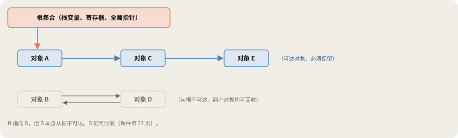

# 13.1 自动内存管理与可达性近似

在 [[10.4 全局变量、堆与进程内存四分区]] 中可以看到，堆用于存放生命周期超过单个函数调用的动态对象。如果把堆空间的释放完全交给程序员手动维护，很容易引入隐蔽的内存安全隐患；**自动内存管理（垃圾回收，GC）**则由运行时系统自动识别并回收不再使用的对象。

> [!info] 本章验证背景
> 本章对应 CS143 第 17 讲 *Automatic Memory Management*（里士满大学镜像课件页码）。核心算法与机制均已完成实测对照：
> - **垃圾回收算法**：在 3000 个随机堆上对照标记–清除、Schorr–Waite 指针反转和 Cheney 复制算法，验证标记位、指针恢复和复制子图同构性。
> - **C++ 引用计数实测**：使用 G++ 13.3 编译运行 `shared_ptr` 的循环引用和 100 万节点长链表递归析构爆栈示例。
> - **工业资料**：对照查阅了 Boehm GC 文档（`docs/gcdescr.md`、`docs/gcinterface.md`）与 *The Garbage Collection Handbook*。

## 1. 手动管理堆内存的典型错误

C 和 C++ 中，手动管理堆内存会引入几类错误：

- 忘记释放已分配的内存，造成**内存泄漏**（Memory Leak）。
- 内存释放后仍保留指向它的**悬空指针**（Dangling Pointer），通过它访问会造成释放后使用（Use-After-Free）。
- 越界访问破坏相邻的数据结构。
- 写坏内存的位置与程序崩溃的位置可能相隔很远。例如一个模块破坏了数据，另一个模块很久以后读到它才崩溃，定位错误会更困难。

自动内存管理在 1950 年代随 Lisp 出现，1990 年代又随着 Java 的普及进入主流开发。

## 2. 用可达性近似判断对象还会不会被使用

对任意程序，判断某个对象今后是否会再次被读取是不可判定的，可以用停机问题归约来说明。追踪式垃圾回收器用**可达性分析**（Reachability Analysis）作保守近似：

> 程序能通过指针链访问它仍然持有引用的对象。若从任何根都无法沿引用找到某个对象，就可以将该对象视为垃圾并回收。

**读图**。蓝色对象可以沿根的指针找到，灰色虚线对象互相引用，但根没有路径通向它们。课件第 15 页递归定义可达性：寄存器（及栈、全局变量等根集合）指向的对象可达，可达对象所指向的对象也可达。计算时从根开始遍历指针即可。

> [!note] 可达对象也可能再也用不到
> 参考课件第 16–18 页，假设 GC 在 `x ← new A; y ← new B; x ← y; if alwaysTrue() then x ← new A else x.foo() fi` 的 `x ← y` 之后运行，且 y 随后不再使用：
>
> - **第一个 A**。已经没有引用指向它，可以回收。
> - **B**。GC 当时还能沿 x 找到它，因此会保留。如果 `alwaysTrue()` 始终返回真，x 很快就改为指向新 A，B 以后其实不会再用到。
>
> 可达性会保留未来可能使用的对象。如果变量一直持有用完的大对象，即使语言有 GC，那部分内存也可能长期无法回收。课件第 92 页举例：编译器生成 IR 后仍保留一个指向 AST 的变量。

---

上一篇：[[12.4 缓存层次与面向局部性的循环优化]] | 下一篇：[[13.2 标记–清除（Mark & Sweep）]]

来源：[[16.AI编译器/学习日记/0.2十一月/11_06#4. 自动内存管理（Automatic Memory Management）|11_06 §4]]。
