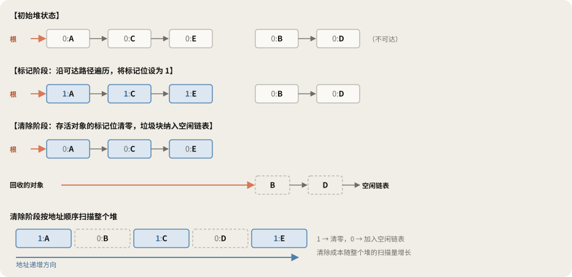

# 13.2 标记–清除（Mark & Sweep）

**标记–清除（Mark and Sweep）**是最经典的追踪式垃圾回收算法，分为“标记可达对象”与“线性扫描清除”两个阶段，典型实现可在无法满足新的堆分配时触发回收。

## 1. 标记与清除两阶段

1. **标记（Mark）**。从根集合出发，沿对象之间的指针执行深度优先或广度优先遍历。根可来自寄存器、调用栈帧中的局部指针和全局变量。访问一个可达对象时，把它的标记位从 0 设为 1。
2. **清除（Sweep）**。按地址顺序扫描整个堆。标记位为 1 的对象保留，同时把标记位清回 0，供下次 GC 使用。标记位为 0 的对象不可达，其内存块加入空闲链表（Free List）。

**读图**。每个对象左侧一格是标记位。标记沿根的指针遍历，因此只有 A、C、E 变成 1。B 本身不可达，标记过程不会访问它指向 D 的边。

最下面一行给出了清除顺序。清除从堆的起始地址出发，每次按当前对象的大小前进，直到扫完所有对象（课件第 28 页）。这也是 COOL 对象头需要大小字段的原因之一（参见 [[11.5 面向对象代码生成：对象布局与分派表]]）。标记成本主要随存活对象和其引用数增长，清除成本随整个堆的扫描量增长。课件第 29 页的 A–F 示例在标记后的位序列为 `1 0 1 0 0 1`，配套脚本 `gc.py` 得到了同样的结果。

## 2. 堆空间紧张时的辅助空间与指针反转

在堆分配已经吃紧时，标记还需要空间来存放待访问的对象。显式工作列表和递归调用栈的最坏规模都可能随存活对象数增长。**Schorr–Waite 指针反转（Pointer Reversal）**会临时用对象本身的指针字段记录回溯路径，从而用 $O(1)$ 的独立辅助空间执行原地遍历。

> [!warning] 工作列表大小与外部碎片的成因
> - **工作列表上界随堆而变**。课件第 31 页所说的 unbounded 指无法预先划出一个适用于任意堆形状的固定大小。堆有限时，列表也有上界。在 `gc.py` 中构造一个有 1000 个子对象的节点，工作列表达到 1000 项；而遍历长度为 1000 的单链表，显式列表只需 1 项，递归实现却会积累 1000 层调用。
> - **外部碎片来自标记–清除的空闲块布局**。存活对象留在原地，分散的空闲块被放进空闲链表，因此课件第 50 页建议合并相邻空闲块。指针反转只改变遍历方式，结束后恢复指针字段。对象地址保持稳定的特性在 [[13.4 保守式垃圾回收（Conservative GC）]] 中也有重要价值（课件第 51 页）。

> [!note] 指针反转的空间开销与实际实现
> - **回溯机制**。课件第 34–49 页的做法把深度优先遍历的回溯信息存进对象：向子对象前进时把对应字段反转成指向父对象，回溯时恢复原值。
> - **空间口径**。独立辅助空间只需几个指针。每个对象还要能记录当前处理到第几个字段：若对象有 $n$ 个字段，记录索引约需 $\lceil \log_2 n \rceil$ 位，通常使用对象头的空闲位。这里的 $O(1)$ 指与对象总数无关的独立工作空间。
> - **验证记录**。对 3000 个随机堆比较了指针反转和显式工作列表的标记结果，两者完全一致，所有指针字段也都在遍历结束后恢复。
> - **Boehm GC**。`docs/gcdescr.md` 的 `mark stack overflows` 部分说明，该实现用显式标记栈，溢出后通过再次扫描恢复。指针反转需要临时改写对象，对并行或并发回收不便，每个反转字段也要写入两次。

---

上一篇：[[13.1 自动内存管理与可达性近似]] | 下一篇：[[13.3 停止–复制（Stop & Copy）与 Cheney 算法]]

来源：[[16.AI编译器/学习日记/0.2十一月/11_06#5. 标记–清除（Mark and Sweep）|11_06 §5]]。
