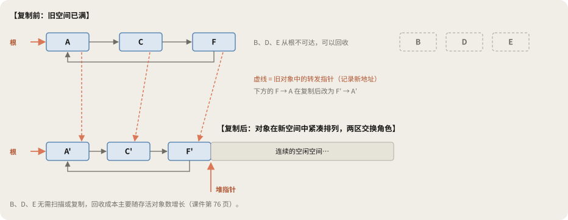

# 13.3 停止–复制（Stop & Copy）与 Cheney 算法

针对 [[13.2 标记–清除（Mark & Sweep）]] 遗留的外部碎片与空闲链表分配开销，**停止–复制（Stop & Copy）**预留一部分堆，用来把存活对象紧凑地复制到连续地址。它用空间换取简单的分配路径和无碎片的对象布局。

## 1. 半空间与指针递增分配（Bump Allocation）

堆分成相等的两个半空间：

- **当前分配区**（Old Space / From-Space）供程序分配对象。
- **备用区**（New Space / To-Space）平时为空，回收时接收存活对象的副本。


**读图**。分配区内，堆指针左侧已使用，右侧是连续的可用空间。分配时直接保留当前地址，再把指针按对象大小向前推进。备用区等到 GC 时才使用。

```cpp
// 指针递增分配。简化示意，分配只需要一次指针加法
void* alloc(size_t size) {
    void* p = heap_pointer;
    heap_pointer += size;
    return p;
}
```

> [!note] 实现中的边界检查与对齐
> 实际实现会先把 `size` 向上对齐到分配单位（常见单位为 8 或 16 字节），再检查是否越过上界，可用 `if (heap_pointer + size > heap_limit) collect();` 示意。快路径仍只需一次加法、一次比较和一次存储。多线程运行时可以给每个线程预留一小段空间，例如 HotSpot 的 TLAB（Thread-Local Allocation Buffer），线程可在自己的区间内分配，避免每次分配都争用共享指针。

## 2. 复制、转发指针与 Cheney 算法

当前分配区空间不足时，回收器按以下顺序运行：

1. 暂停应用线程。
2. 从根开始扫描，将发现的存活对象紧凑地复制到备用区的前部。
3. 每复制一个对象就在原位置记录**转发指针**（Forwarding Pointer），指向新副本。后续引用如果仍指向旧对象，就沿转发指针找到已有副本，并把该引用更新为新地址。
4. 回收整块原分配区，交换两个半空间的角色，然后恢复应用执行。



**读图**。上下两行给出复制前后的空间布局。底部折线是课件第 55 和 72 页的 F → A。复制必须保留该环，把 F′ 的引用改成 F′ → A′。橙色虚线是留在旧对象上的转发指针。B、D、E 既不复制也不扫描，所以工作量主要取决于存活对象和其中的引用，垃圾比例高时相对划算（第 76 页）。


**读图**。Cheney（1970）用新空间自身保存扫描队列，解决复制时也需要辅助工作列表的问题：

- `alloc` 指向下一个副本的放置位置，`scan` 指向第一个尚未检查指针字段的副本。
- 处理 `scan` 对象的每个指针字段。目标尚未复制时，复制到 `alloc`，推进 `alloc`，在旧对象处留下转发指针。目标已有副本时，取转发指针的值。两种情况都要把当前字段改为新地址。
- `scan` 与 `alloc` 之间的橙色区域是已经复制但尚未扫描的对象，相遇时遍历结束。

副本按离根从近到远的顺序放置，对应广度优先遍历。配套脚本 `gc.py` 重现了课件第 66–73 页的 A、C、F 顺序，并在 3000 个随机堆上验证了副本与原可达子图的结构一致。

复制后存活对象紧挨在一起，没有对象间的外部碎片，后续分配也只需推进指针。代价是等大的半空间布局始终要留出堆的 50% 作为备用区。

> [!note] 分代回收如何缩小备用空间
> 课件第 52 页指出，两个半空间只让程序用到一半。**分代 GC**（第 94 页）利用多数新对象很快死亡的特点，只把年轻代分成较小的两块，经常复制回收。存活时间较长的对象移入老年代，可用标记–清除或压缩等方式降低回收频率。需要为复制预留的空间随年轻代大小而定。

---

上一篇：[[13.2 标记–清除（Mark & Sweep）]] | 下一篇：[[13.4 保守式垃圾回收（Conservative GC）]]

来源：[[16.AI编译器/学习日记/0.2十一月/11_06#6. 停止–复制（Stop & Copy）|11_06 §6]]。
