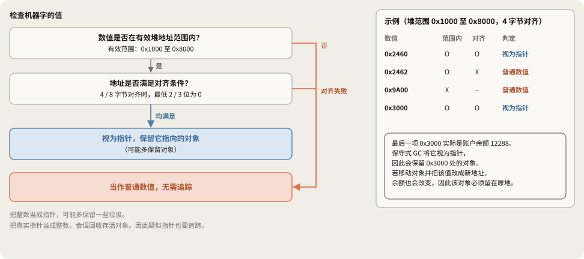

# 13.4 保守式垃圾回收（Conservative GC）

Java、Go 等带 GC 的运行时可以利用类型布局、栈映射等元数据区分指针和整数，据此实施**精确式 GC（Exact / Precise GC）**。C/C++ 的普通内存区域缺少对回收器可用的完整类型信息，回收器有时只能看到原始字节，此时就需要**保守式垃圾回收**。

## 1. 从字节模式无法确定类型

连续两个机器字可以表示链表节点的值和指针，也可以表示两个 64 位整数。单看这些位无法还原它们的实际类型。

```cpp
struct Data {
    uint64_t account_balance; // 账户余额
    void*    next_ptr;        // 指向下一个对象
};
```

假如 `account_balance` 的整数值恰好等于一个有效堆地址，例如 `0x7fff8040`，缺少类型信息的回收器无法区分它是余额还是指针。

## 2. 候选指针判定与对象移动限制

**Boehm GC** 是保守式回收器的代表。保守的目标是保留所有可能仍被引用的对象，允许一部分垃圾暂时留下。课件的简化规则把一个机器字当作候选指针，需要满足两个条件：

1. 数值满足示例的地址对齐约束（参见 [[10.5 字长、内存对齐与结构体填充]]）。例如按 8 字节对齐时，地址最低 3 位为 `000`。
2. 数值落在有效的堆地址范围内。

回收器按潜在引用处理同时符合两项条件的值，并继续追踪它指向的对象。



**读图**。左侧用流程图展示课件的两项条件，检查的先后顺序可以交换。右侧用 4 字节对齐演示：

- `0x2462` 位于范围内，但不满足 4 字节对齐，按普通数值处理。
- `0x9A00` 超出示例堆范围，按普通数值处理。
- `0x3000` 实际是余额这样的整数，却通过了两项检查。因此回收器会保留该地址处的对象。对象即便原本可回收，也可能因此留下。

如果移动该对象并把含义不明的字改为新地址，整数余额也会被篡改。对象只要仍可能被某个无法重写的引用指向，就必须留在原地。在完全保守的模型中，原地 [[13.2 标记–清除（Mark & Sweep）|标记–清除]] 可以满足这个约束，整体 [[13.3 停止–复制（Stop & Copy）与 Cheney 算法|复制]] 和压缩则无法安全更新这些值。

> [!note] Boehm GC 的实际检查与部分可移动的情形
> - **对齐检查针对扫描位置**。据 Boehm GC 的 `docs/gcdescr.md`，在缺少类型信息的区域中，它从对齐的槽位读取候选值。在 64 位示例中槽位按 8 字节对齐。候选值先与粗略堆边界比较，再检查它指向的地址是否属于实际已分配的堆块。
> - **内部指针**。默认设置下，指向对象内部的值也可以让该对象继续存活（例如 C 中可能只剩 `p = buf + 3`）。文档指出，C++ 多重继承下通常不适合用 `GC_set_all_interior_pointers(0)` 关闭这项行为。
> - **黑名单**。如果某个疑似指针值指向堆边缘之外或未分配的页，回收器可将该页记入黑名单，今后只在此类页内放可减轻误判影响的无指针小对象。
> - **部分对象可以移动**。Bartlett 的 mostly-copying GC（1988）保守扫描栈和寄存器，对堆内对象使用精确类型信息。栈上含义不明的值所指向的页会被固定，其他对象仍可复制。

---

上一篇：[[13.3 停止–复制（Stop & Copy）与 Cheney 算法]] | 下一篇：[[13.5 引用计数（Reference Counting）]]

来源：[[16.AI编译器/学习日记/0.2十一月/11_06#7. 保守式垃圾回收（Conservative Collection）|11_06 §7]]。
