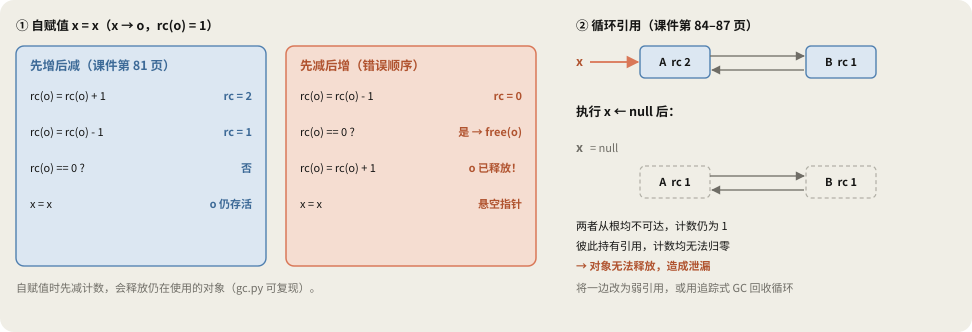

# 13.5 引用计数（Reference Counting）

与前面几节从根出发周期性追踪的 GC 不同，**引用计数（Reference Counting）**在每次修改引用时实时维护计数，将回收工作分散到各次指针操作中。最后一个拥有引用消失时，回收可以立即开始。

## 1. 基本规则与赋值顺序

- 对象建立首个拥有引用时，计数 `rc` 初始化为 1。
- 新增指向它的拥有引用时，执行 `rc += 1`。
- 引用离开作用域或改指向其他对象时，执行 `rc -= 1`。
- `rc == 0` 时销毁对象并释放其内存。

指针赋值 `x = y` 的底层逻辑可用以下伪代码表示：

```cpp
// 假设 x 原先指向对象 o，y 指向对象 p
// 以下步骤对应一次 x = y

rc(p) = rc(p) + 1;     // 1. 先增加新对象的引用计数
rc(o) = rc(o) - 1;     // 2. 再减少旧对象的引用计数

if (rc(o) == 0) {      // 3. 判断旧对象是否已失去全部引用
    free(o);           // 归零时释放，可能引发递归回收
}

x = y;                 // 4. 写入新指针
```

> [!note] 先增加新引用，再减少旧引用
> 自赋值 `x = x` 时，两个指针指向同一个对象。如果计数为 1 且先减计数，归零会在赋值完成前释放仍然需要的对象。



**读图**。左侧假设 x 是 o 的唯一引用。先增后减得到 `1 → 2 → 1`，o 仍然存活。先减后增时，计数先到 0，随后增加计数的操作会访问已释放的对象。配套脚本 `gc.py` 复现了这两条路径。

右侧是课件第 84–87 页的循环引用。`x ← null` 后，A 的计数由 2 变成 1。A、B 都已从根不可达，但彼此的引用让各自的计数仍然是 1。

## 2. 回收时机、循环引用与维护成本

**确定性的回收时机**（Deterministic Reclamation）与 RAII（Resource Acquisition Is Initialization）兼容。最后一个拥有引用离开作用域时即可触发释放，一般无需等待一次全堆扫描。

- **循环引用**。若 $A \to B$ 与 $B \to A$ 都是强引用，外部引用断开后，两者的计数仍为 1，内存无法靠引用计数回收。
- **计数维护成本**。普通的拥有引用赋值也可能要增计数、减计数并判断是否归零。多个线程共享同一个计数时，原子读改写会产生缓存一致性流量和争用。

```cpp
// 用弱引用表示不拥有对象的回边
#include <memory>

struct Node {
    std::shared_ptr<Node> next;
    std::weak_ptr<Node>   prev; // 回边使用弱引用，避免形成强引用环
};
```

> [!note] C++ 实验与实现细节
> - **循环引用实验**。用 `rc.cpp` 将两个节点连接起来，并把 `prev` 也设为 `shared_ptr`。两个局部变量销毁后，析构次数为 0。把 `prev` 改成 `weak_ptr` 后，两个节点都被释放。这类环造成的是内存泄漏。课件第 88 页给出两种处理方式：用弱引用打断环，或偶尔运行追踪式 GC 收集环。CPython 在引用计数之上增加了循环收集器，采用后一种方式。
> - **连锁释放**。一个对象的计数变为 0 时，它的析构可能继续减少其他对象的计数。释放一条有 100 万个节点的 `shared_ptr` 链表头时，递归析构耗尽 8 MB 栈并触发段错误（对照 [[10.4 全局变量、堆与进程内存四分区]] 的 8 MB 栈上限实测）；10 万节点的试验能正常结束。大批量释放会暂停当前工作，递归析构还有栈空间成本。
> - **原子操作**。Rust 分别提供单线程的 `Rc` 和可在线程间共享的 `Arc`。libstdc++ 在运行时通过 `__gthread_active_p` 检查线程支持是否激活，未激活时可采用非原子加法（`ext/atomicity.h`）。

## 3. 本章参考资料

- CS143 第 17 讲 *Automatic Memory Management*（里士满大学镜像 `facultystaff.richmond.edu/~dszajda/classes/cs331/Fall_2017/lecture_slides/`）
- C. J. Cheney，*A nonrecursive list compacting algorithm*，CACM 13(11)，1970
- H. Schorr、W. M. Waite，*An efficient machine-independent procedure for garbage collection in various list structures*，CACM 10(8)，1967
- J. F. Bartlett，*Compacting garbage collection with ambiguous roots*，DEC WRL Research Report 88/2，1988
- Boehm GC 的 `docs/gcdescr.md` 和 `docs/gcinterface.md`（`github.com/ivmai/bdwgc`）
- Richard Jones、Antony Hosking、Eliot Moss，*The Garbage Collection Handbook*，第 2 版，2023

---

上一篇：[[13.4 保守式垃圾回收（Conservative GC）]] | 下一篇：[[14.1 Java 数组与协变子类型]]

来源：[[16.AI编译器/学习日记/0.2十一月/11_06#8. 引用计数（Reference Counting）|11_06 §8]]。
