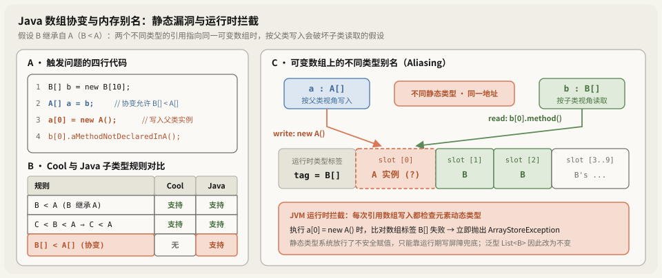

# 14.1 Java 数组与协变子类型

前面几章从前端类型检查（[[7.1 语义分析的任务与带类型 AST]]）、操作语义（[[8.1 语义定义四要素与三大形式语义学]]）、中间代码与优化（[[9.1 中间代码的解耦价值与三地址码（TAC）]]）一路走到运行时组织、代码生成、寄存器分配与垃圾回收（`10` ~ `13` 章），讨论的对象都是教学语言 Cool。Cool 刻意把语言做得很小、很规整；一旦转向 Java 这样的工业级语言，数组、异常、接口、数值转换、并发线程和动态类加载这些真实需求一进来，编译器和运行时就不得不做出大量妥协。本章按主题梳理这六块的设计与底层代价。

## 1. 四行 Java 代码暴露的类型漏洞

先看一段只有四行的 Java 代码。假设类 $B$ 继承自类 $A$（记作 $B < A$），下面这段程序会发生什么？

```java
B[] b = new B[10];
A[] a = b;
a[0] = new A();
b[0].aMethodNotDeclaredInA();
```

如果只按静态类型去读，每一行看起来都合情合理：第 1 行在堆上分配了一个长度为 10 的 `B` 数组；第 2 行把 `b` 赋给了 `A[]` 类型的引用 `a`；第 3 行往 `A[]` 的 0 号槽位塞进一个 `A` 对象；第 4 行从 `B[]` 里取出 0 号元素，调用一个只在 `B` 里声明、但 `A` 里根本没有的方法。

四行拼在一起就出事了。`a` 和 `b` 指向的是堆上的同一块内存，第 3 行借着 `a` 的父类视角把 `new A()` 塞进了原本存 `B` 的槽位，第 4 行再通过 `b` 把它当成 `B` 来调用方法，程序就会去访问一个并不存在的方法表项或字段。

## 2. Cool 和 Java 的子类型规则差异

问题出在第 2 行。把 Cool（参见 [[7.8 子类型、赋值与初始化相容性]]）和 Java 的子类型关系并排写出来，差别一眼就能看清：

$$
\begin{aligned}
B < A &\quad \text{若 } B \text{ 继承自 } A && \text{（与 Cool 相同）} \\
C < A &\quad \text{若 } C < B \text{ 且 } B < A && \text{（与 Cool 相同，传递性）} \\
B[] < A[] &\quad \text{若 } B < A && \text{（Cool 中没有这条规则）}
\end{aligned}
$$

前两条在面向对象语言里几乎是标配。第三条叫**数组协变（array covariance）**：只要元素类型满足 $B < A$，Java 就认为 `B[]` 也是 `A[]` 的子类型。Cool 没有这套可变数组的协变规则，所以躲过了这个坑；Java 放行了它，于是让静态类型检查器直接接受了 `A[] a = b`。

从类型理论的角度看（对照 [[7.5 类型、静态检查与可靠性]]），根源很朴素：

> 让多个静态类型不同的别名指向同一块可修改的内存位置，类型系统就不健全（unsound）。



图里把这段内存关系画透了。如果这块数组是只读的，协变其实不会出问题，把 `B` 当 `A` 读出来完全安全。麻烦在于数组既可读又可写：`a` 负责按宽松的 `A` 类型往里写，`b` 负责按严格的 `B` 类型往外读，两个别名共用同一个槽位，读写契约当场打架。

## 3. Java 为什么明知有漏洞还要这么设计，以及它怎么兜底

早期的 Java 1.0 还没有泛型。如果不允许 `B[] < A[]`，标准库甚至没法写出一个通用的排序函数 `sort(Object[] a)` 来接收 `String[]` 或 `Integer[]`。为了能写通用数组工具函数，Java 当年选择了数组协变。

为了不让第 4 行真的把内存踩坏，JVM 在运行期补了一道防线：每个数组对象在堆上都带着自己的运行时元素类型标签（这里是 `B[]`）。只要代码向引用类型的数组写入元素，JVM 就会现场比对要写入对象的真实类型是否兼容数组标签。走到第 3 行 `a[0] = new A()` 时，JVM 发现 `A` 不是 `B` 的子类型，直接抛出 `ArrayStoreException`，根本不会让程序执行到第 4 行。

这笔账其实是拿运行期性能换编译期便利：每次往对象数组里写引用，都要多做一次动态类型检查。后来 Java 5 引入泛型时，设计者吸取了教训，把 `List<B>` 定成了不变的（`List<B>` 不是 `List<A>` 的子类型），这类错误终于重新回到编译期解决。

---

上一篇：[[13.5 引用计数（Reference Counting）]] | 下一篇：[[14.2 异常处理与操作语义]]

来源：[[16.AI编译器/学习日记/0.2十一月/11_07#一、Java 数组与协变子类型（Cool 和 Java 的区别）|11_07 §一]]。
