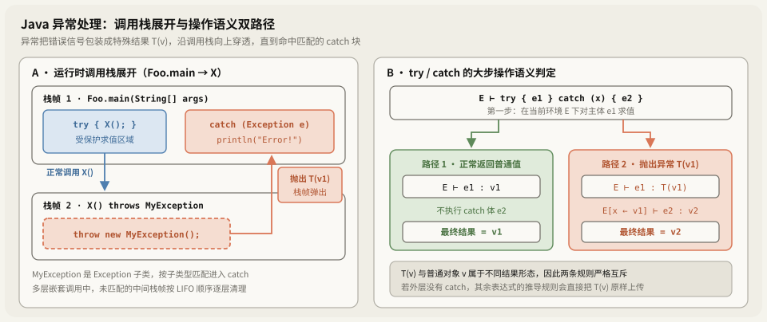

# 14.2 异常处理与操作语义

代码写深了总会撞上意料之外的故障，比如内存耗尽，或者一个按约定本该排好序的列表传进来居然是乱序的。

没有异常机制的话，摆在面前的路都不怎么好走：要么当场终止整个进程，要么让每一层函数都在返回值里夹带错误码，调用链上每一环都得手动检查并往上透传。只要中间有一个调用者忘了判断返回值，错误就悄悄吞掉了。

## 1. Java 的一等异常机制与栈展开

Java 的做法是把错误当成语言的一等机制：

1. 新增专门表示错误的异常类型（类层级）。
2. 引入两种控制流语法：`throw exception` 负责抛出异常对象，`try { something } catch (x) { cleanup }` 负责划定监控范围并在出事时接住异常做清理。

```java
class Foo {
    public static void main(String[] args) {
        try {
            X();
        } catch (Exception e) {
            System.out.println("Error!");
        }
    }

    public static void X() throws MyException {
        throw new MyException();
    }
}
```

（课件原稿为了省篇幅，把 `X()` 上的 `static` 和 `println` 末尾的分号都略去了，这里补全以便对照实际 Java 语法。）

`X()` 在方法签名里用 `throws MyException` 显式声明自己可能抛出的受检异常。运行期间一旦执行到 `throw new MyException()`，控制流不会按常规方式返回给 `X()` 的下一行，而是直接弹出 `X()` 的栈帧，一路回到 `main` 中的 `catch (Exception e)`。因为 `MyException` 是 `Exception` 的子类，按子类型匹配规则正好被接住，打印 `"Error!"`。

## 2. 用操作语义刻画 `try / catch`

在 [[8.2 环境 E、存储 S 与求值判断]] 里我们用大步操作语义写过 Cool 的求值判断，这里把异常也纳入同一套推导框架。为了把注意力留在控制流上，下面的规则先省略了存储 $S$ 和当前对象 $\mathrm{so}$，只保留环境 $E$。

先区分两种截然不同的求值结果：
- $v$ 表示普通值，也就是表达式正常算出来的对象；
- $T(v)$ 表示一个已经被抛出、携带异常对象 $v$ 的异常结果。

有了这个区分，`try { e1 } catch (x) { e2 }` 的大步语义只需要两条互斥的规则。

第一条处理正常结束的情况：如果 $e_1$ 在环境 $E$ 下正常求值为普通对象 $v_1$，整个 `try / catch` 直接返回 $v_1$，`catch` 里的 $e_2$ 根本不会执行：

$$
\frac{E \vdash e_1 : v_1}{E \vdash \texttt{try}\{e_1\}\ \texttt{catch}(x)\{e_2\} : v_1}
$$

第二条处理抛异常的情况：如果 $e_1$ 求值产生的是异常 $T(v_1)$，就把异常对象 $v_1$ 绑定到变量 $x$ 上得到扩展环境 $E[x \leftarrow v_1]$，再在这个新环境里求值清理代码 $e_2$，以 $e_2$ 的结果 $v_2$ 作为整条表达式的结果：

$$
\frac{E \vdash e_1 : T(v_1) \qquad E[x \leftarrow v_1] \vdash e_2 : v_2}{E \vdash \texttt{try}\{e_1\}\ \texttt{catch}(x)\{e_2\} : v_2}
$$



这套记法有个很干净的地方：$T(v)$ 并不是一个普通值 $v$。如果在没有外层 `try` 的地方写 $e_1 + e_2$，而 $e_1$ 求出了 $T(v)$，加法的正常求值规则就匹配不上，必须走专门的异常传播规则，跳过 $e_2$ 的求值并直接把 $T(v)$ 原样交给外层表达式。层层穿透下去，就对应了运行时的**调用栈展开（stack unwinding）**（参见 [[10.2 运行时结构、生命周期与作用域]] 中异常依然遵守 LIFO 析构顺序的讨论）。

当然，这两条课件规则做了两处简化：
1. 没有把存储 $S$ 写进去，真实执行时 $e_1$ 在抛出异常前改过的堆内存和变量副作用不会自动回滚，$e_2$ 看到的是抛出那一刻的存储状态 $S_1$；
2. 实际的 Java 允许带类型的 `catch (C x)`，只有当 $v_1$ 的动态类型满足子类匹配时才会进入第二条规则，匹配不上就继续让 $T(v_1)$ 往上抛。

---

上一篇：[[14.1 Java 数组与协变子类型]] | 下一篇：[[14.3 接口与多继承实现]]

来源：[[16.AI编译器/学习日记/0.2十一月/11_07#二、异常处理与操作语义|11_07 §二]]。
