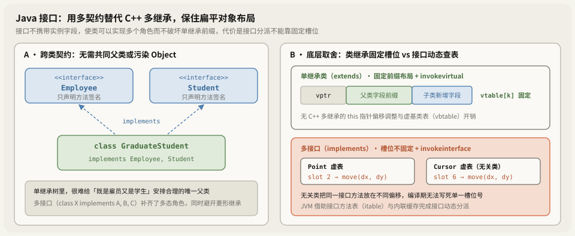

# 14.3 接口与多继承实现

面向对象里经常要描述这样一种关系：几个类在继承树上八竿子打不着，但它们都支持同一组操作。**接口（Interface）**就是用来在不引入继承关系的前提下声明这种契约的。

## 1. 接口契约与多实现

```java
interface PointInterface {
    void move(int dx, int dy);
}

class Point implements PointInterface {
    public void move(int dx, int dy) {
        // ...
    }
}
```

（课件里的 `Point.move` 省略了 `public`；实际 Java 规范规定接口方法隐含 `public abstract`，实现类里必须显式标出 `public`，否则访问权限比接口窄，编译会直接报错。）

Java 语言规范里有一句很直白的说明：

> “Java 程序可以用接口来避免让相关类必须共享一个公共抽象父类，也不必把各种方法往 `Object` 里塞。”

换个更贴近 C++ 视角的说法：接口承担的就是 C++ 里多继承（multiple inheritance）的职责，因为一个 Java 类可以同时实现任意多个接口：

```java
class X implements A, B, C { ... }
```

课件举了大学研究生的例子：研究生既拿津贴干助教助研，算学校雇员（`Employee`），又注册选课拿学位，算学生（`Student`）：

```java
class GraduateStudent implements Employee, Student { ... }
```

只靠单继承，这件事怎么设计都别扭：让 `Employee` 继承 `Student` 或反过来都不合逻辑；硬凑一个大而全的公共父类，很快就会把类层次揉成一团；把方法全塞进顶层的 `Object` 更荒唐。接口把“能做什么”从“是谁的子类”里拆了出来。

## 2. 编译器与运行时实现：单继承 `vtable` vs 接口 `itable`



站在编译器实现的立场看，Java 选“类单继承 + 接口多实现”而不是照搬 C++ 多继承，算盘打得很精。C++ 允许从多个带成员变量的基类继承，结果引发了菱形继承的数据重复、虚基类表（`vbtable`）以及调用虚函数时的 `this` 指针偏移修正，对象内存模型和编译器实现都会迅速膨胀。Java 接口不带实例字段，每个类的对象布局始终严格遵循单继承前缀，父类字段在什么偏移，子类里就在什么偏移（与 [[11.5 面向对象代码生成：对象布局与分派表]] 中 Cool 的单继承对象布局规律一致）。

省下来的复杂度转嫁到了接口方法分派上。单继承体系里，父类方法在虚函数表（`vtable`）里的下标在编译期就固定了，子类沿用同一个槽位号，JVM 用 `invokevirtual` 一次索引就能跳转。但两个毫无亲缘关系的类（比如图里的 `Point` 和 `Cursor`）同时实现 `PointInterface` 时，`move` 在各自虚表里排在第几位完全没有保证。通过接口引用调用方法时，JVM 不能写死槽位偏移，只能走 `invokeinterface`，依靠每个类额外维护的**接口方法表（`itable`）**配合 JIT 的内联缓存来查出目标地址。

---

上一篇：[[14.2 异常处理与操作语义]] | 下一篇：[[14.4 类型转换与强制转型]]

来源：[[16.AI编译器/学习日记/0.2十一月/11_07#三、接口（Interfaces）|11_07 §三]]。
