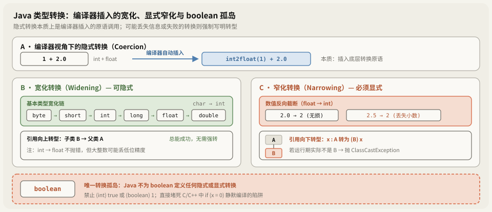

# 14.4 类型转换与强制转型

Java 允许基本数据类型在特定上下文中自动发生隐式转换（coercion），也支持显式强制转型（cast）。在编译器看来，这些转换并不是魔法，而是前端在 AST/IR 阶段显式插入的数值转换原语或运行期类型核验指令。

## 1. 隐式转换的编译期改写

最常见的例子是混合算术运算：

```java
1 + 2.0
```

左边的 `1` 是 `int`，右边的 `2.0` 是浮点数（严格按 Java 语法，`2.0` 字面量是 `double`，`2.0f` 才是 `float`，这里沿用课件记法统称浮点）。CPU 硬件不会直接把整数位模式和 IEEE 754 浮点位模式相加，Java 编译器在生成代码时会把 `1` 宽化为 `1.0`，等价于替你改写成：

```java
int2float(1) + 2.0
```

从编译器的眼光看，隐式类型转换就是编译器在 AST 或 IR 阶段悄悄插进去的一个底层原语函数调用。绝大多数编程语言在基础数值类型之间都内置了一整套这样的转换规则。

## 2. 宽化（Widening）与窄化（Narrowing）

Java 把所有的类型转换和强制转型清晰地分成两类：

- **宽化转换（Widening）**总能执行，不会因为目标类型装不下而失败，可以隐式发生。基本数值类型的宽化链是 `byte → short → int → long → float → double`（加上 `char → int`）；引用类型里则是子类向父类的向上转型（upcast）。
- **窄化转换（Narrowing）**可能丢失数据或在运行期失败，Java 要求必须显式写出转型语法。比如把 `float` 转成 `int` 时，`2.0` 转成 `2` 没毛病，碰到 `2.5` 就得截断小数部分；引用类型的向下转型（downcast）风险更大：假设 $B < A$，手里有个静态类型为 $A$ 的变量 `x`，要把它当 `B` 用，必须显式写成 `(B) x`。



有两处细节容易被字面意思带偏：
1. 课件说 `int → float` “总能成功”，是指语义上总有定义、不会报错，不代表绝对无损。Java 的 `int` 是 32 位有符号整数，有 31 位数值精度，而 IEEE 754 单精度 `float` 只有 24 位有效尾数（含隐含位），像 `123456789` 这样的大整数隐式转成 `float` 时，低位一样会被舍入。
2. 至于引用类型的向下转型 `(B) x`，编译期只看 `A` 和 `B` 之间有没有继承关系，真正的核验留在运行期。JVM 会生成 `checkcast` 指令检查 `x` 指向对象的实际类型；如果运行到那一行时 `x` 装的是纯粹的 `A` 或者另一个兄弟子类，JVM 直接抛出 `ClassCastException`。

## 3. 一个经典问题：哪个类型没有任何转换规则？

Java 里唯一没有定义任何隐式转换（coercion）或强制转型（cast）的类型是什么？

答案是 **`boolean`**。

在 C 和 C++ 里，整数、指针和布尔值可以来回互转，`0` 当假、非零当真，于是 `if (x = 0)` 这种把 `==` 手滑少打一个等号的错误能顺利通过编译，然后悄悄埋雷。Java 干脆把 `boolean` 做成了一座孤岛：既不能把 `1` 或 `0` 隐式当成 `boolean`，也不允许写成 `(int) true` 或 `(boolean) 1` 强转，彻底切断了布尔值和整数之间的通道。

---

上一篇：[[14.3 接口与多继承实现]] | 下一篇：[[14.5 并发与同步机制]]

来源：[[16.AI编译器/学习日记/0.2十一月/11_07#四、类型转换与强制转型（Coercions & Casts）|11_07 §四]]。
