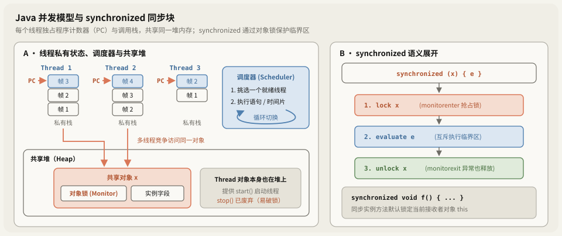

# 14.5 并发与同步机制

很多语言早期把并发甩给操作系统库（比如 C 的 POSIX `pthreads`），Java 则直接把线程和锁做进了语言本身和虚拟机规范里。

## 1. 多线程运行时模型：私有栈与共享堆

从运行时环境的角度看（对比 [[10.2 运行时结构、生命周期与作用域]] 里的单线顺序假设与 [[10.4 全局变量、堆与进程内存四分区]] 的单栈模型），引入线程后，单个程序不再只有一套调用栈：
- 每个线程都独占自己的**程序计数器（PC）**和**调用栈**，记录各自执行到了哪条指令、嵌套了哪些活动记录（栈帧）；
- 所有线程**共享同一片堆内存**。

在概念模型里，调度器（scheduler）像一个永不停歇的循环：挑选一个就绪线程，让它向前推进一步（一条语句或一个时间片），然后再切到下一个线程。线程本身在 Java 里也用对象来表示，对应 `Thread` 类，课件里提到它有 `start` 和 `stop` 方法。

> [!note] 关于 `Thread.stop()` 的后续演变
> 早期 Java 确实提供了 `Thread.stop()` 来强行终止线程，但很快人们发现这几乎必出事故：强制杀掉一个正在临界区里改数据的线程，会导致它持有的所有对象锁被突然释放，留下一堆改到一半、破坏了对象不变式的脏数据给其他线程。所以 `Thread.stop()` 早已废弃，在现代 JDK（Java 21+）里调用甚至直接抛出 `UnsupportedOperationException`，协作式取消统一改为 `interrupt()`。

## 2. 内置监视器锁与 `synchronized` 展开

因为多个线程共用同一个堆，一旦两个线程同时读写同一个对象，调度器在任意两条指令之间切换都可能引发竞态条件。Java 为每个对象都配了一把内置监视器锁（monitor），用 `synchronized` 关键字来申请和释放：

```java
synchronized (x) {
    e
}
```

它的执行含义可以直观地拆成三步：

```text
lock x         // 对应字节码 monitorenter：获取对象 x 的锁，拿不到就阻塞等待
evaluate e     // 互斥执行临界区代码 e
unlock x       // 对应字节码 monitorexit：释放对象 x 的锁（哪怕 e 抛异常也会释放）
```

如果把 `synchronized` 直接加在实例方法声明上：

```java
synchronized void f() {
    // ...
}
```

它锁住的对象就是当前方法调用的接收者 `this`，效果上等同于把整个方法体包在 `synchronized (this) { ... }` 里。



---

上一篇：[[14.4 类型转换与强制转型]] | 下一篇：[[14.6 动态类加载、字节码验证与延迟初始化]]

来源：[[16.AI编译器/学习日记/0.2十一月/11_07#五、并发与同步（Concurrency & Synchronization）|11_07 §五]]。
