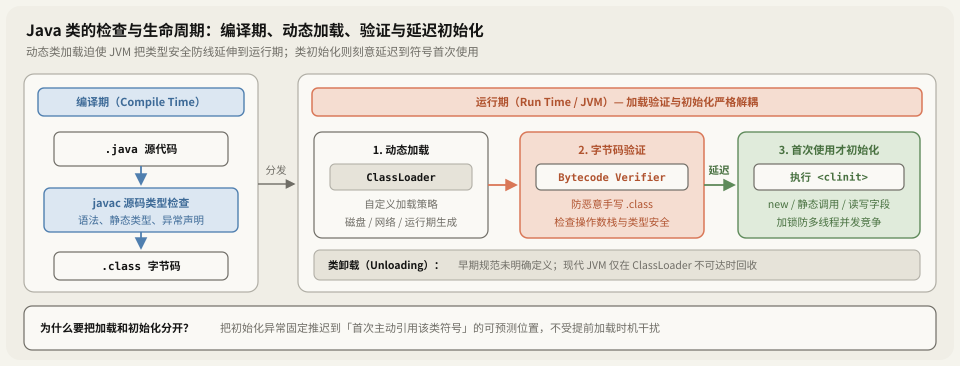

# 14.6 动态类加载、字节码验证与延迟初始化

回到编译器视角，C/C++ 通常是把所有代码提前静态编译链接成原生机器码再跑（参见 [[1.1 C++ 构建流程与目标文件]]）；Java 走的是另一条路线：它允许程序在运行期间按需把新类动态加载进虚拟机。这一决定从根本上改变了类型检查、类生命周期与初始化的边界。

## 1. 动态类加载、字节码验证与类卸载

动态加载引入了编译期与运行期的双层安全防线：

1. **源码级类型检查**依然发生在编译期（由 `javac` 完成）。
2. **运行期字节码验证（bytecode verification）**：JVM 不能假设运行期收到的 `.class` 字节码一定出自老实的 `javac`，它可能来自网络，也可能是别人手工篡改过的恶意字节码，专门用来绕过私有字段访问限制、制造操作数栈溢出或者把整数硬当成对象指针用。所以运行期还得再过一遍字节码验证，在真正执行之前用**数据流分析**（参见 [[9.6 全局常量传播：数据流分析与半格]]）确认字节码满足类型安全和栈平衡约束。
3. **可插拔的 `ClassLoader`**：类的查找与加载策略全部交给 `ClassLoader` 控制（本地磁盘、JAR 包、网络或运行期动态生成都可以）。

既然类能动态加载，自然也能卸载（unloading）。早期 Java 规范对类卸载的时机并没有定义得很清楚；到了现代 JVM 里，规则已经收敛：只有当某个类对应的所有实例都已死亡、没有反射引用指向它的 `Class` 对象，并且加载它的那个 `ClassLoader` 实例本身也变得不可达时，GC（参见 [[13.1 自动内存管理与可达性近似]]）才允许把这批类元数据一起卸载掉。

## 2. 为什么类初始化不在加载时执行

Java 的初始化机制比 Cool 复杂得多：Cool 里那套按继承链先填默认值再跑属性初始化表达式的规则（见 [[8.4 对象创建 new T 与类属性展平]]）在 Java 里全都有，还叠上了静态字段、静态代码块、接口默认初始化，以及最头疼的多线程并发竞争。

为了把复杂度压在可控范围内，JVM 把「类加载（Loading）」和「类初始化（Initialization，即执行 `<clinit>` 里的静态初始化逻辑）」严格拆开：

- 一个类被 `ClassLoader` 读进内存并验证通过时，**并不会**立刻执行它的静态初始化代码。
- 只有当类里的某个符号**第一次被主动使用时**（比如 `new` 实例、调用静态方法、读写非常量静态字段），JVM 才会触发这个类的初始化。

这么做最直接的好处，是把初始化阶段可能抛出的错误（比如静态代码块里除零、读配置文件失败抛出的 `ExceptionInInitializerError`）固定推迟到一个可预测的时间点，也就是代码真正用到这个类的那一刻。如果类在后台预加载时就偷偷跑静态代码，加载顺序稍微一变，程序在哪里崩、崩不崩都会变得玄学。

而一旦和并发碰头，延迟初始化就变得相当棘手：假如有两个线程在完全相同的时刻第一次引用同一个未初始化的类 `Foo`，JVM 绝不能让 `<clinit>` 跑两遍，也不能让第二个线程在第一个线程还没初始化完的时候就读到半成品静态字段。JVM 规范要求给每个类的初始化过程加上专门的初始化锁：一个线程进去跑 `<clinit>`，另一个线程在门口阻塞等待。要是类 `A` 的静态块里引用了 `B`，同时另一条线程正在跑 `B` 的静态块又反过来引用了 `A`，两个线程甚至会在类初始化阶段直接死锁。

---

上一篇：[[14.5 并发与同步机制]]

来源：[[16.AI编译器/学习日记/0.2十一月/11_07#六、动态类加载、字节码验证与延迟初始化|11_07 §六]]。
