# 11月5日学习记录：语义分析入门——前端守门员与CFG的能力边界

整理斯坦福 CS143 的语义分析内容：从语义分析概览到 SELF_TYPE 与错误恢复。按 University of Richmond 2017 年转载版的编号，第1–40节对应 Lecture 9，第41–44节对应 Lecture 10。

在经历词法分析（Lexing）和语法分析（Parsing）后，编译器前端来到了最后一个关卡：**语义分析（Semantic Analysis）**。它的核心任务是拦截语法合法但逻辑荒谬的程序，捕获前端遗留的所有静态错误。

---

## 0. 阅读导航与配套演示

| 要解决的问题 | 对应内容 |
|---|---|
| 文法正确后还剩哪些错误？ | 第1–5节：前端分工与 CFG 的边界 |
| 一个名字究竟指向哪个声明？ | 第6–15节：作用域、符号表与多趟分析 |
| 如何为表达式确定类型？ | 第16–31节：推导规则、证明树与类型环境 |
| 子类与分支结果如何兼容？ | 第32–36节：子类型、赋值、if、case 与 LUB |
| 方法调用如何保留子类信息？ | 第37–43节：方法环境、分派与 SELF_TYPE |
| 怎样继续检查出错的 AST？ | 第44节：Object 与 No_type 恢复 |

中文交互演示：[从词法到语义](../11_05/frontend-flow.html)。31 个页面把词法、语法与语义分析串在同一个程序上；其中 `int * int` 是初始化式 `2 * 3` 的 Token。

- `下一步` 或键盘 `→` 先推进当前页的步骤；到末步后才进入下一页。`上一步` 或 `←` 可回退，页首再按一次会回到上一页离开时的位置。
- 出现选项时，须点击选项继续。错误路径会说明原因，可返回改选；对比页面的两侧同步推进。
- FIRST、FOLLOW、GOTO、ACTION、作用域、TypeCheck、LUB 等内容先展示流程图，再展示逐步计算。橙色实线表示外层循环，蓝色虚线表示内层循环，绿色点线表示最内层循环。

| 内容 | 演示入口 |
|---|---|
| 三阶段与三种外部环境 | [整体流程](../11_05/frontend-flow.html#overview) |
| 最长匹配与 Token 划分 | [词法流程](../11_05/frontend-flow.html#lex-flow) → [逐步分词](../11_05/frontend-flow.html#lex-run) |
| FIRST、FOLLOW 与 LL(1) 表 | [FIRST](../11_05/frontend-flow.html#first-flow)、[FOLLOW](../11_05/frontend-flow.html#follow-flow)、[建表](../11_05/frontend-flow.html#lltable-flow)、[分析输入](../11_05/frontend-flow.html#ll-run) |
| LR(0) 状态与 SLR(1) 表 | [GOTO](../11_05/frontend-flow.html#goto-flow)、[ACTION](../11_05/frontend-flow.html#action-flow)、[分析输入](../11_05/frontend-flow.html#slr-run) |
| 名称与作用域 | [多趟分析](../11_05/frontend-flow.html#passes-run)、[遍历流程](../11_05/frontend-flow.html#scope-flow)、[嵌套 let](../11_05/frontend-flow.html#scope-run)、[静态与动态作用域](../11_05/frontend-flow.html#scope-compare) |
| 类型规则与 LUB | [TypeCheck](../11_05/frontend-flow.html#tc-flow)、[证明树](../11_05/frontend-flow.html#tc-proof)、[环境传递](../11_05/frontend-flow.html#tc-run)、[LUB](../11_05/frontend-flow.html#lub-flow)、[case](../11_05/frontend-flow.html#case-run) |
| 分派与 SELF_TYPE | [查找流程](../11_05/frontend-flow.html#dispatch-flow)、[四种调用](../11_05/frontend-flow.html#dispatch-run)、[Count 对比](../11_05/frontend-flow.html#selftype) |
| 错误恢复与回顾 | [Object / No_type](../11_05/frontend-flow.html#recovery)、[三阶段错误对比](../11_05/frontend-flow.html#finale) |

图示放在 `assets/11_01/`，与十月笔记的 `assets/笔记名/` 组织方式一致。

---

## 1. 前端三阶段的分工与防线

编译器的前端由三个经典阶段依次把关，每个阶段负责拦截不同层级的错误输入：

| 阶段                              | 核心任务                         | 拦截的错误类型                                      | 典型错误样例                           |
| ------------------------------- | ---------------------------- | -------------------------------------------- | -------------------------------- |
| **词法分析**<br>(Lexical Analysis)  | 将字符流切分为合法的 Token 序列          | 非法字符、无法识别的词法记号（Illegal Tokens）               | `foo$bar`（语言不认 `$` 符号）、未闭合的字符串常量 |
| **语法分析**<br>(Parsing)           | 将 Token 序列组织为符合文法的抽象语法树（AST） | 结构畸形、不符合产生式的树结构（Ill-formed Parse Trees）      | `let x = 2 * + 3;`（连续操作符）、括号不匹配  |
| **语义分析**<br>(Semantic Analysis) | 审查语法树背后的逻辑合法性并注解信息           | 结构合法但语义无意义的静态错误（All Remaining Static Errors） | 使用未声明的变量、将整数与字符串直接相加、继承不存在的父类    |

词法分析器只看当前切片出来的单词合不合规；语法分析器只管这些单词摆放的架势是否符合语法树结构。至于这个变量有没有先声明、两边类型能不能相加，语法分析器一概不知，也不归它管。

语义分析就是前端阶段的最后一环。在这之后，编译器将脱离源语言的静态约束检查，正式走向中端优化与后端代码生成（IR 生成、目标指令翻译）。

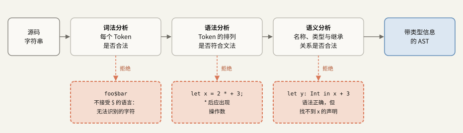

---

## 2. 为什么语法分析抓不住所有错误？

一个自然而然的疑问：**既然前面花了那么大力气推导 LL/LR 文法、构建语法分析表，为什么不能把所有检查规则写进文法，让 Parser 一并做了？**

答案很简单：**上下文无关文法（Context-Free Grammar, CFG）的表达能力不够。**

### 2.1 理论根源：非上下文无关语言的硬壁垒

语法分析器依赖的是下推自动机（Pushdown Automaton, PDA），只配备了一个先进后出的后备栈。

考虑编程语言中最基础的一条规则：“变量必须先声明，然后才能使用”。
抽象成形式语言，这本质上是在检查形如下述模式的字符串：

$$L = \{ w \, c \, w \mid w \in \Sigma^* \}$$

这里的 $c$ 是不属于字母表 $\Sigma$ 的固定分隔符；第一个 $w$ 与第二个 $w$ 抽象表示声明名与使用名。它用于说明同序复制的限制，不是把任意代码片段直接定义为一个字符。

当 $\Sigma$ 至少包含两个不同字符时，$L = \{w c w \mid w\in\Sigma^*\}$ 不是上下文无关语言，可用上下文无关语言的泵引理证明。

直观上，若把第一个 $w=ab$ 逐字压栈，弹栈顺序是 $ba$，与第二个同序的 $ab$ 对不上；反序复制 $w c w^R$ 则能与弹栈顺序匹配。这个例子说明栈的顺序限制，严格结论仍来自形式语言的证明。

> [!note] 字母表条件与反序复制
> 如果字母表只有一个字符 $a$，上述语言变成 $\{a^n c a^n\}$，只需匹配数量，是上下文无关语言。$\{w c w^R\}$ 也属于 CFL，因为后半段与弹栈顺序一致。
> 《编译原理》第2版 §4.3.5 用同序复制抽象声明与使用的匹配，并用 $\{a^n b^m c^n d^m\}$ 说明另一类跨段计数约束。LL(1)、LR(1) 对应确定性下推自动机，其能力还小于 CFL 全集。

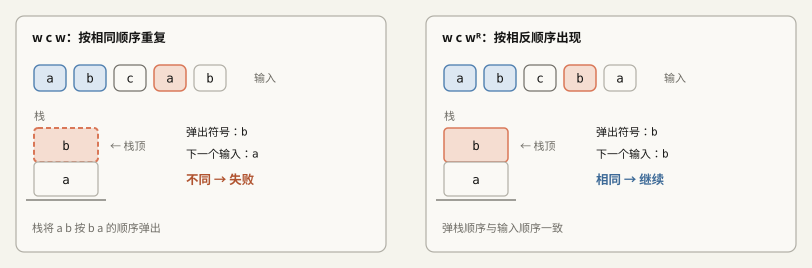

### 2.2 现实中的语言构造：无处不在的“上下文相关”

现实语言到处充斥着上下文相关的约束，单靠产生式规则无法表达：

1. **作用域与声明关联**：使用变量 `x` 时，必须确认它已在当前作用域或外层某个作用域声明过。
2. **形参与实参匹配**：函数调用 `foo(a, b, c)` 的参数个数与每个实参的类型，必须与 `foo` 声明处的签名逐一对应。
3. **类型相容性**：`a + b` 中的加法操作符究竟合不合法，完全取决于 `a` 和 `b` 算出来的最终类型，而表达式可以嵌套数十层。

如果强行试图用文法去编码类型（例如为“整型表达式”、“布尔表达式”分别写一套产生式），文法规则数量会瞬间发生组合爆炸，甚至在存在隐式类型转换、多态或模板时直接退化为不可行。

因此，分工是非常清醒的工程选择：
- **语法分析负责句法结构**（树长得对不对）；
- **语义分析负责符号含义与关联**（树上的每个节点讲不讲得通）。

---

## 3. 语义分析器在查什么：coolc 检查清单

以斯坦福 CS143 的教学语言 Cool 编译器 `coolc` 为例，语义分析阶段通常需要做六类典型检查：

### 3.1 标识符全生命期：先声明后使用（All Identifiers are Declared）
- 代码中出现的每一个变量名、方法名、类名，是否都在其可见的作用域内被明确声明过？
- 编译器借助**符号表（Symbol Table）**跟踪当前作用域链。进入新作用域压栈，退出作用域出栈；遇到标识符则沿着符号表链逐级向外查找定义。

### 3.2 类型合法性与一致性（Types）
- 赋值语句左右两边的类型是否相容？（例如将 `String` 赋给 `Int` 变量直接拒掉）
- 运算符两端的运算数类型是否满足操作要求？（算术运算必须是数值类型，逻辑判断必须是布尔类型）
- 函数调用的参数类型是否与函数签名一致？
- 条件分支 `if-else` 的两个分支返回类型如何求取最小公共祖先（LUB, Least Upper Bound）？

### 3.3 继承关系的合法性（Inheritance Relationships）
- 一个类声明继承自 `Foo`，那么 `Foo` 是否真实存在？
- **继承图是否无环**：绝不允许出现 `class A extends B` 且 `class B extends A` 的循环继承。语义分析器必须对类继承图进行拓扑排序或有向无环图（DAG）成环检测。
- 派生类重写父类方法时，形参个数、参数类型与返回值类型是否与父类完全一致？

### 3.4 类定义的唯一性（Classes Defined Only Once）
- 同一个名字的类不能重复定义。整个编译单元中，类名必须全局唯一。

### 3.5 类内方法定义的唯一性（Methods in a Class Defined Only Once）
- 在同一个类作用域内，不能定义两个同名方法（Cool 语言不支持同名重载，这大大简化了规则；即使在支持重载的 C++ 中，签名完全相同的重定义也是非法行为）。

### 3.6 保留标识符未被滥用（Reserved Identifiers are Not Misused）
- 语言内建的特殊名字具有保留语义，不能作为普通标识符被肆意绑定或覆写。
- 例如在 Cool 中，不能继承 `Int`、`String`、`Bool`，也不能把 `SELF_TYPE` 作为父类；`Object` 和 `IO` 可以被继承，但内置类不能被重新定义。不能将 `self` 绑定为普通变量，也不能给 `self` 赋值。

---

## 4. 语义规则因语言而异

上面六条是 `coolc` 的要求，但不同的编程语言，语义分析阶段制定的规则差异很大：

- **静态类型 vs 动态类型**：
  在 C++ 或 Rust 这类静态强类型语言中，类型检查由编译期全部做完；而在 Python、JavaScript 等动态语言中，大部分类型合法性推迟到了运行时处理，编译前端仅负责名字解析或基础的作用域检查。
- **单继承 vs 多继承 / Trait**：
  Java 只允许单继承类但允许多实现接口；C++ 允许多继承并需要处理菱形继承；Rust 用 Trait 系统做孤儿规则检查。继承或组合的拓扑检查算法完全不同。
- **变量隐藏与重定义**：
  有些语言允许内层块级作用域 shadowing 外层同名变量（如 Rust、C++），有些语言（如 Python）则使用特定的 `global`/`nonlocal` 关键字控制变量归属。

无论规则怎么变，本质没变：**语义规则完全由语言规范（Language Specification）白纸黑字定义，语义分析器就是把这本规范转换成实际的代码审查器。**

> [!note] 同层重声明也取决于语言
> Rust 允许同块 `let x = 5; let x = x + 1;`，后者遮蔽前者。C++ 的同块 `int x; int x;` 是重定义错误。Cool 则允许 `let x: Int <- 1, x: Int <- x + 1 in x` 的顺序遮蔽，却禁止同一方法的重复形参。因此不能把 `check_scope` 命中一律解释为错误。

---

## 5. 阶段产物：带类型注解的语法树（Decorated AST）

语义分析除了拦截错误，还会为语法树补充下游所需的元数据。

在输入语义分析器之前，AST 节点上记录的只是语法层面的结构；
经过语义分析器之后，AST 节点被**注解（Annotate / Decorate）**了丰富的语义元数据：
- 每个表达式节点被标上了它的求值类型（`Type`）；
- 每个标识符节点被链接到了它在符号表中的确切定义位置（`Binding`）；
- 方法调用节点关联到静态检查所需的方法签名；动态分派实际执行的实现仍由运行时对象决定。

带着这些注解信息的 AST，才真正具备了被翻译为中间表示（IR）或机器指令的全部前提。
前端的任务，至此全部完成。


---

## 6. 静态分析核心步骤：匹配声明与使用（Matching Declarations with Uses）

进入语义分析后，首要且基础的工作，是**把程序中每一个标识符的使用，与其对应的声明精确绑定起来**。

无论是变量读写、函数调用还是类继承，编译器处理标识符时都必须先回答两个问题：
1. 这个名字在当前位置有没有声明过？
2. 如果声明过，它对应的是哪一个具体的声明（类型是什么、作用域在哪）？

几乎所有静态类型语言（包括 Cool）都把这一步放在语义分析的最前线。只有完成标识符绑定，类型检查器才能拿到具体的类型信息。

### 6.1 两个对照示例

看两段简单的 Cool 表达式，体会两种截然不同的失败机制：

#### 示例 1：声明匹配成功，后续类型检查失败
```cool
let y: String <- "abc" in y + 3
```
- 分析器在 `y + 3` 处查找 `y`，成功在 `let` 作用域内找到了声明 `y: String`。
- 绑定完成后，类型检查器介入：加法操作符 `+` 要求两端均为整型 `Int`，而 `y` 的类型是 `String`。
- **结论**：声明与使用匹配通过，但在类型规则检查时被拦截。

#### 示例 2：声明匹配阶段直接被截停
```cool
let y: Int in x + 3
```
- 分析器读到表达式 `x + 3`，试图在当前所有可见的作用域中查找 `x`。
- 当前作用域只注册了 `y: Int`，外层也没有 `x` 的任何踪影。
- **结论**：尚未走到加法类型判断，在第一步“匹配声明”时直接报 `Undeclared identifier: x` 并中止。

> [!note] 未使用的 y 与未声明的 x 是两件事
> 例 2 中 `y` 只声明不用，并不构成语义错误；编译器可以另发警告。`x` 是否出错取决于外层环境：外层若有 `x: Int`，`x + 3` 可以通过；若有 `x: String`，则名称绑定成功而类型检查失败。不能仅凭这一个局部表达式断定 x 未声明。

---

## 7. 作用域的本质（Scope of Identifiers）

既然要匹配声明，就必须定义标识符的可见范围，也就是**作用域（Scope）**。

### 7.1 基本定义
- **标识符的作用域**：指该标识符在程序文本中能够被合法访问的代码区域。
- **同名不同义**：同一个标识符在程序的不同区域可以指代完全不同的实体。
- **范围受限**：大多数标识符的作用域都是有限的。一个在函数内部声明的局部变量，生命期仅限于该函数块，外界无法窥探。

不同作用域为相同名字划分了各自的势力范围。只要两个作用域互不重叠，即使使用相同的名字 `x`，彼此也不会发生冲突。

---

## 8. 静态作用域 vs 动态作用域

编程语言在确定“某处变量到底绑定哪个声明”时，历史上发展出两种截然不同的策略：

| 维度       | 静态作用域（Static / Lexical Scope）         | 动态作用域（Dynamic Scope）            |
| -------- | ------------------------------------- | ------------------------------- |
| **判定依据** | **程序文本的物理嵌套结构**（写代码时的排版）              | **运行时的函数调用链路**（执行时的 Call Stack） |
| **确定时机** | 编译期（静态语义分析阶段即可完全确定）                   | 运行期（必须等到代码执行时沿调用栈回溯）            |
| **代表语言** | C/C++、Java、Rust、Python、Cool 等几乎所有现代语言 | 早期 Lisp、SNOBOL、Bash、Perl（部分特性）  |
| **工程评价** | 逻辑直观、易于静态分析与重构优化                      | 极易发生意外的名字捕获，增加调试与维护成本           |

### 8.1 为什么现代语言几乎都选择静态作用域？
静态作用域也叫**词法作用域（Lexical Scope）**。它的好处是读代码时一目了然：变量绑定到哪一层定义，光看源文件的缩进和括号嵌套就能定死，不需要在脑海中模拟整个运行时的调用栈。

Lisp 最初采用动态作用域，但在后续演进中（如 Scheme、Common Lisp）几乎全面转向了词法作用域，仅对极少数特殊变量保留动态绑定支持。

---

## 9. 作用域嵌套与变量遮蔽（Shadowing）

当作用域发生嵌套时，内外层出现同名变量是极常见的场景。静态分析器必须严格遵循遮蔽（Shadowing）规则。

### 9.1 经典代码切片解析

观察如下 Cool 代码段的变量绑定过程：

```cool
let x: Int <- 0 in
{
    x;                 -- (1) 绑定外层 x, 值为 0
    let x: Int <- 1 in
    {
        x;             -- (2) 遮蔽发生！绑定内层 x, 值为 1
    };
    x;                 -- (3) 内层作用域结束，重新回到外层 x, 值为 0
}
```

这段代码的行为清晰展现了作用域的嵌套生命周期：
1. 最外层 `let` 声明了整型变量 `x = 0`。在进入代码块后，第一个表达式 `x;` 毫无争议地绑定到这个外层变量。
2. 内部再次遇到 `let x: Int <- 1`。此时内层声明生效，它**遮蔽（Shadow）**了外层的同名变量。在内层大括号的作用范围内，所有对 `x` 的访问都被截流至内层的 `x`。
3. 一旦走出内层 `let` 的大括号，内层作用域立即销毁。此时后续的第三个表达式 `x;` 重新恢复对外层 `x` 的可见性，值仍然为 `0`。

### 9.2 编译器的实现直觉：符号表栈（Scope Stack）

语义分析器遍历抽象语法树（AST）时，维护一个栈式的符号表结构来管理嵌套：

```text
遇到外层 let      --> Push Scope 1:  [ x: Int(0) ]
执行语句 (1)      --> 从栈顶查找 x，命中 Scope 1 的 x
遇到内层 let      --> Push Scope 2:  [ x: Int(1) ] -> Scope 1: [ x: Int(0) ]
执行语句 (2)      --> 从栈顶查找 x，在 Scope 2 率先命中 x（遮蔽外层）
离开内层 let      --> Pop Scope 2
执行语句 (3)      --> 从栈顶查找 x，此时栈顶是 Scope 1，重新命中外层 x
```

通过这种进入与离开作用域时的压栈与弹栈，语义分析器无需复杂的全局搜索，只沿着符号表栈顶自顶向下扫描，就能保证内层优先，并在退栈后自动恢复外层环境。

> [!note] Cool 的块不单独创建作用域
> `{ e₁; e₂; … }` 只按顺序求值，不引入名称绑定。上例栈中的新层来自两个 `let`，不是来自两对花括号。内层 `let` 的正文在外部块的分号处结束；随后第三处 x 重新使用外层绑定。符号表也只保存声明、类型等编译信息，代码注释中的 0、1 是运行时值。

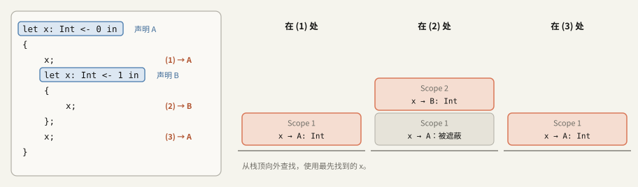

---

## 10. 深入理解动态作用域（Dynamic Scope）

前面提到动态作用域由运行时的调用链路决定，看一段具体的代码切片：

```text
g(y) = let a <- 4 in f(3);
f(x) = a;
```

观察函数 `f(x) = a`：
- 在 `f` 内部，变量 `a` 既不是形参，也没有被局部声明。
- **静态作用域下的判定**：编译器审查 `f` 所在的外层物理文本，若全局都没有声明 `a`，在编译期直接报错 `Undeclared identifier: a`。
- **动态作用域下的判定**：编译期根本不管。当程序运行时执行到 `g(y)`，先在调用栈上绑定了 `a = 4`，接着 `g` 调用 `f(3)`。此时 `f` 沿着运行时的**调用栈（Call Stack）**向上回溯寻找 `a`，在调用者 `g` 的栈帧里命中了 `a = 4`，因此返回值是 `4`。

动态作用域的核心问题在于**函数行为取决于被谁调用**：
如果另一个函数 `h()` 内部没有绑定 `a` 就直接调用了 `f(3)`，运行时就会抛出找不到变量的崩溃；如果调用链外层无意中定义了一个同名变量 `a`，`f` 就会意外读取甚至篡改外部数据。这就是为什么现代语言几乎全面摒弃动态作用域。

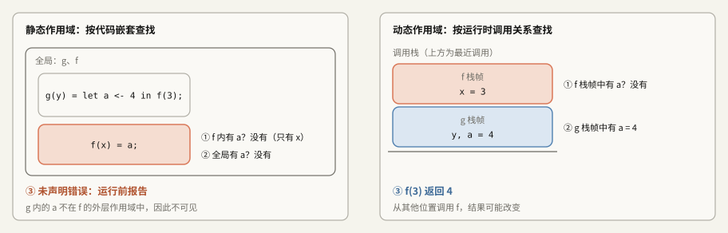

---

## 11. Cool 语言中引入标识符绑定的 6 种途径

在 Cool 编译器（coolc）中，并非只有 `let` 会引入标识符。所有的标识符绑定严格通过以下 6 种语法结构引入：

1. **类声明（Class declarations）**：引入全局的类名（Class Name，如 `class Main { ... }`）。
2. **方法定义（Method definitions）**：引入类内的方法名（Method Name，如 `f(): Int { ... }`）。
3. **Let 表达式（Let expressions）**：在局部子树中引入对象标识符（Object ID，如 `let x: Int <- 0 in ...`）。
4. **形式参数（Formal parameters）**：在方法体内引入形参对象标识符（如 `foo(x: Int, y: String)`）。
5. **属性定义（Attribute definitions）**：在整个类内部引入成员变量（如 `a: Int <- 0;`）。
6. **Case 分支（Case expressions）**：在模式匹配分支中引入单分支局部绑定的对象标识符（如 `case e of x: Int => ...; y: String => ...; esac`）。

这 6 种绑定在符号表里分属不同的命名空间（Namespace）：类名使用大写开头，变量和方法名使用小写开头，彼此互不干扰。

---

## 12. 打破“最近嵌套规则”的三类特殊作用域

很多初学者容易形成刻板印象：以为所有变量都像 `let` 那样，必须“先声明后使用”，且“作用域严格局限在大括号嵌套内”。

在面向对象语言中，这种“单向向下、最近嵌套”的规则会被三种情况打破：

### 12.1 类名：全局可见且允许前向引用（Forward Reference）
Cool 中的类定义不能相互嵌套，所有类都处于全局顶层作用域，并且**允许在定义之前直接使用**：

```cool
class Foo {
    ... let y: Bar in ...    -- 使用了类名 Bar，但 Bar 定义在后面
};

class Bar {
    ...
};
```
在扫描到 `class Foo` 时，编译器还没有读到后面的 `class Bar`。如果按照传统的单趟流式处理，这里就会误报 `Bar` 未定义。

### 12.2 类属性：作用域覆盖整个类体
类的属性变量在整个类内部是全局可见的，其作用域不受行号先后的限制：

```cool
class Foo {
    f(): Int { a };          -- 在前面读取 a
    a: Int <- 0;             -- 属性在后面才正式声明
};
```
属性的作用域覆盖了类内定义的所有方法，即便属性写在类底，顶层的方法依然能够自由访问。

### 12.3 方法名：具有继承与重写（Override）链条
方法名字的作用域更加复杂：
- 一个方法不一定声明在当前类中，它可能沿着继承链来自于父类甚至祖先类。
- 派生类可以重写父类的同名方法，编译器必须跨类核对形参个数、参数类型与返回值是否严格匹配。

---

## 13. 澄清关键认知：语法分析状态栈 vs 语义分析符号表

> [!important] 彻底理清概念混淆
> 很多同学在这里会把“语法分析时的状态转移”与“语义分析时的符号表”混为一谈：
> - **语法分析中的 `<状态, 符号>` 栈**：
>   那是 LR / SLR 分析器内部的**解析驱动栈（Parser Stack）**。栈中存放的是 DFA 状态号和终结符/非终结符，用来跟踪规约句柄（Handles），决定何时 Shift、何时 Reduce，目标是**造出 AST 树**。一旦 AST 建造完成，语法分析栈就功成身退被销毁了。
> - **语义分析中的符号表（Symbol Table）**：
>   语义分析阶段已经拿到了完整的 AST。此时的符号表是**业务字典（Mapping: Name $\to$ Info）**，Key 是代码里的标识符字符串（如 `"x"`），Value 是类型与属性元数据（如 `Int`、内存偏移量）。它的任务是**给 AST 节点查户口、绑定义、做类型推导**。

### 13.1 语义分析符号表是什么？

符号表是编译器维护的一份登记表，记录代码里的名字对应哪个声明，以及该声明的类型等信息。它用于回答：这个名字有没有声明？这里使用的是哪个声明？它是什么类型？

例如，检查下面的 Cool 表达式：

```cool
let x: Int <- 10 in x + 1
```

检查 `in` 后面的主体时，符号表中已有这条记录：

| 名字 | 类别 | 类型 | 声明位置 |
|---|---|---|---|
| `x` | 局部变量 | `Int` | 前面的 `let x: Int` |

检查 `x + 1` 时，编译器按以下步骤处理：

1. 遇到 `x`，查符号表，找到它的声明，得知类型是 `Int`。
2. 数字 `1` 的类型也是 `Int`。
3. 按 Cool 的加法规则，两边都是 `Int`，因此加法合法，结果类型为 `Int`。

如果主体改成 `y + 1`，且外层也没有声明 `y`，编译器查不到它，就会报告“使用了未声明的变量”。

符号表也可以记录函数、方法和类。变量条目记录类型、声明位置等信息；函数或方法条目还需要参数类型、返回类型；类条目可以关联父类与成员信息。实际实现可能把这些名字分放在不同的表中。

这里需要区分编译信息与运行时数据：符号表记录 `x` 的声明和类型等信息，程序运行时才在相应的存储位置保存变量的值 `10`。做名字解析和类型检查，无须实际执行这段代码。

当内外层存在同名变量时，符号表可以按作用域分层组织：

```text
当前内层：{ x → 内层声明，类型 String }
外层：    { x → 外层声明，类型 Int    }
```

查找 `x` 时从内向外，先找到内层声明，所以这里的 `x` 是 `String`。退出内层后，移除内层这一层，再查 `x` 就会找到外层的 `Int`。外层记录始终保留，只是在内层声明生效时被遮蔽。

这就是后文“符号表演进”的含义：随着 AST 遍历进入或离开作用域，当前可查到的声明发生变化。具体的登记、查找和退出操作见 [[#14. AST 递归下降遍历与符号表演进]]。

参考：《编译原理》第2版 §2.7；[CS143 符号表接口说明](https://web.stanford.edu/class/archive/cs/cs143/cs143.1112/javadoc/cool_ast/SymbolTable.html)。

---

## 14. AST 递归下降遍历与符号表演进

语义分析的执行机制，可以形式化地表达为对 AST 的一次或多次**递归下降遍历（Recursive Descent over AST）**：

```text
遍历节点 n:
  1. Before:  进入节点 n 前，建立新作用域或预注册符号；
  2. Recurse: 递归处理节点 n 的所有子节点；
  3. After:   遍历完子节点后，退出作用域，收尾并注解节点 n。
```

### 14.1 案例细剖：`let x: Int <- 0 in e` 的作用域流转

考虑 Cool 中典型的 `let` 语法树节点：

```text
         [ let x: Int ]  (当前输入环境: Sym)
            /       \
           /         \
    [ init 表达式 ]   [ 主体表达式 e ]
     (环境: Sym)      (环境: Sym + [x -> Int])
```

注意初始化表达式与主体表达式的**环境不对称性**：
1. **处理 `init` 子节点**：
   在处理初始值 `0` 时，所处的作用域依然是**旧环境 $Sym$**，新变量 $x$ 尚未生效。
   如果是 `let x: Int <- x in e`，初始化处的 `x` 访问的是**外层的旧 $x$**，绝不是正在初始化的这个新 $x$。
2. **处理主体 `e` 之前（Before）**：
   将新绑定的映射条目 $[x \to \text{Int}]$ 注入当前符号表，遮蔽外层的同名 $x$。
3. **递归处理 `e`（Recurse）**：
   在拥有新 $x$ 的作用域下，递归遍历并检查主体表达式 `e` 中的所有节点。
4. **处理主体 `e` 之后（After）**：
   从符号表中彻底移除新 $x$ 的定义，将符号表精确回滚至旧环境 $Sym$。

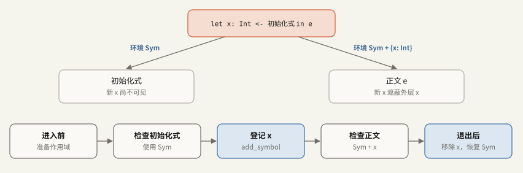

### 14.2 基础符号表：基于栈的操作

最朴素的符号表可以直接用单栈（Stack）承载：
- `add_symbol(x, info)`：把标识符 $x$ 及其属性（类型等）直接压入栈顶。
- `find_symbol(x)`：从栈顶向栈底做线性搜索，遇到第一个匹配的 $x$ 即返回，未找到返回 `null`。后压栈的符号自然排在前面，自动实现了作用域遮蔽。
- `remove_symbol()`：弹出栈顶元素。

### 14.3 工业级作用域管理器：分层接口

单栈单元素弹出的方式在遇到多变量声明时极其繁琐。编译器项目通常会封装一个高层的作用域管理器（Symbol Table Manager），提供五大核心接口：

```cpp
enter_scope();       // 开启一个新的嵌套作用域（压入一层作用域标记或独立作用域哈希表）
find_symbol(x);      // 从当前内层向外层逐级查找 x，返回最近的有效绑定（未找到返回 null）
add_symbol(x, info); // 将符号 x 注册进当前最内层作用域
check_scope(x);      // 仅检查当前最内层作用域是否已存在 x（不向外层查找）
exit_scope();        // 退出当前作用域，批量注销该层所有符号并销毁作用域
```

> [!note] 为什么必须有 `check_scope(x)`？
> `find_symbol(x)` 会自内向外查找所有外层作用域，用来做变量读取解析。
> 新声明是否重复，要按具体语法构造判断：
> - 内层声明可以遮蔽外层声明。
> - Cool 的同一个方法不能有同名形参，例如 `foo(x: Int, x: String)` 不合法。
> - Cool 的 `let` 列表是顺序绑定，后面的同名变量遮蔽前面的变量，不能按重复形参的规则拒绝。
> 
> `check_scope(x)` 只检查当前层，用来区分同层重复与外层同名；是否报错由该处的语言规则决定。

单纯的符号栈若不记录作用域边界，就不能判断找到的同名 x 是另一个形参，还是外层变量。`enter_scope` 为一批形参建立共同边界，`check_scope` 才能检测这批声明内部的重复；离开方法时可整层移除。CS143 提供的符号表接口采用这种分层管理。

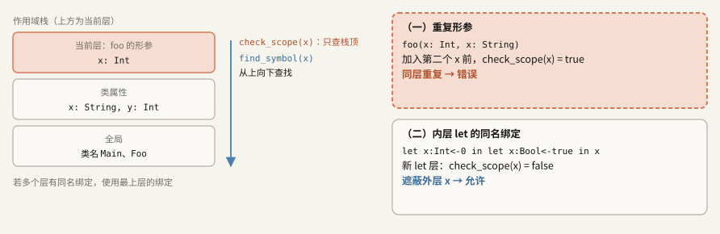

---

## 15. 前向引用与多趟语义分析（Multi-Pass Analysis）

前面提到的类名互引、类内属性先用后定等特性，揭示了一个无法回避的工程现实：
**语义分析不可能靠单趟（One-pass）扫描一次搞定。**

如果只走一趟，当分析到开头的 `class Foo { ... y: Bar ... }` 时，编译器根本不知道后面的 `Bar` 存不存在，无法立刻决定该不该报错。

### 15.1 解法：分步推进的多趟流水线（Multiple Passes）

现代编译器对 AST 实施多趟分析，步步为营：

- **第一趟（Pass 1：收集全局类名）**：
  遍历 AST 顶层节点，仅仅收集所有合法的类名，注册进全局类符号表。同时拦截“类名重复定义”的错误。
- **第二趟（Pass 2：构建并检查类继承关系）**：
  在所有类名都已知的前提下，解析每个类的父类声明。检查父类是否存在、是否继承了系统基础类（如 `Int`）、对继承图进行拓扑排序检查是否存在环路继承（$A \to B \to A$）。
- **第三趟（Pass 3：收集每个类的特征——属性与方法签名）**：
  遍历各个类体，为每个类建立各自的局部命名空间，录入其属性类型与方法参数/返回值签名。检查类内方法名是否重复、派生类重写父类方法时签名是否一致。
- **第四趟（Pass 4：表达式类型推导与语义检查）**：
  此时类、继承、方法与属性的大图谱已完全就位。编译器深入到方法体内部的复杂表达式树，借助符号表管理器推导表达式类型、绑定局部变量，做最终的静态语义闭环。

语义分析从来不是一蹴而就的单次计算，而是分层递进、多趟收敛的系统工程。

> [!note] 继承图错误应先处理
> 未定义父类、禁止继承或继承环会使后续查找失去前提。尤其是继承环，会让沿父类链进行的方法查找和 LUB 计算无法正常终止。因此通常在第 2 趟报告这些错误并停止，不继续检查成员和正文；独立的正文类型错误则可以在有效的继承图上恢复并继续检查。

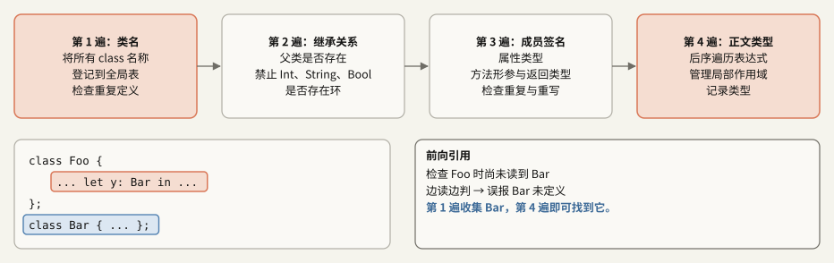

---

## 16. 什么是类型（What is a Type?）

虽然不同语言对类型的叫法和语法花样繁多，但计算理论与工程实践对类型有一个公认的定义：

$$\text{Type} = \text{A set of values} + \text{A set of operations on those values}$$

**类型本质上由两部分构成：一组允许的取值集合，以及作用在这些值上的合法操作集合。**

- 以整型 `Int` 为例：
  - **取值集合**：指定范围内的离散整数（如 $[-2^{31}, 2^{31}-1]$）；
  - **合法操作**：加、减、乘、除、比较大小（`+`, `-`, `>=`, `<`）。
- 以字符串 `String` 为例：
  - **取值集合**：有限长度的字符序列；
  - **合法操作**：拼接（`concat`）、判空（`isnull?`）、求长度；绝不允许直接与整数做算术加减乘除。

在面向对象语言中，**类（Class）正是现代类型概念的一种实体化落地**。类内部声明的属性定义了取值空间的状态结构，类内的方法则严格界定了可以在这个对象上执行的合法操作集合。

---

## 17. 为什么需要类型检查：底层的无类型真相

为什么不能跳过类型检查？

考虑 C 语言中的两个表达式：
1. 两个整型变量相加：`int_a + int_b`，完全合法且符合直觉；
2. 一个函数指针和一个整数相加：`func_ptr + int_b`，在逻辑上荒谬绝伦。

**然而，在汇编与机器码的底层世界里，这两者毫无区别。**

在 CPU 寄存器和内存总线眼里，根本没有“指针”或者“整数”的概念。函数指针是一个 64 位二进制数，整数也是一个 64 位二进制数。如果把它们送进 ALU 执行一条 `addq` 指令，硬件会忠实地完成二进制加法，既不报错，也不中断。

这就引出了类型系统最本质的意义：

> **类型系统强制约束了值的解释方式，因为除了它，没有任何底层机制会替你约束！**
> （*Enforces intended interpretation of values, because nothing else will!*）

物理硬件只负责搬运 0 和 1。只有编译器的类型系统在代码进入底层前充当守门员，为这些无差别的比特位注入业务语义，阻止程序员把浮点位模式当指令执行、把函数地址当普通整数相加。

---

## 18. 语言类型三分类：静态、动态与无类型

根据类型检查发生在哪个生命周期，编程语言分为三大阵营：

| 分类 | 检查时机 | 核心特征 | 典型代表 |
|---|---|---|---|
| **静态类型**<br>(Statically typed) | **编译期** | 绝大部分类型检查在编译阶段全部完成，未运行前即可定位类型错误 | C、C++、Java、Rust、Cool |
| **动态类型**<br>(Dynamically typed) | **运行期** | 绝大部分类型检查推迟到程序执行期间，变量无静态类型，值携带类型标签（Tag） | Python、JavaScript、Scheme、Ruby |
| **无类型**<br>(Untyped) | **完全不检查** | 底层数据纯粹作为二进制位解释，没有任何操作合法性校验 | 汇编语言、机器码、早期 Forth |

---

## 19. 阵营之争与现实妥协（Escape vs Retrofit）

静态类型与动态类型的争论持续了数十年，双方各有坚实的论据：

- **静态类型支持者的理由**：
  1. **提早排雷**：在编译期拦截大量低级类型拼写和签名错误，重构大型项目时底气更足。
  2. **消除运行时开销**：由于类型在编译期已经锁定，生成的机器指令不需要在每次计算前检查对象标签，执行效率更高。
- **动态类型支持者的理由**：
  1. **避免僵化约束**：静态类型系统规则严格，很多动态多态或元编程模式难以用文法表达。
  2. **原型开发更快**：写小脚本或业务实验时，不需要先花半天时间定义繁重的接口和类型签名。

### 工程现实的互相渗透与妥协

现实软件工程的走向非常戏剧化——双方都在向对方靠拢：

1. **静态类型语言开“后门”（Escape Mechanism）**：
   写静态代码的人经常遇到类型系统过于死板的瓶颈，于是语言内置了逃逸手段，例如 C 语言的不安全类型转换（Unsafe Casts / `void*`）、C++ 的 `reinterpret_cast`、Java 的向下转型 `(Child) obj`。
2. **动态类型语言补“地基”（Retrofitting Static Typing）**：
   当动态语言编写的项目膨胀到数十万行后，团队因缺乏类型约束苦不堪言，于是大家疯狂为动态语言倒挂静态类型检查系统：
   - JavaScript 催生了 TypeScript；
   - Python 引入了 Type Hints 与 Mypy 静态检查器；
   - PHP 催生了 Hack，Ruby 催生了 Sorbet。

这种妥协究竟是兼具两家之长还是同时背负了双重包袱，业内各有评判。但不可否认的是，随着软件规模扩大，类型系统成了控制大型工程复杂度必不可少的工具。

类型转换的失败方式也不同：C 中不合法的转换或错误使用转换结果可能导致未定义行为；Java 的引用向下转型有运行时检查，类型不匹配时抛出 `ClassCastException`。不能仅因两者都允许显式转换，就认为其运行时安全性相同。

---

## 20. Cool 语言的类型全貌

斯坦福教学语言 Cool 的类型系统设计得十分精炼：

1. **类型集合的构成**：
   - **所有用户自定义与内置的类名（Class Names）**：包括 `Object`、`IO`、`Int`、`String`、`Bool` 等。在 Cool 中，每个类名本身就是一个合法的类型。
   - **特殊自引用类型 `SELF_TYPE`**：用于表示“当前方法调用者对象的动态类型”，解决继承体系中派生类方法链式调用的类型收敛问题。
2. **显式声明与推导分工**：
   - **程序员负责声明标识符的类型**：类的属性定义、方法的形参及返回值、`let` 绑定的变量名，都必须由写代码的人显式标出类型；
   - **编译器负责推导表达式的类型**：语法树上的每一个表达式节点（常数、算术运算、函数调用、条件分支等），编译器都必须在遍历过程中自动推导算出其确切类型。

---

## 21. 类型检查（Type Checking）与类型推导（Type Inference）

在讨论编译器时，这两个术语经常被交替使用，但严格来说指代两项不同的任务：

- **类型检查（Type Checking）**：
  针对已经标注了类型的程序，**验证各个构件之间的类型是否互相匹配**。例如已知函数形参要求 `Int`，实参传了一个 `String`，类型检查器据此亮起红灯。
- **类型推导（Type Inference）**：
  针对未显式标注类型的程序片段，编译器利用已知的上下文规则，**自动逆向求解并填补缺失的类型信息**。例如 C++ 的 `auto` 或 Rust 的局部变量推导。

在 Cool 编译器中，这两个过程紧密交织：
语义分析器对 AST 进行后序遍历，先通过子节点推导出复合表达式的求值类型（**类型推导**），再将推导出的结果与变量声明或赋值目标处的约束规则进行比对验证（**类型检查**）。

---

## 22. 形式化类型系统：从文法跨越到逻辑推理

纵观编译器前端，各个阶段都有其对应的形式化数学支柱：

| 前端阶段     | 理论形式工具                        | 计算模型                       | 核心产物                |
| -------- | ----------------------------- | -------------------------- | ------------------- |
| **词法分析** | 正则表达式（Regex）                  | 有限自动机（DFA / NFA）           | 词法记号（Token 流）       |
| **语法分析** | 上下文无关文法（CFG）                  | 下推自动机（PDA / 预测表）           | 抽象语法树（AST）          |
| **类型检查** | **形式逻辑推理规则（Inference Rules）** | **证明树（Proof Tree / 归纳推理）** | **类型注解（Typed AST）** |

为什么类型系统必须用数理逻辑来定义？
如果仅用自然语言编写规范，随着语言特性（继承、多态、重载、协变）的叠加，规则很容易产生歧义与漏洞。形式化的类型推理系统，提供了一套类似数学定理证明的无歧义记法，让编译器可以像验证几何定理一样，一步一步机械化验证整个程序的类型合法性。

---

## 23. 类型推理规则的形式化表示法（Inference Rule Notation）

类型系统的逻辑核心建立在“如果……则……”（If-Then）的推理机制之上：

> *如果子表达式 $e_1$ 与 $e_2$ 具备某些类型，那么复合表达式 $e_1 + e_2$ 就能确定出某种类型。*

### 23.1 逻辑积木块
在逻辑形式系统中，定义了三类基础符号：
- $\land$：逻辑“与”（And），连接多个前提条件；
- $\Rightarrow$：逻辑“蕴含”（If-Then），连接前提与结论；
- $e : T$：类型断言（Typing Judgment），表示“表达式 $e$ 拥有类型 $T$”。

将自然语言翻译为数理逻辑：
- **自然语言**：“如果 $e_1$ 具有类型 Int 且 $e_2$ 具有类型 Int，那么 $e_1 + e_2$ 具有类型 Int”
- **命题逻辑形式**：
  $$(e_1 : \text{Int} \land e_2 : \text{Int}) \implies e_1 + e_2 : \text{Int}$$

### 23.2 分式横线记号与旋转门符号 $\vdash$

学术界和编程语言规范传统上采用更紧凑的分式横线格式来排版推理规则：

$$\frac{\vdash \text{Hypothesis}_1 \quad \dots \quad \vdash \text{Hypothesis}_n}{\vdash \text{Conclusion}}$$

- **横线上方**：**前提假设（Hypotheses）**。必须全部成立，结论才能成立；
- **横线下方**：**推理结论（Conclusion）**；
- **旋转门符号 $\vdash$（Turnstile）**：读作“可证明（it is provable that）”，$\vdash e : T$ 表示在当前类型规则体系下，能够推导证明表达式 $e$ 的类型是 $T$。

---

## 24. 核心规则推演与证明树（Proof Tree）构建

以 Cool 语言最基础的整型字面量和加法操作符为例，来看两套规则模板：

### 24.1 基础公理规则（整型字面量 `[Int]`）
$$\frac{i \text{ is an integer literal}}{\vdash i : \text{Int}} \quad [\text{Int}]$$
整型字面量（如 `1`, `42`）没有需要递归证明的子表达式，横线上方只是一个语法断言。这种无前置类型假设的规则称为**公理（Axiom）**，充当推理的基底（叶子节点）。

### 24.2 复合推演规则（加法操作符 `[Add]`）
$$\frac{\vdash e_1 : \text{Int} \quad \vdash e_2 : \text{Int}}{\vdash e_1 + e_2 : \text{Int}} \quad [\text{Add}]$$
只要证明了左右两个操作数都是 `Int`，就能推导出整体求和结果也是 `Int`。

### 24.3 实战：构建 $1 + 2$ 的完整证明树

这些规则是抽象的模板（Templates），只要往里面填入具体的 AST 节点，就能层层嵌套构建出一棵**证明树（Proof Tree）**：

$$\frac{\cfrac{1 \text{ is an int literal}}{\vdash 1 : \text{Int}} [\text{Int}] \qquad \cfrac{2 \text{ is an int literal}}{\vdash 2 : \text{Int}} [\text{Int}]}{\vdash 1 + 2 : \text{Int}} [\text{Add}]$$

- 最上层的叶子节点利用 `[Int]` 公理分别证明了 $\vdash 1 : \text{Int}$ 和 $\vdash 2 : \text{Int}$；
- 底层的根节点利用 `[Add]` 规则，结合两个已证的前提，最终证明了 $\vdash 1 + 2 : \text{Int}$。

整个类型检查的过程，就是编译器在尝试为整个 AST 构建出这样一棵自洽的、无断层的证明树。

---

## 25. 类型系统的可靠性（Soundness）与精确性（Precision）

设计类型推理规则时，有两个不可逾越的评价维度：

### 25.1 可靠性（Soundness）
一个类型系统被称为是**可靠的（Sound）**，必须满足：
$$\text{若编译器推导出 } \vdash e : T \implies \text{程序在运行时 } e \text{ 求出的值，其动态类型必须真真切切属于 } T$$

可靠性是静态类型系统的安全生命线。它确保只要编译期通过了检查，程序在运行期间就绝对不会发生由于类型不匹配而导致的底层崩溃（*Well-typed programs cannot go wrong*）。

这里的“不出错”指类型系统所承诺排除的类型错误，并不代表所有执行路径都能成功。Cool 仍可能出现对 void 的分派、无匹配分支的 case 等规定的运行时错误，见第35节。

### 25.2 为什么不能把整型字面量推导为 `Object`？
既然追求可靠性，考虑下面这条规则：
$$\frac{i \text{ is an int literal}}{\vdash i : \text{Object}}$$

在 Cool 的面向对象体系中，所有整型确实都继承自根基类 `Object`。
因此从数学上看，把 `1` 算作 `Object` **在语义上是完全可靠（Sound）的**，运行时把 `1` 当作对象看待不会产生任何内存安全越界。

**但这条规则在工程上是灾难性的，因为它丢失了精确性（Imprecise / Overly Conservative）：**
如果编译器把数字 `1` 和 `2` 都推导成 `Object`，那么在代入加法规则 `[Add]` 时，由于加法死板地要求操作数必须是 `Int`，表达式 `1 + 2` 就会因为类型不匹配直接被类型检查器枪毙！

> [!important] 规则的设计哲学
> 单纯的“可靠（Sound）”并不难做，最保守的做法甚至可以把一切都标记为 `Object`，但这样任何具体操作都做不了。
> 优秀的类型规则必须在**绝对可靠（Soundness）**的前提下，提供**最具约束力、最精确的具体类型（Most specific type）**。

---

## 26. 证明树与 AST 树的对偶映射（自底向上的类型合成）

类型检查看似高深的数理逻辑推导，在工程落地时其实和语法树的结构紧密绑定：

```text
       【证明树 (Proof Tree)】                    【AST 语法树 (Syntax Tree)】
             (叶在顶，根在底)                            (根在顶，叶在底)

   1: Int (叶)        2: Int (叶)                    [ + (根) ]  <-- 对应 [Add] 结论
       \                 /                             /   \
        \               /                             /     \
    [Add] 1 + 2 : Int (根)                     [ 1 (叶) ]  [ 2 (叶) ]
```

观察这两者的对偶关系：
1. **结构同构**：证明树的形状与 AST 语法树完全一致，只是上下镜像倒置。
2. **一一对应**：AST 上的**每一个节点**，都唯一对应一条**类型推理规则的实例化**。
3. **递归依赖**：规则的前提（Hypotheses）就是子树节点的类型证明，规则的结论（Conclusion）就是当前节点最终注解上的类型。

由此，类型检查器的工程实现水到渠成：**对 AST 进行一次自底向上的后序遍历（Bottom-Up Pass）**。
- 先深入子树，算出子节点的求值类型；
- 退栈回到当前父节点时，匹配对应的操作符规则，检查子节点类型是否满足前提；
- 若满足，将结论类型打上当前节点作为注解，继续向上传递；若不满足，立即拦截并抛出类型错误。

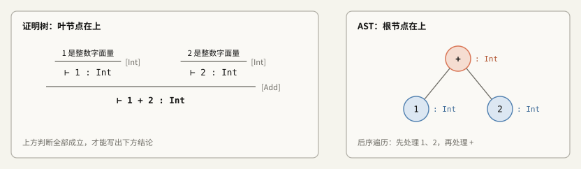

---

## 27. 扩展更多类型规则：常量、对象创建与控制流

掌握了基础记号后，可以为语言的其余语法结构建立形式化规则体系。

### 27.1 字面量公理：为什么横线上方是空的？
观察布尔常量与字符串字面量的推导规则：

$$\frac{}{\vdash \text{false} : \text{Bool}} \quad [\text{False}]$$

$$\frac{s \text{ is a string literal}}{\vdash s : \text{String}} \quad [\text{String}]$$

> [!note] 概念解惑：横线上方为什么可以留空？
> 在形式逻辑中，如果一条规则的**横线上方没有任何前提条件**，它就是一条**公理（Axiom）**。
> `false`、`true` 是语言内建的固有常量，它不像 `e1 + e2` 那样包含子表达式。它的类型归属是自明的，不需要递归证明任何前置假设。横线上方留空，表示它无条件直接成立，充当证明树的叶子起点。

### 27.2 对象创建规则 `[New]`
Cool 支持动态实例化类对象：

$$\frac{}{\vdash \text{new } T : T} \quad [\text{New}]$$

执行 `new T` 表达式时，其产出值的静态类型毫无争议就是类名 $T$ 本身（暂不考虑继承体系中的 `SELF_TYPE`）。这同样是一条自成闭环的基础规则。

### 27.3 布尔取反 `[Not]` 与循环表达式 `[Loop]`
逻辑运算与控制流的规则如下：

$$\frac{\vdash e : \text{Bool}}{\vdash \text{not } e : \text{Bool}} \quad [\text{Not}]$$

$$\frac{\vdash e_1 : \text{Bool} \quad \vdash e_2 : T}{\vdash \text{while } e_1 \text{ loop } e_2 \text{ pool} : \text{Object}} \quad [\text{Loop}]$$

> [!important] 重点解惑：为什么 while 循环的类型不是循环体类型 $T$，而是 `Object`？
> 很多初学者在这里会困惑：循环体 $e_2$ 明明算出了类型 $T$，为什么整个循环表达式的结论类型是 `Object`？
> 
> 原因在于 Cool 的核心语言设计哲学——**万物皆表达式（Everything is an Expression）**：
> 1. Cool 没有独立于表达式之外的“语句（Statement）”。每一个控制流结构都必须作为表达式产生一个运行时的值，并赋予一个编译期的静态类型。
> 2. 审视 `while e_1 loop e_2 pool` 的执行逻辑：如果循环条件 $e_1$ 第一次判断就是 `false`，那么循环体 $e_2$ 的执行次数是 **0 次**！
> 3. 当循环体一次都没执行时，该表达式根本不可能产生一个类型为 $T$ 的有效值。
> 
> Cool 规定循环正常结束后的值总是 `void`，不论循环体执行了零次还是多次；`void` 表示没有对象，并不是一个特殊对象。循环表达式的静态类型统一为 `Object`，不能从循环体类型推断循环结果。

> [!note] 讲义记号与实际 Cool 语法
> 某些课件将布尔取反写作 `!e`，实际 Cool 使用 `not e`；`~e` 是整数取反。上面的 `[Not]` 已按实际语言写法表示。`while` 的值为 void，也不表示可以安全地对它调用方法；对 void 分派仍会发生运行时错误。

---

## 28. 局域规则的瓶颈：变量引用的类型盲区

到目前为止，所有规则都仅依赖节点的**局部语法结构**（字面量自身、或者子表达式组合）。但一旦遇到变量引用，这个纯语法的系统瞬间瘫痪了：

$$\frac{x \text{ is a variable}}{\vdash x : ?} \quad [\text{Var}]$$

当我们单看 AST 上的一个叶子节点 `x` 时，光看名字本身，**没有任何人能知道 `x` 到底是整型、字符串还是某个类的实例**。
变量的类型并不写在它被引用的这一刻，而是写在包围它的外层声明（方法形参、类属性、`let` 绑定）之中。

单纯的局部规则无法携带跨节点的上下文，必须对规则体系进行升级，注入上下文记忆机制。

---

## 29. 引入类型环境（Type Environment $O$）

解决变量盲区的钥匙，是在所有推理规则中引入**类型环境（Type Environment，通常记作大写字母 $O$）**。

### 29.1 什么是自由变量（Free Variables）？
在表达式内部未被声明、依赖外部上下文提供的变量，称为**自由变量**：
- 在单表达式 `x` 中，`x` 没有绑定来源，是自由变量；
- 在 `x + y` 中，`x` 和 `y` 都是自由变量；
- 在 `let y: Int <- 0 in x + y` 中，$y$ 被当前的 `let` 结构局部绑定了，但 $x$ 依然是自由变量。

类型环境的核心职责，就是**为当前作用域内的所有自由变量提供类型映射**。

### 29.2 类型环境 $O$ 的数学形式与符号表对应
形式上，$O$ 是一个有限映射函数，将对象标识符映射到具体的类型：

$$O : \text{ObjectIdentifiers} \to \text{Types}$$

在编译器工程实现中，**$O$ 就是前文实现的符号表（Symbol Table）在逻辑推理系统中的代号**。

### 29.3 带环境的类型断言记号：$O \vdash e : T$
将环境 $O$ 挂载到旋转门符号的左侧，构成完整的三元断言：

$$O \vdash e : T$$

**读法**：*在类型环境 $O$ 对自由变量的类型假设下，能够推导证明表达式 $e$ 的类型是 $T$。*

### 29.4 重构早期规则：显式透传环境 $O$
当引入环境后，此前所有脱离上下文的规则都需要将 $O$ 显式纳入前提与结论中：

- **整型字面量**：
  $$\frac{i \text{ is an integer literal}}{O \vdash i : \text{Int}} \quad [\text{Int}]$$
- **加法操作符**：
  $$\frac{O \vdash e_1 : \text{Int} \quad O \vdash e_2 : \text{Int}}{O \vdash e_1 + e_2 : \text{Int}} \quad [\text{Add}]$$

父节点当前所处的作用域环境 $O$，被平行传递给它的各个子表达式。

---

## 30. 变量查表规则与环境更新算子

拥有了类型环境 $O$，变量访问与局部绑定的类型规则便能形式化写出。

### 30.1 变量查找规则 `[Var]`
读取一个变量的规则非常直接——去环境 $O$ 里查字典：

$$\frac{O(x) = T}{O \vdash x : T} \quad [\text{Var}]$$

如果把变量名 $x$ 输入映射函数 $O$，查出的结果是类型 $T$，那么当前上下文就能确认 $\vdash x : T$。如果 $O$ 中查不到 $x$（返回空），则推导中断，直接判定为未声明标识符错误。

### 30.2 重点解惑：环境更新与遮蔽算子 $O[T/x]$
在遇到新变量声明时，环境需要动态扩展。讲义中给出的形式化记号为：

$$O[T/x]$$

> [!important] 彻底读懂 $O[T/x]$
> 这个记号读作“将环境 $O$ 中的 $x$ 绑定更新为类型 $T$”。
> 它的严格数学定义包含两个互斥分支：
> 
> $$O[T/x](x) = T$$
> $$O[T/x](y) = O(y) \quad (y \neq x)$$
> 
> - **第一条**：如果你查询的名字恰好是被新声明的名字 $x$，无论外层原来有没有同名变量，结果一律返回新类型 $T$。**这在数学上形式化定义了变量遮蔽（Shadowing）**！
> - **第二条**：如果你查询的是任何其他名字 $y$（$y \neq x$），它的类型仍然沿用外层旧环境 $O(y)$ 的结果。

在工程代码中，$O[T/x]$ 对应的就是**进入新作用域后执行 `add_symbol(x, T)`** 的动作。


#### 30.2.1 $O(x)$ 与 $O[T/x](x)$：查的是哪个环境？

两者最后都在查表，区别是：$O(x)$ 直接查询原环境，而 $O[T/x](x)$ 先得到更新后的环境，再查询其中的 $x$。

可以把后一个式子加上括号，明确两步操作：

$$
\bigl(O[T/x]\bigr)(x)
$$

- $O[T/x]$ 的结果是一个**新类型环境**：将 $x$ 的类型绑定设为 $T$，其他名字的绑定保持不变。
- 再对这个新环境应用 $(x)$，得到的是一个**类型**，结果为 $T$。

例如，原环境和新环境分别为：

$$
O = \{x \mapsto \mathrm{Int},\ y \mapsto \mathrm{String}\}
$$

$$
O' = O[\mathrm{Bool}/x]
   = \{x \mapsto \mathrm{Bool},\ y \mapsto \mathrm{String}\}
$$

| 表达式 | 操作 | 结果 |
|---|---|---|
| $O(x)$ | 在原环境中查询 $x$ | $\mathrm{Int}$ |
| $O[\mathrm{Bool}/x]$ | 构造将 $x$ 绑定为 $\mathrm{Bool}$ 的新环境 | $O'$ |
| $O[\mathrm{Bool}/x](x)$ | 在新环境中查询 $x$ | $\mathrm{Bool}$ |
| $O[\mathrm{Bool}/x](y)$ | 在新环境中查询其他变量 $y$ | $\mathrm{String}$ |

因此，分别应用 [[#30.1 变量查找规则 `[Var]`]]，可以得到：

$$
O \vdash x : \mathrm{Int}
\qquad
O' \vdash x : \mathrm{Bool}
$$

这两个判断使用的是不同环境，并不矛盾。如果新类型 $T$ 与原绑定相同，两次查询的结果也可以相同；如果原环境没有 $x$，更新操作就是新增绑定。

![O[Bool/x] 构造新环境，只遮蔽 x 的类型绑定，原环境与其他绑定均保留](assets/11_01/sa-env-update.svg)

#### 30.2.2 原环境保留：用嵌套 let 理解遮蔽

$O' = O[T/x]$ 在数学上定义了一个新环境，原环境 $O$ 仍然保留。这里更新的是类型绑定，不是给运行时变量赋值。

```cool
let x: Int <- 7 in
{
    x;                              -- 使用外层环境 O，类型为 Int
    let x: Bool <- true in x;        -- 主体使用 O[Bool/x]，类型为 Bool
    x;                              -- 内层 let 已结束，使用 O，类型仍为 Int
}
```

内层声明的 $x$ 在自己的主体中遮蔽外层 $x$；检查完内层主体后，继续使用外层环境即可。外层记录没有被永久覆盖。

工程实现不必复制整张符号表，可以使用 [[#14.3 工业级作用域管理器：分层接口]] 中的作用域栈：进入内层时登记新绑定，退出时移除内层这一层，外层绑定重新可见。

### 30.3 无初值局部变量绑定规则 `[Let-No-Init]`
看一条完整的局部绑定推演规则（无初始化式的 `let`）：

$$\frac{O[T_0/x] \vdash e_1 : T_1}{O \vdash \text{let } x : T_0 \text{ in } e_1 : T_1} \quad [\text{Let-No-Init}]$$

**推演链条拆解**：
1. 当前进入 `let` 表达式时，外层的环境是 $O$；
2. 声明引入了新变量 $x$，声明类型为 $T_0$。因此在进入主体 $e_1$ 时，类型环境被扩展为 $O[T_0/x]$；
3. 在这个强化后的新环境下，递归推导表达式 $e_1$，算出了类型 $T_1$（横线上方的前提）；
4. 一旦前提成立，结论自然顺水推舟：在原环境 $O$ 下，整个 `let` 复合表达式的求值类型就是 $T_1$。

---


#### 30.3.1 结论判断的范围：整个 let 表达式

$$
O \vdash
\underbrace{
\left(\text{let }x:T_0\text{ in }e_1\right)
}_{\text{这一整块被判断为 }T_1}
:T_1
$$

公式中的括号把判断对象圈了出来：最右侧的 $T_1$ 属于整个 `let x: T₀ in e₁`，而不只是变量 $x$。其中 $T_0$ 是 $x$ 的声明类型，$T_1$ 是主体 $e_1$ 的类型；整个 `let` 的结果取自主体，因此类型也是 $T_1$。

**左侧的 $O$ 表示检查整个表达式时的起始环境。** 它不要求每个内部位置都使用同一张表。检查器进入 `in` 后的主体时，会使用加入局部绑定后的环境 $O[T_0/x]$。

`in` 在程序中分隔声明与主体；推理横线在数学上分隔前提与结论。结论虽然包含主体 $e_1$，但判断对象仍是连同声明一起的完整 `let` 表达式。

#### 30.3.2 上下两行：内部子任务与整个任务

$$
\frac{
\underbrace{
O[\mathrm{Int}/x]\vdash x:\mathrm{Int}
}_{\text{内部子任务的结果}}
}{
\underbrace{
O\vdash
\left(\text{let }x:\mathrm{Int}\text{ in }x\right)
:\mathrm{Int}
}_{\text{整个任务的结果}}
}
$$

以公式中的 `let x: Int in x` 为例：

| 位置 | 检查对象 | 起始类型环境 | 得到的类型 |
|---|---|---|---|
| 横线上方：内部子任务 | 主体 `x` | $O[\mathrm{Int}/x]$ | $\mathrm{Int}$ |
| 横线下方：整个任务 | 完整的 `let x: Int in x` | $O$ | $\mathrm{Int}$ |

上方只检查主体 `x`，它需要环境提供 `x: Int`。下方检查的完整表达式自己就包含 `let x: Int` 声明，因此可以从原环境 $O$ 出发，临时建立内部环境来完成检查。

把类型检查器的处理过程写成伪代码，可以看到这两层任务的关系：

```text
检查类型(O, let x: Int in x)
    建立内部环境 O_inner = O[Int/x]
    检查类型(O_inner, x)，查到 Int
    将主体的类型 Int 作为整个 let 的类型返回
```

这里是在推导静态类型，不需要执行这段程序。**前提说明内部子任务成立，结论据此说明整个任务成立**；两行判断的是不同的表达式，使用不同的起始环境。

本例中变量和主体的类型恰好都是 `Int`。若改成 `let x: Int in true`，变量 $x$ 的类型仍为 `Int`，主体和整个 `let` 的类型则都是 `Bool`。

---
## 31. 类型检查的数据流双向模型：环境自顶向下，类型自底向上

讲义末尾总结了类型检查器遍历 AST 时的核心数据流走向，这对应了编译原理中**属性文法（Attribute Grammars）**的经典哲学：

```text
                  [ let x: T0 in e1 ]   <-- 类型 T1 最终汇聚至此 (综合属性)
                     |              ^
                     | 传递 O[T0/x]  | 返回求值类型 T1
                     v              |
                   [ 主体表达式 e1 ]
                     |              ^
                     | 传递环境 O    | 返回变量类型 T
                     v              |
                   [ 变量引用 x ]
```

1. **类型环境 $O$：自顶向下传递（Inherited Attribute / 继承属性）**
   从 AST 的根节点向叶子节点单向流动。每当遇到引入新作用域的节点（`let`、方法形参、类体），就在原环境基础上叠加更新 $O[\dots]$，将丰富的上下文环境不断分发给更深层的子树。
2. **类型 $T$：自底向上合成（Synthesized Attribute / 综合属性）**
   从 AST 的叶子节点（常量字面量、变量查表结果）确定基本类型，然后由内向外、由深到浅逐层递归回填，父节点结合子节点的类型算出复合表达式的最终类型。

编译器就是在这一降一升的两股数据流交织下，对整棵语法树完成了严丝合缝的静态类型闭环。


---

## 32. 为什么需要子类型化（Subtyping）：面向对象的多态兼容

如果严格按照前文的思路，带初始值的 `let` 规则似乎顺理成章写成这样：

$$\frac{O \vdash e_0 : T_0 \quad O[T_0/x] \vdash e_1 : T_1}{O \vdash \text{let } x : T_0 \leftarrow e_0 \text{ in } e_1 : T_1} \quad [\text{Let-Init-Naive}]$$

**但这在面向对象语言中极其狭隘。**
根据面向对象的多态原则（里氏替换原则 LSP），我们经常声明一个基类变量，并用派生类对象进行初始化（例如 `let s: Shape <- new Circle in ...`）。
如果强制要求初始值表达式 $e_0$ 的类型必须与声明类型完全一模一样，任何派生类赋值都会被类型系统无情拦截。

为此，类型系统必须正式引入**子类型关系（Subtyping Relation）**。

### 32.1 子类型偏序关系 $\le$ 的定义
在类继承体系中，定义二元关系 $\le$（读作“$X$ 是 $Y$ 的子类型”或“$X$ 继承自 $Y$”）：

- **自反性（Reflexivity）**：$X \le X$（任何类型都是它自身的子类型）；
- **继承即子类型**：若类 $X$ 显式继承自类 $Y$，则 $X \le Y$；
- **传递性（Transitivity）**：若 $X \le Y$ 且 $Y \le Z$，则必然有 $X \le Z$。

### 32.2 扩展后的带初值 `let` 规则 `[Let-Init]`
将子类型关系纳入前提条件：

$$\frac{O \vdash e_0 : T_0 \quad O[T/x] \vdash e_1 : T_1 \quad T_0 \le T}{O \vdash \text{let } x : T \leftarrow e_0 \text{ in } e_1 : T_1} \quad [\text{Let-Init}]$$

**推演逻辑**：
1. 初始值表达式 $e_0$ 推导出的实际类型是 $T_0$；
2. 变量 $x$ 的显式声明类型是 $T$；
3. **核心拦截条件**：要求 $T_0 \le T$（初始值的类型必须是声明类型的子类）；
4. 进入主体 $e_1$ 时，注入符号表的是**声明类型 $T$**（$O[T/x]$），而不是初始值的具体子类类型 $T_0$；
5. 在此环境下主体 $e_1$ 算出类型 $T_1$，也就是整个 `let` 表达式的求值类型。

为什么正文环境记录声明类型 $T$？例如 `let s: Shape <- new Circle in { s <- new Square; s; }`：正文可以向 s 赋另一个 Shape 子类。若把绑定错误地收窄为 Circle，就会拒绝合法的 Square 赋值。初始化式类型只描述初始值，声明类型约束变量后续可容纳的值。

---

## 33. 赋值与类属性初始化的子类型约束

子类型相容性同样主宰了变量赋值与属性初始化。

### 33.1 赋值表达式规则 `[Assign]`
变量赋值操作 $x \leftarrow e_1$ 的类型规则：

$$\frac{O(x) = T_0 \quad O \vdash e_1 : T_1 \quad T_1 \le T_0}{O \vdash x \leftarrow e_1 : T_1} \quad [\text{Assign}]$$

- 从环境查出 $x$ 的静态声明类型为 $T_0$；
- 右侧表达式 $e_1$ 算出类型 $T_1$；
- **类型相容性检查**：必须满足 $T_1 \le T_0$（右值必须是左值声明类型的子类；派生类可以赋给基类变量，基类不能赋给派生类变量）；
- **结论**：在 Cool 中，赋值表达式求值后的结果就是右侧表达式本身，因此其静态类型为 $T_1$。

### 33.2 类属性初始化规则 `[Attr-Init]`
类的成员属性初始化与普通局部变量类似，但其作用域环境具有特殊性：

$$\frac{O_C(x) = T_0 \quad O_C \vdash e_1 : T_1 \quad T_1 \le T_0}{O_C \vdash x : T_0 \leftarrow e_1;} \quad [\text{Attr-Init}]$$

> [!note] 符号 $O_C$ 的工程含义
> $O_C$ 表示针对类 $C$ 建立的属性符号表，它**包含了类 $C$ 中声明的全部属性及其类型**。
> 这直接解释了为什么在 Cool 中，**一个属性的初始值表达式可以自由引用该类中的任何其他属性**（即使被引用的属性写在当前属性的代码下方）。因为 $O_C$ 是在遍历类体前一次性收集完毕的。

---

## 34. 控制流汇聚与最小上界（Least Upper Bound, LUB）

当程序出现多分支时，静态类型系统面临新的抉择：

$$\text{if } e_0 \text{ then } e_1 \text{ else } e_2 \text{ fi}$$

分支条件的真假在编译期不可预知。在运行期间，这个表达式可能执行 $e_1$ 返回类型 $T_1$ 的值，也可能执行 $e_2$ 返回类型 $T_2$ 的值。

编译器必须静态确定出一个安全的类型，既能兜住 $T_1$，又能兜住 $T_2$。

### 34.1 为什么必须是“最小”上界？
寻找一个公共基类并不难——直接将类型指定为顶层根类 `Object`，在数学上是绝对可靠的（Sound）。
但这会导致严重的类型信息丢失（退化为泛型丢失），后续操作完全无法执行。编译器需要寻找的是**两者在继承树上离得最近的共同祖先**，即**最小上界（Least Upper Bound, LUB）**。

### 34.2 最小上界 $\text{lub}(X, Y)$ 的形式化定义
设 $Z = \text{lub}(X, Y)$，它必须满足两条准则：
1. **$Z$ 必须是公共上界**：$X \le Z \land Y \le Z$（$Z$ 同时是 $X$ 和 $Y$ 的祖先类）；
2. **$Z$ 必须是最小的那个**：若存在任何另一个公共基类 $Z'$ 满足 $X \le Z' \land Y \le Z'$，则必然有 $Z \le Z'$。

```text
                  [ Object (根) ]
                     /       \
                   ...       ...
                    /         \
                 [ Z ] <--- lub(X, Y)：两条路径交汇的第一站
                 /   \
               ...   ...
               /       \
             [ X ]   [ Y ]
```

在 Cool 这种单继承语言中，$\text{lub}(X, Y)$ 在数据结构上就是**类继承树中节点 $X$ 与 $Y$ 的最近公共祖先（LCA, Least Common Ancestor）**。
先对齐 $X$、$Y$ 的深度，再同时沿父类指针向上移动，首次到达同一个类时就找到了 LUB。深度不同却直接同步上移，可能跳过最近公共祖先。

计算可以分成两个循环：先将较深的节点逐次替换为父类，直到深度相同；再将两者同时替换为父类，直到相等。若深度已知，时间为 $O(h)$，其中 $h$ 是继承树高度，最坏为 $O(n)$。例如 Dog 深度为 2、Int 深度为 1，应先将 Dog 提升为 Animal，再同步上移到 Object。

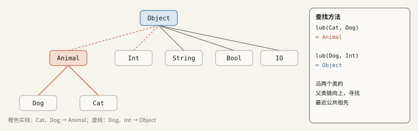

### 34.3 条件分支规则 `[If-Then-Else]`
结合 LUB，条件表达式的规则成型：

$$\frac{O \vdash e_0 : \text{Bool} \quad O \vdash e_1 : T_1 \quad O \vdash e_2 : T_2}{O \vdash \text{if } e_0 \text{ then } e_1 \text{ else } e_2 \text{ fi} : \text{lub}(T_1, T_2)} \quad [\text{If-Then-Else}]$$

条件 $e_0$ 严格限制为布尔型；分支表达式类型取两者的最小公共祖先。

---

## 35. 深度拆解：多路模式匹配 `[Case]` 规则（核心解惑）

很多同学看到讲义里的 `case` 推导规则感到望而生畏，其实剥开形式化外壳，它的逻辑与 `if-else` 一脉相承。

看 Cool 的类型分支语法：
```cool
case e_0 of
    x_1 : T_1 => e_1;
    x_2 : T_2 => e_2;
    ...
    x_n : T_n => e_n;
esac
```

对应的类型推理规则：

$$\frac{O \vdash e_0 : T_0 \quad O[T_1/x_1] \vdash e_1 : T_1' \quad \dots \quad O[T_n/x_n] \vdash e_n : T_n'}{O \vdash \text{case } e_0 \text{ of } x_1: T_1 \Rightarrow e_1; \dots; x_n: T_n \Rightarrow e_n; \text{ esac} : \text{lub}(T_1', \dots, T_n')} \quad [\text{Case}]$$

> [!important] 逐行读懂 `[Case]` 规则的推导链
> 1. **第一前提（$O \vdash e_0 : T_0$）**：
>    被匹配的靶目标表达式 $e_0$，在当前环境 $O$ 下推导出类型为 $T_0$。
> 2. **分支前提（$O[T_k/x_k] \vdash e_k : T_k'$）**：
>    对于每一个模式匹配分支 $k$：
>    - 语法规定该分支绑定了局部变量 $x_k$，且声明类型为 $T_k$；
>    - 因此在检查该分支的主体表达式 $e_k$ 时，必须使用**加入了新绑定的扩展环境 $O[T_k/x_k]$**；
>    - 在这个局部环境下，分支体 $e_k$ 算出了自己的返回类型 $T_k'$。
> 3. **最终结论（$\text{lub}(T_1', \dots, T_n')$）**：
>    在运行期间，程序会根据 $e_0$ 真实的动态对象类型，精确跳转到匹配的某一个分支中去执行。
>    换句话说，整个 `case` 表达式最终产生的返回值，可能是 $e_1$ 算出的 $T_1'$，也可能是 $e_2$ 算出的 $T_2'$，直至 $T_n'$。
>    在编译期无法预测具体命中哪条分支的情况下，整个 `case` 表达式的安全静态类型，就是**所有分支返回类型的多元最小公共祖先**：
>    $$\text{lub}(T_1', T_2', \dots, T_n')$$

`case` 规则本质上就是多路分支下的类型汇聚，借助 $\text{lub}$ 函数在多态不确定性与类型安全之间达成了最紧凑的静态妥协。

> [!note] case 还需要哪些检查？
> 同一个 case 的分支声明类型必须互不相同，且不能是 SELF_TYPE。运行时选择动态类型的最近匹配祖先分支，而非简单选择源码中最先出现的可兼容分支。
> 若被匹配值为 void，或没有任何分支匹配（例如 Animal 对象遇到仅含 Dog、Cat 的分支），发生运行时错误。静态检查会检查各分支的合法性，但不保证 case 对所有运行时对象都有匹配分支。

---

## 36. 第31至35节串讲：Animal、Dog、Cat 的类型检查

第31至35节围绕同一个问题展开：编译器怎样根据作用域和类型规则，给一个复杂表达式确定类型？下面沿用前文的对象类型环境 $O$，省略暂时用不到的方法环境与当前类信息。

假设已经定义了以下继承关系：

```text
Object
└── Animal
    ├── Dog
    └── Cat
```

检查下面这段 Cool 表达式，外层环境中已有 `flag: Bool`：

```cool
let pet: Animal <- new Dog in
    if flag then
        pet <- new Cat
    else
        new Dog
    fi
```

### 36.1 对应第31节：环境往下传，类型往上返回

检查整个 `let` 时，起始环境为：

$$
O = \{\mathrm{flag}\mapsto\mathrm{Bool}\}
$$

检查初始化式 `new Dog` 时，仍然使用外层环境 $O$。进入 `in` 后面的主体时，再加入 `pet` 的声明：

$$
O_1 = O[\mathrm{Animal}/\mathrm{pet}]
    = \{\mathrm{flag}\mapsto\mathrm{Bool},\ \mathrm{pet}\mapsto\mathrm{Animal}\}
$$

检查器把当前环境传给子表达式，子表达式检查完成后，把自己的类型返回给父节点。

```text
环境向下：告诉子表达式“这里有哪些变量，各是什么类型”
类型向上：子表达式回答“我的类型是什么”
```

例如，`if` 的条件 `flag` 使用 $O_1$ 查表，得到 `Bool`；两个分支也在 $O_1$ 下检查，各自返回类型，交给 `if` 汇总。主体检查完成后，`let` 再把主体的类型作为自己的类型返回。

第31节示意图中，主体继续向下透传的环境应理解为当前环境：进入局部作用域后，本例传递的是 $O_1$，不会在更深一层丢掉 `pet` 的绑定。

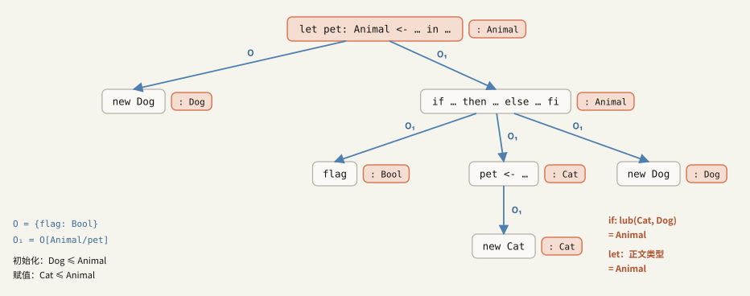

### 36.2 对应第32节：声明类型与初始化式的类型可以不同

先看声明与初始化：

```cool
let pet: Animal <- new Dog in ...
```

| 对象 | 静态类型 |
|---|---|
| 变量 `pet` 的声明类型 | `Animal` |
| 初始化表达式 `new Dog` | `Dog` |

`Dog` 继承 `Animal`，因此 `Dog` 是 `Animal` 的子类型：

$$
\mathrm{Dog}\le\mathrm{Animal}
$$

$\le$ 表示子类型相容关系，不是数值大小关系。初始化是否允许，需要检查：

$$
\text{初始化式的静态类型}\le\text{变量的声明类型}
$$

本例中，两个检查条件为：

$$
O\vdash\text{new Dog}:\mathrm{Dog}
\qquad
\mathrm{Dog}\le\mathrm{Animal}
$$

因此初始化合法。进入主体时，环境登记的是声明类型：

$$
O_1(\mathrm{pet})=\mathrm{Animal}
$$

**`pet` 仍按声明类型 `Animal` 检查。** 初始化时创建的是 `Dog` 对象，并不会把环境里的绑定改成 `pet → Dog`。这里讨论的初始化式类型，是类型检查器推导出的静态类型；运行时对象的动态类型需要另外区分。

### 36.3 对应第33节：赋值合法性与赋值表达式的类型

第一个分支为：

```cool
pet <- new Cat
```

检查器依次查变量、检查右侧，再验证类型相容性：

$$
O_1(\mathrm{pet})=\mathrm{Animal}
\qquad
O_1\vdash\text{new Cat}:\mathrm{Cat}
\qquad
\mathrm{Cat}\le\mathrm{Animal}
$$

三个条件成立，因此赋值合法。在 Cool 中，赋值表达式把右侧的值作为结果，其静态类型也是右侧表达式的静态类型：

$$
O_1\vdash
\left(\mathrm{pet}\leftarrow\text{new Cat}\right):\mathrm{Cat}
$$

| 判断对象 | 静态类型 |
|---|---|
| 变量 `pet` | `Animal` |
| 右侧 `new Cat` | `Cat` |
| 整个赋值表达式 `pet <- new Cat` | `Cat` |

赋值不会改变 `pet` 的声明类型，之后仍有 $O_1(\mathrm{pet})=\mathrm{Animal}$。变量的声明类型与本次赋值表达式的结果类型，需要分别判断。

类属性初始化也使用同一方向的相容性检查：

```cool
class Zoo {
    resident: Animal <- new Dog;
};
```

这里使用类的属性环境 $O_{\mathrm{Zoo}}$，从中查到 `resident` 的声明类型为 `Animal`，再验证 $\mathrm{Dog}\le\mathrm{Animal}$。

$O_C$ 包含类 $C$ 的属性及继承来的属性。属性在初始化表达式中可见，但“能查到声明和类型”不代表它在运行时已经完成初始化。

### 36.4 对应第34节：if 汇总两个分支的结果类型

现在检查整个主体：

```cool
if flag then
    pet <- new Cat     -- 分支表达式的类型是 Cat
else
    new Dog            -- 分支表达式的类型是 Dog
fi
```

条件 `flag` 的类型为 `Bool`，符合条件表达式的要求。两个分支分别返回 `Cat` 和 `Dog` 类型的结果，因此整个 `if` 需要一个能同时容纳二者的静态类型。

在前面的继承树中，`Cat` 和 `Dog` 最近的公共祖先是 `Animal`：

$$
\operatorname{lub}(\mathrm{Cat},\mathrm{Dog})=\mathrm{Animal}
$$

`lub` 是最小上界，在这里就是最近的公共祖先类型。选择 `Object` 也能容纳两个结果，但会丢掉 `Animal` 层的类型信息；取 `Animal` 更精确。静态类型若只保留为 `Object`，仍可使用 `Object` 的接口，并不等于所有后续操作都无法进行。

因此，类型从子表达式逐层返回：

```text
pet <- new Cat     → Cat
new Dog            → Dog
        ↓
if 的类型          → Animal
        ↓
整个 let 的类型    → Animal
```

外层 `let` 的主体就是这个 `if`，因此整个 `let` 的类型也为 `Animal`。这是第31节“类型自底向上返回”的具体过程。

### 36.5 对应第35节：case 的局部绑定与分支类型汇总

继续使用包含 `pet: Animal` 的环境 $O_1$，检查另一个表达式：

```cool
case pet of
    d: Dog => 1;
    c: Cat => 2;
esac
```

每个分支都引入自己的局部变量。检查第一个分支主体时使用 $O_1[\mathrm{Dog}/d]$；检查第二个分支主体时使用 $O_1[\mathrm{Cat}/c]$。`d` 只在第一个分支中可见，`c` 只在第二个分支中可见，两个局部绑定互不混合。

| 分支 | 分支变量的声明类型 | 主体表达式 | 主体的结果类型 |
|---|---|---|---|
| `d: Dog => 1` | `Dog` | `1` | `Int` |
| `c: Cat => 2` | `Cat` | `2` | `Int` |

两个分支的主体类型分别为：

$$
O_1[\mathrm{Dog}/d]\vdash 1:\mathrm{Int}
\qquad
O_1[\mathrm{Cat}/c]\vdash 2:\mathrm{Int}
$$

第35节公式里的两组类型需要分开读：

$$
T_k=\text{第 }k\text{ 个分支变量的声明类型}
$$

$$
T_k'=\text{第 }k\text{ 个分支主体的结果类型}
$$

撇号只是用来区分这两组类型。**最终求最小上界的是分支主体的结果类型。** 本例中应该计算：

$$
\operatorname{lub}(\mathrm{Int},\mathrm{Int})=\mathrm{Int}
$$

因此整个 `case` 的静态类型是 `Int`。分支声明中的 `Dog`、`Cat` 用于绑定局部变量和选择分支，不是本例最终汇总的结果类型。

运行时，`case` 根据被检查对象的动态类型，选择类型最接近它的匹配祖先分支；编译期则分别检查各分支，并对主体类型求最小上界。执行时选中一个分支，与编译时检查所有分支，是两个不同阶段的工作。

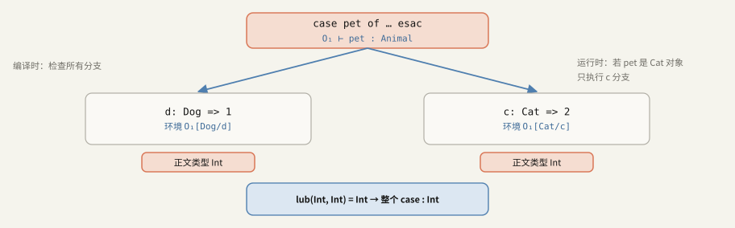

### 36.6 把整段代码的类型判断连起来

对于开头的 `let → if → 赋值` 例子：

| 表达式或绑定 | 静态类型 | 依据 |
|---|---|---|
| `new Dog` | `Dog` | 创建表达式的类型 |
| 变量 `pet` | `Animal` | `let` 中的显式声明 |
| `new Cat` | `Cat` | 创建表达式的类型 |
| `pet <- new Cat` | `Cat` | 赋值表达式取右侧类型 |
| `if flag then pet <- new Cat else new Dog fi` | `Animal` | 两个分支结果类型的最小上界 |
| 整个 `let` | `Animal` | 主体 `if` 的类型 |

读一条推理规则时，可以依次确认：

1. 当前这一行正在判断哪个表达式，是整体还是某个子表达式？
2. 检查它时使用哪个环境，是否需要加入局部绑定？
3. 哪些地方要求“表达式类型是声明类型的子类型”？
4. 结果类型来自哪一部分：主体、赋值右侧，还是多个分支的最小上界？

在这些规则中，`let` 取主体类型，赋值取右侧类型，`if` 与 `case` 对分支主体的结果类型求最小上界。

参考：[Cool 官方手册](https://web.stanford.edu/class/cs143/materials/cool-manual.pdf) §7.3、§7.5、§7.8、§7.9 与 §12.2。


---

## 37. 方法环境 $M$ 与动态方法分派（Dynamic Dispatch）

在面向对象语言中，最核心的操作莫过于方法调用：

$$e_0.f(e_1, \dots, e_n)$$

对象 $e_0$ 调用方法 $f$，并传入实参 $e_1 \dots e_n$。要为此操作制定类型规则，仅有对象环境 $O$ 已经不够用了。

### 37.1 独立命名空间与方法环境 $M$
在 Cool 中，**变量与方法处于彼此完全隔离的命名空间（Namespace）**。
在同一个类中，完全可以同时存在一个名为 `foo` 的属性和一个名为 `foo()` 的方法，二者并存且互不遮蔽。

为了形式化表示类中的方法签名，类型系统引入了独立的**方法环境（Method Environment，记作 $M$）**：

$$M(C, f) = (T_1, \dots, T_n, T_{n+1})$$

这个映射的含义是：**在类 $C$ 中，方法 $f$ 接收 $n$ 个类型分别为 $T_1 \dots T_n$ 的形参，最终返回类型为 $T_{n+1}$ 的结果**。最后一个类型 $T_{n+1}$ 永远代表方法的返回类型。

### 37.2 动态方法分派规则 `[Dispatch]`
综合利用对象环境 $O$ 和方法环境 $M$，构建出方法调用的完整规则：

$$\frac{O, M \vdash e_0 : T_0 \quad O, M \vdash e_1 : T_1 \quad \dots \quad O, M \vdash e_n : T_n \quad M(T_0, f) = (T_1', \dots, T_n', T_{n+1}) \quad T_i \le T_i' \; (\forall 1 \le i \le n)}{O, M \vdash e_0.f(e_1, \dots, e_n) : T_{n+1}} \quad [\text{Dispatch}]$$

**严密的推演四步法**：
1. **推导调用者与实参**：在当前环境下，主调对象 $e_0$ 推导出静态类型 $T_0$；各个实参表达式 $e_1 \dots e_n$ 分别算出类型 $T_1 \dots T_n$。
2. **查阅方法签名**：从方法环境 $M$ 中查询类 $T_0$ 的方法 $f$，获得其形参签名 $(T_1' \dots T_n')$ 与返回类型 $T_{n+1}$。
3. **逐一验证实参多态相容**：对每一个传入的实参，其实际类型 $T_i$ 必须是形参声明类型 $T_i'$ 的子类型（$T_i \le T_i'$）。
4. **确定结论类型**：整个调用表达式的静态类型，正是方法声明的返回值类型 $T_{n+1}$。

> [!note] 方法环境也包含继承的方法
> $M(T_0,f)$ 不要求 $T_0$ 直接定义 f，只要祖先定义过即可。实现上从 $T_0$ 沿父类链查找最近的定义。签名按接收者的静态类型检查；动态分派实际执行哪个实现，则由运行时对象的类决定。实参个数也必须与形参个数一致，不能只检查已有实参的类型。此处的返回类型公式暂按普通类类型描述，SELF_TYPE 的处理见第43节。

---

## 38. 静态方法分派规则（Static Dispatch）

在继承体系中，有时我们希望跳过运行时的动态多态分派，显式指名调用某个父类的方法实现（类似于 C++ 中的 `Base::func()` 或 Java 中的 `super.func()`）。

Cool 为此提供了静态分派语法：

$$e_0@T.f(e_1, \dots, e_n)$$

### 38.1 静态分派规则 `[Static Dispatch]`
$$\frac{O, M \vdash e_0 : T_0 \quad O, M \vdash e_1 : T_1 \quad \dots \quad O, M \vdash e_n : T_n \quad T_0 \le T \quad M(T, f) = (T_1', \dots, T_n', T_{n+1}) \quad T_i \le T_i' \; (\forall 1 \le i \le n)}{O, M \vdash e_0@T.f(e_1, \dots, e_n) : T_{n+1}} \quad [\text{Static Dispatch}]$$

对比动态分派，静态分派有两处关键区别：
1. **额外卡死基类约束（$T_0 \le T$）**：接收者 $e_0$ 的静态类型 $T_0$ 必须是指定类 $T$ 本身或其子类型。可以指定自身类或祖先类，不能指定无关类或更具体的子类。
2. **查表靶点转移**：查阅方法环境时使用的是目标类 $T$（$M(T, f)$），而不是主调对象的自身类型 $T_0$。

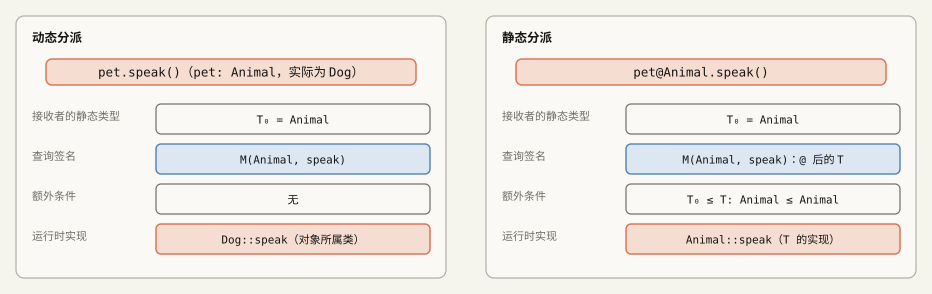

---

## 39. 完整三元类型环境：$(O, M, C)$

在面向对象的高级特性中，还有一个特殊的存在：**`SELF_TYPE`**。
为了让类型系统能正确解析“当前表达式到底处于哪一个类之中”，环境必须补上第三块拼图：**当前类名 $C$（Current Class）**。

至此，Cool 编译器形式化逻辑体系达到了完全体：

$$O, M, C \vdash e : T$$

- **$O$（Object Environment）**：对象与变量符号表（`Name → Type`）；
- **$M$（Method Environment）**：全系统方法签名注册表（`Class × Method → Signature`）；
- **$C$（Current Class）**：当前代码文本所处的宿主类。

**环境在绝大多数规则中的透传性**：
在绝大部分非方法调用的常规表达式中（如算术运算、字面量），环境 $M$ 和 $C$ 只是像静水一样从父节点原封不动透传给子节点，不直接参与运算：

$$\frac{O, M, C \vdash e_1 : \text{Int} \quad O, M, C \vdash e_2 : \text{Int}}{O, M, C \vdash e_1 + e_2 : \text{Int}} \quad [\text{Add}]$$

只有在方法调用（使用 $M$）和处理 `self` / `SELF_TYPE`（使用 $C$）时，编译器才会真正提取这些维度的信息。

---

## 40. 从形式化规则到编译器工程代码实现

形式化类型规则看似是写在纸上的数学符号，但它的结构与真实的编译器递归代码存在**直接的机械映射关系**。

在前期完成类名和方法签名的收集之后，Cool 的类型检查可以在**对 AST 的单次遍历（Single Traversal）**中全部完成：
- **类型环境向下传递**：函数传参，由父节点传给子节点；
- **计算类型向上传递**：函数返回值，由子节点返回给父节点。

### 40.1 映射案例 1：加法操作符 `[Add]`

形式化规则：
$$\frac{O, M, C \vdash e_1 : \text{Int} \quad O, M, C \vdash e_2 : \text{Int}}{O, M, C \vdash e_1 + e_2 : \text{Int}} \quad [\text{Add}]$$

翻译成编译器内部的 C++ 递归函数：

```cpp
Type TypeCheck(Environment env, AddExpr* expr) {
    // 1. 横线上方的两个前提，对应两次子节点的递归类型检查
    Type T1 = TypeCheck(env, expr->e1);
    Type T2 = TypeCheck(env, expr->e2);

    // 2. 检查子节点类型是否与规则要求完全一致
    if (T1 != Int || T2 != Int) {
        TypeError("Both operands of '+' must be Int");
    }

    // 3. 横线下方的结论，对应函数的最终返回值
    return Int;
}
```

### 40.2 映射案例 2：带初值的局部绑定 `[Let-Init]`

形式化规则：
$$\frac{O, M, C \vdash e_0 : T_0 \quad O[T/x], M, C \vdash e_1 : T_1 \quad T_0 \le T}{O, M, C \vdash \text{let } x: T \leftarrow e_0 \text{ in } e_1 : T_1} \quad [\text{Let-Init}]$$

翻译成编译器工程实现：

```cpp
Type TypeCheck(Environment env, LetExpr* expr) {
    // 1. 在当前环境下检查初始值表达式 e0
    Type T0 = TypeCheck(env, expr->e0);

    // 2. 检查子类型相容性：初始值类型必须是声明类型的子类
    if (!is_subtype(T0, expr->declared_type)) {
        TypeError("Initialization expression type does not conform to declared type");
    }

    // 3. 扩展环境：将 x -> declared_type 注册进符号表，得到新环境 env_extended
    Environment env_extended = env.add_symbol(expr->x, expr->declared_type);

    // 4. 在新环境下递归检查主体 e1
    Type T1 = TypeCheck(env_extended, expr->e1);

    // 5. 整个 let 表达式的类型就是主体的求值类型
    return T1;
}
```

**数学规则中的每一根横线，本质上就是一个类型检查函数；横线上方的每个前置条件，就是函数内部的一行递归调用或条件断言（`Assert / Check`）；横线下的结论，就是函数的 `return`。**

> [!note] 课件伪代码中的比较对象
> Richmond 版 Lecture 9 第107页写作 `subtype(T0, T1)`，但 $T_1$ 是正文类型。初始化应检查 $T_0 \le T$，即初值类型是否符合声明类型，而不是是否符合正文类型。本节代码中的 `is_subtype(T0, expr->declared_type)` 才与 `[Let-Init]` 一致。这里展示的是接口级伪代码，不是完整可编译的检查器。

---

## 41. 静态类型 vs 动态类型：表达力的权衡与困境

静态类型系统最大的优势在于**在编译期提前拦截常见错误**。但它有一个固有代价——**保守性（Conservatism）**。

为了绝对安全，静态类型检查器宁可错杀一千，绝不放过一个。某些在运行期完全合法、逻辑自洽的程序，往往因为静态规则表达能力不足而被无情拒绝。

面对这一痛点，编程语言设计分化出了两条路线：
1. **转向动态类型检查**：干脆放弃编译期校验，等到程序运行时再看真实值是否合法。
2. **发展更具表现力的静态类型系统**：不放弃编译期安全底线，但让静态类型系统变得更聪明（如引入泛型、协变/逆变、`SELF_TYPE`），去接纳更多原本被误杀的合法程序。

表现力越强，类型系统的数学推导和编译器实现也就越复杂。

### 41.1 动态类型 vs 静态类型的本质区别

先严格界定两个极易混淆的概念：

- **动态类型（Dynamic Type）**：
  这是一个**运行时（Run-time）**概念。指对象在内存中被 `new C` 实例化时，真实绑定的那个具体类 $C$。哪怕是 Python、Scheme 这种完全不做静态类型检查的动态语言，每个运行时对象也同样拥有自己的动态类型。
- **静态类型（Static Type）**：
  这是一个**编译期（Compile-time）**概念。编译器在源码上标注或推导出的表达式静态类型，必须能够**安全兜住该表达式在所有可能执行路径下产生的全部动态类型**。

### 41.2 可靠性定理（Soundness Theorem）

在包含子类型继承的面向对象语言中，可靠性定理表现为一条不可逾越的不变量：

$$\forall E, \quad \text{dynamic\_type}(E) \le \text{static\_type}(E)$$

在任何一次实际执行中，表达式 $E$ 求值得到的运行时对象，其真实动态类型必然是编译器所推导静态类型的子类型（在无子类型的语言里即严格相等）。

看一段直观的动态/静态类型分化代码（假设 $B \le A$）：

```cool
class A { ... };
class B inherits A { ... };

class Main {
    x: A <- new A;   -- x 的静态类型是 A；此时动态类型也是 A
    ...
    x <- new B;      -- x 的静态类型依然是 A；但动态类型变成了 B！
};
```

变量 `x` 的静态类型从声明那一刻起就锁死为 `A`，而它的动态类型在运行过程中不断切换，但始终被关在 `A` 及其子类的安全笼子里。

子类型关系足以保证这种替换：子类保留父类提供的属性和方法，重写方法也必须保持 Cool 要求的签名，因此可用于父类的操作同样可用于子类。上面的 `x <- new B` 是示意写法，实际 Cool 中应放在方法正文内，不能直接作为类体中的独立表达式。

### 41.3 静态类型的经典盲区：信息丢失陷阱

看一个极具代表性的工程痛点。定义一个带自增计数器的基类 `Count`：

```cool
class Count {
    i: Int <- 0;
    inc(): Count {
        {
            i <- i + 1;
            self;
        }
    };
};
```

注意 `inc()` 方法返回 `self`，并将返回类型声明为 `Count`。
现在我们派生出一个子类 `Stock`（库存商品，比父类多了一个 `name` 属性）：

```cool
class Stock inherits Count {
    name: String; -- 商品名称
};
```

接着在业务代码中连贯地调用它：

```cool
class Main {
    a: Stock <- (new Stock).inc();
    ... a.name ...
};
```

**冲突瞬间爆发**：
- **在运行时**：`(new Stock).inc()` 是在一个 `Stock` 实例上运行的，`inc()` 最后返回 `self`，所以它在运行期返还的**动态类型实打实就是 `Stock`**！把它赋给变量 `a: Stock` 天经地义。
- **但在朴素的静态类型系统下**：编译器查看 `Count::inc()` 的方法签名，只认死理地看到返回值写着 `Count`。因此 `(new Stock).inc()` 的静态类型被死板定格为 `Count`！
- 当编译器检查赋值 `a: Stock <- (new Stock).inc()` 时，需要验证 $\text{Count} \le \text{Stock}$。父类怎么可能是子类的子类？**直接触发 `Type error`！**

**静态类型检查器在这里“丢失”了关键的子类信息。**
如果不解决这个问题，派生类继承 `inc()` 方法几乎毫无意义，程序员被迫在每一个子类里把一模一样的代码重写一遍，仅仅为了把返回签名从 `Count` 改成 `Stock`。

---

## 42. 引入 `SELF_TYPE`：解决多态自引用

为了打破上述僵局，Cool 引入了极具表现力的特殊类型 **`SELF_TYPE`**。

修改 `Count` 类的签名：

```cool
class Count {
    i: Int <- 0;
    inc(): SELF_TYPE {
        {
            i <- i + 1;
            self;
        }
    };
};
```

### 42.1 `SELF_TYPE` 的精确语义

`inc()` 声明返回 `SELF_TYPE`，它在告诉编译器：“这个方法返回的对象，其动态类型永远与调用该方法时的 `self` 保持一致”。
如果当前 `inc()` 在 `Count` 中定义，而后续可能被子类 `A`、`B`、`C` 继承调用，那么返回值可能是 `Count`，也可能是 `Count` 的任意子类。

因此，如果 `SELF_TYPE` 文本上出现在类 $C$ 的代码体中，作为某表达式 $E$ 的声明类型，其必须满足：

$$\text{dynamic\_type}(E) \le C$$

由于 **`SELF_TYPE` 的实际含义完全依赖它所处的宿主类 $C$**，形式化记法中将其标注为带下标的符号：

$$\text{SELF\_TYPE}_C$$

由此确立一条全新的子类型公理：

$$\text{SELF\_TYPE}_C \le C$$

不管运行时的 `self` 究竟是 $C$ 还是 $C$ 的孙子类，它必然是 $C$ 的子类型。

> [!note] SELF_TYPE 是静态类型，不是运行时类名
> 可将 $\text{SELF\_TYPE}_C$ 理解为取值受 C 约束的类型变量。把它替换为 C 仍可保持可靠性，但会丢失与 self 的关系，重新出现 Count / Stock 的精度问题。
> 两个基本规则是 $O,M,C\vdash\text{self}:\text{SELF\_TYPE}_C$ 和 $O,M,C\vdash\text{new SELF\_TYPE}:\text{SELF\_TYPE}_C$。`new SELF_TYPE` 创建的是新对象，因此返回 SELF_TYPE 并不要求返回同一个 self 对象。

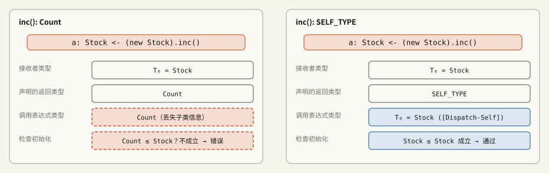

### 42.2 `SELF_TYPE` 的使用禁区与 6 大规则

虽然语法分析器允许 `SELF_TYPE` 出现在任何需要类型标识的位置，但语义分析器必须严格封杀它在危险位置的使用。逐条梳理 6 种语法位置：

1. **类定义头部 `class T inherits T'`**：**禁止**。$T$ 和 $T'$ 必须是具体的静态类名。
2. **类属性声明 `x: T`**：**允许**（例如链表节点定义 `next: SELF_TYPE`）。
3. **局部绑定 `let x: T in E`**：**允许**。
4. **对象创建 `new T`**：**允许**！`new SELF_TYPE` 在运行时会动态分配一个与当前 `self` 具有相同动态类型的对象。
5. **静态分派 `m@T(E1, ..., En)`**：**禁止**。静态分派必须显式指定接收者自身或祖先的具体类名。
6. **方法签名 `m(x: T): T'`**：
   - **返回类型 $T'$ 允许为 `SELF_TYPE`**；
   - **形式参数 $T$ 严禁使用 `SELF_TYPE`！**

> [!warning] 深度剖析：为什么方法形参绝对不能使用 `SELF_TYPE`？（协变参数陷阱）
> 设想如果不加限制，允许了形参 `comp(x: SELF_TYPE)`，看这段反例代码：
> ```cool
> class A {
>     comp(x: SELF_TYPE): Bool { ... };
> };
> 
> class B inherits A {
>     b: Int;
>     comp(x: SELF_TYPE): Bool { ... x.b ... }; -- 方法体内读取了 B 特有的属性 b
> };
> 
> -- 灾难发生的调用现场：
> let obj: A <- new B in
>     obj.comp(new A);
> ```
> **复盘崩溃现场**：
> 1. 编译期看 `obj`：它的静态类型是基类 `A`。编译器查 `A::comp(x: SELF_TYPE)`，认为参数只需要满足 `A` 就行，于是 `obj.comp(new A)` **欺骗了类型检查器，顺利编译通过**。
> 2. 进入运行期：因为 `obj` 真实的动态类型是派生类 **`B`**，动态分派机制实际跳转去执行 **`B::comp`**！
> 3. 此时 `B::comp` 拿到的实参 `x` 是一个普通的 `new A` 对象——**它根本没有属性 `b`！** 代码执行到 `x.b` 瞬间引发内存非法访问崩溃！
> 
> 这在类型论中称为**函数参数的逆变性（Contravariance）要求**。`SELF_TYPE` 随子类继承发生**协变（Covariance）**收缩，如果放在方法形参位置，就会打破里氏替换原则，导致类型系统失去可靠性（Unsound）。

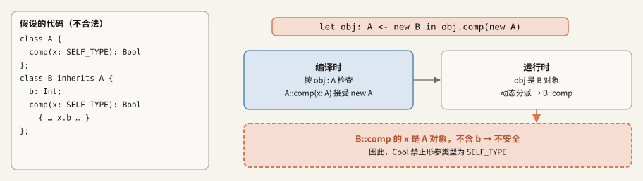

---

## 43. 整合 `SELF_TYPE` 到 Cool 类型检查规则

为了让全套类型系统支持 `SELF_TYPE`，我们必须先升级类型系统的两项基础算子：$\le$（子类型判定）与 $\text{lub}$（最小上界求解），以接纳 $\text{SELF\_TYPE}_C$。

### 43.1 完整判定式与宿主类 $C$ 的真正使命

还记得前面埋下的伏笔吗？我们把三元组判定式定为：

$$O, M, C \vdash e : T$$

之所以费尽周折把当前类 $C$ 也塞进环境里，正是为了在此刻**锚定 $\text{SELF\_TYPE}$ 的精确含义**（$\text{SELF\_TYPE}_C$）。

绝大多数基础规则（如赋值、加法、`let`）的公式结构无需改动，只需在底层调用支持了 `SELF_TYPE` 判定逻辑的全新 $\le$ 和 $\text{lub}$ 函数即可：

$$\frac{O(\text{Id}) = T_0 \quad O, M, C \vdash e_1 : T_1 \quad T_1 \le T_0}{O, M, C \vdash \text{Id} \leftarrow e_1 : T_1} \quad [\text{Assign}]$$

### 43.2 扩展后的 $\le$ 与 $\text{lub}$ 规则

当参与比较的类型中出现 $\text{SELF\_TYPE}_C$ 时，遵循以下判定：

- **子类型关系 $\le$ 的扩展**：
  - $\text{SELF\_TYPE}_C \le \text{SELF\_TYPE}_C$（自反性）；
  - $\text{SELF\_TYPE}_C \le T$ 当且仅当 $C \le T$（因为 $\text{SELF\_TYPE}_C \le C$）；
  - $T \le \text{SELF\_TYPE}_C$ **恒为假**（当 $T$ 是普通具体类名时，哪怕 $T = C$ 也不成立，因为运行期 `self` 可能是 $C$ 的某个真子类 $D$，而基类 $C$ 不能赋给子类 $D$）。
- **最小上界 $\text{lub}$ 的扩展**：
  - $\text{lub}(\text{SELF\_TYPE}_C, \text{SELF\_TYPE}_C) = \text{SELF\_TYPE}_C$；
  - $\text{lub}(\text{SELF\_TYPE}_C, T) = \text{lub}(C, T)$（具体类与 `SELF_TYPE` 汇聚时，直接退化为用宿主类 $C$ 去找共同祖先）。

这里第二条 LUB 公式中的 $T$ 是普通类类型；两个相同 SELF_TYPE 相遇时必须使用第一条，不能先全部替换为 C，否则会丢失精度。在同一方法正文内出现的 SELF_TYPE 都由当前类 C 解释，Cool 的这些规则不需要比较 $\text{SELF\_TYPE}_C$ 与另一个宿主类的 $\text{SELF\_TYPE}_D$。

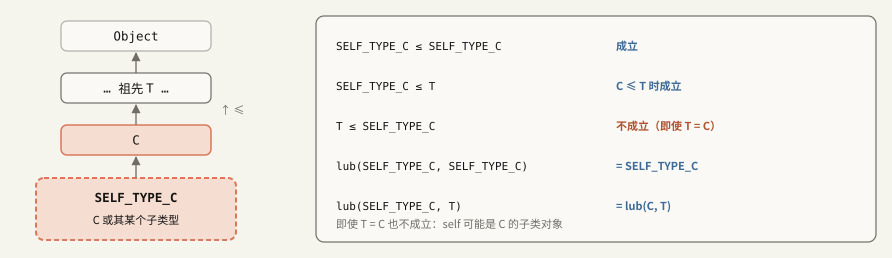

### 43.3 方法分派规则 `[Dispatch]` 的分裂

遇到方法调用 $e_0.f(e_1, \dots, e_n)$ 时，根据方法声明的返回值是否为 `SELF_TYPE`，规则正式裂变为两条分支：

#### 分支 1：方法返回值不是 `SELF_TYPE`（保持原样）
$$\frac{O, M, C \vdash e_0 : T_0 \quad \dots \quad O, M, C \vdash e_n : T_n \quad M(T_0, f) = (T_1', \dots, T_n', T_{n+1}') \quad T_{n+1}' \neq \text{SELF\_TYPE} \quad T_i \le T_i' \; (1 \le i \le n)}{O, M, C \vdash e_0.f(e_1, \dots, e_n) : T_{n+1}'} \quad [\text{Dispatch-Normal}]$$

#### 分支 2：方法返回值是 `SELF_TYPE`（核心突破！）
$$\frac{O, M, C \vdash e_0 : T_0 \quad \dots \quad O, M, C \vdash e_n : T_n \quad M(T_0, f) = (T_1', \dots, T_n', \text{SELF\_TYPE}) \quad T_i \le T_i' \; (1 \le i \le n)}{O, M, C \vdash e_0.f(e_1, \dots, e_n) : T_0} \quad [\text{Dispatch-Self}]$$

注意横线下方的结论类型：**当方法返回 `SELF_TYPE` 时，整个调用表达式的静态类型直接被替换为调用者 $e_0$ 的静态类型 $T_0$！**

回到前面困扰我们的 `a: Stock <- (new Stock).inc()`：
1. 接收者 $e_0$ 为 `new Stock`，算出 $T_0 = \text{Stock}$；
2. 查表 $M(\text{Stock}, \text{inc})$ 得到返回类型为 `SELF_TYPE`；
3. 套用分支 2 规则，用 $T_0$ 替换返回类型，于是 `(new Stock).inc()` 的静态类型精准定格为 **`Stock`**！
4. 赋值给 `a: Stock` 顺利验证通过，完美保留了子类类型信息。

> [!note] 查找起点 $T_0'$ 与静态分派的返回类型
> 若接收者类型 $T_0=\text{SELF\_TYPE}_C$，先令查找类 $T_0'=C$；否则 $T_0'=T_0$，再查 $M(T_0',f)$。这个替换只影响签名查找，不会把调用结果中的 SELF_TYPE 丢掉。
> 对静态分派 $e_0@T.f(\dots)$，若返回声明为 SELF_TYPE，结果仍为接收者类型 $T_0$，不是 @ 后的 T。例如 `(new Stock)@Count.inc()` 的结果类型是 Stock。@Count 固定所用实现，但方法内的 self 仍是原来的 Stock 对象。

### 43.4 边角情况处理：当调用者 $e_0$ 本身就是 `SELF_TYPE` 时

考虑在一个类 $C$ 的方法内部写 `self.f(e1)`（或直接写 `f(e1)`）：
- 此时接收者 $e_0$ 的静态类型 $T_0$ 本身就是 **`SELF_TYPE`**（即 $\text{SELF\_TYPE}_C$）。
- **问题 1：实际参数可以是 `SELF_TYPE` 吗？**
  **可以**（比如 `obj.foo(self)`）。根据扩展后的 $\le$ 规则，只要满足 $C \le T_i'$，那么 $\text{SELF\_TYPE}_C \le T_i'$ 必然成立，完全合法。
- **问题 2：此时查表 $M(\_, f)$ 应该传哪个类名去查方法签名？**
  **答案：安全地传入当前宿主类 $C$（$M(C, f)$）**！
  因为无论 `self` 运行时指向 $C$ 还是 $C$ 的派生类，子类必定继承或重写了 $C$ 的所有方法，在 $C$ 中查到的方法签名对所有派生类都是绝对安全有效的。如果该方法声明返回 `SELF_TYPE`，按规则返回的 $T_0$ 依然是 `SELF_TYPE`，从而丝滑支持 `self.inc().inc()` 的链式调用。

---

## 44. 从类型错误中恢复（Error Recovery）：用 `No_type` 消灭级联报错

跟语法分析一样，一个成熟的语义分析器绝不能一碰到类型错误就崩溃退出，而必须尝试恢复并继续遍历，争取一次性向开发者报告代码中的所有错误。

### 44.1 为什么类型错误恢复比语法错误恢复更简单？
在语法分析阶段，一旦遭遇语法错误，整棵树的结构就乱了套，分析器被迫开启恐慌模式（Panic Mode）丢弃大量 Token 跳过残缺代码。
但在语义分析阶段，**完整的 AST 已经被构造出来了**。所有节点的父子结构都是清清楚楚的，我们**完全不需要跳过任何代码片段**。

**唯一的难题是**：
当某个表达式节点本身就写错了（没有合法类型）时，自底向上遍历还要继续往上走，**编译器该给这个“坏掉的节点”赋一个什么占位类型，交给它的父节点处理？**

### 44.2 朴素方案的噩梦：赋给它 `Object`
考虑下面这行代码，其中变量 `x` 压根未声明：

```cool
let y: Int <- x + 2 in y + 3
```

如果我们简单粗暴地把出错节点的类型一律回退为根类 **`Object`**，来看看灾难是怎么连锁引爆的：
1. 分析叶节点 `x`：发现未定义 $\implies$ **报错 1**：`x is undefined`。给 `x` 赋予占位类型 `Object`。
2. 回到父节点 `x + 2`：尝试检查 `Object + Int`，加法要求两侧都是 `Int` $\implies$ **报错 2**：`+ applied to Object`！再给 `x + 2` 赋予占位类型 `Object`。
3. 回到顶层 `let y: Int <- (x + 2)`：检查 `Object <= Int` $\implies$ **报错 3**：`bad assignment`！

程序员明明只写错了一个字母（忘了声明 `x`），编译器却像多米诺骨牌一样吐出三条报错信息。这种**级联报错（Cascading Errors）**极其干扰排错视线。

### 44.3 优雅解法：引入专用的底部类型 `No_type`
一种恢复方案是引入内部错误占位类型 **`No_type`**，按位于所有正常类型下方的底部类型处理。具体名称和传播规则依编译器实现而定：

```text
          [ Object ]         <-- 顶层（所有正常类 C <= Object）
            /    \
         Int    String  ...
            \    /
          [ No_type ]        <-- 最底层（No_type <= C 对所有类成立）
```

在这个模型中增加两项处理：
1. 对所有正常类型 $C$，规定 `No_type <= C`。
2. 抑制由已知 `No_type` 引发的派生错误，必要时继续传播 `No_type`；其他独立错误仍应检查。恢复不等于接受这个错误程序。

**重新推演刚才的错误代码 `let y: Int <- x + 2 in y + 3`**：
1. 分析叶节点 `x`：未定义 $\implies$ **报错 1**：`x is undefined`。给 `x` 打上标签 **`No_type`**。
2. 回到父节点 `x + 2`：看到操作数包含 `No_type`，直接静默吞并，不触发报错，返回结果 **`No_type`**。
3. 回到 `let y: Int <- (x + 2)`：检查初始化相容性 `No_type <= Int` —— 按上述子类型约定成立，不再为同一根源重复诊断。
4. 进入 `in y + 3`：由于 `y` 在 `let` 中明确声明了类型 `Int`，后续的 `y + 3` 照常以 `Int` 精确检查！其他独立错误仍应继续检查。

一条真实的根源错误只报一次，把级联噪音彻底掐死在源头。

> [!note] No_type 的实现成本与恢复边界
> 在所有正常类型下方加入共同底部后，扩展的子类型关系是 DAG，而非原来的单继承树；用户类的继承树本身没有因此改变。LUB 算法需要增加 $\operatorname{lub}(\text{No\_type},T)=T$ 等特殊处理。
> 这是避免级联诊断的一种工程选择，不是语言规范要求所有编译器采用的固定方案。CS143 课件允许作业中使用 Object 恢复并接受部分级联报错。已经记录语义错误的 AST 不应继续生成可执行代码。

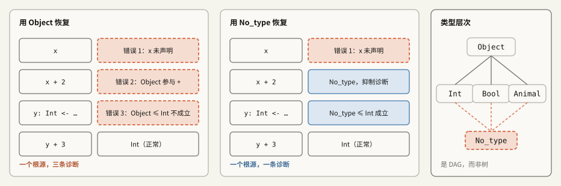

---

## 45. 语义分析全讲收官：前端闭环全景总结

本笔记覆盖 Lecture 9 的语义分析概览和 Lecture 10 的 SELF_TYPE、错误恢复，可按以下流程串联：

```text
源码字符流 (Source Code)
       │
       ▼ [词法分析: 正则表达式 + DFA/NFA]
    Token 流
       │
       ▼ [语法分析: 上下文无关文法 + LL/LR 分析栈]
  原始语法树 (Bare AST)
       │
       ▼ [语义分析: 多趟遍历 + 符号表 + 形式化推理系统 + SELF_TYPE + No_type 恢复]
  带类型注解的语法树 (Decorated / Typed AST)
       │
       ▼
进入后端代码生成、运行时内存布局与优化 (IR & Code Generation)
```

至此，语义分析的四个核心环节全部拼接完毕：
1. **作用域与多趟流水线**：用分层符号表栈管理词法嵌套与遮蔽（`enter_scope` / `check_scope` / `exit_scope`）；靠多趟扫描先收类名、检查继承树、录方法签名，化解前向引用与循环继承。
2. **形式化推理系统**：基于三元组环境 $O, M, C \vdash e : T$，让类型环境自顶向下渗透，推导类型自底向上汇聚，每一条逻辑横线都对应 AST 遍历里的一个递归检查函数。
3. **面向对象多态**：通过偏序 $\le$ 与继承树最小上界 $\text{lub}$（LCA）支撑多态汇聚；借助 $\text{SELF\_TYPE}_C$ 保留派生类链式调用的精确类型，并在形参位置禁掉协变以守住可靠性定理。
4. **类型错误恢复**：引入底部占位类型 `No_type`，在不跳过任何 AST 代码的前提下拦截级联错误，继续检查其余节点。只有没有语义错误时，Typed AST 才能进入后续代码生成。


---

## 46. 自检问题

> [!question]- 1. 举出两种语法分析无法独立检查的错误，并说明缺少什么信息。
> 使用未声明名称，需要作用域和声明信息；对不兼容类型执行运算，需要表达式的类型与子类型关系。仅凭 Token 的排列结构，不能完成这些检查。

> [!question]- 2. 为什么单栈能处理 $\{w c w^R\}$，却不能用同样方法处理 $\{w c w\}$？
> 栈按入栈顺序的逆序弹出。反序复制恰好与弹栈顺序一致，同序复制则不一致。对至少含两个字符的字母表，同序复制语言不是 CFL；若只有一种字符，就退化为可用栈匹配数量的情况。

> [!question]- 3. `let x: Int <- x in x + 1` 中三处 x 各指向哪里？
> 第一处是新声明；初始化式中的 x 查外层环境，外层若没有它则报错；正文中的 x 指向新声明。新绑定不能用于自己的初始化式。

> [!question]- 4. 为什么只用 `find_symbol` 不能准确判断 `foo(x: Int, x: String)` 的重复形参？
> 它能找到同名绑定，却无法单凭查找结果区分同一形参作用域与外层作用域。需要 `enter_scope` 标记边界，再用只查当前层的 `check_scope`。Cool 的顺序 let 同名绑定另有遮蔽规则。

> [!question]- 5. Cool 为什么先收集类名，再检查正文？
> 类名允许前向引用。检查前面的 Foo 时，后面的 Bar 可能尚未被扫描；先收全局类名，再检查继承、签名和正文，就不会误报 Bar 未定义。

> [!question]- 6. `g(y) = let a <- 4 in f(3); f(x) = a;` 在两种作用域规则下如何解释？
> 在这段示意代码中，静态作用域沿 f 的定义位置向外查找，找不到 a；动态作用域沿调用栈找到 g 绑定的 a = 4。若从其他调用路径进入 f，动态作用域的结果可能不同，甚至在运行时查找失败。

> [!question]- 7. 给整数字面量推导 Object 虽然保守，为什么仍不合适？
> 它丢失了 Int 信息，导致 `1 + 2` 无法满足加法规则的 Int 前提。规则既要保持可靠性，也应尽量给出精确类型。

> [!question]- 8. Cool 的 while 为什么不能直接使用循环体的类型？
> 循环体可能一次也不执行，而且规范规定循环正常结束后总是返回 void，不是最后一次正文的值。循环表达式的静态类型固定为 Object。

> [!question]- 9. `[Let-Init]` 为什么将声明类型 T，而不是初始化式类型 T₀，放入正文环境？
> 声明类型约束变量整个生命周期中可容纳的值。初始化为 Circle 的 Shape 变量，正文仍可以被赋为 Square，不能只凭初值将它永久收窄为 Circle。

> [!question]- 10. if 与 case 分别对什么求 LUB？case 中的 Dog、Cat 分支类型有何用途？
> if 对两个分支表达式的类型求 LUB；case 对所有分支正文的类型求 LUB。分支声明类型用于建立局部环境和运行时选择分支，不一定是参与最终 LUB 的类型。

> [!question]- 11. 动态分派与静态分派分别从哪里查签名、选择实现？
> 动态分派按接收者静态类型查签名，运行时按对象所属类选择实现；静态分派 `e₀@T.f` 先检查 T₀ ≤ T，再从 T 查签名，并固定使用 T 所提供的方法实现。方法可能从祖先继承而来。

> [!question]- 12. 为什么 inc 返回 Count 时不能初始化 Stock，而返回 SELF_TYPE 时可以？
> 前者使调用结果的静态类型为 Count，而 Count ≤ Stock 不成立。后者使结果类型保留为接收者的静态类型 Stock，因此 Stock ≤ Stock 成立。

> [!question]- 13. 形参使用 SELF_TYPE 会带来什么风险？
> 若根据父类静态签名接受一个 A 实参，却动态调用要求更具体 B 对象的实现，就可能访问 A 中不存在的成员。第42.2节的反例是假设放开限制后的类型问题示意，实际 Cool 禁止这种形参声明。

> [!question]- 14. 为什么普通类 T ≤ SELF_TYPE_C 在 T = C 时也不成立？
> SELF_TYPE_C 保留了与 self 实际类型的关系；self 可能是 C 的子类 D 对象。一个普通 C 对象并不一定能放到需要 D 的位置，不能仅凭 T = C 认定符合。

> [!question]- 15. No_type 相比 Object 恢复有什么收益与成本？
> 它可抑制同一根源引起的级联诊断。成本是扩展子类型关系和相关算法，例如为 LUB 增加 lub(No_type, T) = T。已发现的错误仍然存在，不能因此继续代码生成。

> [!question]- 16. 演示中的 Y → ε 填入 LL(1) 表的哪些列？SLR(1) 状态 3 遇到 * 时为什么不按 r4 归约？
> Y → ε 填入 FOLLOW(Y) = { +, ), $ } 对应的列。SLR 的 r4（T → int）只填 FOLLOW(T) = { +, ), $ }，其中没有 *；* 列由 T → int · * T 项目给出 s6，因此应移进。状态编号采用演示中的发现顺序。

---

## 47. 对照修订与补充索引

与 `11_05/11_05.md` 对照后，补充内容已放回相应章节，图示也直接插在知识点附近。

| 位置 | 修订或补充 |
|---|---|
| 开头、第0节 | 明确涵盖 Lecture 9、10，增加中文动画入口与使用方法 |
| 第2.1节 | 固定分隔符和字母表条件，区别同序复制与反序复制 |
| 第3.6节 | Object、IO 可被继承；区分禁止继承与禁止重定义 |
| 第4、6、9节 | 不同语言的重声明规则、外部 x 的影响、Cool 块不引入绑定 |
| 第14.3节 | 重复形参与顺序 let 遮蔽的区别，作用域边界的用途 |
| 第15.1节 | 继承图错误为何应在正文检查前处理 |
| 第19、25.1节 | 转型失败方式与类型可靠性的适用边界 |
| 第27.3节 | 实际语法为 not；while 的值为 void，而非一个特殊对象 |
| 第32.2节 | 正文环境必须保存声明类型的原因 |
| 第34.2节 | LUB 的深度对齐、同步上移和时间复杂度 |
| 第35节 | case 分支类型约束、void 与无匹配分支的运行时错误 |
| 第37–38节 | 继承方法的查找、编译时签名与运行时实现的区别 |
| 第40.2节 | 初始化应比较 T₀ 与声明类型 T，而非正文类型 T₁ |
| 第41–43节 | SELF_TYPE 的静态含义、基本规则、查找类 T₀′、静态分派的 SELF_TYPE 返回值 |
| 第44–45节 | No_type 的 DAG / LUB 成本，错误恢复不等于程序正确 |
| 第46节 | 增加 16 道可折叠的自检问题与答案 |

---

## 48. 参考资料

- [University of Richmond CMSC 331 Lecture 9：Overview of Semantic Analysis](https://facultystaff.richmond.edu/~dszajda/classes/cs331/Fall_2017/lecture_slides/lecture09.pdf)：转载 Aiken 的课件，共 107 页。本笔记第1–40节对应此部分。
- [Lecture 10：Type Checking in Cool II](https://facultystaff.richmond.edu/~dszajda/classes/cs331/Fall_2017/lecture_slides/lecture10.pdf)：SELF_TYPE 与错误恢复，共 60 页。本笔记第41–44节对应此部分。
- [Cool Reference Manual](https://web.stanford.edu/class/cs143/materials/cool-manual.pdf)：§3–4（类、继承与 SELF_TYPE）、§7（表达式）、§12（类型规则）。语言细节以手册为准。
- [Stanford CS143 Compilers](https://web.stanford.edu/class/cs143/)：课程入口。
- Aho、Lam、Sethi、Ullman，《Compilers: Principles, Techniques, and Tools》第2版：§2.7（符号表）、§4.3.5（非上下文无关结构）、§6.3–§6.5（类型检查）。
- R. Milner，*A Theory of Type Polymorphism in Programming*，JCSS 17（1978）：类型可靠性的经典论述。
- 配套中文演示：[从词法到语义](../11_05/frontend-flow.html)。
