# 11月2日学习记录：运行时组织与栈式机器

> [!info] 阅读说明
> - 主干内容保留原笔记结构，并合入了韩文扩展版中的所有补充：10 张 SVG 图示（`assets/11_02/rt-*.svg`）、图下的 **读图** 说明，以及 `补充` 与 `纠偏` 提示框。如果想快速浏览新增部分，可以直接看文末第七节的汇总表。
> - 补充部分里的实测数值均在同一台机器（Ubuntu 24.04、x86-64、`gcc 13.3`）上实际编译运行测得，包括递归 `sum` 的反汇编（`-O0` 与 `-O2`）和各次调用的栈帧地址、`readelf` 查看入口点、进程各内存区域的实测地址、结构体 `sizeof` 与 `offsetof`、异常展开析构顺序、UBSan 对齐检查，以及递归触及栈上限测试。第六部分第 2 节的不变性则在一个小型 Python 栈式机器模拟器上用 2000 条随机嵌套加法表达式做过验证。
> - 由于 ASLR（地址空间布局随机化）的存在，实际进程地址每次运行都会变化，图和笔记中记录的是其中一次运行的结果。

## 一、运行时系统与后端优化开篇

### 1. 从前端到后端：为什么先讲运行时系统？

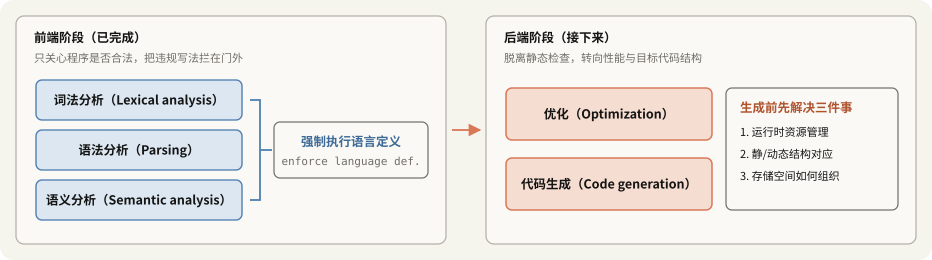

在讨论代码生成之前，我们需要先理解要生成的是什么。业界已经有一批广泛使用的标准技术，用来组织可执行代码的结构。

词法、语法、语义分析合在一起叫编译器前端，批注“enforce language definition”点明了前端的全部职责：它只管程序合不合规矩，把不符合语言定义的写法挡在门外。

过了语义分析，编译器就来到后端的优化和代码生成。学到这里很容易想直接看语法树怎么翻译成汇编指令，但光把源码翻译成一条条指令还不够。函数调用时参数往哪塞、递归调用时局部变量的几份拷贝怎么互不打架、动态申请的内存由谁分配和回收，这些事没法在编译期写死，必须先有一套运行时机制来托底。

---

### 2. 运行时组织要解决的三件事

语义分析会检查“变量 x 是什么类型、能不能参与加法”。到了代码生成，还要回答：x 的值放在哪里？执行这次加法时，应该读取哪一份 x？

运行时组织讨论的就是程序执行时，函数调用和数据存储如何安排。

| 议题 | 具体要回答的问题 |
| --- | --- |
| 运行时资源的管理（Management of run-time resources） | 寄存器和内存什么时候给谁用？哪些值要保留？用完怎么回收或复用？ |
| 静态结构与动态结构的对应关系 | 源码里的一个函数定义、一个变量声明，运行时对应哪次调用、哪一份数据？ |
| 存储组织（Storage organization） | 代码、全局变量、局部变量和动态创建的对象分别放在哪里？ |

#### 2.1 用一个递归函数来看

```cpp
int sum(int n)
{
    int x = n;

    if (n == 0)
        return 0;

    int y = sum(n - 1);
    return x + y;
}
```

调用 `sum(2)`，返回值为 3。下面按普通的栈实现解释，暂不考虑内联、消除局部变量等编译优化。

`sum(2)` 要先调用 `sum(1)`，`sum(1)` 又要调用 `sum(0)`。执行到最里面时，外面两次调用都还没结束，仍在等待结果。

#### 2.2 资源管理：调用别人时，自己的数据怎么办？

`sum(2)` 中的 x \= 2。调用 `sum(1)` 后，这个值还要留着，因为最后需要计算 x 加上递归调用的返回值。

`sum(1)` 也有自己的 x，值为 1。它不能覆盖外层的 x，否则回到 `sum(2)` 时就无法得到正确结果。

因此，普通的栈实现需要安排这些操作：

- 进入一次函数调用，为这次调用准备栈帧，保存它需要的数据和返回信息。
- 调用其他函数前，保留返回后仍然需要的值。
- 函数返回时，撤销本次调用的栈帧，让这部分空间可以再次使用。撤销通常是调整栈指针，不需要把内存逐字节清零。

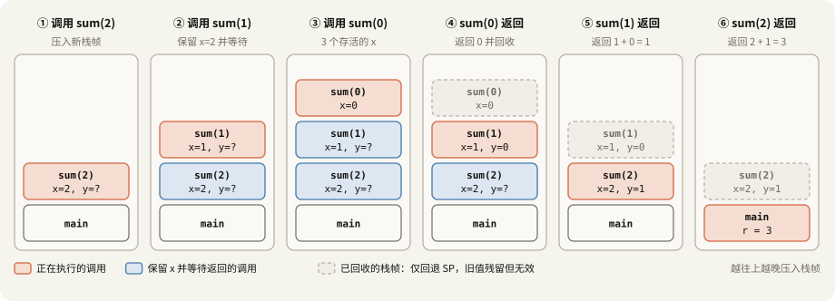

**读图**：栈帧往上累加、从顶部回收。第 ② 到第 ④ 步期间，`sum(2)` 的 `x = 2` 一直安稳留在原地，直到第 ⑥ 步才拿出来和返回的 `y = 1` 相加。灰色虚线画出的已回收栈帧说明内存并不会被清零，只是把栈指针 SP 拨了回去，旧数值在下一次调用覆盖之前其实还留在内存里，但逻辑上已经作废。

寄存器也需要遵守保存与恢复的约定。如果某个值在调用之后还要用，而被调用函数可能改写保存它的寄存器，就必须安排保护措施。

这里不意味着有一个独立的“运行时管理员”临时决定每个变量放哪里。寄存器分配通常由编译器完成；保存、恢复和调整栈空间等操作，也通常由编译器按照调用约定生成指令，程序运行时执行。堆内存分配则通常会调用分配器。

#### 2.3 静态与动态的对应：一个 x 为什么有好几份？

源码中只有一个 `sum` 定义，也只有一处 `int x = n`。但执行到 `sum(0)` 的函数体时，可以有三份仍然存活的 x：

| 尚未结束的调用 | 这次调用自己的 x | 当前状态 |
| --- | --- | --- |
| `sum(2)` | 2 | 等待 `sum(1)` 返回 |
| `sum(1)` | 1 | 等待 `sum(0)` 返回 |
| `sum(0)` | 0 | 即将返回 0 |

这里的“静态”和“动态”，区分的是源码里的结构和执行时的实例：

- 静态：不运行程序，光看源码就能确定的结构。例如，`sum` 有一个参数 `n`，声明了局部变量 `x`，而 `return x + y` 中的 `x` 指向前面的那条声明。
- 动态：程序执行时实际产生的调用和数据。例如，调用 `sum(2)` 后，递归过程中出现三次尚未结束的调用，各自有一份 x，值分别为 2、1、0。

所以，“这个 x 对应哪条声明”由编译期的作用域分析确定；“这次执行应该读取哪份 x”则要结合当前调用的状态。源码中只有一处声明，运行时却可以产生多份变量。

一个函数定义可以对应多次调用，一处局部变量声明可以对应多份同时存在的变量。各次调用通常共用同一份机器代码，但分别保存自己的调用状态。每次调用所需的参数、局部变量、返回位置等信息组成一份活动记录（Activation Record）。在常见的栈实现中，它对应一个栈帧；其中部分信息也可能放在寄存器里。

那么，同一句 `return x + y` 怎么找到当前这次调用的 x？编译器可以使用“当前栈帧基址加固定偏移”的寻址方式。例如，假设 x 被放在栈帧基址之前的 4 字节处：

> x 的地址 \= 当前栈帧基址 − 4

偏移量可以在编译期确定，当前栈帧基址则随调用而变化。同一套指令就能访问各次调用自己的 x。这里的偏移量只是示例，实际布局由目标平台和编译器决定，也不一定使用独立的帧指针。

![静态结构与动态结构的对应关系。源码中只有一处 int x 声明，读取 return x + y 中 x 的机器指令也只有一份 load \[FP − 4\]。运行期间 sum(0)、sum(1)、sum(2) 每个栈帧里各有一份 x，同一条指令按当前 FP 读取 sum(0) 栈帧里的 x。](assets/11_02/rt-static-dynamic.svg)

**读图**：左边的一处静态声明对应着右边三个动态栈帧（虚线连线）。机器指令 `load [FP − 4]` 在代码区里自始至终只有这一份，当前 FP 正好指着 `sum(0)` 的栈帧，所以读到 `x = 0`；等回到 `sum(1)` 时，FP 切换成 `sum(1)` 的栈帧，同一条指令读到的就是 `x = 1`。

> [!note] 补充：用 gcc 实测栈帧布局
> - 把上面的 `sum` 用 gcc 13.3 `-O0` 编译并反汇编，以帧指针寄存器 `rbp` 为基准，`n` 落在 `rbp-20`，`x` 落在 `rbp-8`，`y` 落在 `rbp-4`。虽然示例里的 `-4` 实际变成了 `-8`，但所有调用共用同一个固定偏移量的原理完全一致。
> - 在每次调用里把 `&x` 和 `rbp` 打印出来，会看到 `rbp` 依次从 `…140` 降到 `…110` 再到 `…0e0`，每次递减 48 字节，说明越往内层调用，栈帧放在越低的地址上。这 48 字节包括 `call` 压入的 8 字节返回地址、保存的调用方 `rbp` 8 字节以及 32 字节局部变量区（加入 `printf` 后因栈保护 canary 占用了 `rbp-8`，`x` 被挤到 `rbp-16`，但三层调用的偏移仍统一是 `-16`）。
> - 如果打开 `-O2` 优化，gcc 会把这段递归直接改写成循环，连栈帧和局部变量 `x` 都会被优化掉，这正是前面讨论时特意先关闭优化的原因。

返回时，`sum(0)` 先返回 0；`sum(1)` 用自己的 x 算出 1；`sum(2)` 再用自己的 x 算出 3。

#### 2.4 存储组织：不同的数据放在哪里？

从整个程序看，不同内容需要保留的时间不同，因此通常采用不同的存储区域。

| 内容 | 常见存放位置 | 保留时间 |
| --- | --- | --- |
| `sum` 编译后的机器指令 | 代码区 | 普通程序中通常随程序保持加载 |
| 全局变量、`static` 变量的存储 | 静态存储区域 | 整个程序运行期间 |
| 每次 `sum` 调用的参数、局部变量等 | 栈帧，也可能使用寄存器 | 对应调用期间；局部对象还受自身作用域限制 |
| `new` 动态创建的对象 | 堆（Heap） | 由相应的销毁和释放操作决定，可以跨越函数返回 |

例如，`sum(1)` 返回后，它的局部变量不再需要，栈帧空间可以回收。全局变量还要供后续代码使用，不能跟着这次调用一起回收。函数通过 `new` 创建并返回给调用者的对象，也可能需要继续存在。

这三件事会交叉：栈属于存储组织；建立和撤销栈帧属于资源管理；通过当前栈帧找到本次调用的 x，则解释了源码声明与运行时数据的对应关系。

---

### 3. 程序怎么从静止变成运行？

程序的执行最初由操作系统（OS）控制。当一个程序被调用启动时，操作系统会做三件事：
1. 为程序分配空间
2. 把代码加载到该空间的一部分中
3. 跳转到入口点（即 `main`）

刚编译出来的可执行文件只是硬盘上的一堆字节，程序刚拉起时控制权并不在用户代码手里。直到操作系统完成空间分配和代码加载、把指令指针跳进 `main`，CPU 的控制权才正式交给程序，预先约定好的运行时机制也从这一刻起接管后续的函数调用与内存分配。

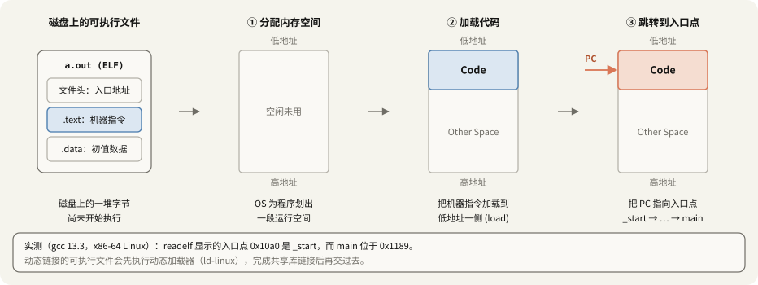

> [!note] 补充：真正的入口点通常不是 `main`
> 这里说的“跳转到 `main`”是从 C/C++ 程序员视角来看的。ELF 文件头里记录的真实入口点其实是 C 运行时库提供的 `_start`。实测 `readelf -h` 输出的 `Entry point address` 是 `_start`（`0x10a0`），和 `main`（`0x1189`）不是同一个地址。`_start` 先把栈上的 `argc`、`argv` 整理好再调用 `__libc_start_main`，由后者完成全局对象构造等初始化后才去调用 `main`，并在 `main` 返回后拿着返回值调用 `exit`。实际 Linux 内核也不会一口气把整个可执行文件全拷进内存，而是先建立虚拟地址映射，等真正访问到对应页面时才触发缺页按页载入。

---

### 4. 内存空间的基础切分与看图约定

操作系统把代码加载进分配好的空间后，对应的内存结构可以画成下面这样：

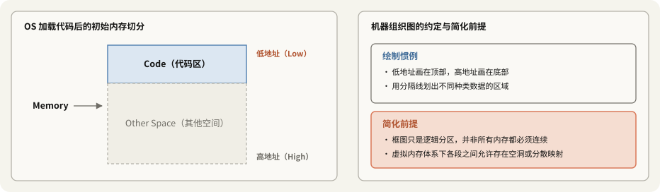

按照机器组织图的绘制惯例：
- 低地址画在顶部
- 高地址画在底部
- 用分隔线划出存放不同种类数据的区域

> [!warning] 纠偏：低地址画在上面只是教材惯例之一
> CS143 这门课的幻灯片和《操作系统导论》（OSTEP）习惯把低地址画在上方，但像《深入理解计算机系统》（CS:APP）这类教材则普遍把高地址画在上方，于是看起来就像栈从上往下长。图纸的上下朝向纯粹是排版习惯，看图前要先找准低地址和高地址在哪一头，牢记“栈向低地址增长，堆向高地址增长”才是不会出错的判断方法。两种画法的对照图见第四部分第 3 节。

操作系统的第一步只是切出整块空间，把编译好的机器指令放进低地址这一头的 `Code` 区；下面那块更大的 `Other Space`，后续会继续细分成静态数据、栈和堆等运行时区域。

这类示意图还有一个简化前提：并非所有内存都必须是连续的。框图画成一个方方正正的整体只是为了讲清楚逻辑分区，在真实的硬件和虚拟内存体系下，各块区域在物理内存或虚拟地址上不必紧挨着排布，中间完全可以留出空洞或分散映射。记住这一点，后面学到栈从高地址向低地址增长、堆从低地址向高地址增长时，就不会被“盒子大小写死了”的错觉带偏。

---

## 二、运行时结构

### 1. 代码生成的两个目标

编译器在设计运行时结构时，主要盯着两个目标：正确性（Correctness）和执行速度（Speed）。代码生成之所以复杂，恰恰是因为我们既想让程序跑得对，又想让它跑得快。

如果只求正确，很多实现可以做得很笨重：所有变量全塞进内存、每次调用都把所有寄存器备份一遍、不做任何复用。反过来，想要速度，就得尽量把值留在寄存器里、精简调用开销、复用内存空间，而这又反过来要求编译器精确掌握数据的存活期、寄存器占用和栈帧布局。后端代码生成的各种麻烦，基本都来自在这两个目标之间找平衡。

### 2. 运行时结构的两条基本假设

先讨论最经典的一类语言模型，它建立在两条假设之上：
1. 执行是顺序的：控制流按照明确定义的顺序，从程序的一个位置移动到另一个位置。
2. 当一个过程（函数）被调用时，控制流总会返回到紧跟在这次调用之后的位置。

正是这两条假设，撑起了传统的调用栈（Stack）模型。控制流按单线顺序推进，每次调用结束后又原路返回，函数的激活和结束天然呈后进先出（LIFO）的嵌套关系，所以用一个栈就能把活动记录一层层叠起来。

但在实际语言里，这两条假设都可能被打破：
- 在并发程序中，第一条假设可能会被违反。多线程或协程同时推进时，不再只有单一的顺序控制流，各个执行流往往需要各自独立的栈或上下文。
- 在第二条假设中，像是异常（Exception）和 `call/cc`（call-with-current-continuation）这样的高级控制结构可能会违反。抛出异常时，控制流会直接跳过中间好几层调用，一路回退到外层的捕获点；`call/cc` 甚至能把当前执行上下文保存成对象，在之后某个完全不同的位置反复恢复执行，这就无法只靠“原路返回”的栈帧来支撑了。

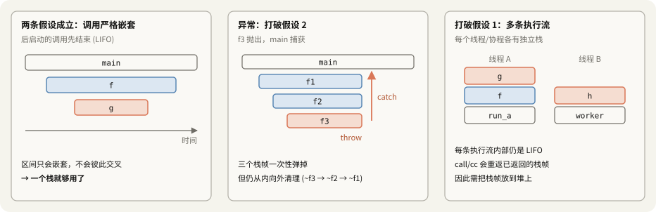

> [!note] 补充：异常遵守 LIFO，而 `call/cc` 会打破它
> 异常虽然跳过了正常的逐层返回点，但并没有打乱销毁顺序。实测在 `main → f1 → f2 → f3` 调用链里让 `f3` 抛异常、由 `main` 捕获时，各函数局部对象的析构函数严格按 `~f3 → ~f2 → ~f1` 的顺序被调用。因为清理依然是从栈顶向栈底依次展开（栈展开，stack unwinding），所以异常仍旧能靠栈实现。真正绕开栈模型的是 `call/cc`：它保存下来的续延（continuation）可以在原函数已经返回之后再次跳回去执行，若栈帧随返回销毁就无处可回，因此实现上只能把栈帧分配在堆里，或者整段拷贝栈内容。带捕获局部变量且寿命长于外层函数的闭包也会遇到类似问题，被捕获的变量通常同样要逃逸到堆上。

### 3. 生命周期（Lifetime）与作用域（Scope）

变量 `x` 的生命周期（Lifetime），指的是程序执行过程中 `x` 处于已定义状态的那一段执行期。这里需要注意一组容易混用的概念：
- 生命周期是一个动态的（运行期，run-time）概念。
- 作用域（Scope）是一个静态的（编译期）概念。

作用域回答的是“在源码的哪几行里可以写下名字 `x` 并引用它”，编译期扫一遍语法树和符号表就能确定。生命周期回答的则是“程序跑起来以后，为 `x` 分配的那块存储从什么时候开始有效、什么时候能被回收”。

这两者不一定同步。比如在函数里动态申请一块堆内存，把地址赋给局部变量 `p`：名字 `p` 的作用域在函数结束时就结束了，但那块堆对象只要没被释放，它的生命周期就会一直延续到函数返回之后。局部栈变量则相反，它的作用域和生命周期大体贴合，只在当次调用期间有效。分清静态作用域和动态生命周期，才能决定一个变量该放在栈帧、静态区还是堆里。

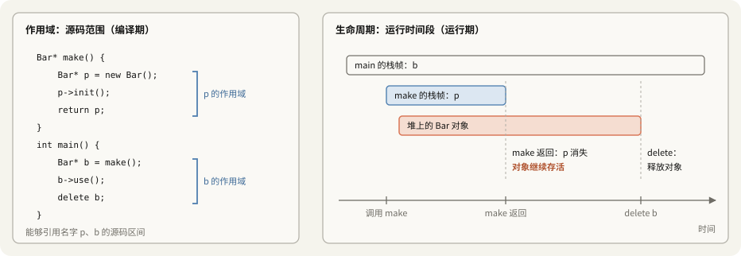

**读图**：左边标的是源代码行号范围，右边是程序跑起来的时间轴。`make` 返回的那一刻，存放 `p` 的栈帧就消失了，但堆上的 `Bar` 对象直到 `delete b` 才结束寿命。还有另一种反方向的错位：C++ 函数内部的 `static` 局部变量，作用域只局限于这个函数体里面，但它的生命周期贯穿整个程序运行期（见第四部分第 1 节）。

---

## 三、激活记录（Activation Record）

### 1. 什么是激活记录？

用来管理一次过程激活（也就是一次函数调用）所需的全部信息，称为激活记录（Activation Record，简称 AR），有时也叫栈帧（Frame）。

如果过程 `F` 调用了过程 `G`，在 `G` 跑完之前，`F` 会暂时处于“挂起（suspended）”状态；等到 `G` 执行结束，控制权交回，`F` 才从暂停的地方继续执行。所以 `G` 的激活记录里装的不只是 `G` 自己的数据，而是 `F` 和 `G` 两方信息的混合，主要包括两类内容：
- 完成 `G` 自身执行所需的信息（如参数、局部变量、临时存储等）。
- 恢复 `F` 继续执行所需的信息（如 `G` 结束后跳回哪里、怎么找回 `F` 的激活记录等）。

### 2. 具体例子：递归调用中的 AR 结构

下面这段代码展示了嵌套与递归调用的场景，其中 `(*)` 和 `(**)` 分别标出了调用返回后紧接着要继续执行的位置：

```cpp
int g() {
    return 1;
}

int f(int x) {
    if (x == 0) {
        return g();
    } else {
        int res = f(x - 1); // (**) 递归调用返回后继续执行的位置
        return res;
    }
}

int main() {
    int ans = f(3); // (*) 首次调用返回后继续执行的位置
    return 0;
}
```

执行 `f(3)` 时，调用链会依次经过 `main -> f(3) -> f(2) -> f(1) -> f(0) -> g()`。其中每一次对 `f` 的调用，它的激活记录（`AR for f`）可以画成下面这个结构：

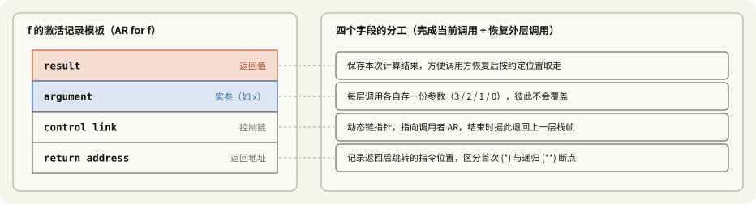

这四个字段把完成当前调用和恢复外层调用所需的最小信息拆开了：
- `result` 保存这次调用计算出的返回值，调用方恢复执行后就从这里（或约定位置）取结果。
- `argument` 保存调用方传入的实参。初次调用 `f(3)` 时这里存 `3`，递归深入时，每一层新建立的 `AR for f` 里分别存 `2`、`1`、`0`，彼此不会覆盖。
- `control link`（控制链，也常称动态链）指向调用方（caller）的激活记录。比如 `f(2)` 的 AR 里的 `control link` 指向 `f(3)` 的 AR，`f(3)` 的指向 `main` 的 AR；当内层调用结束时，沿着它就能找回上一层挂起时的栈帧基址。
- `return address` 记录当前过程结束后应该跳回哪条指令继续执行。由 `main` 发起的 `f(3)`，返回地址指向 `(*)`；而 `f(3)` 内部递归发起的 `f(2)`，返回地址指向 `(**)`。有了控制链和返回地址，就算同一个函数 `f` 同时挂起了好几层，每一层返回时都能准确退回自己的调用现场。

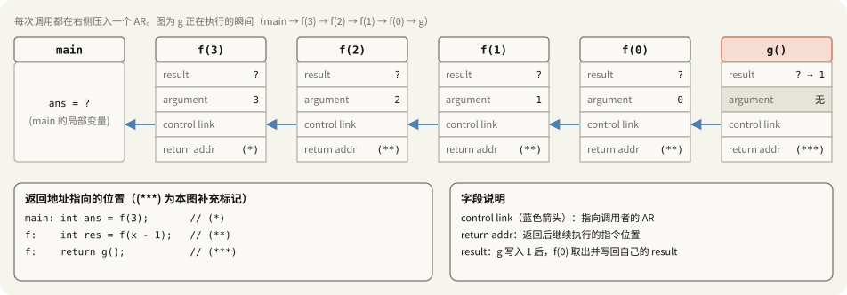

**读图**：越往右表示越晚压栈的 AR。顺着蓝色的 `control link` 箭头往左追溯，就能一路走回完整的调用链。只有 `f(3)` 的返回地址指向 `(*)`，其余递归调用的 `f` 全部指向 `(**)`。当 `g()` 把 `1` 写入自己的 `result` 并返回后，`f(0)` 取走这个值填进自己的 `result`，然后一层层往回传递到 `f(3)`。

> [!note] 补充：真实机器上的 AR 和这四格模型不同
> 这四格的排列和内容只是概念教学模型，例如把 `result` 放在最前面，是为了让调用方能用相对于自己栈帧的固定偏移直接拿到结果。在真实的 x86-64 Linux（System V ABI）下，前 6 个整型参数通过寄存器 `rdi`、`rsi`、`rdx`、`rcx`、`r8`、`r9` 传递，返回值放在 `rax` 里带回。反汇编第一部分 2.1 节的 `sum` 也能看到：参数 `n` 是从 `edi` 传进来的（`-O0` 下立即存进 `rbp-20`），返回值则由 `eax` 带出；内存栈帧里主要存放 `call` 自动压入的返回地址和保存的调用方 `rbp`，其中保存的 `rbp` 就起着控制链的作用。

---

## 四、处理全局变量和堆数据结构

### 1. 全局变量：为什么不能放进激活记录？

对同一个全局变量的所有引用，指向的都是同一个对象，因此不能把全局变量存放在某个函数的激活记录（AR）里。激活记录会随着函数调用创建、随着函数返回销毁，同一个函数被多次调用时还会产生好几份栈帧，全局唯一的数据显然不能跟它绑定。

编译期会给全局变量一次性分配好固定地址。这类拥有固定地址的变量称为“静态分配（statically allocated）”的变量。具体到不同语言，除了全局变量，还可能有其他静态分配的值，比如 C++ 里的 `static` 局部变量和字符串字面量。

### 2. 堆（Heap）：活得比函数更久的数据

如果一个值的生命周期超过了创建它的过程，它同样不能留在激活记录里。看下面这个 C++ 例子（对应幻灯片中的 `method foo() { new Bar }`）：

```cpp
Bar* foo() {
    return new Bar();
}
```


`foo` 返回后，它的激活记录就会被释放，但新创建的 `Bar` 对象必须在 `foo` 的激活记录销毁之后继续存在。凡是支持动态分配数据的语言，都会用堆（Heap）来存放这类动态数据。

### 3. 内存的四大分区与栈、堆的对向增长

把前面几类数据放在一起看，程序运行时的内存通常会划分为四个区域：
- 代码区（Code area）：存放目标代码。在很多语言里（幻灯片手写将“大多数”改成了“很多”），这块区域大小固定且只读。
- 静态区（Static area）：存放拥有固定地址的数据（不是代码），例如全局数据。这块区域大小固定，可以是可读或可写的。
- 栈（Stack）：为每个当前活跃的过程保存一个激活记录。每个激活记录通常大小固定，里面存放局部变量、参数和返回信息等。
- 堆（Heap）：存放其余所有数据。在 C 语言里，堆由 `malloc` 和 `free` 管理（C++ 中对应 `new` 和 `delete`）；在 Java 里，则是用 `new` 动态分配数据，之后由垃圾回收（Garbage Collection）自动回收。

运行过程中，堆和栈都会动态增长，因此必须防止它们长着长着撞到一起。标准的解法是把堆和栈分别放在可用内存空间的两端，让它们相向生长：

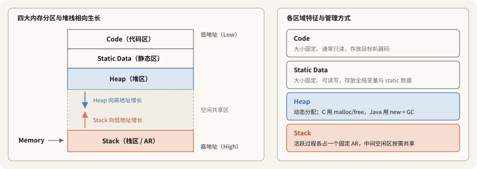

把两个会增长的区域摆在两头相向生长，中间那片空闲空间就能按需让给任意一方，只有当堆顶和栈顶真的碰到一起时才算耗尽，省去了提前把堆和栈各自上限切死的麻烦。

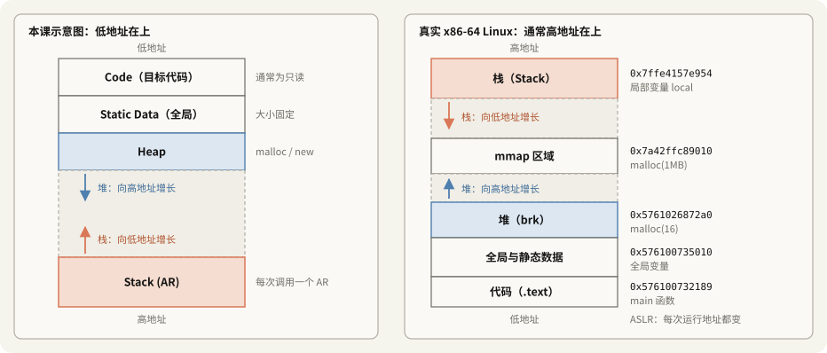

> [!note] 补充：在真实 Linux 进程里实测内存地址
> 在一个测试程序里把各区域变量的地址直接打印出来，从低到高的排列顺序与上面讲的完全一致（见上图右侧）：代码 < 全局数据 < 堆 < 局部变量。用 `readelf -l` 查看段权限时，代码段标记为可读可执行（`R E`），全局数据段为可读可写（`RW`）。和教材简化图不同的细节主要有三点：
> - 堆和栈中间还夹着一片 `mmap` 映射区，大块的 `malloc`（实测里分配 `1MB` 时就走这里）以及共享库都会放在这片区域。
> - 栈并不会真的涨到和堆撞上才停止。主线程栈大小受 `ulimit -s` 限制，这台机器上默认是 8MB（8192KB）；拿每次调用消耗约 1KB 栈帧的递归函数测试，用满大约 8MB 时就直接触发段错误（segmentation fault）结束了。新创建的线程也会各自拿到一块固定大小的独立栈。
> - 因为开启了 ASLR，每次运行各区域的起始地址都会重新随机分布，而且区域之间隔着巨大的地址空洞，正好印证了第一部分第 4 节说的“内存不必连续”。

---

## 五、对齐问题（Alignment）

### 1. 字长与寻址方式

大多数现代机器都是 32 位或 64 位的：
- 1 个字节（byte）有 8 个比特（bit）
- 1 个字（word）占 4 个字节（32 位机）或 8 个字节（64 位机）
- 机器要么按字节寻址（byte addressable），要么按字寻址（word addressable）

虽然现代主流处理器大多支持按字节寻址，但 CPU 底层读写内存总线时，仍然倾向于以字为单位对齐读取。

### 2. 什么是字对齐，为什么未对齐会变慢？

如果一份数据的起始地址正好落在字边界上（起始地址能被字长整除），就称它是字对齐的（word aligned）。

大多数机器都对对齐有要求，或者会在数据未对齐时带来明显的性能惩罚。访问未对齐的数据比访问对齐的数据要慢很多：一个 4 字节整数如果跨在两个字的边界上，CPU 可能要分两次读取内存再把结果拼起来；在一些要求更严格的硬件架构上，未对齐访问甚至会直接触发异常。

### 3. 具体例子：字符串的字节填充（Padding）

以 32 位机器（每字 4 字节）上存放字符串 `"Hello"` 为例：
- 字符串 `"Hello"`（不含末尾的 `\0` 结束符）占 5 个字节。
- 为了让后面的下一个字从字边界开始，需要在字符串后面加上 3 个“填充（padding）”字节，凑够 8 字节（2 个字）。
- 这些填充字节不是字符串的一部分，只是为了凑齐边界而留出来的未使用内存。

按 4 字节一字画出来，内存排布如下：

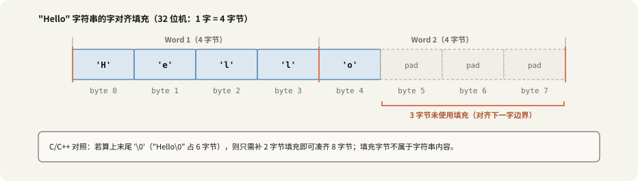

顺带提一句 C/C++ 里的常见情况：如果按 C 风格字符串算上末尾的 `'\0'`，`"Hello\0"` 一共占 6 个字节，那么只需要在后面补 2 个填充字节就能对齐到下一个 4 字节边界。不管补 3 字节还是 2 字节，原理是一样的：用少数几个闲置字节的空间开销，换取后面所有字段的对齐访问速度。

![对齐访问与未对齐访问。4 字节 int 从地址 4 开始时完整落在同一个字里，一次读取即可；从地址 6 开始则横跨两个字，需要读取两次再拼接。下方为 gcc 13.3 实测结构体布局：char c\[5\] 后接 int 时会填充 3 字节让 x 从 8 开始，总大小 12；后接 char 时无填充，总大小 6。](assets/11_02/rt-alignment.svg)

> [!note] 补充：填充大小由紧随其后的数据决定
> - `"Hello"` 这个例子采用的是“下一个数据固定从字边界开始”的简化模型。真正的 C/C++ 编译器只会按下一个成员自身的对齐要求（`alignof`）去补齐空白。就像上图下方实测的两个结构体：`char c[5]` 后面如果跟着 `int`（对齐要求 4），编译器就会在偏移 5 后面补 3 个填充字节，让 `x` 从偏移 8 开始，`sizeof` 为 12；如果后面跟着的只是另一个 `char`（对齐要求 1），就不需要任何填充，直接紧挨着放在偏移 5，`sizeof` 为 6。`char` 数组本身的对齐要求也是 1。
> - 现代 x86-64 硬件对普通的未对齐 load/store 已经能自动处理，主要损失落在跨缓存行或跨页边界时变慢；不过在 C/C++ 语言标准里，通过未对齐指针解引用依然属于未定义行为（UB）。把地址满足 `addr % 4 == 2` 的指针强转成 `int*` 并开启 UBSan（`-fsanitize=alignment`）运行时，编译器会直接报出 `load of misaligned address … which requires 4 byte alignment`；而像 SSE 的 `movaps` 这类强制对齐指令在遇到未对齐地址时仍会直接触发硬件异常。

---

## 六、栈式机器（Stack Machines）

### 1. 栈式机器的执行模型

在栈式机器（Stack Machine）中，唯一的存储就是栈，不再像寄存器机器那样显式分配一堆通用寄存器。

对于一条通用的运算指令 $r = F(a_1, \dots, a_n)$，它的执行固定分为三步：
1. 从栈顶弹出 $n$ 个操作数 $a_1, \dots, a_n$。
2. 用这些操作数计算运算 $F$。
3. 把计算结果 $r$ 重新压回栈顶。

### 2. 具体例子：用两条指令计算 `7 + 5`

先看两条最基本的指令：
- `push i`：把整数 `i` 压入栈顶。
- `add`：弹出栈顶的两个整数，相加后把结果压回栈顶。

用这两条指令写出计算 `7 + 5` 的程序：

```text
push 7
push 5
add
```

整个执行过程中栈的变化如下（`S` 表示执行这段表达式之前，栈里原本已经存放的内容）：

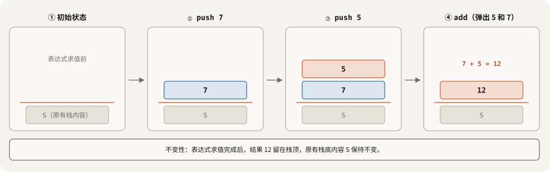

这里有一个栈式机器的关键性质（也是后续代码生成会直接依赖的不变性）：当计算一个表达式时，结果会留在栈顶，原本的内容 `S` 会被完整保留下来。哪怕表达式嵌套得很深，每算完一个子表达式，它对下方原有栈空间的影响也只是在栈顶多放了一个结果值。

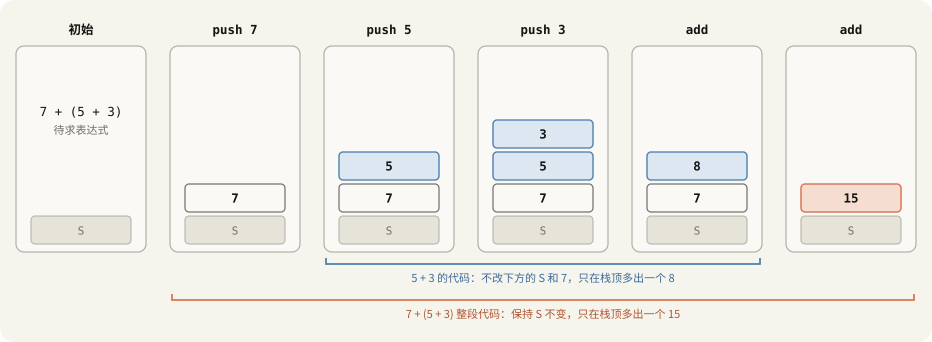

**读图**：蓝色括号括起来的三条指令（`push 5`、`push 3`、`add`）对应子表达式 `5 + 3`。这段代码执行前后，下方原有的 `S` 和 `7` 毫发无损，栈顶只是多了一个 `8`。放大到整条表达式（橙色括号）也是如此：执行结束后原有的 `S` 保持不变，栈顶只多了一个 `15`。

> [!note] 补充：正是这条不变性支撑了递归代码生成
> 加法表达式 `e1 + e2` 的目标代码可以直接拼接成“`e1` 的代码 + `e2` 的代码 + `add`”。因为任何子表达式都会守住一条约定，就是算完之后不破坏下面的旧栈内容、只在栈顶留下一个结果值，所以不管 `e1` 和 `e2` 各自嵌套了多少层，轮到最后的 `add` 执行时，栈顶刚好就躺着这两个子表达式算出来的值。在自己写的 Python 栈式机器模拟器上按这套规则生成并跑了 2000 个随机嵌套加法表达式，每一条表达式和每一层子表达式都严格满足这条不变性。

### 3. 栈式机器与寄存器机器的对比

栈式机器指令有一个很鲜明的特点：操作数和结果的位置都不需要在指令里显式写出来，因为它们永远默认在栈顶。

把它和寄存器机器（Register Machine）放在一起对比就能看出来：
- 寄存器机器必须在指令中写明操作数和结果所在的寄存器，例如 $\text{add } r_1, r_2, r_3$。
- 栈式机器只需要写一条 `add`，不需要带任何寄存器编号或地址。

因此，栈式机器生成出来的程序通常更加紧凑（指令短、代码体积小）。不过代价是所有运算都得先压栈再弹出，执行指令条数和访栈次数往往会比寄存器机器多；像 JVM 字节码、WebAssembly 这类追求体积紧凑的虚拟指令集常采用栈式结构，而物理 CPU 与高性能编译器后端则更倾向于寄存器架构。

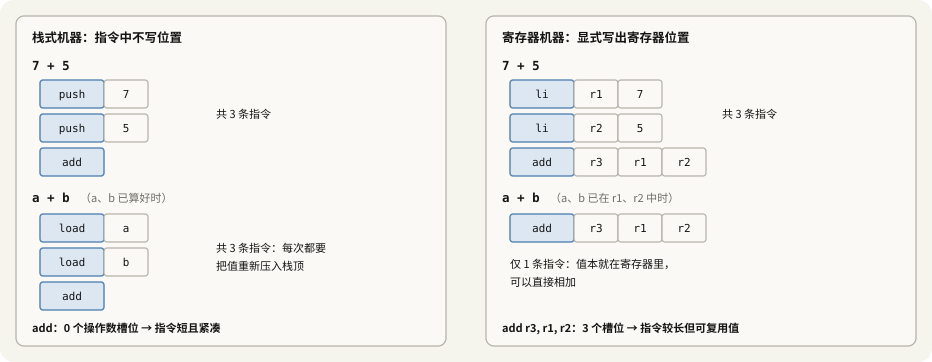

> [!note] 补充：栈式字节码在后端最终还是会走向寄存器
> 栈式格式主要是为了方便代码分发、压缩体积和静态校验。像 JVM HotSpot 的 C2 或 V8 的 TurboFan 这类即时优化编译器，并不会傻傻照着栈式字节码一条条压栈弹出，而是先把它转换成基于 SSA 的中间表示，再完成寄存器分配后放到物理寄存器上跑。反过来，Lua 5.0 之后的虚拟机和早期的 Android Dalvik 从一开始就设计成了基于寄存器的虚拟机，可见并非所有虚拟机都是栈式的。

---

## 七、补充内容汇总

| 位置 | 补充内容 | 核心要点 |
| --- | --- | --- |
| §一.2.2 | 图 `rt-sum-calls` | 栈帧压栈与回收的六个瞬间，回收只回退 SP 而不清零旧内存 |
| §一.2.3 | 图 `rt-static-dynamic`、补充 | 1 处声明对应 3 个动态实例；gcc `-O0` 下 `x` 在 `rbp-8`，帧间距 48 字节，`-O2` 下栈帧被优化消除 |
| §一.3 | 图 `rt-os-load`、补充 | 真实 ELF 入口是 `_start`，经由 `__libc_start_main` 初始化后才调用 `main` |
| §一.4 | 纠偏提示框 | 低地址画在上方或下方只是不同教材的绘图惯例 |
| §二.2 | 图 `rt-lifo`、补充 | 异常展开仍从内向外按 LIFO 析构，而 `call/cc` 会重返已返回的栈帧，需把帧放到堆上 |
| §二.3 | 图 `rt-scope-lifetime` | 作用域是源码编译期概念，生命周期是运行期时间区间 |
| §三.2 | 图 `rt-ar-chain`、补充 | 控制链与返回地址串联调用栈；真实 x86-64 ABI 使用寄存器传参和返回 |
| §四.3 | 图 `rt-layout-conventions`、补充 | 两种画法与实测进程地址，包含 `mmap` 区域、8MB 默认栈上限与 ASLR 空洞 |
| §五.3 | 图 `rt-alignment`、补充 | 结构体填充由下一成员的 `alignof` 决定；C/C++ 未对齐指针读取属未定义行为 |
| §六.2 | 图 `rt-stack-invariant`、补充 | 子表达式只在栈顶留一个结果值的不变性支撑了递归代码生成 |
| §六.3 | 图 `rt-stack-vs-register`、补充 | 0 操作数与 3 操作数指令对比；优化编译器会把栈式字节码转回 SSA 与寄存器分配 |

## 八、参考资料

- Alex Aiken, Stanford CS143 课程幻灯片 *Runtime Organization*（Lecture 11）
- *System V Application Binary Interface, AMD64 Architecture Processor Supplement*：参数寄存器与返回值调用约定
- Randal E. Bryant, David R. O'Hallaron, *Computer Systems: A Programmer's Perspective*（CS:APP）第 3 版，3.7 节（过程）与 9.7 节（Linux 虚拟内存）
- Remzi H. Arpaci-Dusseau, Andrea C. Arpaci-Dusseau, *Operating Systems: Three Easy Pieces*（OSTEP）第 13 章（地址空间）
- glibc `sysdeps/x86_64/start.S`：`_start` 调用 `__libc_start_main` 的启动代码
- Roberto Ierusalimschy, Luiz Henrique de Figueiredo, Waldemar Celes, *"The Implementation of Lua 5.0"* (2005)：Lua 转向基于寄存器虚拟机的设计原因
