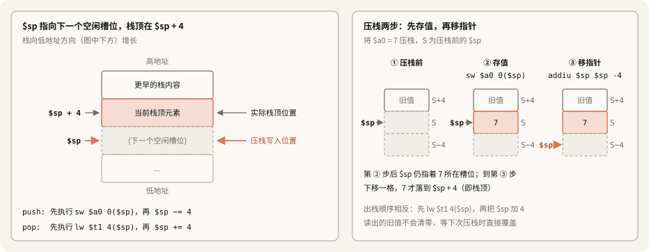
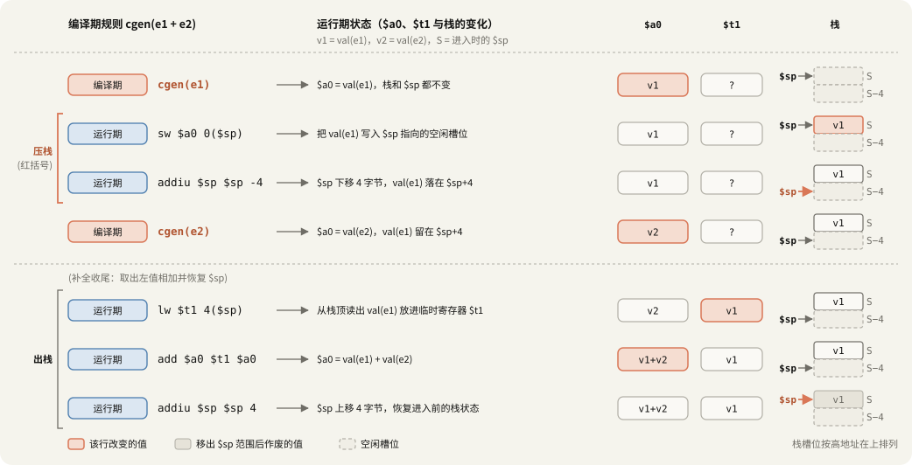
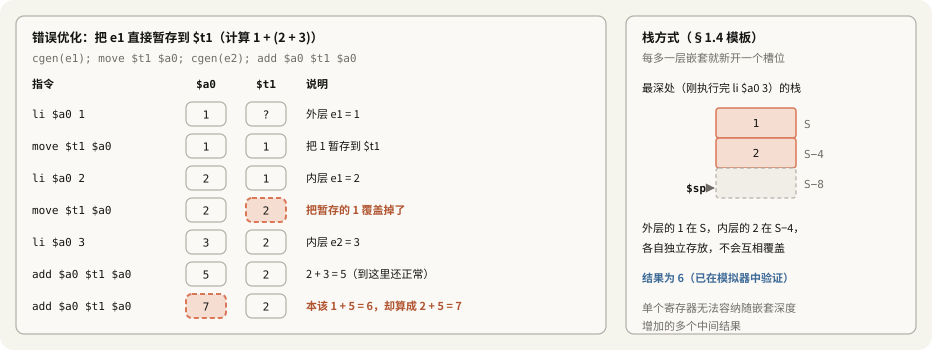
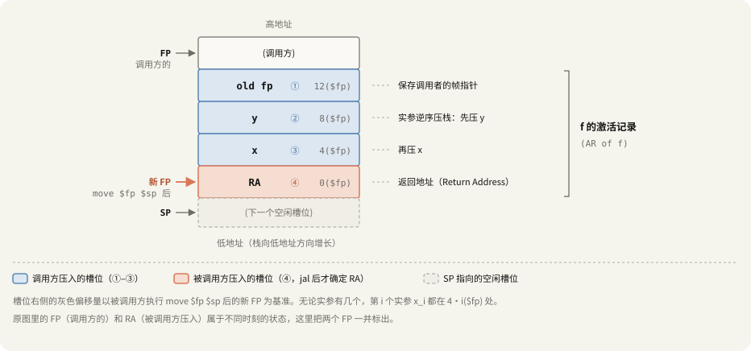
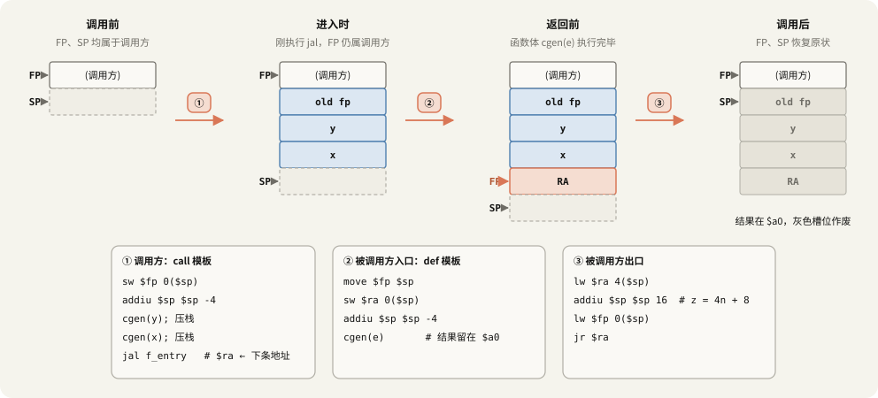
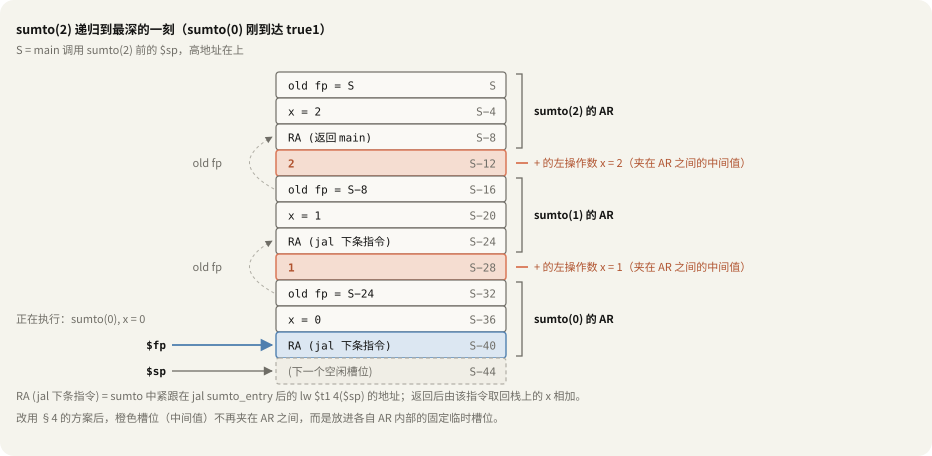
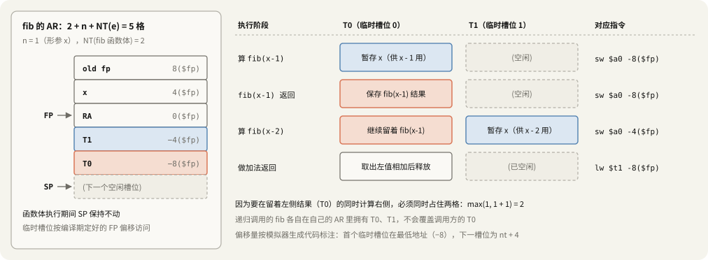
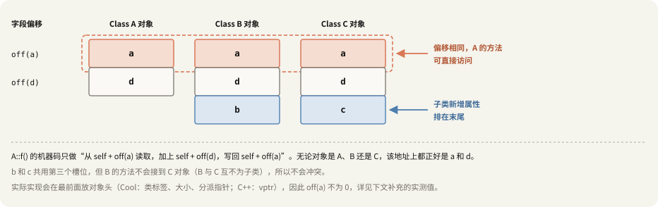
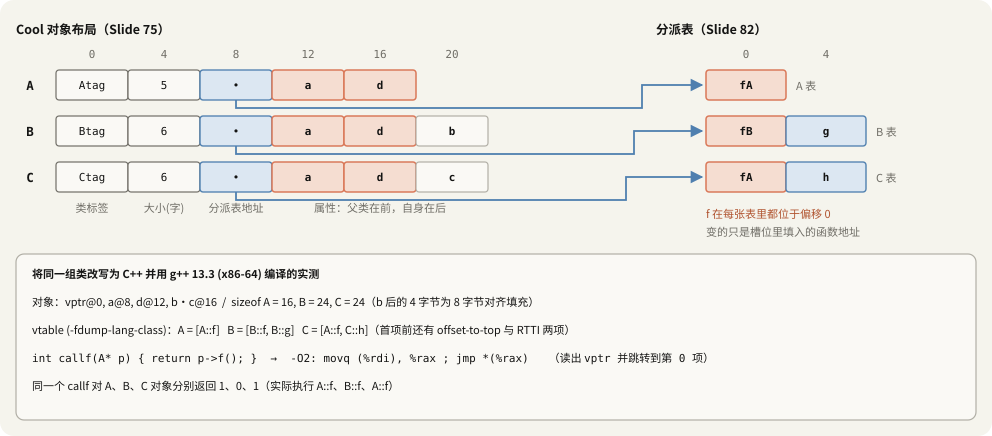

# 代码生成策略

> [!info] 阅读说明
> - 主干内容保留原笔记结构，并将原先的 5 幅 ASCII 图替换为对应的中文 SVG 图示（`assets/11_03/cg-*.svg`），同时合入配套韩文扩展版（`11_02_codegen.md`）新增的 4 幅图示、**读图**说明、`补充` 与 `纠偏` 提示框，以及文末 §6 汇总表。
> - 本篇所有栈图统一按 CS143 幻灯片习惯把高地址画在上方。原 §1.1 的 ASCII 图是低地址在上，为了与 §1.4“`$sp` 下移 4 字节”及 §2.2 的 AR 图保持方向一致，这里统一翻成了高地址在上。
> - 这是接续前一篇 [11_02.md](11_02.md) 第六部分的内容，讨论如何把带累加器的栈机器落实到 MIPS 上。文中标注的幻灯片编号以 Richmond CS331 镜像版 `lecture12.pdf` 为准。
> - 补充框里的验证数据摘译自 `11_02_codegen.md`：包含一个按讲义模板生成代码的 Python 生成器、只实现本文 11 条指令（`li lw sw addiu add sub move beq b jal jr`）的 MIPS 模拟器（对 `sumto(0..7)`、`fib(1..15)` 及 2,000 个随机三函数程序做了栈推拉与临时槽位双版本核对），以及在 Ubuntu 24.04 x86-64 上用 `gcc/g++ 13.3` 实测的对象布局、vtable 与 `push`/`call` 行为。

## 一、代码生成器

### 1. 目标机器：带累加器的栈机器

代码生成器产生的代码，重点落在带累加器的栈机器（stack machine with accumulator）上。为了让结果能在真实硬件上跑起来（比如 MIPS 处理器或 SPIM 模拟器），我们用 MIPS 指令和寄存器来模拟这套栈机器。

MIPS 是典型的精简指令集计算机（RISC），大多数运算指令直接操作寄存器，读写内存则统一走 `load` 和 `store` 指令。它有 32 个 32 位通用寄存器，我们这套模型只用到其中三个：

- `$a0` 充当累加器，保存当前表达式算出来的值
- `$sp` 保存栈在内存中的下一个空闲槽位地址
- `$t1` 是临时寄存器，用来暂存从栈里取出的左操作数

按 MIPS 的标准约定，栈保存在内存中并向低地址方向增长。正因为 `$sp` 指着下一个还没写入数据的位置，当前真正的栈顶元素反而在 `$sp + 4` 处：



**读图**：左边是把原来的 ASCII 图翻成高地址在上，槽位顺序和指针指向都没有变。右边展示了把 `$a0 = 7` 压栈的两个步骤：因为先存值（②），7 写进了 `$sp` 原来指着的空闲槽位；直到移指针（③）把 `$sp` 减 4 后，7 才落在 `$sp + 4` 成为新的栈顶。要是颠倒顺序先减 `$sp`，7 就会写进 `S - 4` 且 `$sp` 仍指着它，“栈顶在 `$sp + 4`”的约定就破了。

这么定偏移量写起来很直接：压栈就是先把 `$a0` 存进 `0($sp)`，再把 `$sp` 减 4；出栈则是从 `4($sp)` 读回数据，再把 `$sp` 加 4。其余指令细节可查阅 SPIM 文档。

> [!note] 补充：“下一个空闲槽位”是本课的约定
> - 幻灯片第 5 页把 `$sp` 定义为“下一次压栈将要写入的未分配槽位地址”。栈向低地址增长是 MIPS 的标准约定，但让 `$sp` 指着空槽位而不是已用槽位，是这门课自己定下的简化规则。
> - 真实的 MIPS 编译器通常在函数入口用一条 `addiu $sp, $sp, -N` 一次性划出整块栈帧，然后用正偏移（如 `sw $ra, N-4($sp)`）往里写，此时 `$sp` 指着已分配区域最底端的那个字。x86-64 的 `push` 也是先减后写：在 Ubuntu x86-64 上实测 `pushq $42`，会先让 `rsp` 减 8，再把 42 写到 `[rsp]` 处。
> - 这里一开始只用了三个寄存器，到了 §2 还会加入 `$fp`（帧指针）和 `$ra`（返回地址）。另外按 MIPS 标准调用约定，`$a0` 原本是第 1 个参数寄存器，这门课把它借来当累加器，幻灯片第 5 页也提到“用其他寄存器也可以”。

### 2. 整数语言文法与入口约定

先把类型系统、对象这些包袱放一边，用一个只支持整数和整型运算的小语言来看代码生成。它的上下文无关文法如下：

$$
\begin{aligned}
P &\to D;\ P \mid D \\
D &\to \text{def } \mathrm{id}(\mathrm{ARGS}) = E; \\
\mathrm{ARGS} &\to \mathrm{id},\ \mathrm{ARGS} \mid \mathrm{id} \\
E &\to \mathrm{int} \mid \mathrm{id} \mid \text{if } E_1 = E_2 \text{ then } E_3 \text{ else } E_4 \\
  &\quad \mid E_1 + E_2 \mid E_1 - E_2 \mid \mathrm{id}(E_1, \dots, E_n)
\end{aligned}
$$

语言约定第一个定义的函数作为程序入口，相当于 C/C++ 里的 `main` 例程。把课件里的斐波那契示例换成 C++ 写法（保留原图重点标出的两处递归调用）：

```cpp
// 约定第一个定义的函数 f 为程序入口（相当于 main 例程）
int fib(int x) {
    if (x == 1) return 0;
    if (x == 2) return 1;
    return fib(x - 1) + fib(x - 2);
    //     ^^^^^^^^^^   ^^^^^^^^^^
    //     原图重点标注：算完左边的 fib(x - 1) 后得先压栈保存，再算右边的 fib(x - 2)
}
```

### 3. `cgen(e)` 不变性与常量生成

定义代码生成函数 $\mathrm{cgen}(e)$，它的输出就是表达式 $e$ 对应的 MIPS 目标代码。为了能让任意深度的嵌套表达式安全拼接，每条 $\mathrm{cgen}(e)$ 必须守住两条规约：

1. 执行完生成的代码后，表达式 $e$ 的结果留在 `$a0` 中。
2. `$sp` 和栈上原本存着的所有内容都保持原样。

求值整数常量 $i$ 最简单，直接把常量装进累加器就行，栈完全不用动：

$$
\mathrm{cgen}(i) = \texttt{li \$a0 } i
$$

这里要注意课件的配色约定（红字表示编译期，蓝字表示运行期）：左边的 $\mathrm{cgen}(i)$ 是编译器在编译期调用的生成规则，右边的 `li $a0 i` 才是写进输出文件、等程序跑起来后由 MIPS 硬件在运行期执行的指令。

### 4. 加法表达式 `cgen(e1 + e2)`

按前面的规约，生成 $e_1 + e_2$ 的代码时立刻会碰到一个冲突：$\mathrm{cgen}(e_1)$ 把结果放进了 `$a0`，紧接着跑 $\mathrm{cgen}(e_2)$ 时也会把结果放进 `$a0`，前一个值会被直接覆盖。因此在算 $e_2$ 之前，必须先把 `$a0` 压到栈里保存。

课件截图停在 $\mathrm{cgen}(e_2)$ 这一步，给出的前半段生成规则如下（原图用红括号把中间两条运行期指令括成一组压栈动作）：

$$
\begin{aligned}
\mathrm{cgen}(e_1 + e_2) ={} & \mathrm{cgen}(e_1) \qquad && \text{[编译期]} \\
& \left[\begin{array}{l}
  \texttt{sw \$a0 0(\$sp)} \\
  \texttt{addiu \$sp \$sp -4}
\end{array}\right. \qquad && \text{[运行期：压栈保存 } e_1 \text{ 结果]} \\
& \mathrm{cgen}(e_2) \qquad && \text{[编译期]}
\end{aligned}
$$

走到 $\mathrm{cgen}(e_2)$ 结束时，`$a0` 里放着 $e_2$ 的值，而 $e_1$ 的值就待在当前栈顶 `4($sp)`。要把加法算完并恢复 `$sp` 满足规约，后面还要把 `4($sp)` 读进临时寄存器 `$t1`，相加写回 `$a0`，再把 `$sp` 加 4 弹栈。把编译期展开和运行期栈状态串起来看：



**读图**：橙色标签行是编译器递归展开的位置，蓝色标签行是直接输出的运行期指令，和原课件的红蓝配色一致。右侧三列是执行完该行后的状态，橙色高亮格表示这一行改过的值。`cgen(e2)` 把 `$a0` 写成 `v2` 时，`v1` 依然安稳待在栈槽位 `S` 里；最后一行结束后 `S` 里其实还留着 `v1`，但 `$sp` 已经指回 `S`，逻辑上它就是下一个会被覆盖的空槽位。

最后三条指令执行完，`$a0` 拿到了 $e_1 + e_2$ 的结果，`$sp` 和栈底旧内容也完全恢复，整条加法表达式依然符合 $\mathrm{cgen}$ 的规约。



> [!note] 补充：为什么不直接把 `e1` 放进 `$t1`，而要走栈？
> 幻灯片 16–18 先试了一个看似省事的优化：“直接 `move $t1 $a0` 把 `e1` 留在 `$t1`，不就省掉压栈和出栈了吗？”紧接着就用嵌套加法给出了反例。上图算 `1 + (2 + 3)` 时，内层加法一动 `$t1` 就把外层的 `1` 覆盖成 `2`，最终算出 `7` 而不是 `6`；同样算 `3 + (7 + 5)` 会得出 `19` 而不是 `15`。表达式嵌套越深，同时存活的中间值越多，单个寄存器装不下，所以才需要能随深度扩展的栈。到 §4 我们还会发现，其实在编译期就能算出每层最多需要几个槽位。
>
> 顺便留意 `addiu` 里的 `u`：虽然它代表 unsigned，但立即数 `-4` 照样做符号扩展，所以 `addiu $sp $sp -4` 能正确减 4。这里的 `u` 只意味着“不触发有符号溢出异常”（幻灯片第 7 页），相对地 `add` 和 `sub` 在有符号溢出时会触发异常。

## 二、函数定义

上面已经完成了表达式层面的变量引用和函数调用，对应文法里标出的两类表达式，接下来处理函数定义以及调用双方的配合：

$$
E \to \mathrm{int} \mid \underline{\mathrm{id}} \mid \text{if } E_1 = E_2 \text{ then } E_3 \text{ else } E_4 \mid E_1 + E_2 \mid E_1 - E_2 \mid \underline{\mathrm{id}(E_1, \dots, E_n)}
$$

> [!warning] 纠偏：下划线标出的两个表达式是“接下来”才要处理的
> 前面真正给出生成规则的其实只有整数常量和加法（减法和 `if` 也走同一套思路）。文法里画了下划线的变量引用 `id` 和函数调用 `id(E1, ..., En)`，才是接下来要处理的两个式子。因为两者都要依赖激活记录（AR）的布局，讲义先定下 AR 结构，再依次给出函数调用、函数定义和变量引用的代码模板；幻灯片第 34 页也明确写着“变量引用是最后一个拼图”。
>
> 减法只需把加法模板里的 `add` 换成 `sub $a0 $t1 $a0`（计算 `$t1 - $a0` 即 `e1 - e2`）。`if` 表达式的模板如下（幻灯片第 22 页），§3 的 `sumto` 里的 `beq`、`true1`、`false1`、`endif1` 就是套这个模板出来的：
>
> ```text
> cgen(if e1 = e2 then e3 else e4) =
>     cgen(e1)
>     sw    $a0 0($sp)
>     addiu $sp $sp -4
>     cgen(e2)
>     lw    $t1 4($sp)
>     addiu $sp $sp 4
>     beq   $a0 $t1 true_branch
> false_branch:
>     cgen(e4)
>     b     end_if
> true_branch:
>     cgen(e3)
> end_if:
> ```

### 1. 极简激活记录（AR）的取舍

函数调用和函数定义生成什么样的代码，取决于激活记录（AR）怎么排布。好在这个整数小语言足够简单，AR 可以比通用模型精简不少：

| AR 组成部分 | 在本语言中的处理 | 原因 |
| --- | --- | --- |
| 返回值（Result） | 不存入 AR | 结果永远留在累加器 `$a0` 中 |
| 实参（Actual parameters） | 存入 AR，按 `x_n, ..., x_1` 逆序压栈 | 本语言没有其他局部变量，形参就是全部变量 |
| 控制链（Control link） | 不需要 | 栈规约保证退出时 `$sp` 与进入时完全一致 |
| 返回地址（RA）与当前帧指针（`$fp`） | 需要保留 | 分别用于跳回调用点、定位当前 AR 中的参数 |

也就是说，对这门语言而言，一份 AR 里放进调用方的帧指针、实参和返回地址就够了。

> [!note] 补充：`old fp` 在内容上就是控制链
> `old fp` 存的值指向调用方的 AR，单看指针内容它和通用模型里的控制链是一回事。幻灯片第 24 页之所以说“不需要控制链”，有两层原因：退出时 `$sp` 仅靠栈规约就能自动回到进入前的位置；同时语言里没有嵌套作用域的非局部变量，运行期不用沿着链表往外层 AR 找变量。之所以还要保存 `old fp`，是因为被调用方会把 `$fp` 寄存器改写为自己的 AR（幻灯片第 26 页）；等返回后，调用方还得继续靠 `4($fp)` 读取自己的参数，必须把原来的 `$fp` 恢复回来。这和 x86-64 上 `push rbp` 保存上一帧基址指针是同一件事（见 [11_02.md](11_02.md) 第三部分补充）。

### 2. `f(x, y)` 的 AR 布局与逆序压栈

以调用 `f(x, y)` 为例，对应的 C++ 形式和压栈顺序如下：

```cpp
int f(int x, int y) {
    return x + y;
}

int main() {
    int res = f(x, y);
    //          ^  ^
    //          原图重点标注：按逆序压栈，先压入 y，再压入 x
    return 0;
}
```

结合图里的 `FP`、`SP` 和手写的 `RA`（返回地址）标注，调用 `f(x, y)` 时栈上的 AR 布局如下：



**读图**：蓝色槽位 ①–③ 由调用方压入，橙色槽位 ④ 由被调用方压入。原图左侧标出的 `FP` 还是刚跳进函数时调用方的旧指针，而 `RA` 是被调用方执行前几条指令后才压进去的，两者其实不是同一时刻的画面；因此图里把被调用方执行完 `move $fp $sp` 后的**新 FP** 一并画了出来，它直接指向 `RA` 槽位（幻灯片第 35 页：“帧指针永远指向栈上的返回地址”）。槽位右侧的灰色偏移量就是以这个新 FP 为基准的，后面 §3 里的 `4($fp)` 取 `x`、`0($fp)` 存 `RA` 就是这么算出来的。

把参数按 `x_n, ..., x_1` 从右往左压栈，第一个参数 `x` 会落在靠近栈底的位置，无论函数有几个参数，开头几个实参相对于当前激活记录底部的偏移都是固定的。

> [!warning] 纠偏：`x` 靠近的是栈“顶”，而不是栈“底”
> 按栈的术语，栈底（bottom）是栈开始生长的那一端（高地址），栈顶（top）才是最近一次压入的那一端（低地址）。最后压进去的 `x` 和 `RA` 靠近的是栈顶，前一句说的“底部”只是指图纸的下方。幻灯片第 31 页也特意强调：“帧指针指向栈帧的顶部，而不是底部。”`FP` 指着的 `RA` 槽位正是这份 AR 的栈顶。

> [!note] 补充：变量引用规则与逆序压栈的用意
> 最后一个没展开的表达式 `id` 只需要一条指令（幻灯片第 35 页）：对第 $i$ 个形参 $x_i$，有 $\mathrm{cgen}(x_i) = \texttt{lw \$a0 } z\texttt{(\$fp)}$，其中 $z = 4i$ 在编译期就已经算死。
> - 正因为实参是逆序压栈的，$x_1$ 永远在 `4($fp)`、$x_2$ 永远在 `8($fp)`，不管这个函数总共有几个参数，前面几个参数的偏移都不会变。
> - 不用 `$sp` 而改用 `$fp` 当基准，是因为求值过程中每次把中间结果压栈都会移动 `$sp`，导致参数到 `$sp` 的距离一直在变（幻灯片第 34 页）。
> - C 语言的 `cdecl` 调用约定同样从右往左压参，道理一致：哪怕是 `printf(fmt, ...)` 这种每次传参个数不固定的变参函数，也能在固定偏移处稳定找到第一个参数 `fmt`。

### 3. 调用序列与 `jal` 指令

为了让上面的 AR 真正搭起来并顺利跳过去执行，调用方（caller）和被调用方（callee）需要配合执行一段指令，这就是**调用序列**（calling sequence）。

MIPS 里专门用一条新指令完成跳转和记录返回地址：

```text
jal label
```

它的动作分两步：跳转到 `label` 处的函数入口，同时把下一条指令的地址存入寄存器 `$ra`。

这点和 x86 等架构不太一样。其他架构上的 `call` 指令会顺手把返回地址直接压进内存栈里，而 MIPS 的 `jal` 只把它放进 `$ra` 寄存器。如果 `f` 内部还会再调用别的函数（比如前面的 `fib(x - 1)`），不把 `$ra` 转存到栈上的 `RA` 位置，下一次 `jal` 就会把外层的返回地址冲掉。



**读图**：这里拆出了幻灯片第 33 页的四个瞬间。① 调用方压入 `old fp`、`y`、`x` 并用 `jal` 跳进来，此时 `FP` 还是调用方的；② 被调用方先用 `move $fp $sp` 把 `FP` 对齐到当前空槽位，然后把 `$ra` 存进去；③ 函数体跑完后读回 `RA`，一条 `addiu $sp $sp 16` 一次性弹掉 `z = 4n + 8 = 16` 字节（2 个参数 + RA + old fp），接着 `lw $fp 0($sp)` 恢复调用方的 `FP` 并执行 `jr $ra` 返回。调用结束后 `FP` 和 `SP` 都回到原点，只把返回值留在了 `$a0` 里，说明一次函数调用整体上也遵守了 `cgen` 规约。

> [!warning] 纠偏：把返回地址直接压栈反而是少数派
> 正文沿用了幻灯片第 28 页的说法（“其他架构的 `call` 指令把返回地址压栈”），但那主要是 x86 系列的做法。ARM 的 `BL` 把返回地址存进链接寄存器（LR，AArch64 中是 X30），RISC-V 的 `jal` 存进 `ra` 寄存器，绝大多数 RISC 架构都跟 MIPS 一样放寄存器里。这样做的好处是，不再调用别的函数的叶子函数（leaf function）可以省掉把返回地址存栈的开销；课程模板为了统一简洁，所有函数一律保存了 `$ra`。
> - 在 Ubuntu x86-64 上实测，C 函数里 `__builtin_return_address(0)` 的值正好等于保存好的 `rbp + 8`，印证了 x86 `call` 会把返回地址直接压在 `push rbp` 之前。
> - 真实的 MIPS 硬件带有分支延迟槽（branch delay slot），`jal` 放进 `$ra` 的其实是再下一条指令的地址（`jal` 地址 + 8）。SPIM 在关闭延迟槽模拟时，才会像讲义描述的那样回到紧邻的下一条指令。

> [!note] 补充：调用方与定义方的完整生成模板（幻灯片 29、31）
> ```text
> cgen(f(e1, ..., en)) =          # 调用方
>     sw    $fp 0($sp)            # 保存 old fp
>     addiu $sp $sp -4
>     cgen(en)                    # 从最后一个实参开始逆序求值并压栈
>     sw    $a0 0($sp)
>     addiu $sp $sp -4
>     ...
>     cgen(e1)
>     sw    $a0 0($sp)
>     addiu $sp $sp -4
>     jal   f_entry               # 到这里一共压了 4n + 4 字节
>
> cgen(def f(x1, ..., xn) = e) =  # 被调用方
> f_entry:
>     move  $fp $sp               # FP 对齐到即将存放 RA 的槽位
>     sw    $ra 0($sp)
>     addiu $sp $sp -4
>     cgen(e)                     # 结果留在 $a0，$sp 在这行前后保持一致
>     lw    $ra 4($sp)
>     addiu $sp $sp z             # z = 4n + 8：RA + n 个实参 + old fp
>     lw    $fp 0($sp)
>     jr    $ra
> ```
> 之所以由被调用方来保存 `$ra`，是因为只有执行完 `jal` 之后 `$ra` 才算真正生成（幻灯片第 32 页）。出口处 `lw $ra 4($sp)` 能精准取回 `RA`，靠的正是 `cgen(e)` 遵守规约把 `$sp` 还原回了刚进函数体时的位置。

## 三、最小实例

用带条件判断和递归的累加函数 `sumto` 走一遍完整的代码生成，C++ 写法如下（保留原图下划线标出的几个关键子表达式）：

```cpp
int sumto(int x) {
    if (x == 0) return 0;
    else return x + sumto(x - 1);
    //          ^   ^^^^^^^^^^^^
    //   条件 x == 0、真分支 0、假分支左值 x、假分支递归调用 sumto(x - 1)
}
```

对照上一节定好的 AR 布局，手写推导出的 MIPS 入口与判断部分代码如下（原图在进入 `false1` 后写到 `s...` 处截断）：

```text
sumto_entry:
    move  $fp $sp          # 设置当前帧指针（caller 刚压完 x，所以 x 在 4($fp)）
    sw    $ra 0($sp)       # 把返回地址 RA 存进 0($fp)
    addiu $sp $sp -4       # $sp 下移，指向下一个空闲槽位

    lw    $a0 4($fp)       # 读出参数 x 到 $a0
    sw    $a0 0($sp)       # 压栈保存左值 x，准备和 0 比较
    addiu $sp $sp -4
    li    $a0 0            # 把右值 0 装进 $a0
    lw    $t1 4($sp)       # 弹出左值 x 到临时寄存器 $t1
    addiu $sp $sp 4
    beq   $a0 $t1 true1    # 若 0 == x，跳转到 true1 分支

false1:                    # else 分支：计算 x + sumto(x - 1)
    lw    $a0 4($fp)       # 先把 x 读入 $a0
    s...                   # 原图在此截断，接下来是 sw $a0 0($sp) 压栈保存 x，再去算 sumto(x - 1)
```

这段指令把前面的规约全串起来了：因为 caller 压栈顺序是 `old fp`、`x`，所以 callee 刚进函数执行 `move $fp $sp` 时，参数 `x` 正好落在 `4($fp)`，而接下来压入的返回地址 `RA` 刚好占住 `0($fp)`。



**读图**：这是模拟器跑 `sumto(2)` 时，最内层 `sumto(0)` 刚抵达 `true1` 那一刻的内存快照。每层调用的 AR 占 `old fp`、`x`、`RA` 三格，夹在两层 AR 中间的橙色格子 `2` 和 `1`，正是 `x + sumto(x - 1)` 压栈暂存的左操作数 `x`，在递归调用返回前一直待在那里等待相加。顺着左侧的 `old fp` 弧线，每次返回都会把 `FP` 抬回上一层的 `RA` 槽位。

> [!note]- 补充：`s...` 后面的完整 MIPS 代码（幻灯片 41）
> 按讲义模板生成的 `false1` 到结尾完整代码如下（在 `11_02_codegen.md` 的验证中，输出与幻灯片 41 逐 token 一致，模拟器跑 `sumto(0..7)` 依次得到 `0, 1, 3, ..., 28`，结束时 `$sp` 和 `$fp` 均恢复原值）：
>
> ```text
> false1:
>     lw    $a0 4($fp)        # x
>     sw    $a0 0($sp)        # (原图截断处) 压栈保存 + 号左边的 x
>     addiu $sp $sp -4
>     sw    $fp 0($sp)        # 准备递归调用：压入 old fp
>     addiu $sp $sp -4
>     lw    $a0 4($fp)        # 计算实参 x - 1：先取 x
>     sw    $a0 0($sp)        #   压栈保存 - 号左边的 x
>     addiu $sp $sp -4
>     li    $a0 1
>     lw    $t1 4($sp)
>     sub   $a0 $t1 $a0       #   得到 x - 1
>     addiu $sp $sp 4
>     sw    $a0 0($sp)        # 压入实参 x - 1
>     addiu $sp $sp -4
>     jal   sumto_entry       # 递归调用，结果放在 $a0
>     lw    $t1 4($sp)        # 取出一直等在栈上的左操作数 x
>     add   $a0 $t1 $a0       # 计算 x + sumto(x - 1)
>     addiu $sp $sp 4
>     b     endif1
> true1:
>     li    $a0 0             # x == 0 时返回 0
> endif1:
>     lw    $ra 4($sp)        # 函数定义模板收尾
>     addiu $sp $sp 12        # z = 4·1 + 8
>     lw    $fp 0($sp)
>     jr    $ra
> ```
> 正如幻灯片第 43 页吐槽的那样，直接拼模板的执行效率很低——刚把 `x` 从栈帧读进 `$a0` 就立刻又压回栈里，后面还要再弹出来，全是机械拼接带来的冗余访存。

## 四、临时变量（Temporaries）

前面的 `sumto` 和加法模板每次都要靠 `addiu $sp $sp -4` 和 `+4` 在运行时来回挪动栈顶。换个思路：把临时值（temporaries）也直接放进 AR 里，由代码生成器在编译期为每个临时值在 AR 中分配一个**固定位置**（fixed location），算表达式时就不用反复推拉 `$sp` 了。

以斐波那契函数为例，原图用蓝笔标出了每一处表达式计算所需的临时槽位数：

```cpp
// 整个函数体共需 2 个临时槽位（2 temporaries）
int fib(int x) {
    if (x == 1) return 0;            // 比较 x == 1：需 1 个临时槽位（暂存 x）
    if (x == 2) return 1;            // 比较 x == 2：需 1 个临时槽位（复用前面的即可）
    return fib(x - 1) + fib(x - 2);
    //         ^^^^^  ^     ^^^^^
    //         需 1 个│     需 1 个（此时 fib(x-1) 结果还占着第 1 个，共需 2 个）
    //                └─ 需 1 个临时槽位保存 fib(x - 1) 的结果
}
```

记 $\mathrm{NT}(e)$ 为求值表达式 $e$ 所需的临时槽位数量。算加法 $e_1 + e_2$ 时满足两条规则：

- 需要的槽位数至少等于 $\mathrm{NT}(e_1)$，先算左半边时得装得下。
- 需要的槽位数至少等于 $\mathrm{NT}(e_2) + 1$，因为 $e_1$ 算完后结果要占住 1 个槽位，留给 $e_2$ 用的还剩 $\mathrm{NT}(e_2)$ 个。

算 $e_1$ 时用过的临时槽位，在 $e_1$ 求值结束后可以腾出来给 $e_2$ 复用，所以最终需求是两者取大：

$$
\mathrm{NT}(e_1 + e_2) = \max\big(\mathrm{NT}(e_1),\ \mathrm{NT}(e_2) + 1\big)
$$

套回上面的 `fib`：算 `fib(x - 1)` 时里头的 `x - 1` 需要 1 个槽位，算完后这个返回值自己占 1 个槽位，再去算 `fib(x - 2)` 里的 `x - 2` 又需要 1 个槽位，结果就是 $\max(1, 1 + 1) = 2$。槽位随时间复用的情况如下：



**读图**：右边表格前三列对应原来的复用时间线，最后一列补上了实际操作该槽位的指令。左边则标出了这些槽位在 AR 里的具体位置：两个临时槽位接在 `RA` 下方，整块 AR 一共占 $2 + n + \mathrm{NT}(e) = 5$ 格（幻灯片第 56 页），函数入口直接把 `$sp` 一次拉到底。执行函数体期间 `$sp` 纹丝不动，临时槽位全部通过编译期算好的 `-8($fp)`、`-4($fp)` 固定偏移来读写。

> [!note] 补充：改写后的模板与省下的指令数
> 代码生成函数多传一个参数 `nt`，表示“下一个可用临时槽位相对于 `$fp` 的偏移”（幻灯片 58–60）：
>
> ```text
> cgen(e1 + e2, nt) =
>     cgen(e1, nt)
>     sw    $a0 nt($fp)       # 用固定槽位取代 push
>     cgen(e2, nt + 4)        # e2 从下一个槽位开始用
>     lw    $t1 nt($fp)
>     add   $a0 $t1 $a0       # 不再需要 pop
> ```
>
> - 按幻灯片第 57 页的布局，Temp 1 位于最低地址处，所以函数体从 `nt = -4·NT(e)` 起步、每次加 4 向上递增；在 `fib` 中就是 `T0 = -8($fp)`、`T1 = -4($fp)`。入口处用 `addiu $sp $sp -(4 + 4·NT(e))` 一次性留出 `RA` 和全部临时槽位，出口弹出 `z = 4n + 8 + 4·NT(e)` 字节。
> - 函数调用的临时槽位需求只需 $\mathrm{NT}(f(e_1, \dots, e_n)) = \max(\mathrm{NT}(e_1), \dots, \mathrm{NT}(e_n))$，因为算好的实参直接压进新调用方的 AR 里，不占当前 AR 的临时槽位（幻灯片第 52 页）。`if` 语句则是 $\max(\mathrm{NT}(e_1), 1 + \mathrm{NT}(e_2), \mathrm{NT}(e_3), \mathrm{NT}(e_4))$。由于每个节点的 `NT` 只取决于子节点，从下往上遍历一遍 AST 就能算完。
> - 在 `11_02_codegen.md` 的模拟器对比测试中，换用这套模板跑 `fib(15)`，总执行指令数从 43,841 条降到 35,777 条（减少了 18%），专门用来挪动 `$sp` 的指令从 12,940 条降到 4,876 条，`fib` 函数生成的代码也从 54 行缩到 44 行。剩下的 `$sp` 移动只出现在调用前把 `old fp` 和实参压进新 AR 的阶段。工业级编译器会在此基础上更进一步，把临时值优先放进物理寄存器，寄存器不够用时才溢出（spill）到 AR 槽位里（幻灯片 39、44）。

## 五、面向对象代码生成（协同代码生成）

面向对象语言的实现可以拆成两块：前面讲过的基础代码生成，再加上处理对象与继承的机制（`OO implementation = Basic code generation + More stuff`）。

面向对象有一个最核心的替换原则：如果 `B` 是 `A` 的子类，那么任何期待 `A` 类对象的地方，都可以直接放一个 `B` 类对象进去。这意味着为 `A` 类编译好的方法代码，不需要做任何修改就能直接作用在 `B` 类对象上。要让这件事成立，代码生成器得解决两个问题：

1. 对象在内存里怎么表示？
2. 动态分派（dynamic dispatch）怎么实现？

先看第一个问题。把课件里的 `A`、`B`、`C` 三个类改写成 C++（保留原图的两条关键标注）：

```cpp
class A {
public:
    int a = 0;
    int d = 1;
    virtual int f() { return a = a + d; }
};

class B : public A {
public:
    int b = 2;
    int f() override { return a; }
    virtual int g() { return a = a - b; }
};

class C : public A {
public:
    int c = 3;
    virtual int h() { return a = a * c; }
};
// 原图关键标注：
// 1. 所有类中的所有方法（f、g、h）都引用了属性 a
// 2. 为了让 A 的方法在 A、B、C 对象上都能正常工作，属性 a 在每个对象里必须处于相同的“位置”
```

解决办法是把对象放在连续内存中，让每个属性在对象内部占据固定偏移（同一类的所有对象里，属性位置完全一致）。当某个方法被调用时，当前对象就是 `self`（对应 C++ 里的 `this` 指针），方法读写属性时直接按固定偏移去访问 `self` 指向的那块内存。

子类只要把自己的新增属性接在父类属性后面，就能保证继承下来的字段偏移完全不变：



**读图**：橙色虚线框标出了三类对象的 `a` 落在完全相同的偏移位置。`b` 和 `c` 虽然占着同一个第三槽位，但 `B` 和 `C` 互不为子类，`B` 的方法绝不会收到 `C` 的对象，因此共用这个偏移毫无问题（幻灯片第 76 页）。继承链再往下拉长也遵循同一规则：只要下一层子类把新增字段接在前一层父类末尾即可（幻灯片第 77 页）。

> [!note] 补充：真实对象前面还有对象头
> - Cool 语言的对象最前面固定有 3 个字的对象头（幻灯片 71–73）：偏移 0 是类标签（class tag），偏移 4 是对象大小（以字为单位），偏移 8 是分派表指针。所以在上面的例子里，`a` 实际在偏移 12，`d` 在 16，`b` 和 `c` 在 20。
> - 把本节的 C++ 代码用 `g++ 13.3`（x86-64）编译实测，对象开头是一个 8 字节的 `vptr`（位于偏移 0），后面紧跟着 `a`（偏移 8）、`d`（偏移 12）、`b` 或 `c`（偏移 16）。`sizeof(A)` 为 16，而 `B` 和 `C` 实际字段只占 20 字节，但受 `vptr` 的 8 字节对齐要求影响，总大小填充到 24 字节。无论对象头占几个字节，父类布局放在最前面、子类追加在后面的规律完全一样。

> [!note] 补充：第二个问题（动态分派）预告
> 解决属性偏移的这套思路，搬到方法上也一样管用（幻灯片 80–84）。编译器为每个类生成一张**分派表（dispatch table）**，里面按固定编号存放各个方法的入口地址，并确保重写的方法 $f$ 在父类和所有子类的表里占着同一个槽位编号 $O_f$。每个对象的对象头里带有一个指向所属类分派表的指针。于是调用 `e.f()` 只需要一套固定指令：算出 `e` 得到对象地址 `x`，顺着 `x` 的分派表指针取出第 $O_f$ 号槽位里的函数地址，把 `self = x` 传进去跳转执行即可。



**读图**：`f` 在 `A`、`B`、`C` 三张分派表里都排在偏移 0，只有重写了 `f` 的 `B` 把表里第 0 格换成了 `B::f`，`A` 和 `C` 依然填着 `A::f`；新增的 `g` 和 `h` 则接在后面的偏移 4 位置。下方框里是用 `g++` 编译同款 C++ 类的实测结果：C++ 里的 `vtable` 正好就是这里的分派表，`p->f()` 在 `-O2` 下编译成先读 `vptr` 再跳到第 0 项的两条机器指令，同一段代码传入 `A`、`B`、`C` 对象时会分别执行 `A::f`、`B::f`、`A::f`。

---

## 六、补充内容汇总

| 位置 | 补充内容 | 核心要点 |
| --- | --- | --- |
| §一.1 | 图 `cg-stack-sp`、补充 | `$sp` 指向空槽位、栈顶在 `$sp + 4` 是本课约定；真实 MIPS/x86 编译器通常先调指针再写；压栈必须先存值后减 `$sp` |
| §一.4 | 图 `cg-add-trace` | `cgen(e1 + e2)` 编译期展开与每条指令后的 `$a0`、`$t1` 及栈状态变化 |
| §一.4 | 图 `cg-t1-clobber`、补充 | 直接放 `$t1` 会导致嵌套表达式 `1 + (2 + 3)` 算出 `7`；`addiu` 的 `u` 只关闭溢出异常，仍做符号扩展 |
| §二 | 纠偏 | 文法中画下划线的 `id` 与函数调用是接下来要生成的表达式；给出减法与 `if` 模板 |
| §二.1 | 补充 | `old fp` 在内容上就是控制链，保存它是为了被调用方改写 `$fp` 后能恢复调用方的基准地址 |
| §二.2 | 图 `cg-ar-fxy`、纠偏、补充 | 区分调用方 `FP` 与 `move $fp $sp` 后的新 `FP`；`x` 靠近栈顶；`cgen(x_i) = lw $a0 4i($fp)` 及逆序压参原因 |
| §二.3 | 图 `cg-calling-seq`、纠偏、补充 | 调用序列四个瞬间；ARM/RISC-V 等多数 RISC 同样把返回地址放寄存器；分支延迟槽；caller/callee 完整模板 |
| §三 | 图 `cg-sumto-stack`、折叠补充 | `sumto(2)` 最深处的栈快照；补全 `s...` 后的完整汇编（`false1` 到 `endif1`） |
| §四 | 图 `cg-temps`、补充 | `fib` 的 5 格 AR 与 `T0/T1` 复用；`cgen(e1 + e2, nt)` 模板与调用/`if` 的 `NT` 规则；`fib(15)` 指令数降 18% |
| §五 | 图 `cg-object-layout`、补充 | Cool 三字对象头（`tag`/`size`/`disp`）与 `g++` 实测布局（`vptr@0`、`a@8`） |
| §五 | 图 `cg-dispatch`、补充 | 分派表实现动态分派的原理，以及 `g++` 编译 `vtable` 与 `p->f()` 的实测汇编 |

## 七、参考资料

- Alex Aiken, Stanford CS143 课程幻灯片 *Code Generation*（Lecture 12，Richmond CS331 镜像 `lecture12.pdf`）
- James R. Larus, *"Assemblers, Linkers, and the SPIM Simulator"*, Patterson & Hennessy *Computer Organization and Design* 附录 A：SPIM 指令与寄存器惯例
- *MIPS32 Architecture for Programmers, Volume II*：`JAL`、`ADDIU`、`ADD` 指令定义（分支延迟槽与溢出异常语义）
- *Itanium C++ ABI, Virtual Table Layout*：`g++` 遵循的虚表布局（`offset-to-top`、RTTI 与虚函数指针顺序）
- 前一篇笔记：[11_02.md](11_02.md)（激活记录、控制链与栈式机器不变性）
