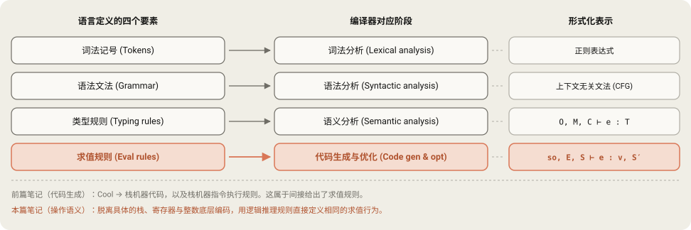
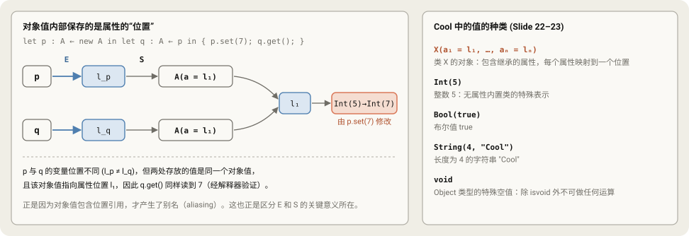
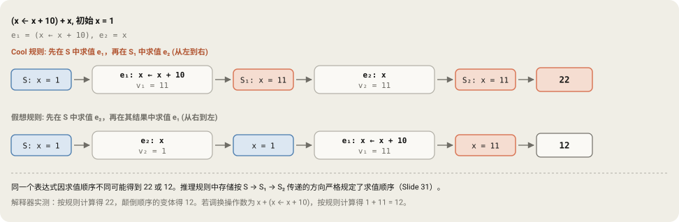
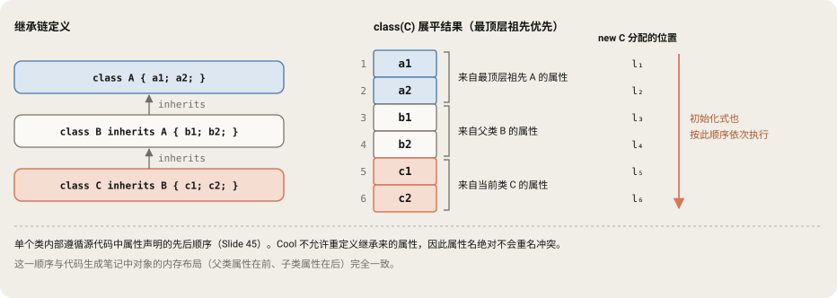
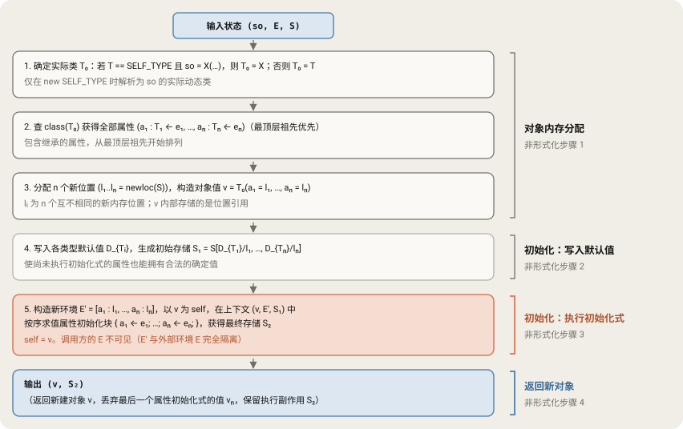

# COOL 语言操作语义概述

> [!info] 阅读说明与背景
> - 本篇笔记在原操作语义笔记的基础上进行了系统性增强与深化。将原先的四幅纯文本 ASCII 示意图全面升级为高分辨率中文矢量图（SVG），并新增了 6 幅关键执行流程与语义结构的插图，每幅图均配有深入的**图解阅读**剖析；同时补充了形式化推导规则、跨语言机制对比以及多个关键概念的 `> [!note] 补充` 专栏。全部补充要点已在文末 §4 形成汇总表。
> - 本文的核心任务，是将此前在代码生成章节（参见 [[11_02_codegen]]）中通过“先编译为栈机器代码、再按指令规则执行”所间接给出的求值语义，重新用与底层机器无关的、严谨的形式化**逻辑推理规则**（Rules of Inference）直接表述出来。其形式化判断与推理规则的表示方法与类型系统（参见 [[11_05]] §39）保持高度一致。文中的幻灯片编号对应 Stanford CS143 Operational Semantics 课程（Richmond CS331 镜像课件 lecture13.pdf）。
> - 本文讨论的所有规则均通过一个精简的 Python 形式化操作语义解释器进行了严格的验证：解释器分别维护 $\mathrm{so}$、$E$ 与 $S$，每次规则推导均生成新的存储映射，位置分配严格遵循 $\mathrm{newloc}$ 语义。
>   - 实测课件 Slide 36 的代码块 `{ x ← 7 + 5; 4; }`，正确求出 `Int(4)` 且变量存储更新为 `[l → 12]`。
>   - 针对六种常见的“错误语义变体”进行了对比实验验证：若赋值规则在旧存储 $S$ 上覆盖修改，则右侧表达式求值过程中产生的副作用全部丢失；若加法从右向左求值，则表达式 `(x ← x + 10) + x` 的结果会由 22 变为 12；若跳过默认值初始化阶段，求值属性初始化式时将因读取未初始化的内存位置而崩溃；若属性初始化时向作用域传入调用者的环境 $E$，外部局部变量将意外泄露到对象内部；若字面地执行 $n$ 次未更新的 $\mathrm{newloc}(S)$，所有属性将错误地挤在同一个内存位置；若方法调用时先对接收者对象求值再对参数求值，含副作用的调用顺序将完全颠倒。
>   - 此外，包含 $\mathrm{class}(C)$ 的展平顺序、`new SELF_TYPE` 的动态类型派发、对象别名（Aliasing）、变量遮蔽（Shadowing）以及 `while` 循环在内的 25 项测试用例全部通过。
>   - C/C++ 的求值顺序与初始化语义基于本地 gcc/g++ 13.3 (x86-64) 编译实测对比；Java 语义依据 JLS 规范阐述。

## 一、语义概述

词法分析和语法分析管的是程序长什么样，类型检查管的是类型能不能对上，但这还不够。要真正定义一门语言，必须说明**每一个 Cool 表达式**求值时会发生什么，这正是表达式的“含义（meaning）”。

一门编程语言的完整定义可以拆成四块，恰好对应编译器从前端到后端的各个阶段：

**图解阅读**：左侧两列对应语言的定义要素与编译器处理阶段，右侧列补充了各要素在形式化理论中的标准书写范式。前三行在编译器前端与中端已分别深入讨论：正则表达式是词法分析器（Lexer）的形式化规范，上下文无关文法（CFG）是语法分析器（Parser）的形式化规范，而类型判断 $O, M, C \vdash e : T$ 则是语义分析中类型检查器的形式化规范。最后一行正是本篇的核心议题：我们使用与类型判断形式高度契合的逻辑推理规则，精确规定程序在运行期“究竟计算出什么”。

其实在前面的代码生成章节里，我们已经间接给出过一套求值规则：先把 Cool 编译成栈机器代码，再按栈机器的指令规则去执行。这种做法确实给出了完整的行为描述，但它**还不够好**。

问题在于，基于汇编或特定机器实现来定义语义，会混入大量和语言本身无关的底层细节：

- 要不要采用栈机器
- 栈往高地址还是低地址增长
- 整数在底层怎么编码表示
- 目标架构具体长了一套什么指令集

我们需要的是一份**完整但不过度受限（not overly restrictive）**的语言规范，把“表达式应该算出什么”和“底层机器打算怎么实现”拆开，让不同架构上的编译器有自由优化的空间。描述语义的形式化方法有很多种，它们的表达能力其实等价，只是各自适合不同的场景；这里选用最贴近编译器实现直觉的**操作语义（Operational Semantics）**。

> [!note] 补充：以参考实现为规范的缺陷，以及程序语言的三大形式语义学
> - **参考实现沦为规范的陷阱**（Slide 8–9）：如果在设计一门编程语言时缺乏高层次的形式化规范，开发者往往只能退化为“以参考实现（Reference Implementation）的实际运行结果为准”。然而，任何参考实现都会包含 Bug，并且受限于初次实现时的偶然工程妥协。当缺乏独立定义时，这些未曾深思熟虑的实现瑕疵和巧合 Bug 就会不可逆转地被固化为该语言规范的一部分。
> - **形式语义学的三大流派**（Slide 10–12）：
>   - **操作语义（Operational Semantics）**：通过在抽象机器上的状态迁移与执行规则来定义程序含义。Stanford 课件将其生动地比喻为“一种极高层次的代码生成（Very High-Level Code Generation）”。由于它最贴合编译器构造与程序实现的工程直觉，Cool 语言全面采用此方法。
>   - **指称语义（Denotational Semantics）**：将程序中的语法成分直接映射为严谨的数学函数（从输入状态到输出状态的映射）。尽管形式极为优美严谨，但为了让函数拥有良好的数学性质，必须首先建立复杂的域理论（Domain Theory），这引入了大量与编译器工程实现无关的抽象复杂度。
>   - **公理语义（Axiomatic Semantics）**：用数理逻辑断言来表述程序性质，形式通常为“在满足前提断言 $P$ 的状态下执行语句，终止时必满足后置断言 $Q$”（即霍尔三元组 $\{P\}\;C\;\{Q\}$）。它是自动化程序验证与形式化证明的基石。
> - **大步语义 vs 小步语义**：本讲义采用的是**大步操作语义**（Big-Step Semantics，亦称自然语义 Natural Semantics），即一条推理规则一步到位地推导出表达式最终算出的值和最终存储状态；与之相对的是**小步操作语义**（Small-Step Semantics，亦称结构操作语义 SOS），它将表达式每次只向前重写/归约一步。在工业级语言规范中，WebAssembly 采用小步归约规则进行形式化定义，而 Standard ML (SML'97) 则采用大步语义。

## 二、形式化操作语义

和类型检查一样，这里再次引入形式化的逻辑推理规则（logical rules of inference）。

回想类型检查里的类型判断（typing judgment）：

$$
\mathrm{Context} \vdash e : C
$$

意思是“在给定上下文 $\mathrm{Context}$ 中，表达式 $e$ 具有类型 $C$”。求值判断（evaluation judgment）的写法非常相似：

$$
\mathrm{Context} \vdash e : v
$$

意思是“在给定上下文 $\mathrm{Context}$ 中，表达式 $e$ 求值得到值 $v$”。写成横线上下形式的推理规则，比如加法求值的一个具体例子：

$$
\frac{\mathrm{Context} \vdash e_1 : 5 \qquad \mathrm{Context} \vdash e_2 : 7}{\mathrm{Context} \vdash e_1 + e_2 : 12}
$$

横线上方是前提，下方是结论：只要在当前上下文中 $e_1$ 求值出 `5`、$e_2$ 求值出 `7`，就能推出 $e_1 + e_2$ 求值出 `12`。

不过只写一个笼统的 $\mathrm{Context}$ 还不足以处理变量读写和赋值。考虑一条赋值表达式 `y ← x + 1`：我们需要知道 `x` 当前存着什么值，还要把算出来的结果写回 `y` 对应的位置，同时不能和同名遮蔽变量或别名搞混。为此，把运行时与变量相关的上下文拆成两层：

- 环境（Environment，$E$）：回答变量**在哪里**（where in memory），即把变量名映射到内存位置（$\text{vars} \to \text{memory locations}$）。
- 存储（Store，$S$）：回答内存里**有什么**（what is in memory），即把内存位置映射到具体的值（$\text{memory locs} \to \text{values}$）。

![环境 E 与存储 S 的两步查找机制。变量名 x, y 经环境 E 映射到内存位置 l_x, l_y，内存位置经存储 S 映射到存储的值 v_x, v_y。赋值后 v_y 更新为 v_x + 1。右侧展示在 x = 5, y = 0 下求值 y ← x + 1 的前后对比：E 保持不变，S 中仅 l_y 的值由 0 变为 6，得到新存储 S′ = S[6/l_y]。](../../SVG/中文/os-env-store.svg)

**图解阅读**：左侧为经典的两步查找模型：蓝色箭头代表环境 $E$ 的映射（确定位置），灰色箭头代表存储 $S$ 的映射（确定内容）。右侧展示了初始状态为 `x = 5`, `y = 0` 时，执行赋值语句 `y ← x + 1` 的前后对比：环境 $E$ 始终保持不变，而存储在内存位置 $l_y$ 处被改写，生成了一个崭新的存储 $S' = S[6/l_y]$。记号 $S[v/l]$ 表示“在保持其他内存位置完全不变的前提下，唯独将位置 $l$ 处的值替换为 $v$ 所派生出的新存储”（Slide 21）。在形式化操作语义中，存储从不被视为“原地可变对象（in-place mutable object）”，而是一个**不可变数学映射函数**；只有通过推导产生新存储，才能在同一推理规则中严谨地并列表示不同时间点的存储状态 $S, S_1, S_2$。

变量环境 $E$ 不仅记录了当前作用域里有哪些变量可见，还指明了每个变量各自落在哪一块内存地址上，通常记作：

$$
E = [a : l_1,\ b : l_2]
$$

之所以把“名字 $\to$ 位置”和“位置 $\to$ 值”分成两步，是因为变量的作用域绑定在进入块或函数时就定死了（即 $E$），而变量里存的值在执行过程中随时可能被赋值语句改写（即 $S$）。

> [!note] 补充：Cool 语言中环境 E 发生变化的时机与形式化 let 规则
> 在 Cool 中，普通的代码块语句 `{ e1; ...; en; }` 并不会引入新的局部变量作用域。在整个语言中，**唯一能够向环境 $E$ 引入新变量名绑定的语法构造只有四处**：
> 1. `let` 表达式（引入局部变量绑定）；
> 2. `case` 分支语句（为动态类型匹配成功的分支变量绑定新位置）；
> 3. 方法调用的形参绑定（为接收到的实参分配新的形式参数位置）；
> 4. `new` 表达式创建对象时构建的属性环境。
>
> 以最典型的局部变量声明 `let` 表达式为例，其完整的大步操作语义规则如下（Slide 40）：
>
> $$
> \frac{\mathrm{so},\ E,\ S \vdash e_1 : v_1,\ S_1 \qquad l_{\mathrm{new}} = \mathrm{newloc}(S_1) \qquad \mathrm{so},\ E[l_{\mathrm{new}}/\mathrm{id}],\ S_1[v_1/l_{\mathrm{new}}] \vdash e_2 : v_2,\ S_2}{\mathrm{so},\ E,\ S \vdash \texttt{let}\ \mathrm{id} : T \leftarrow e_1\ \texttt{in}\ e_2 : v_2,\ S_2}
> $$
>
> - 函数 $\mathrm{newloc}(S_1)$ 负责在当前存储 $S_1$ 中寻找一个**全新且尚未被占用的内存位置**，其本质等价于运行时的动态内存分配。
> - 记号 $E[l_{\mathrm{new}}/\mathrm{id}]$ 表示在当前环境 $E$ 的基础上，将标识符 $\mathrm{id}$ 绑定到新分配的位置 $l_{\mathrm{new}}$。若外部作用域已存在同名变量，该操作会自然地形成**作用域遮蔽（Variable Shadowing）**：在求值主体表达式 $e_2$ 时，查表必然优先命中新的 $l_{\mathrm{new}}$，而外部同名变量所对应的旧内存位置完好无损。
>   - 实测解释器运行嵌套遮蔽：`let x : Int ← 1 in { let x : Int ← 2 in x; x; }`，解释器会为内层与外层分配两个完全独立的内存位置，内层求值得到 2，离开内层后外层再次访问 `x` 正确读到 1。
> - 环境修改的生命周期仅限于子表达式 $e_2$ 的求值阶段；当整条 `let` 表达式求值完毕后，外部结论处依然保持着调用前的旧环境 $E$。

## 三、COOL 语言操作语义的细节

在 Cool 里，表达式的求值结果不仅依赖 $E$ 和 $S$，还必须知道当前正在执行方法的对象 `self`（记作 $\mathrm{so}$，即 self object）。同时，求值一个表达式可能会产生修改内存的副作用，所以每条求值判断还要把**求值后的新存储** $S'$ 吐出来：

$$
\mathrm{so},\ E,\ S \vdash e : v,\ S'
$$

读作“在当前对象为 $\mathrm{so}$、变量环境为 $E$、初始存储为 $S$ 的上下文下，求值表达式 $e$ 会得到值 $v$，并产生新存储 $S'$”。

**图解阅读**：⊢ 符号左侧的三项构成了求值前的**输入状态**，右侧两项构成了求值后的**输出结果**。注意，$\mathrm{so}$ 与 $E$ **不会出现在输出侧**。这是因为在求值单个表达式的过程中，当前执行主体 `self` 绝不会突然变成其他对象，标识符与内存位置的映射关系也不会发生永久泄露（Slide 25–26）。虽然 `self` 的属性值可能在执行中被赋值修改，但这些修改全部统一记录在存储 $S'$ 中。
此外，该推理判断**仅在表达式求值能够在有限步内正常终止（Terminates）时才成立**。如果表达式发生死循环（例如条件恒为真的 `while true loop ... pool`），则不存在任何数学上的 $v$ 和 $S'$ 能够满足该判断（Slide 24–25）。因此在阅读操作语义规则时，潜台词始终是：“*若表达式 $e$ 的执行能够正常结束，则…*”。
图表下方对比了静态类型判断与动态求值判断的异同：类型检查期的上下文 $C$ 表示源码静态写在哪个类中，而运行时的 $\mathrm{so}$ 则表示真实执行的对象（其动态类型可能是 $C$ 的子类）；类型检查器使用 $O$ 进行名字到类型的一步映射，而运行时则通过 $E$ 和 $S$ 分解为两步查找；方法签名表 $M$ 在求值期无需直接对应，而是通过动态类型派发函数 $\mathrm{impl}(X, f)$ 在运行期类的虚表/实现结构中查找方法体。

### 1. 字面量与 `self`

布尔、整数、字符串字面量以及 `self` 都不修改内存，求值后的存储原封不动：

$$
\frac{}{\mathrm{so},\ E,\ S \vdash \texttt{true} : \mathrm{Bool}(\texttt{true}),\ S}
\qquad
\frac{}{\mathrm{so},\ E,\ S \vdash \texttt{false} : \mathrm{Bool}(\texttt{false}),\ S}
$$

$$
\frac{i \text{ is an integer literal}}{\mathrm{so},\ E,\ S \vdash i : \mathrm{Int}(i),\ S}
\qquad
\frac{s \text{ is a string literal} \quad n \text{ is the length of } s}{\mathrm{so},\ E,\ S \vdash s : \mathrm{String}(n, s),\ S}
$$

关键字 `self` 直接求值出当前上下文的自身对象 $\mathrm{so}$：

$$
\frac{}{\mathrm{so},\ E,\ S \vdash \texttt{self} : \mathrm{so},\ S}
$$

这里的 $\mathrm{Bool}(\texttt{true})$、$\mathrm{Int}(i)$、$\mathrm{String}(n, s)$ 都是带有类型标记和必要元数据的运行时对象值表示。

**图解阅读**：右下角展示了 Cool 运行期支持的全部值类型（Slide 22–23）。一般类的对象表示为 $X(a_1 = l_1, \dots, a_n = l_n)$，其**核心设计在于对象内部记录的是各属性的内存位置 $l_i$，而非直接存值**。只要掌握了属性所在的位置，其具体内容即可随时在存储 $S$ 中查询。基本数据类型 `Int`、`Bool`、`String` 可视为不含用户定义属性的特殊内置对象表示。`void` 则是 `Object` 继承体系中的特殊空引用标记，除 `isvoid` 判定外不能对其执行任何运算。
左图展示了由此产生的**别名机制（Aliasing）**：当执行 `q ← p` 发生对象赋值时，复制的是该对象值本身（即包含了属性位置 $l_1$ 的记录）。虽然局部变量 `p` 和 `q` 在环境 $E$ 中分配了不同的内存槽位（$l_p \neq l_q$），但它们内部存储的值指向了同一个属性内存位置 $l_1$。因此，通过 `p.set(7)` 改写 $S(l_1)$ 后，执行 `q.get()` 立即能够观测到更新后的值 7。这再次印证了将环境 $E$ 与存储 $S$ 彻底解耦的不可替代性。

### 2. 变量引用与赋值

读一个标识符 $\mathrm{id}$（如 `x`、`y`）时，先去环境 $E$ 查到它的内存位置 $l_{\mathrm{id}}$，再去存储 $S$ 取出该位置存的值 $v$：

$$
\frac{E(\mathrm{id}) = l_{\mathrm{id}} \qquad S(l_{\mathrm{id}}) = v}{\mathrm{so},\ E,\ S \vdash \mathrm{id} : v,\ S}
$$

读变量不修改内存，存储依然是 $S$。而赋值表达式 $\mathrm{id} \leftarrow e$（如 `x ← 1 + 1`）则会改写存储：

$$
\frac{\mathrm{so},\ E,\ S \vdash e : v,\ S_1 \qquad E(\mathrm{id}) = l_{\mathrm{id}} \qquad S_2 = S_1[v / l_{\mathrm{id}}]}{\mathrm{so},\ E,\ S \vdash \mathrm{id} \leftarrow e : v,\ S_2}
$$

这里的存储传递顺序至关重要：必须先在初始存储 $S$ 下求值右边表达式 $e$，得到计算结果 $v$ 和中间存储 $S_1$。然后再去环境查到 $\mathrm{id}$ 绑定的位置 $l_{\mathrm{id}}$，在 $S_1$ 的基础上把位置 $l_{\mathrm{id}}$ 的内容替换成 $v$，得到新存储 $S_2 = S_1[v / l_{\mathrm{id}}]$。如果写成 $S[v / l_{\mathrm{id}}]$，求值 $e$ 时顺带改过的其他变量就全丢了。在 Cool 中赋值本身也是表达式，它的返回值就是 $v$。

![x ← { y ← 3; y + 1; } 的存储传递流程。初始 S 下求值右侧，得到反映了 y = 3 的存储 S₁；在 S₁ 的 l_x 位置写入 4 得到最终存储 S₂ = S₁[4/l_x]。若在初始 S 上直接覆盖(S₂ = S[4/l_x])，则右侧表达式内部的 y ← 3 副作用将被彻底丢弃！](../../SVG/中文/os-assign-thread.svg)

**图解阅读**：上方主流程展示了符合语义规范的执行过程：① 求值右侧复合表达式 `{ y ← 3; y + 1; }`，在生成中间存储 $S_1$ 的同时使得 $l_y = 3$，并算出整体值 `Int(4)`；② 与 ③ 在 $S_1$ 的基础之上仅将 $l_x$ 覆盖为 4，最终得到保存了所有副作用的 $S_2$。
下方展示了**错误规则**的灾难性后果：若推理规则错误地定义为 $S_2 = S[v / l_x]$，尽管 $l_x$ 被成功赋为 4，但由于是以最初的 $S$ 为基准进行覆盖，右侧表达式内部发生的所有内存写入（即 $l_y = 3$）全部被回滚抹除！形式化规则中下标 $S_1$ 的精密串联，本质上就是在数学层面实现运行时的**副作用精确线索化（Side-Effect Threading）**。在解释器中实测对比：正确规则输出 `x = 4, y = 3`，而错误规则变体则输出 `x = 4, y = 0`。

### 3. 加法与求值顺序

加法规则体现了求值顺序对副作用的传递：

$$
\frac{\mathrm{so},\ E,\ S \vdash e_1 : v_1,\ S_1 \qquad \mathrm{so},\ E,\ S_1 \vdash e_2 : v_2,\ S_2}{\mathrm{so},\ E,\ S \vdash e_1 + e_2 : v_1 + v_2,\ S_2}
$$

左边 $e_1$ 在 $S$ 下算完后吐出 $S_1$，右边 $e_2$ 必须在 $S_1$ 下接着算，最后把 $S_2$ 作为整条加法的输出存储。两条前提把 Cool **从左到右**的求值顺序写死了：如果 $e_1$ 里带了赋值，后算的 $e_2$ 一定会看到更新后的值。

**图解阅读**：面对完全相同的表达式 `(x ← x + 10) + x`（初始 `x = 1`）：
- 上方行按照 Cool 的标准操作语义推导：$e_1$ 在初始存储 $S$ 下首先求值，将 `x` 改写为 11；随后的 $e_2$ 在承接了新状态的 $S_1$ 下求值读出 11，最终相加得到 **22**。
- 下方行展示假想的反向求值语义：若规定右侧 $e_2$ 先在初始存储 $S$ 下求值，它将读出原始值 1；随后左侧 $e_1$ 算得 11，最终相加得到 **12**。
- Slide 31 明确指出：**存储在前提之间的传递拓扑序列（$S \to S_1 \to S_2$），在数学上严格且唯一地锁定了子表达式的执行顺序**。

> [!note] 补充：C/C++ 语言为何故意不指定求值顺序？
> - 与 Cool 或 Java 严格固定求值顺序不同，**ISO C 与 C++ 标准故意将二元运算符的运算对象（Operands）以及函数参数的求值顺序规定为未指明的（Unspecified）**。这是设计者有意为之的选择：为了让不同 CPU 架构上的编译器能够根据寄存器分配压力与指令调度优势，自由决定先算左边还是先算右边（这是对 §1 “不过度受限”原则的更激进追求）。其代价则是：若代码中存在依赖未指明顺序的副作用，该程序在不同编译器或不同优化等级下的运行结果可能会截然不同。
> - 在本地环境使用 gcc 13.3 (x86-64) 进行了编译实测：编写包含全局自增记录的函数 `f()` 与 `g()`，计算表达式 `f() + g()` 时 gcc 先执行了 `f()`；然而在计算函数调用 `h(f(), g())` 时，无论是在 `-O0` 还是 `-O2` 下，gcc 均先执行了右侧参数 `g()`。
> - Cool 选择了严格保证跨平台的一致性与可移植性，宁可牺牲部分极端的编译器优化自由度。Java 语言规范（JLS §15.7）同样强制规定所有操作数从左至右求值。当然，若编译器能够静态证明两个表达式均无副作用（Pure Expressions），则仍可在底层自由调整其计算指令的排布。

> [!note] 补充：顺序表达式（代码块）规则与首个推导树实例
> Cool 语言中使用花括号包围的顺序复合表达式 $\{ e_1; \dots; e_n; \}$（即代码块）不仅是常见的编程结构，更是后文 `new` 表达式属性初始化块的核心机制。其形式化推理规则如下（Slide 33）：
>
> $$
> \frac{\mathrm{so},\ E,\ S \vdash e_1 : v_1,\ S_1 \qquad \mathrm{so},\ E,\ S_1 \vdash e_2 : v_2,\ S_2 \qquad \cdots \qquad \mathrm{so},\ E,\ S_{n-1} \vdash e_n : v_n,\ S_n}{\mathrm{so},\ E,\ S \vdash \{ e_1;\ \dots;\ e_n; \} : v_n,\ S_n}
> $$
>
> 存储按照流水线 $S \to S_1 \to \dots \to S_n$ 依次流转，每个子表达式产生的所有副作用被完整汇聚到最终的 $S_n$ 中，而整个代码块的求值结果只取最后一个表达式的值 $v_n$。
> 结合前面学到的字面量规则、加法规则与赋值规则，我们可以为复合表达式 `{ x ← 7 + 5; 4; }` 构建一棵完整的**形式化推导树（Derivation Tree）**（Slide 34–36）：

![{ x ← 7 + 5; 4; } 的推导树。E = [x : l]，初始 S = [l → 0]。最上方 7 和 5 分别求值为 Int(7) 与 Int(5)，存储不变。加法规则推导出 7 + 5 为 Int(12)。结合 E(x) = l 与 [l → 12] = [l → 0][Int(12)/l]，赋值规则得出 x ← 7 + 5 : Int(12), [l → 12]。4 在更新后的存储 [l → 12] 中求值，顺序表达式规则最终得出结果 Int(4) 与存储 [l → 12]。](../../SVG/中文/os-derivation.svg)

**图解阅读**：阅读推导树时，自底向上阅读代表“为了证明该结论，需要满足哪些前置条件（目标导向的推理）”，自顶向下阅读则代表“程序在运行时的实际求解演化次序”。
树的最顶端叶子节点是常数字面量 7 和 5，依据常数规则可直接成立；加法规则 `[Add]` 将其合并为 `Int(12)`，初始存储 `[l → 0]` 毫无改变地向下传递；随后赋值规则 `[Assign]` 将存储单点更新为橙色的 `[l → 12]`；该新存储随后作为输入传递给代码块的第二个子表达式 4；最终顺序表达式规则 `[Seq]` 产出整体计算结果 `Int(4)`，并输出更新后的最终存储 `[l → 12]`。解释器实测输出与推导树的理论推导分毫不差。

> [!note]- 补充：其余基础控制流规则（条件分支 if 与循环 while 的形式化推导）
> 条件分支与循环结构同样通过这种精巧的存储传递机制实现形式化（Slide 32, 37–38）：
>
> - **条件分支 `if` 规则**（以 True 分支为例，False 分支呈对称形式）：
>
> $$
> \frac{\mathrm{so},\ E,\ S \vdash e_1 : \mathrm{Bool}(\texttt{true}),\ S_1 \qquad \mathrm{so},\ E,\ S_1 \vdash e_2 : v,\ S_2}{\mathrm{so},\ E,\ S \vdash \texttt{if}\ e_1\ \texttt{then}\ e_2\ \texttt{else}\ e_3\ \texttt{fi} : v,\ S_2}
> $$
>
> 必须先在 $S$ 下求值条件式 $e_1$ 产出 $S_1$，被选中的分支 $e_2$ 必须在承接了条件式副作用的 $S_1$ 下执行。类型检查器此前已保证条件表达式的求值类型必为 `Bool`。
>
> - **循环结构 `while` 规则**：
>
> $$
> \frac{\mathrm{so},\ E,\ S \vdash e_1 : \mathrm{Bool}(\texttt{false}),\ S_1}{\mathrm{so},\ E,\ S \vdash \texttt{while}\ e_1\ \texttt{loop}\ e_2\ \texttt{pool} : \mathrm{void},\ S_1}
> $$
>
> $$
> \frac{\mathrm{so},\ E,\ S \vdash e_1 : \mathrm{Bool}(\texttt{true}),\ S_1 \qquad \mathrm{so},\ E,\ S_1 \vdash e_2 : v,\ S_2 \qquad \mathrm{so},\ E,\ S_2 \vdash \texttt{while}\ e_1\ \texttt{loop}\ e_2\ \texttt{pool} : \mathrm{void},\ S_3}{\mathrm{so},\ E,\ S \vdash \texttt{while}\ e_1\ \texttt{loop}\ e_2\ \texttt{pool} : \mathrm{void},\ S_3}
> $$
>
> 当条件为真时，先在 $S_1$ 下执行循环体 $e_2$ 产生存储 $S_2$；随后**在更新后的状态 $S_2$ 下递归地再次求值整个 `while` 表达式本身**，最终产生 $S_3$。这种用“在崭新状态下重新求值自身”的方式，极其优雅地在无循环语句的形式化逻辑框架中定义了迭代语义！循环体的返回值 $v$ 被直接丢弃，整体返回值恒为 `void`。对于永不退出的死循环，推导树深度无限发散，形式化判断自然无法成立。

### 4. 对象创建 `new T`

按非形式化的理解，执行 `new T` 需要做四件事：

1. 为类 `T` 的对象的所有属性分配内存位置（本质上就是分配一个新对象）。
2. 把所有属性先设成各自的默认值。
3. 依次求值各属性的初始化表达式，并写入对应的属性位置。
4. 返回这个新分配的对象。

为了把继承下来的属性也一并算进去，对于任意类 $A$，定义记号 $\mathrm{class}(A)$ 列出它拥有的全部属性（**包括从祖先类继承来的属性**）、声明类型与初始化表达式：

$$
\mathrm{class}(A) = (a_1 : T_1 \leftarrow e_1,\ \dots,\ a_n : T_n \leftarrow e_n)
$$

排列顺序遵循**最顶层祖先优先（greatest ancestor first）**。沿着 `C inherits B`、`B inherits A` 的继承链一路展平，`class(C)` 会把 `A`、`B`、`C` 的属性顺次排开：

**图解阅读**：继承链中的属性从顶层祖先类开始向下展平。在单个类的内部，属性顺序严格遵循源代码中的书写声明顺序（Slide 45）。Cool 语言在语义规则层面禁止子类重定义继承而来的同名属性，因此展平后的属性元组中绝不会发生名字碰撞。
右侧突出强调了核心实现逻辑：在执行 `new C` 时，运行时**位置分配（$l_1$ 到 $l_6$）与初始化表达式的执行序列完全遵循这一展平顺序**。若子类属性 `c1` 的初始化式引用了父类属性 `a1 + b2`，由于父类属性在前且已率先初始化完毕，读取将能够合法获得确定的前序值。这一静态展平结构与我们在代码生成章节（参见 [[11_02_codegen]] §5）中推导的**对象内存物理布局**（祖先属性槽位在前、派生属性槽位在后）完全对应。

有了 $\mathrm{class}(T_0)$，就可以写出 `new T` 完整的形式化推理规则：

$$
\frac{
  \begin{array}{l}
  T_0 = \text{if } (T == \text{SELF\_TYPE} \text{ and } \mathrm{so} = X(\dots)) \text{ then } X \text{ else } T \\
  \mathrm{class}(T_0) = (a_1 : T_1 \leftarrow e_1,\ \dots,\ a_n : T_n \leftarrow e_n) \\
  l_i = \mathrm{newloc}(S) \quad \text{for } i = 1, \dots, n \\
  v = T_0(a_1 = l_1,\ \dots,\ a_n = l_n) \\
  S_1 = S[D_{T_1} / l_1,\ \dots,\ D_{T_n} / l_n] \\
  E' = [a_1 : l_1,\ \dots,\ a_n : l_n] \\
  v,\ E',\ S_1 \vdash \{ a_1 \leftarrow e_1;\ \dots;\ a_n \leftarrow e_n; \} : v_n,\ S_2
  \end{array}
}{
  \mathrm{so},\ E,\ S \vdash \text{new } T : v,\ S_2
}
$$

这条规则看着长，拆开来看每一步都在精准落实前面的四件事：

**图解阅读**：各方框详细揭示了每一步的具体操作与存在理由。右侧大括号精准对应了本节开篇总结的非形式化四个阶段：第 1 到 3 步负责**对象分配**，第 4 到 5 步负责**对象初始化**，最后返回对象。
请特别关注第 5 步中求值上下文的微妙切换：求值判断左上角的首项从调用方的当前对象 $\mathrm{so}$ 切换为了**新构造的对象 $v$**！这意味着在执行各属性初始化表达式时，代码内部如果访问了关键字 `self`，其指向的是当前**正在被构造的新对象**，而不是外部触发 `new` 操作的调用方对象。

有三个容易忽略的细节藏在规则里：

- `SELF_TYPE` 在运行期要看当前对象 `so` 的真实动态类型 `X`，这样子类调用父类继承来的 `new SELF_TYPE` 方法时，造出来的才会是子类 `X` 的实例。
- 初始化表达式块在全新的环境 $E'$ 下求值，而不是调用方的 $E$，因为属性初始化式里只能访问当前新对象的属性，不能看见外面的局部变量。
- 把所有属性先填上默认值 $D_{T_i}$（例如 `Int` 默认 `0`、`Bool` 默认 `false`、`String` 默认空串，其他引用类型默认 `void`）得到 $S_1$ 再跑初始化，保证了后面排在前面的属性初始化式万一读到了后面的属性或者调用了 `self` 的方法时，内存里已经有确定值而不是未定义状态。

> [!note] 补充：字面阅读形式化规则时的两个细节陷阱
> 1. **$l_i = \mathrm{newloc}(S),\; i = 1, \dots, n$ 的语义理解**：
>    形式化规则为了数学书写简练，将 $n$ 个位置分配写为基于同一初始存储 $S$ 的推导。但在程序实现中，若将其误当成纯函数不更新存储地调用 $n$ 次，每次都会返回同一个内存地址！其真实数学语义是**分配 $n$ 个互不相同的全新位置**。在解释器实验中，若未递增模拟分配，所有属性会重叠在同一内存位置上，导致后续赋值 `a ← 1; b ← 2` 后再读取 `a` 错误得到 2。
> 2. **缺少显式初始化式的属性处理**：
>    在实际 Cool 程序中，许多属性声明并没有附带赋值初始式（如 `o : A;`）。在形式化规则中，这类属性相当于在最后的属性初始化代码块中省略了对应的赋值语句。该属性槽位将直接保留在第 4 步中填入的默认值 $D_T$。基本类型的默认值为 `Int(0)`、`Bool(false)`、`String(0, "")`，所有其他对象类型则默认初始化为 `void`（Slide 44）。

**图解阅读**：
- **左侧：为什么必须先填充默认值**：在类 `A` 的定义中，排在前面的属性 `a` 初始化时引用了声明在后面的属性 `b`（前向引用），属性 `c` 则通过调用 `self.getb()` 间接读取 `b`。在第四步填入默认值后，$S_1$ 中所有属性均拥有了合法底线值（`Int` 均为 0，`o` 为 `void`）。因此执行 `a ← b + 1` 时能够安全读出 `b = 0` 算得 `a = 1`；`self.getb()` 同样读到 0。直到最后执行 `b ← 5` 时，$b$ 才被改写为 5。若跳过默认值填充阶段，解释器在执行 `a ← b + 1` 时将由于 $S(l_3)$ 尚未定义而直接抛出异常崩溃。
- **右侧：`new SELF_TYPE` 的动态分发奇迹**：类 `P` 中编写了方法 `copy() : SELF_TYPE { new SELF_TYPE }`，子类 `C` 继承了 `P`。当在子类实例上调用 `(new C).copy()` 时，方法体执行期间的自身对象 $\mathrm{so}$ 是实际的 `C` 对象（包含槽位 $l_1, l_2$）。操作语义规则的第一行 $T_0$ 判断成功捕获到这一动态事实，将 $T_0$ 解析为子类 `C`！最终为新对象分配新槽位 $l_3, l_4$，成功实例化出完整的子类对象 `C`，而非父类 `P`。

> [!note] 补充：跨语言对比 —— Java 与 C++ 中的对象初始化语义
> Slide 48 特别指出，对象初始化过程中复杂的前向依赖语义绝非 Cool 所独有：
> - **Java 的处理策略**：与 Cool 类似，Java 在进入构造函数之前，也会将对象的所有实例变量（Fields）先清零初始化（数值型为 0，布尔为 `false`，对象引用为 `null`）。随后按照文本声明顺序执行字段初始化器。若在属性初始化器中通过 `this.b` 访问后声明的字段，Java 允许编译并通过并读到默认值 0；但为了提升安全性，若直接使用未加限定的裸变量名进行前向引用（如 `int a = b + 1;`），Java 编译器会在编译期直接报错阻止（"illegal forward reference" 编译错误，参见 JLS §8.3.3 与 §12.5）。
> - **C++ 的处理策略**：C++ 遵循极客的零开销原则，**根本不存在统一的默认零值预填充阶段**。非静态成员变量完全按照在类中声明的先后顺序进行初始化（无论构造函数初始化列表中的书写顺序如何）。若在初始化列表中读取了尚未初始化的成员变量（例如 `struct A { int a; int b; A() : a(b + 1), b(5) {} };`），这属于**未定义行为（Undefined Behavior, UB）**。在本地使用 g++ 13.3 开启 `-Wall` 编译该代码，编译器会明确报出警告 `"member 'A::b' is used uninitialized"`；在运行时程序可能读取到栈/堆残留的随机内存垃圾值。

> [!note] 补充：核心规则前瞻 —— 动态方法分发（Dynamic Dispatch）的形式化操作语义
> Slide 41 将 `new` 与动态方法分发（Dispatch）并列为 Cool 语言中最复杂的核心操作。方法调用表达式 $e_0.f(e_1, \dots, e_n)$ 的完整大步操作语义推理规则如下（Slide 51）：
>
> $$
> \frac{
>   \begin{array}{l}
>   \mathrm{so},\ E,\ S \vdash e_1 : v_1,\ S_1 \quad \mathrm{so},\ E,\ S_1 \vdash e_2 : v_2,\ S_2 \quad \cdots \quad \mathrm{so},\ E,\ S_{n-1} \vdash e_n : v_n,\ S_n \\
>   \mathrm{so},\ E,\ S_n \vdash e_0 : v_0,\ S_{n+1} \\
>   v_0 = X(a_1 = l_1,\ \dots,\ a_m = l_m) \\
>   \mathrm{impl}(X, f) = (x_1,\ \dots,\ x_n,\ e_{\mathrm{body}}) \\
>   l_{x_i} = \mathrm{newloc}(S_{n+1}) \quad \text{for } i = 1, \dots, n \\
>   E' = [a_1 : l_1,\ \dots,\ a_m : l_m][l_{x_1}/x_1,\ \dots,\ l_{x_n}/x_n] \\
>   S_{n+2} = S_{n+1}[v_1/l_{x_1},\ \dots,\ v_n/l_{x_n}] \\
>   v_0,\ E',\ S_{n+2} \vdash e_{\mathrm{body}} : v,\ S_{n+3}
>   \end{array}
> }{
>   \mathrm{so},\ E,\ S \vdash e_0.f(e_1,\ \dots,\ e_n) : v,\ S_{n+3}
> }
> $$
>
> 深入拆解该规则的关键设计：
> 1. **求值次序**：规则前两行明确规定，**所有实参表达式 $e_1, \dots, e_n$ 必须从左到右率先求值，最后才对接收者对象表达式 $e_0$ 进行求值**（Slide 49）。在解释器中实测：若让接收者表达式执行 `k ← k * 10 + 1`，参数表达式执行 `k ← k * 10 + 2`，按 Cool 规则先算参数后算接收者，最终 `k = 21`；若反转为先算接收者，`k` 则会变成 12。现代工业语言（如 Java 以及 C++17 的 `[expr.call]` 规则）则做出了相反选择，严格规定接收者对象优先于实参求值。
> 2. **动态分发实现函数**：记号 $\mathrm{impl}(X, f) = (x_1, \dots, x_n, e_{\mathrm{body}})$ 表示在对象 $v_0$ 的实际动态类 $X$ 虚表中查询方法 $f$ 的形参列表与实现体（包含从祖先继承的方法）（Slide 50）。
> 3. **执行环境与调用栈帧**：方法体 $e_{\mathrm{body}}$ 必须在目标对象 $v_0$ 的自身上下文（$\mathrm{so} = v_0$）以及一个全新的局部环境 $E'$ 下执行。该环境仅包含 $v_0$ 自身的属性映射与分配给各形参的新内存位置 $l_{x_i}$，**调用方的局部变量环境 $E$ 被彻底屏蔽隔离**。在形式化语义中并不存在物理意义上的调用栈帧（Stack Frame）数据结构，每个参数分配全新内存槽位 $l_{x_i} = \mathrm{newloc}(\dots)$ 的机制在数学上等价实现了活动记录（Activation Record）的栈帧空间分配（Slide 52）。
> 4. **静态类型系统无法阻止的运行时崩溃**：虽然静态类型检查器保证了合法的 Cool 程序绝不会出现“找不到方法 $\mathrm{impl}(X, f)$”的错误，但依然存在四种类型系统无法在编译期根除的致命运行时错误（Slide 53–54）：
>    - 对空对象调用方法（Dispatch on void）；
>    - 除以零（Division by zero）；
>    - 字符串截取越界（`substr` out of range）；
>    - 堆内存耗尽（Heap exhaustion）。
>    按照语言规范，虚拟机在遇到这些错误时绝不能发生无响应或段错误（Segmentation fault），必须规范地向标准错误输出诊断信息并安全退出。

## 四、补充内容与核心要点总结

| 章节位置                | 升级形式 / 补充要点                                  | 核心收获与理论价值                                                                             |
| :------------------ | :------------------------------------------- | :------------------------------------------------------------------------------------ |
| **§1 语义概述**         | 矢量图 `assets/os-four-parts.svg` (ASCII 升级)    | 梳理语言定义四要素（词法记号、文法、类型规则、求值规则）与编译器阶段及形式化表达体系的纵向映射。                                      |
| **§1 语义概述**         | 专栏补充：形式语义学三大理论                               | 阐明以参考实现为规范的危害；对比操作语义、指称语义与公理语义的适用场景；厘清大步语义（Big-step）与小步语义（Small-step）。                |
| **§2 形式化操作语义**      | 矢量图 `assets/os-env-store.svg` (ASCII 升级)     | 详解环境 $E$ 与存储 $S$ 的两步查找结构；揭示存储单点更新运算 $S[v/l]$ 的不可变映射本质。                                |
| **§2 形式化操作语义**      | 专栏补充：环境 $E$ 的变动与 `let` 形式化规则                 | 归纳 Cool 中唯一引入新变量绑定的四种语法；给出 `let` 形式化推导规则，阐明 $\mathrm{newloc}$ 分配与作用域遮蔽（Shadowing）机制。  |
| **§3 语义细节概览**       | 矢量图 `assets/os-judgment.svg` (新增插图)          | 剖析求值判断 $\mathrm{so}, E, S \vdash e : v, S'$ 输入输出拓扑；对比类型判断 $O,M,C$；强调操作语义仅对有限步终止的计算成立。 |
| **§3.1 字面量与 self**  | 矢量图 `assets/os-object-value.svg` (新增插图)      | 揭示对象值内部保存“属性内存位置”的核心机制；阐明别名现象（Aliasing）的成因以及 Cool 中各类值的运行时表示。                         |
| **§3.2 变量与赋值**      | 矢量图 `assets/os-assign-thread.svg` (新增插图)     | 证明赋值规则为什么必须在 $S_1$ 基础之上改写存储；对比错误规则变体，分析副作用线索化（Threaded Store）的重要性。                    |
| **§3.3 加法与求值顺序**    | 矢量图 `assets/os-add-order.svg` (新增插图)         | 演示相同表达式在不同求值顺序下产生 22 与 12 的差异；揭示存储流转方向在数学上锁定求值顺序的机制。                                  |
| **§3.3 加法与求值顺序**    | 专栏补充：C/C++ 规范与 gcc 实测                        | 分析 C/C++ 故意不指定求值顺序背后的设计哲学（追求优化自由度）；对比本地 gcc 13.3 实测的求值次序。                             |
| **§3.3 加法与求值顺序**    | 矢量图 `assets/os-derivation.svg` 与推导实例         | 给出顺序复合表达式（代码块）推理规则；完整展示 `{ x ← 7 + 5; 4; }` 形式化推导树的构建全过程。                             |
| **§3.3 加法与求值顺序**    | 专栏补充：控制流 `if` 与 `while` 规则                   | 给出条件分支与循环的大步操作语义；阐述循环结构如何通过在更新状态下“递归调用自身”实现形式化。                                       |
| **§3.4 对象创建 new T** | 矢量图 `assets/os-class-flatten.svg` (ASCII 升级) | 明确继承链按照“最顶层祖先优先”展平；说明属性展平顺序直接决定了运行期槽位分配与初始化次序。                                        |
| **§3.4 对象创建 new T** | 矢量图 `assets/os-new-flow.svg` (ASCII 升级)      | 细化 `new T` 形式化推理规则的五步内部流转，并建立与非形式化四步骤的严格对应；指出上下文切换为 $v$ 的关键细节。                        |
| **§3.4 对象创建 new T** | 矢量图 `assets/os-new-example.svg` (新增插图)       | 图解先行填入默认值避免前向引用未定义错误的机理；展示 `new SELF_TYPE` 在继承体系下动态解析实际派生类的全流程。                       |
| **§3.4 对象创建 new T** | 专栏补充：跨语言对象初始化机制                              | 对比 Java 的前向引用编译报错及字段默认零值填充，与 C++ 初始化列表中访问未初始化成员的未定义行为（UB）。                            |
| **§3.4 对象创建 new T** | 专栏补充：方法分发（Dispatch）规则                        | 提前给出动态方法调用的形式化规则；揭示参数优先于接收者求值的顺序；解析活动记录在 $\mathrm{newloc}$ 中的隐式实现及四类运行时异常。            |

## 五、参考资料

- **Alex Aiken**, *Stanford CS143 Compilers Course Notes: Operational Semantics of Cool*. （镜像参考：`facultystaff.richmond.edu/~dszajda/classes/cs331/Fall_2017/lecture_slides/lecture13.pdf`，对应文中 Slide 幻灯片编号）
- **Alex Aiken**, *The Cool Reference Manual: Operational Semantics Section*. （涵盖 `case` 分支、静态分发、算术与比较运算等语言全部形式化规则）
- **Glynn Winskel**, *The Formal Semantics of Programming Languages: An Introduction* (MIT Press, 1993). （形式语义学经典教材：系统介绍操作语义、指称语义与公理语义）
- **W3C / WebAssembly Community Group**, *WebAssembly Core Specification: Execution Section*. （采用小步归约操作语义编写的现代工业级语言规范范例）
- **Robin Milner et al.**, *The Definition of Standard ML (Revised)* (MIT Press, 1997). （完全采用大步操作语义自然规范定义的严谨编程语言里程碑）
- **语言标准规范对比**：
  - ISO/IEC 9899:2011 (C11) §6.5 & §6.5.2.2：表达式与实参求值顺序属于未指明行为（Unspecified Behavior）；
  - Java Language Specification (JLS SE 8) §15.7 & §15.12.4：强制从左至右求值，接收者对象优先于实参求值；字段初始化顺序与前向引用限制（JLS §8.3.3 & §12.5）；
  - ISO/IEC 14882:2017 (C++17) [expr.call]：规定后缀表达式（接收者）的求值先于函数参数表达式。
- **关联学习笔记**：
  - 代码生成实现：参见 [[11_02_codegen]]（以栈机器代码生成的角度实现相同表达式语义）；
  - 类型检查系统：参见 [[11_05]] §11（变量绑定语法）与 §39（形式化类型判断规则 $O, M, C \vdash e : T$）。
