# 编译原理学习笔记：中间代码与程序优化

> [!info] 导读与实测验证
> - 本篇笔记基于斯坦福大学 CS143 编译原理课程（对应 Richmond CS331 镜像 lecture14 与 lecture15 讲义：Intermediate Code & Local Optimizations 与 Global Optimization），系统梳理了从 AST 降解到中间代码（IR）、基本块划分、窥孔优化、局部优化链、全局数据流分析（前向常量传播半格）到逆向数据流分析（活跃性分析与死代码消除）的完整演进路径。
> - 原笔记中的 12 处 ASCII 示意图已全部升级为高精度矢量架构图（SVG 图收录在编译器的 SVG 中文目录），并额外补充了 3 张推演图表、各图详细的**读图指引**，以及针对工程细节的 `> [!note] 补充` 与 `> [!warning] 纠偏` 模块。核心增补内容汇总见文末第 7 节对照表。
> - 核心理论与算法已通过实测代码严谨验证：
>   - 用 Python 求解器逐字实现了常量传播规则 1–8 与活跃性传播规则 1–4，对讲义 Slide 39、50、82 的 CFG 进行了定态求解。随机置换数百种更新顺序，不动点均严格唯一；对内部变量进行 $\top$ 初始化的变体在循环用例中产生欠优化停机（`A := 2 * X` 误保留为 $\top$），漏掉规则 3 的变体则在程序入口处错误判定变量活跃。
>   - 编写了独立 Pass 函数模拟 Slide 60–78 的十步局部优化流，输入 500 组随机 $x$ 样本，各阶段计算结果严格等价。
>   - 在 MIPS 子集模拟器上运行了窥孔优化规则，证实若剔除“跳转目标检查”将导致循环状态被破坏（实测输出由正确的 `b = 7` 偏离为 `b = 5`）。
>   - 代数化简与常量折叠的边界特性在 x86-64 机器上通过 GCC 13.3（`-O0`、`-O2`、`-Os`）进行了汇编实测对照。

---

## 一、中间代码在编译中的用途

中间代码（Intermediate Representation, IR / Intermediate Language, IL）是介于源语言与目标机器架构之间的一种抽象表达。

在抽象层级上，中间代码处于源语言与目标机器码的折中位置：
- 比源语言包含更多执行与布局细节（显式的临时变量、拍平的表达式、底层的线性控制流）。
- 比目标机器码保留更少的物理硬件约束（不绑定具体物理寄存器、指令流水细节与调用约定）。

### 1. 解耦与架构复杂度

直接将 $M$ 种源语言编译到 $N$ 种目标架构，需要实现 $M \times N$ 个独立编译器。引入统一的中间表示后，编译器前端只需将源语言翻译为 IR（$M$ 个前端），后端只需将 IR 翻译为特定硬件指令（$N$ 个后端），系统工程复杂度降为 $M + N$。

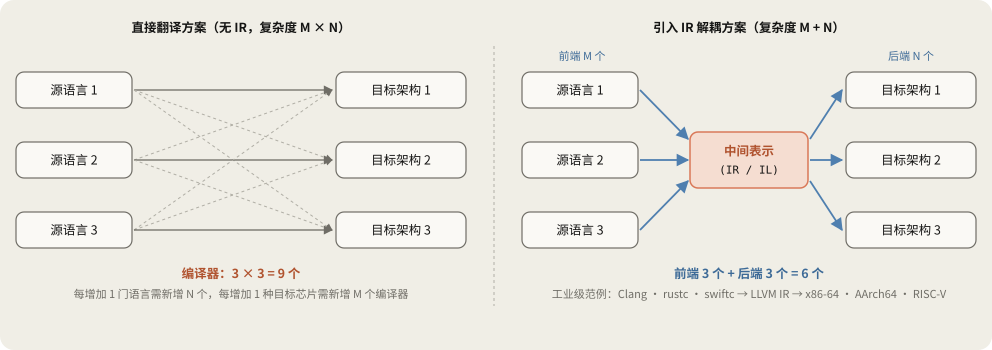

**读图**：左侧展示无 IR 时的点对点全连接翻译，源语言与目标架构的每一种组合都需要一套专用的代码生成器，连线复杂度高达 $M \times N$（图中 3 种源语言与 3 种目标芯片对应 9 个独立编译器）。右侧展示引入统一 IR 后的解耦架构，蓝色箭头左半部分为语言前端，负责语法语义解析并发射 IR；右半部分为芯片后端，负责指令选择、寄存器分配与机器码发射。工程复杂度由相乘骤降为相加（$3 + 3 = 6$）。底部标注了工业界典型实践：Clang（C/C++）、rustc（Rust）与 swiftc（Swift）统一生成 LLVM IR，再由 LLVM 统一发射至 x86-64、AArch64、RISC-V 等主流架构。

> [!note] 补充：工业实践通常设计多层 IR
> - 讲义 Slide 9 指出，几乎所有工业级现代编译器都会引入中间表示，且通常会在源码与物理硬件之间设计多级分层的 IR 体系。讲义此处主要抽象出相当于“高层汇编”的一层经典 IR 进行分析。
> - GCC 采用多级降解：前端先生成高层语法树 GENERIC，降解为三地址形式的 GIMPLE，进入优化管线后再降为贴近物理寄存器的 RTL（Register Transfer Language）。rustc 在发射 LLVM IR 前先构建 MIR 以进行借用检查与所有权优化；swiftc 则借助 SIL 处理引用计数与高层泛型特化。语言专有的语义信息若过早降解到通用扁平 IR 中就会丢失，因此必须在专用高层 IR 阶段先行优化。
> - $M + N$ 是工程上的理想上界。在实践中，单一 IR 很难同时兼顾动态语言、函数式语言、高维张量计算与底层系统编程的所有语义需求。MLIR（Multi-Level Intermediate Representation）提出的解决方案是不再绑定单一固定 IR，而是在统一框架内定义具有不同抽象层级的方言（Dialect），逐层降解（如从张量计算 `linalg` 降解到循环控制 `scf` / `affine`，再进入 `llvm` 方言）。

抽象层次的过渡关系如下：

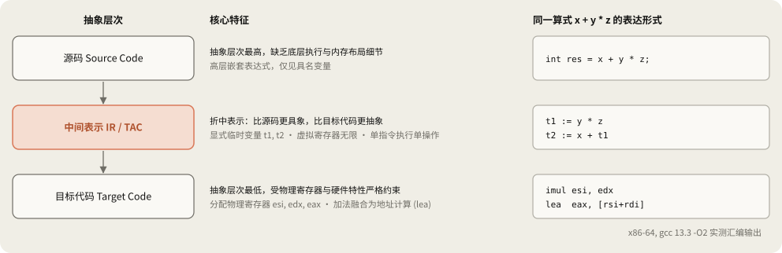

**读图**：图表纵向对比了三种核心表现形态的抽象层级。左侧两列界定了各层次的语义跨度与硬件依赖程度；右侧列追踪了同一算式 `x + y * z` 在编译各阶段的具体展开形态。在源码层，表达式高度嵌套，仅见具名变量；降至三地址码（IR / TAC）后，表达式被完全拍平，引入显式临时名字 `t1`、`t2`，单条指令仅承载单步操作；最下方为该函数用本机的 `gcc 13.3 -O2` 编译出的 x86-64 目标汇编，虚拟寄存器已分配给具体物理寄存器 `esi`、`edx`，乘法使用 `imul`，而顶层加法被巧妙合成为三操作数的地址加载指令 `lea eax, [rsi+rdi]`。硬件特有的寻址模式由后端处理，不会在 IR 层过早暴露。

### 2. 三地址码（Three-Address Code, TAC）

三地址码是中间代码最常见的表现形态。每条三地址指令最多包含三个操作数，其基本结构为：

$$x := y \text{ op } z$$
$$x := \text{op } y$$

其中 $y$ 和 $z$ 可以是虚拟寄存器或字面常量。

> [!note] 补充：“三地址”命名缘由与代码生成模板
> - 所谓“三地址”，是指每条指令至多引用三个地址空间（两个源操作数、一个目的操作数，见 Slide 11–12）。因为单条指令至多执行单步运算，复杂复合算式被彻底拆解，每个子表达式都拥有具名表示。
> - 三地址码的生成过程与前述基于栈计算机的代码生成结构高度一致（Slide 13–14），核心差异在于：三地址码假定拥有**无限数量的虚拟寄存器（IL 寄存器）**。若定义 $\mathrm{igen}(e, t)$ 为“计算表达式 $e$ 并将结果写入寄存器 $t$ 的指令序列”，加法表达式的降解模板为：
>
> $$\mathrm{igen}(e_1 + e_2,\ t) = \mathrm{igen}(e_1,\ t_1);\ \ \mathrm{igen}(e_2,\ t_2);\ \ t := t_1 + t_2 \qquad (t_1, t_2 \text{ 为分配的新虚拟寄存器})$$
>
> - 相比于栈式计算机频繁维护 `$sp` 压栈与出栈，无限虚拟寄存器假设让前端代码生成变得极其纯粹，把“物理寄存器不足时的溢出与调度问题”正交解耦给后端寄存器分配阶段（lecture16）。

在源代码中嵌套的复杂表达式，在降低到三地址码时会被拆解成一系列顺序执行的单步运算，每个子表达式都拥有独立的临时名字。

```cpp
// C++ 源码层面的复合表达式
int res = x + y * z;

// 编译器降解后的三地址码（对应 C++ 伪代码）
int t1 = y * z;   // 为子表达式命名并优先计算乘法
int t2 = x + t1;  // 计算顶层加法
```

### 3. 中间语言文法规范

基于三地址码的简化中间语言，可以通过如下上下文无关文法（CFG）定义：

$$\begin{aligned}
P &\to S \; P \mid S \\
S &\to \text{id} := \text{id} \text{ op } \text{id} \\
  &\mid \text{id} := \text{op } \text{id} \\
  &\mid \text{id} := \text{id} \\
  &\mid \text{push } \text{id} \\
  &\mid \text{id} := \text{pop} \\
  &\mid \text{if } \text{id} \text{ relop } \text{id} \text{ goto } L \\
  &\mid L: \\
  &\mid \text{jump } L
\end{aligned}$$

文法规则说明：
- 标识符 $\text{id}$ 通常对应虚拟寄存器名，也可以替换为立即数常量。
- 常见的双目操作符 $\text{op}$ 为 $+,-,\times$；关系比较操作符 $\text{relop}$ 包含 $<, \le, =, \ne$ 等。
- 控制流通过标签（$L:$）、无条件跳转（$\text{jump } L$）以及条件分支（$\text{if } \dots \text{ goto } L$）实现。过程调用的参数传递则借助栈操作（$\text{push} / \text{pop}$）或寄存器约定完成。

> [!note] 补充：与讲义文法的细微差异与高层 Opcode
> - Slide 18 的起始产生式定义为 $P \to S\,P \mid \varepsilon$。与上述文法 $P \to S\,P \mid S$ 唯一的区别仅在于是否显式允许空程序，两者在表达“语句流线性序列”这一语义上完全等价。
> - 按照 Slide 10 的界定，此处的 IL 属于“高层汇编”。它直接使用寄存器名，且绝大多数操作码与目标硬件指令（如 MIPS 指令）一一对应；但诸如 `push` 等操作属于复合抽象操作码，降解到物理汇编时会展开为栈指针移动与内存写入等多条底层指令（例如 MIPS 下的 `sw $a0 0($sp)` 与 `addiu $sp $sp -4`）。

---

## 二、程序优化的时机与本质

### 1. 优化的发生阶段对比

编译器各个阶段都可以实施优化，但取舍截然不同：

- **在抽象语法树（AST）上**：
  - 优点：完全机器无关。
  - 缺点：层次太高，缺乏平铺后的控制流和寄存器暴露，很多底层优化无法施展。
- **在目标汇编语言上**：
  - 优点：直接面对真实机器，容易发现硬件相关的优化机会（如指令融合、专用寻址模式）。
  - 缺点：严重依赖具体机器。一旦换一个目标芯片，所有优化逻辑都要重写一遍。
- **在中间代码（IR）上**：
  - 兼顾两端：既保持了跨平台独立性，又拆平了复杂的语法糖，把变量定义、使用链和跳转路径暴露得清清楚楚。绝大多数经典通用优化（常数折叠、死代码消除、循环不变量外提等）都在这一层完成。

### 2. 基本块（Basic Block）

基本块是程序局部优化最基础的处理单元。它的形式化定义为：**满足以下约束的最长指令连续序列（Maximal sequence of instructions）**：
- 序列内部不允许包含任何标号（标签只能出现在第一条指令处）。
- 序列内部不允许包含任何跳转或分支（跳转指令只能出现在最后一条指令处）。

基本块的精髓是**单入口、单出口（Single-Entry, Single-Exit）**的直线型代码段。程序一旦踏入基本块第一行，就只能老老实实顺着执行到末尾，绝不可能从中间某个位置插进来，也不可能从中间某个分叉溜走。

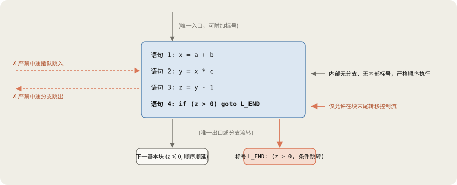

**读图**：中间区域展示了一个标准基本块，包含 4 条直线执行的连续语句。上方带有外部引用标号的入口是唯一的进入途径。当最后一条语句为条件跳转时，底部存在两条确定的流转路径：条件不满足时顺序顺延（fall-through）至下一基本块；条件满足时跳转至目标标号 `L_END`。这两条路径均由最后一条语句分流，符合“出口仅在末尾”的定义。左侧用虚线明确标出了非法情形：禁止任何控制流在语句 2、3 处插队跳入，也严禁从语句 2、3 中途分叉跳出。若语句 2 带有标号或属于跳转指令，则必须切断并分为不同基本块。

将线性指令流划分为基本块并构建控制流图（CFG）的标准流程如下：

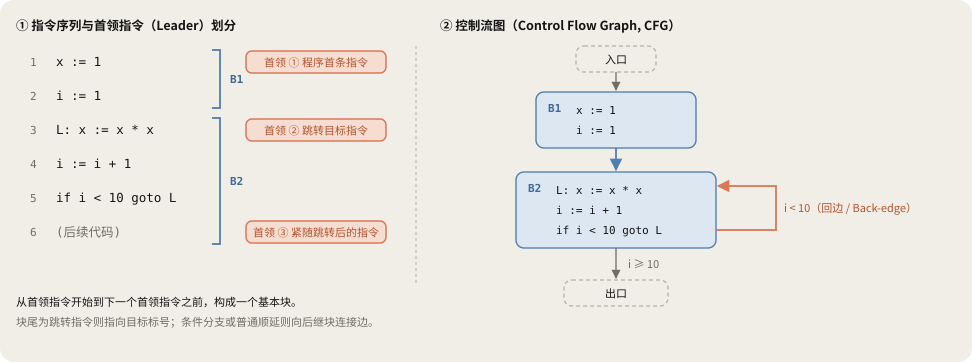

**读图**：划分基本块的关键在于识别**首领指令（Leader）**（参考龙书《Compilers》第 2 版 §8.4）。首领指令共有三类判据：① 程序首条指令必为首领；② 任何跳转或分支指令的目标指令（带标号指令）为首领；③ 紧随跳转或分支指令之后的下一条指令为首领。从每个首领开始，到下一个首领之前的指令区间构成一个完整的基本块。右侧展示构建出的 CFG：程序自入口进入 $B_1$，$B_1$ 顺延进入 $B_2$；$B_2$ 末尾的分支在 $i < 10$ 时沿**回边（Back-edge）**跳回自身，构成循环结构；在 $i \ge 10$ 时流向出口。

> [!note] 补充：块内可知信息与块外盲区
> 考察 Slide 21 中的基本块：`L: t := 2 * x; w := t + x; if w > 0 goto L'`。由于块内指令执行顺序严格确定，可直接在块内将 `w := t + x` 化简为 `w := 3 * x`。但此时能否顺势将第一行 `t := 2 * x` 彻底删除？仅凭该基本块内部的信息无法给出答案——因为无法断定变量 `t` 在跳出该块后是否会被其他基本块引用。这一判定必须借助后文第 6 节的全局活跃性分析。

### 3. 关于“程序优化”的工程真相

“程序优化（Program Optimization）”这个说法在工程上往往言过其实。

编译器生成的代码在数学意义上从来不是真正的“最优解（Optimal）”。证明一段代码对于任意输入都是指令周期最短或体积最小的，往往属于不可判定问题或具有极高的理论复杂度。

更合理的称呼是**“程序改进（Program Improvement）”**。编译器优化器本质上是一组经过验证的启发式改写规则：在确保程序可观测行为（Observable Behavior）不变的前提下，让代码跑得更快一些、占用的内存和电量更少一些。

> [!note] 补充：最优解在原理上不可达的停机问题证明，以及优化的三级范围
> - **停机问题反证法**：假定存在能生成“绝对最优机器码”的终极优化编译器。对于任意待测程序 $P$，构造一个包装程序：“执行 $P$ 后立即正常停机退出”。若 $P$ 实际发生死循环，该程序在数学上的最优等价形式应为 `L: jump L`（单条死循环指令）；若 $P$ 最终停机，最优等价形式应为 `return`（单条返回指令）。若终极优化编译器存在，只需检查其生成的指令是 `return` 还是 `jump` 即可判定任意程序 $P$ 是否停机，这与图灵停机问题不可判定相矛盾。编译界将这一不可避免的渐进性戏称为“编译器工程师全就业定理”（Full Employment Theorem）。
> - **优化的三级作用范围**（Slide 26–27）：
>   1. **局部优化（Local）**：局限于单个基本块内，分析开销最低，收益稳定；
>   2. **全局优化（Global）**：覆盖单个函数内的整张 CFG，属于过程内优化（Intra-procedural，名称略带误导，并不涉及全程序跨函数）；
>   3. **过程间优化（Inter-procedural）**：跨越函数调用边界，如内联展开、全程序链接期优化（LTO），分析复杂度高且容易引发代码膨胀。
> - 大多数编译器默认集中火力攻克局部与全局优化。研究文献中计算复杂度过高（如全程序多态分析）、编译耗时暴增（动辄数小时甚至数天）的极端算法在工业生产编译中往往被舍弃，核心诉求是以最低编译开销换取最显著的代码执行收益（Slide 28–29）。

---

## 三、局部优化（Local Optimization）与窥孔优化

局部优化只聚焦在单个基本块（One basic block）范围内，不需要去分析整个函数或跨过程复杂的控制流图。

### 1. 代数化简（Algebraic Simplifications）

利用数学代数恒等式，消除冗余计算或把高开销运算替换成低开销运算（强度折减）。以下代码均以 C++ 语义呈现：

```cpp
// 1. 冗余计算消除：加 0 或乘 1 不改变变量值，直接删除该语句
x = x + 0;   // 删除
x = x * 1;   // 删除

// 2. 特殊常数计算简化
x = x * 0;   // 简化为: x = 0;

// 3. 规避数学库函数调用（强度折减）
y = std::pow(y, 2);  // 简化为普通自乘: y = y * y;

// 4. 乘除法向位移的强度折减（假定变量类型为整型）
x = x * 8;   // 简化为: x = x << 3;

// 将乘以 15 转换为移位加减：15 * x = (16 - 1) * x = (x << 4) - x
int t = x << 4;
x = t - x;
```

> [!NOTE] 真实硬件上的权衡
> 移位替代乘法曾经是黄金法则，但在当今现代处理器上并不绝对。现代 x86/ARM CPU 内置了多级流水的硬件乘法器，32/64 位整数乘法通常只需要 1 到 3 个时钟周期。强行将一次乘法拆解为多条移位和减法，会多占指令解码带宽与执行端口，还可能打乱微指令调度。编译器后端通常会查表核算指令周期与延迟，再决定是否进行代数强度折减。

> [!warning] 纠偏：带符号整数除法无法直接用单条右移替代
> 注释 4 虽然提及“乘除法”，但示例仅展示了乘法。除法优化需要格外谨慎：**C/C++ 中有符号整数除法规定向 0 截断（Truncate toward zero），而算术右移操作（`>>`）在底层硬件上规定向负无穷方向截断（Floor）**。
> 两者在负数输入下结果截然不同：
> - `-1 / 8` 计算结果为 `0`；而 `-1 >> 3` 计算结果为 `-1`；
> - `-9 / 8` 计算结果为 `-1`；而 `-9 >> 3` 计算结果为 `-2`。
>
> 变换 $x / 8 \to x \gg 3$ 仅在 $x$ 为无符号型（unsigned）或编译器已通过值域分析证明 $x \ge 0$ 时才合法。本机 GCC 13.3 在优化带符号 `int` 的除法 `x / 8` 时，必须插入负数偏置补偿（当 $x < 0$ 时先加上 $2^k - 1 = 7$）：
>
> ```text
> int x / 8 (带符号):             unsigned x / 8 (无符号):
>   test   edi, edi                mov  eax, edi
>   lea    eax, 7[rdi]             shr  eax, 3
>   cmovns eax, edi
>   sar    eax, 3
> ```
>
> 相比之下，机器上的整数补码乘法不存在符号截断歧义，向左位移在低位补零，在模 $2^{32}$ 语义下带符号与无符号完全同构。

> [!note] 补充：GCC 13.3 (x86-64) 实测汇编对照与浮点恒等式陷阱
>
> | 源码语句 | `-O2` 优化汇编 | 底层实现细节与考量 |
> | :--- | :--- | :--- |
> | `int: x * 8` | `lea eax, [0+rdi*8]` | 未使用移位指令，而是直接利用 CPU 寻址流水线的变址乘 8 |
> | `int: x * 15` | `sal eax, 4; sub eax, edi` | 严格匹配 Slide 31 的移位减法；但使用 `-Os`（尺寸优化）时直接生成 `imul eax, edi, 15`，节省指令字节 |
> | `int: x * 0` | `xor eax, eax` | 异或自清零，单字节指令兼顾性能与体积 |
> | `double: pow(y, 2)` | `mulsd xmm0, xmm0` | 无需 `-ffast-math` 即可直接转为单条双精度乘法（平方结果严格等价） |
> | `double: x * 1.0` | (无指令，原样返回) | 恒等式成立 |
> | `double: x + 0.0` | 保留 `addsd` 指令！ | 浮点 IEEE 754 规定 `-0.0 + (+0.0) = +0.0`，改变了负零符号，故非恒等变换！反之 `x + (-0.0)` 则会被安全消除 |
> | `double: x * 0.0` | 保留 `mulsd` 指令！ | 若 $x$ 为 NaN、$\pm\infty$ 或负数，相乘结果不为 `+0.0`，严格模式下禁止折叠 |
>
> 浮点数在 IEEE 754 规范下不满足结合律与部分分配律，编译器只有在显式指定 `-ffast-math`（允许不严谨代数重排）时才会放宽化简约束。

### 2. 编译期常量折叠（Constant Folding）

对于形式为 $x := y \text{ op } z$ 的赋值语句，如果操作数 $y$ 和 $z$ 都是编译期可知的字面常量，那么操作符 $\text{op}$ 的计算在编译阶段直接完成，不留到运行时去消耗 CPU 周期。

```cpp
// 源码中的常量计算
int seconds = 60 * 60 * 24;

// 编译器前端进行常量折叠后直接生成：
int seconds = 86400;
```

> [!note] 补充：常量折叠衍生的死控制流剪枝与交叉编译陷阱
> - **控制流剪枝**（Slide 36–43）：常量折叠若作用于条件分支，能直接消除整条分支边。例如 `if (2 < 0) goto L` 的条件恒假，直接抹去该跳转；若条件恒真，则退化为无条件跳转 `jump L`。伴随分支删除，原本指向的目标基本块可能变为无入边的孤岛，控制流优化器（Unreachable Code Elimination）随后将其连根拔除，既缩小了代码体积，又改善了指令缓存（I-Cache）局部性。
> - **不可达代码的普遍来源**：常由宏开关（如 `#define DEBUG 0` 后的 `if (DEBUG) { ... }`）、模板特化、未调用的库函数或前序优化步骤的残留物引入。
> - **交叉编译中的浮点折叠陷阱**（Slide 38–40）：当宿主机（Host）与目标机（Target）架构不同时，宿主机 CPU 的浮点舍入模式若与目标机存在微小差异（如宿主执行 `1.5 + 3.7` 折叠为 `5.2`，但目标机运行为 `5.199999`），静态折叠就会悄然改变程序的数值运行结果。工业级编译器（如 GCC）在交叉编译时借助 MPFR 高精度数学库在软件层严格模拟目标架构的位级浮点舍入。
> - 在本机测试中，即便在 `-O0` 优化等级下，GCC 亦会把 `60 * 60 * 24` 预先折叠为 `mov eax, 86400`。常量折叠往往在语法解析与 AST 语义检查阶段就已经提前完成。

### 3. 窥孔优化（Peephole Optimization）

窥孔优化通常作用于汇编或底层 IR 指令序列上。

优化器维持一个极小的“观察视窗”（通常为连续的 2 到 4 条指令），像小孔一样贴在指令流上滑动。一旦窗口内的指令序列匹配到已知的低效模式，就用一套更紧凑、更快速的等价序列替换掉。

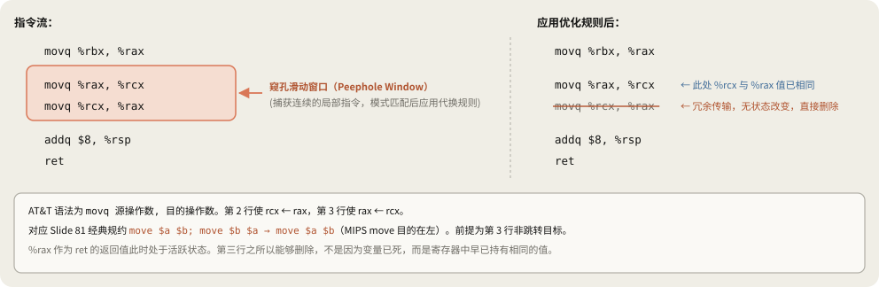

**读图**：左侧展示了原始指令流与滑动的窥孔窗口。窗口当前框选了连续的两条指令：`movq %rax, %rcx` 与 `movq %rcx, %rax`。右侧展示了模式替换的结果：在 AT&T 汇编语法中（`movq src, dst`），执行完第二条指令后寄存器 `%rcx` 与 `%rax` 必然持有完全相同的数值；因此紧随其后的第三条指令没有产生任何新的状态变化，属于纯冗余指令，直接予以剔除。该规则与 Slide 81 的经典规约 `move $a $b; move $b $a -> move $a $b` 一致。需要格外注意，`%rax` 作为后续 `ret` 指令的返回值，在程序点处处于活跃状态——第三行能够被删除的真正原因不是变量死亡，而是寄存器数值已经一致。

窥孔优化的规则可以形式化记为：

$$i_1, \dots, i_n \to j_1, \dots, j_m \quad (m \le n)$$

右侧（rhs）为左侧（lhs）在相同语义下的精简版本。

> [!note] 补充：$m \le n$ 并非严格铁律与算法终止的必要条件
> Slide 81 仅强调右侧必须是左侧的“改良版本（Improved Version）”。通常情况下指令条数会减少，但也存在例外：例如前述将乘 15 拆解为移位与减法（`sal` + `sub`），指令条数由 1 增加至 2（$m > n$），但总时钟周期显著缩减。衡量优化成立的标尺是执行成本而非单纯的指令计数。为了保证窥孔不动点循环必然停机，整套改写规则必须定义在严格单调递减的成本度量空间中；若同时引入互逆的规则（如对称交换操作数的乘法规则），就会引发死循环颠簸。

#### 典型改写模式与安全边界

1. **冗余数据搬移消除**：
   ```cpp
   // 汇编表现：
   // move $a, $b
   // move $b, $a  ===>  move $a, $b

   // C++ 对应语义：
   a = b;
   b = a;  // 冗余赋值，通常可删除
   ```
   * **安全边界**：这一项改写成立的前提是，第二条指令 `b = a` 绝对不能是任何外部跳转的目标地址（Not the target of a jump）。如果其他基本块有跳转分支直达第二条指令，删除它就会改变程序状态。

2. **连续常量累加合并**：
   ```cpp
   // 汇编表现：
   // addiu $a, $a, i
   // addiu $a, $a, j  ===>  addiu $a, $a, (i + j)

   // C++ 对应语义：
   a += 2;
   a += 3;
   // 窥孔合并为：
   a += 5;
   ```

3. **基本块优化下沉为窥孔规则**：
   不少原本需要基本块分析的简单局部优化，可以直接拆解为底层的窥孔替换模式。例如：
   - 规则一（加 0 转搬移）：`addiu $a, $b, 0` $	o$ `move $a, $b`
   - 规则二（自身复制消除）：`move $a, $a` $	o$ 空（直接丢弃）
   
   当遇到代码 `addiu $a, $a, 0` 时，规则一先将其重写为 `move $a, $a`，随后的扫描中规则二立即生效，整条指令彻底被抹除。

4. **不动点迭代（Fixed-Point Iteration）**：
   窥孔优化不是单次扫描就能完事的。某一条模式替换之后，往往会和前后原本不相干的指令拼接出全新的优化视窗。因此，窥孔优化必须反复多轮扫描，直到整个窗口滑过去没有任何一条规则被触发为止。

> [!note] 补充：窥孔微型引擎实测反馈
> 在微型 MIPS 模拟器上实测了前述 4 组窥孔规则：
> - 对 `addiu $a, $a, 0` 进行扫描：首轮将其转为 `move $a, $a`，次轮匹配自身消除规则抹除该指令，第三轮无规则触发并正常停机。
> - 对级联序列 `addiu $a,$a,2; addiu $a,$a,3; addiu $a,$a,-5` 进行扫描：前两行首先合成为 `+5`，与下一行拼接后合成为 `+0`，再降解为 `move` 后彻底消除。共耗费 4 轮改写扫描与 1 轮收敛检验。
> - **立即数溢出约束**：MIPS `addiu` 的立即数字段为 16 位有符号数（范围 $-32768 \dots 32767$）。当两数累加超出该区间时（如 $30000 + 30000 = 60000$），常量合并必须放弃触发，否则会导致硬件截断或非法指令。
> - **安全边界的反例验证**：在指令序列 `b <- 5; c <- 0; a <- b; L: b <- a; a <- a + 1; c <- c + 1; (loop while c < 3)` 中，标号 `L` 处的 `move $b, $a` 与前序的 `move $a, $b` 表面上构成规则 1。若忽略跳转目标约束强行删除该行，循环内的 `b` 将无法捕获迭代递增后的 `a`，最终 `b` 的输出值从正确的 `7` 坍塌为 `5`。

---

## 四、基本块优化与跨基本块扩展

### 1. 基本块内的常量传播与死代码消除

在基本块内部，**常量传播（Constant Propagation）**和**死代码消除（Dead Code Elimination）**往往结伴登场。常量传播负责把已知的字面值往前推，为表达式求值和逻辑判断铺路；死代码消除则跟在后面打扫战场，清理掉失去意义的中间变量。

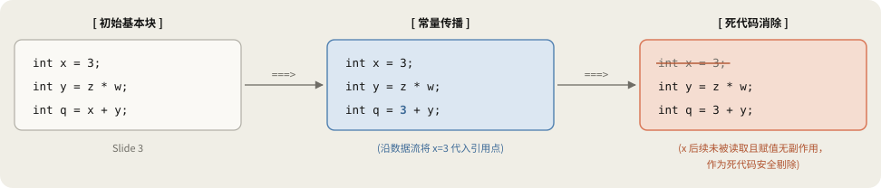

**读图**：流程清晰展示了局部优化 Pass 之间的连锁触发效应。初始基本块中定义了变量 `x = 3`，后续语句 `q = x + y` 引用了 `x`。第一步触发常量传播，沿数据依赖链将 `q` 中的操作数 `x` 替换为字面值 `3`。由于此项替换彻底消除了对 `x` 的后续所有读取操作，第二步死代码消除顺理成章地将已经失去存活意义的 `int x = 3;` 移出指令序列，仅保留真正参与后续计算的 `y` 与 `q`。单一优化 Pass 往往无法单独缩减指令，必须与其他 Pass 协作才能发挥最大效用。

1. **常量传播（Constant Propagation）**：
   编译器扫描基本块，确认 `x = 3` 是一处常量定义。在 `x` 被重新赋值之前，后续语句 `q = x + y` 引用了 `x`。编译器将操作数直接替换为字面量 `3`，表达式变形为 `q = 3 + y`。
2. **死代码消除（Dead Code Elimination）**：
   替换完成后，编译器检查符号表中的变量活性（Liveness）。如果在当前基本块及后续整个程序路径中，变量 `x` 再也不会被任何指令读取，且赋值语句本身不包含任何副作用（如 I/O 操作、内存屏障或修改全局状态），那么 `int x = 3;` 就沦为了死代码。优化器将其直接从指令流中剔除，节省寄存器分配压力与内存开销。

> [!note] 补充：讲义中的其余三项经典局部优化
> 讲义 Slide 44–57 还介绍了另外三项基础局部优化 Pass：
> - **单一赋值形式（Single Assignment Form）**：重写基本块中的局部寄存器，确保每个虚拟寄存器在赋值号左端至多出现一次。例如将序列 `x := z + y; a := x; x := 2 * x` 改写为 `b := z + y; a := b; x := 2 * b`（引入新变量 `b`）。在单个基本块内实现重命名十分简便，而将其推广至全函数即构成了现代编译管线（如 LLVM IR）的基石——静态单赋值（SSA）形式。
> - **公共子表达式消除（Common Subexpression Elimination, CSE）**：在单一赋值块中，若两处赋值的右端表达式完全相同，则二者必然产出相同值。编译器可直接将后出现的语句 `w := y + z` 替换为单纯的别名绑定 `w := x`。
> - **复制传播（Copy Propagation）**：遇到形如 `w := x` 的变量复制时，将后续所有对 `w` 的读取替换为直接读取 `x`。虽然单独执行不会缩减指令，但它能直接架空临时变量 `w`，为 CSE 和死代码消除铺平道路。
>
> 编译器通过遍历优化规则库，不断寻找并应用匹配项，循环推进直至不动点。

Slide 60–78 完整演示了这五种局部优化在一个包含 7 条语句的基本块上的连锁推演过程：

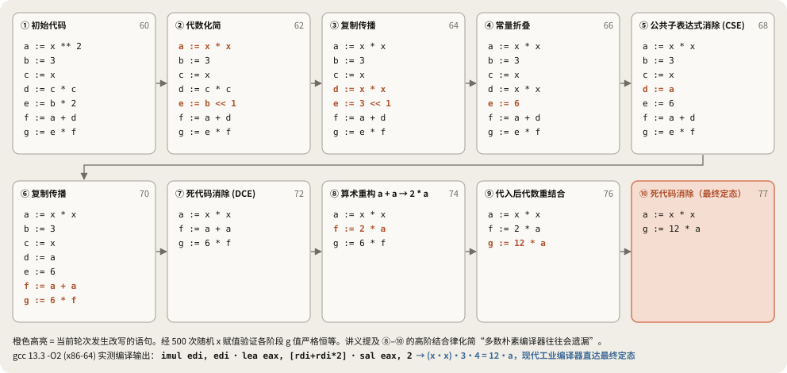

**读图**：全图直观呈现了 10 个阶段的代码演变形态，橙色行高亮了当前轮次被改写的语句。推演流程严格遵循讲义步骤：
- **① $\to$ ②（代数化简）**：将乘方 `x ** 2` 化为乘法 `x * x`，将乘 2 化为移位 `b << 1`；
- **② $\to$ ③（复制传播）**：将 `c` 与 `b` 传播为 `x` 与常量 `3`，暴露出下一步的折叠与 CSE 机会；
- **③ $\to$ ④（常量折叠）**：`3 << 1` 静态折叠为常量 `6`；
- **④ $\to$ ⑤（公共子表达式消除）**：识别出 `d := x * x` 与 `a := x * x` 重复，将 `d` 化简为 `a`；
- **⑤ $\to$ ⑥（再次复制传播）**：将 `d` 的引用点代入为 `a`，将 `e` 的引用点代入为 `6`，使得 $f$ 变为 `a + a`，$g$ 变为 `6 * f`；
- **⑥ $\to$ ⑦（死代码消除）**：逆向扫描发现中间变量 `b`、`c`、`d`、`e` 已无后续引用，全部剔除，代码行数从 7 行压缩至 3 行；
- **⑦ $\to$ ⑩（高阶代数重构与收敛）**：将 `a + a` 重构为 `2 * a`，代入 $g$ 并结合常量系数得出 `g := 12 * a`，最后再次消除死变量 $f$，收敛至终态两行代码 `a := x * x; g := 12 * a`。
- 本机用 GCC 13.3 `-O2` 编译该逻辑，直接生成两条连续的三操作数乘加指令：`imul edi, edi`（即 $x \cdot x$）与 `lea eax, [rdi+rdi*2]` 配合移位，完美达成 $12 \cdot a$ 的终态，证实工业级编译器均具备此类高级结合律代数推理能力。

### 2. 将优化推向整个控制流图（CFG）

基本块优化只能顾及无分支的直线代码。将常量传播扩展到整个控制流图（CFG）时，变量的值会沿着分支流动并在汇合点发生交汇。

此时，常量能否安全传播，取决于汇合前所有路径的一致性：

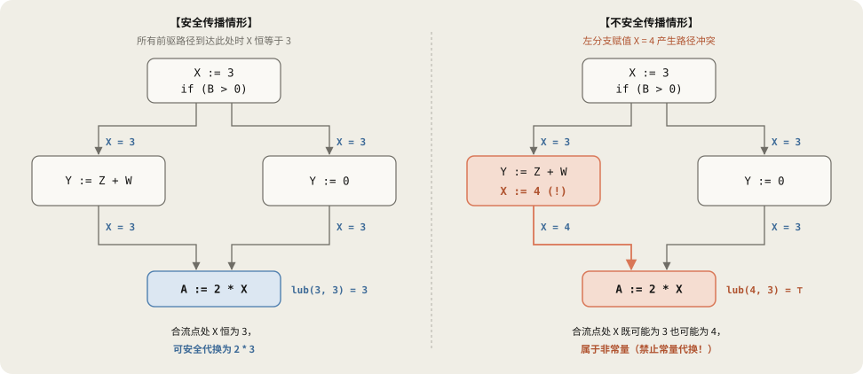

**读图**：左图展示安全传播情形：在入口处赋值 `X := 3` 后遭遇条件分支 `if (B > 0)`，分别派生出左分支 `Y := Z + W` 与右分支 `Y := 0`。在这两个分支中，变量 `X` 均未遭到修改。当控制流在 `A := 2 * X` 处重新交汇时，来自两边入边的数据流上 `X` 均恒等于 `3`，最小上界计算为 $\mathrm{lub}(3, 3) = 3$。因此优化器可以安全地将 `2 * X` 替换为 `2 * 3`。右图展示不安全传播情形：左分支内部执行了赋值 `X := 4`。在交汇点处，来自左边的边携带值 `4`，来自右边的边携带值 `3`，二者产生冲突，$\mathrm{lub}(4, 3) = \top$（表示非常量）。因此在汇合点处绝对不能实施常量代换。

对应 C++ 逻辑对比如下：

```cpp
// 1. 安全传播场景：不论进入哪个分支，x 始终保持为 3
int x = 3;
if (b > 0) {
    y = z + w;
} else {
    y = 0;
}
int a = 2 * x;  // 汇聚点各路径 x 均为 3，可安全代换为：int a = 2 * 3;

// 2. 不安全传播场景：分支内部存在对 x 的重写
int x = 3;
if (b > 0) {
    y = z + w;
    x = 4;      // 分支内修改了 x 的值
} else {
    y = 0;
}
int a = 2 * x;  // 到达此处的 x 取决于运行时分支走向，不可替换为常数！
```

### 3. 全局常量传播的正确性充要条件

要将程序中某处对变量 $x$ 的使用替换为常量 $k$，必须满足如下核心条件 $(**)$：

$$\text{在到达变量 } x \text{ 的该使用点之前，所有可能路径上的最后一次赋值均为 } x := k \quad (**)$$

这个条件检验起来绝非易事。“所有路径”既包含条件分支的各种组合，也包含循环体内不可预知次数的反复回绕。要判定条件 $(**)$ 是否成立，必须对整张控制流图建立**全局数据流分析（Global Dataflow Analysis）**。

> [!note] 补充：“回答未知”永远是安全的保守近似
> - 在图论意义上全面检验条件 $(**)$ 在数学上属于停机可达性范畴，无法做到 100% 精确判定。但数据流分析能够落地的根基在于：**静态分析允许保守放弃优化，但绝不允许给出错误的优化判断**。当分析引擎无法完全断定某一路径上的值时，只需给出保守答案“未知（$\top$）”并保留原有运行时计算即可。
> - 静态数据流分析将 CFG 上的所有路径都假定为控制流可行路径，因此可能因为“死路径”而引入过度的保守性。例如以下代码：
>
> ```text
> if (B > 0) X := 3 else X := 4;
> if (B > 0) A := X;        // 运行时若到达此行，B 必然大于 0，故 X 必然为 3
> ```
>
> 在真实执行中，第二个 `if` 若为真，其前置条件必然是第一个 `if` 也为真，因此 `X` 恒等于 `3`。但在标准数据流分析中，CFG 会盲目保留“第一个分支走假、第二个分支走真”的死路径，导致汇合处计算出 $\mathrm{lub}(3, 4) = \top$，从而错失优化。这种“不精确但安全”的特性是所有经典数据流框架的共性；若想进一步消除此类假路径，需结合条件分支预测与稀疏条件常量传播（SCCP，Wegman & Zadeck 1991）。

---

## 五、全局常量传播的工作机制：数据流分析与半格

为了对所有程序点上的变量状态做严谨计算，编译器为每个变量引入抽象值域（Abstract Values），建立半格模型并通过迭代求解不动点。

### 1. 抽象值的三态定义

在程序的任意执行点，针对考察的变量 $X$，关联以下三种状态之一：

| 抽象值 | 术语 | 语义解释 |
|:---:|:---:|:---|
| $ot$ | **Bottom**（底元素） | 代码尚未执行 / 静态分析推断当前控制流尚不可达（"So far as we know, control never reaches this point"） |
| $c$ | **Constant**（常数） | 变量 $X$ 在此处确定持有常量值 $c$（即 $X = c$） |
| $	op$ | **Top**（顶元素） | 变量 $X$ 不是常量（存在分支冲突、外部未知输入或动态运行时变量） |

> [!note] 补充：状态值附着在语句之间的“程序点”上
> Slide 19 与 22 明确指出，数据流状态并非依附在语句本身，而是严格依附在**语句之间的程序切片点（Program Points）**上。对于语句 $s$ 与变量 $x$，分别定义其紧接执行前的入口状态 $C(s, x, \text{in})$ 与紧接执行后的出口状态 $C(s, x, \text{out})$。在多语句构成的基本块抽象图中，边上的标定值即代表离开前序块、流入后继块时的数据流抽象状态。

### 2. 为什么必须引入 $ot$：环路与循环依赖的破局

如果程序中存在循环（回边），前驱与后继之间的依赖就会打成死结：

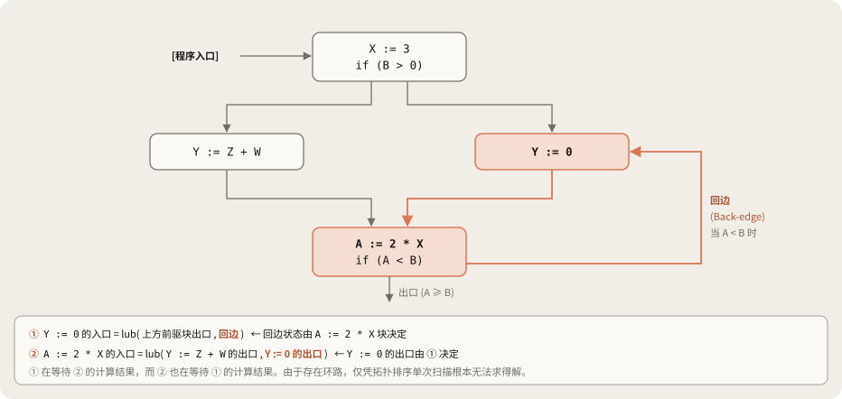

**读图**：图中展示了带循环控制流图所面临的典型循环依赖困局。从入口进入执行 `X := 3` 后遇到分支，分流至左侧 `Y := Z + W` 与右侧 `Y := 0`，随后汇入块 `A := 2 * X`。在块末尾，若条件 `A < B` 成立，则控制流通过**回边（Back-edge）**跳回上方的 `Y := 0` 处；若不成立则退出。底部面板详细拆解了互锁关系：
- 式 ① 指出，`Y := 0` 入口处的状态取决于上方块出口与回边状态的汇合；而回边状态由下方块 `A := 2 * X` 决定；
- 式 ② 指出，下方块 `A := 2 * X` 入口处的状态取决于两个前驱块出口的汇合，其中一个正是 `Y := 0`。
式 ① 在等待式 ② 的输出，而式 ② 又在等待式 ① 的输出。由于有向环的存在，控制流图不再是有向无环图（DAG），无法采用自顶向下的单次拓扑排序完成计算。

赋予初值是打破循环依赖的关键：
- **程序总入口**初始化为 $	op$（函数参数、全局状态等外部输入在编译期未知）。
- **程序内部其余所有点**全部初始化为 $ot$（乐观假定：控制流尚未到达，没有任何冲突发生）。

通过迭代求解该循环 CFG 的四个阶段推演如下：

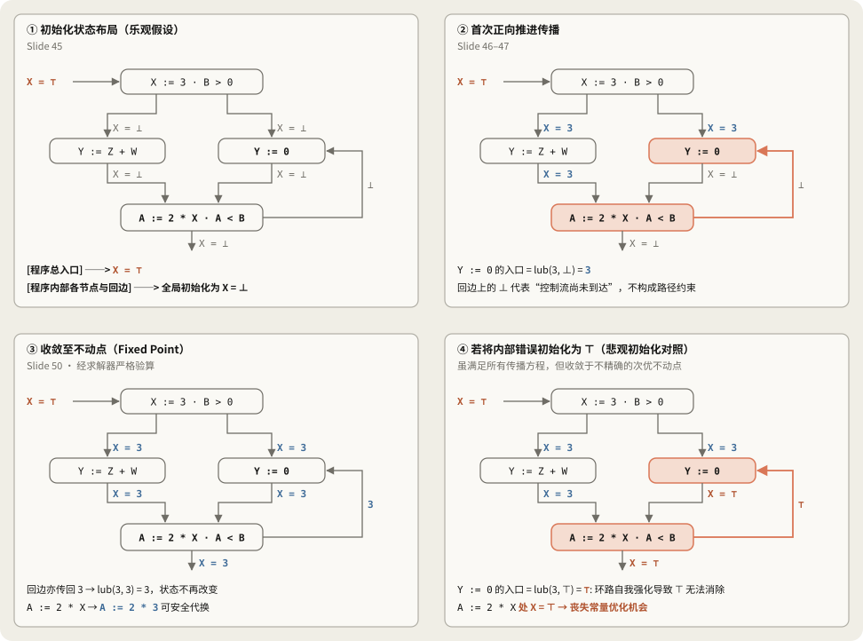

**读图**：
- **① 初始化阶段（乐观假设）**：程序总入口设定为 $X = \top$。除入口外的所有内部程序点以及回边全部赋予底元素 $\bot$。底元素 $\bot$ 的语义是“假定控制流未曾到达”，因此不会对汇合运算产生任何数值约束；
- **② 首轮正向推演**：控制流沿入口自顶向下推进，常量值 `3` 扩散至各分支。在计算节点 `Y := 0` 的入口时，上方前驱传入 `3`，而回边暂为 $\bot$。根据汇合规则 $\mathrm{lub}(3, \bot) = 3$（未到达边不造成干扰），成功将常量 `3` 传递至 `Y := 0` 并流向 `A := 2 * X`；
- **③ 收敛至不动点**：常量 `3` 沿循环体下行，最终随回边回传至上方入口。此时重新计算入口汇合：$\mathrm{lub}(3, 3) = 3$。状态与上一轮完全一致，求解器触发停机！最终成功在不动点下将 `A := 2 * X` 代换为 `A := 2 * 3`；
- **④ 悲观初始化的失败对照**：若错误地将内部节点全初始化为 $\top$，回边在第一轮就输入 $\top$。节点 `Y := 0` 的入口被迫计算 $\mathrm{lub}(3, \top) = \top$。这个 $\top$ 顺着环路自我循环强化，最终死锁在次优解，导致 `A := 2 * X` 错失常量化简机会。以 $\bot$ 作为起点自底向上求解，数学上能确保收敛至最精确的**最小不动点（Least Fixed Point）**。

### 3. 半格偏序与汇合运算（Least Upper Bound, lub）

通过偏序关系将抽象值进行层级排列，形成常量传播半格（Constant Propagation Semi-Lattice）：

$$\bot < c < \top$$

- $	op$ 是格中的极大元（Greatest value），代表最保守的无常量状态。
- $ot$ 是格中的极小元（Least value），代表尚未探测到的乐观初值。
- 所有具象常量 $c$ 处于中间层，彼此互不可比（Incomparable）。

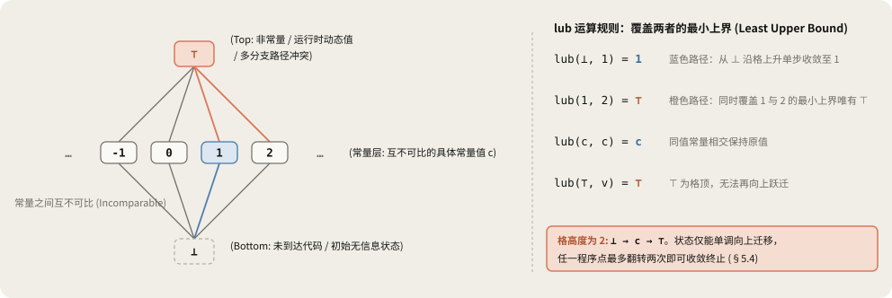

**读图**：左侧展示了经典的扁平格（Flat Lattice）拓扑架构。顶部的 $\top$ 代表非常量或多分支冲突状态；中间层是由互不相交的整数字面值构成的常量平面，任意两个不同常量之间均不可比较大小（Incomparable）；底部的 $\bot$ 代表未执行的无信息状态。右侧演示了最小上界运算（Least Upper Bound, $lub$）的几何跃迁规则：两元素的 $lub$ 即为沿偏序连线向上寻找的首个公共交汇点。从 $\bot$ 与具体数值 $1$ 出发，单步提升即收敛至数值 $1$（蓝色箭头）；而从数值 $1$ 与数值 $2$ 出发，在中间层无路可通，只能共同跃升至顶层元素 $\top$（橙色箭头）。整个半格的高度（Height）严格等于 2，这一性质构成了后文算法停机性证明的核心支撑。

> [!note] 补充：不同经典教材中格方向的倒置传统
> - CS143 课程约定将无信息的“尚未到达”置于格底 $\bot$，将“非常量”置于格顶 $\top$，使用自底向上的汇合运算 $lub$（Join, $\vee$）。
> - 龙书（Aho 等《Compilers》第 2 版 §9.3–9.4）与 Kildall 1973 年奠基论文的传统则正好相反：将未定义状态记为 $\top$（UNDEF），将非确定常量记为 $\bot$（NAC, Not-A-Constant），汇合运算使用最大下界（Meet, $\wedge$）。两者仅是上下镜像颠倒，代数结构与计算实质完全同构。阅读论文与教材时需首先明确其正逆定义。LLVM 内部在实现 SCCP 时直接使用具名枚举 `unknown`、`constant` 与 `overdefined`，避免了符号歧义。
> - 此结构被称为“半格”，是因为分析算法仅用到上确界汇合运算 $lub$。因其同时具备上确界与下确界，它在代数上亦构成完整格。

定义偏序关系上的最小上界（Least-Upper Bound, $lub$）：

$$\begin{aligned}
lub(\bot, c) &= c       && \text{（未达分支不提供约束，保留已有确定值）} \\
lub(c, c) &= c          && \text{（多路径汇入相同常量，最小上界保持不变）} \\
lub(c_1, c_2) &= \top \quad (c_1 \ne c_2) && \text{（常数产生分歧，最小上界跃迁至顶元素）} \\
lub(\top, v) &= \top    && \text{（存在动态或未知路径，最小上界直接锁定为顶元素）}
\end{aligned}$$

通过 $lub$ 可以简洁表达所有前驱节点向当前语句入口汇聚的状态方程：

$$C(s, x, \text{in}) = lub \{ C(p, x, \text{out}) \mid p \text{ 是 } s \text{ 的前驱语句} \}$$

> [!note] 补充：语句内部的状态转移方程（规则 5 至 8）
> 上式解决了前驱出口到当前入口的跨节点传递，语句内部从入口 $C(s, x, \text{in})$ 到出口 $C(s, x, \text{out})$ 的转化则由 Slide 28–32 定义的规则 5–8 掌控：
>
> $$
> \begin{aligned}
> C(s, x, \text{out}) &= \bot \quad \text{若 } C(s, x, \text{in}) = \bot && \text{(规则 5: 未达代码的后继依然未达)} \\
> C(x := c,\ x, \text{out}) &= c \quad (c \text{ 为字面常量}) && \text{(规则 6: 常量赋值重写状态)} \\
> C(x := f(\dots),\ x, \text{out}) &= \top && \text{(规则 7: 动态函数或表达式赋值重置为未知)} \\
> C(y := \dots,\ x, \text{out}) &= C(y := \dots,\ x, \text{in}) \quad (x \ne y) && \text{(规则 8: 未触及变量 x 则状态原样穿透)}
> \end{aligned}
> $$
>
> 规则 5 拥有最高优先权。若入口为 $\bot$，即便是常量赋值语句 `x := 3`，出口依然保持为 $\bot$。这确保了初始置为 $\bot$ 的死分支绝不会产生幽灵常量，只有当控制流真正自入口激活注入时，节点才会被激活计算。

### 4. 算法终止性（Termination）的形式化保障

仅仅设定“重复遍历直到状态不再变化（Repeat until nothing changes）”，在数学上并不足以证明循环必然能停机。

引入 $lub$ 之后，算法的停机证明变得直截了当：
1. **单调上升（Monotonicity）**：所有程序点均以 $ot$ 为起点，且每次应用 $lub$ 运算后状态值**只能单调增加**（沿偏序链 $\bot \le c \le \top$ 上升），绝不可能发生回退。
2. **有限跃迁步数（Finite Height）**：状态值的跃迁路径只有 $\bot \to c \to \top$ 一条链，每个程序点针对单个变量的状态最多只能改变 2 次。
3. **全局收敛边界**：迭代分析必然在有限轮次内达到不动点（Fixed Point）并完全停机。

> [!warning] 纠偏：全程序状态更新上界实为 $4 \times N \times V$
> 常见笔记常粗疏地将更新上界记为 $2 \times N \times V$。这一疏漏忽略了**每条语句都拥有两个独立程序点（入口 $\text{in}$ 与出口 $\text{out}$）**这一事实。
> 若 CFG 中包含 $N$ 条语句、跟踪 $V$ 个变量，全程序总共拥有的独立数据流状态切片点数量为 $2 \times N \times V$ 个。由于每个状态点至多只能发生 2 次单向跃迁（$\bot \to c$ 一次，$c \to \top$ 一次），因此整个不动点算法的最大理论更新上限为：
>
> $$2 \times (2 \times N \times V) = 4 \times N \times V \text{ 次}$$
>
> Slide 58 也明确指出了“总更新次数 = 状态值总数 $\times 2$ = 语句数 $\times 4$”。在自研求解器中测试第 4.2 节的不安全分支用例（6 条语句，跟踪变量 X，若按 $2N$ 计算上限仅为 12 次），在随机构建的特定遍历顺序下，汇合点 `A := 2 * X` 的入出状态各经历了 $\bot \to 3 \to \top$ 的两次翻转，实测总更新次数达到 13 次，直接突破了 $2NV$ 的估算。但无论常数系数如何，核心结论始终成立：算法复杂度与程序尺寸呈**线性阶**关系，且必然停机。

---

## 六、活跃性分析（Liveness Analysis）与死代码消除

全局常量传播完成后，常数已被直接代入使用点。例如语句 `A := 2 * X` 变成了 `A := 2 * 3`。此时，原有的赋值语句 `X := 3` 就失去了存在的意义，应当予以剔除。

判断一条赋值语句能否安全删除，核心依托于**活跃性分析（Liveness Analysis）**。

### 1. 变量的“活跃”与“死亡”

直观而言，**活跃（Live）意味着该变量的值在未来可能被读取（May be used in the future）**：
- 如果一个变量所持有的值在后续执行路径中还可能被任何语句作为操作数使用，它就是**活的（Live）**。
- 如果一个变量在被读取之前就被新的赋值直接覆写，或者程序此后完全不再读取它，那么当前的赋值就是**死的（Dead）**。

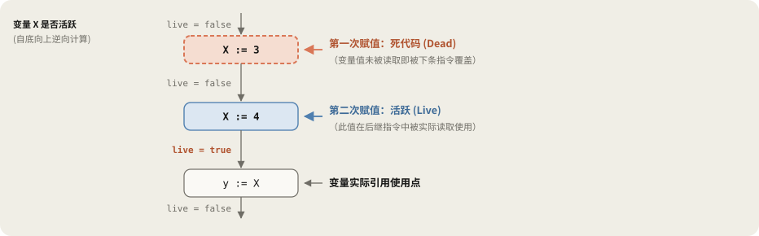

**读图**：右侧展示了三条顺序执行的语句：第一次赋值 `X := 3`、第二次赋值 `X := 4` 以及使用点 `y := X`。左侧展示了自底向上逆向推导出的变量 `X` 活跃性状态：在程序退出点（第 3 条语句之后），假定没有其他代码读取 `X`，故活跃性为 `false`；第 3 条语句读取了 `X`，因此在其紧邻上方，变量被成功激活为 `true`；第 2 条语句执行了对 `X` 的重写（Kill），切断了依赖链，使得在其紧邻上方活跃性再度复位为 `false`；因此在第一次赋值 `X := 3` 的紧后出口处，活跃性状态为 `false`。这意味着赋值 `X := 3` 产出的数值尚未被任何人读取便已死亡，属于彻头彻尾的死代码，优化器可直接予以切除。

对应 C++ 代码逻辑如下：

```cpp
int x = 3;  // 第一次赋值：死代码（从未被读取就遭覆盖）
x = 4;      // 第二次赋值：活跃（此值流入下一行）
int y = x;  // x 在此处被读取使用
```

### 2. 活跃性的形式化定义

变量 $x$ 在语句 $s$ 处是**活跃的（Live）**，当且仅当同时满足以下三个条件：
1. 存在某条语句 $s'$ 使用了变量 $x$（$\exists s', s' \text{ uses } x$）。
2. 在控制流图中，存在一条从 $s$ 指向 $s'$ 的可达路径（Path from $s$ to $s'$）。
3. 在这条路径上，**不存在对变量 $x$ 的任何中间赋值（No intervening assignment to $x$）**。

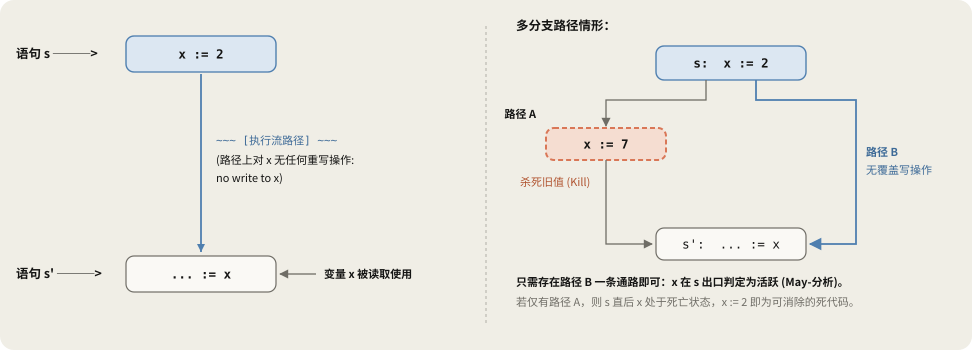

**读图**：左图展示单路径情形：语句 $s$ 执行 `x := 2`，沿控制流到达语句 $s'$ 读取 `... := x`。由于中间路径没有任何针对 `x` 的写入（no write to x），来自 $s$ 的值能无损送达 $s'$，因此 `x` 在语句 $s$ 出口处处于活跃状态。右图展示多分支情形：分支路径 A 包含了赋值 `x := 7`，重写杀死了来自 $s$ 的旧值；但并行的分支路径 B 没有任何写入。活跃性分析属于典型的 **May-分析**（只要存在至少一条通路使得未来可能读取，就判定为活跃），因此只要路径 B 畅通，`x` 在 $s$ 出口依然保持活跃！只有当路径 B 不存在（所有可行路径均包含覆盖写）时，$s$ 后的 `x` 才会彻底死亡。

### 3. 死代码消除（Dead Code Elimination）的判准

基于活跃性分析，死代码消除的判定极为干脆：

> 对于赋值语句 $x := \dots$，**如果紧随该赋值之后变量 $x$ 是死的（Dead after assignment）**，且该语句自身不包含外部可观测副作用（如向 volatile 内存写入、系统调用或 I/O 输出），则该语句即为死代码，可以直接从程序中彻底剥离。

> [!note] 补充：死代码消除的迭代连锁与副作用保留
> - **迭代级联效应**：死代码消除往往不能一蹴而就。删除一条死赋值语句后，该语句右侧所引用的源操作数变量可能随之失去使用点，进而沦为新的死变量。因此，死代码消除与活跃性分析同样需要循环执行直至不动点。在第 4.1 节十步推演中，第 ⑩ 步之所以能删除 `f := 2 * a`，正是因为第 ⑨ 步优化将变量 $g$ 的计算重写为直接引用 $a$ 从而架空了 $f$。
> - **保留外部副作用**：对于包含函数调用的赋值 `x := f()`，即使变量 $x$ 已经死亡，函数调用本身绝不可轻率删除，必须改写为单独的求值语句 `f()`，防止遗漏 I/O 或全局状态变更。
> - **赋能寄存器分配**：活跃性分析除用于剔除死代码外，更是后续课程（lecture16）图着色寄存器分配的核心技术支撑。若两变量在某一程序点同时处于活跃状态，二者的生命周期产生重叠（Interference），绝不能共享分配同一个物理寄存器。

### 4. 活跃性分析的数据流方程与逆向传播

活跃性分析本质上比常量传播更纯粹：
- 它是一个**布尔属性（Boolean property）**：在任意点，变量要么活跃（`true`），要么死亡（`false`）。
- 常量传播是沿着代码执行顺序向后流动的**前向分析（Forward Analysis）**；而活跃性分析则必须从“未来的使用点”逆向回溯到“当下的定义点”，属于典型的**逆向数据流分析（Backward Dataflow Analysis）**。

#### 汇合规则（Rule 1：后继汇聚到前驱出口）

对于拥有多个后继分支的语句 $p$，只要在其任何一条后继路径上变量 $x$ 是活跃的，那么在语句 $p$ 执行完毕的出口处，变量 $x$ 就必须保持活跃。

出口活跃状态由所有后继语句入口状态的**逻辑或（$\bigvee$）**决定：

$$L(p, x, \text{out}) = \bigvee \{ L(s, x, \text{in}) \mid s \text{ 是 } p \text{ 的后继语句} \}$$

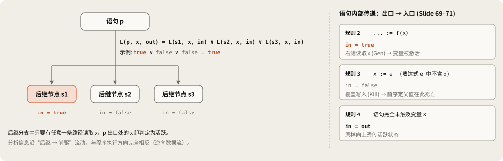

**读图**：左侧展示后继分支向当前前驱节点汇聚的**规则 1**。语句 $p$ 拥有三个后续可能的分支 $s_1$、$s_2$、$s_3$。只要其中哪怕只有一个分支的入口活跃性为真（例如 $s_1$ 为 `true`，而 $s_2$、$s_3$ 为 `false`），通过逻辑析取汇合后，语句 $p$ 出口处的活跃性即确定为 `true`。右侧展示单个语句内部由出口向入口逆推的**规则 2 至 4**：
- **规则 2**：若语句右侧表达式读取了变量 $x$（生成活跃性 / Gen），则不论出口状态如何，该语句入口处 $x$ 必为 `true`；
- **规则 3**：若语句左侧定义了变量 $x$ 且右侧未读取 $x$（杀死活跃性 / Kill），则入口处 $x$ 的旧值彻底死亡，强制置为 `false`；
- **规则 4**：若语句未触及变量 $x$，则原样透传，入口状态与出口状态完全等价。

> [!note] 补充：规则 2 至 4 的形式化与经典数据流集合方程
> 单个变量在语句 $s$ 内部的逆向传递方程写作：
>
> $$
> \begin{aligned}
> L(s, x, \text{in}) &= \text{true} \quad (s \text{ 在右端读取了变量 } x) && \text{(规则 2)} \\
> L(x := e,\ x, \text{in}) &= \text{false} \quad (e \text{ 中不含变量 } x) && \text{(规则 3)} \\
> L(s, x, \text{in}) &= L(s, x, \text{out}) \quad (s \text{ 与变量 } x \text{ 无关}) && \text{(规则 4)}
> \end{aligned}
> $$
>
> 若语句形如 `x := x + 1`，由于其右侧读取了 `x`，规则 2 优先生效，入口活跃性为 `true`。若推广至整个符号表的所有变量集合，可紧凑表示为经典的数据流集合方程：
>
> $$\mathrm{in}(s) = \mathrm{use}(s) \cup \bigl(\mathrm{out}(s) - \mathrm{def}(s)\bigr), \qquad \mathrm{out}(s) = \bigcup_{t \in \mathrm{succ}(s)} \mathrm{in}(t)$$
>
> 其中 $\mathrm{use}(s)$ 为该语句引用的变量集合，$\mathrm{def}(s)$ 为该语句覆写的变量集合。

讲义 Slide 73–82 的经典循环用例求解过程推演如下：

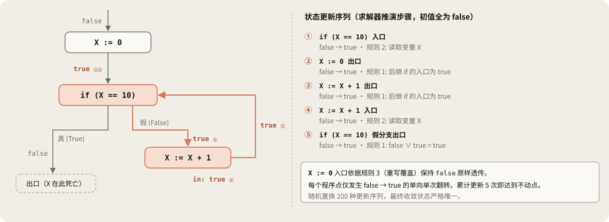

**读图**：示例包含循环结构：入口进入 `X := 0`，随后进入循环守卫 `if (X == 10)`；条件为真时跳往出口退出（此时变量 X 死亡）；条件为假时进入循环体 `X := X + 1` 并折返回 `if` 处。
- 初始化时将所有边上的状态全部置为 `false`，随后逆向更新违背规则的程序点；
- **①** 语句 `if (X == 10)` 读取了变量 $X$，依据规则 2 将其入口逆向更新为 `true`；
- **②** 依据规则 1，前驱语句 `X := 0` 的出口被刷新为 `true`；
- **③** 同样依据规则 1，循环体 `X := X + 1` 的出口被刷新为 `true`；
- **④** 语句 `X := X + 1` 在右端读取了 $X$，依据规则 2 将其入口逆向更新为 `true`；
- **⑤** `if` 语句假分支的出口由此被更新为 `true`；
- 首行语句 `X := 0` 的入口由于执行了无自引用的覆写，依据规则 3 判定旧值已死，保持为 `false`。全网状态经 5 步翻转后达到完美不动点。实测随机重排 200 种更新次序，收敛形态严格一致。

> [!note] 补充：常量传播与活跃性分析的对偶特性横向对比
>
> | 核心考量维度 | 全局常量传播（Constant Propagation） | 活跃性分析（Liveness Analysis） |
> | :--- | :--- | :--- |
> | **核心探查问题** | 在特定程序点，变量 $x$ 的值是否恒等于固定常数 $c$ | 在特定程序点，变量 $x$ 当前的值在未来是否可能被读取 |
> | **数据流流动方向** | **正向（Forward）**：前驱出口 $\to$ 后继入口 | **逆向（Backward）**：后继入口 $\to$ 前驱出口 |
> | **抽象值与偏序格** | 半格三态：$\bot < c < \top$（高度为 2） | 布尔二态：$\text{false} < \text{true}$（高度为 1） |
> | **路径汇合运算** | 最小上界：$\mathrm{lub} \{ C(p) \}$ | 逻辑析取（并集）：$\bigvee \{ L(s) \}$ |
> | **路径判定语义** | **Must-分析**（必须在所有可行前驱路径上成立） | **May-分析**（只要在任意一条后续路径上成立即可） |
> | **全局初始底态** | 程序入口置为 $\top$，其余所有内部点置为 $\bot$ | 全程序所有切片点统一初始化为 `false` |
> | **单点最大跃迁步数** | 至多翻转 2 次（$\bot \to c \to \top$） | 至多翻转 1 次（$\text{false} \to \text{true}$） |
> | **产出主要赋能阶段** | 编译期常量代换、常量折叠、死控制流分支剪枝 | 死代码彻底剔除、图着色物理寄存器分配 |
>
> 绝大多数经典过程内数据流分析（如可用表达式分析 Available Expressions、非常量定义分析 Reaching Definitions）均能纳入这一套前向/逆向、Must/May 的正交框架内。

---

## 七、补充与实测要点汇总表

下表汇集了本次笔记润色中基于讲义细节与实机验证所补充的核心要点：

| 章节定位 | 核心增补模块 | 技术要点与实测结论摘要 |
| :--- | :--- | :--- |
| **§1.1** | 矢量架构图 `opt-mn-decoupling.svg` 与 IR 进阶笔记 | 对比 $M \times N = 9$ 与 $M + N = 6$。指出工业编译器普遍采用多级 IR 架构（GCC 的 GIMPLE/RTL、Rust 的 MIR、MLIR 方言降解流水线）。 |
| **§1.1** | 矢量演进图 `opt-abstraction-levels.svg` | 展示同一算式 `x + y * z` 在源码、三地址码与 GCC 13.3 实测汇编（`imul` + `lea`）之间的对应关系。 |
| **§1.2** | 三地址码生成模板补充 | 剖析无限虚拟寄存器假设下的递归代码生成函数 $\mathrm{igen}(e, t)$，解耦物理寄存器限制。 |
| **§1.3** | 文法与抽象操作码分析 | 解析讲义文法 $P \to S\,P \mid \varepsilon$ 边界；指出 `push` 属于需在底层展开的高层 Opcode。 |
| **§2.2** | 矢量结构图 `opt-basic-block.svg` | 图解单入口、单出口、分支流转以及严禁中途插队跳入与跳出的几何约束。 |
| **§2.2** | 矢量切分图 `opt-cfg-build.svg` 与块外盲区补充 | 详解龙书首领指令（Leader）三原则；以 Slide 21 用例说明基本块分析无法判定跨块变量活性的局限。 |
| **§2.3** | 优化本质与全就业定理补充 | 借助图灵停机问题证明数学最优代码生成的不可判定性；梳理局部、过程内全局与过程间优化三级范围。 |
| **§3.1** | 带符号除法移位替代纠偏 | 澄清 C/C++ 向零截断与算术右移向负无穷截断的本质冲突（`-1 / 8 = 0` 对比 `-1 >> 3 = -1`），还原 GCC 偏置补偿汇编。 |
| **§3.1** | GCC 13.3 实测汇编与浮点恒等式陷阱 | 实测说明 `-O2` 与 `-Os` 在乘 15 上的策略差异；揭示 IEEE 754 规范下 `-0.0` 与 NaN 阻碍浮点代数化简的机制。 |
| **§3.2** | 常量折叠分支剪枝与交叉编译陷阱 | 分析分支折叠引发的不可达代码剔除；剖析交叉编译宿主与目标浮点舍入差异及 MPFR 软件模拟对策。 |
| **§3.3** | 矢量滑动图 `opt-peephole-window.svg` 与滑动原理 | 图解 AT&T 语法下寄存器同值消去的安全边界（删除前提为同值而非死亡）。 |
| **§3.3** | 窥孔规则 $m \le n$ 条件与微型引擎实测 | 指出强度折减可出现指令条数增加（$m > n$）；实测证实忽略跳转目标检查导致循环状态计算错误（`b = 5` 对比 `7`）。 |
| **§4.1** | 矢量协作图 `opt-local-cp-dce.svg` | 图解常量传播与死代码消除互为因果、级联触发的协作关系。 |
| **§4.1** | 矢量推演图 `opt-local-chain.svg` 与十步推演 | 完整实现 Slide 60–78 的十步优化流水线，500 组随机用例等价性检验；实测 GCC 汇编同样达成 $12 \cdot a$ 终态。 |
| **§4.2** | 矢量对比图 `opt-global-safe-unsafe.svg` | 对比展示汇合点 $\mathrm{lub}(3, 3) = 3$ 的安全代换与 $\mathrm{lub}(4, 3) = \top$ 的保守阻断。 |
| **§4.3** | 保守近似原则补充 | 阐明数据流分析考虑不可达假路径的保守性机理，引出条件常量传播（SCCP）。 |
| **§5.1** | 程序切片点定位补充 | 明确数据流状态依附于语句间的入切片点与出切片点。 |
| **§5.2** | 矢量循环图 `opt-loop-backedge.svg` | 公式化剖析回边引发的前后驱互锁死结，解释拓扑排序失效机理。 |
| **§5.2** | 矢量推演图 `opt-init-states.svg` | 分步演示乐观初始化（$\bot$）引导收敛至最小不动点，对比悲观初始化（$\top$）陷于次优解的反例。 |
| **§5.3** | 矢量半格图 `opt-lattice.svg` 与教材倒置传统 | 图解高度为 2 的扁平半格与 $lub$ 向上跳变；梳理 CS143 与龙书/Kildall 在格方向与 $\top/\bot$ 上的对偶定义。 |
| **§5.3** | 语句内状态转移规则 5 至 8 补充 | 补全语句内部转移方程，阐明规则 5 阻断未达分支产生幽灵常量的守卫机制。 |
| **§5.4** | 全局更新上限纠偏 | 纠正忽略语句入出双状态点的传统笔误，证明理论上限为 $4 \times N \times V$；求解器实测出现 13 次更新突破 $2NV$。 |
| **§6.1** | 矢量时序图 `opt-live-dead.svg` | 图解逆向活跃性计算与覆写死代码判定。 |
| **§6.2** | 矢量多路径图 `opt-live-def.svg` | 图解 May-分析特性：多分支中只要存在单条畅通路径即可确立变量存活。 |
| **§6.3** | 死代码消除迭代级联与寄存器分配赋能 | 解析删代码引起的连环死亡效应；强调带副作用函数调用的保护；衔接寄存器冲突图着色。 |
| **§6.4** | 矢量规则图 `opt-live-rule1.svg` 与集合方程 | 图解汇合规则 1 与语句内规则 2–4；导出经典数据流集合方程 $\mathrm{in} = \mathrm{use} \cup (\mathrm{out} - \mathrm{def})$。 |
| **§6.4** | 矢量示例图 `opt-liveness-example.svg` 与双分析对比 | 步进复现讲义 Slide 73–82 的 5 步收敛过程；横向对比常量传播与活跃性分析的全部对偶维度。 |

---

## 八、参考资料

- **Alex Aiken**, Stanford CS143 编译原理课程讲义：
  - *Intermediate Code & Local Optimizations* (Lecture 14)
  - *Global Optimization* (Lecture 15)
  - 课程镜像参考：`facultystaff.richmond.edu/~dszajda/classes/cs331/Fall_2017/lecture_slides/lecture14.pdf`, `lecture15.pdf`。后续讲义 Lecture 16 进一步探讨基于活跃性分析的图着色寄存器分配。
- **Alfred V. Aho, Monica S. Lam, Ravi Sethi, Jeffrey D. Ullman**, *Compilers: Principles, Techniques, and Tools* (2nd Edition, 2006, 龙书)：
  - §8.4 基本块与控制流图（首领指令判定法）
  - §8.5 基本块内的局部优化
  - §8.7 窥孔优化与模式替换
  - §9.2 数据流分析基础与活跃变量分析（Live-Variable Analysis）
  - §9.3 数据流分析的代数抽象与半格模型
  - §9.4 全局常量传播（采用 UNDEF 与 NAC 符号表示法）
- **Gary A. Kildall**, *"A Unified Approach to Global Program Optimization"*, ACM POPL 1973: 形式化确立格结构与不动点迭代数据流分析框架的开山奠基论文。
- **Mark N. Wegman, F. Kenneth Zadeck**, *"Constant Propagation with Conditional Branches"*, ACM TOPLAS 1991: 联合条件分支求值与常量传播的稀疏条件常量传播算法（SCCP）。
- **William M. McKeeman**, *"Peephole Optimization"*, Communications of the ACM, 1965: 窥孔优化概念的原始提出论文。
- **Henry S. Warren, Jr.**, *Hacker's Delight* (2nd Edition, 2012) 第 10 章：深入剖析将常量除法转化为乘法与算术位移的数学原理与有符号偏置校正技术。
- **Andrew W. Appel**, *Modern Compiler Implementation in ML*: 编译器全就业定理、活跃性干扰图构造与寄存器分配深入讲解。
- 前序笔记链接：[`11_02_codegen.md`](11_02_codegen.md)（从 AST 直接发射无 IR 栈式机代码的经典对照）。
