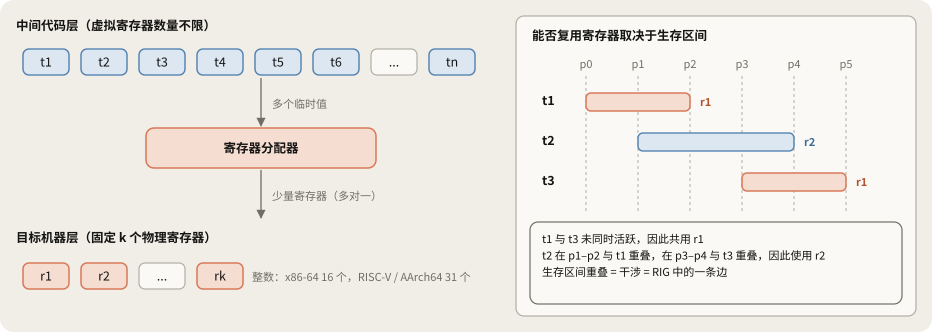
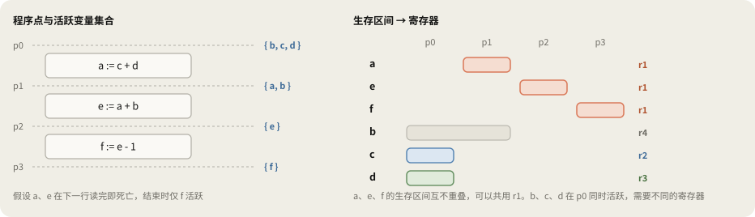
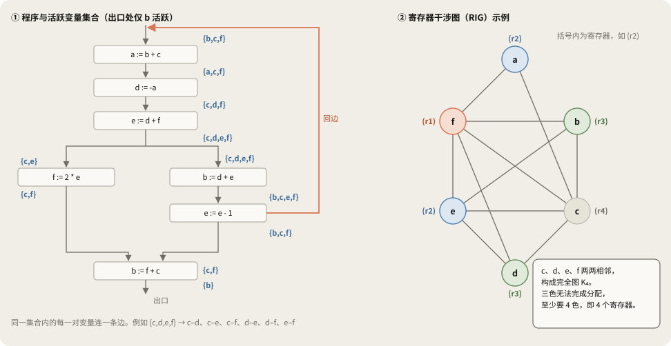
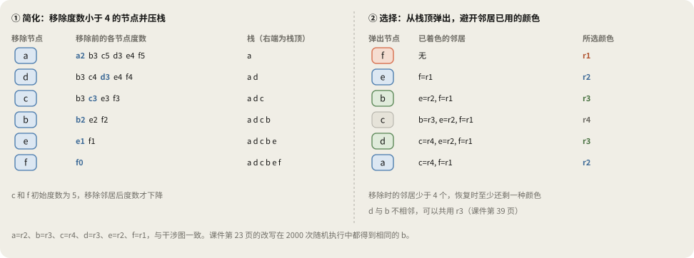
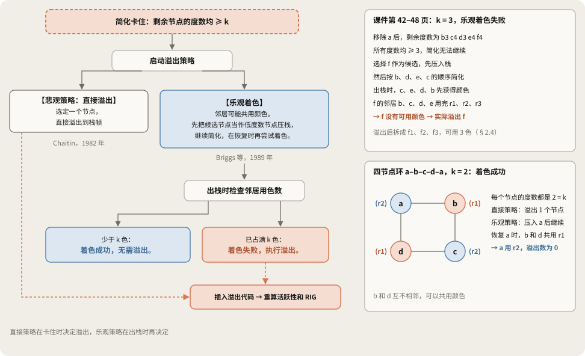
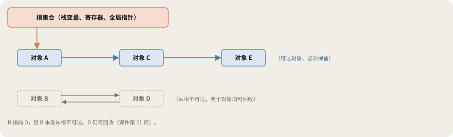
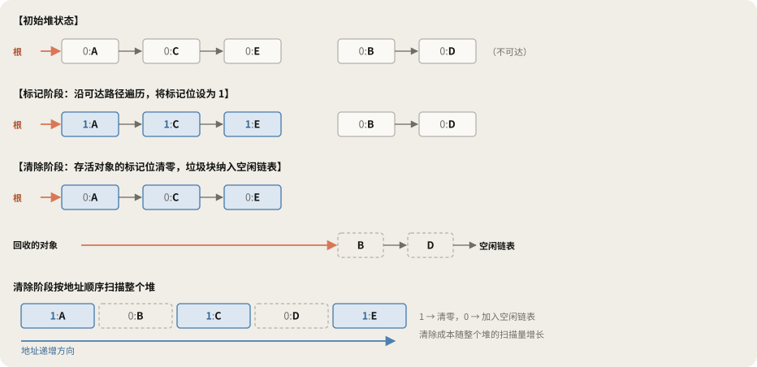
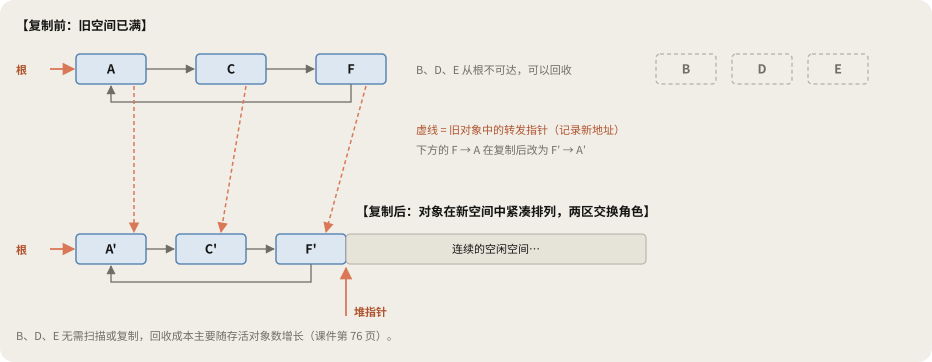
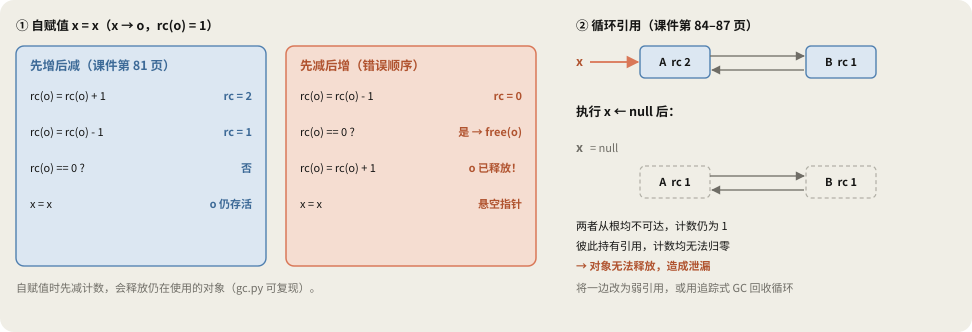

# 编译原理学习笔记：寄存器分配、缓存与自动内存管理

> [!info] 阅读说明
> - 扩展版保留了原笔记的主体，修复了 10 处未正确渲染的粗体。9 处把英文术语移到粗体之外，另有一处把 $\ge k$ 移到粗体之外。§8.2 中的 `\to` 曾在粘贴时被误转为制表符，扩展版已恢复为 $A \to B$。
> - 原有的 8 张 ASCII 图改为 SVG，另补了 4 张图来说明生存区间、简化与选择、Cheney 算法和引用计数。§2.1 的干涉图在粘贴时丢失了部分斜线，扩展版根据课件给出的活跃变量集合重算了边。每张图后都有读图说明。
> - 课件页码以里士满大学镜像中的 CS143 第 16 讲（寄存器分配与缓存）和第 17 讲（自动内存管理）为准。
> - 扩展版标出了四处勘误，分别涉及 §1.3 的 LLVM 分配器、§2.2 的多项式时间算法、§3.3 的冷缺失和 §5.2 的辅助空间上界。
> - 扩展版的验证记录如下。
>   - **寄存器分配**。用 Python 按课件规则复现活跃性分析、干涉图、简化、选择和溢出，得到课件第 12、23、39、45–48、56、61 页的结果。分配寄存器后的代码在 2000 次随机执行中与原代码结果一致。
>   - **垃圾回收**。在 3000 个随机堆上对照标记–清除、指针反转和 Cheney 复制。
>   - **缓存**。在 Xeon E5-2686 v4 和 GCC 13.3 环境中测量内存访问延迟及 §3.3 的循环。
>   - **C++**。编译运行 `shared_ptr` 的循环引用和长链表释放示例。
>   - **实现资料**。查阅 GCC 的 `ira.cc`、LLVM 的 `TargetPassConfig.cpp` 和 `RegAllocGreedy.cpp`，以及 Boehm GC 文档。
> - 配套动画中，[中间代码与优化](../../11_02/middleend-flow.zh-CN.html)涵盖中间代码和优化，[后端流程](../../11_02/backend-flow.zh-CN.html)涵盖运行时环境、代码生成、寄存器分配与内存管理。它们和[前端流程](../11_05/frontend-flow.html)一样，可以用 `→` 键逐步播放。

## 1. 寄存器分配（Register Allocation）

编译器的前端和优化器通常假定中间表示（IR）拥有任意数量的**虚拟临时变量**（也称虚拟寄存器）。这个假设简化了中间代码生成和数据流优化。到生成机器码时，编译器必须使用目标 CPU 提供的物理寄存器，数量通常只有十几个到几十个。

### 1.1 多对一映射与寄存器复用

寄存器分配把虚拟临时变量映射到有限的 $k$ 个物理寄存器，同时保留程序的计算结果和执行语义。同一物理寄存器可以在不同时间存放不同的临时值。



**读图**。左侧给出多对一映射，右侧用横条表示各变量的生存区间。竖虚线 p0–p5 对应程序点。t1 和 t3 从未同时活跃，可以轮流使用 r1。t2 分别与两者重叠，需要另一个寄存器。把每一对重叠的变量连起来，就得到 §2.1 的干涉图。

这种复用依赖**活跃性分析**（Liveness Analysis）。一个临时值在后续执行中不会再被读取时，它所占的寄存器就可以分配给新的值。在课件的简化模型中，$t_1$ 和 $t_2$ 要共享物理寄存器，任一程序点至多有一个值活跃。如果两个值在某个程序点同时活跃，它们就产生**干涉**（Interference），需要各自的寄存器。

> [!note] 共享判据成立的前提
> 课件第 11 页用“是否同时活跃”判定两个变量能否共享寄存器。实际分配器还要处理两种情况。
>
> - **死定义**。在 `t := x + 1; y := 5; z := t * 2` 中，假设 `y` 从未被读取，而且只检查这些定义所对应的临时值。三个值没有同时活跃，按课件方法构造的干涉图在它们之间也没有边。如果都映射到 r1，`y := 5` 就会覆盖仍然活跃的 `t`。当 x = 7 时，z 会从正确的 16 变成 10，扩展版用 `regalloc.py` 复现了这个结果。因此，Chaitin 系列分配器会让一个定义与该语句之后仍然活跃的变量形成干涉。死代码消除通常会删除 `y := 5`，但带副作用的函数调用可能必须保留，哪怕它的返回值无用。
> - **同值复制**。执行 `t2 := t1` 后，即使两者都活跃，只要它们需要保存的是同一个值，就可以共用寄存器。分配器将这对变量合到一起的操作称为**寄存器合并**（Coalescing），也是 §1.3 所引 GCC IRA 注释里的 register coalescing。
>
> 把判据当作充要条件，需要假定每个定义随后都会被读取，而且同时活跃的两个变量可能持有不同的值。

### 1.2 三地址代码中的复用

```cpp
// 原始逻辑使用独立的临时变量
int a = c + d;
int e = a + b;
int f = e - 1;
```

假设 `a` 只在第二行读取，`e` 只在第三行读取，执行完这段代码后只有 `f` 仍然活跃。三个值的生存区间两两不重叠，可以映射到同一个物理寄存器 $r_1$。

```cpp
// 复用物理寄存器 r1，假设 c、d、b 分别位于 r2、r3、r4
r1 = r2 + r3;  // 计算 a，结果存入 r1
r1 = r1 + r4;  // 计算 e，复用 r1
r1 = r1 - 1;   // 计算 f，复用 r1
```



**读图**。左侧列出三条语句前后的 p0–p3 和对应的活跃变量集合，右侧按变量画出生存区间。a 只在 p1 活跃，e 只在 p2 活跃，f 只在 p3 活跃。`r1 = r1 + r4` 先从 r1 读出 a，再把 e 写入 r1。a 在这条语句之后已经死亡，覆盖它是安全的。

### 1.3 从早期启发式到图着色

1950 年代的早期 FORTRAN 编译器已经使用启发式规则分配寄存器。1980 年前后，Gregory Chaitin 等人将寄存器分配形式化为**图着色问题**（Graph Coloring）。图着色由此成为全局寄存器分配的一类基础算法，GCC 的 IRA 就采用了这条路线。

> [!warning] GCC 与 LLVM 的分配策略
> - **GCC**。`gcc/ira.cc` 开头将 IRA 描述为基于 Chaitin–Briggs 算法的区域图着色分配器。
> - **LLVM**。按扩展版所查实现，`TargetPassConfig::createTargetRegisterAllocator` 在 `Optimized` 为真时返回 `createGreedyRegisterAllocator()`，否则返回 `createFastRegisterAllocator()`。贪心分配器（`RegAllocGreedy.cpp`）按优先队列处理生存区间，必要时逐出（evict）已有区间或拆分（split）当前区间。PBQP 分配器属于图着色相关路线，可用 `-regalloc=pbqp` 选择。
> - **JIT 编译器**。编译时间敏感的实现常用线性扫描（Linear Scan），可参看 Poletto 和 Sarkar 1999 年的论文。
> - **时间线**。课件第 9 页提到 1980 年的 IBM 研究团队。相关论文包括 1981 年发表的 *Register allocation via coloring*，以及 Chaitin 在 SIGPLAN 1982 发表的、进一步处理溢出的论文。

---

## 2. 图着色与 Kempe 启发式

### 2.1 寄存器干涉图（Register Interference Graph，RIG）

- **节点**代表虚拟临时变量。
- **无向边**连接在某个程序点同时活跃的两个变量，表示它们不能使用同一个物理寄存器。
- **颜色**对应物理寄存器。目标机器有 $k$ 个可用寄存器时，要给每个节点分配 $k$ 种颜色之一，并让相邻节点颜色不同。



**读图**。原 ASCII 图中 a 下方的斜线出现了显示错误。扩展版用左侧程序的活跃变量集合重算边，保留原来的节点位置和括号中的寄存器编号。

- 对每个程序点，将活跃变量集合里的每一对变量连起来，去重后得到 11 条边。b 和 c 相邻，不能共享。b 和 d 不相邻，可以共用 r3，与课件第 15 页一致。
- d 和 f 同时出现在 `{c,d,f}` 与 `{c,d,e,f}` 中，因此有 d–f 这条边。a 的邻居只有 c 和 f。
- c、d、e、f 构成完全图 $K_4$，b、c、e、f 也构成一个 $K_4$。任意 $K_4$ 都需要四种颜色。扩展版穷举了六个节点的着色，验证最少需要四种颜色，与课件第 20 页一致。

这个例子可以用四个寄存器完成无溢出分配。只有三个寄存器时，当前干涉图没有合法的三色分配。

### 2.2 计算复杂度与 Kempe 简化

对一般图，固定 $k \ge 3$ 时，判定是否可以用 $k$ 种颜色着色是 **NP 完全**问题。求最少颜色数是 **NP 困难**的优化问题。

> [!warning] 多项式时间算法的已知结论
> 课件第 25 页写的是目前没有已知的高效算法。要断言一般问题不存在多项式时间算法，还需要证明 $P \ne NP$。
>
> Chaitin 等人（1981）证明，任意图都可以构造成某个程序的干涉图，所以一般的寄存器分配继承了这个难度。SSA 形式在消除 $\phi$ 函数之前构成特殊情形。其干涉图属于**弦图**（Chordal Graph），可在多项式时间内求最优着色（Hack、Grund 和 Goos，2006）。

> **Kempe 启发式的依据**。若节点 $t$ 的度数 $d(t) < k$，就算它的每个邻居都使用不同的颜色，也至少有一种颜色留给 $t$。由此可以先移除 $t$ 及其相连的边，把它压入栈。如果剩余子图可以用 $k$ 种颜色着色，恢复 $t$ 之后原图也可以。

1. **简化（Simplify）**。反复找出度数小于 $k$ 的节点，移除并压栈。
2. **选择（Select）**。图清空后按栈的逆序恢复节点，为每个节点选择一种已着色邻居未使用的颜色。



**读图**。图中的两张表对应课件第 28–40 页。左表列出每次移除前各节点的度数，粗体蓝字标出本轮移除的节点。c 和 f 最初度数为 5，移除相邻的 a 和 d 后，部分节点的度数降为 4 再降到 3，简化可以继续。图采用课件中的一种移除顺序。右表从栈顶的 f 开始恢复，每次选最小编号的可用颜色。

按这个结果改写课件第 12 页的代码，可以得到第 23 页的指令 `r2 := r3 + r4; r3 := -r2; …`。

### 2.3 溢出（Spilling）与乐观着色

简化进行到某一步时，剩余节点的度数可能全部 $\ge k$。此时已无法用低度数节点的判据继续。如果恢复节点时确实没有可用颜色，编译器就要把该变量**溢出**到栈帧中的内存槽。



**读图**。左侧保留了原 ASCII 图的两条路径。Chaitin（1982）的策略在简化卡住时直接决定溢出。Briggs 等人（1989、1994）的乐观着色先将候选节点压栈继续简化，等到恢复该节点时再统计邻居实际用了多少种颜色。下方橙色框给出着色失败后执行的代码改写和重新分析。

- **上方，$k = 3$**。课件第 42–48 页中，恢复 f 时三个颜色都已被邻居使用，因此 f 确实溢出。
- **下方，$k = 2$**。四节点环上的每个节点初始度数都是 2。直接策略会立刻溢出一个节点。乐观策略先压入 a，恢复它时发现 b 和 d 不相邻，可以用同一种颜色，因此仍有颜色给 a，最终没有溢出。

扩展版用 `regalloc.py` 验证了两个例子。

### 2.4 溢出后的代码改写

确定 f 要溢出后，编译器在当前函数的栈帧为它分配槽位 $fa$。写 f 的地方在计算后存入该槽位，读 f 的地方先从该槽位加载。

```cpp
// 原始三地址代码
f = a + b;
c = f * 2;

// f 溢出后的伪代码，混合展示三地址运算与机器指令
int t_reg = a + b;
mov [fa], t_reg;      // 写 f 时，把值存到栈槽（store fa, f）

// ... 执行其他逻辑 ...

mov t_reg2, [fa];     // 读 f 时，从栈槽重新加载（load f, fa）
c = t_reg2 * 2;
```

改写后，原值长期保存在栈里，寄存器临时值只在加载之后或存储之前的短区间内活跃，干涉边通常会减少。编译器据此重新构建干涉图并再次着色。

> [!note] 课件第 49–65 页的改写细节
> - **临时值重新命名**。课件把内存操作写成 `f := load fa` 和 `store f, fa`，并引入 f1、f2、f3 等新变量（第 53 页）。独立命名后，各片段可以使用不同的寄存器。
> - **重新计算活跃变量集合**。`{c,d,f1}`、`{c,f2}`、`{c,f3}` 中的 f1、f2、f3 各自只在紧贴加载或存储的位置活跃（第 56 页）。f1 只与 c、d 干涉，f2 和 f3 只与 c 干涉。新图可以用三色完成着色（第 61 页）。
> - **验证记录**。扩展版脚本得到了相同的活跃变量集合和干涉边。用三个寄存器和槽位 `fa` 改写的代码，在 2000 次随机执行中都得到了与原代码一致的 b。
> - **指令写法**。`mov [fa], t_reg` 使用目标在前的 Intel 语法，代码注释中的 `store fa, f` 与课件的 `store f, fa` 采用不同的操作数顺序。
> - **选择溢出对象**。课件第 62–65 页给出几类启发式，包括优先考虑干涉多、定义和使用少、位于内层循环之外的变量。正确改写可保持语义，选择会影响性能。

---

## 3. 缓存与内存层次

### 3.1 各层容量与访问延迟

处理器的时钟频率比主存响应快得多。片上高速 SRAM 的容量也受面积和功耗限制，因此硬件采用多级存储结构。

| 层级 | 典型访问延迟（周期） | 容量范围 |
|---|---:|---|
| **寄存器** | 1 | 数百 B 到数 KB |
| **片上缓存（L1/L2/L3）** | 3–20 | 数十 KB 到数十 MB |
| **主存** | 20–100+ | 数 GB 到数十 GB |
| **外部存储（SSD / NVMe）** | 100,000–5,000,000 | 数百 GB 到数 TB |

缓存缺失可能让依赖该次读取的流水线停顿几十到几百个周期。处理器用两到三级缓存减轻访问延迟。

> [!note] 课件参考值与扩展版实测
> 上表采用课件第 67 页的早期估值作为参考。课件列出寄存器 1 周期、缓存 3 周期、主存 20–100 周期、磁盘 50 万–500 万周期。扩展版的 Xeon E5-2686 v4 每核有 32 KiB L1d、256 KiB L2，并共享 45 MiB L3。实验通过随机指针追踪测单次串行加载延迟（`cache.c`，按 2.3 GHz 的 TSC 换算）。
>
> | 工作集 | 延迟 | TSC 计数 | 主要来源 |
> |---|---:|---:|---|
> | 16 KiB | 1.8 ns | 4 | L1 |
> | 128 KiB | 6.0 ns | 14 | L2 |
> | 1 MiB | 26 ns | 60 | L3 |
> | 8 MiB | 61 ns | 140 | L3 和 TLB 缺失 |
> | 32 MiB | 132 ns | 303 | 部分 L3 访问和 TLB 缺失 |
> | 1 GiB | 259 ns | 595 | DRAM 和页表遍历 |
>
> 这台服务器的主存访问可达数百个周期，高于表中 20–100+ 的参考区间。随机访问可能同时引起缓存和 TLB 缺失，所以表中的实测值包含地址转换成本。实验在虚拟机中执行，绝对值可能波动几十个百分点。

### 3.2 编译器能控制哪些访问

编译器可以凭借活跃性分析和全局分配策略自动复用寄存器。缓存中哪些行会被反复逐出、哪些地址会落到同一组，以及运行时指针会访问哪里，都更难在编译时确定。数据布局和访问顺序因此直接影响缓存利用率，例如采用数据导向设计、按行访问和分块遍历。

### 3.3 工作集超过缓存时的循环访问

```cpp
// 每个数组有 1,000,000 个整数，约 4 MB。外层循环重复 10 次
for (int j = 0; j < 10; ++j) {
    for (int i = 0; i < 1000000; ++i) {
        a[i] *= b[i];
    }
}
```

两个数组合计约 8 MB，超过常见的 L1/L2 容量。内层循环扫过整个数组以后，下一轮再次访问最前面的 `a[0]`、`b[0]` 时，这些块可能已从该级缓存逐出。**循环分块**（Loop Tiling / Blocking）把大数组分成适合缓存的小块，提高逐出之前的复用率。

> [!warning] 用 3C 模型区分这里的缺失
> - **强制缺失**（Compulsory / Cold Miss）发生在第一次访问某个块时。
> - **容量缺失**（Capacity Miss）发生在缓存装不下工作集、块被逐出后又被访问时。
> - **冲突缺失**（Conflict Miss）来自多个块竞争同一缓存组。
>
> 第一轮（`j = 0`）首次读取 `a[0]` 可能发生冷缺失。下一轮重新读取同一块时，如果它因工作集太大而被逐出，这次属于容量缺失。

> [!note] 循环交换、分块和实测
> 课件第 72 页把 i 放到外层、j 放到内层。每取到一对 `a[i]` 和 `b[i]`，就连续做 10 次乘法。按课件的简化模型，首个引用缺失，接下来的九个引用命中，因此估计可能提速 10 倍以上。分块把这项思路推广到一整段 i，每次取一个能放入缓存的块，在块内完成全部 j 轮。
>
> 扩展版在 `cache.c` 中用 GCC 13.3 测了三个版本。每块 4096 对元素，共 32 KiB。表中给出三次运行的范围，三种实现的计算结果一致。
>
> | N | 选项 | 原始循环（j 在外） | 循环交换（i 在外） | 分块 |
> |---|---|---:|---:|---:|
> | 10⁶（8 MB） | `-O2` | 14.5–15.1 ms | 25.7–26.8 ms | 14.2–14.7 ms |
> | 10⁶（8 MB） | `-O3` | 10.4–11.2 ms | 8.0–15.3 ms | 4.8–8.9 ms |
> | 10⁷（80 MB） | `-O2` | 124–149 ms | 120–135 ms | 66–73 ms |
> | 10⁷（80 MB） | `-O3` | 105–122 ms | 71–81 ms | 47–53 ms |
>
> - **顺序访问已能预取**。原循环顺序访问地址，硬件预取器可以提前搬运下一个块。吞吐量更容易受内存带宽限制。8 MB 的工作集还能放进这台机器的 45 MiB L3，差距进一步缩小。
> - **循环交换受编译选项影响**。在 `-O2` 下速度持平或下降，80 MB 时用 `-O3` 约快 1.4 倍。对同一个 `a[i]` 连续乘 10 次会形成依赖链，每次乘法都要等前一次结果，抵消一部分内存收益。
> - **80 MB 时分块约快两倍**。块内仍顺序遍历，便于向量化和预取，同时减少内存往返。
> - **编译器保持了原循环顺序**。该环境下 GCC 13.3 的 `-O3` 启用了 `-floop-interchange`，但 `-fopt-info-loop` 没有报告原循环发生该转换。扩展版推测原因是原内循环已经在访问连续地址，课件第 69 页也指出自动缓存优化的局限。

---

## 4. 自动内存管理（Automatic Memory Management）

C 和 C++ 中，手动管理堆内存会引入几类错误。

- 忘记释放已分配的内存，造成**内存泄漏**（Memory Leak）。
- 内存释放后仍保留指向它的**悬空指针**（Dangling Pointer），通过它访问会造成释放后使用（Use-After-Free）。
- 越界访问破坏相邻的数据结构。
- 写坏内存的位置与程序崩溃的位置可能相隔很远。例如一个模块破坏了数据，另一个模块很久以后读到它才崩溃，定位错误会更困难。

自动内存管理在 1950 年代随 Lisp 出现，1990 年代又随着 Java 的普及进入主流开发。

### 用可达性近似判断对象还会不会被使用

对任意程序，判断某个对象今后是否会再次被读取是不可判定的，可以用停机问题归约来说明。追踪式垃圾回收器用**可达性分析**（Reachability Analysis）作保守近似。

> 程序能通过指针链访问它仍然持有引用的对象。若从任何根都无法沿引用找到某个对象，就可以将该对象视为垃圾并回收。



**读图**。蓝色对象可以沿根的指针找到，灰色虚线对象互相引用，但根没有路径通向它们。课件第 15 页递归定义可达性。寄存器指向的对象可达，可达对象所指向的对象也可达。计算时从根开始遍历指针即可。

> [!note] 可达对象也可能再也用不到
> 参考课件第 16–18 页，假设 GC 在 `x ← new A; y ← new B; x ← y; if alwaysTrue() then x ← new A else x.foo() fi` 的 `x ← y` 之后运行，且 y 随后不再使用。
>
> - **第一个 A**。已经没有引用指向它，可以回收。
> - **B**。GC 当时还能沿 x 找到它，因此会保留。如果 `alwaysTrue()` 始终返回真，x 很快就改为指向新 A，B 以后其实不会再用到。
>
> 可达性会保留未来可能使用的对象。如果变量一直持有用完的大对象，即使语言有 GC，那部分内存也可能长期无法回收。课件第 92 页举例，编译器生成 IR 后仍保留一个指向 AST 的变量。

---

## 5. 标记–清除（Mark and Sweep）

标记–清除分两个阶段，典型实现可在无法满足新的堆分配时触发回收。

### 5.1 标记与清除

1. **标记（Mark）**。从根集合出发，沿对象之间的指针执行深度优先或广度优先遍历。根可来自寄存器、调用栈帧中的局部指针和全局变量。访问一个可达对象时，把它的标记位从 0 设为 1。
2. **清除（Sweep）**。按地址顺序扫描整个堆。标记位为 1 的对象保留，同时把标记位清回 0，供下次 GC 使用。标记位为 0 的对象不可达，其内存块加入空闲链表（Free List）。



**读图**。每个对象左侧一格是标记位。标记沿根的指针遍历，因此只有 A、C、E 变成 1。B 本身不可达，标记过程不会访问它指向 D 的边。

最下面一行给出了清除顺序。清除从堆的起始地址出发，每次按当前对象的大小前进，直到扫完所有对象（课件第 28 页）。这也是 COOL 对象需要大小字段的原因之一。标记成本主要随存活对象和其引用数增长，清除成本随整个堆的扫描量增长。课件第 29 页的 A–F 示例在标记后的位序列为 `1 0 1 0 0 1`，扩展版用 `gc.py` 得到了同样的结果。

### 5.2 堆空间紧张时的辅助空间

在堆分配已经吃紧时，标记还需要空间来存放待访问的对象。显式工作列表和递归调用栈的最坏规模都可能随存活对象数增长。Schorr–Waite 指针反转（Pointer Reversal）会临时用对象本身的指针字段记录回溯路径，从而用 $O(1)$ 的独立辅助空间执行原地遍历。

> [!warning] 工作列表大小与外部碎片的成因
> - **工作列表上界随堆而变**。课件第 31 页所说的 unbounded 指无法预先划出一个适用于任意堆形状的固定大小。堆有限时，列表也有上界。扩展版在 `gc.py` 中构造一个有 1000 个子对象的节点，工作列表达到 1000 项。遍历长度为 1000 的单链表，显式列表只需 1 项，递归实现却会积累 1000 层调用。
> - **外部碎片来自标记–清除的空闲块布局**。存活对象留在原地，分散的空闲块被放进空闲链表，因此课件第 50 页建议合并相邻空闲块。指针反转只改变遍历方式，结束后恢复指针字段。对象地址保持稳定的特性在 §7 的保守式 GC 中也有用（课件第 51 页）。

> [!note] 指针反转的空间开销与实际实现
> - **回溯机制**。课件第 34–49 页的做法把深度优先遍历的回溯信息存进对象。向子对象前进时把对应字段反转成指向父对象，回溯时恢复原值。
> - **空间口径**。独立辅助空间只需几个指针。每个对象还要能记录当前处理到第几个字段。若对象有 $n$ 个字段，记录索引约需 $\lceil \log_2 n \rceil$ 位，通常使用对象头的空闲位。这里的 $O(1)$ 指与对象总数无关的独立工作空间。
> - **验证记录**。扩展版对 3000 个随机堆比较了指针反转和显式工作列表的标记结果。两者一致，所有指针字段也都在遍历结束后恢复。
> - **Boehm GC**。`docs/gcdescr.md` 的 `mark stack overflows` 部分说明，该实现用显式标记栈，溢出后通过再次扫描恢复。指针反转需要临时改写对象，对并行或并发回收不便，每个反转字段也要写入两次。

---

## 6. 停止–复制（Stop & Copy）

停止–复制预留一部分堆，用来把存活对象紧凑地复制到连续地址。它用空间换取简单的分配路径和无碎片的对象布局。

### 6.1 半空间与指针递增分配（Bump Allocation）

堆分成相等的两个半空间。

- **当前分配区**（Old Space / From-Space）供程序分配对象。
- **备用区**（New Space / To-Space）平时为空，回收时接收存活对象的副本。


**读图**。分配区内，堆指针左侧已使用，右侧是连续的可用空间。分配时直接保留当前地址，再把指针按对象大小向前推进。备用区等到 GC 时才使用。

```cpp
// 指针递增分配。简化示意，分配只需要一次指针加法
void* alloc(size_t size) {
    void* p = heap_pointer;
    heap_pointer += size;
    return p;
}
```

> [!note] 实现中的边界检查与对齐
> 实际实现会先把 `size` 向上对齐到分配单位，常见单位为 8 或 16 字节，再检查是否越过上界，可用 `if (heap_pointer + size > heap_limit) collect();` 示意。快路径仍只需一次加法、一次比较和一次存储。多线程运行时可以给每个线程预留一小段空间，例如 HotSpot 的 TLAB（Thread-Local Allocation Buffer），线程可在自己的区间内分配，避免每次分配都争用共享指针。

### 6.2 复制、转发指针与 Cheney 算法

当前分配区空间不足时，回收器按以下顺序运行。

1. 暂停应用线程。
2. 从根开始扫描，将发现的存活对象紧凑地复制到备用区的前部。
3. 每复制一个对象就在原位置记录**转发指针**（Forwarding Pointer），指向新副本。后续引用如果仍指向旧对象，就沿转发指针找到已有副本，并把该引用更新为新地址。
4. 回收整块原分配区，交换两个半空间的角色，然后恢复应用执行。



**读图**。上下两行给出复制前后的空间布局。底部折线是课件第 55 和 72 页的 F → A。复制必须保留该环，把 F′ 的引用改成 F′ → A′。橙色虚线是留在旧对象上的转发指针。B、D、E 既不复制也不扫描，所以工作量主要取决于存活对象和其中的引用，垃圾比例高时相对划算（第 76 页）。


**读图**。Cheney（1970）用新空间自身保存扫描队列，解决复制时也需要辅助工作列表的问题。

- `alloc` 指向下一个副本的放置位置，`scan` 指向第一个尚未检查指针字段的副本。
- 处理 `scan` 对象的每个指针字段。目标尚未复制时，复制到 `alloc`，推进 `alloc`，在旧对象处留下转发指针。目标已有副本时，取转发指针的值。两种情况都要把当前字段改为新地址。
- `scan` 与 `alloc` 之间的橙色区域是已经复制但尚未扫描的对象，相遇时遍历结束。

副本按离根从近到远的顺序放置，对应广度优先遍历。扩展版的 `gc.py` 重现了课件第 66–73 页的 A、C、F 顺序，并在 3000 个随机堆上验证了副本与原可达子图的结构一致。

复制后存活对象紧挨在一起，没有对象间的外部碎片，后续分配也只需推进指针。代价是等大的半空间布局始终要留出堆的 50% 作为备用区。

> [!note] 分代回收如何缩小备用空间
> 课件第 52 页指出，两个半空间只让程序用到一半。分代 GC（第 94 页）利用多数新对象很快死亡的特点，只把年轻代分成较小的两块，经常复制回收。存活时间较长的对象移入老年代，可用标记–清除或压缩等方式降低回收频率。需要为复制预留的空间随年轻代大小而定。

---

## 7. 保守式垃圾回收（Conservative Collection）

Java、Go 等带 GC 的运行时可以利用类型布局、栈映射等元数据区分指针和整数，据此实施精确式 GC（Exact / Precise GC）。C/C++ 的普通内存区域缺少对回收器可用的完整类型信息，回收器有时只能看到原始字节。

### 7.1 从字节模式无法确定类型

连续两个机器字可以表示链表节点的值和指针，也可以表示两个 64 位整数。单看这些位无法还原它们的实际类型。

```cpp
struct Data {
    uint64_t account_balance; // 账户余额
    void*    next_ptr;        // 指向下一个对象
};
```

假如 `account_balance` 的整数值恰好等于一个有效堆地址，例如 `0x7fff8040`，缺少类型信息的回收器无法区分它是余额还是指针。

### 7.2 候选指针判定与对象移动限制

Boehm GC 是保守式回收器的代表。保守的目标是保留所有可能仍被引用的对象，允许一部分垃圾暂时留下。课件的简化规则把一个机器字当作候选指针，需要满足两个条件。

1. 数值满足示例的地址对齐约束。例如按 8 字节对齐时，地址最低 3 位为 `000`。
2. 数值落在有效的堆地址范围内。

回收器按潜在引用处理同时符合两项条件的值，并继续追踪它指向的对象。


**读图**。左侧用流程图展示课件的两项条件，检查的先后顺序可以交换。右侧用 4 字节对齐演示。

- `0x2462` 位于范围内，但不满足 4 字节对齐，按普通数值处理。
- `0x9A00` 超出示例堆范围，按普通数值处理。
- `0x3000` 实际是余额这样的整数，却通过了两项检查。因此回收器会保留该地址处的对象。对象即便原本可回收，也可能因此留下。

如果移动该对象并把含义不明的字改为新地址，整数余额也会被篡改。对象只要仍可能被某个无法重写的引用指向，就必须留在原地。在完全保守的模型中，原地标记–清除可以满足这个约束，整体复制和压缩则无法安全更新这些值。

> [!note] Boehm GC 的实际检查与部分可移动的情形
> - **对齐检查针对扫描位置**。据 Boehm GC 的 `docs/gcdescr.md`，在缺少类型信息的区域中，它从对齐的槽位读取候选值。在 64 位示例中槽位按 8 字节对齐。候选值先与粗略堆边界比较，再检查它指向的地址是否属于实际已分配的堆块。
> - **内部指针**。默认设置下，指向对象内部的值也可以让该对象继续存活。例如 C 中可能只剩 `p = buf + 3`。文档指出，C++ 多重继承下通常不适合用 `GC_set_all_interior_pointers(0)` 关闭这项行为。
> - **黑名单**。如果某个疑似指针值指向堆边缘之外或未分配的页，回收器可将该页记入黑名单，今后只在此类页内放可减轻误判影响的无指针小对象。
> - **部分对象可以移动**。Bartlett 的 mostly-copying GC（1988）保守扫描栈和寄存器，对堆内对象使用精确类型信息。栈上含义不明的值所指向的页会被固定，其他对象仍可复制。

---

## 8. 引用计数（Reference Counting）

引用计数在修改引用时维护计数，将回收工作分散到各次指针操作。最后一个拥有引用消失时，回收可以立即开始。

### 8.1 基本规则

- 对象建立首个拥有引用时，计数 `rc` 初始化为 1。
- 新增指向它的拥有引用时，执行 `rc += 1`。
- 引用离开作用域或改指向其他对象时，执行 `rc -= 1`。
- `rc == 0` 时销毁对象并释放其内存。

指针赋值 `x = y` 的底层逻辑可用以下伪代码表示。

```cpp
// 假设 x 原先指向对象 o，y 指向对象 p
// 以下步骤对应一次 x = y

rc(p) = rc(p) + 1;     // 1. 先增加新对象的引用计数
rc(o) = rc(o) - 1;     // 2. 再减少旧对象的引用计数

if (rc(o) == 0) {      // 3. 判断旧对象是否已失去全部引用
    free(o);           // 归零时释放，可能引发递归回收
}

x = y;                 // 4. 写入新指针
```

> [!note] 先增加新引用，再减少旧引用
> 自赋值 `x = x` 时，两个指针指向同一个对象。如果计数为 1 且先减计数，归零会在赋值完成前释放仍然需要的对象。



**读图**。左侧假设 x 是 o 的唯一引用。先增后减得到 `1 → 2 → 1`，o 仍然存活。先减后增时，计数先到 0，随后增加计数的操作会访问已释放的对象。扩展版用 `gc.py` 复现了这两条路径。

右侧是课件第 84–87 页的循环引用。`x ← null` 后，A 的计数由 2 变成 1。A、B 都已从根不可达，但彼此的引用让各自的计数仍然是 1。

### 8.2 回收时机、循环和维护成本

**确定性的回收时机**（Deterministic Reclamation）与 RAII（Resource Acquisition Is Initialization）兼容。最后一个拥有引用离开作用域时即可触发释放，一般无需等待一次全堆扫描。

- **循环引用**。若 $A \to B$ 与 $B \to A$ 都是强引用，外部引用断开后，两者的计数仍为 1，内存无法靠引用计数回收。
- **计数维护成本**。普通的拥有引用赋值也可能要增计数、减计数并判断是否归零。多个线程共享同一个计数时，原子读改写会产生缓存一致性流量和争用。

```cpp
// 用弱引用表示不拥有对象的回边
#include <memory>

struct Node {
    std::shared_ptr<Node> next;
    std::weak_ptr<Node>   prev; // 回边使用弱引用，避免形成强引用环
};
```

> [!note] C++ 实验与实现细节
> - **循环引用实验**。扩展版用 `rc.cpp` 将两个节点连接起来，并把 `prev` 也设为 `shared_ptr`。两个局部变量销毁后，析构次数为 0。把 `prev` 改成 `weak_ptr` 后，两个节点都被释放。这类环造成的是内存泄漏。课件第 88 页给出两种处理方式，用弱引用打断环，或偶尔运行追踪式 GC 收集环。CPython 在引用计数之上增加了循环收集器，采用后一种方式。
> - **连锁释放**。一个对象的计数变为 0 时，它的析构可能继续减少其他对象的计数。扩展版释放一条有 100 万个节点的 `shared_ptr` 链表头时，递归析构耗尽 8 MB 栈并触发段错误。10 万节点的试验能正常结束。大批量释放会暂停当前工作，递归析构还有栈空间成本。
> - **原子操作**。Rust 分别提供单线程的 `Rc` 和可在线程间共享的 `Arc`。扩展版所查的 libstdc++ 在运行时通过 `__gthread_active_p` 检查线程支持是否激活，未激活时可采用非原子加法（`ext/atomicity.h`）。

---

## 9. 扩展内容与验证记录

| 位置 | 扩展内容 | 扩展版的验证方法 |
|---|---|---|
| §1.1 | 多对一映射图及共享判据的两个例外 | 复现死定义导致 z 从 16 变成 10 |
| §1.2 | 三条语句的生存区间图 | 按课件第 7 页的假设计算活跃变量集合 |
| §1.3 | GCC 的 Chaitin–Briggs 着色与 LLVM 贪心分配 | 查看 `ira.cc`、`TargetPassConfig.cpp` 和 `RegAllocGreedy.cpp` |
| §2.1 | 课件第 12 页的活跃变量集合、11 条干涉边和四色下界 | 重算活跃性并穷举所有着色 |
| §2.2 | NP 完全的含义、SSA 干涉图、简化与选择 | 复现课件第 28–40 页的顺序、着色以及第 23 页的代码 |
| §2.3 | 两种溢出策略及乐观着色的失败与成功示例 | 运行课件 $k = 3$ 的例子和 $k = 2$ 的四节点环 |
| §2.4 | 溢出后的活跃变量集合与新干涉图 | 复现课件第 56、61 页，用三个寄存器的代码随机执行 2000 次 |
| §3.1 | 内存访问延迟 | 用 `cache.c` 做指针追踪 |
| §3.3 | 容量缺失、循环交换与分块 | 用 GCC 13.3 的 `-O2`、`-O3` 测量 `cache.c`，检查 `-fopt-info-loop` |
| §4 | 可达性图与可达却不用的对象 | 对照课件第 16 页的示例 |
| §5.1–5.2 | 标记–清除、辅助空间、碎片与指针反转 | 在 3000 个随机堆上对照三种方法，查阅 Boehm GC 文档 |
| §6 | 半空间、复制、Cheney 算法、指针递增分配与分代回收 | 复现课件第 66–73 页顺序，交叉验证 3000 个随机堆 |
| §7.2 | 候选指针判定、Boehm GC 规则和 mostly-copying | 查阅 `gcdescr.md`、`gcinterface.md` |
| §8 | 引用计数顺序、循环引用和连锁释放 | 运行 `gc.py`、`rc.cpp`，使用 G++ 13.3 |

## 10. 参考资料

- CS143 第 16 讲 *Register Allocation*、第 17 讲 *Automatic Memory Management*（里士满大学镜像 `facultystaff.richmond.edu/~dszajda/classes/cs331/Fall_2017/lecture_slides/`）
- G. J. Chaitin、M. A. Auslander、A. K. Chandra、J. Cocke、M. E. Hopkins、P. W. Markstein，*Register allocation via coloring*，Computer Languages 6，1981
- G. J. Chaitin，*Register allocation & spilling via graph coloring*，SIGPLAN 1982
- P. Briggs、K. D. Cooper、L. Torczon，*Improvements to graph coloring register allocation*，ACM TOPLAS 16(3)，1994（乐观着色）
- M. Poletto、V. Sarkar，*Linear scan register allocation*，ACM TOPLAS 21(5)，1999
- S. Hack、D. Grund、G. Goos，*Register allocation for programs in SSA-form*，CC 2006
- GCC `gcc/ira.cc` 文件开头的注释，LLVM `llvm/lib/CodeGen/RegAllocGreedy.cpp` 和 `TargetPassConfig.cpp`
- C. J. Cheney，*A nonrecursive list compacting algorithm*，CACM 13(11)，1970
- H. Schorr、W. M. Waite，*An efficient machine-independent procedure for garbage collection in various list structures*，CACM 10(8)，1967
- J. F. Bartlett，*Compacting garbage collection with ambiguous roots*，DEC WRL Research Report 88/2，1988
- Boehm GC 的 `docs/gcdescr.md` 和 `docs/gcinterface.md`（`github.com/ivmai/bdwgc`）
- Richard Jones、Antony Hosking、Eliot Moss，*The Garbage Collection Handbook*，第 2 版，2023
- 前一篇[中间代码与程序优化](11_05.md)，包含本篇用到的活跃性分析
