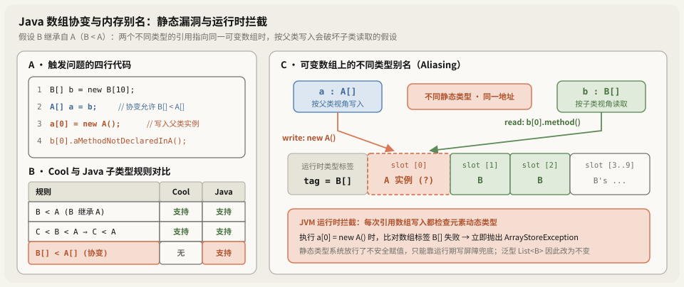
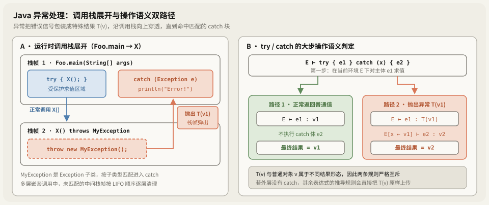
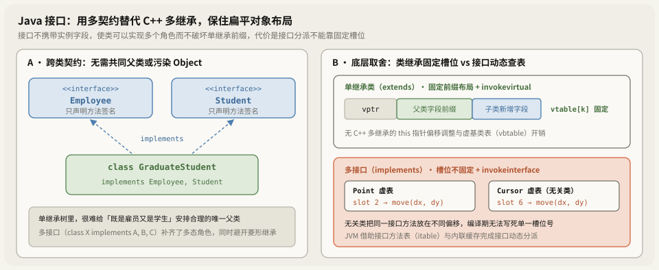
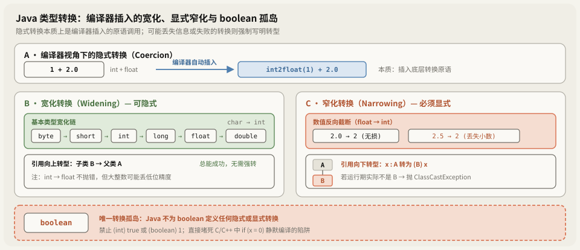
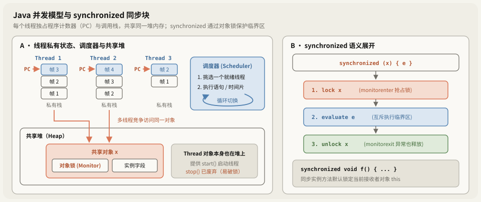
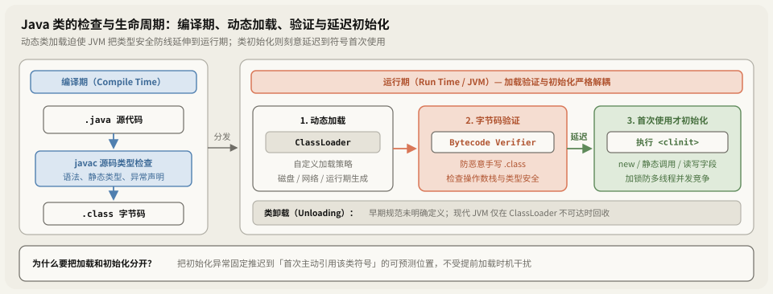

# Java 语言特性与编译/运行时机制（对比 Cool）

前面几篇从前端类型检查（[[11_01]]）、运行时环境与代码生成（[[16.AI编译器/学习日记/0.2十一月/11_02]]、[[11_03]]）、操作语义（[[11_04]]）一路走到优化与内存管理（[[11_05]]、[[11_06]]），用的都是教学语言 Cool。Cool 刻意把语言做得很小、很规整；一旦转向 Java 这样的工业级语言，数组、异常、接口、数值转换、并发线程和动态类加载这些真实需求一进来，编译器和运行时就不得不做出大量妥协。这篇笔记按主题整理这几块的设计与底层代价。

---

## 一、Java 数组与协变子类型（Cool 和 Java 的区别）

先看一段只有四行的 Java 代码。假设类 $B$ 继承自类 $A$（记作 $B < A$），下面这段程序会发生什么？

```java
B[] b = new B[10];
A[] a = b;
a[0] = new A();
b[0].aMethodNotDeclaredInA();
```

如果只按静态类型去读，每一行看起来都合情合理：第 1 行在堆上分配了一个长度为 10 的 `B` 数组；第 2 行把 `b` 赋给了 `A[]` 类型的引用 `a`；第 3 行往 `A[]` 的 0 号槽位塞进一个 `A` 对象；第 4 行从 `B[]` 里取出 0 号元素，调用一个只在 `B` 里声明、但 `A` 里根本没有的方法。

四行拼在一起就出事了。`a` 和 `b` 指向的是堆上的同一块内存，第 3 行借着 `a` 的父类视角把 `new A()` 塞进了原本存 `B` 的槽位，第 4 行再通过 `b` 把它当成 `B` 来调用方法，程序就会去访问一个并不存在的方法表项或字段。

### Cool 和 Java 的子类型规则差异

问题出在第 2 行。把 Cool 和 Java 的子类型关系并排写出来，差别一眼就能看清：

$$
\begin{aligned}
B < A &\quad \text{若 } B \text{ 继承自 } A && \text{（与 Cool 相同）} \\
C < A &\quad \text{若 } C < B \text{ 且 } B < A && \text{（与 Cool 相同，传递性）} \\
B[] < A[] &\quad \text{若 } B < A && \text{（Cool 中没有这条规则）}
\end{aligned}
$$

前两条在面向对象语言里几乎是标配。第三条叫数组协变（array covariance）：只要元素类型满足 $B < A$，Java 就认为 `B[]` 也是 `A[]` 的子类型。Cool 没有这套可变数组的协变规则，所以躲过了这个坑；Java 放行了它，于是让静态类型检查器直接接受了 `A[] a = b`。

从类型理论的角度看，根源很朴素：

> 让多个静态类型不同的别名指向同一块可修改的内存位置，类型系统就不健全（unsound）。



图里把这段内存关系画透了。如果这块数组是只读的，协变其实不会出问题，把 `B` 当 `A` 读出来完全安全。麻烦在于数组既可读又可写：`a` 负责按宽松的 `A` 类型往里写，`b` 负责按严格的 `B` 类型往外读，两个别名共用同一个槽位，读写契约当场打架。

### Java 为什么明知有漏洞还要这么设计，以及它怎么兜底

早期的 Java 1.0 还没有泛型。如果不允许 `B[] < A[]`，标准库甚至没法写出一个通用的排序函数 `sort(Object[] a)` 来接收 `String[]` 或 `Integer[]`。为了能写通用数组工具函数，Java 当年选择了数组协变。

为了不让第 4 行真的把内存踩坏，JVM 在运行期补了一道防线：每个数组对象在堆上都带着自己的运行时元素类型标签（这里是 `B[]`）。只要代码向引用类型的数组写入元素，JVM 就会现场比对要写入对象的真实类型是否兼容数组标签。走到第 3 行 `a[0] = new A()` 时，JVM 发现 `A` 不是 `B` 的子类型，直接抛出 `ArrayStoreException`，根本不会让程序执行到第 4 行。

这笔账其实是拿运行期性能换编译期便利：每次往对象数组里写引用，都要多做一次动态类型检查。后来 Java 5 引入泛型时，设计者吸取了教训，把 `List<B>` 定成了不变的（`List<B>` 不是 `List<A>` 的子类型），这类错误终于重新回到编译期解决。

---

## 二、异常处理与操作语义

代码写深了总会撞上意料之外的故障，比如内存耗尽，或者一个按约定本该排好序的列表传进来居然是乱序的。

没有异常机制的话，摆在面前的路都不怎么好走：要么当场终止整个进程，要么让每一层函数都在返回值里夹带错误码，调用链上每一环都得手动检查并往上透传。只要中间有一个调用者忘了判断返回值，错误就悄悄吞掉了。

Java 的做法是把错误当成语言的一等机制：

1. 新增专门表示错误的异常类型（类层级）。
2. 引入两种控制流语法：`throw exception` 负责抛出异常对象，`try { something } catch (x) { cleanup }` 负责划定监控范围并在出事时接住异常做清理。

```java
class Foo {
    public static void main(String[] args) {
        try {
            X();
        } catch (Exception e) {
            System.out.println("Error!");
        }
    }

    public static void X() throws MyException {
        throw new MyException();
    }
}
```

（课件原稿为了省篇幅，把 `X()` 上的 `static` 和 `println` 末尾的分号都略去了，这里补全以便对照实际 Java 语法。）

`X()` 在方法签名里用 `throws MyException` 显式声明自己可能抛出的受检异常。运行期间一旦执行到 `throw new MyException()`，控制流不会按常规方式返回给 `X()` 的下一行，而是直接弹出 `X()` 的栈帧，一路回到 `main` 中的 `catch (Exception e)`。因为 `MyException` 是 `Exception` 的子类，按子类型匹配规则正好被接住，打印 `"Error!"`。

### 用操作语义刻画 `try / catch`

在 [[11_04]] 里我们用大步操作语义写过 Cool 的求值判断，这里把异常也纳入同一套推导框架。为了把注意力留在控制流上，下面的规则先省略了存储 $S$ 和当前对象 $\mathrm{so}$，只保留环境 $E$。

先区分两种截然不同的求值结果：
- $v$ 表示普通值，也就是表达式正常算出来的对象；
- $T(v)$ 表示一个已经被抛出、携带异常对象 $v$ 的异常结果。

有了这个区分，`try { e1 } catch (x) { e2 }` 的大步语义只需要两条互斥的规则。

第一条处理正常结束的情况：如果 $e_1$ 在环境 $E$ 下正常求值为普通对象 $v_1$，整个 `try / catch` 直接返回 $v_1$，`catch` 里的 $e_2$ 根本不会执行。

$$
\frac{E \vdash e_1 : v_1}{E \vdash \texttt{try}\{e_1\}\ \texttt{catch}(x)\{e_2\} : v_1}
$$

第二条处理抛异常的情况：如果 $e_1$ 求值产生的是异常 $T(v_1)$，就把异常对象 $v_1$ 绑定到变量 $x$ 上得到扩展环境 $E[x \leftarrow v_1]$，再在这个新环境里求值清理代码 $e_2$，以 $e_2$ 的结果 $v_2$ 作为整条表达式的结果。

$$
\frac{E \vdash e_1 : T(v_1) \qquad E[x \leftarrow v_1] \vdash e_2 : v_2}{E \vdash \texttt{try}\{e_1\}\ \texttt{catch}(x)\{e_2\} : v_2}
$$



这套记法有个很干净的地方：$T(v)$ 并不是一个普通值 $v$。如果在没有外层 `try` 的地方写 $e_1 + e_2$，而 $e_1$ 求出了 $T(v)$，加法的正常求值规则就匹配不上，必须走专门的异常传播规则，跳过 $e_2$ 的求值并直接把 $T(v)$ 原样交给外层表达式。层层穿透下去，就对应了运行时的调用栈展开（stack unwinding）。

当然，这两条课件规则做了两处简化。一是没有把存储 $S$ 写进去，真实执行时 $e_1$ 在抛出异常前改过的堆内存和变量副作用不会自动回滚，$e_2$ 看到的是抛出那一刻的存储状态 $S_1$；二是实际的 Java 允许带类型的 `catch (C x)`，只有当 $v_1$ 的动态类型满足子类匹配时才会进入第二条规则，匹配不上就继续让 $T(v_1)$ 往上抛。

---

## 三、接口（Interfaces）

面向对象里经常要描述这样一种关系：几个类在继承树上八竿子打不着，但它们都支持同一组操作。接口就是用来在不引入继承关系的前提下声明这种契约的。

```java
interface PointInterface {
    void move(int dx, int dy);
}

class Point implements PointInterface {
    public void move(int dx, int dy) {
        // ...
    }
}
```

（课件里的 `Point.move` 省略了 `public`；实际 Java 规范规定接口方法隐含 `public abstract`，实现类里必须显式标出 `public`，否则访问权限比接口窄，编译会直接报错。）

Java 语言规范里有一句很直白的说明：

> “Java 程序可以用接口来避免让相关类必须共享一个公共抽象父类，也不必把各种方法往 `Object` 里塞。”

换个更贴近 C++ 视角的说法：接口承担的就是 C++ 里多继承（multiple inheritance）的职责，因为一个 Java 类可以同时实现任意多个接口：

```java
class X implements A, B, C { ... }
```

课件举了大学研究生的例子：研究生既拿津贴干助教助研，算学校雇员（`Employee`），又注册选课拿学位，算学生（`Student`）：

```java
class GraduateStudent implements Employee, Student { ... }
```

只靠单继承，这件事怎么设计都别扭：让 `Employee` 继承 `Student` 或反过来都不合逻辑；硬凑一个大而全的公共父类，很快就会把类层次揉成一团；把方法全塞进顶层的 `Object` 更荒唐。接口把“能做什么”从“是谁的子类”里拆了出来。



站在编译器实现的立场看，Java 选“类单继承 + 接口多实现”而不是照搬 C++ 多继承，算盘打得很精。C++ 允许从多个带成员变量的基类继承，结果引发了菱形继承的数据重复、虚基类表（`vbtable`）以及调用虚函数时的 `this` 指针偏移修正，对象内存模型和编译器实现都会迅速膨胀。Java 接口不带实例字段，每个类的对象布局始终严格遵循单继承前缀，父类字段在什么偏移，子类里就在什么偏移。

省下来的复杂度转嫁到了接口方法分派上。单继承体系里，父类方法在虚函数表（`vtable`）里的下标在编译期就固定了，子类沿用同一个槽位号，JVM 用 `invokevirtual` 一次索引就能跳转。但两个毫无亲缘关系的类（比如图里的 `Point` 和 `Cursor`）同时实现 `PointInterface` 时，`move` 在各自虚表里排在第几位完全没有保证。通过接口引用调用方法时，JVM 不能写死槽位偏移，只能走 `invokeinterface`，依靠每个类额外维护的接口方法表（`itable`）配合 JIT 的内联缓存来查出目标地址。

---

## 四、类型转换与强制转型（Coercions & Casts）

Java 允许基本数据类型在特定上下文中自动发生强制转换（coercion）。最常见的例子是混合算术运算：

```java
1 + 2.0
```

左边的 `1` 是 `int`，右边的 `2.0` 是浮点数（严格按 Java 语法，`2.0` 字面量是 `double`，`2.0f` 才是 `float`，这里沿用课件记法统称浮点）。CPU 硬件不会直接把整数位模式和 IEEE 754 浮点位模式相加，Java 编译器在生成代码时会把 `1` 宽化为 `1.0`，等价于替你改写成：

```java
int2float(1) + 2.0
```

从编译器的眼光看，隐式类型转换并没有什么魔法，它就是编译器在 AST 或 IR 阶段悄悄帮你插进去的一个底层原语函数调用。绝大多数编程语言在基础数值类型之间都内置了一整套这样的转换规则。

### 宽化（Widening）与窄化（Narrowing）

Java 把所有的类型转换和强制转型清晰地分成两类：

- 宽化转换（Widening）总能执行，不会因为目标类型装不下而失败，可以隐式发生。基本数值类型的宽化链是 `byte → short → int → long → float → double`（加上 `char → int`）；引用类型里则是子类向父类的向上转型（upcast）。
- 窄化转换（Narrowing）可能丢失数据或在运行期失败，Java 要求必须显式写出转型语法。比如把 `float` 转成 `int` 时，`2.0` 转成 `2` 没毛病，碰到 `2.5` 就得截断小数部分；引用类型的向下转型（downcast）风险更大：假设 $B < A$，手里有个静态类型为 $A$ 的变量 `x`，要把它当 `B` 用，必须显式写成 `(B) x`。



有两处细节容易被字面意思带偏。课件说 `int → float` “总能成功”，是指语义上总有定义、不会报错，不代表绝对无损。Java 的 `int` 是 32 位有符号整数，有 31 位数值精度，而 IEEE 754 单精度 `float` 只有 24 位有效尾数（含隐含位），像 `123456789` 这样的大整数隐式转成 `float` 时，低位一样会被舍入。

至于引用类型的向下转型 `(B) x`，编译期只看 `A` 和 `B` 之间有没有继承关系，真正的核验留在运行期。JVM 会生成 `checkcast` 指令检查 `x` 指向对象的实际类型；如果运行到那一行时 `x` 装的是纯粹的 `A` 或者另一个兄弟子类，JVM 直接抛出 `ClassCastException`。

### 一个经典问题：哪个类型没有任何转换规则？

课件最后抛了一个小问题：Java 里唯一没有定义任何隐式转换（coercion）或强制转型（cast）的类型是什么？

答案是 `boolean`。

在 C 和 C++ 里，整数、指针和布尔值可以来回互转，`0` 当假、非零当真，于是 `if (x = 0)` 这种把 `==` 手滑少打一个等号的错误能顺利通过编译，然后悄悄埋雷。Java 干脆把 `boolean` 做成了一座孤岛：既不能把 `1` 或 `0` 隐式当成 `boolean`，也不允许写成 `(int) true` 或 `(boolean) 1` 强转，彻底切断了布尔值和整数之间的通道。

---

## 五、并发与同步（Concurrency & Synchronization）

很多语言早期把并发甩给操作系统库（比如 C 的 POSIX `pthreads`），Java 则直接把线程和锁做进了语言本身和虚拟机规范里。

从运行时环境的角度看（对比 [[16.AI编译器/学习日记/0.2十一月/11_02]] 里的单栈模型），引入线程后，单个程序不再只有一套调用栈。每个线程都独占自己的程序计数器（PC）和调用栈，记录各自执行到了哪条指令、嵌套了哪些活动记录（栈帧）；而所有线程共享同一片堆内存。

在概念模型里，调度器（scheduler）像一个永不停歇的循环：挑选一个就绪线程，让它向前推进一步（一条语句或一个时间片），然后再切到下一个线程。线程本身在 Java 里也用对象来表示，对应 `Thread` 类，课件里提到它有 `start` 和 `stop` 方法。

> [!note] 关于 `Thread.stop()` 的后续演变
> 早期 Java 确实提供了 `Thread.stop()` 来强行终止线程，但很快人们发现这几乎必出事故：强制杀掉一个正在临界区里改数据的线程，会导致它持有的所有对象锁被突然释放，留下一堆改到一半、破坏了对象不变式的脏数据给其他线程。所以 `Thread.stop()` 早已废弃，在现代 JDK（Java 21+）里调用甚至直接抛出 `UnsupportedOperationException`，协作式取消统一改为 `interrupt()`。

因为多个线程共用同一个堆，一旦两个线程同时读写同一个对象，调度器在任意两条指令之间切换都可能引发竞态条件。Java 为每个对象都配了一把内置监视器锁（monitor），用 `synchronized` 关键字来申请和释放：

```java
synchronized (x) {
    e
}
```

它的执行含义可以直观地拆成三步：

```text
lock x         // 对应字节码 monitorenter：获取对象 x 的锁，拿不到就阻塞等待
evaluate e     // 互斥执行临界区代码 e
unlock x       // 对应字节码 monitorexit：释放对象 x 的锁（哪怕 e 抛异常也会释放）
```

如果把 `synchronized` 直接加在实例方法声明上：

```java
synchronized void f() {
    // ...
}
```

它锁住的对象就是当前方法调用的接收者 `this`，效果上等同于把整个方法体包在 `synchronized (this) { ... }` 里。



---

## 六、动态类加载、字节码验证与延迟初始化

回到编译器视角，C/C++ 通常是把所有代码提前静态编译链接成原生机器码再跑；Java 走的是另一条路线：它允许程序在运行期间按需把新类动态加载进虚拟机。

这个决定立刻改变了类型检查的边界。

1. 源码级的类型检查依然发生在编译期（由 `javac` 完成）。
2. JVM 不能假设运行期收到的 `.class` 字节码一定出自老实的 `javac`，它可能来自网络，也可能是别人手工篡改过的恶意字节码，专门用来绕过私有字段访问限制、制造操作数栈溢出或者把整数硬当成对象指针用。所以运行期还得再过一遍字节码验证（bytecode verification），在真正执行之前用数据流分析确认字节码满足类型安全和栈平衡约束。
3. 类的查找与加载策略全部交给 `ClassLoader` 控制（本地磁盘、JAR 包、网络或运行期动态生成都可以）。

既然类能动态加载，自然也能卸载（unloading）。课件特意点出一句：早期 Java 规范对类卸载的时机并没有定义得很清楚。到了现代 JVM 里，规则已经收敛：只有当某个类对应的所有实例都已死亡、没有反射引用指向它的 `Class` 对象，并且加载它的那个 `ClassLoader` 实例本身也变得不可达时，GC 才允许把这批类元数据一起卸载掉。



### 为什么类初始化不在加载时执行

Java 的初始化机制比 Cool 复杂得多：Cool 里那套按继承链先填默认值再跑属性初始化表达式的规则（见 [[11_04]]）在 Java 里全都有，还叠上了静态字段、静态代码块、接口默认初始化，以及最头疼的多线程并发竞争。

为了把复杂度压在可控范围内，JVM 把「类加载（Loading）」和「类初始化（Initialization，即执行 `<clinit>` 里的静态初始化逻辑）」严格拆开：

- 一个类被 `ClassLoader` 读进内存并验证通过时，**并不会**立刻执行它的静态初始化代码。
- 只有当类里的某个符号第一次被主动使用时（比如 `new` 实例、调用静态方法、读写非常量静态字段），JVM 才会触发这个类的初始化。

这么做最直接的好处，是把初始化阶段可能抛出的错误（比如静态代码块里除零、读配置文件失败抛出的 `ExceptionInInitializerError`）固定推迟到一个可预测的时间点，也就是代码真正用到这个类的那一刻。如果类在后台预加载时就偷偷跑静态代码，加载顺序稍微一变，程序在哪里崩、崩不崩都会变得玄学。

而一旦和并发碰头，延迟初始化就变得相当棘手：假如有两个线程在完全相同的时刻第一次引用同一个未初始化的类 `Foo`，JVM 绝不能让 `<clinit>` 跑两遍，也不能让第二个线程在第一个线程还没初始化完的时候就读到半成品静态字段。JVM 规范要求给每个类的初始化过程加上专门的初始化锁：一个线程进去跑 `<clinit>`，另一个线程在门口阻塞等待。要是类 `A` 的静态块里引用了 `B`，同时另一条线程正在跑 `B` 的静态块又反过来引用了 `A`，两个线程甚至会在类初始化阶段直接死锁。
