# 11월 2일 학습 기록

스탠퍼드 CS143 5강(정규 언어의 한계, 문맥 자유 문법, 유도, 파스 트리, 모호성)을 공부했다. 주말에 동기들과 북한산에 다녀오면서 계획이 조금 밀렸고, 5강도 한 번에 이해되지 않아 질문 순서대로 다시 정리했다.

> [!info] 이 노트를 읽는 법
> - 본문은 내가 이해한 내용을 다듬은 것이다. `> [!warning] 바로잡기`는 처음 이해가 틀린 부분이고, `> [!note] 보충`은 빠진 부분이다.
> - 처음 노트의 `그림 N`은 슬라이드 번호라서 없앴다. 그림은 모두 `assets/` 폴더의 SVG 원본을 인용했고, Mermaid 그림 3개도 SVG로 다시 그렸다.
> - 문법에 관한 주장은 Python으로 문자열을 모두 열거하고 파스 트리를 세어 확인했다(표현식 13토큰 이하 5,439개, dangling else 17토큰 이하 281개). 정해진 길이까지의 전수 조사이므로 증명을 대신하지는 않는다.
> - DFA의 한계(§1.1)는 상태 4개 이하 DFA 1,054,474개에서 증명의 두 문자열이 실제로 같은 상태로 끝나는지 확인했다.
> - **Bison 실물은 실행하지 못했다.** 이 머신에 없고 외부 바이너리를 내려받을 권한도 없었다. §6의 충돌 수와 트레이스는 Bison 매뉴얼의 충돌 해결 규칙대로 Python으로 직접 작성한 LALR(1) 표 생성기의 결과다. 실물로 확인하는 방법은 §6.7에 적었다.
> - 슬라이드는 CS143 Lecture 5 PDF(Aiken 원안, Kjolstad 수정)와 대조했다. 내가 본 강의와 판이 달라 표현이 조금 다를 수 있다. MLIR 내용(§6.8)은 `AffineParser.cpp` 소스를 읽어 확인했다.
> - 바로잡은 내용만 보려면 §9 표를 보면 된다.

## 0. 5강 한눈에 보기

5강은 다섯 질문이 차례로 이어지는 구조다. 어디서 막혔는지 모르겠다면 이 표에서 막힌 질문부터 읽으면 된다.

| 순서 | 질문 | 답 | 위치 |
|---|---|---|---|
| 1 | DFA로 괄호 짝을 왜 못 맞추나? | 상태 수가 유한해서 깊이를 끝까지 셀 수 없다 | §1 |
| 2 | 그러면 중첩 구조는 무엇으로 적나? | 문맥 자유 문법(CFG). 규칙 안에 자기 자신을 다시 넣는다 | §2 |
| 3 | 문법은 입력의 구조를 어떻게 알려 주나? | 유도를 그림으로 그리면 파스 트리가 된다 | §3 |
| 4 | 트리가 두 개 나오면 어떻게 하나? | 모호한 문법이다. 문법을 층으로 나눠 없앤다 | §4, §5 |
| 5 | 문법을 고치지 않고 해결할 수는 없나? | 우선순위와 결합법칙을 선언해 충돌을 해결한다 | §6 |

서로 비슷해서 헷갈리는 개념은 §7에 표로 모았다.

### 0.1 계획 점검

10/27 노트의 10/30–11/2 계획(미니 lexer, MLIR `Lexer.cpp` 읽기, 포인터와 스레드 풀, 복습)은 완료 기록이 없고 저장소에도 10/29 이후 결과물이 없다. 아직 하지 않은 것으로 보고 옮겼으니, 이미 한 항목은 표에서 지우면 된다.

| 날짜 | 주제 | 할 일 | 시간 |
|---|---|---|---|
| 11/3 화 | 5강 손으로 풀기 | §8 점검 질문을 답을 보지 않고 풀기. `id + id * id`의 트리를 §4의 세 문법으로 각각 그리기 | 2h |
| 11/4 수 | 미니 lexer (이월) | 10/27 §2.5의 세 규칙과 §6.3의 되감기를 C++로 구현 | 2h |
| 11/5 목 | 파서 코드 읽기 (이월 + 신규) | MLIR `Lexer.cpp`와 `AffineParser.cpp`에서 최장 일치와 우선순위 처리 찾기(§6.8) | 2h |
| 11/6 금 | CS143 6강 | 오류 처리, AST 구성, 재귀 하강 파싱 | 2h |
| 11/7 토 | 미뤄 둔 C++와 Bison 실습 (이월 + 신규) | 포인터 기초, 스레드 풀 TSan 검증, §6.7의 표를 Bison으로 재현 | 4h |
| 11/8 일 | 복습 | 틀린 점검 질문 다시 풀기, 주간 회고 | 1h |

이 표는 CS143 흐름만 이어 적은 것이다. `06.매일 학습 계획과 하루 일과`의 W2(11/2–11/8, LLVM/MLIR 빌드와 참조 구현)와 시간이 겹치므로, 둘을 함께 하기는 어렵다.

---

## 1. 정규 언어의 한계

### 1.1 DFA는 왜 중첩된 괄호를 처리하지 못하나

다음 언어를 보자.

$$
L = \{(^i )^i \mid i \ge 0\}
$$

```text
ε
()
(())
((()))
...
```

여는 괄호가 먼저 나오고, 그 뒤에 같은 개수의 닫는 괄호가 나온다. 중첩된 `if ... then ... else ... fi`도 이와 비슷한 구조다.

**유한 오토마타의 핵심은 상태 수가 유한하다는 것이다.** 상태가 2개든 100개든 그 수는 미리 정해져 있다.

상태를 순환시키면 나머지 연산은 처리할 수 있다.

- 상태 2개를 번갈아 이동하면 `1`의 개수가 홀수인지 짝수인지 구분한다.
- 상태 3개를 순환하면 개수를 3으로 나눈 나머지를 기억한다.
- 일반적으로 `count mod k`를 추적할 수 있다.

하지만 개수가 제한 없이 커지면 정확한 값을 구분할 수 없다. 여는 괄호 10,000개를 읽었다면 닫는 괄호도 정확히 10,000개인지 검사해야 하는데, 그 수를 담아 둘 곳이 없다.

증명은 비둘기집 원리 하나로 끝난다. 이 언어를 인식하는 상태 $k$개짜리 DFA가 있다고 가정하자.

1. `(`를 0개, 1개, …, $k$개 읽은 $k+1$개 시점의 상태를 본다. 상태는 $k$개뿐이므로 어떤 $i < j$에서 $(^i$ 뒤와 $(^j$ 뒤의 상태가 같다.
2. 같은 상태에서 같은 $)^i$를 읽으면 같은 상태로 끝난다. 따라서 $(^i)^i$와 $(^j)^i$의 판정이 같다.
3. 앞의 문자열은 언어에 속하고 뒤의 문자열은 속하지 않는다. 판정이 같으므로 둘 중 하나는 반드시 틀린다.

$k$가 얼마든 같은 논증이 성립하므로 이 언어를 인식하는 DFA는 없다.

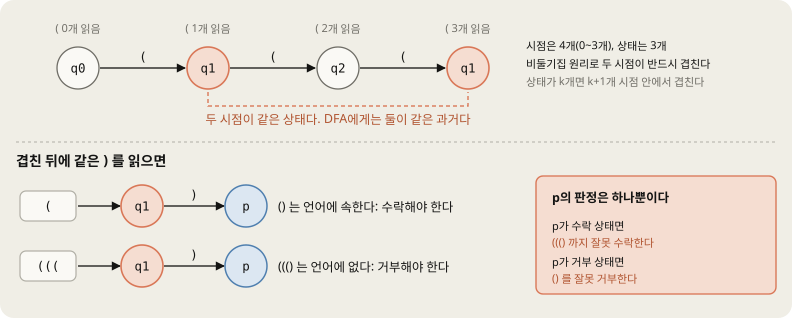

> **DFA는 유한한 상태 정보만 가지고 있으며, 중첩 깊이에 따라 늘어나는 별도의 스택이 없다. 따라서 임의의 깊이로 중첩된 괄호 구조를 인식할 수 없다.**

> [!note] 보충: 깊이에 상한을 두면 DFA로 된다
> 문제는 **상한이 없다**는 점이다. 깊이를 $n$ 이하로 제한하면 문자열이 유한 개가 되어 DFA로 인식할 수 있다. 직접 최소화해 보니 $\{(^i)^i \mid 0 \le i \le n\}$의 최소 DFA는 죽은 상태를 포함해 $2n+2$개였다($n$ = 1, 2, 3, 5, 10, 100에서 4, 6, 8, 12, 22, 202개). 상태 수가 깊이에 비례해 늘어나므로, 고정된 $k$개로 모든 깊이를 처리할 수는 없다.

> [!note] 보충: 카운터로 충분할 때와 스택이 필요할 때
> $(^i)^i$만 처리한다면 정수 카운터 하나로 충분하다. 괄호 종류가 섞이면 스택이 필요하다. `([])`는 받아들이고 `([)]`는 거부하려면 무엇이 어떤 순서로 열렸는지 기억해야 한다. CFG로 표현할 수 있는 언어는 스택을 가진 오토마타(푸시다운 오토마타)가 인식하는 언어와 정확히 같다.

### 1.2 어휘 분석과 구문 분석의 역할

이런 구조를 다루는 도구가 **문맥 자유 문법**(Context-Free Grammar, CFG)과 **구문 분석기**(Parser)다.

| 단계 | 입력 | 출력 | 주요 이론과 도구 | 처리하는 구조 |
|---|---|---|---|---|
| 어휘 분석 | 문자 스트림 | 토큰 스트림 | 정규 표현식, DFA | 식별자, 숫자, 키워드 등 개별 토큰 |
| 구문 분석 | 토큰 스트림 | 파스 트리나 AST 등의 구조 | CFG, 스택을 사용하는 분석 기법 | 중첩 구문, 재귀적인 표현식 |

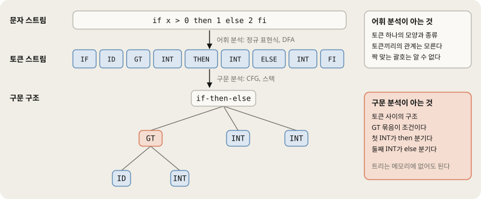

`if-then-else` 트리에서 루트는 조건문 전체이고, 그 아래에 조건식, `then` 분기, `else` 분기가 있다. 각 분기 안에 또 다른 조건문이 들어갈 수 있다. 하나의 구조 안에 같은 종류의 구조가 다시 들어가는 **재귀적인 정의**가 중첩 구문을 표현하는 핵심이다.

### 1.3 `Parse tree (may be implicit)`의 의미

슬라이드의 `may be implicit`는 트리가 반드시 독립된 자료 구조일 필요는 없다는 뜻이다.

- **명시적인 트리**: 노드를 메모리에 만들어 연결한다. AST를 구성하는 방식이 여기에 해당한다.
- **암묵적인 트리**: 전체 트리를 저장하지 않아도 구조가 분석 과정에 반영된다. 재귀적으로 구문을 분석하면서 곧바로 코드를 생성하면, 계층 구조는 함수 호출 관계와 호출 스택에 나타날 뿐 트리는 따로 남지 않는다.

구문 분석과 트리 저장은 같은 말이 아니다.

### 1.4 어휘 분석과 구문 분석을 합칠 수도 있나

일반적인 흐름은 $\text{문자} \to \text{토큰} \to \text{구문 구조}$다. 하지만 별도의 어휘 분석기 없이 문자부터 직접 처리하는 **스캐너리스 파싱**(Scannerless Parsing)도 있다. 문자 수준과 구문 수준의 규칙을 함께 다루므로, 같은 문자열이 문맥에 따라 키워드도 되고 식별자도 되는 언어에 유용하다. PEG나 Packrat Parsing으로 이런 분석기를 만들 수 있지만, 이 기법들이 항상 어휘 분석기를 없애는 것은 아니다.

> [!note] 보충: 그래도 보통 나누는 이유
> 정규 언어는 모두 CFG로 쓸 수 있으므로 이론상 합칠 수 있다. 그래도 나누면 공백과 주석 같은 문자 수준의 규칙이 문법에서 빠져 문법이 단순해지고, 토큰 인식은 표 기반 DFA(10/27 §6)로 빠르게 처리할 수 있다.

---

## 2. 문맥 자유 문법과 유도

### 2.1 CFG의 네 가지 구성 요소

| 구성 요소 | 뜻 | 괄호 문법의 예 |
|---|---|---|
| 단말 기호 $T$ | 더 이상 규칙으로 바꾸지 않는 기호 | `(`, `)` |
| 비단말 기호 $N$ | 다른 기호열로 바꿀 수 있는 자리표시자 | `S` |
| 시작 기호 | 유도를 시작하는 비단말 기호 | `S` |
| 생성 규칙 | 비단말 기호를 무엇으로 바꿀 수 있는지 정한 규칙 | $S \to (S)$, $S \to \varepsilon$ |

**단말 기호**(Terminal)의 "단말"은 여기에 도달하면 더 이상 바꾸지 않는다는 뜻이다. `(`, `)`, `if`, `+`가 그 예이고, 구문 분석에서는 `ID`, `INT` 같은 토큰 종류도 단말 기호다.

**비단말 기호**(Nonterminal)는 문법상의 자리표시자다. `EXPR`은 "여기에 표현식이 들어간다"는 뜻이어서, 그 자리에 식별자 하나가 올 수도 있고 복잡한 조건식이 올 수도 있다.

생성 규칙 $A \to \alpha$는 "비단말 기호 $A$를 기호열 $\alpha$로 바꿀 수 있다"고 읽는다.

- $S \to (S)$: $S$를 괄호 한 쌍으로 감싼다. 안쪽의 $S$는 계속 확장할 수 있다.
- $S \to \varepsilon$: $S$를 빈 문자열로 바꾼다.

> [!note] 보충: 대문자라고 비단말 기호는 아니다
> 슬라이드는 비단말 기호를 대문자로, 단말 기호를 소문자로 쓰고 첫 규칙의 왼쪽을 시작 기호로 삼는다. 하지만 토큰은 `ID`, `INT`처럼 대문자로 쓰는 일이 많다. 단말인지 비단말인지는 글꼴이 아니라 **왼쪽에 나타나는 규칙이 있는지**로 판단한다.

### 2.2 유도를 단계별로 따라가기

**유도**(Derivation)는 시작 기호에서 출발해 생성 규칙을 적용해 가는 과정이다. 절차는 세 단계다.

1. 시작 기호만 있는 상태에서 출발한다.
2. 비단말 기호 하나를 생성 규칙의 오른쪽으로 바꾼다.
3. 비단말 기호가 없어질 때까지 2를 반복한다.

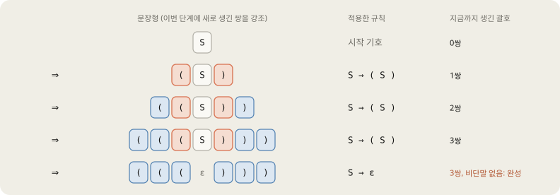

$$
S \Rightarrow (S) \Rightarrow ((S)) \Rightarrow (((S))) \Rightarrow ((()))
$$

### 2.3 문법은 어떻게 괄호 개수를 맞추나

핵심은 $S \to (S)$가 여는 괄호와 닫는 괄호를 **항상 한 쌍으로 생성한다**는 점이다. 규칙을 10,000번 적용하면 10,000쌍이 생긴다. DFA는 입력을 읽으면서 개수를 세야 했지만, 문법은 생성 규칙 자체가 개수를 같게 유지한다.

여기서 두 관점을 구분해야 한다.

- **문법**은 문자열을 어떻게 **생성할 수 있는지** 설명한다.
- **분석기**는 주어진 문자열이 그 문법에 맞는지 **검사한다.** 이때 중첩 구조를 추적하려고 스택을 쓴다.

이 문법은 `(())`처럼 바깥에서 안쪽으로 감싸는 형태만 만든다. `()()`는 만들지 못한다.

> [!note] 보충: 올바른 괄호 문자열 전체의 문법
> 슬라이드는 $(^i)^i$를 "balanced parentheses"라고 부르지만, 나란히 놓인 `()()`까지 포함하려면 규칙이 달라야 한다.
>
> $$S \to (S)S \mid \varepsilon$$
>
> 앞의 $(S)$가 첫 번째 괄호 쌍과 그 안쪽을, 뒤의 $S$가 그 오른쪽에 이어지는 나머지를 만든다. 14자 이하의 올바른 괄호 문자열 626개를 모두 만들고, 그 외의 문자열은 만들지 않았으며, 문자열마다 트리가 하나뿐이었다.

### 2.4 왜 '문맥 자유'인가

문맥 자유 문법의 생성 규칙 왼쪽에는 **비단말 기호 하나만** 온다. 문자열 안에 $S$가 있으면 앞뒤에 무엇이 있는지와 관계없이 $S$의 규칙을 적용할 수 있다. **주변 문맥을 조건으로 삼지 않기 때문에** 문맥 자유라고 한다.

빵 만들기에 비유하면 다음과 같다.

| 문법 개념 | 비유 |
|---|---|
| 비단말 기호 | 아직 가공할 수 있는 반죽 |
| 단말 기호 | 완성된 빵 |
| 생성 규칙 | 반죽을 가공하는 조리법 |
| 유도 | 조리법에 따라 반죽을 완성품으로 바꾸는 과정 |

> [!note] 보충: 문맥 자유의 한계
> "변수는 쓰기 전에 선언해야 한다" 같은 규칙은 문법 위치와 멀리 떨어진 정보를 대조해야 해서 CFG로 표현할 수 없다. 이런 검사는 구문 분석 뒤의 의미 분석이 맡는다.

### 2.5 표기 정리: $\to$, $\Rightarrow$, $\Rightarrow^*$, $L(G)$

| 표기 | 뜻 | 예 |
|---|---|---|
| $A \to \alpha$ | 문법에 적힌 생성 규칙 | $S \to (S)$ |
| $\alpha \Rightarrow \beta$ | 규칙을 **한 번** 적용해 $\beta$를 얻는다 | $(S) \Rightarrow ((S))$ |
| $\alpha \Rightarrow^* \beta$ | 규칙을 **0번 이상** 적용해 $\beta$를 얻는다 | $S \Rightarrow^* ((S))$ |

$\alpha$와 $\beta$는 문법 기호로 이루어진 문자열이고, 단말 기호와 비단말 기호가 섞여 있을 수 있다. `((S))`에서 괄호는 단말 기호이고 `S`는 비단말 기호다. 시작 기호에서 유도할 수 있는 이런 형태를 **문장형**(Sentential Form)이라고 한다. 단말 기호만 남은 최종 문자열도 문장형에 포함된다.

문법이 생성하는 언어는 다음과 같다.

$$
L(G)=\{w\in T^*\mid S\Rightarrow^*w\}
$$

어떤 문자열이 $L(G)$에 속하려면 시작 기호에서 유도할 수 있어야 하고, **모든 기호가 단말 기호**여야 한다. `((S))`는 유도할 수 있지만 비단말 기호가 남아 있으므로 $L(G)$에 속하지 않는다.

### 2.6 단말 기호는 왜 더 이상 바뀌지 않나

1. **단말 기호를 치환하는 규칙이 없다.** 생성 규칙의 왼쪽에는 비단말 기호만 올 수 있다.
2. **한 번 생성된 단말 기호는 끝까지 남는다.** 다른 비단말 기호를 확장해도 이미 생긴 단말 기호는 바뀌지 않는다.
3. **구문 문법에서 단말 기호는 보통 토큰 종류에 대응한다.** `IF`, `ID`, 괄호, 세미콜론 등이다. 구체적인 변수 이름 `count`는 `ID` 토큰의 부가 정보로 전달한다.

### 2.7 Lexer가 토큰을 만들었는데 왜 비단말 기호가 필요한가

어휘 분석기는 `((((1 + 2) * 3) - 4))`를 괄호, 숫자, 연산자 토큰으로 나눌 수 있다. 하지만 다음 질문에는 답할 수 없다.

- 괄호가 올바르게 짝지어졌는가?
- 어떤 표현식이 어떤 연산자의 피연산자인가?
- 이 `else`는 어느 `if`에 속하는가?

이런 **토큰 사이의 구조**를 나타내기 위해 비단말 기호가 필요하다.

한국어 문장으로 생각하면 쉽다. 설명을 위해 단순화한 규칙이다.

```text
<문장>   → <주어> <목적어> <서술어>
<주어>   → 민규가
<목적어> → 사과를
<서술어> → 먹는다
```

`민규가`, `사과를`, `먹는다`는 실제로 나타나는 말이고, `<주어>` 같은 것은 각 부분의 역할을 설명하는 범주다. 프로그래밍 언어의 비단말 기호도 같은 역할을 한다.

```text
if x > 0 then 1 else 2 fi        (소스 코드)
IF ID GT INT THEN INT ELSE INT FI (토큰 열)
```

```text
PROGRAM → STMT

STMT → if EXPR then STMT else STMT fi
     | EXPR

EXPR → EXPR > EXPR
     | ID
     | INT
```

`if`, `>`, `ID`, `INT`는 입력에 대응하는 단말 기호이고, `PROGRAM`, `STMT`, `EXPR`은 구조를 나타내는 비단말 기호다. 규칙은 다음과 같이 읽는다.

1. `PROGRAM → STMT`: 이 예제에서 프로그램은 하나의 문으로 구성된다.
2. `STMT → if EXPR then STMT else STMT fi`: 조건식과 두 분기를 가진 조건문이다.
3. `STMT → EXPR`: 표현식 하나도 문이 될 수 있다. 이 규칙이 있어야 `1`과 `2`를 분기 본문으로 유도할 수 있다.
4. `EXPR → EXPR > EXPR | ID | INT`: 표현식은 비교식, 식별자, 정수 리터럴 중 하나다.

| 약어 | 영어 | 의미 | 역할 | 예 |
|---|---|---|---|---|
| `PROGRAM` | Program | 프로그램 | 전체 프로그램의 구조 | 소스 파일 전체 |
| `STMT` | Statement | 문 | 실행 단위, 제어 흐름이나 상태 변경 | `if (...) {...}`, `x = 10;`, `return;` |
| `EXPR` | Expression | 식, 표현식 | 값이나 연산을 구성하는 구문 | `1 + 2`, `x > 0`, `a * b` |
| `ID` | Identifier | 식별자 | 변수명, 함수명 등에 대응하는 토큰 | `x`, `count`, `foo` |
| `INT` | Integer | 정수 리터럴 | 정수 상수에 대응하는 토큰 | `0`, `42`, `100` |

문과 식의 구체적인 구분은 언어마다 다르다.

> [!note] 보충: 이 설명용 문법도 사실 모호하다
> 이 문법으로 `if x > 0 then 1 else 2 fi`의 트리는 하나뿐이다. 하지만 `EXPR → EXPR > EXPR` 때문에 `a > b > c`에는 트리가 2개 생긴다. 왜 문제가 되는지는 §4에서 다룬다.

### 2.8 유도와 환원: 방향이 반대다

문법을 정의할 때는 시작 기호에서 출발해 비단말 기호를 확장하고 단말 기호 문자열을 만든다. 구문 분석기는 반대로 이미 주어진 입력을 보고 구조를 찾아야 한다.

특히 **상향식 구문 분석**은 다음 질문을 반복한다.

> `x > 0`을 하나의 `EXPR`로 묶을 수 있을까?
> `if EXPR then STMT else STMT fi`를 하나의 `STMT`로 묶을 수 있을까?
> 이렇게 해서 전체 입력을 시작 기호까지 묶을 수 있을까?

생성 규칙의 오른쪽을 왼쪽의 비단말 기호로 묶는 동작이 **환원**(Reduction)이다. 끝까지 묶이면 그 결과를 트리 등으로 표현하고, 묶이지 않으면 `Syntax Error: unexpected token` 같은 오류를 보고한다. 모든 분석기가 환원 방식은 아니다. 하향식 분석기는 시작 기호에서 구조를 확장하면서 입력과 맞춰 나간다.

건축에 비유하면 토큰은 재료, 비단말 기호는 방이나 문 같은 구조상의 역할, 생성 규칙은 설계 규칙이고, 구문 분석기는 재료의 배열이 설계 규칙에 맞는지 확인한다.

### 2.9 `|`로 묶기와 재귀적인 중첩

왼쪽이 같은 규칙은 "또는"을 뜻하는 `|`로 묶어 쓴다. 표기만 간단해질 뿐 의미는 같다. COOL의 일부를 보자.

```text
EXPR → if EXPR then EXPR else EXPR fi
     | while EXPR loop EXPR pool
     | id
```

이 문법으로 다음 문자열을 차례로 만들 수 있다.

```text
id
if id then id else id fi
while id loop id pool
if while id loop id pool then id else id fi
if if id then id else id fi then id else id fi
```

마지막 두 줄에서는 제어 구조 전체가 다른 `if`의 조건 자리에 들어간다. 그 자리를 `EXPR`로 정의했기 때문에, `EXPR`로 유도할 수 있는 것이면 무엇이든 들어갈 수 있다.

중첩 상자로 생각하면 쉽다. 가장 작은 상자는 `id`이고, 더 큰 상자는 `if`나 `while` 구조다. 큰 상자 안에는 `EXPR`이 들어갈 칸이 있고, 그 칸에는 `id`를 넣을 수도, 또 다른 큰 상자를 넣을 수도 있다.

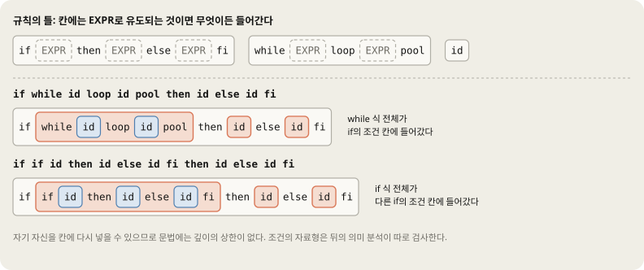

규칙 안에 같은 비단말 기호가 다시 등장하므로 문법에는 중첩 깊이의 상한이 없다. 다만 이것은 **구문 차원의 가능성**이다. 조건식의 자료형 같은 의미 규칙은 뒤에서 따로 검사한다.

### 2.10 산술 표현식 문법

앞으로 계속 쓸 표현식 문법이다.

$$
E \to E+E \mid E*E \mid (E) \mid id
$$

```text
id
id + id
id + id * id
(id + id) * id
```

$E$가 있는 자리에는 다시 덧셈, 곱셈, 괄호를 포함한 표현식을 넣을 수 있다.

### 2.11 CFG를 도입한 뒤에도 남는 과제

1. **판정만으로는 부족하다.** 컴파일러는 입력이 맞는지뿐 아니라 **어떤 구조로 해석할지**도 알아야 한다. 이 구조를 타입 검사와 중간 코드 생성이 사용한다.
2. **오류를 이해하기 쉽게 보고해야 한다.** 세미콜론이나 닫는 괄호가 빠졌다면 위치와 원인을 구체적으로 알려 주고, 여러 오류를 한 번에 찾도록 오류 뒤의 분석을 계속하는 복구 전략도 쓴다.
3. **문법의 형태가 구현에 영향을 준다.** 어휘 분석기 생성 도구로 `flex`가 있듯이 구문 분석기 생성 도구로는 Bison과 Yacc가 있다. 같은 언어를 생성하는 문법이라도 형태에 따라 분석하기 쉬울 수도 어려울 수도 있다.

세 번째 과제의 대표적인 예가 §4의 **모호성**이다.

---

## 3. 파스 트리와 유도 순서

### 3.1 유도 과정은 어떻게 파스 트리가 되나

시작 기호를 루트로 두고, 규칙 $X \to Y_1 \dots Y_n$을 적용할 때마다 노드 $X$ 아래에 자식 $Y_1 \dots Y_n$을 붙인다. `id * id + id`를 만드는 과정을 보자.

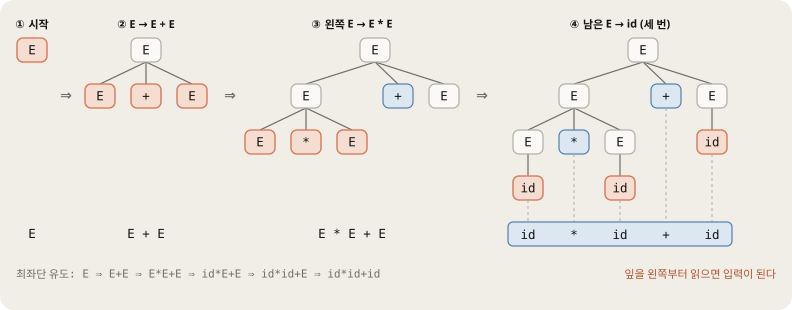

$$
E \Rightarrow E+E \Rightarrow E*E+E \Rightarrow id*E+E \Rightarrow id*id+E \Rightarrow id*id+id
$$

### 3.2 트리에서 읽을 수 있는 것

**잎을 왼쪽부터 읽으면 입력이 된다.** 내부 노드는 모두 비단말 기호이고 잎은 단말 기호다. 일반적인 이진 트리의 중위 순회가 아니라 **잎만 왼쪽부터 읽는다**는 점에 주의한다.

**트리는 연산의 묶임을 보여 준다.** 입력 문자열에는 없는 정보다. 위 트리에서는 곱셈 결과가 덧셈의 왼쪽 피연산자이므로 `(id * id) + id`로 묶인다.

> [!note] 보충: 묶임이 곧 실행 순서는 아니다
> 트리는 값의 의존 관계를 정할 뿐, 모든 실행 순서를 정하지는 않는다. C++에서 `f() + g() * h()`는 `g() * h()`의 결과를 더한다는 묶임이 정해져 있지만, `f`, `g`, `h`를 어떤 순서로 호출할지는 규정되어 있지 않다.

**파스 트리와 AST는 다르다.**

| | 파스 트리 | AST |
|---|---|---|
| 담는 것 | 생성 규칙이 적용된 구조 전체 | 이후 처리에 필요한 핵심 구조 |
| `(id)`의 괄호 | `(`, `E`, `)` 노드가 모두 있다 | 없다. 묶임은 트리 모양이 이미 표현한다 |
| `E → E'` 같은 단일 규칙 | 노드가 하나 더 생긴다 | 보통 생략한다 |

### 3.3 최좌단 유도와 최우단 유도

유도 도중에는 비단말 기호가 여러 개 남아 있을 수 있다. 어느 것을 먼저 바꿀지에 따라 유도 순서를 구분한다.

| 구분 | 영어 | 규칙 | 분석기와의 관계 |
|---|---|---|---|
| 최좌단 유도 | Leftmost Derivation | 매 단계에서 가장 왼쪽의 비단말 기호를 바꾼다 | LL 계열의 하향식 분석 |
| 최우단 유도 | Rightmost Derivation | 매 단계에서 가장 오른쪽의 비단말 기호를 바꾼다 | LR 분석은 이 유도의 역순에 대응 |

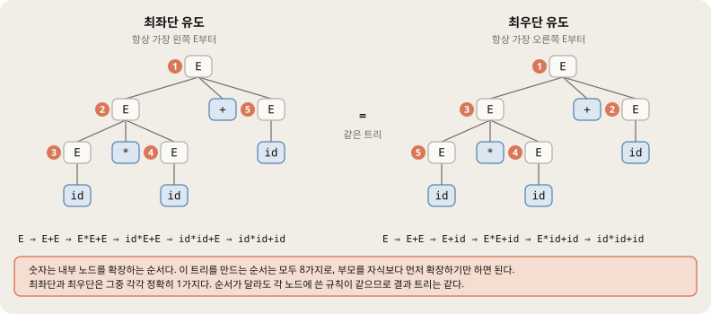

트리 하나를 고정하면 최좌단 유도와 최우단 유도는 **각각 정확히 하나씩** 정해진다. **확장 순서는 달라도 트리 구조는 같다.**

### 3.4 하나의 트리에 여러 유도가 대응한다

루트에 $E \to E+E$를 적용했다면, 최좌단 유도는 왼쪽 부분 트리를 먼저 완성하고 최우단 유도는 오른쪽 부분 트리를 먼저 완성한다. 집을 지을 때 침실부터 만들든 주방부터 만들든 설계가 같으면 완성된 집의 구조는 같은 것과 비슷하다.

꼭 왼쪽이나 오른쪽 끝을 고를 필요도 없다. $E*E+E$에는 $E$가 세 개 있으니 가운데 $E$를 먼저 바꿀 수도 있다. 각 위치에 같은 규칙을 적용하면서 순서만 바꾸면 결과 트리는 같다.

> [!warning] 바로잡기
> 처음에는 "고정된 유한 트리에 대응하는 유도 순서가 반드시 무한히 많은 것은 아니다"라고 적었다. 더 정확히는 **항상 유한하다.** 내부 노드가 $n$개인 트리는 규칙을 $n$번 적용하므로 순서는 많아야 $n!$가지다. 부모를 자식보다 먼저 확장해야 하므로 실제로는 더 적다. `id * id + id`의 트리는 내부 노드가 5개이고 유도 순서는 정확히 **8가지**다.
>
> 계산은 간단하다. 루트가 맨 처음이고, 왼쪽 $E$ 묶음(자신과 두 자식)을 처리하는 순서는 두 자식의 순서에 따라 2가지다. 오른쪽 $E \to id$는 이 3번의 단계 사이 어디든 끼어들 수 있으니 4가지 위치가 있다. $2 \times 4 = 8$이다. 모든 순서를 직접 열거해서 확인했다.

### 3.5 그런데 왜 서로 다른 트리가 생기기도 하나

$E \to E+E \mid E*E \mid id$와 `id + id * id`를 보자. 값이 `2 + 3 * 4`라면 묶는 방법에 따라 결과가 달라진다.

| 해석 | 묶임 | 값 |
|---|---|---|
| A: 곱셈을 먼저 묶기 | `id + (id * id)` | $2+(3\times4)=14$ |
| B: 덧셈을 먼저 묶기 | `(id + id) * id` | $(2+3)\times4=20$ |

이 차이는 왼쪽을 먼저 확장했는지 오른쪽을 먼저 확장했는지 때문에 생기는 것이 아니다. **같은 위치에 적용한 생성 규칙 자체가 달라** 트리 구조가 달라진 것이다. A의 루트는 $E \to E+E$이고 B의 루트는 $E \to E*E$다.

이 구분이 5강에서 가장 중요하다.

- **유도**는 규칙을 적용하는 **순서**다.
- **트리**는 그 결과로 얻는 **구조**다.
- **모호성**은 같은 입력에 **서로 다른 구조가 존재하는** 문제다.
- 최좌단이나 최우단으로 순서를 정해도 모호성은 사라지지 않는다.

### 3.6 파서 구현에서 두 유도가 중요한 이유

**하향식 분석**은 시작 기호에서 출발해 입력에 맞는 구조를 확장한다. LL 분석은 최좌단 유도를 구성하는 것으로 볼 수 있다.

**상향식 LR 분석**은 입력의 일부를 비단말 기호로 환원하면서 구조를 만든다. 이 과정은 최우단 유도의 역순에 대응한다.

최우단 유도라고 해서 입력을 오른쪽부터 읽는 것은 아니다. **LL과 LR은 모두 입력을 왼쪽에서 오른쪽으로 읽는다.** 이름의 첫 글자 L이 Left-to-right 읽기를 뜻하고, 둘째 글자가 어떤 유도를 만드는지를 뜻한다.

---

## 4. 모호성과 문법 재작성

### 4.1 모호한 문법이란

> 어떤 문자열에 서로 다른 파스 트리가 두 개 이상 존재하는 문법을 **모호한 문법**(Ambiguous Grammar)이라고 한다. 같은 뜻으로, 어떤 문자열에 최좌단 유도나 최우단 유도가 두 개 이상 존재하는 문법이다.

트리 하나에 최좌단 유도가 정확히 하나씩 대응하므로 두 정의는 같다. 9토큰 이하의 문자열 257개에서 최좌단 유도 수와 트리 수가 모두 일치했다.

$E \to E+E \mid E*E \mid (E) \mid id$는 덧셈과 곱셈의 우선순위를 구분하지 않으므로 `id * id + id`를 덧셈으로 나눌 수도, 곱셈으로 나눌 수도 있다.

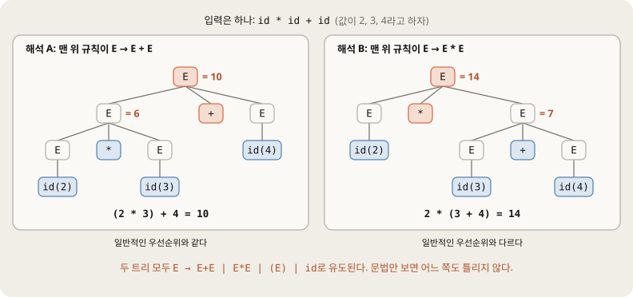

슬라이드의 표현대로 모호성은 일부 프로그램의 **의미를 정의되지 않은 채로 남긴다**(leaves meaning of some programs ill-defined). 같은 코드의 값이 10일 수도 14일 수도 있으면 곤란하다.

> [!note] 보충: 모호성은 예외적인 경우가 아니다
> 이 문법에서 13토큰 이하 문자열 5,439개 중 4,552개가 모호했다. 트리 수도 빠르게 늘어난다. `id + id + ... + id`의 피연산자가 1개에서 8개로 늘어나면 트리 수는 1, 1, 2, 5, 14, 42, 132, 429개이고, 이는 카탈란 수다.

### 4.2 해결 방법 두 가지

어떤 구조를 택할지는 언어의 규칙으로 정해야 한다. 방법은 크게 두 가지다.

1. **문법을 다시 작성한다.** 원하는 트리만 나오도록 비단말 기호를 나눈다. (§4.3–4.5, §5)
2. **간단한 문법을 유지하고 우선순위와 결합법칙을 선언한다.** 충돌이 생길 때 고를 쪽을 도구에 알려 준다. (§6)

### 4.3 문법을 층으로 나누기

슬라이드는 비단말 기호를 두 층으로 나눈다(stratification).

$$
E \to E'+E \mid E'
$$

$$
E' \to id*E' \mid id \mid (E)*E' \mid (E)
$$

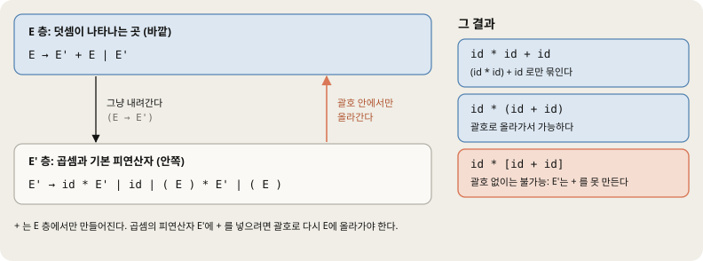

층의 역할은 세 줄로 정리된다.

- 낮은 우선순위의 연산은 전체 표현식을 나누는 **바깥** 층에 둔다.
- 높은 우선순위의 연산은 그 피연산자를 구성하는 **안쪽** 층에 둔다.
- 괄호는 안쪽에서 다시 전체 표현식으로 올라갈 수 있게 해 준다.

### 4.4 새 문법으로 같은 입력 분석하기

`id * id + id`를 분석하면 트리는 하나뿐이다.

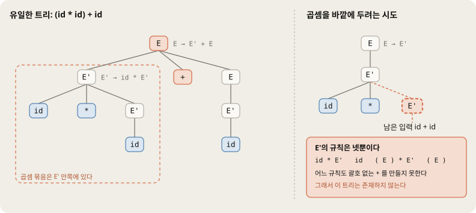

전체에는 $E \to E'+E$가 적용되고, 왼쪽 $E'$가 `id * id`를, 오른쪽 $E$가 `id`를 만든다.

다른 해석이 배제되는 이유도 분명하다. 전체를 곱셈 하나로 보려면 곱셈의 오른쪽 피연산자 $E'$가 괄호 없는 `id + id`를 만들어야 하는데, $E'$의 규칙 어디에도 괄호 없는 `+`는 없다. 반면 `id * (id + id)`는 `(E)`로 올라갈 수 있어서 가능하다.

세 문법을 비교해 확인했다. 13토큰 이하에서 세 문법의 언어는 똑같았고, 층을 나눈 두 문법에서는 모든 문자열의 트리가 하나였다.

| 입력 (값 2, 3, 4) | 원래 문법 | 층을 나눈 문법 |
|---|---|---|
| `id * id + id` | 트리 2개: 10, 14 | 트리 1개: 10 |
| `id + id * id` | 트리 2개: 14, 20 | 트리 1개: 14 |

트리를 위에서 아래로 그릴 때 덧셈 노드가 먼저 나오지만, 값을 구하려면 왼쪽 곱셈 결과가 먼저 필요하다.

> **생성 규칙을 적용하는 순서와 식의 값을 계산하는 순서는 다르다.**

### 4.5 우선순위를 해결해도 결합법칙이 남는다

슬라이드의 문법은 $E \to E'+E$처럼 **오른쪽 재귀**라서 연속된 연산을 오른쪽으로 묶는다. 교과서에서 자주 보는 Expr/Term/Factor 문법은 **왼쪽 재귀**다.

$$
Expr \to Expr+Term \mid Term
$$

$$
Term \to Term*Factor \mid Factor
$$

$$
Factor \to (Expr) \mid id
$$

두 문법 모두 곱셈이 덧셈보다 강하게 묶이지만, 같은 우선순위끼리의 방향이 다르다.

| 입력 | $E \to E'+E$ (오른쪽 재귀) | $Expr \to Expr+Term$ (왼쪽 재귀) |
|---|---|---|
| `id + id + id` | `id + (id + id)` | `(id + id) + id` |
| `id * id * id` | `id * (id * id)` | `(id * id) * id` |
| 같은 모양으로 `-`를 넣은 `1 - 2 - 3` | `1 - (2 - 3) = 2` | `(1 - 2) - 3 = -4` |

> [!note] 보충: 슬라이드 문법에 뺄셈을 그대로 추가하면 틀린다
> 덧셈과 곱셈은 어느 쪽으로 묶어도 정수 값이 같아서 슬라이드의 문법에서 문제가 드러나지 않는다. 같은 모양으로 $E \to E'-E$를 추가하면 `1 - 2 - 3`이 2가 된다. **우선순위와 결합법칙은 별개의 문제**이고, 재귀 방향이 결합법칙을 정한다. 왼쪽 결합이 필요하면 왼쪽 재귀로 쓴다. 다만 왼쪽 재귀는 단순한 하향식 분석기에서 무한 재귀를 일으키므로, 6강의 재귀 하강 파싱과 이어지는 문제다.

---

## 5. Dangling Else

### 5.1 `else`는 어느 `if`와 연결되나

```text
if E1 then if E2 then E3 else E4
```

`if`는 두 개이고 `else`는 하나다. 단순한 문법 $E \to \text{if } E \text{ then } E \mid \text{if } E \text{ then } E \text{ else } E \mid \text{OTHER}$에서는 두 가지 해석이 가능하다.

```text
if E1 then (if E2 then E3) else E4     바깥쪽 if에 연결
if E1 then (if E2 then E3 else E4)     안쪽 if에 연결
```

이것이 **Dangling Else 문제**다. 보통은 안쪽 `if`에 연결한다.

> [!warning] 바로잡기
> 처음에는 "`else`는 앞에 있는 `if` 중 아직 `else`와 짝지어지지 않은 가장 가까운 `if`에 연결한다"고 적었다. 슬라이드의 표현은 **가장 가까운 짝 없는 `then`**(closest unmatched then)이다. 차이는 조건 안에 `if`가 있을 때 드러난다.
>
> ```text
> if if o then o then o else o
> ```
>
> `if`만 세면 가장 가까운 것은 둘째 `if`이지만, 그것은 조건 안에 있고 바로 뒤의 `then`에서 이미 끝났다. `else`는 첫째 `if`의 것이다.
>
> 엄밀히는 `then` 기준 규칙도 단순한 스택으로 구현하면 `if o then if if o then o then o else o else o`에서 틀린다. 조건 안에서 이미 끝난 `then`이 스택에 남기 때문이다. 정확한 규칙은 "**`then` 분기가 아직 끝나지 않은 `if` 중 가장 가까운 것**"이다. 17토큰 이하 281개 문자열에서 문법과 비교하면 `if` 기준은 90개, 단순한 `then` 기준은 7개에서 달랐고, 이 규칙은 모두 일치했다.
>
> 조건이 단순한 식인 언어에서는 세 규칙이 같은 답을 낸다. 조건을 `o`로 제한한 37개 문자열에서 모두 일치했다. 그래서 "가까운 `if`"라는 표현이 흔히 통한다.

### 5.2 MIF와 UIF

해석 하나만 남기려면 구문을 두 종류로 나눈다.

- **MIF(Matched IF)**: 닫힌 형태. 뒤에 나오는 `else`를 기다리는 `if`가 남아 있지 않다. `if-then-else`의 짝이 다 맞는 구조이고, `if`가 없는 기본 구문 `OTHER`도 여기에 속한다.
- **UIF(Unmatched IF)**: 열린 형태. 아직 `else`와 짝지어지지 않은 `if`가 남아 있다.

이 구분의 목적은 **어떤 부분이 뒤에 나오는 `else`를 받을 수 있는지**를 문법에 나타내는 것이다.

### 5.3 규칙을 한 줄씩 읽기

```text
E   → MIF | UIF

MIF → if E then MIF else MIF
    | OTHER

UIF → if E then E
    | if E then MIF else UIF
```

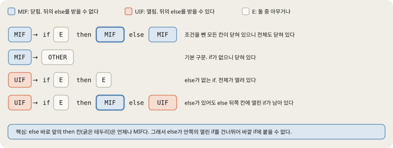

**`MIF → if E then MIF else MIF`**: `then` 뒤에 일반적인 `E`나 `UIF`가 아니라 `MIF`가 온다는 점이 핵심이다. 그래야 뒤의 `else`가 안쪽의 다른 `if`에 연결될 여지가 없다.

**`UIF → if E then E`**: 바깥쪽 `if`에 `else`가 없다. `then` 뒤에는 일반적인 `E`가 오므로 닫힌 구조와 열린 구조가 모두 올 수 있다.

**`UIF → if E then MIF else UIF`**: 바깥쪽 `if`에 `else`가 있는데도 전체가 UIF다. `then` 분기는 닫혀 있고, **열린 부분이 `else` 뒤에 남아 있기 때문이다.** `else`가 있다고 해서 전체가 닫힌 구조가 되는 것은 아니다.

슬라이드의 한 줄 요약은 "then 절 안에 if-then을 허용하지 않는다"이다. 바깥쪽 `if`가 자기 `else`를 가지려면 `then` 분기 안에 짝 없는 `if`가 남아 있으면 안 된다. 남아 있다면 그 `else`는 더 가까운 안쪽 `if`가 먼저 가져가야 한다.

> [!note] 보충: 조건 칸의 `E`에는 UIF가 와도 된다
> 모든 규칙에서 `if` 다음 칸은 그냥 `E`다. 조건은 뒤따르는 `then`에서 끝나므로, 조건 안의 열린 `if`가 그 뒤의 `else`를 놓고 다툴 일이 없다. 그래서 §5.1의 `if if o then o then o else o`도 트리가 하나로 정해진다.

### 5.4 바깥쪽 연결이 배제되는 이유

같은 입력을 다시 보자. `E1`, `E2`는 조건이고 `E3`, `E4`는 닫힌 기본 구문이라고 하자.

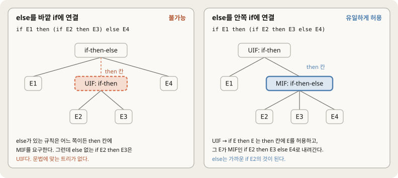

`else E4`를 바깥쪽 `if E1`에 연결하려면 `then` 분기가 `if E2 then E3`여야 한다. 이 부분에는 `else`가 없으므로 UIF인데, `else`가 있는 규칙은 모두 `then` 칸에 MIF를 요구한다. 따라서 이 해석은 문법에 맞지 않는다.

허용되는 구조는 다음과 같다.

1. 바깥쪽은 `UIF → if E1 then E`를 따른다.
2. 안쪽의 `E`는 `MIF`로 내려간다.
3. 그 `MIF`가 `if E2 then E3 else E4`를 구성한다.

입력이 오류라는 뜻이 아니다. **두 해석 중 하나가 제외되고 나머지 해석으로 분석된다.**

17토큰 이하 281개 문자열로 확인한 결과다. 두 문법이 만드는 언어는 같았고, 원래 문법에서 모호했던 78개를 포함해 MIF/UIF 문법의 트리는 모두 하나였다. 그 트리는 "`else`가 보이면 바로 가져가는" 재귀 분석의 결과와도 모두 일치했다.

### 5.5 언어 설계로 피하기

> [!note] 보충: COOL에는 이 문제가 없다
> §2.9의 COOL 문법은 `if E then E else E fi`로 `else`가 필수이고 `fi`로 끝난다. 끝이 분명하므로 어느 `if`의 `else`인지 헷갈릴 수 없다. 19토큰 이하 177개 문자열 모두 트리가 하나였다. Go와 Rust는 분기에 중괄호를 강제하고, Python은 들여쓰기로 분기의 범위를 정해 같은 효과를 얻는다.

### 5.6 모든 모호한 문법을 자동으로 고칠 수 있나

없다. 슬라이드의 표현대로 모호성을 처리하는 일반적인 기법은 없고, 모호한 문법을 비모호한 문법으로 자동 변환할 수도 없다.

- 주어진 CFG가 모호한지 판정하는 문제 자체가 결정 불가능하다.
- 어떤 언어는 어떤 문법으로 써도 모호하다. $\{a^i b^j c^k \mid i=j \text{ 또는 } j=k\}$가 대표적인 예다. $a^n b^n c^n$은 두 조건을 모두 만족하므로 두 가지 방식으로 유도될 수밖에 없다.

게다가 층을 나누면 문법이 복잡해진다. 그래서 다른 방법이 필요하다.

---

## 6. 우선순위와 결합법칙 선언

### 6.1 두 개념 구분

문법을 여러 비단말 기호로 나누는 대신, 간단한 문법을 유지하면서 도구에 해석 선택 규칙을 줄 수도 있다.

| 개념 | 결정하는 내용 | 예 |
|---|---|---|
| 결합법칙 | 같은 우선순위의 연산자가 연속될 때 어느 쪽으로 묶는가 | `1 - 2 - 3` |
| 우선순위 | 서로 다른 우선순위의 연산자가 있을 때 무엇을 더 강하게 묶는가 | `2 + 3 * 4` |

### 6.2 먼저 알아 둘 것: 이동과 환원

선언이 무엇을 하는지 이해하려면 LR 분석기의 두 동작을 알아야 한다. LR 분석은 다음 강의들에서 자세히 다루므로 여기서는 필요한 만큼만 본다. 분석기는 스택과 남은 입력을 가지고 매 순간 둘 중 하나를 한다.

- **이동(shift)**: 다음 토큰을 스택에 올린다.
- **환원(reduce)**: 스택 위가 어떤 규칙의 오른쪽과 같으면 왼쪽의 비단말 기호로 묶는다.

`%left '+'`와 `%left '*'`를 선언한 뒤 `int + int * int`를 분석한 실제 트레이스다.

| 스택 | 남은 입력 | 동작 |
|---|---|---|
| (비어 있음) | `int + int * int` | 이동 |
| `int` | `+ int * int` | 환원 $E \to int$ |
| `E` | `+ int * int` | 이동 |
| `E +` | `int * int` | 이동 |
| `E + int` | `* int` | 환원 $E \to int$ |
| **`E + E`** | **`* int`** | **이동 (선택의 순간)** |
| `E + E *` | `int` | 이동 |
| `E + E * int` | (없음) | 환원 $E \to int$ |
| `E + E * E` | (없음) | 환원 $E \to E*E$ |
| `E + E` | (없음) | 환원 $E \to E+E$ |
| `E` | (없음) | 수락 |

굵게 표시한 줄에서 분석기는 두 동작을 모두 할 수 있다. `E + E`를 지금 환원하면 덧셈이 먼저 묶이고, `*`를 이동하면 곱셈이 먼저 묶인다. 이것이 **이동/환원 충돌**(shift/reduce conflict)이고, 이 문법이 모호하다는 사실이 분석기에서는 이런 모습으로 나타난다. 선언은 바로 이 순간에 고를 쪽을 정해 준다.

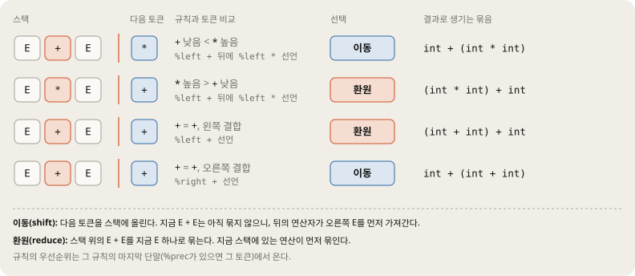

### 6.3 결합법칙: 같은 우선순위의 연산

$E \to E+E \mid int$에서 `int + int + int`는 두 구조가 가능하다. `(int + int) + int`가 **왼쪽 결합**, `int + (int + int)`가 **오른쪽 결합**이다.

수학적인 정수 덧셈에서는 결과가 같지만 뺄셈에서는 차이가 분명하다.

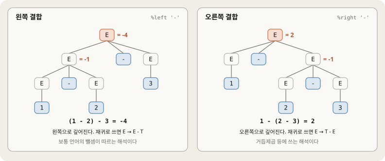

왼쪽 결합은 다음과 같이 선언한다.

```yacc
%left '+'
```

스택이 `E + E`이고 다음 토큰이 `+`일 때 환원을 고르므로 `(int + int) + int`가 된다. `%right`로 바꾸면 이동을 고르므로 오른쪽으로 묶인다.

> [!note] 보충: 컴퓨터의 덧셈은 수학의 덧셈과 다르다
> 부동소수점 덧셈은 결합법칙이 성립하지 않는다. `(1e20 + -1e20) + 1.0`은 `1.0`이고 `1e20 + (-1e20 + 1.0)`은 `0.0`이다(Python으로 확인). 그래서 컴파일러는 `-ffast-math` 같은 옵션 없이는 부동소수점 덧셈의 순서를 함부로 바꾸지 못한다. 파서가 정한 묶임이 실제 계산 결과를 결정하는 예다.

### 6.4 우선순위: 서로 다른 연산

$E \to E+E \mid E*E \mid int$에서 `2 + 3 * 4`는 묶는 방법에 따라 20이나 14가 된다. Bison에서는 다음과 같이 선언한다.

```yacc
%left '+'
%left '*'
```

**뒤에 선언한 줄의 우선순위가 더 높다.** 이 선언은 `+`와 `*`가 모두 왼쪽 결합이고 `*`가 `+`보다 우선한다는 뜻이다. 그 결과 입력은 `int + (int * int)`로 해석된다.

중요한 점은 문법 자체가 비모호한 CFG로 바뀌는 것이 **아니라는** 것이다. 문법은 그대로 모호하고, 분석기 생성 과정에서 선언에 따라 충돌을 해결할 뿐이다.

### 6.5 Bison이 실제로 고르는 방법

Bison 매뉴얼의 규칙은 네 줄로 요약된다.

1. 규칙의 우선순위는 그 규칙의 **마지막 단말 기호**에서 온다. `%prec`로 직접 지정할 수도 있다.
2. 규칙의 우선순위가 다음 토큰보다 높으면 **환원**, 낮으면 **이동**한다.
3. 같으면 결합법칙을 따른다. `%left`는 환원, `%right`는 이동, `%nonassoc`는 오류다.
4. 규칙이나 토큰 중 하나라도 우선순위가 없으면 충돌을 보고하고 기본값인 **이동**을 고른다.

즉 "우선순위 선언"은 연산자의 성질을 정의한다기보다 **이동/환원 선택을 지시**한다. 6강 개요에도 우선순위 선언이 있으니 이어서 확인한다.

### 6.6 Dangling else도 선언으로 해결하기

```yacc
%nonassoc LOWER_THAN_ELSE
%nonassoc ELSE
```

```yacc
stmt : IF expr THEN stmt            %prec LOWER_THAN_ELSE
     | IF expr THEN stmt ELSE stmt
     | OTHER
     ;
```

`else`가 없는 규칙의 우선순위를 `ELSE`보다 낮게 지정했다. 스택이 `if c then S`이고 다음 토큰이 `else`일 때 토큰의 우선순위가 더 높으므로 이동한다. **이동은 `else`를 가까운 `if`에 연결하는 해석**이다.

사실 이 충돌은 선언이 없어도 기본값인 이동으로 같은 결과가 나온다. 선언의 역할은 "의도한 선택이다"라고 밝혀서 충돌 경고를 없애는 것이다.

### 6.7 선언의 함정

직접 만든 생성기로 여러 선언을 시험한 결과다. 기대와 다른 결과는 굵게 표시했다.

| 선언 | 미해결 충돌 | `2 + 3 * 4` | `2 * 3 + 4` | `1 + 2 + 3`의 묶임 |
|---|---|---|---|---|
| 없음 | 이동/환원 4개 | 14 | **14** | **`1 + (2 + 3)`** |
| `%left '+'`만 | 이동/환원 3개 | 14 | **14** | `(1 + 2) + 3` |
| `%left '+'` 뒤에 `%left '*'` | 0개 | 14 | 10 | `(1 + 2) + 3` |
| `%left '*'` 뒤에 `%left '+'` | 0개 | **20** | **14** | `(1 + 2) + 3` |

| Dangling else 처리 | 미해결 충돌 | `if c then if c then o else o` | `if c then o else o` |
|---|---|---|---|
| 선언 없음 | 이동/환원 1개 | 안쪽 `if`에 연결 | 정상 |
| §6.6의 선언과 `%prec` | 0개 | 안쪽 `if`에 연결 | 정상 |
| 선언만 있고 `%prec` 없음 | 이동/환원 1개 | 안쪽 `if`에 연결 | 정상 |
| 두 `%nonassoc`의 순서를 뒤집음 | 0개 | **구문 오류** | **구문 오류** |
| MIF/UIF 문법 (선언 없음) | 0개 | 안쪽 `if`에 연결 | 정상 |

세 가지를 기억해 둔다.

1. **충돌 0개가 옳다는 뜻은 아니다.** `%left` 순서를 뒤집어도, `%nonassoc` 순서를 뒤집어도 충돌은 0개다. 도구는 내가 지시한 대로 고를 뿐이다. 선언을 쓰면 반드시 입력을 넣어 트리를 확인한다.
2. **선언의 범위를 확인한다.** `*`를 빼먹은 `%left '+'`는 충돌 3개를 남기고, `2 * 3 + 4`를 14로 계산한다.
3. **순서를 뒤집어도 바깥 `if`에 붙지 않는다.** `%nonassoc` 순서를 뒤집으면 `else`를 볼 때 항상 환원하므로 `else`를 이동할 기회가 아예 사라지고, `else`를 쓴 모든 입력이 구문 오류가 된다.

Bison이 있는 환경에서는 다음과 같이 직접 확인할 수 있다. 위 표를 재현하는 것이 11/7 실습이다.

```yacc
/* expr.y */
%token INT
%left '+'
%left '*'
%%
e : e '+' e | e '*' e | INT ;
```

```bash
bison -v expr.y                   # expr.output에 상태, 충돌, 해결 내용이 기록된다
bison -Wcounterexamples expr.y    # 선언을 지우고 실행하면 충돌의 반례를 보여 준다
```

### 6.8 두 방법 비교와 MLIR

| 방법 | 방식 | 장점 | 고려할 점 | 활용 예 |
|---|---|---|---|---|
| 문법 재작성 | `Expr`, `Term`, `Factor`, `MIF`, `UIF` 등으로 구조 구분 | 원하는 구조를 문법 자체에 명시한다. 선언 없이 충돌 0개 | 규칙이 늘어나고, 분석 방식에 맞는 문법 형태도 고려해야 한다 | 문법 설계, 이론 학습, 손으로 작성하는 분석기 |
| 선언으로 충돌 해결 | 간단한 문법에 우선순위와 결합법칙 추가 | 표현식 문법을 간결하게 유지한다 | 문법은 여전히 모호하다. 선언이 해결하는 충돌의 범위를 확인해야 한다 | Bison, Yacc 기반 분석기 |

두 방법 모두 입력의 구조를 언어의 규칙에 맞게 일관되게 결정하기 위한 것이다.

> [!note] 보충: MLIR의 affine 식 파서에서 같은 구조를 찾을 수 있다
> MLIR의 `mlir/lib/AsmParser/AffineParser.cpp`는 파서 생성기를 쓰지 않고 손으로 작성한 재귀 하강 파서다. 그래도 §4의 층 나누기와 같은 생각이 코드에 그대로 있다.
> - 낮은 우선순위 연산(`AffineLowPrecOp`: `Add`, `Sub`)과 높은 우선순위 연산(`AffineHighPrecOp`: `Mul`, `FloorDiv`, `CeilDiv`, `Mod`)을 나누고, 함수도 `parseAffineLowPrecOpExpr`와 `parseAffineHighPrecOpExpr`로 나눈다.
> - 소스 주석은 "All affine binary ops are left associative"라고 밝힌다. 왼쪽 결합은 지금까지 묶은 왼쪽 식을 `llhs` 인자로 넘겨 다음 연산자와 다시 묶는 방식으로 구현한다.
> - 괄호를 만나면 `parseParentheticalExpr`가 `parseAffineExpr`를 다시 불러, 안쪽에서 전체 식으로 올라간다. §4.3 그림의 위로 올라가는 화살표와 같다.
>
> 11/5에 이 파일을 읽으면서 `i + j * 2 - k`가 어떤 호출 순서로 분석되는지 따라가 본다.

---

## 7. 5강 정리: 헷갈리는 구분

| 구분 | 이쪽은 | 저쪽은 | 기억할 문장 |
|---|---|---|---|
| $\to$ / $\Rightarrow$ | 문법에 적힌 규칙 | 규칙을 실제로 적용한 한 단계 | 규칙은 화살표, 적용은 이중 화살표 |
| 문법 / 분석기 | 문자열을 생성할 수 있는 방법 | 주어진 문자열을 검사하는 프로그램 | 문법은 스택을 쓰지 않아도 분석기는 쓴다 |
| 유도 / 환원 | 규칙 왼쪽 → 오른쪽 | 규칙 오른쪽 → 왼쪽 | LR 분석은 최우단 유도를 거꾸로 만든다 |
| 유도 순서 / 트리 구조 | 어느 비단말 기호를 먼저 바꾸는가 | 각 위치에 어떤 규칙을 썼는가 | 순서가 달라도 트리는 같을 수 있다 |
| 유도 순서 / 계산 순서 | 트리를 만드는 순서 | 값을 구하는 순서 | 덧셈 노드가 먼저 생겨도 곱셈 값이 먼저 필요하다 |
| 파스 트리 / AST | 규칙의 적용을 모두 기록 | 이후 처리에 필요한 구조만 기록 | 괄호 노드는 AST에서 사라진다 |
| 모호성 / 유도 순서 | 트리가 여러 개인 문제 | 같은 트리를 만드는 순서의 차이 | 최좌단으로 고정해도 모호성은 남는다 |
| 우선순위 / 결합법칙 | 서로 다른 연산자 사이의 선택 | 같은 우선순위 연산자 사이의 선택 | `2 + 3 * 4` / `1 - 2 - 3` |
| 왼쪽 재귀 / 오른쪽 재귀 | 왼쪽 결합을 만든다 | 오른쪽 결합을 만든다 | 슬라이드의 $E \to E'+E$는 오른쪽 결합이다 |
| 문법 재작성 / 선언 | 문법이 비모호해진다 | 문법은 모호한 채 충돌만 해결한다 | 선언을 쓰면 입력으로 꼭 확인한다 |
| LL과 LR의 첫 L / 둘째 글자 | 입력을 왼쪽부터 읽는다 | 최좌단 또는 최우단 유도를 만든다 | R은 오른쪽부터 읽는다는 뜻이 아니다 |

---

## 8. 점검 질문

11/3에 답을 먼저 말해 본 뒤 펼쳐서 확인한다.

> [!question]- 1. 상태가 3개인 DFA가 $(^i)^i$를 인식한다고 가정하면 어떤 두 문자열에서 모순이 생기나요?
> `(`를 0~3개 읽은 4개 시점 중 어떤 $i<j$에서 상태가 같다. 그러면 $(^i)^i$와 $(^j)^i$가 같은 상태로 끝나 판정이 같은데, 앞의 문자열은 언어에 속하고 뒤의 문자열은 속하지 않는다.

> [!question]- 2. 깊이를 3 이하로 제한한 $(^i)^i$를 인식하는 최소 DFA의 상태 수는? 이것이 1번과 모순되지 않는 이유는?
> 죽은 상태를 포함해 8개($2n+2$)다. 깊이를 제한하면 유한 언어이므로 DFA로 인식할 수 있다. 1번은 깊이에 상한이 없을 때의 이야기다.

> [!question]- 3. $S \to (S) \mid \varepsilon$로 `()()`를 만들 수 없는 이유와, 만들 수 있게 고친 문법은?
> 규칙이 바깥에서 안쪽으로 감싸기만 할 뿐, 괄호 쌍을 옆으로 잇는 방법이 없다. $S \to (S)S \mid \varepsilon$로 고치면 뒤의 $S$가 오른쪽에 이어지는 나머지를 만든다.

> [!question]- 4. `((S))`는 $L(G)$에 속하나요? 문장형인가요?
> 문장형이지만 $L(G)$에는 속하지 않는다. 시작 기호에서 유도할 수 있으므로 문장형이고, 비단말 기호 `S`가 남아 있으므로 언어의 문자열은 아니다.

> [!question]- 5. `id * id + id`의 (곱셈이 안쪽인 트리에 대한) 최우단 유도를 써 보세요.
> $E \Rightarrow E+E \Rightarrow E+id \Rightarrow E*E+id \Rightarrow E*id+id \Rightarrow id*id+id$

> [!question]- 6. 최좌단 유도만 쓰기로 정하면 모호성이 사라지나요?
> 아니다. 모호한 문자열에는 최좌단 유도 자체가 두 개 이상 있다. `id + id * id`는 최좌단 유도가 2개다. 첫 단계에서 $E \to E+E$를 쓰는지 $E \to E*E$를 쓰는지가 다르다. 순서가 아니라 규칙 선택의 문제다.

> [!question]- 7. $E \to E'+E \mid E'$, $E' \to id*E' \mid id \mid (E)*E' \mid (E)$에서 `id * id + id`를 곱셈 하나로 묶을 수 없는 이유는?
> 곱셈의 오른쪽 피연산자는 $E'$다. $E'$가 `id + id`를 만들어야 하는데, $E'$의 어느 규칙도 괄호 없는 `+`를 만들지 못한다. `+`는 $E$ 층에서만 나오고, $E'$에서 $E$로 올라가려면 괄호가 필요하다.

> [!question]- 8. 7번 문법에 $E \to E'-E$를 추가하면 `1 - 2 - 3`의 값은? 올바르게 고치려면?
> `1 - (2 - 3) = 2`가 된다. 오른쪽 재귀는 오른쪽 결합을 만들기 때문이다. $E \to E - E'$처럼 왼쪽 재귀로 쓰면 `(1 - 2) - 3 = -4`가 된다.

> [!question]- 9. `UIF → if E then MIF else UIF`에서 `else`가 있는데도 전체가 UIF인 이유는?
> 열린 `if`가 `else` 뒤쪽에 남아 있기 때문이다. 예를 들어 `if a then b else if c then d`는 마지막 `if`가 `else` 없이 끝나므로, 뒤에 `else`가 오면 그것을 받을 수 있다.

> [!question]- 10. `if if o then o then o else o`의 `else`는 어느 `if`의 것인가요?
> 첫째 `if`의 것이다. 둘째 `if`는 조건 안에 있고 그 뒤의 `then`에서 이미 끝났다. "가장 가까운 `if`"를 글자 그대로 적용하면 틀린다.

> [!question]- 11. `%left '+'`, `%left '*'`를 선언했을 때 스택이 `E + E`이고 다음 토큰이 `*`면 이동하나요, 환원하나요? `*`가 `+`라면?
> `*`일 때는 이동한다. 규칙의 우선순위(`+`)가 토큰(`*`)보다 낮기 때문이다. `+`일 때는 환원한다. 우선순위가 같고 `%left`이기 때문이다.

> [!question]- 12. 선언 순서를 `%left '*'`, `%left '+'`로 뒤집으면 `2 + 3 * 4`의 값은? 충돌 경고는 나오나요?
> 20이다. 경고는 나오지 않는다. 충돌은 모두 선언대로 해결되었기 때문이다. 충돌 0개가 곧 올바른 문법을 뜻하지는 않는다.

> [!question]- 13. dangling else에서 `%nonassoc`의 순서를 뒤집으면 `else`가 바깥 `if`에 붙나요?
> 아니다. `else` 없는 규칙의 우선순위가 `else`보다 높아져 `else`를 볼 때마다 환원한다. 바깥 `if`까지 모두 환원되어 `else`를 이동할 기회가 없으므로, `if c then o else o`까지 포함해 `else`가 있는 입력은 모두 구문 오류가 된다.

> [!question]- 14. `%left`를 쓴 문법과 Expr/Term/Factor 문법의 근본적인 차이는?
> Expr/Term/Factor는 문법 자체가 비모호하다. `%left`를 쓴 문법은 여전히 모호하고, 분석기를 만들 때 충돌을 선언대로 해결할 뿐이다. 그래서 그 문법을 다른 도구나 다른 분석 방식에 그대로 가져가면 선언의 효과가 따라오지 않는다.

---

## 9. 바로잡은 내용 요약

처음 노트는 대부분 정확했고, 정의와 예제에서 틀린 값은 찾지 못했다. 바로잡은 것은 다음 두 가지다.

| 위치 | 처음 이해 | 바로잡은 내용 |
|---|---|---|
| §3.4 | 유한 트리의 유도 순서가 "반드시 무한히 많은 것은 아니다" | 항상 유한하다. `id * id + id`의 트리는 정확히 8가지 |
| §5.1 | `else`는 짝 없는 가장 가까운 `if`에 연결 | 슬라이드는 "가장 가까운 짝 없는 `then`". 정확히는 `then` 분기가 끝나지 않은 가장 가까운 `if`. 조건 안에 `if`가 있으면 차이가 난다 |

주요 보충 내용:

| 위치 | 보충 |
|---|---|
| §0.1 | 계획 점검과 11/3–11/8 계획 |
| §1.1 | 비둘기집 증명의 전체 단계, 깊이를 제한한 DFA의 크기 $2n+2$, 카운터와 스택의 차이 |
| §1.4 | 어휘 분석과 구문 분석을 보통 나누는 이유 |
| §2.3 | 올바른 괄호 문자열 전체의 문법 $S \to (S)S \mid \varepsilon$ |
| §2.4 | CFG로 표현할 수 없는 규칙 |
| §2.7 | `STMT → EXPR` 읽기, 설명용 문법의 모호성 |
| §3.2 | 묶임과 실행 순서의 차이, 파스 트리와 AST 비교 |
| §4.1 | 두 가지 모호성 정의의 동치, 트리 수의 증가 |
| §4.5 | 재귀 방향과 결합법칙, 슬라이드 문법에 뺄셈을 넣으면 틀리는 이유 |
| §5.3, §5.5 | 조건 칸에 UIF를 허용해도 되는 이유, 언어 설계로 피하는 방법 |
| §5.6 | 본질적으로 모호한 언어의 예 |
| §6.2 | 처음 노트에서 건너뛴 이동과 환원, 실제 트레이스 |
| §6.3 | 부동소수점 덧셈의 비결합성 |
| §6.5 | Bison의 충돌 해결 규칙 |
| §6.7 | 선언 조합별 충돌 수와 결과, `%nonassoc` 순서의 함정 |
| §6.8 | MLIR `AffineParser.cpp`와의 연결 |

---

## 10. 참고 자료

- [Stanford CS143 Compilers](https://web.stanford.edu/class/cs143/): [Lecture 5 슬라이드](https://web.stanford.edu/class/cs143/lectures/lecture05.pdf)
- [Bison 매뉴얼](https://www.gnu.org/software/bison/manual/): Shift/Reduce Conflicts, Operator Precedence, Context-Dependent Precedence, Counterexamples
- [MLIR `AsmParser/AffineParser.cpp`](https://github.com/llvm/llvm-project/blob/main/mlir/lib/AsmParser/AffineParser.cpp)
- [MLIR `AsmParser/Lexer.cpp`](https://github.com/llvm/llvm-project/blob/main/mlir/lib/AsmParser/Lexer.cpp)
