# 11월 5일 학습 기록: 의미 분석과 CFG의 한계

스탠퍼드 CS143의 의미 분석 강의를 정리했다. 제9강(Overview of Semantic Analysis)에서 시작해 제10강(Type Checking in Cool II)의 SELF_TYPE과 오류 복구까지 다룬다. [11/4 노트](../11_04/11_04.md)의 구문 분석에 이어지는 내용이다.

렉싱과 파싱 다음에는 컴파일러 프런트엔드의 마지막 단계인 **의미 분석**(Semantic Analysis)이 이어진다. 문법에는 맞지만 의미 규칙을 어긴 프로그램을 찾아내고, 언어가 요구하는 나머지 정적 검사를 수행한다.

> [!info] 학습 범위와 핵심 질문
> - 파서를 통과한 프로그램에 남은 오류는 무엇이고, 왜 문법으로 잡을 수 없는가? (§1–§5)
> - 이름을 쓰는 곳과 선언을 어떻게 연결하는가? 스코프, 심벌 테이블, 여러 번의 순회 (§6–§15)
> - 타입은 어떻게 정하고 검사하는가? 추론 규칙, 환경, 서브타입, lub (§16–§40)
> - 객체 지향이 더하는 문제와 오류 복구: 디스패치, SELF_TYPE, No_type (§37–§44)

> [!info] 이 노트를 읽는 법
> - 본문은 내가 이해한 내용을 다듬은 것이다. 절 번호와 구성은 처음 노트 그대로다. `> [!warning] 바로잡기`는 처음 이해가 틀리거나 빠진 부분, `> [!note] 보충`은 덧붙인 부분이다. 바로잡은 내용만 보려면 §47 표를 보면 된다.
> - **그림 17장을 새로 넣었다.** 표나 글로 이미 충분한 곳에는 넣지 않았다. 원래 있던 글 도식(```text 블록)은 그대로 두었다.
> - **애니메이션 [`frontend-flow.html`](../../动画/中文/frontend-flow.html)을 새로 만들었다.** 어휘 분석 → 구문 분석 → 의미 분석을 31장에 이어 붙였다. 절차는 순서도 페이지를 먼저 보고, 바로 다음 페이지에서 구체적인 예로 한 단계씩 따라간다. 쓰는 법은 §0.2에 있다.
> - 강의 내용은 Aiken의 슬라이드를 옮긴 University of Richmond 판(2017) Lecture 9(슬라이드 107장)와 Lecture 10(60장)의 텍스트와 대조했다. 슬라이드 번호는 이 판 기준이다. 이 노트의 §1–§40은 Lecture 9, §41–§44는 Lecture 10에 해당한다.
> - 애니메이션에 나오는 집합, 표, 상태, 분석 추적은 모두 Python으로 계산한 값이다. FIRST·FOLLOW, LL(1) 표 11칸, LR(0) 상태 11개와 전이 18개, SLR(1) 표(충돌 없음), `int * int`의 LL(1)·SLR(1) 추적을 11/3, 11/4 노트의 값과 맞춰 보았다.
> - **애니메이션과 SVG는 실제 브라우저와 렌더러로 보지 못했다.** 직접 만든 JavaScript 부분집합 해석기와 DOM 스텁, 글자 겹침 검사기와 배치 미리보기로만 확인했다. 자세한 내용은 §0.2에 적었다.

## 0. 의미 분석 한눈에 보기

의미 분석 강의는 질문 하나를 풀면 다음 질문이 생기는 흐름이다.

| 순서 | 질문 | 답 | 위치 |
|---|---|---|---|
| 1 | 파서를 통과하면 끝인가? | 아니다. 선언, 타입, 상속처럼 문맥이 필요한 규칙이 남는다 | §1–§5 |
| 2 | 이 x는 어느 선언인가? | 스코프 규칙으로 정한다. Cool은 정적 스코프 | §6–§12 |
| 3 | 그 규칙을 어떻게 구현하나? | AST를 돌며 스코프 스택(심벌 테이블)을 쌓고 지운다 | §13, §14 |
| 4 | 뒤에 정의된 클래스를 먼저 쓰면? | 여러 번 나누어 순회한다 | §15 |
| 5 | 타입은 무엇이고 왜 검사하나? | 값의 해석을 강제한다. 기계는 비트만 본다 | §16–§21 |
| 6 | 타입 규칙을 어떻게 정확히 적나? | 추론 규칙, 증명 트리 | §22–§27 |
| 7 | 변수의 타입은 어디서 오나? | 환경 O. 환경은 아래로, 타입은 위로 | §28–§31 |
| 8 | 자식 객체를 부모 변수에 넣으려면? | 서브타입 ≤, 분기에는 lub | §32–§36 |
| 9 | 메서드 호출은? | 메서드 환경 M, 동적·정적 디스패치 | §37–§40 |
| 10 | 상속된 메서드가 자식 타입을 잃으면? | SELF_TYPE과 현재 클래스 C | §41–§43 |
| 11 | 오류 하나가 오류 여럿을 낳으면? | No_type으로 연쇄 진단을 막는다 | §44 |

### 0.1 계획 점검

11/4 노트는 9강을 다음 주로 잡았지만 11/5에 미리 봤다. 10강(SELF_TYPE, 오류 복구)까지 이 노트에 들어 있으니, 다음 주 강의 칸에는 11강(Run-time Environments)을 넣는다. 11/6–11/8 칸은 11/4 노트 §0.1 그대로 둔다. 표는 그 표에 이어 적은 것이다.

| 날짜 | 주제 | 할 일 | 시간 |
|---|---|---|---|
| 11/6–11/8 | 11/4 노트 계획 그대로 | 손으로 풀기, Bison 실습, 재귀 하강 파서 | - |
| 다음 주 | 표 기반 파서 (이월) | LL(1)·SLR(1) 구동기를 C++로. 애니메이션의 FIRST, FOLLOW, ACTION 페이지를 손으로 먼저 풀고 같은 값이 나오는지 본 뒤 표를 코드에 넣는다 | 3h |
| 다음 주 | 의미 분석 미니 구현 (신규) | §14.3 인터페이스의 스코프 스택과 `let`·`+`·`if`·변수만 있는 TypeCheck를 C++로 직접 짠다. 애니메이션 "전체 흐름" 페이지의 세 환경으로 결과를 확인한다 | 3h |
| 다음 주 | 점검 질문, 11강 | §46의 Q1–Q8을 답 없이 풀고, 11강 Run-time Environments. 미니 lexer(이월) | 3h |

의미 분석기는 직접 구현할 과제이므로 이 노트에는 의사 코드와 규칙만 둔다.

### 0.2 애니메이션 쓰는 법

**[`frontend-flow.html`](../../动画/中文/frontend-flow.html), 어휘에서 의미까지.** 어휘 분석, 구문 분석, 의미 분석을 한 흐름으로 묶었다. 온라인에도 게시했다(비공개).

- **페이지 안의 단계를 먼저 넘긴다.** `→` 또는 "다음 단계"는 지금 페이지의 다음 단계를 실행하고, 마지막 단계에서 한 번 더 누르면 다음 페이지로 간다. `←` 또는 "이전 단계"는 한 단계 되돌리고, 첫 단계에서 한 번 더 누르면 이전 페이지의 떠났던 자리로 돌아간다. 버튼 글자가 "다음 페이지 →", "← 이전 페이지"로 바뀌면 페이지가 넘어간다는 뜻이다.
- **한 단계는 화면 전체를 바꾼다.** 이동이나 축약을 하면 스택, 남은 입력, 표의 칸, 지금 단계 표시가 함께 바뀐다. 뒤로 가면 그 단계의 화면이 그대로 돌아온다.
- **갈림길은 직접 고른다.** 선택지가 나오면 `→`로는 넘어가지 않는다. 버튼을 눌러야 하고, 잘못된 쪽을 고르면 왜 막히는지 보여 준 뒤 `←`로 돌아가 다른 쪽을 고를 수 있다. 두 방법을 비교하는 페이지(정적·동적 스코프, Count·SELF_TYPE, Object·No_type)는 왼쪽과 오른쪽이 같은 단계로 함께 움직인다.
- **긴 절차는 순서도 페이지가 먼저다.** FIRST, FOLLOW, LL(1) 표, LR(0) 상태와 GOTO, ACTION 표, 의미 분석 패스, 스코프 순회, 타입 검사, lub, 디스패치는 각 절의 첫 페이지가 순서도다. 분기는 상자를 나눠 화살표로 잇고, 반복은 되돌아가는 화살표로 그렸다. 중첩 반복은 색으로 구분한다: 주황 실선이 바깥 반복, 파란 점선이 안쪽 반복, 초록 점선이 가장 안쪽 반복이다. 순서도 페이지에서도 작은 예로 경로를 한 칸씩 따라간다. 그다음 페이지가 실제 문법이나 코드로 하는 단계별 시연이고, 위쪽 "손으로 할 때" 상자에 위에서 아래로 무엇을 찾아 어느 칸에 넣는지 적었다.
- 위쪽 띠의 단추로 부분(어휘, LL(1), SLR(1), 의미 분석 넷, 마무리)의 첫 페이지로 가고, 페이지 목록에서 원하는 페이지로 바로 갈 수 있다. 주소 끝의 `#페이지이름`으로 특정 페이지를 열 수 있다.

| 부분 | 페이지 | 고르는 갈림길 | 노트 위치 |
|---|---|---|---|
| 전체 흐름 | [한 줄의 프로그램이 지나가는 길](../../动画/中文/frontend-flow.html#overview) | 바깥 환경에 x가 없다 / Int / String | §1, §6 |
| 어휘 분석 | [최장 일치 순서도](../../动画/中文/frontend-flow.html#lex-flow) → [소스 한 줄을 토큰으로](../../动画/中文/frontend-flow.html#lex-run) | `<`에서 끊는다 / `-`까지 읽는다 | §1 |
| 구문: LL(1) | [FIRST 순서도](../../动画/中文/frontend-flow.html#first-flow) → [시연](../../动画/中文/frontend-flow.html#first-run), [FOLLOW 순서도](../../动画/中文/frontend-flow.html#follow-flow) → [시연](../../动画/中文/frontend-flow.html#follow-run), [표 순서도](../../动画/中文/frontend-flow.html#lltable-flow) → [시연](../../动画/中文/frontend-flow.html#lltable-run), [int * int 분석](../../动画/中文/frontend-flow.html#ll-run) | - | 11/3 7강 노트 |
| 구문: SLR(1) | [GOTO 순서도](../../动画/中文/frontend-flow.html#goto-flow) → [시연](../../动画/中文/frontend-flow.html#goto-run), [ACTION 순서도](../../动画/中文/frontend-flow.html#action-flow) → [시연](../../动画/中文/frontend-flow.html#action-run), [int * int 분석](../../动画/中文/frontend-flow.html#slr-run) | 상태 3, 다음 입력 `*`: s6 / r4 | 11/4 노트 §18–§29 |
| 의미: 이름과 스코프 | [패스 순서도](../../动画/中文/frontend-flow.html#passes-flow) → [세 프로그램](../../动画/中文/frontend-flow.html#passes-run), [스코프 순서도](../../动画/中文/frontend-flow.html#scope-flow) → [중첩 let](../../动画/中文/frontend-flow.html#scope-run), [정적·동적 스코프](../../动画/中文/frontend-flow.html#scope-compare) | 정상 / 상속 사이클 / Int 상속, f를 부르는 쪽 g / h / main | §3, §8–§15 |
| 의미: 타입 검사 | [TypeCheck 순서도](../../动画/中文/frontend-flow.html#tc-flow), [2 + 3 증명 트리](../../动画/中文/frontend-flow.html#tc-proof), [환경은 아래로](../../动画/中文/frontend-flow.html#tc-run), [lub 순서도](../../动画/中文/frontend-flow.html#lub-flow) → [Animal 예제](../../动画/中文/frontend-flow.html#lub-run), [case](../../动画/中文/frontend-flow.html#case-run) | 바깥 환경 셋, flag 참 / 거짓, 실행 시 객체 Dog / Cat / Animal | §22–§36, §40 |
| 의미: 객체 지향 | [디스패치 순서도](../../动画/中文/frontend-flow.html#dispatch-flow) → [네 가지 호출](../../动画/中文/frontend-flow.html#dispatch-run), [Count와 SELF_TYPE](../../动画/中文/frontend-flow.html#selftype) | 호출 넷 | §37–§43 |
| 의미: 오류 복구 | [Object와 No_type](../../动画/中文/frontend-flow.html#recovery) | - | §44 |
| 마무리 | [세 단계를 한 줄로](../../动画/中文/frontend-flow.html#finale) | 정상 / 어휘 오류 / 구문 오류 / 의미 오류 | §1, §45 |

구문 분석 페이지의 입력 `int * int`는 전체 흐름 페이지에 나오는 초기화식 `2 * 3`의 토큰이다. 그래서 세 단계가 같은 프로그램으로 이어진다. SLR(1) 페이지의 상태 번호는 발견한 순서다. 11/4 노트 §18.5와 비교하면 이 페이지의 I7, I8, I9가 노트의 I9, I7, I8이고 나머지는 같다.

> [!note] 애니메이션을 어떻게 검사했나
> 브라우저도 JS 엔진도 없어 다음 방법으로 확인했다.
> - 페이지의 스크립트를 직접 만든 JavaScript 부분집합 해석기와 DOM 스텁으로 실행했다. 31장의 모든 단계(389개)를 선택지의 모든 경로(50개)로 따라가며 매 단계 화면이 데이터와 같은지, `undefined`·`NaN`이 새어 나오지 않는지, 강조된 순서도 상자가 그 단계의 것과 같은지 확인했다.
> - 모든 단계에서 다음 단계로 갔다가 돌아왔을 때 화면이 글자 하나까지 같은지 비교했다. 선택지에서 `→`가 넘어가지 않는지, 페이지 경계에서 `→`·`←`가 다음·이전 페이지로 가는지, 이전 페이지로 돌아가면 떠났던 자리인지, 키보드와 주소의 `#페이지이름`도 확인했다.
> - 스크립트에 일부러 넣은 오류 12개 중 11개를 잡았다. 놓친 하나는 "단계에 적어 둔 다음 번호를 무시"하는 변형인데, 지금 페이지들은 그 번호를 쓰지 않아 동작이 같다.
> - 순서도 11장과 AST 그림은 글자와 상자, 선이 겹치는지, 마름모 안에 글자가 들어가는지 계산으로 검사했다. 화면 배치와 실제 움직임은 보지 못했다. 어긋나 보이면 알려 주면 고치겠다.

---

## 1. 프런트엔드의 세 단계

프런트엔드의 각 단계는 서로 다른 종류의 오류를 검사한다.

| 단계 | 하는 일 | 검사하는 오류 | 예시 |
| ------------------------------- | ---------------------------- | -------------------------------------------- | -------------------------------- |
| **어휘 분석**<br>(Lexical Analysis) | 문자열을 올바른 토큰으로 나눈다 | 허용되지 않는 문자, 인식할 수 없는 토큰 | `$`를 허용하지 않는 언어의 `foo$bar`, 닫히지 않은 문자열 |
| **구문 분석**<br>(Parsing) | 토큰을 문법에 맞는 AST로 구성한다 | 생성 규칙에 맞지 않는 구조 | `let x = 2 * + 3;`, 짝이 맞지 않는 괄호 |
| **의미 분석**<br>(Semantic Analysis) | 트리의 의미 규칙을 검사하고 정보를 붙인다 | 문법상 올바르지만 정적 의미 규칙을 어긴 코드 | 선언하지 않은 변수, 정수와 문자열의 덧셈, 없는 부모 클래스 상속 |

렉서는 토큰 자체가 올바른지 보고, 파서는 토큰의 배열이 문법에 맞는지 본다. 변수가 선언되어 있는지, 두 값을 더할 수 있는지는 별도의 의미 정보가 있어야 알 수 있다.

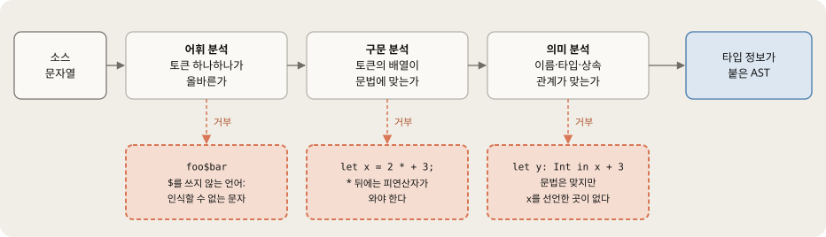

슬라이드 4는 세 단계를 거름망(filter)에 비유한다. 각 단계는 앞 단계를 통과한 입력만 받고, 의미 분석은 그 마지막 방어선이다. 애니메이션의 [마무리 페이지](../../动画/中文/frontend-flow.html#finale)에서 입력 넷을 골라 어디서 걸리는지 볼 수 있다.

의미 분석을 마치면 IR 생성, 중간 단계 최적화, 타깃 코드 생성으로 넘어간다.

---

## 2. 파싱만으로 모든 오류를 잡을 수 없는 이유

LL/LR 문법과 분석표를 만들었다면, 모든 검사 규칙을 문법에 넣어 파서가 처리하게 하면 안 될까?

문제는 **문맥 자유 문법(Context-Free Grammar, CFG)의 표현력에 한계가 있다**는 점이다.

### 2.1 문맥 자유 언어로 표현할 수 없는 조건

CFG에 대응하는 계산 모델은 스택 하나를 사용하는 푸시다운 오토마톤(Pushdown Automaton, PDA)이다.

“변수는 선언한 뒤에 사용해야 한다”는 규칙을 생각해 보자.
이름의 일치를 형식 언어로 단순화하면 다음과 같은 반복 패턴을 비교하는 문제가 된다.

$$L = \{ w \, c \, w \mid w \in \Sigma^* \}$$

첫 번째 $w$는 선언된 이름, 두 번째 $w$는 사용된 이름을 나타낸다. 가운데 $c$는 두 부분을 구분하는 표지로 생각할 수 있다.

적절한 알파벳 조건에서 $L=\{wcw\}$는 **문맥 자유 언어가 아니다**. CFL 펌핑 보조정리 등으로 증명할 수 있다.

스택은 나중에 넣은 것을 먼저 꺼낸다. 반대로 이름 비교는 앞서 읽은 문자열과 같은 순서로 두 번째 문자열을 대조해야 한다. 이 차이는 왜 단순한 CFG만으로 일반적인 이름 일치 조건을 처리할 수 없는지 이해하는 데 도움이 된다. 다만 이 설명 자체가 형식적인 증명은 아니다.

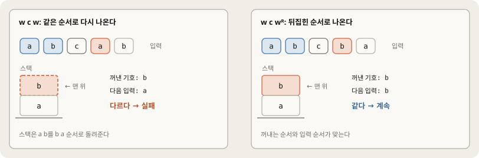

> [!note] 보충: 알파벳 조건과 뒤집힌 경우
> - "적절한 알파벳 조건"은 $w$에 쓰는 글자가 두 종류 이상이라는 뜻이다. 글자가 $a$ 하나뿐이면 $\{a^n c\, a^n\}$이 되어 개수만 맞추면 되므로 문맥 자유다.
> - 순서를 뒤집은 $\{w\,c\,w^R\}$은 문맥 자유 언어다. 그림의 오른쪽처럼 꺼내는 순서가 맞기 때문이다. 같은 순서로 두 번 나오는 것이 문제다.
> - 이 예는 Dragon Book 2판 §4.3.5(Non-Context-Free Language Constructs)에 선언과 사용의 추상화로 나온다. 같은 절의 $\{a^n b^m c^n d^m\}$은 함수 선언의 매개변수 수와 호출의 인자 수를 맞추는 조건의 추상화다(§2.2의 2번).
> - 실제 파서가 쓰는 LL(1)·LR(1)은 결정적 PDA라서 CFL 전체보다도 좁다. 문법으로 할 수 있는 일을 늘리기는 더 어렵다.

### 2.2 실제 언어에서 문맥 정보가 필요한 경우

실제 언어에는 생성 규칙만으로 처리하기 어려운 조건이 많다.

1. **스코프와 선언 연결**: `x`를 쓰는 위치에서 현재 또는 바깥 스코프의 선언을 찾을 수 있어야 한다.
2. **매개변수와 인자 일치**: `foo(a, b, c)`의 인자 수와 타입이 선언된 시그니처에 맞아야 한다.
3. **타입 호환성**: `a + b`가 가능한지는 두 표현식의 타입에 달려 있다. 각 표현식은 여러 겹으로 중첩될 수 있다.

정수식과 불리언식마다 별도 생성 규칙을 만드는 식으로 타입을 문법에 모두 넣으면 규칙 수가 크게 늘어난다. 암시적 변환, 다형성, 템플릿까지 포함하면 관리하기 어렵다.

그래서 보통 다음처럼 역할을 나눈다.
- **구문 분석**: 트리의 문법적 구조를 검사한다.
- **의미 분석**: 노드의 의미와 노드 사이의 관계를 검사한다.

---

## 3. coolc의 의미 분석 검사 목록

CS143의 교육용 언어 Cool과 컴파일러 `coolc`를 예로 들면 크게 여섯 가지를 확인한다.

### 3.1 사용한 식별자에 선언이 있는가
- 변수명, 메서드명, 클래스명이 해당 위치에서 보이는 스코프에 선언되어 있는지 확인한다.
- **심벌 테이블**(Symbol Table)로 스코프를 관리한다. 들어갈 때 새 스코프를 쌓고, 나올 때 제거한다. 이름은 안쪽부터 바깥쪽으로 찾는다.

### 3.2 타입이 올바르고 서로 호환되는가
- 대입의 좌우 타입이 호환되는가? 예를 들어 `String`을 `Int` 변수에 넣을 수는 없다.
- 피연산자가 연산자의 조건을 만족하는가? Cool의 산술 연산은 정수, 논리 조건은 불리언을 요구한다.
- 호출 인자의 타입이 메서드 시그니처와 맞는가?
- `if-else` 두 분기의 결과 타입은 최소 상계(LUB, Least Upper Bound)로 어떻게 합치는가?

### 3.3 상속 관계가 올바른가
- `Foo`를 상속한다면 `Foo`가 실제로 정의되어 있는가?
- **상속 그래프에 사이클이 없는가?** `A`가 `B`를, `B`가 `A`를 상속할 수는 없다. 위상 정렬이나 방향 그래프의 사이클 검사로 확인한다.
- Cool에서 오버라이드할 때 매개변수 수, 매개변수 타입, 반환 타입이 부모 메서드와 일치하는가?

### 3.4 클래스가 한 번만 정의되는가
- 같은 이름의 클래스를 중복 정의할 수 없다. 클래스 이름은 프로그램 전체에서 유일해야 한다.

### 3.5 같은 클래스에 같은 이름의 메서드가 중복되는가
- Cool은 메서드 오버로딩을 지원하지 않으므로 한 클래스 안에서 같은 이름의 메서드를 두 번 정의할 수 없다. C++처럼 오버로딩을 지원해도 동일한 함수를 중복 정의하는 것은 별개의 오류다.

### 3.6 예약된 이름을 잘못 쓰지 않았는가
- 특별한 의미를 가진 내장 이름을 일반 식별자처럼 재정의하거나 사용할 수 없다.
- Cool에서는 `Int`, `String`, `Bool` 등을 부모 클래스로 지정할 수 없다. `self`를 새 변수로 선언하거나 대입 대상으로 쓸 수도 없다. `IO`와 `Object`는 상속할 수 있다.

슬라이드 7은 3–5번(상속, 클래스 중복, 메서드 중복)을 객체 지향이라서 생기는 검사로, 6번을 거의 모든 언어에 있는 검사로 분류한다. 애니메이션의 [세 프로그램 페이지](../../动画/中文/frontend-flow.html#passes-run)에서 상속 사이클과 Int 상속이 2차 패스에서 걸리는 모습을 볼 수 있다.

---

## 4. 의미 규칙은 언어마다 다르다

앞의 목록은 `coolc` 기준이다. 다른 언어에서는 요구하는 검사가 달라진다.

- **정적 타입과 동적 타입**:
  C++·Rust 같은 정적 타입 언어는 타입 검사의 상당 부분을 컴파일 시점에 수행한다. Python·JavaScript 같은 동적 타입 언어는 많은 타입 검사를 실행 시점에 수행하며, 프런트엔드가 하는 이름·스코프 처리도 언어마다 다르다.
- **단일 상속, 다중 상속, 트레이트**:
  Java는 클래스 단일 상속과 여러 인터페이스 구현을 지원한다. C++는 다중 상속과 다이아몬드 상속을 다루고, Rust는 트레이트와 고아 규칙 등을 검사한다. 필요한 관계 검사도 각각 다르다.
- **섀도잉과 재선언**:
  Rust·C++는 안쪽 스코프에서 바깥 변수를 가리는 경우가 있다. Python의 `global`·`nonlocal`은 이름이 어느 스코프에 속하는지 지정한다.

> [!note] 보충: 같은 스코프의 재선언도 언어마다 다르다
> Rust는 같은 블록 안에서도 `let x = 5; let x = x + 1;`처럼 다시 선언할 수 있다. 새 `let`이 앞의 `x`를 가린다. C++는 같은 블록의 `int x; int x;`를 재정의 오류로 본다. Cool은 같은 `let` 안에서 같은 이름을 여러 번 묶으면 뒤의 것이 앞의 것을 가린다고 정하고, 한 메서드의 형식 매개변수 이름은 서로 달라야 한다고 정한다. §14.3의 `check_scope`를 언제 오류로 볼지는 이 규칙에 따라 정한다.

검사 내용의 기준은 **언어 명세**(Language Specification)다. 의미 분석기는 이 규칙을 실행 가능한 검사 코드로 구현한다.

---

## 5. 결과물: 타입 정보가 붙은 AST

의미 분석은 오류를 찾는 동시에 다음 단계에 필요한 메타데이터를 AST에 붙인다.

입력 AST에는 우선 문법 구조가 담겨 있다.
분석 후에는 다음과 같은 의미 정보가 추가된다.
- 표현식의 결과 타입(`Type`).
- 식별자가 가리키는 선언(`Binding`).
- 메서드 호출의 시그니처와 디스패치에 필요한 정보. 동적 분파의 실제 구현은 실행 시점 수신 객체에 따라 달라질 수 있다.

이 정보가 붙은 AST를 바탕으로 IR이나 타깃 코드를 생성할 수 있다.
이로써 프런트엔드의 주요 정적 검사가 마무리된다.


---

## 6. 선언과 사용을 연결하기

의미 분석의 기본 작업은 **식별자를 사용한 위치와 그 이름에 해당하는 선언을 연결하는 것**이다.

변수 접근, 메서드 호출, 클래스 상속을 처리하기 전에 다음을 알아야 한다.
1. 이 위치에서 접근할 수 있는 선언이 있는가?
2. 있다면 정확히 어느 선언이며, 타입과 스코프는 무엇인가?

Cool을 비롯한 정적 타입 언어에서는 이름을 연결해야 타입 검사에 필요한 정보를 얻을 수 있다.

### 6.1 두 가지 실패 사례

다음 Cool 표현식은 서로 다른 단계에서 실패한다.

#### 예 1: 선언은 찾았지만 타입이 맞지 않는다
```cool
let y: String <- "abc" in y + 3
```
- `y + 3`에서 `y`를 찾으면 `let` 스코프의 `y: String` 선언이 나온다.
- 이름 연결은 성공하지만 `+`는 두 피연산자로 `Int`를 요구한다. `y`는 `String`이다.
- 따라서 **이름 연결은 통과하고 타입 검사에서 실패한다**.

#### 예 2: 이름 연결부터 실패한다
```cool
let y: Int in x + 3
```
- `x + 3`에서 현재 보이는 모든 스코프를 대상으로 `x`를 찾는다.
- 현재 스코프에는 `y: Int`만 있고 바깥에도 `x`가 없다.
- 덧셈 타입을 판단하기 전에 `Undeclared identifier: x`를 보고한다.

애니메이션의 [전체 흐름 페이지](../../动画/中文/frontend-flow.html#overview)와 [환경 페이지](../../动画/中文/frontend-flow.html#tc-run)에서 바깥 환경을 `x 없음`, `x : Int`, `x : String`으로 바꿔 가며 두 실패와 성공을 비교할 수 있다.

> [!note] 보충: 예 2에서 y는 문제가 아니다
> 슬라이드 11은 예 2에서 `y`를 선언만 하고 쓰지 않은 것은 오류가 아니라고 짚는다. 경고를 낼 수는 있다. 또 `x`가 오류인지는 이 식만 보고 정할 수 없다. 바깥에 `x`의 선언이 있으면 정상이다(슬라이드 12). 슬라이드는 이것을 "문맥 자유가 아닌 성질"의 예로 든다.

---

## 7. 식별자의 스코프

선언과 사용을 연결하려면 먼저 이름이 보이는 범위, 즉 **스코프**(Scope)를 정해야 한다.

### 7.1 기본 정의
- **식별자의 스코프**: 프로그램 텍스트에서 해당 이름을 사용할 수 있는 영역이다.
- **같은 이름, 다른 대상**: 위치에 따라 같은 이름이 서로 다른 선언을 가리킬 수 있다.
- **제한된 가시성**: 함수 안에서 선언한 지역 이름은 보통 그 블록 밖에서 접근할 수 없다. 이름의 스코프와 실행 중 객체의 수명은 구분해야 한다.

스코프가 서로 겹치지 않으면 같은 이름 `x`를 써도 충돌하지 않는다.

---

## 8. 정적 스코프와 동적 스코프

어느 선언에 이름을 연결할지 정하는 방식에는 크게 두 가지가 있다.

| 구분 | 정적·렉시컬 스코프 | 동적 스코프 |
| -------- | ------------------------------------- | ------------------------------- |
| **기준** | 소스 코드의 어휘적 중첩 구조 | 실행 중 함수 호출 관계 |
| **결정 시점** | 코드의 스코프 구조로 결정 | 실행 시 호출 스택에서 탐색 |
| **예시** | C/C++, Java, Rust, Python, Cool | 초기 Lisp, SNOBOL, Bash, Perl의 일부 기능 |
| **특징** | 코드만 보고 이름 관계를 파악하기 쉽다 | 호출자에 따라 바인딩이 달라져 예상치 못한 이름 참조가 생길 수 있다 |

### 8.1 렉시컬 스코프를 많이 쓰는 이유
정적 스코프는 **렉시컬 스코프**(Lexical Scope)라고도 한다. 변수의 바인딩을 이해하려고 전체 호출 스택을 상상할 필요 없이, 코드의 중첩 구조를 보면 된다.

Lisp 계열도 Scheme·Common Lisp 등에서는 렉시컬 스코프를 널리 사용한다. Common Lisp의 특수 변수처럼 동적 바인딩을 지원하는 경우는 별도로 구분한다.

---

## 9. 중첩 스코프와 섀도잉

안쪽과 바깥쪽에 같은 이름이 있으면 **섀도잉(Shadowing)** 규칙에 따라 어느 선언을 쓸지 정한다.

### 9.1 코드로 살펴보기

다음 Cool 코드의 바인딩을 보자.

```cool
let x: Int <- 0 in
{
    x;                 -- (1) 바깥 x, 값은 0
    let x: Int <- 1 in
    {
        x;             -- (2) 안쪽 x가 바깥 x를 가린다. 값은 1
    };
    x;                 -- (3) 안쪽 스코프 종료, 다시 바깥 x를 참조한다. 값은 0
}
```

스코프에 들어가고 나올 때의 동작은 다음과 같다.
1. 바깥 `let`이 정수 `x = 0`을 선언한다. 첫 번째 `x;`는 이 선언에 연결된다.
2. 안쪽 `let x: Int <- 1`에 들어가면 새 선언이 바깥 이름을 가린다. 안쪽 본문에서 `x`는 새 변수를 뜻한다.
3. 안쪽 `let`을 나오면 그 바인딩이 사라지고 세 번째 `x;`는 다시 바깥 변수를 참조한다. 값은 여전히 `0`이다.

### 9.2 구현 관점: 스코프 스택

AST를 순회하면서 스코프별 심벌 테이블을 스택으로 관리한다.

```text
바깥 let 진입  --> Push Scope 1: [ x: Int(0) ]
식 (1) 검사    --> 스택 위에서 x 탐색, Scope 1에서 찾음
안쪽 let 진입  --> Push Scope 2: [ x: Int(1) ] -> Scope 1: [ x: Int(0) ]
식 (2) 검사    --> Scope 2의 x를 먼저 찾음, 바깥 x는 가려짐
안쪽 let 종료  --> Pop Scope 2
식 (3) 검사    --> Scope 1의 바깥 x를 다시 찾음
```

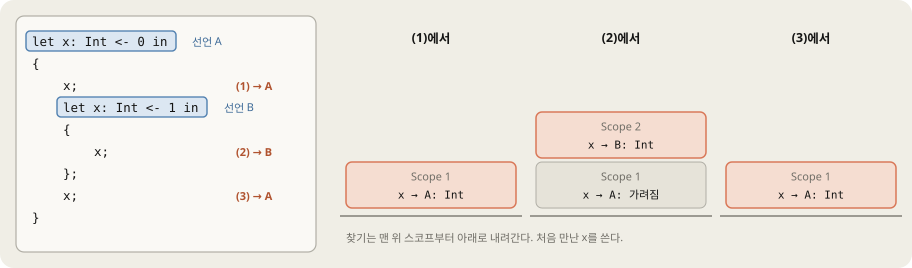

스코프에 들어갈 때 쌓고 나올 때 제거하면, 안쪽 선언을 우선 찾으면서도 바깥 환경을 쉽게 복원할 수 있다. 애니메이션의 [중첩 let 페이지](../../动画/中文/frontend-flow.html#scope-run)가 이 표를 한 단계씩 움직인다.

> [!note] 보충: 블록은 스코프를 만들지 않는다
> Cool의 블록 `{ e₁; e₂; … }`는 식을 차례로 계산할 뿐 이름을 묶지 않는다. 그래서 그림의 스택에는 `let`이 만든 층만 있다. C나 Java의 `{ }`는 블록마다 지역 변수의 스코프를 만든다. 슬라이드 16의 원래 예는 안쪽 `let`의 본문을 `x` 하나로 쓴다(`let x: Int <- 1 in x; x;`). `let`의 본문은 가능한 한 오른쪽으로 늘어나지만 블록 안의 `;`에서 끝나므로 결과는 이 노트와 같다.

---

## 10. 동적 스코프를 코드로 이해하기

동적 스코프에서는 실행 중의 호출 관계로 바인딩을 결정한다.

```text
g(y) = let a <- 4 in f(3);
f(x) = a;
```

함수 `f(x) = a`를 보자.
- `a`는 `f`의 매개변수도 지역 변수도 아니다.
- **정적 스코프**: `f`가 정의된 바깥 환경에서 `a`를 찾아야 한다. Cool 같은 정적 검사 언어에서 해당 선언이 없으면 `Undeclared identifier: a` 오류다.
- **동적 스코프**: `g(y)`가 실행되어 `a = 4`를 바인딩하고 `f(3)`을 호출하면, `f`는 호출 스택을 따라 `g`의 `a`를 찾는다. 따라서 `4`를 반환한다.

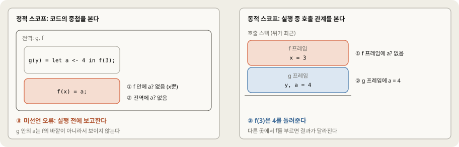

동적 스코프에서는 **누가 함수를 호출했는지에 따라 동작이 바뀐다**.
`a`가 없는 호출 경로에서 `f(3)`을 부르면 실행 중 이름 탐색이 실패할 수 있다. 다른 호출자가 우연히 만든 `a`를 읽거나 수정할 수도 있다. 이런 의존성은 코드를 이해하고 수정하기 어렵게 만든다.

애니메이션의 [정적·동적 스코프 페이지](../../动画/中文/frontend-flow.html#scope-compare)에서 `f`를 부르는 쪽을 `g`(a = 4), `h`(a = 7), `main`(a 없음)으로 골라 보면 왼쪽(정적)은 셋 모두 같은 오류이고 오른쪽(동적)은 4, 7, 실행 오류로 갈린다.

---

## 11. Cool에서 바인딩을 만드는 여섯 가지 구문

Cool에서 이름을 도입하는 구문은 `let`만이 아니다.

1. **클래스 선언**: 전역 클래스 이름을 만든다. 예: `class Main { ... }`.
2. **메서드 정의**: 클래스의 메서드 이름을 만든다. 예: `f(): Int { ... }`.
3. **let 표현식**: 본문에 지역 객체 식별자를 도입한다. 예: `let x: Int <- 0 in ...`.
4. **형식 매개변수**: 메서드 본문에서 사용할 이름을 만든다. 예: `foo(x: Int, y: String)`.
5. **속성 정의**: 클래스의 멤버 변수를 만든다. 예: `a: Int <- 0;`.
6. **case 분기**: 해당 분기 본문에서만 사용할 이름을 만든다. 예: `case e of x: Int => ...; y: String => ...; esac`.

이 이름들은 종류별 이름 공간으로 구분된다. 클래스 이름은 대문자로, 객체 식별자와 메서드 이름은 소문자로 시작한다.

---

## 12. 단순한 최근접 중첩 규칙으로 설명하기 어려운 경우

모든 이름이 `let`처럼 “텍스트에서 먼저 선언해야 하고, 가까운 블록 안에서만 보인다”고 생각하기 쉽다.

객체 지향 언어에서는 다음 세 경우를 따로 살펴봐야 한다.

### 12.1 클래스 이름: 전역 가시성과 전방 참조
Cool 클래스는 서로 중첩되지 않으며 최상위에 정의한다. **정의보다 앞에서 이름을 사용할 수 있다**.

```cool
class Foo {
    ... let y: Bar in ...    -- Bar는 뒤에서 정의되지만 여기서 사용할 수 있다
};

class Bar {
    ...
};
```
`Foo`를 읽을 때 아직 뒤의 `Bar`를 못 봤다. 단순한 한 번의 순차 처리만으로 검사하면 정의되지 않았다고 잘못 판단할 수 있다.

### 12.2 속성: 클래스 본문 전체에서 보인다
속성의 가시성은 같은 클래스 안에서 선언된 줄의 앞뒤로 제한되지 않는다.

```cool
class Foo {
    f(): Int { a };          -- 앞쪽 메서드에서 a를 읽는다
    a: Int <- 0;             -- 속성 선언은 뒤에 있다
};
```
클래스 아래쪽에 적은 속성도 앞쪽 메서드에서 사용할 수 있다.

### 12.3 메서드 이름: 상속과 오버라이드
메서드 이름은 상속 관계도 함께 봐야 한다.
- 현재 클래스에 선언되지 않았더라도 부모나 조상의 메서드일 수 있다.
- 자식이 부모 메서드를 오버라이드하면 매개변수 수, 타입, 반환 타입이 Cool의 규칙에 맞는지 확인해야 한다.

---

## 13. 파서 상태 스택과 심벌 테이블은 다르다

> [!important] 두 자료구조의 역할
> 파싱 중의 상태 전이와 의미 분석의 심벌 테이블을 구분하자.
> - **파서의 `<상태, 기호>` 스택**:
>   LR/SLR 분석기의 구동 스택이다. DFA 상태와 문법 기호를 저장해 핸들을 추적하고 이동·축약 시점을 결정한다. 분석 트리나 AST를 구성하는 구문 분석에 사용한다.
> - **의미 분석의 심벌 테이블**:
>   이름을 선언 정보에 대응시키는 매핑이다. 키는 `"x"` 같은 이름, 값은 `Int` 같은 타입과 선언 메타데이터다. AST의 이름 연결과 타입 추론에 사용한다.

### 13.1 심벌 테이블이란

컴파일러가 관리하는 이름 등록부다. 이름이 어느 선언을 뜻하는지, 그 타입이 무엇인지 기록한다. 선언 존재 여부와 현재 사용 위치의 바인딩을 찾는 데 쓴다.

다음 Cool 표현식을 검사한다고 하자.

```cool
let x: Int <- 10 in x + 1
```

`in` 뒤의 본문을 검사할 때는 다음 항목이 등록되어 있다.

| 이름 | 종류 | 타입 | 선언 위치 |
|---|---|---|---|
| `x` | 지역 변수 | `Int` | 앞의 `let x: Int` |

`x + 1`은 다음 순서로 검사한다.

1. `x`를 찾아 선언과 타입 `Int`를 확인한다.
2. 리터럴 `1`의 타입도 `Int`다.
3. 두 피연산자가 모두 `Int`이므로 덧셈이 가능하며 결과도 `Int`다.

본문이 `y + 1`이고 바깥에도 `y`가 없으면 미선언 식별자 오류를 보고한다.

심벌 테이블은 변수뿐 아니라 함수·메서드·클래스 정보도 다룬다. 변수는 타입과 선언 위치, 메서드는 매개변수와 반환 타입, 클래스는 부모와 멤버 정보를 연결할 수 있다. 구현에서는 종류별로 표를 나누기도 한다.

컴파일 정보와 실행 중 데이터는 다르다. 여기서는 `x`의 선언과 타입을 기록한다. 실제 값 `10`은 프로그램 실행 시 저장된다. 이름 연결이나 타입 검사 때문에 코드를 실행할 필요는 없다.

같은 이름이 중첩된 경우에는 스코프별로 나눠 관리한다.

```text
현재 안쪽: { x → 안쪽 선언, 타입 String }
바깥:      { x → 바깥 선언, 타입 Int    }
```

안쪽부터 찾으므로 현재 `x`는 `String`이다. 안쪽 스코프를 제거한 뒤에는 바깥의 `Int` 선언이 다시 보인다. 바깥 선언이 지워진 것이 아니라 잠시 가려진 것이다.

이후의 “심벌 테이블 변화”는 AST를 따라 스코프에 들어가고 나올 때 보이는 선언이 달라진다는 뜻이다. 등록·탐색·종료 동작은 14절에서 설명한다.

참고: *Compilers: Principles, Techniques, and Tools*, 2판 §2.7; [CS143 SymbolTable API](https://web.stanford.edu/class/archive/cs/cs143/cs143.1112/javadoc/cool_ast/SymbolTable.html).

---

## 14. AST 재귀 순회와 심벌 테이블 변화

의미 분석은 AST를 한 번 또는 여러 번 **재귀적으로 순회**하는 과정으로 구현할 수 있다.

```text
노드 n 순회:
  1. Before: 진입 전에 필요한 스코프를 만들거나 이름을 미리 등록한다.
  2. Recurse: 자식 노드를 재귀적으로 검사한다.
  3. After: 필요한 스코프를 종료하고 n의 타입 등 정보를 기록한다.
```

### 14.1 `let x: Int <- 0 in e`의 스코프 변화

Cool의 `let` 노드를 보자.

```text
         [ let x: Int ]  (입력 환경: Sym)
            /       \
           /         \
    [ 초기화식 ]       [ 본문 e ]
    (환경: Sym)        (환경: Sym + [x -> Int])
```

초기화식과 본문은 **서로 다른 환경**에서 검사한다.
1. **초기화식 검사**:
   초기값 `0`을 검사할 때는 기존 환경 $Sym$을 사용한다. 새 $x$는 아직 보이지 않는다.
   `let x: Int <- x in e`의 초기화식에 있는 `x`는 새 변수가 아니라 **바깥의 기존 $x$**를 가리킨다.
2. **본문 진입 전(Before)**:
   $[x\to\text{Int}]$를 등록해 바깥의 같은 이름을 가린다.
3. **본문 검사(Recurse)**:
   새 $x$가 보이는 환경에서 `e`의 모든 노드를 검사한다.
4. **본문 검사 후(After)**:
   새 $x$가 속한 스코프를 제거하고 이전 환경 $Sym$으로 돌아간다.

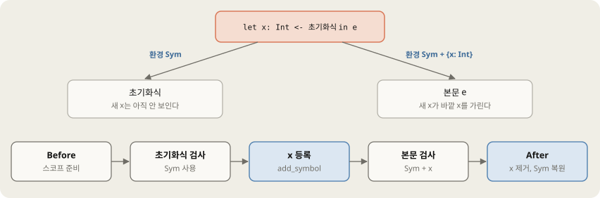

슬라이드 28의 요점은 마지막 줄이다. let 하위 트리의 처리를 마치고 나올 때 심벌 테이블은 들어갈 때와 **정확히 같은 상태**여야 한다.

### 14.2 스택 기반의 기본 심벌 테이블

가장 단순하게는 항목을 하나의 스택에 저장할 수 있다.
- `add_symbol(x, info)`: 이름 $x$와 타입 등의 정보를 스택에 넣는다.
- `find_symbol(x)`: 위에서 아래로 찾아 첫 $x$를 반환한다. 없으면 `null`이다. 나중에 넣은 선언을 먼저 찾으므로 섀도잉을 구현한다.
- `remove_symbol()`: 맨 위 항목을 제거한다.

### 14.3 스코프 단위로 관리하는 인터페이스

변수가 많으면 항목을 하나씩 빼기 번거롭다. 보통 다음과 같은 스코프 관리 인터페이스로 감싼다.

```cpp
enter_scope();       // 새 스코프 계층이나 스코프별 해시 테이블 생성
find_symbol(x);      // 안쪽부터 바깥쪽까지 탐색, 가장 가까운 바인딩 반환. 없으면 null
add_symbol(x, info); // 가장 안쪽 스코프에 x 등록
check_scope(x);      // 바깥으로 나가지 않고 현재 스코프에 x가 있는지만 검사
exit_scope();        // 현재 스코프와 그 안의 항목을 한꺼번에 제거
```

> [!note] `check_scope(x)`가 필요한 이유
> `find_symbol(x)`는 모든 바깥 스코프까지 찾아 이름을 해석한다.
> 반면 새 선언을 검사할 때는 언어의 재선언 규칙을 적용해야 한다.
> - 바깥 이름을 가리는 것은 허용할 수 있다.
> - 같은 스코프에서 금지된 중복 선언은 따로 검출해야 한다. 예를 들어 Cool의 `foo(x: Int, x: String)`은 허용되지 않는다. `let`의 순차 바인딩은 별도 규칙을 따른다.
> 
> `check_scope(x)`는 현재 계층만 확인하므로, 바깥 이름과의 겹침을 같은 스코프의 중복 선언과 구분할 수 있다.

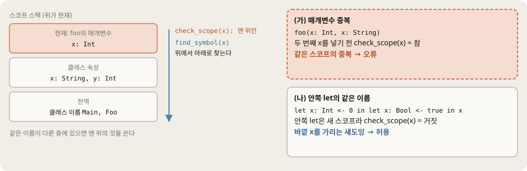

> [!note] 보충: 14.2의 단순 스택이 매개변수 중복을 못 잡는 이유
> 슬라이드 32–33의 예는 `f(x: Int, x: Int) { }`다. 단순 스택에는 스코프의 경계가 없다. 두 번째 `x`를 넣을 때 `find_symbol(x)`가 첫 번째 `x`를 찾더라도, 그것이 같은 매개변수 목록에서 온 것인지 바깥 `let`에서 온 것인지 알 수 없다. 함수는 이름 여러 개를 **한꺼번에 같은 스코프에** 넣는데 스택은 하나씩 넣기 때문이다. `enter_scope`가 경계를 표시해 주면 `check_scope`로 구분할 수 있다. CS143 과제는 이 인터페이스의 심벌 테이블을 제공한다(슬라이드 36).

애니메이션의 [스코프 순서도 페이지](../../动画/中文/frontend-flow.html#scope-flow)는 이 인터페이스를 쓰는 순회를 순서도로 그리고 `let x : Int <- 1 in x + y`로 따라간다. 초기화식을 먼저 방문하고 나서 `x`를 등록하는 순서, `y`를 찾지 못해 미선언 오류를 내는 갈래를 볼 수 있다.

---

## 15. 전방 참조와 여러 번의 의미 분석

클래스 사이의 전방 참조나 뒤에 선언된 속성을 처리하려면 다음 점을 고려해야 한다.
**읽는 즉시 모든 판단을 끝내는 단순한 한 번의 순회로는 부족하다.**

`class Foo { ... y: Bar ... }`를 검사하는 순간에는 아직 뒤에 `Bar`가 정의되어 있는지 모를 수 있기 때문이다.

### 15.1 역할을 나누어 여러 번 순회한다

AST를 다음처럼 여러 단계로 검사할 수 있다.

- **1차: 전역 클래스 이름 수집**:
  최상위 노드에서 클래스 이름을 수집해 전역 표에 등록하고 중복 정의를 검사한다.
- **2차: 상속 관계 구성과 검사**:
  수집한 클래스 이름을 바탕으로 부모가 존재하는지, `Int` 같은 상속 금지 클래스를 지정하지 않았는지, $A\to B\to A$ 같은 사이클이 있는지 확인한다.
- **3차: 속성과 메서드 시그니처 수집**:
  각 클래스의 속성 타입, 메서드 매개변수와 반환 타입을 기록한다. 중복 메서드와 오버라이드 시그니처도 검사한다.
- **4차: 표현식 타입 추론과 검사**:
  앞서 모은 클래스·상속·멤버 정보를 사용해 메서드 본문을 검사한다. 지역 바인딩을 관리하면서 각 표현식의 타입을 구한다.

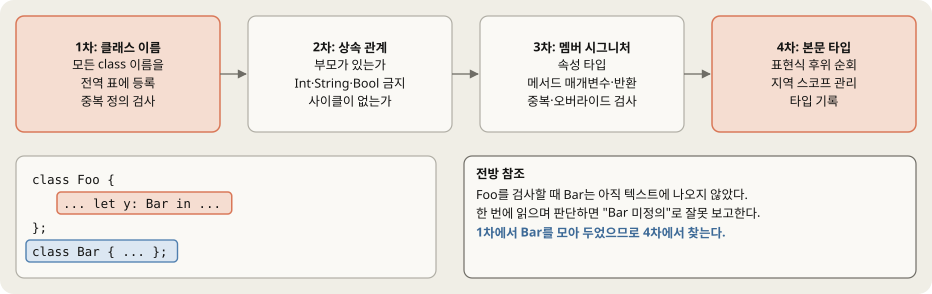

실제 구현에서는 단계를 합치거나 나누기도 한다. 핵심은 필요한 정보를 먼저 모은 뒤 그 정보에 의존하는 검사를 하는 것이다.

> [!note] 보충: 상속 그래프가 깨지면 멈추는 이유
> 슬라이드 38은 "의미 분석은 여러 번의 순회가 필요하고, 아마 둘보다 많다. 엉킨 한 번보다 단순한 여러 번이 낫다"고 정리한다. 2차에서 사이클을 찾으면 그 뒤 단계는 의미가 없다. lub(§34)와 상속된 메서드 찾기(§37)는 부모를 따라 Object까지 올라가는 반복인데, 사이클이 있으면 끝나지 않는다. 그래서 상속 그래프에 오류가 있으면 보고하고 멈추는 것이 보통이다. 애니메이션의 [세 프로그램 페이지](../../动画/中文/frontend-flow.html#passes-run)에서 정상, 상속 사이클, Int 상속을 골라 각각 몇 차에서 멈추는지 볼 수 있다.


---

## 16. 타입이란 무엇인가

타입을 이해하는 한 가지 실용적인 관점은 다음과 같다.

$$\text{Type} = \text{A set of values} + \text{A set of operations on those values}$$

**타입은 가능한 값들과 그 값에 허용되는 연산을 함께 설명한다.**

- 정수 `Int`:
  - **값**: 정해진 범위의 정수. 예를 들어 $[-2^{31},2^{31}-1]$.
  - **연산**: 덧셈·뺄셈·곱셈·나눗셈·비교. 예: `+`, `-`, `>=`, `<`.
- 문자열 `String`:
  - **값**: 유한한 문자열.
  - **연산**: 이어 붙이기, 비어 있는지 검사하기, 길이 구하기 등. 정수와의 산술 연산이 자동으로 허용되는 것은 아니다.

객체 지향 언어의 **클래스**(Class)도 타입을 나타낸다. 속성은 객체 상태를, 메서드는 객체에 적용할 수 있는 연산을 설명한다.

---

## 17. 타입 검사가 필요한 이유: 비트만으로는 의미를 알 수 없다

타입 검사를 생략하면 어떤 문제가 생길까?

C의 두 표현식을 비교해 보자.
1. 정수끼리 더하는 `int_a + int_b`.
2. 함수 포인터와 정수를 더하는 `func_ptr + int_b`. 표준 C에서는 허용되지 않는다.

**기계 수준의 덧셈만으로는 이런 언어 차원의 의미 차이를 알 수 없다.**

일반적인 CPU에서는 정수와 주소가 모두 비트 패턴으로 표현된다. 예를 들어 두 값을 같은 폭의 레지스터에 넣고 `addq`를 실행하면, 명령은 비트 덧셈을 수행할 뿐 소스 언어에서 함수 주소를 더해도 되는지 검사하지 않는다. 실제 크기와 표현은 아키텍처와 ABI에 따라 다르다.

따라서 타입 시스템은 다음 역할을 한다.

> **값을 어떤 의미로 해석하고 어떤 연산에 쓸 수 있는지 제한한다.**
> (*Enforces intended interpretation of values, because nothing else will!*)

타입 검사는 비트 패턴에 소스 언어의 의미를 부여한다. 함수 주소를 일반 정수처럼 다루는 등 잘못된 연산을 코드 생성 전에 걸러 내는 데 쓰인다.

---

## 18. 정적 타입, 동적 타입, 무타입

타입 검사를 언제 수행하는지에 따라 다음처럼 구분할 수 있다.

| 구분 | 검사 시점 | 특징 | 예시 |
|---|---|---|---|
| **정적 타입** | 주로 컴파일 시점 | 실행 전에 많은 타입 오류를 찾는다 | C, C++, Java, Rust, Cool |
| **동적 타입** | 실행 시점 | 값의 타입을 실행 중 확인해 연산 가능 여부를 판단한다 | Python, JavaScript, Scheme, Ruby |
| **무타입** | 소스 언어 수준 타입 검사가 없음 | 데이터를 주로 비트 패턴으로 다룬다 | 어셈블리, 기계어, 전통적인 Forth |

---

## 19. 정적 타입과 동적 타입의 장단점

두 방식은 서로 다른 이점을 제공한다.

- **정적 타입의 장점**:
  1. 실행 전에 잘못된 타입 사용과 시그니처 불일치를 찾을 수 있어 큰 프로젝트를 수정할 때 도움이 된다.
  2. 타입을 미리 알면 일부 실행 중 검사와 태그 확인을 줄일 수 있다.
- **동적 타입의 장점**:
  1. 정적 타입으로 표현하기 까다로운 동적 패턴과 메타프로그래밍을 유연하게 작성할 수 있다.
  2. 작은 스크립트나 실험에서 인터페이스와 타입 선언을 먼저 작성하는 부담이 적다.

### 실제 언어에서는 두 방식을 조합한다

실제 언어와 도구는 서로의 기능을 받아들인다.

1. **정적 타입 제약을 벗어나는 수단(Escape Mechanism)**:
   C의 `void*`나 명시적 캐스트, C++의 `reinterpret_cast`, Java의 명시적 다운캐스트 등이 있다. 허용 범위와 실행 중 검사 여부는 언어마다 다르다.
2. **동적 언어에 정적 타입 도구 추가(Retrofitting Static Typing)**:
   프로젝트가 커지면 타입 정보를 이용해 오류를 미리 찾고 싶어진다.
   - JavaScript에는 TypeScript가 있다.
   - Python에는 타입 힌트와 mypy가 있다.
   - PHP 계열의 Hack, Ruby의 Sorbet 같은 사례도 있다.

이 조합이 얼마나 유용한지는 프로젝트마다 다르다. 타입 정보는 큰 코드베이스의 관계를 파악하고 변경을 검증하는 수단이 된다.

> [!note] 보충: 탈출 수단이 실패하면
> 슬라이드 51은 잘못된 캐스트의 결과를 이렇게 비교한다. C에서는 실행 중 충돌(미정의 동작)로 이어질 수 있고, Java에서는 실행 중 검사에 걸려 `ClassCastException`이 난다. 같은 "탈출 수단"이라도 실행 중 검사가 있느냐에 따라 안전성이 다르다.

---

## 20. Cool의 타입 구성

Cool의 타입 시스템은 비교적 작다.

1. **어떤 타입이 있는가**:
   - **클래스 이름**: 사용자 정의 클래스와 `Object`, `IO`, `Int`, `String`, `Bool` 같은 기본 클래스 이름이 타입이 된다.
   - **`SELF_TYPE`**: 수신 객체와의 타입 관계를 보존하는 특별한 타입이다. 상속된 메서드의 반환 타입을 더 정확하게 표현한다.
2. **명시적 선언과 추론의 역할**:
   - 프로그래머는 속성, 매개변수, 반환값, `let` 변수의 타입을 명시한다.
   - 컴파일러는 리터럴·연산·호출·분기 등 각 표현식의 정적 타입을 구한다.

---

## 21. 타입 검사와 타입 추론

두 용어는 함께 쓰이지만 질문이 다르다.

- **타입 검사(Type Checking)**:
  주어진 타입 정보와 사용 방식이 맞는지 확인한다. `Int` 매개변수 자리에 `String`을 전달하면 불일치다.
- **타입 추론(Type Inference)**:
  명시하지 않은 타입을 알려진 정보와 규칙으로 구한다. C++의 `auto`, Rust의 지역 변수 타입 추론이 예다.

Cool 컴파일러에서는 두 과정이 함께 진행된다.
먼저 자식 표현식의 타입으로 복합식의 결과 타입을 구하고, 그 타입이 선언이나 대입의 제약을 만족하는지 검사한다.

---

## 22. 논리 규칙으로 정의하는 타입 시스템

프런트엔드 각 단계에는 대응하는 형식적 도구가 있다.

| 단계 | 형식적 도구 | 계산·추론 모델 | 결과 |
| -------- | ----------------------------- | -------------------------- | ------------------- |
| **어휘 분석** | 정규식 | DFA/NFA | 토큰열 |
| **구문 분석** | CFG | PDA, 예측 분석표 | AST |
| **타입 검사** | 추론 규칙 | 증명 트리, 귀납적 추론 | 타입 정보가 붙은 AST |

왜 자연어 설명 외에 논리 규칙도 필요할까?
상속·다형성·오버로딩·공변성 등이 겹치면 자연어만으로는 조건을 빠뜨리거나 다르게 해석하기 쉽다. 형식 규칙은 전제와 결론을 명확히 적어, 같은 절차로 판단할 수 있게 한다.

---

## 23. 타입 추론 규칙의 표기법

기본 구조는 “전제가 성립하면 결론을 얻는다”이다.

> *부분식 $e_1$, $e_2$의 타입을 알면 복합식 $e_1+e_2$의 타입을 판단할 수 있다.*

### 23.1 기본 기호
먼저 다음 기호를 사용한다.
- $\land$: 논리곱. 여러 조건이 모두 성립해야 한다.
- $\Rightarrow$: 함의. 전제로부터 결론을 얻는다.
- $e:T$: 타입 판단. 표현식 $e$의 타입이 $T$라는 뜻이다.

자연어를 논리식으로 옮기면 다음과 같다.
- **자연어**: $e_1$과 $e_2$가 모두 Int이면 $e_1+e_2$도 Int다.
- **논리식**:
  $$(e_1 : \text{Int} \land e_2 : \text{Int}) \implies e_1 + e_2 : \text{Int}$$

### 23.2 가로선과 턴스타일 $\vdash$

추론 규칙은 보통 분수처럼 가로선 위아래로 배치한다.

$$\frac{\vdash \text{Hypothesis}_1 \quad \dots \quad \vdash \text{Hypothesis}_n}{\vdash \text{Conclusion}}$$

- **가로선 위**: 전제(Hypotheses). 모두 성립해야 한다.
- **가로선 아래**: 결론(Conclusion).
- **$\vdash$**: 턴스타일(Turnstile). $\vdash e:T$는 주어진 규칙으로 $e$의 타입이 $T$임을 유도할 수 있다는 뜻이다.

---

## 24. 기본 규칙과 증명 트리

Cool의 정수 리터럴과 덧셈 규칙을 보자.

### 24.1 정수 리터럴 공리 `[Int]`
$$\frac{i \text{ is an integer literal}}{\vdash i : \text{Int}} \quad [\text{Int}]$$
`1`, `42` 같은 정수 리터럴에는 재귀적으로 검사할 부분식이 없다. 타입 판단 전제가 없는 규칙을 **공리**(Axiom)라고 하며 증명 트리의 출발점이 된다. 정수 리터럴이라는 구문 조건은 따로 확인한다.

### 24.2 덧셈 규칙 `[Add]`
$$\frac{\vdash e_1 : \text{Int} \quad \vdash e_2 : \text{Int}}{\vdash e_1 + e_2 : \text{Int}} \quad [\text{Add}]$$
양쪽 피연산자가 `Int`임을 보이면 합의 타입도 `Int`로 정할 수 있다.

### 24.3 $1+2$의 증명 트리

추론 규칙에 구체적인 AST 노드를 대입하고 중첩하면 **증명 트리**(Proof Tree)를 만든다.

$$\frac{\cfrac{1 \text{ is an int literal}}{\vdash 1 : \text{Int}} [\text{Int}] \qquad \cfrac{2 \text{ is an int literal}}{\vdash 2 : \text{Int}} [\text{Int}]}{\vdash 1 + 2 : \text{Int}} [\text{Add}]$$

- 위쪽의 잎은 `[Int]` 공리로 $\vdash1:\text{Int}$, $\vdash2:\text{Int}$를 보인다.
- 아래쪽 루트는 `[Add]`로 두 전제를 결합해 $\vdash1+2:\text{Int}$를 얻는다.

타입 검사는 전체 AST에 대해 이런 증명 구조를 만들 수 있는지 확인하는 과정으로 볼 수 있다.

---

## 25. 타입 시스템의 건전성과 정밀도

추론 규칙은 건전성과 정밀도를 함께 고려해야 한다.

### 25.1 건전성(Soundness)
건전한 타입 시스템에서는 정적으로 얻은 타입이 실행 중 결과와 일관되어야 한다.
$$\text{정적으로 }\vdash e:T\text{를 얻고 }e\text{가 값으로 평가되면, 그 값의 동적 타입은 }T\text{에 부합해야 한다.}$$

“Well-typed programs cannot go wrong”은 타입 시스템이 방지하도록 설계된 종류의 실행 오류가 잘 타입된 프로그램에서 발생하지 않는다는 뜻이다. 모든 종류의 충돌이나 실행 실패가 없다는 보장은 아니다.

### 25.2 정수 리터럴을 `Object`로 추론하면 왜 불편한가
건전성만 생각해 다음 규칙을 고려해 보자.
$$\frac{i \text{ is an int literal}}{\vdash i : \text{Object}}$$

Cool에서 `Int`는 `Object`의 서브타입이다.
따라서 `1`을 `Object`로 보는 것은 그 값이 포함되는 범위라는 관점에서는 건전하다.

**하지만 타입 정보가 부정확해진다.**
`1`, `2`를 모두 `Object`로만 추론하면 `[Add]`가 요구하는 `Int` 조건을 만족시키지 못해 `1+2`마저 거부할 수 있다.

> [!important] 규칙 설계의 기준
> 모든 것을 `Object`로 올려 잡으면 구체적인 연산에 필요한 정보를 잃는다.
> 건전성을 유지하면서 가능한 한 **구체적이고 정밀한 타입**을 구해야 한다.

---

## 26. 증명 트리와 AST의 대응

타입 추론의 구조는 AST 구조와 밀접하게 연결된다.

```text
       [증명 트리]                              [AST]
       (잎이 위, 루트가 아래)                    (루트가 위, 잎이 아래)

   1: Int (잎)       2: Int (잎)                 [ + (루트) ]  <-- [Add]의 결론
       \                 /                             /   \
        \               /                             /     \
    [Add] 1 + 2 : Int (루트)                  [ 1 (잎) ] [ 2 (잎) ]
```

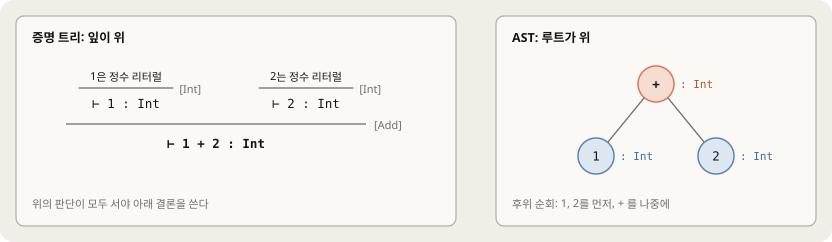

이 예에서 두 트리는 다음처럼 대응한다.
1. **구조**: 같은 부분식 관계를 서로 반대 방향으로 그린다.
2. **노드 대응**: AST의 각 노드에 해당하는 타입 규칙을 적용한다.
3. **의존성**: 자식의 타입 증명이 전제이고, 현재 노드의 타입이 결론이다.

따라서 구현은 **자식부터 처리하는 후위 순회**로 자연스럽게 이어진다.
- 자식 표현식의 타입을 먼저 구한다.
- 부모로 돌아와 연산자 규칙의 조건을 검사한다.
- 맞으면 결과 타입을 기록해 위로 전달하고, 아니면 타입 오류를 보고한다.

애니메이션의 [2 + 3 증명 트리 페이지](../../动画/中文/frontend-flow.html#tc-proof)는 왼쪽 AST를 후위 순회하는 동안 오른쪽 증명 트리가 잎부터 채워지는 모습을 같은 단계로 보여 준다.

---

## 27. 리터럴, 객체 생성, 제어 흐름의 규칙

기본 표기법을 다른 구문으로 확장해 보자.

### 27.1 리터럴 공리는 왜 전제가 없는가
불리언과 문자열 규칙은 다음과 같다.

$$\frac{}{\vdash \text{false} : \text{Bool}} \quad [\text{False}]$$

$$\frac{s \text{ is a string literal}}{\vdash s : \text{String}} \quad [\text{String}]$$

> [!note] 가로선 위가 비어 있어도 되는 이유
> 타입 판단 전제가 없는 규칙은 **공리**다.
> `true`, `false`는 자식 표현식이 없는 기본 리터럴이다. 타입을 정하기 위해 다른 부분식의 타입을 먼저 증명할 필요가 없으므로 바로 증명 트리의 잎이 된다.

### 27.2 객체 생성 `[New]`
Cool에서는 `new`로 객체를 생성한다.

$$\frac{}{\vdash \text{new } T : T} \quad [\text{New}]$$

`SELF_TYPE`을 제외하고, 유효한 클래스 $T$에 대한 `new T`의 정적 타입은 $T$다.

### 27.3 불리언 부정 `[Not]`와 반복문 `[Loop]`
논리 연산과 반복문의 규칙은 다음과 같다.

$$\frac{\vdash e : \text{Bool}}{\vdash !e : \text{Bool}} \quad [\text{Not}]$$

$$\frac{\vdash e_1 : \text{Bool} \quad \vdash e_2 : T}{\vdash \text{while } e_1 \text{ loop } e_2 \text{ pool} : \text{Object}} \quad [\text{Loop}]$$

> [!warning] 바로잡기: Cool에는 `!`가 없다
> `[Not]` 규칙의 `!e`는 슬라이드 71의 표기를 그대로 옮긴 것이다. Cool의 실제 문법에서 불리언 부정은 키워드 **not e**이고, `~e`는 정수의 보수(부호 반전)다. Cool 명세의 규칙도 $O,M,C \vdash \text{not } e_1 : \text{Bool}$로 적는다. 규칙의 내용(피연산자 Bool, 결과 Bool)은 같다.

> [!important] while의 타입은 왜 본문 타입 $T$가 아니라 `Object`인가
> 본문 $e_2$의 타입이 $T$라고 해도 전체 반복식의 타입까지 $T$로 정할 수는 없다.
> 
> Cool의 제어 흐름도 값을 가진 **표현식**이기 때문이다.
> 1. 제어 구문도 실행 결과와 정적 타입을 가진다.
> 2. `while e_1 loop e_2 pool`에서 첫 조건이 `false`이면 본문은 한 번도 실행되지 않는다.
> 3. 따라서 본문 결과를 전체 반복식의 값으로 사용할 수 없다.
> 
> Cool 명세는 while의 결과를 `void`, 정적 타입을 **Object**로 정한다. 이는 해당 언어의 규칙이며 모든 언어가 반드시 이렇게 해야 한다는 뜻은 아니다.

슬라이드 72는 이것을 설계 선택이라고 밝힌다. 마지막으로 실행한 본문 값을 반복식의 값으로 삼는 언어도 만들 수 있지만, 본문이 한 번도 실행되지 않으면 `void`가 나오고 `void`를 역참조하면 실행 오류다. 그래서 반복식의 값에 기대지 못하도록 `Object`로 둔다.

---

## 28. 지역적인 구문 정보만으로는 변수 타입을 알 수 없다

지금까지는 리터럴 자체나 자식 표현식만 봐도 타입을 판단할 수 있었다. 변수 참조는 다르다.

$$\frac{x \text{ is a variable}}{\vdash x : ?} \quad [\text{Var}]$$

AST 잎에 `x`라고 적혀 있다는 사실만으로 정수인지, 문자열인지, 어떤 클래스의 객체인지 알 수 없다.
그 타입은 매개변수·속성·`let` 등 바깥의 선언에 적혀 있다.

노드 사이의 문맥을 전달하려면 규칙에 환경을 추가해야 한다.

---

## 29. 타입 환경 $O$

이름에 대한 타입 정보를 전달하는 **타입 환경**(Type Environment)을 보통 $O$라고 쓴다.

### 29.1 자유 변수란
표현식 내부에서 바인딩되지 않아 바깥 문맥에 의존하는 변수가 **자유 변수**(Free Variable)다.
- `x`에서 `x`는 자유 변수다.
- `x+y`에서는 둘 다 자유 변수다.
- `let y: Int <- 0 in x+y`에서는 $y$가 let에 바인딩되어 있지만 $x$는 자유 변수다.

타입 환경은 이 자유 변수들에 타입을 제공한다.

### 29.2 환경과 심벌 테이블
$O$는 객체 식별자를 타입에 대응시키는 유한 매핑이다.

$$O : \text{ObjectIdentifiers} \to \text{Types}$$

구현 관점에서는 심벌 테이블이 제공하는 정보를 형식 규칙에 $O$로 나타낸 것이다.

### 29.3 환경을 포함한 판단: $O\vdash e:T$
턴스타일 왼쪽에 환경을 적는다.

$$O \vdash e : T$$

**읽는 법**: 환경 $O$의 타입 가정 아래에서 표현식 $e$의 타입이 $T$임을 유도할 수 있다.

### 29.4 기존 규칙에 환경 전달하기
앞의 규칙에도 전제와 결론에 $O$를 명시한다.

- **정수 리터럴**:
  $$\frac{i \text{ is an integer literal}}{O \vdash i : \text{Int}} \quad [\text{Int}]$$
- **덧셈**:
  $$\frac{O \vdash e_1 : \text{Int} \quad O \vdash e_2 : \text{Int}}{O \vdash e_1 + e_2 : \text{Int}} \quad [\text{Add}]$$

부모의 환경 $O$가 각 자식 표현식으로 전달된다.

---

## 30. 변수 탐색과 환경 갱신

환경을 사용하면 변수 참조와 지역 바인딩을 형식적으로 설명할 수 있다.

### 30.1 변수 규칙 `[Var]`
환경에서 이름을 찾아 타입을 얻는다.

$$\frac{O(x) = T}{O \vdash x : T} \quad [\text{Var}]$$

$O(x)=T$이면 현재 환경에서 $x:T$를 판단할 수 있다. 이름이 없으면 미선언 식별자 오류다.

### 30.2 환경 갱신과 섀도잉: $O[T/x]$
새 선언을 도입할 때는 다음 표기로 환경을 확장한다.

$$O[T/x]$$

> [!important] $O[T/x]$ 읽는 법
> “환경 $O$에서 $x$의 바인딩을 타입 $T$로 갱신한 환경”이다.
> 정의는 두 경우로 나뉜다.
> 
> $$O[T/x](x) = T$$
> $$O[T/x](y) = O(y) \quad (y \neq x)$$
> 
> - 새로 바인딩한 이름 $x$를 찾으면 기존 선언과 상관없이 새 타입 $T$를 얻는다. 이것이 **섀도잉**이다.
> - 다른 이름 $y\ne x$는 기존의 $O(y)$를 그대로 사용한다.

구현에서는 새 스코프에 들어가 `add_symbol(x,T)`를 수행하는 것에 해당한다.


#### 30.2.1 $O(x)$와 $O[T/x](x)$는 어느 환경을 조회하는가

$O(x)$는 기존 환경을 바로 찾는다. $O[T/x](x)$는 갱신된 환경을 만든 다음 그 안에서 $x$를 찾는다.

괄호를 추가하면 두 단계가 잘 보인다.

$$
\bigl(O[T/x]\bigr)(x)
$$

- $O[T/x]$의 결과는 **새 타입 환경**이다. $x$만 $T$에 연결하고 다른 이름은 유지한다.
- 거기에 $(x)$를 적용하면 **타입** $T$가 나온다.

기존 환경과 새 환경을 다음처럼 두자.

$$
O = \{x \mapsto \mathrm{Int},\ y \mapsto \mathrm{String}\}
$$

$$
O' = O[\mathrm{Bool}/x]
   = \{x \mapsto \mathrm{Bool},\ y \mapsto \mathrm{String}\}
$$

| 표현 | 동작 | 결과 |
|---|---|---|
| $O(x)$ | 기존 환경에서 $x$ 조회 | $\mathrm{Int}$ |
| $O[\mathrm{Bool}/x]$ | $x$를 Bool에 연결하는 환경 생성 | $O'$ |
| $O[\mathrm{Bool}/x](x)$ | 새 환경에서 $x$ 조회 | $\mathrm{Bool}$ |
| $O[\mathrm{Bool}/x](y)$ | 새 환경에서 다른 이름 $y$ 조회 | $\mathrm{String}$ |

![환경 O에서 O[Bool/x]를 만들면 x만 Bool로 바뀐 새 환경 O'이 생기고 O는 그대로 남는다. O(x) = Int, O'(x) = Bool, O'(y) = String이다](../../SVG/韩文/sa-env-update.svg)

각 환경에 30.1절의 `[Var]` 규칙을 적용하면 다음을 얻는다.

$$
O \vdash x : \mathrm{Int}
\qquad
O' \vdash x : \mathrm{Bool}
$$

두 판단은 환경이 다르므로 모순이 아니다. 새 타입이 기존 타입과 같으면 결과도 같을 수 있다. 기존에 $x$가 없었다면 새 바인딩을 추가한 것이다.

#### 30.2.2 중첩 let: 기존 환경은 사라지지 않는다

$O'=O[T/x]$는 수학적으로 새 환경을 정의한다. 기존 $O$는 그대로다. 실행 중 변수에 값을 대입하는 것이 아니라 타입 바인딩을 바꾸는 표기다.

```cool
let x: Int <- 7 in
{
    x;                              -- 바깥 환경 O, 타입은 Int
    let x: Bool <- true in x;        -- 본문 환경은 O[Bool/x], 타입은 Bool
    x;                              -- 안쪽 let 종료, 다시 O에서 Int를 얻음
}
```

안쪽 $x$는 자신의 본문에서만 바깥 $x$를 가린다. 검사가 끝나면 기존 환경을 계속 쓰면 된다. 바깥 항목을 영구히 덮어쓴 것이 아니다.

심벌 테이블 전체를 복사할 필요는 없다. 14.3절처럼 스코프를 쌓고 제거하면 바깥 바인딩이 다시 보인다.

### 30.3 초기값 없는 let: `[Let-No-Init]`
초기화식이 없는 지역 바인딩 규칙은 다음과 같다.

$$\frac{O[T_0/x] \vdash e_1 : T_1}{O \vdash \text{let } x : T_0 \text{ in } e_1 : T_1} \quad [\text{Let-No-Init}]$$

**규칙을 읽는 순서**:
1. 전체 `let`을 검사하기 시작할 때의 환경은 $O$다.
2. 새 변수 $x$의 선언 타입은 $T_0$다. 본문 $e_1$에는 $O[T_0/x]$를 전달한다.
3. 이 환경에서 본문을 검사해 타입 $T_1$을 얻는다. 이것이 가로선 위의 전제다.
4. 따라서 기존 환경 $O$에서 전체 `let`의 타입은 본문과 같은 $T_1$이다.

---


#### 30.3.1 결론이 판단하는 것은 전체 let이다

$$
O \vdash
\underbrace{
\left(\text{let }x:T_0\text{ in }e_1\right)
}_{\text{이 전체 표현식의 타입이 }T_1}
:T_1
$$

괄호로 묶인 전체 `let x: T₀ in e₁`에 $T_1$을 부여한다. 변수 $x$의 선언 타입은 $T_0$, 본문 타입은 $T_1$이다. let은 본문의 값을 결과로 내므로 타입도 $T_1$이다.

**왼쪽 $O$는 전체 표현식 검사를 시작할 때의 환경이다.** 내부의 모든 위치가 같은 환경을 써야 한다는 뜻은 아니다. 본문에 들어가면 $O[T_0/x]$로 검사한다.

코드의 `in`은 선언과 본문을 나누고, 추론 가로선은 전제와 결론을 나눈다. 결론에도 $e_1$이 들어 있지만 판단 대상은 선언을 포함한 전체 let이다.

#### 30.3.2 위쪽은 부분 작업, 아래쪽은 전체 작업

$$
\frac{
\underbrace{
O[\mathrm{Int}/x]\vdash x:\mathrm{Int}
}_{\text{부분 작업의 결과}}
}{
\underbrace{
O\vdash
\left(\text{let }x:\mathrm{Int}\text{ in }x\right)
:\mathrm{Int}
}_{\text{전체 작업의 결과}}
}
$$

`let x: Int in x`를 예로 보자.

| 위치 | 검사 대상 | 시작 환경 | 얻는 타입 |
|---|---|---|---|
| 위쪽: 부분 작업 | 본문 `x` | $O[\mathrm{Int}/x]$ | $\mathrm{Int}$ |
| 아래쪽: 전체 작업 | `let x: Int in x` 전체 | $O$ | $\mathrm{Int}$ |

위쪽에서는 `x`만 검사하므로 환경에 선언이 있어야 한다. 아래쪽의 전체 표현식은 선언을 스스로 포함하므로 기존 $O$에서 시작해 임시 내부 환경을 만들 수 있다.

검사기를 의사 코드로 적으면 다음과 같다.

```text
typecheck(O, let x: Int in x)
    내부 환경 O_inner = O[Int/x] 생성
    typecheck(O_inner, x)에서 Int를 얻음
    본문 타입 Int를 전체 let의 타입으로 반환
```

여기서는 실행하지 않고 정적 타입을 구한다. **전제는 부분 작업, 결론은 전체 작업의 성립을 설명한다.** 검사하는 표현식과 시작 환경이 서로 다르다.

이 예에서는 변수와 본문이 우연히 모두 `Int`다. `let x: Int in true`라면 $x$는 여전히 `Int`지만 본문과 전체 let은 `Bool`이다.

---
## 31. 환경은 아래로, 타입은 위로

타입 검사기의 두 데이터 흐름은 **속성 문법**(Attribute Grammar)의 관점으로도 설명할 수 있다.

```text
                  [ let x: T0 in e1 ]   <-- 최종 타입 T1 (합성 속성)
                     |              ^
                     | O[T0/x] 전달  | 결과 타입 T1 반환
                     v              |
                   [ 본문 e1 ]
                     |              ^
                     | 현재 환경 전달 | 변수 타입 T 반환
                     v              |
                   [ 변수 참조 x ]
```

1. **환경 $O$: 위에서 아래로 전달하는 상속 속성**
   스코프를 도입하는 let·매개변수·클래스 본문 등에 들어갈 때 필요한 바인딩을 더해 자식에게 전달한다.
2. **타입 $T$: 아래에서 위로 계산하는 합성 속성**
   리터럴과 변수 탐색으로 기본 타입을 얻고, 부모가 자식들의 타입을 결합해 복합식 타입을 구한다.

이 두 흐름을 함께 사용해 전체 AST를 검사한다.

애니메이션의 [환경 페이지](../../动画/中文/frontend-flow.html#tc-run)에서 AST의 간선 위 파란 글자가 내려가는 환경, 노드 아래 칩이 올라오는 타입이다. 오른쪽 칸에는 지금 적용하는 규칙의 전제가 하나씩 ✓로 바뀐다.


---

## 32. 서브타입이 필요한 이유

초기값이 있는 let에 단순히 타입의 동일성을 요구하면 다음 규칙을 생각할 수 있다.

$$\frac{O \vdash e_0 : T_0 \quad O[T_0/x] \vdash e_1 : T_1}{O \vdash \text{let } x : T_0 \leftarrow e_0 \text{ in } e_1 : T_1} \quad [\text{Let-Init-Naive}]$$

**하지만 객체 지향 언어에는 너무 강한 제한이다.**
부모 타입 변수에 자식 객체를 넣는 것은 흔하다. 예를 들어 `let s: Shape <- new Circle in ...`이 그렇다.
초기화식과 선언 타입이 완전히 같아야 한다면 이런 다형적 사용을 거부하게 된다.

따라서 **서브타입 관계**(Subtyping Relation)를 도입한다.

### 32.1 서브타입 관계 $\le$
$X\le Y$는 “$X$가 $Y$의 서브타입이다”라고 읽는다. Cool의 클래스 상속에서는 다음 규칙을 따른다.

- **반사성**: $X\le X$.
- **상속 관계**: $X$가 $Y$를 상속하면 $X\le Y$.
- **추이성**: $X\le Y$, $Y\le Z$이면 $X\le Z$.

### 32.2 초기값 있는 let: `[Let-Init]`
전제에 서브타입 조건을 넣는다.

$$\frac{O \vdash e_0 : T_0 \quad O[T/x] \vdash e_1 : T_1 \quad T_0 \le T}{O \vdash \text{let } x : T \leftarrow e_0 \text{ in } e_1 : T_1} \quad [\text{Let-Init}]$$

**적용 순서**:
1. 초기화식 $e_0$의 정적 타입을 $T_0$로 구한다.
2. 변수 $x$의 선언 타입은 $T$다.
3. $T_0\le T$인지 확인한다.
4. 본문에는 초기화식의 더 구체적인 $T_0$가 아니라 **선언 타입 $T$**를 넣은 $O[T/x]$를 전달한다.
5. 본문 $e_1$의 타입 $T_1$이 전체 let의 타입이다.

> [!note] 보충: 본문에 $T_0$가 아니라 $T$를 넣는 이유
> 본문에서 $x$에 다른 값을 대입할 수 있기 때문이다. `let s: Shape <- new Circle in { s <- new Square; … }`에서 본문의 `s`를 Circle로 보면 대입이 거부된다. 선언 타입은 "이 변수에 무엇이든 Shape면 넣을 수 있다"는 약속이고, 본문 전체가 그 약속을 따라야 한다. 슬라이드 89는 두 let 규칙이 모두 건전하지만 서브타입이 있는 쪽이 더 많은 프로그램을 받아들인다고 정리한다.

---

## 33. 대입과 속성 초기화의 서브타입 조건

같은 방향의 호환성 조건을 대입과 속성 초기화에도 적용한다.

### 33.1 대입 규칙 `[Assign]`
$x\leftarrow e_1$의 규칙은 다음과 같다.

$$\frac{O(x) = T_0 \quad O \vdash e_1 : T_1 \quad T_1 \le T_0}{O \vdash x \leftarrow e_1 : T_1} \quad [\text{Assign}]$$

- 환경에서 $x$의 선언 타입 $T_0$를 찾는다.
- 오른쪽 $e_1$의 타입 $T_1$을 구한다.
- $T_1\le T_0$인지 확인한다. 자식 타입 값을 부모 타입 변수에 넣을 수 있지만 반대는 일반적으로 허용되지 않는다.
- Cool 대입식은 오른쪽 값을 결과로 내므로 대입식 자체의 정적 타입은 $T_1$이다.

### 33.2 속성 초기화 `[Attr-Init]`
멤버 속성도 비슷하게 검사하지만 사용하는 환경이 다르다.

$$\frac{O_C(x) = T_0 \quad O_C \vdash e_1 : T_1 \quad T_1 \le T_0}{O_C \vdash x : T_0 \leftarrow e_1;} \quad [\text{Attr-Init}]$$

> [!note] $O_C$의 의미
> 클래스 $C$에 대해 만든 속성 타입 환경이다. $C$의 속성과 그 타입 정보를 포함한다.
> 이 환경을 먼저 수집하므로, 초기화식에서도 뒤에 선언된 다른 속성의 이름과 타입을 찾을 수 있다. 다만 그 속성의 실행 중 초기화가 이미 끝났다는 뜻은 아니다.

---

## 34. 분기 결과를 합치는 최소 상계

분기가 있으면 가능한 결과 타입을 하나로 묶어야 한다.

$$\text{if } e_0 \text{ then } e_1 \text{ else } e_2 \text{ fi}$$

조건에 따라 $e_1$의 $T_1$ 값이나 $e_2$의 $T_2$ 값이 결과가 될 수 있다.

두 경우를 모두 안전하게 포함하는 정적 타입이 필요하다.

### 34.1 왜 최소 상계인가
항상 `Object`를 고르면 공통 상위 타입은 얻을 수 있다.
하지만 구체적인 타입 정보를 잃는다. 따라서 **가장 가까운 공통 조상 타입**, 즉 **최소 상계**(LUB)를 구한다.

### 34.2 $\operatorname{lub}(X,Y)$의 정의
$Z=\operatorname{lub}(X,Y)$는 다음 두 조건을 만족한다.
1. **공통 상계**: $X\le Z\land Y\le Z$.
2. **최소성**: 다른 공통 상계 $Z'$에 대해 $X\le Z'\land Y\le Z'$이면 $Z\le Z'$다.

```text
                  [ Object (루트) ]
                     /       \
                   ...       ...
                    /         \
                 [ Z ] <--- lub(X, Y): 두 경로의 가장 가까운 공통 지점
                 /   \
               ...   ...
               /       \
             [ X ]   [ Y ]
```

Cool의 단일 상속 트리에서는 LUB가 두 클래스 노드의 **최소 공통 조상**(LCA)이다.
부모 링크를 따라 조상 경로를 비교하면 가장 가까운 공통 클래스를 찾을 수 있다. 깊이가 다르면 그 차이도 고려해야 한다.

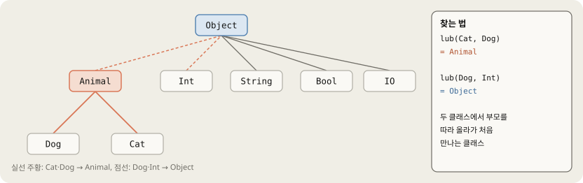

애니메이션의 [lub 순서도 페이지](../../动画/中文/frontend-flow.html#lub-flow)는 이 계산을 두 반복으로 그린다. 먼저 더 깊은 쪽을 부모로 올려 깊이를 맞추고(첫째 반복), 그다음 둘이 같아질 때까지 함께 한 칸씩 올라간다(둘째 반복). 깊이를 미리 알면 클래스 수가 $n$일 때 $O(\text{깊이})$, 최악 $O(n)$이다.

### 34.3 조건식 `[If-Then-Else]`
LUB를 사용하면 다음 규칙을 얻는다.

$$\frac{O \vdash e_0 : \text{Bool} \quad O \vdash e_1 : T_1 \quad O \vdash e_2 : T_2}{O \vdash \text{if } e_0 \text{ then } e_1 \text{ else } e_2 \text{ fi} : \text{lub}(T_1, T_2)} \quad [\text{If-Then-Else}]$$

조건 $e_0$는 `Bool`이어야 하고, 결과는 두 분기 타입의 최소 상계다.

---

## 35. case 규칙 읽기

case 규칙도 각 분기 타입을 구한 뒤 합친다는 점에서 if와 비슷하다.

Cool의 타입 분기는 다음과 같이 쓴다.
```cool
case e_0 of
    x_1 : T_1 => e_1;
    x_2 : T_2 => e_2;
    ...
    x_n : T_n => e_n;
esac
```

타입 규칙은 다음과 같다.

$$\frac{O \vdash e_0 : T_0 \quad O[T_1/x_1] \vdash e_1 : T_1' \quad \dots \quad O[T_n/x_n] \vdash e_n : T_n'}{O \vdash \text{case } e_0 \text{ of } x_1: T_1 \Rightarrow e_1; \dots; x_n: T_n \Rightarrow e_n; \text{ esac} : \text{lub}(T_1', \dots, T_n')} \quad [\text{Case}]$$

> [!important] `[Case]`를 읽는 순서
> 1. **대상 식: $O\vdash e_0:T_0$**
>    기존 환경에서 검사 대상 $e_0$의 타입을 구한다.
> 2. **각 분기: $O[T_k/x_k]\vdash e_k:T_k'$**
>    각 분기 $k$에 대해 다음을 수행한다.
>    - 분기 변수 $x_k$의 선언 타입은 $T_k$다.
>    - 본문 $e_k$는 새 바인딩을 추가한 $O[T_k/x_k]$에서 검사한다.
>    - 그 결과가 분기 본문 타입 $T_k'$다.
> 3. **전체 결과: $\operatorname{lub}(T_1',\dots,T_n')$**
>    실행 중에는 $e_0$의 동적 타입에 맞는 분기를 선택한다.
>    전체 결과는 그 분기 본문이 계산한 값이다.
>    컴파일 시에는 모든 분기 본문의 타입을 포함하는 최소 상계를 구한다.
>    $$\text{lub}(T_1', T_2', \dots, T_n')$$

case도 여러 결과 타입을 LUB로 합치는 규칙이다.

> [!note] 보충: case에 남는 검사와 실행 중 오류
> - Cool 명세는 한 case의 분기 변수 타입 $T_1,\dots,T_n$이 서로 달라야 한다고 정한다. 같은 타입의 분기가 둘이면 어느 쪽을 고를지 정할 수 없기 때문이다. 이것도 의미 분석기가 잡는다.
> - 실행 중에 맞는 분기가 없으면(예: `pet`이 Animal 객체인데 분기는 Dog와 Cat뿐) 실행 오류다. $e_0$가 void여도 실행 오류다. 정적 타입 검사는 이 경우를 막지 않는다. 애니메이션의 [case 페이지](../../动画/中文/frontend-flow.html#case-run) 마지막 갈림길에서 Animal 객체를 고르면 볼 수 있다.


---

## 36. 31~35절 종합 예제: Animal, Dog, Cat

앞의 규칙을 하나의 코드에 적용해 보자. 여기서는 객체 타입 환경 $O$만 쓰고 메서드 환경과 현재 클래스 표기는 잠시 생략한다.

다음 상속 관계가 있다고 하자.

```text
Object
└── Animal
    ├── Dog
    └── Cat
```

바깥 환경에 `flag: Bool`이 있을 때 다음 Cool 표현식을 검사한다.

```cool
let pet: Animal <- new Dog in
    if flag then
        pet <- new Cat
    else
        new Dog
    fi
```

### 36.1 환경은 내려가고 타입은 올라온다

전체 let의 시작 환경은 다음과 같다.

$$
O = \{\mathrm{flag}\mapsto\mathrm{Bool}\}
$$

`new Dog`는 기존 환경 $O$에서 검사한다. `in` 뒤의 본문으로 들어갈 때 `pet` 선언을 추가한다.

$$
O_1 = O[\mathrm{Animal}/\mathrm{pet}]
    = \{\mathrm{flag}\mapsto\mathrm{Bool},\ \mathrm{pet}\mapsto\mathrm{Animal}\}
$$

검사기는 자식에게 환경을 전달하고 자식에게서 타입을 돌려받는다.

```text
환경은 아래로: 지금 보이는 변수와 각 변수의 타입을 전달한다.
타입은 위로: 부분식이 자신의 타입을 돌려준다.
```

if 조건 `flag`는 $O_1$에서 `Bool`로 조회된다. 두 분기도 $O_1$에서 검사한 뒤 타입을 합친다. 마지막으로 let은 본문의 타입을 반환한다.

31절 그림의 아래쪽 환경도 항상 현재 환경을 뜻한다. 이 예에서는 더 깊이 들어가도 $O_1$을 전달해 `pet`을 유지한다.

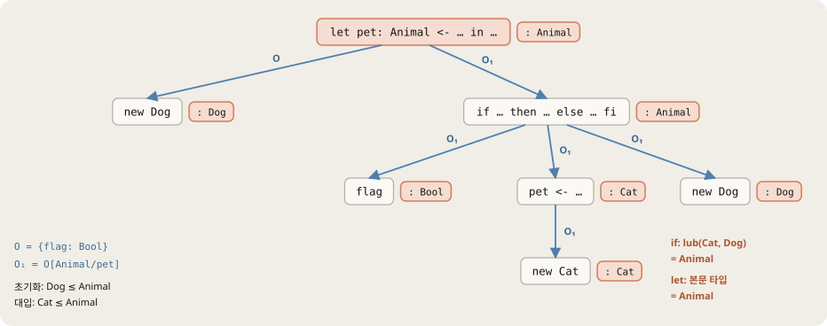

### 36.2 선언 타입과 초기화식 타입은 다를 수 있다

선언과 초기화식을 나눠 보자.

```cool
let pet: Animal <- new Dog in ...
```

| 대상 | 정적 타입 |
|---|---|
| `pet`의 선언 | `Animal` |
| 초기화식 `new Dog` | `Dog` |

`Dog`는 `Animal`을 상속하므로 다음이 성립한다.

$$
\mathrm{Dog}\le\mathrm{Animal}
$$

$\le$는 수의 대소가 아니라 서브타입 관계다. 확인할 조건은 다음과 같다.

$$
\text{초기화식의 정적 타입}\le\text{변수의 선언 타입}
$$

이 예에서는 다음 두 조건을 확인한다.

$$
O\vdash\text{new Dog}:\mathrm{Dog}
\qquad
\mathrm{Dog}\le\mathrm{Animal}
$$

따라서 초기화가 허용된다. 본문 환경에는 선언 타입을 등록한다.

$$
O_1(\mathrm{pet})=\mathrm{Animal}
$$

**`pet`은 여전히 `Animal`로 검사한다.** `Dog` 객체로 초기화해도 환경을 `pet → Dog`로 바꾸지는 않는다. 초기화식의 정적 타입과 실행 중 객체의 동적 타입도 구분해야 한다.

### 36.3 대입 가능 여부와 대입식의 타입

첫 번째 분기는 다음과 같다.

```cool
pet <- new Cat
```

변수 타입과 오른쪽 타입을 구한 뒤 호환성을 검사한다.

$$
O_1(\mathrm{pet})=\mathrm{Animal}
\qquad
O_1\vdash\text{new Cat}:\mathrm{Cat}
\qquad
\mathrm{Cat}\le\mathrm{Animal}
$$

세 조건이 성립하므로 대입할 수 있다. Cool의 대입식 결과는 오른쪽 값이므로 정적 타입도 오른쪽 타입이다.

$$
O_1\vdash
\left(\mathrm{pet}\leftarrow\text{new Cat}\right):\mathrm{Cat}
$$

| 판단 대상 | 정적 타입 |
|---|---|
| 변수 `pet` | `Animal` |
| 오른쪽 `new Cat` | `Cat` |
| 전체 대입식 `pet <- new Cat` | `Cat` |

대입 후에도 $O_1(\mathrm{pet})=\mathrm{Animal}$이다. 변수의 선언 타입과 이번 대입식의 결과 타입은 따로 판단한다.

클래스 속성 초기화도 같은 방향으로 검사한다.

```cool
class Zoo {
    resident: Animal <- new Dog;
};
```

클래스 속성 환경 $O_{\mathrm{Zoo}}$에서 `resident: Animal`을 찾고 $\mathrm{Dog}\le\mathrm{Animal}$인지 확인한다.

$O_C$에는 상속받은 속성도 포함된다. 선언과 타입이 보인다는 사실은 그 값이 실행 중 이미 초기화되었다는 뜻은 아니다.

### 36.4 if의 두 분기 타입 합치기

이제 전체 본문을 보자.

```cool
if flag then
    pet <- new Cat     -- 이 분기 본문의 타입은 Cat
else
    new Dog            -- 이 분기 본문의 타입은 Dog
fi
```

조건은 `Bool`이다. 두 결과는 각각 `Cat`, `Dog`이므로 전체 if에는 둘을 포함하는 타입이 필요하다.

상속 트리에서 가장 가까운 공통 조상은 `Animal`이다.

$$
\operatorname{lub}(\mathrm{Cat},\mathrm{Dog})=\mathrm{Animal}
$$

`Object`도 두 결과를 포함하지만 `Animal` 수준의 정보를 잃는다. `Object`로만 알면 Object의 인터페이스는 사용할 수 있으나, Animal에만 있는 기능은 바로 사용할 수 없다.

타입은 다음 순서로 올라온다.

```text
pet <- new Cat     → Cat
new Dog            → Dog
        ↓
if의 타입          → Animal
        ↓
전체 let의 타입    → Animal
```

let의 본문이 이 if이므로 전체 let도 `Animal`이다. 이것이 타입이 아래에서 위로 올라오는 과정이다.

### 36.5 case의 지역 바인딩과 결과 타입

`pet: Animal`이 있는 $O_1$에서 다음 식을 검사한다.

```cool
case pet of
    d: Dog => 1;
    c: Cat => 2;
esac
```

각 분기는 별도 변수를 도입한다. 첫 본문은 $O_1[\mathrm{Dog}/d]$, 둘째 본문은 $O_1[\mathrm{Cat}/c]$에서 검사한다. `d`와 `c`는 각자 자신의 분기에서만 보인다.

| 분기 | 분기 변수의 선언 타입 | 본문 | 본문 결과 타입 |
|---|---|---|---|
| `d: Dog => 1` | `Dog` | `1` | `Int` |
| `c: Cat => 2` | `Cat` | `2` | `Int` |

각 본문의 타입은 다음과 같다.

$$
O_1[\mathrm{Dog}/d]\vdash 1:\mathrm{Int}
\qquad
O_1[\mathrm{Cat}/c]\vdash 2:\mathrm{Int}
$$

35절 규칙의 두 타입 표기를 구분하자.

$$
T_k=\text{분기 }k\text{의 변수 선언 타입}
$$

$$
T_k'=\text{분기 }k\text{의 본문 결과 타입}
$$

프라임은 두 종류의 타입을 구분하는 표시다. **LUB를 구하는 대상은 본문 결과 타입**이다.

$$
\operatorname{lub}(\mathrm{Int},\mathrm{Int})=\mathrm{Int}
$$

따라서 전체 case의 정적 타입은 `Int`다. `Dog`, `Cat`은 지역 변수 바인딩과 실행 중 분기 선택에 쓰이며, 최종 결과를 합칠 때 사용하는 타입이 아니다.

![case 식의 타입 검사. case pet of 노드에서 O₁ ⊢ pet : Animal을 구하고, 분기 d: Dog ⇒ 1은 환경 O₁[Dog/d]에서, 분기 c: Cat ⇒ 2는 환경 O₁[Cat/c]에서 검사해 본문 타입이 모두 Int다. lub(Int, Int) = Int가 case 전체의 타입이다. 실행할 때는 pet이 Cat 객체면 c 분기 하나만 실행한다](../../SVG/韩文/sa-case.svg)

실행 중에는 객체의 동적 타입과 가장 가까운 조상 타입의 분기를 선택한다. 컴파일 시에는 모든 분기를 검사하고 본문 타입의 LUB를 구한다. 한 분기를 실행하는 것과 모든 분기를 검사하는 것은 서로 다른 단계다.

### 36.6 전체 판단 연결하기

앞의 `let → if → 대입` 예를 정리하면 다음과 같다.

| 표현식 또는 바인딩 | 정적 타입 | 근거 |
|---|---|---|
| `new Dog` | `Dog` | 객체 생성 규칙 |
| 변수 `pet` | `Animal` | let의 명시적 선언 |
| `new Cat` | `Cat` | 객체 생성 규칙 |
| `pet <- new Cat` | `Cat` | 대입식은 오른쪽 타입 |
| `if flag then pet <- new Cat else new Dog fi` | `Animal` | 두 분기 결과의 LUB |
| 전체 let | `Animal` | 본문 if의 타입 |

추론 규칙을 읽을 때 다음을 확인하면 좋다.

1. 전체 표현식과 부분식 중 무엇을 판단하는가?
2. 어느 환경을 쓰며 새 바인딩이 필요한가?
3. 어느 곳에서 “표현식 타입 ≤ 선언 타입”을 요구하는가?
4. 결과 타입은 본문, 대입 오른쪽, 분기들의 LUB 중 어디서 오는가?

let은 본문, 대입은 오른쪽, if와 case는 분기 본문의 LUB를 결과 타입으로 삼는다.

애니메이션의 [Animal 예제 페이지](../../动画/中文/frontend-flow.html#lub-run)는 이 표를 한 줄씩 채우고, 마지막에 flag를 참·거짓으로 골라 실행 결과의 동적 타입(Cat 또는 Dog)이 정적 타입 Animal 안에 드는 것을 보여 준다.

참고: [Cool Reference Manual](https://web.stanford.edu/class/cs143/materials/cool-manual.pdf) §7.3, §7.5, §7.8, §7.9, §12.2.


---

## 37. 메서드 환경 $M$과 동적 디스패치

객체 지향 언어에서 메서드 호출은 기본 연산이다.

$$e_0.f(e_1, \dots, e_n)$$

수신 객체 $e_0$가 메서드 $f$를 호출하고 $e_1\dots e_n$을 인자로 전달한다. 이 타입 규칙에는 객체 환경 $O$ 외에 메서드 정보가 필요하다.

### 37.1 별도 이름 공간과 메서드 환경
Cool에서는 **객체 식별자와 메서드 이름의 이름 공간이 다르다**.
한 클래스에 `foo`라는 속성과 `foo()`라는 메서드가 함께 있어도 서로 가리지 않는다.

메서드 시그니처는 별도의 **메서드 환경(Method Environment) $M$**으로 나타낸다.

$$M(C, f) = (T_1, \dots, T_n, T_{n+1})$$

클래스 $C$의 메서드 $f$가 $T_1,\dots,T_n$ 타입의 매개변수를 받고 $T_{n+1}$을 반환한다는 뜻이다. 마지막 항목은 반환 타입이다.

### 37.2 동적 디스패치 `[Dispatch]`
객체 환경과 메서드 환경을 함께 사용한다.

$$\frac{O, M \vdash e_0 : T_0 \quad O, M \vdash e_1 : T_1 \quad \dots \quad O, M \vdash e_n : T_n \quad M(T_0, f) = (T_1', \dots, T_n', T_{n+1}) \quad T_i \le T_i' \; (\forall 1 \le i \le n)}{O, M \vdash e_0.f(e_1, \dots, e_n) : T_{n+1}} \quad [\text{Dispatch}]$$

**검사 순서**:
1. 수신 객체 $e_0$의 정적 타입 $T_0$와 각 인자의 타입 $T_1,\dots,T_n$을 구한다.
2. $M$에서 $T_0$의 메서드 $f$를 찾아 매개변수 타입 $T_1',\dots,T_n'$과 반환 타입 $T_{n+1}$을 얻는다.
3. 각 인자에 대해 $T_i\le T_i'$인지 확인한다.
4. 일반적인 반환 타입이라면 호출식의 타입은 $T_{n+1}$이다. `SELF_TYPE`인 경우는 뒤에서 따로 다룬다.

> [!note] 보충: $M(T_0, f)$에는 상속된 메서드도 들어 있다
> $T_0$ 클래스가 $f$를 직접 정의하지 않아도 조상이 정의했으면 $M(T_0, f)$가 있다. 구현에서는 $T_0$에서 시작해 부모로 올라가며 $f$를 찾는다. 애니메이션의 [디스패치 순서도](../../动画/中文/frontend-flow.html#dispatch-flow)는 이 반복을 "D = 부모"로 되돌아가는 화살표로 그렸다. 메서드 이름이 어디서 왔든 시그니처를 **정적 타입 $T_0$** 기준으로 찾는다는 점이 중요하다. 실행 중에 어느 구현이 불릴지는 모른다.

---

## 38. 정적 디스패치

실행 중 수신 객체의 클래스에 따른 선택 대신, 지정한 클래스에서 메서드를 찾고 싶을 때가 있다. C++의 `Base::func()`나 Java의 `super.func()`와 비교해 볼 수 있다.

Cool에서는 다음 문법을 쓴다.

$$e_0@T.f(e_1, \dots, e_n)$$

### 38.1 `[Static Dispatch]` 규칙
$$\frac{O, M \vdash e_0 : T_0 \quad O, M \vdash e_1 : T_1 \quad \dots \quad O, M \vdash e_n : T_n \quad T_0 \le T \quad M(T, f) = (T_1', \dots, T_n', T_{n+1}) \quad T_i \le T_i' \; (\forall 1 \le i \le n)}{O, M \vdash e_0@T.f(e_1, \dots, e_n) : T_{n+1}} \quad [\text{Static Dispatch}]$$

동적 디스패치와 비교하면 두 가지가 다르다.
1. **$T_0\le T$ 조건**: 수신 객체의 타입은 지정한 타입 $T$의 서브타입이어야 한다. 관계없는 클래스나 더 아래의 클래스를 임의로 지정할 수 없다. 자기 타입도 반사성에 따라 가능하다.
2. **조회할 클래스**: $M(T_0,f)$ 대신 지정한 $M(T,f)$에서 시그니처를 찾는다.

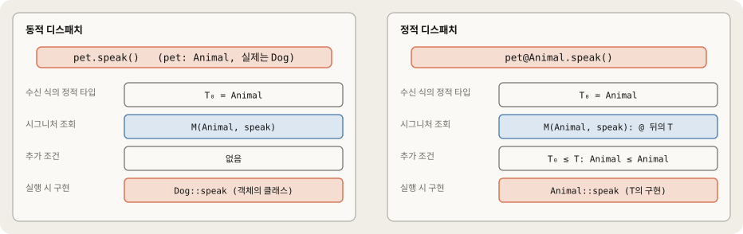

애니메이션의 [네 가지 호출 페이지](../../动画/中文/frontend-flow.html#dispatch-run)에서 `pet.speak(1)`, `pet@Animal.speak(1)`, `(new Animal)@Dog.speak(1)`(T₀ ≤ T 실패), `(new Dog).me()`(SELF_TYPE 반환)를 골라 비교할 수 있다.

---

## 39. 전체 타입 환경: $(O,M,C)$

객체 지향 타입 규칙에는 **SELF_TYPE**도 필요하다.
이를 해석하려면 현재 표현식이 어느 클래스 안에 있는지 알아야 한다. 그래서 **현재 클래스 $C$**를 추가한다.

전체 판단은 다음과 같다.

$$O, M, C \vdash e : T$$

- **$O$**: 객체·변수 이름에서 타입으로 가는 환경. `Name → Type`.
- **$M$**: 클래스와 메서드 이름에서 시그니처로 가는 환경. `Class × Method → Signature`.
- **$C$**: 현재 코드를 작성한 클래스.

**환경은 자식에게 전달된다.**
리터럴이나 덧셈 같은 규칙에서는 $M$, $C$를 직접 사용하지 않고 그대로 전달하는 경우가 많다.

$$\frac{O, M, C \vdash e_1 : \text{Int} \quad O, M, C \vdash e_2 : \text{Int}}{O, M, C \vdash e_1 + e_2 : \text{Int}} \quad [\text{Add}]$$

메서드 호출은 $M$을, `self`와 `SELF_TYPE` 처리는 $C$를 참조한다.

---

## 40. 추론 규칙을 검사 코드로 옮기기

형식 규칙의 구조는 재귀적인 타입 검사 코드와 직접 대응한다.

클래스·상속·시그니처를 먼저 수집했다면, 표현식 검사는 AST를 한 차례 순회하며 수행할 수 있다.
- **환경을 아래로**: 부모가 함수 인자로 자식에게 전달한다.
- **타입을 위로**: 자식이 반환값으로 부모에게 돌려준다.

### 40.1 덧셈 `[Add]`

형식 규칙:
$$\frac{O, M, C \vdash e_1 : \text{Int} \quad O, M, C \vdash e_2 : \text{Int}}{O, M, C \vdash e_1 + e_2 : \text{Int}} \quad [\text{Add}]$$

컴파일러의 C++ 재귀 함수로 옮기면 다음과 같다.

```cpp
Type TypeCheck(Environment env, AddExpr* expr) {
    // 1. 위쪽 두 전제: 자식의 타입을 각각 재귀적으로 검사
    Type T1 = TypeCheck(env, expr->e1);
    Type T2 = TypeCheck(env, expr->e2);

    // 2. 자식 타입이 규칙의 조건을 만족하는지 확인
    if (T1 != Int || T2 != Int) {
        TypeError("Both operands of '+' must be Int");
    }

    // 3. 아래쪽 결론: 결과 타입을 반환
    return Int;
}
```

### 40.2 초기값 있는 지역 바인딩 `[Let-Init]`

형식 규칙:
$$\frac{O, M, C \vdash e_0 : T_0 \quad O[T/x], M, C \vdash e_1 : T_1 \quad T_0 \le T}{O, M, C \vdash \text{let } x: T \leftarrow e_0 \text{ in } e_1 : T_1} \quad [\text{Let-Init}]$$

구현으로 옮기면 다음과 같다.

```cpp
Type TypeCheck(Environment env, LetExpr* expr) {
    // 1. 기존 환경에서 초기화식 e0 검사
    Type T0 = TypeCheck(env, expr->e0);

    // 2. 초기화식 타입이 선언 타입의 서브타입인지 확인
    if (!is_subtype(T0, expr->declared_type)) {
        TypeError("Initialization expression type does not conform to declared type");
    }

    // 3. x -> declared_type을 추가한 env_extended 생성
    Environment env_extended = env.add_symbol(expr->x, expr->declared_type);

    // 4. 새 환경에서 본문 e1을 재귀적으로 검사
    Type T1 = TypeCheck(env_extended, expr->e1);

    // 5. 본문 타입이 전체 let의 타입
    return T1;
}
```

**전제는 재귀 호출이나 조건 검사에, 결론은 함수의 반환값에 대응한다.** 규칙을 읽을 때 코드의 흐름도 함께 떠올릴 수 있다.

> [!note] 보충: 슬라이드 107의 오타
> 슬라이드 107의 의사 코드는 마지막 검사를 `Check subtype(T0, T1)`로 적었다. 초기화식 타입 $T_0$를 **본문 타입** $T_1$과 비교하는 셈이라 규칙과 다르다. 규칙의 전제는 $T_0 \le T$(선언 타입)이고, 이 노트의 코드처럼 `is_subtype(T0, declared_type)`이 맞다. 슬라이드는 검사를 본문 검사 뒤에 두었는데, 순서는 결과에 영향이 없다. 전제끼리는 서로 의존하지 않기 때문이다.

애니메이션의 [TypeCheck 순서도](../../动画/中文/frontend-flow.html#tc-flow)는 이 함수를 구문 종류별 분기로 그렸다. 리터럴, 변수, 덧셈, let, if, 호출이 각각 한 상자이고 모두 "결과 타입 기록"에서 만난다.

---

## 41. 정적 타입의 표현력과 보수성

정적 타입의 장점은 실행 전에 오류를 찾는 것이지만, 그 대가로 **보수적인 판단**이 필요하다.

건전한 검사기는 안전함을 보일 수 없는 코드를 거부한다. 실제로 실행하면 문제가 없는 코드도 규칙의 표현력이 부족해 거부될 수 있다.

이 문제에 접근하는 방향은 크게 두 가지다.
1. **실행 중 검사**: 실제 값을 얻은 시점에 연산 가능 여부를 검사한다.
2. **더 풍부한 정적 타입**: 제네릭, 공변·반공변 관계, `SELF_TYPE` 등으로 더 많은 안전한 패턴을 표현한다.

표현력이 늘면 규칙과 구현도 더 복잡해질 수 있다.

### 41.1 동적 타입과 정적 타입

여기서 “타입 언어의 분류”와 “객체·표현식의 타입”을 구분해야 한다.

- **동적 타입(Dynamic Type)**:
  실행 중 실제 객체가 속한 클래스다. `new C`로 만든 객체의 동적 타입은 $C$다. 정적 타입 검사를 하지 않는 언어에서도 값에는 실행 중 타입이 있다.
- **정적 타입(Static Type)**:
  컴파일러가 선언이나 추론으로 정한 표현식의 타입이다. 건전한 시스템에서는 가능한 실행 결과의 동적 타입을 안전하게 포함해야 한다.

### 41.2 건전성 정리

서브타입이 있는 객체 지향 언어에서는 다음 불변식으로 설명할 수 있다.

$$\forall E, \quad \text{dynamic\_type}(E) \le \text{static\_type}(E)$$

표현식 $E$가 객체 값으로 평가되면 그 동적 타입은 정적으로 구한 타입의 서브타입이어야 한다. 서브타입을 구분하지 않는 단순한 언어에서는 동일성으로 나타내기도 한다.

$B\le A$일 때 다음 예를 보자.

```cool
class A { ... };
class B inherits A { ... };

class Main {
    x: A <- new A;   -- 정적 타입 A, 현재 값의 동적 타입도 A
    ...
    x <- new B;      -- 정적 타입은 여전히 A, 새 값의 동적 타입은 B
};
```

`x`의 선언 타입은 `A`로 유지된다. 저장된 객체는 바뀔 수 있지만 그 동적 타입은 `A`에 부합해야 한다.

> [!note] 보충: 왜 ≤로 충분한가
> 슬라이드 9의 설명은 이렇다. $C$ 객체에 쓸 수 있는 연산(속성 읽기, 메서드 호출)은 $C$의 자식 $C'$ 객체에도 모두 쓸 수 있다. 자식은 속성과 메서드를 더할 수는 있어도 지울 수는 없고, 오버라이드할 때도 시그니처를 그대로 지켜야 하기 때문이다(§3.3). 그래서 정적 타입이 $C$인 자리에 $C' \le C$인 객체가 와도 안전하다. 슬라이드 7은 이전의 단순한 타입 시스템에서는 정리가 $=$였다고 짚는다. 위 코드의 `x <- new B;`는 설명을 위해 클래스 본문에 바로 적었지만 실제 Cool에서는 메서드 본문 안에 있어야 한다.

### 41.3 반환 타입에서 자식 타입 정보가 사라지는 경우

카운터를 증가시키는 부모 클래스 `Count`를 보자.

```cool
class Count {
    i: Int <- 0;
    inc(): Count {
        {
            i <- i + 1;
            self;
        }
    };
};
```

`inc()`는 `self`를 반환하지만 반환 타입은 `Count`로 선언했다.
여기에 `name` 속성을 가진 자식 클래스 `Stock`을 만든다.

```cool
class Stock inherits Count {
    name: String; -- 상품 이름
};
```

이제 다음처럼 호출한다.

```cool
class Main {
    a: Stock <- (new Stock).inc();
    ... a.name ...
};
```

**실행 결과와 정적 정보 사이에 차이가 생긴다.**
- 실행 중 `(new Stock).inc()`의 `self`는 `Stock` 객체이므로 실제 반환 객체도 `Stock`이다.
- 하지만 컴파일러는 `Count::inc()`의 선언된 반환 타입 `Count`를 사용한다. 호출식의 정적 타입도 `Count`다.
- `a: Stock <- (new Stock).inc()`는 $\text{Count}\le\text{Stock}$을 요구하므로 타입 오류다.

**호출식의 정적 타입에서 자식 클래스 정보가 사라진 것이다.**
메서드 자체가 무용해진 것은 아니지만, 이 선언만으로는 반환값을 `Stock`으로 이어서 사용하는 패턴을 표현하지 못한다. Cool은 이를 위해 `SELF_TYPE`을 제공한다.

---

## 42. `SELF_TYPE`으로 수신 객체의 타입 관계 보존하기

Cool의 특별한 타입 **SELF_TYPE**으로 앞의 반환 타입을 바꾼다.

`Count`를 다음처럼 수정한다.

```cool
class Count {
    i: Int <- 0;
    inc(): SELF_TYPE {
        {
            i <- i + 1;
            self;
        }
    };
};
```

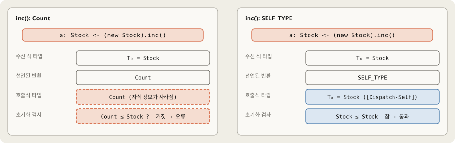

애니메이션의 [Count와 SELF_TYPE 페이지](../../动画/中文/frontend-flow.html#selftype)는 두 선언을 왼쪽과 오른쪽에 놓고 같은 단계로 검사한다. 마지막 단계에서 실행 결과는 두 쪽 모두 같은 Stock 객체이고, 차이는 컴파일러가 아는 정보뿐이라는 것을 확인할 수 있다.

### 42.1 `SELF_TYPE`의 의미

`inc(): SELF_TYPE`은 반환 객체의 동적 타입이 호출 시 `self`의 동적 타입과 같다는 관계를 표현한다. 반드시 같은 객체를 반환한다는 뜻은 아니다.
`Count`에서 정의한 메서드를 자식이 상속해 호출하면 반환 객체의 타입도 해당 수신 객체의 타입에 맞아야 한다.

클래스 $C$ 안의 표현식 $E$가 `SELF_TYPE`으로 판단되었다면 다음 관계를 만족해야 한다.

$$\text{dynamic\_type}(E) \le C$$

문맥의 클래스 $C$를 명확히 하려고 형식 표기에서는 아래첨자를 붙인다.

$$\text{SELF\_TYPE}_C$$

따라서 다음 서브타입 관계가 성립한다.

$$\text{SELF\_TYPE}_C \le C$$

실행 중 self가 $C$이든 그 자식이든 $C$의 서브타입이기 때문이다.

> [!note] 보충: SELF_TYPE은 타입 변수처럼 읽는다
> - 슬라이드 19와 23은 SELF_TYPE을 "동적 타입이 아니라 정적 타입"이자 "C의 서브타입 하나를 값으로 갖는 타입 변수"로 설명한다. 클래스 이름이 아닌 유일한 타입이다.
> - 그래서 $\text{SELF\_TYPE}_C$를 언제든 $C$로 바꿔도 건전하다(슬라이드 24). 다만 모두 바꾸면 SELF_TYPE이 없던 것과 같아 Count 문제가 다시 생긴다.
> - SELF_TYPE을 만드는 기본 규칙은 둘이다(슬라이드 52). $O,M,C \vdash \text{self} : \text{SELF\_TYPE}_C$, $O,M,C \vdash \text{new SELF\_TYPE} : \text{SELF\_TYPE}_C$. 둘 다 현재 클래스 $C$를 알아야 쓸 수 있다.

### 42.2 `SELF_TYPE`을 쓸 수 있는 위치

파서가 타입 이름으로 읽었다고 모두 허용되는 것은 아니다. 의미 분석에서 위치별 제한을 확인한다.

1. **`class T inherits T'`**: 클래스 이름과 부모 이름으로는 사용할 수 없다.
2. **속성 `x:T`**: 가능하다. 예: `next: SELF_TYPE`.
3. **`let x:T in E`**: 가능하다.
4. **`new T`**: 가능하다. `new SELF_TYPE`은 현재 self와 동적 타입이 같은 새 객체를 만든다.
5. **정적 디스패치의 `@T`**: 불가능하다. 구체적인 클래스 이름을 지정해야 한다.
6. **메서드 `m(x:T):T'`**:
   - 반환 타입 $T'$에는 가능하다.
   - 형식 매개변수 타입 $T$에는 불가능하다.

> [!warning] 매개변수의 `SELF_TYPE`이 위험한 이유
> 가정상 `comp(x: SELF_TYPE)`을 허용하고 자식에서 이 매개변수를 더 좁게 해석한다면 다음 문제가 생긴다. 아래는 금지 이유를 설명하기 위한 의사 예제다.
> ```cool
> class A {
>     comp(x: SELF_TYPE): Bool { ... };
> };
> 
> class B inherits A {
>     b: Int;
>     comp(x: SELF_TYPE): Bool { ... x.b ... }; -- B에만 있는 속성 b를 읽는다고 가정
> };
> 
> -- 문제가 생기는 호출:
> let obj: A <- new B in
>     obj.comp(new A);
> ```
> **호출을 따라가 보자.**
> 1. 정적 타입이 `A`인 `obj`에 대해 `A::comp`만 보면 `new A`를 인자로 허용한다고 가정한다.
> 2. 실제 obj가 `B` 객체이면 동적 디스패치는 `B::comp`를 선택한다.
> 3. 그런데 인자는 `A` 객체이므로 `B`에만 있는 `b`가 없다. 이런 접근을 허용하면 안전하지 않다.
> 
> 자식 메서드의 매개변수를 공변적으로 좁히면 대체 가능성을 깨뜨릴 수 있다. 함수 매개변수의 **반공변성**(Contravariance)과 관련된 문제이며, Cool은 형식 매개변수에 SELF_TYPE을 금지해 이 상황을 피한다.

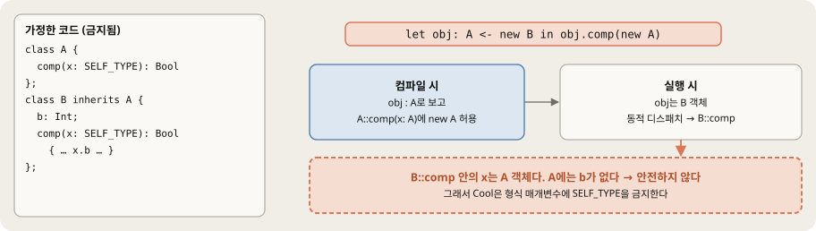

---

## 43. 타입 규칙에 `SELF_TYPE` 반영하기

$\le$와 $\operatorname{lub}$가 $\text{SELF\_TYPE}_C$를 처리하도록 확장한다.

### 43.1 전체 판단과 현재 클래스 $C$

앞에서 사용한 판단은 다음과 같다.

$$O, M, C \vdash e : T$$

현재 클래스 $C$는 `SELF_TYPE`을 $\text{SELF\_TYPE}_C$로 해석할 때 필요하다.

대입·덧셈·let 같은 기본 규칙의 틀은 유지하고, 서브타입과 LUB 연산을 확장한다.

$$\frac{O(\text{Id}) = T_0 \quad O, M, C \vdash e_1 : T_1 \quad T_1 \le T_0}{O, M, C \vdash \text{Id} \leftarrow e_1 : T_1} \quad [\text{Assign}]$$

### 43.2 확장한 서브타입과 LUB

$\text{SELF\_TYPE}_C$가 포함되면 다음 규칙을 쓴다.

- **서브타입 $\le$**:
  - $\text{SELF\_TYPE}_C\le\text{SELF\_TYPE}_C$.
  - 일반 클래스 타입 $T$에 대해 $\text{SELF\_TYPE}_C\le T$ iff $C\le T$.
  - 일반 클래스 타입 $T$에 대해 $T\le\text{SELF\_TYPE}_C$는 성립하지 않는다. $T=C$여도 self의 실제 타입이 더 구체적인 자식일 수 있기 때문이다.
- **최소 상계**:
  - $\text{lub}(\text{SELF\_TYPE}_C, \text{SELF\_TYPE}_C) = \text{SELF\_TYPE}_C$.
  - $\operatorname{lub}(\text{SELF\_TYPE}_C,T)=\operatorname{lub}(C,T)$, 단 $T$는 일반 클래스 타입이다.

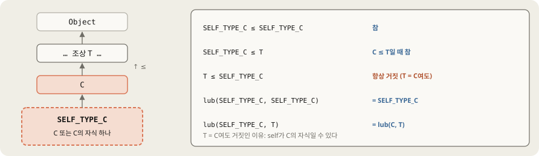

> [!note] 보충: 서로 다른 클래스의 SELF_TYPE은 비교하지 않는다
> 슬라이드 27에 따르면 Cool의 규칙에서 $\text{SELF\_TYPE}_C$와 $\text{SELF\_TYPE}_D$($C \ne D$)를 비교할 일은 생기지 않는다. 한 메서드 본문의 모든 SELF_TYPE은 같은 클래스 $C$에서 나오기 때문이다. 그래서 위 네 줄로 충분하다.

### 43.3 반환 타입에 따른 디스패치 규칙

$e_0.f(e_1,\dots,e_n)$의 반환 선언이 `SELF_TYPE`인지에 따라 나눈다.

#### 경우1: 반환 타입이 일반 클래스 타입
$$\frac{O, M, C \vdash e_0 : T_0 \quad \dots \quad O, M, C \vdash e_n : T_n \quad M(T_0, f) = (T_1', \dots, T_n', T_{n+1}') \quad T_{n+1}' \neq \text{SELF\_TYPE} \quad T_i \le T_i' \; (1 \le i \le n)}{O, M, C \vdash e_0.f(e_1, \dots, e_n) : T_{n+1}'} \quad [\text{Dispatch-Normal}]$$

#### 경우2: 반환 타입이 `SELF_TYPE`
$$\frac{O, M, C \vdash e_0 : T_0 \quad \dots \quad O, M, C \vdash e_n : T_n \quad M(T_0, f) = (T_1', \dots, T_n', \text{SELF\_TYPE}) \quad T_i \le T_i' \; (1 \le i \le n)}{O, M, C \vdash e_0.f(e_1, \dots, e_n) : T_0} \quad [\text{Dispatch-Self}]$$

결론에 주목하자. **반환 선언이 SELF_TYPE이면 호출식의 정적 타입은 수신 식 $e_0$의 정적 타입 $T_0$다.**

`a: Stock <- (new Stock).inc()`에 적용하면 다음과 같다.
1. `new Stock`의 타입은 $T_0=\text{Stock}$이다.
2. $M(\text{Stock},\text{inc})$에서 반환 선언 `SELF_TYPE`을 찾는다.
3. 반환 결과를 $T_0$로 정하므로 호출식의 정적 타입은 **Stock**이다.
4. `a: Stock` 초기화가 통과하며 자식 타입 정보를 보존한다.

> [!note] 보충: 수신 식이 SELF_TYPE일 때와 정적 디스패치
> - 위 두 규칙의 $M(T_0, f)$는 $T_0$가 클래스 이름일 때만 뜻이 있다. $T_0 = \text{SELF\_TYPE}_C$면 $M(C, f)$를 쓴다. Cool 명세는 이것을 전제 하나로 합쳐 적는다: $T_0' = C$ ($T_0 = \text{SELF\_TYPE}_C$일 때), 아니면 $T_0' = T_0$로 두고 $M(T_0', f)$를 찾는다. §43.4가 이 경우의 설명이다.
> - 정적 디스패치 $e_0@T.f(\dots)$의 반환이 SELF_TYPE이어도 결과는 $T$가 아니라 $T_0$다(슬라이드 50–51). $T$의 구현을 고르더라도 그 메서드 안의 self는 여전히 $e_0$가 가리키는 객체이고, 그 동적 타입은 $T_0$의 서브타입이기 때문이다.

### 43.4 수신 식 자체가 `SELF_TYPE`인 경우

클래스 $C$ 안에서 `self.f(e1)` 또는 `f(e1)`을 호출한다고 하자.
- 수신 식의 타입 $T_0$는 $\text{SELF\_TYPE}_C$다.
- **인자로 SELF_TYPE 표현식을 전달해도 되는가?**
  가능하다. `obj.foo(self)`처럼 전달할 때 $C\le T_i'$이면 $\text{SELF\_TYPE}_C\le T_i'$도 성립한다.
- **시그니처는 어느 클래스에서 찾는가?**
  현재 클래스 $C$를 사용해 $M(C,f)$를 조회한다.
  self가 자식 객체여도 부모에서 제공하는 메서드 계약을 따르기 때문이다. 반환 선언이 SELF_TYPE이면 호출 결과 $T_0$도 SELF_TYPE으로 유지되어 `self.inc().inc()` 같은 연결 호출을 지원한다.

---

## 44. 타입 오류 복구와 `No_type`

타입 오류 하나를 찾았다고 바로 분석 전체를 포기하면 다른 오류를 확인하기 어렵다. 검사기는 가능한 범위에서 계속 순회하며 독립적인 오류를 보고할 수 있다.

### 44.1 파싱 오류 복구와 다른 점
파싱 오류는 아직 트리를 구성하는 과정에서 발생하므로 토큰을 건너뛰는 등의 복구가 필요하다.
의미 분석은 이미 구성된 AST를 사용하므로 부모·자식 관계를 유지하며 검사를 이어 갈 수 있다.

문제는 다음과 같다.
타입을 구하지 못한 노드에 **어떤 임시 타입을 붙여 부모 검사를 계속할 것인가?**

### 44.2 무조건 `Object`로 처리하면 생기는 문제
다음 예에서 `x`는 선언되어 있지 않다.

```cool
let y: Int <- x + 2 in y + 3
```

오류 노드에 항상 `Object`를 붙인다고 해 보자.
1. `x`를 찾지 못해 **오류1** `x is undefined`를 보고하고 타입을 Object로 둔다.
2. `x+2`에서 Object와 Int를 더하려 하므로 **오류2** `+ applied to Object`를 보고하고 다시 Object로 둔다.
3. let 초기화에서 Object ≤ Int가 성립하지 않아 **오류3** `bad assignment`를 보고한다.

실제 원인은 미선언 `x` 하나인데 진단은 세 개다. 이런 **연쇄 오류**(Cascading Errors)는 원인을 찾기 어렵게 한다.

### 44.3 전용 오류 타입으로 후속 진단 줄이기
한 가지 설계는 내부 전용 타입 **No_type**을 두고, 오류 전파용으로 특별 취급하는 것이다. 여기서는 이를 모든 정상 타입 아래에 놓는 모델로 설명한다. 구체적인 오류 타입 이름과 동작은 컴파일러마다 다르다.

```text
          [ Object ]         <-- 최상위: 정상 클래스 C ≤ Object
            /    \
         Int    String  ...
            \    /
          [ No_type ]        <-- 최하위: 모든 정상 C에 대해 No_type ≤ C
```

이 모델에서 두 규칙을 추가한다.
1. 모든 정상 타입 $C$에 대해 **No_type <= C**로 처리한다.
2. No_type 때문에 발생한 파생 연산 오류는 억제하고, 필요하면 결과도 No_type으로 전파한다. 독립적인 다른 오류는 계속 검사한다.

**`let y: Int <- x + 2 in y + 3`을 다시 검사하면**:
1. 미선언 `x`에 대해 오류를 한 번 보고하고 No_type을 붙인다.
2. `x+2`는 이미 알려진 오류에 의존하므로 추가 타입 오류를 억제하고 No_type을 전파한다.
3. 초기화에서는 `No_type <= Int`로 처리해 같은 원인에 대한 추가 진단을 내지 않는다.
4. 본문의 `y`는 선언 타입 Int를 유지하므로 `y+3`을 정상적으로 검사할 수 있다. 다른 독립적인 오류도 계속 찾는다.

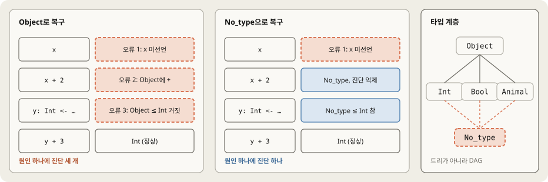

오류를 복구했다는 이유로 프로그램이 올바른 것은 아니다. 이미 오류를 기록한 채 후속 검사를 이어 가는 방식이다.

> [!note] 보충: No_type의 비용
> 슬라이드 60은 No_type의 대가를 짚는다. No_type을 모든 클래스 아래에 두면 상속 구조가 트리가 아니라 맨 아래에 No_type이 있는 DAG가 된다. 그러면 "부모 링크를 따라 올라가 만나는 곳"으로 lub를 구하는 트리 알고리즘을 그대로 쓸 수 없다. $\operatorname{lub}(\text{No\_type}, T) = T$처럼 따로 처리해야 한다. 강의는 실제 컴파일러라면 No_type 같은 것을 쓰겠지만, 과제에서는 Object로 복구하고 연쇄 오류를 감수해도 된다고 한다. 애니메이션의 [오류 복구 페이지](../../动画/中文/frontend-flow.html#recovery)는 두 방식을 왼쪽과 오른쪽에 놓고 같은 순서로 검사해 오류 수를 센다.

---

## 45. 의미 분석 정리

프런트엔드의 흐름을 정리하면 다음과 같다.

```text
소스 문자열 (Source Code)
       │
       ▼ [어휘 분석: 정규식 + DFA/NFA]
    토큰열
       │
       ▼ [구문 분석: CFG + LL/LR 분석 스택]
    기본 AST
       │
       ▼ [의미 분석: 여러 번의 순회 + 심벌 테이블 + 타입 추론 규칙 + SELF_TYPE + 오류 복구]
    타입 정보가 붙은 AST
       │
       ▼
IR 생성, 런타임 표현 설계, 최적화, 타깃 코드 생성으로 진행
```

의미 분석에서 다룬 핵심은 네 가지다.
1. **스코프와 여러 단계의 분석**: `enter_scope`·`check_scope`·`exit_scope`로 중첩과 섀도잉을 관리한다. 클래스·상속·시그니처를 먼저 수집해 전방 참조와 사이클을 검사한다.
2. **타입 추론 규칙**: $O,M,C\vdash e:T$에서 환경은 아래로, 타입은 위로 전달된다. 전제는 재귀 검사나 조건 검사, 결론은 반환 타입에 대응한다.
3. **다형성**: $\le$와 LUB로 호환성과 분기 결과를 다룬다. $\text{SELF\_TYPE}_C$는 자식 타입 관계를 보존하며, 매개변수 위치의 제한은 건전성을 지키는 데 필요하다.
4. **오류 복구**: 전용 오류 타입을 사용해 연쇄 진단을 줄이고 검사를 계속한다. 오류가 없는, 충분한 의미 정보가 붙은 AST를 다음 단계에 전달한다.

애니메이션의 마지막 페이지 [세 단계를 한 줄로](../../动画/中文/frontend-flow.html#finale)가 이 그림을 실제로 돌린다. 정상 입력, `$`가 섞인 입력, `2 * + 3`, `y + true`를 골라 각각 어휘, 구문, 의미 분석 중 어디서 멈추는지 본다. 다음 강의(Run-time Environments)는 이 AST를 받아 실행 중 메모리를 어떻게 배치할지 다룬다. 11강 슬라이드 2의 표현대로 이제 "더는 오류를 찾지 않는다."

---

## 46. 점검 질문

> [!question]- 1. 파서가 잡을 수 없는 오류 두 가지를 들고, 왜 문법으로 잡기 어려운지 말해 보세요.
> 선언하지 않은 이름의 사용과 타입이 맞지 않는 연산이다. 선언과 사용의 일치는 $\{wcw\}$처럼 같은 순서의 반복을 비교하는 조건이라 문맥 자유 언어가 아니다. 타입은 표현식이 임의로 중첩되고 서브타입, 상속까지 얽혀 생성 규칙으로 적으면 규칙 수가 폭발한다.

> [!question]- 2. $\{wcw^R\}$는 스택으로 처리되는데 $\{wcw\}$는 안 되는 이유를 스택의 동작으로 설명하세요.
> 스택은 넣은 순서의 반대로 꺼낸다. $w^R$는 꺼내는 순서와 같은 순서로 나오므로 맞춰 볼 수 있다. $w$를 같은 순서로 다시 읽으려면 맨 아래부터 꺼내야 하는데 스택은 그럴 수 없다.

> [!question]- 3. `let x: Int <- x in x + 1`에서 세 x는 각각 어느 선언을 가리키나요?
> 첫째는 선언 자체다. 초기화식의 x는 아직 새 x가 보이지 않는 환경에서 검사하므로 **바깥의** x다(바깥에 없으면 미선언 오류). 본문의 x는 새로 선언한 x다.

> [!question]- 4. `foo(x: Int, x: String)`을 `find_symbol`만으로 잡을 수 없는 이유는?
> 두 번째 x를 넣을 때 find_symbol(x)는 첫 번째 x를 찾지만, 그것이 같은 매개변수 목록의 것인지 바깥 스코프의 것인지 알려 주지 않는다. 바깥 이름을 가리는 것은 허용해야 하므로 "현재 층에만 있는가"를 묻는 check_scope가 필요하다.

> [!question]- 5. Cool의 클래스 이름을 한 번의 순회로 검사할 수 없는 이유와 해결 방법은?
> 클래스는 정의보다 앞에서 쓸 수 있다. 앞쪽 클래스를 검사할 때 뒤쪽 클래스가 정의될지 아직 모른다. 1차 순회에서 클래스 이름을 모두 모으고, 그다음 순회에서 검사한다.

> [!question]- 6. `g(y) = let a <- 4 in f(3); f(x) = a;`에서 f(3)의 결과를 정적 스코프와 동적 스코프로 각각 말해 보세요. 동적 스코프의 문제는?
> 정적 스코프는 f가 정의된 바깥에 a가 없어 미선언 오류다. 동적 스코프는 g가 묶은 a = 4를 찾아 4다. 동적 스코프에서는 같은 f가 누가 부르느냐에 따라 다른 a를 읽거나 실행 중에 실패한다.

> [!question]- 7. "정수 리터럴의 타입은 Object" 규칙은 건전한데 왜 쓰지 않나요?
> 건전하지만 정보가 부족하다. 1과 2가 Object면 [Add]의 Int 전제를 세울 수 없어 1 + 2를 거부한다. 건전하면서 가장 구체적인 타입을 주는 규칙이 좋다.

> [!question]- 8. while 식의 타입이 본문 타입이 아니라 Object인 이유는?
> 조건이 처음부터 거짓이면 본문이 한 번도 실행되지 않아 값이 void다. 본문 타입을 주면 그 값을 믿고 쓰다가 void 역참조로 실행 오류가 날 수 있다. 반복식의 값에 기대지 못하게 Object로 둔다.

> [!question]- 9. [Let-Init]에서 본문 환경에 초기화식의 타입 $T_0$가 아니라 선언 타입 $T$를 넣는 이유는?
> 본문에서 x에 다른 값을 대입할 수 있다. 선언 타입이 x에 넣을 수 있는 값의 범위이고, $T_0$는 처음 넣은 값의 타입일 뿐이다.

> [!question]- 10. if와 case의 결과 타입은 각각 무엇의 lub인가요? case에서 분기 변수의 타입(Dog, Cat)은 어디에 쓰이나요?
> if는 두 분기 본문 타입의 lub, case는 모든 분기 **본문** 타입의 lub다. 분기 변수의 타입은 그 분기 본문의 환경을 만들 때와 실행 중 분기를 고를 때 쓴다.

> [!question]- 11. 동적 디스패치와 정적 디스패치에서 시그니처를 찾는 클래스와 실행되는 구현은 각각 무엇인가요?
> 동적 디스패치는 수신 식의 정적 타입 $T_0$에서 시그니처를 찾고, 실행 시 객체의 동적 타입에서 구현을 고른다. 정적 디스패치 $e_0@T.f$는 $T_0 \le T$를 확인하고 $T$에서 시그니처를 찾으며, 실행 시에도 $T$의 구현을 쓴다.

> [!question]- 12. `a: Stock <- (new Stock).inc()`가 inc(): Count일 때 거부되는 이유와 SELF_TYPE이 해결하는 방법은?
> 호출식의 정적 타입이 선언된 반환 Count가 되고 Count ≤ Stock이 거짓이다. 반환을 SELF_TYPE으로 적으면 [Dispatch-Self]로 호출식의 타입이 수신 식의 타입 Stock이 되어 통과한다.

> [!question]- 13. 형식 매개변수에 SELF_TYPE을 금지하는 이유를 예로 설명하세요.
> 정적 타입 A인 obj에 A::comp(x: SELF_TYPE)을 보고 new A를 넘기면 검사는 통과하지만, obj가 실제로 B면 B::comp가 실행되어 A 객체에서 B에만 있는 속성을 읽으려 한다. 매개변수를 자식에서 좁히는 것은 대체 가능성을 깬다.

> [!question]- 14. $T \le \text{SELF\_TYPE}_C$가 $T = C$여도 거짓인 이유는?
> SELF_TYPE_C는 C일 수도, C의 자식일 수도 있다. self가 C의 자식 D 객체이면 C 타입 값을 D 자리에 넣는 셈이라 안전하지 않다. 어떤 일반 클래스도 모든 경우의 SELF_TYPE_C 아래에 있다고 보장할 수 없다.

> [!question]- 15. No_type이 Object보다 좋은 점과 비용은?
> 원인 하나에 진단 하나만 낸다(연쇄 오류 방지). 대신 No_type을 모든 클래스 아래에 두면 상속 구조가 DAG가 되어 lub 같은 트리 알고리즘에 예외 처리가 필요하다.

> [!question]- 16. (애니메이션) LL(1) 표에서 Y → ε는 어느 열에 들어가나요? SLR(1) 상태 3에서 다음 입력이 *일 때 r4가 아닌 이유는?
> Y → ε는 FIRST에 ε만 있으므로 FOLLOW(Y) = { +, ), $ } 열에 들어간다. 상태 3에서 r4(T → int)는 FOLLOW(T) = { +, ), $ } 열에만 쓰고 *는 FOLLOW(T)에 없다. * 열에는 T → int · * T 항목에서 온 s6만 있다.

---

## 47. 바로잡은 내용 요약

처음 노트는 대부분 정확했다. 슬라이드와 대조해 틀린 규칙이나 결론은 찾지 못했다. 바로잡은 것은 다음 세 가지다.

| 위치 | 처음 이해 | 바로잡은 내용 |
|---|---|---|
| 머리말 | 제9강의 첫 부분(Semantic Analysis Overview)을 정리했다 | 의미 분석 개요부터 SELF_TYPE과 오류 복구까지, Richmond 판 Lecture 9 전체와 Lecture 10이다. §1–§40이 9강, §41–§44가 10강이다 |
| §27.3 | 불리언 부정 `!e` | Cool 문법은 `not e`다(`~e`는 정수 보수). `!e`는 슬라이드 71의 표기 |
| §17, §43.2 | 전각 괄호 `（）`, 전각 쌍반점 `；` | 반각 문자로 고쳤다 |

주요 보충 내용:

| 위치 | 보충 |
|---|---|
| §0.1, §0.2 | 계획 점검, 애니메이션의 사용법과 검사 내용 |
| §2.1 | 알파벳 조건, $\{wcw^R\}$와의 차이, Dragon Book §4.3.5 |
| §4 | 같은 스코프 재선언 규칙(Rust, C++, Cool)과 check_scope |
| §6.1 | 슬라이드 11–12: 쓰지 않은 y는 오류가 아니고, x의 오류 여부는 바깥 선언에 달렸다 |
| §9.2 | Cool의 블록은 스코프를 만들지 않는다. 슬라이드 16의 원래 예 |
| §14.3 | 단순 스택이 매개변수 중복을 못 잡는 이유(슬라이드 32–33) |
| §15.1 | 상속 그래프 오류에서 멈추는 이유 |
| §19 | 잘못된 캐스트의 결과: C와 Java(슬라이드 51) |
| §27.3 | while이 Object인 설계 이유(슬라이드 72) |
| §32.2 | 본문 환경에 선언 타입을 넣는 이유 |
| §34.2 | lub 계산 절차와 비용 |
| §35 | case 분기 타입의 중복 금지, 실행 중 오류 두 가지 |
| §37.2 | $M(T_0, f)$에 상속된 메서드가 포함된다 |
| §40.2 | 슬라이드 107의 `subtype(T0, T1)` 오타 |
| §41.2 | ≤로 충분한 이유(슬라이드 7, 9) |
| §42.1 | SELF_TYPE은 타입 변수, self와 new SELF_TYPE 규칙(슬라이드 19–24, 52) |
| §43.2, §43.3 | 다른 클래스의 SELF_TYPE은 비교하지 않는다. 수신 식이 SELF_TYPE일 때 $T_0'$, 정적 디스패치의 SELF_TYPE 반환은 $T_0$(슬라이드 27, 48–51) |
| §44.3 | No_type은 상속 구조를 DAG로 만든다(슬라이드 60) |

---

## 48. 참고 자료

- [University of Richmond CMSC 331 Lecture 9](https://facultystaff.richmond.edu/~dszajda/classes/cs331/Fall_2017/lecture_slides/lecture09.pdf)(Overview of Semantic Analysis, 107장)와 [Lecture 10](https://facultystaff.richmond.edu/~dszajda/classes/cs331/Fall_2017/lecture_slides/lecture10.pdf)(Type Checking in Cool II, 60장): Aiken의 슬라이드를 옮긴 판. 이 노트의 대조 대상이고 슬라이드 번호는 이 판 기준이다. 다음 강의는 [Lecture 11](https://facultystaff.richmond.edu/~dszajda/classes/cs331/Fall_2017/lecture_slides/lecture11.pdf)(Run-time Environments)
- [Cool Reference Manual](https://web.stanford.edu/class/cs143/materials/cool-manual.pdf) §7(식), §12(타입 규칙): `not`, case 분기 타입, let의 같은 이름, 디스패치의 $T_0'$
- [Stanford CS143 Compilers](https://web.stanford.edu/class/cs143/): 이 환경에서는 인증서 오류로 받지 못했다
- Aho, Lam, Sethi, Ullman, *Compilers: Principles, Techniques, and Tools* (2판) §2.7(심벌 테이블), §4.3.5(문맥 자유가 아닌 구조), §6.3–§6.5(타입 검사)
- R. Milner, "A Theory of Type Polymorphism in Programming", *JCSS* 17 (1978): "Well-typed programs cannot go wrong"의 출처
- 애니메이션: 어휘에서 의미까지(새 게시본, 비공개). 지난 애니메이션: 파싱 기법의 전환, 토큰에서 의미 분석까지
- 함께 읽기: [11/3 7강 노트](../11_03/11_03_lecture7.md)(FIRST, FOLLOW, LL(1) 표), [11/4 노트](../11_04/11_04.md) §18–§29(LR(0) 상태, SLR(1) 표, 쌍 스택)
