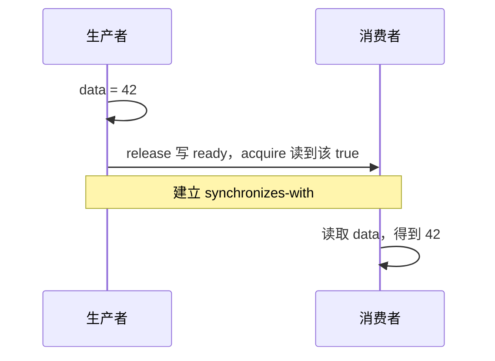

---
tags:
  - Cpp并发
  - 八股
  - 内存模型
  - CPU缓存
---

# 17.5 线程相关

以下讨论 C++17 与普通可缓存内存。

## 1. 线程不安全的本质是什么？

**共享数据的访问缺少必要同步，导致数据竞争，或多步操作交错后破坏逻辑。** 即使只有一个核心，线程切换也可能造成问题。

| 概念 | 要保证什么 | 典型问题 |
|---|---|---|
| 原子性 | 一次操作对其他线程不可分割 | 两个线程都读到 5，各自加一后写回 6，丢失一次更新 |
| 顺序性 | 相关访问满足程序要求的先后关系 | 先看到 `ready`，却没有保证随后能正确读取 `data` |
| 可见性 | 同步后能够读到被发布的数据 | 生产者写入的数据没有安全地交给消费者 |

不是每个程序都需要最强内存序，而是要满足算法需要的保证。例如，独立计数用 `fetch_add(relaxed)`，在线程 `join` 后汇总就可以正确。

两个线程无同步地读写同一位置，至少一方写、至少一个访问非原子，且没有 happens-before，就构成 **C++ 数据竞争，行为未定义**。普通 `++counter` 属于这种情况，不能只说“结果可能偏小”。[标准依据](https://timsong-cpp.github.io/cppwp/n4659/intro.races#20)

## 2. 原子变量如何保证原子性？

`counter.fetch_add(1, std::memory_order_relaxed)` 把读—改—写作为一次原子操作。若改成分开的 `load → 加一 → store`，仍可能丢失更新，哪怕每次访问都是 `seq_cst`。

| 实现 | 核心做法 |
|---|---|
| x86：`lock add / lock xadd` 等 | 常见可缓存、单缓存行内的访问，通过独占写权限和硬件协调保证整个 RMW 不被冲突操作打断 |
| ARM：`LDXR / STXR` 循环 | 读取并建立独占监视，尝试写入；失败就重新读、算、写，不要求一直锁住缓存行 |
| ARM LSE | 用 `LDADD` 等原子指令完成操作 |
| 不支持无锁的类型 | 标准库可以用内部锁；用 `is_lock_free()` 查询 |

“锁缓存行”是常见路径，不能概括成“所有原子操作都锁缓存行”或“绝不会锁总线”。**MESI 只协调副本和写权限，不会自动把普通的读、计算、写合成原子操作。** [Intel 缓存锁定说明](https://www.intel.com/content/dam/www/public/us/en/documents/manuals/64-ia-32-architectures-software-developer-vol-3a-part-1-manual.pdf#page=261)

所有 `fetch_add` 内存序都保留原子性；`relaxed` 不负责发布周围的普通数据，`release/acquire` 可以建立发布与接收关系，`seq_cst` 还要求所有 seq_cst 操作具有单一总顺序。接口见 [[2.C++高级/15. C++11/15.3 atomic|atomic 基础]]。

## 3. 多核与 MESI：S、M、I、E 分别是什么？

软件线程由操作系统调度到核心上，可能迁移。一个处理器封装可以有多个核心，多插槽机器还要跨处理器通信。缓存通常按核心或核心组组织，不能说“每个软件线程都有自己的 L1/L2”。

MESI 管理**缓存行**的副本与写权限。下表描述基本 MESI 的稳定状态：

| 状态 | 含义 | 写入要求 |
|---|---|---|
| M：Modified | 独占、已修改，持有脏数据 | 已有写权限 |
| E：Exclusive | 独占、干净 | 通常可直接 `E → M` |
| S：Shared | 干净，允许其他核心也有副本 | 先使其他副本失效，再取得写权限 |
| I：Invalid | 本地副本无效，不能直接使用 | 重新请求数据与相应权限 |

以双方都有 `data = 0`、状态为 S 为例，省略瞬态后的典型流程：

1. CPU 0 要写 `42`，申请独占写权限，使 CPU 1 的副本 `S → I`。
2. 所需确认到齐、写权限就绪后，CPU 0 完成写入，成为 M。
3. CPU 1 随后读取时，因 I 而重新请求，可从持有新值的缓存取得 `42`；基本 MESI 完成共享读后，双方可成为 S。

ACK 是硬件协议确认，不是软件线程回复。目录协议可以只通知相关共享者；本核已有 M/E 时，也不必每次都广播。**变成 I 不会立即触发读取，新值也不必先写回 DRAM 才能被另一核取得。**

[[图片/SVG/17_5_1.svg|查看硬件路径图]]；缓存层级的背景见 [[8.高性能存储/0. 数据路径硬件基础/0.1 CPU Cache Cache Line 与内存屏障|CPU Cache 与内存屏障]]。

## 4. Store Buffer、Invalidate Queue 和两个窗口

| 结构 | 作用 | 对应的延迟窗口 |
|---|---|---|
| Store Buffer（存储缓冲） | 暂存待传播的写，让核心继续执行 | 本核已执行写，但别核尚未观察到；本核还可能从缓冲中直接读到自己的新值 |
| Invalidate Queue（失效队列） | 某些模型中暂存失效请求，允许提前 ACK，之后再处理缓存行 | 已收到或确认失效请求，但本地失效处理尚未完成 |

在失效队列模型中，请求应用到缓存行时才更新为 I。真实硬件还可能用瞬态标记、访问检查或重放来满足协议；**不能由“提前 ACK”推出核心可以任意继续使用旧值。**

这两个窗口解释了传播延迟，但能否出现“`ready` 已更新、`data` 仍读旧值”，还取决于**不同地址之间的内存序**。MESI 的缓存一致性不能代替它。失效队列是教学模型，不是每种 x86/ARM 都具有的固定结构。[McKenney《并行编程》附录 C](https://www.kernel.org/pub/linux/kernel/people/paulmck/perfbook/perfbook.2024.12.27a.pdf#page=468)

## 5. ready 怎样安全发布 data = 42？

前提：在线程启动前初始化；一个生产者、一个消费者；`data` 只写这一次，发布后不再修改。

```cpp
#include <atomic>
#include <cassert>
#include <thread>

int data = 0;
std::atomic<bool> ready{false};

void producer() {
    data = 42;
    ready.store(true, std::memory_order_release);
}

void consumer() {
    while (!ready.load(std::memory_order_acquire)) {
        std::this_thread::yield();
    }
    assert(data == 42);  // 退出循环后必须成立
}
```


证明只需一条链：

**写 data → release 写 ready → acquire 读到这次 true → 读 data。**

中间建立 synchronizes-with，两端由线程内顺序连接，得到“写 data happens-before 读 data”，所以普通 `data` 也能安全读取。[release/acquire 规则](https://timsong-cpp.github.io/cppwp/n4659/atomics.order#2)

- `ready` 是普通变量或 `volatile`：没有建立同步，存在数据竞争。
- `ready` 是原子变量，但用 relaxed：只保证 `ready` 自身的原子访问，普通 `data` 仍未安全发布。
- 按上面的 release/acquire 配对：断言成立。截图第 4 张下半段、第 8 张的“可能失败”注释有误。

**release/acquire 不等于必须排空整个 Store Buffer / Invalidate Queue。** 它们保证相关访问的顺序与同步，不规定每一步入队、ACK 和缓存更新，也不要求刷新到主存。写入 Store Buffer 本身不代表发布完成。

## 6. x86 强序与 ARM 弱序怎么区分？

| 对比 | x86-64 | ARM / AArch64 |
|---|---|---|
| 普通内存访问 | WB 内存通常保持 Load→Load、Load→Store、Store→Store；允许读取越过先前对不同地址的待传播写入 | 允许更多不同地址间的乱序观察 |
| acquire load 常见映射 | `MOV` | `LDAR` |
| release store 常见映射 | `MOV` | `STLR` |

x86 强序不等于所有访问全局串行；ARM 弱序也不等于没有缓存一致性。编译器还可能调整普通访问，所以**即使在 x86 上，也不能依赖普通变量忙等来替代 C++ 同步**。

x86 的 acquire/release 常不需要额外屏障指令，但编译器仍须遵守相应约束。这也是不能把内存序简单解释为“执行清空队列指令”的原因。[Arm 对内存序与指令映射的说明](https://developer.arm.com/community/arm-community-blogs/b/tools-software-ides-blog/posts/armv8-sequential-consistency)
