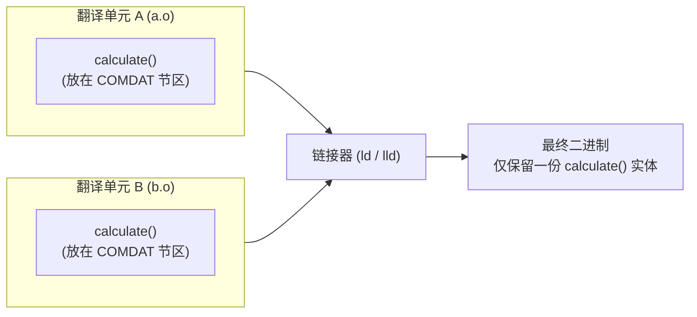

---
tags:
  - Cpp高级
  - inline-内联
阅读次数: 0
---

# 2. inline 内联

## 1. 简介与现代认知

C++ 中的 `inline` 拥有双重角色：

1. **历史优化意图（函数内联展开）**：建议编译器在调用点直接用函数体替换调用指令，省去[[1.2 函数栈帧建立与销毁原理|函数调用栈帧]]的开辟、参数压栈、寄存器保护与跳转开销。
2. **现代核心语义（链接期规则）**：允许同一函数或变量在多个翻译单元（TU）中拥有重复定义。链接器会自动合并这些定义，不触发[[11.1 ODR唯一定义规则|ODR]]的重定义报错。

在现代优化编译器（GCC、Clang、MSVC）开启 `-O2` 或 `-O3` 时，内联展开与 `inline` 关键字已经基本解耦：编译器主要依赖自身的内联启发式算法（Inline Heuristics）来权衡代码体积与速度，没写 `inline` 的小型静态函数常被自动展开，显式写了 `inline` 的复杂函数也随时可能被拒绝。因此，现代代码中 `inline` 的主要工程价值在于**编写可在头文件中安全包含的函数与全局变量**。

---

## 2. 内联展开的底层对比

### 2.1 普通函数调用

```cpp
int add(int a, int b) {
    return a + b;
}

int main() {
    int result = add(3, 5);
}
```

未内联时，底层执行标准的调用协议：

```asm
; 调用方 main
push    5               ; 参数入栈（或使用 edi/esi 等寄存器传参）
push    3
call    add             ; 压入返回地址并跳转
add     esp, 8          ; 平栈

; 被调方 add
push    ebp             ; 保护旧栈底
mov     ebp, esp        ; 建立新栈帧
mov     eax, [ebp+8]
add     eax, [ebp+12]
pop     ebp             ; 恢复栈底
ret                     ; 弹出返回地址并跳转回调用点
```

### 2.2 内联展开后

```cpp
inline int add(int a, int b) {
    return a + b;
}

int main() {
    int result = add(3, 5);
}
```

内联后函数体在调用点就地展开：

```asm
; 直接计算或常量折叠
mov     DWORD PTR [rbp-4], 8
```

原地展开消除了参数传递、栈帧分配与指令跳转的指令周期。编译器还能在展开后的上下文中实施跨表达式的优化，比如常量折叠（Constant Folding）与死代码消除。

---

## 3. 内联的代价与边界

### 3.1 代码膨胀与指令缓存（I-Cache）

内联并非无偿加速。每次展开都会复制一份完整的函数机器码：

- **代码体积放大**：如果一个 50 行的函数在 100 处被调用，展开后将增加数千条指令。
- **I-Cache 命中率下降**：CPU 指令缓存（通常 L1i 为 32KB~64KB）容量有限。代码体积急剧膨胀会导致频繁的指令缓存缺失（Cache Miss）与换页，实际运行速度往往慢于单份紧凑代码的普通调用。

**适合内联的场景**：通常是 1~5 行的存取器（Getter/Setter）、简单的数学计算或只转发参数的小函数。此时展开生成的指令甚至比函数调用的开销指令更短。

### 3.2 编译器的决策边界

即使加了 `inline`，编译器在遇到以下情况时通常会直接拒绝内联展开，退化为普通函数调用：

1. **递归调用**：绝大多数递归无法在编译期确定展开深度。
2. **函数体过于庞大或包含复杂控制流**：例如多层嵌套循环、大型 `switch-case` 语句。
3. **函数包含静态局部变量**：展开可能增加同步与共享状态管理的复杂度。
4. **通过函数指针间接调用**：执行路径依赖运行时指针值。

### 3.3 强制内联与禁止内联

当有强烈的性能或调试诉求时，可使用编译器专用扩展：

```cpp
// GCC / Clang 强制内联
__attribute__((always_inline)) inline void criticalPath() {
    // ...
}

// MSVC 强制内联
__forceinline void criticalPathMSVC() {
    // ...
}

// C++20 标准属性：显式禁止内联（方便在断点分析时保留调用栈）
[[noinline]] void logDebugTrace() {
    // ...
}
```

---

## 4. 链接机制与符号折叠

### 4.1 头文件普通函数的多重定义冲突

```cpp
// utils.h
#ifndef UTILS_H
#define UTILS_H

int calculate(int x) { // 普通函数定义在头文件中
    return x * 42;
}

#endif
```

若 `file_a.cpp` 和 `file_b.cpp` 均 `#include "utils.h"`：
- 两个源文件独立编译，各自生成包含 `calculate` 全局强符号的 `.o` 文件。
- 链接器执行符号解析时，发现两个目标文件输出了同名的非弱全局符号，抛出 `multiple definition of 'calculate'` 错误。

### 4.2 COMDAT 与符号折叠

在函数前声明 `inline`，编译器会改变目标文件中的节区属性：



在 ELF 格式下，编译器将 inline 函数输出为 **COMDAT 组**（或标记为弱符号 `weak`）。当链接器拼接各个 `.o` 时：
1. 检测到名字相同的 COMDAT 节区；
2. 随意保留其中一份机器码，丢弃其他副本；
3. 将程序内所有未被内联展开的调用跳转重定位到这唯一的副本上。

### 4.3 函数地址的唯一性

C++ 标准明确规定：在同一个程序内，**对同一个 inline 函数取地址，得到的结果必须在所有编译单元中完全一致**。

```cpp
// a.cpp
inline void foo() {}
void* getAddrA() { return (void*)&foo; }

// b.cpp
inline void foo() {}
void* getAddrB() { return (void*)&foo; }

// main.cpp: 保证成立
assert(getAddrA() == getAddrB());
```

只要代码中存在取函数地址的操作（或传递给函数指针），编译器就会强行为该 inline 函数生成一份真正的外联实体（Out-of-line Body）。

---

## 5. ODR 与定义一致性

### 5.1 ODR 的豁免与约束

`inline` 允许同一个函数在多个编译单元中出现定义，但有严格的前提：**每个编译单元中该函数的 Token 序列及语义必须完全一致**。

### 5.2 跨编译单元实现不一致的风险

若头文件引入了条件编译宏，而在不同 `.cpp` 中该宏的值不同：

```cpp
// config.h
inline int getBufferLimit() {
#ifdef LARGE_BUFFER
    return 4096;
#else
    return 128;
#endif
}
```

如果 `a.cpp` 定义了 `LARGE_BUFFER`，而 `b.cpp` 没有定义：
- 链接器挑选 COMDAT 时只留其中一份，可能让整个程序都得到 4096，也可能都是 128。
- 这属于违反 ODR 的未定义行为（UB），编译器通常不会报错，排查极其困难。

---

## 6. 类成员函数与构造/析构陷阱

### 6.1 类内定义（隐式 inline）

只要成员函数的实现体 `{ ... }` 直接写在 `class` 体内，C++ 标准规定其自动具备 `inline` 属性：

```cpp
class Account {
private:
    double balance_ = 0.0;
public:
    // 类内定义 → 隐式 inline，头文件多处包含不报错
    double balance() const { return balance_; }
};
```

这种机制极大方便了短小的存取器（Getter/Setter）编写，无需手动书写 `inline` 关键字。

### 6.2 类外定义的声明与实现分离

若要在头文件中将类定义与实现分离排版，一旦将实现移到 `class` 大括号之外，**隐式 inline 属性即刻失效**：

```cpp
// Account.h
class Account {
private:
    double balance_ = 0.0;
public:
    double balance() const; // 仅声明
};

// 错误写法：如果移到类外且未加 inline
// double Account::balance() const { return balance_; }
// 此时退化为普通强符号函数，两个 .cpp 包含该头文件即报 multiple definition 错误！

// 正确写法：在头文件中类外实现必须显式补上 inline
inline double Account::balance() const {
    return balance_;
}
```

### 6.3 构造与析构函数的隐式代码膨胀

《Effective C++》Item 30 指出了一个典型认知陷阱：**大括号内为空 `{}` 的构造函数与析构函数，并不代表没有执行代码。**

```cpp
class Window {
    std::string title_;
    std::vector<int> dimensions_;
    std::string tooltip_;
public:
    Window() {}  // 表面空无一物，类内定义隐式 inline
    ~Window() {} // 同样隐式 inline
};
```

#### 6.3.1 编译器隐式插入的异常安全伪代码

C++ 语言规范要求：在执行构造函数体之前，必须按声明顺序完成所有基类和成员变量的初始化；并且必须保证**异常安全性**。若某个成员在构造中抛出异常（如 `std::string` 或 `std::vector` 动态分配内存失败抛出 `std::bad_alloc`），此前已经成功构造的成员必须被逆序析构，防止内存泄漏。

编译器为 `Window()` 实际展开的等价伪代码如下：

```cpp
Window::Window() {
    // 1. 若有基类，先调用基类构造
    // Base::Base();

    // 2. 构造第一个成员 title_
    try {
        title_.std::string::string();
    } catch (...) {
        // Base::~Base();
        throw;
    }

    // 3. 构造第二个成员 dimensions_
    try {
        dimensions_.std::vector<int>::vector();
    } catch (...) {
        title_.std::string::~string(); // 析构已成功的成员
        // Base::~Base();
        throw;
    }

    // 4. 构造第三个成员 tooltip_
    try {
        tooltip_.std::string::string();
    } catch (...) {
        dimensions_.std::vector<int>::~vector();
        title_.std::string::~string();
        // Base::~Base();
        throw;
    }

    // 5. 最终才执行用户大括号内的空逻辑：{}
}
```

同理，析构函数 `~Window() {}` 会在用户代码之后按逆序隐式追加所有成员及基类的析构调用：

```cpp
Window::~Window() {
    // 执行用户析构逻辑：{}
    tooltip_.~string();
    dimensions_.~vector();
    title_.~string();
    // Base::~Base();
}
```

#### 6.3.2 继承体系下的雪崩效应

因为写在类体内，`Window()` 与 `~Window()` 属于隐式内联。当出现派生类与频繁对象创建时，会引发级联代码膨胀：

```cpp
class CustomWindow : public Window {
    std::string extra_info_;
public:
    CustomWindow() {} // 隐式 inline
};
```

1. **多层连锁展开**：`CustomWindow()` 展开时必须内联基类 `Window()` 的构造逻辑，而 `Window()` 又将三个成员的构造、析构与复杂的异常栈展开分支（Landing Pad）完整内联，机器码体积呈阶乘式倍增。
2. **多调用点拷贝**：工程中若有 100 处 `Window w;`，这套隐式逻辑就会在各个调用点被完整重复拷贝 100 份，挤爆 CPU 的 L1 指令缓存（I-Cache），导致性能严重倒退。

### 6.4 工程标准解法

对于包含非平凡成员（如容器、智能指针、复杂对象）或具有派生关系的类，**严禁在头文件类体内实现构造函数与析构函数**。应遵循声明与实现分离的原则：

```cpp
// Window.h（头文件仅提供声明）
class Window {
    std::string title_;
    std::vector<int> dimensions_;
    std::string tooltip_;
public:
    Window();  // 仅声明
    ~Window(); // 仅声明
};
```

```cpp
// Window.cpp（实现放入源文件中）
#include "Window.h"

// 在 .cpp 中使用 = default，编译器在此处生成单份外联实体
Window::Window() = default;
Window::~Window() = default;
```

**该方案的工程收益**：
- 庞大的成员初始化与异常处理机器码**全工程仅生成一份**，保存在 `Window.o` 中。
- 所有调用 `Window w;` 的地方仅编译为一条简练的 `call Window::Window()` 指令，显著精简二进制体积并降低头文件编译依赖。

---

## 7. 虚函数与函数指针的内联问题

### 7.1 运行时多态调用的限制

虚函数可以声明为 `inline`，但当通过基类指针或引用进行调用时，内联优化失效：

```cpp
class Base {
public:
    virtual inline void display() { /* ... */ }
};

class Derived : public Base {
public:
    void display() override { /* ... */ }
};

void run(Base* p) {
    p->display(); // 运行时多态：通过 vptr -> vtable 寻址，编译器无法在编译期展开
}
```

多态调用的去向依赖运行时的对象内存布局，编译期无法知道具体目标地址，只能发出间接调用指令。

### 7.2 静态决议下的内联机会

当调用目标在编译期完全确定时，虚函数依然能够内联：

```cpp
Derived d;
d.display();          // 对象实体调用：类型确定，可直接内联

Base* p = &d;
p->Base::display();   // 作用域限定符显式消除了动态派发，可直接内联
```

---

## 8. Header-only 类与工程实践

### 8.1 概念与机制

C++ 中所谓 Header-only 类或库（如 Eigen、Catch2、nlohmann/json），指所有接口与实现全部位于头文件中，使用者只需 `#include` 即可编译使用，无需额外编译 `.cpp` 并配置静态库或动态库链接。

支持这一模式的底层基石正是 `inline` 机制（以及模板自带的内联/弱链接属性）。

### 8.2 典型实现示例

```cpp
// Point.h
#ifndef POINT_H
#define POINT_H

class Point {
private:
    int x_;
    int y_;
public:
    Point(int x = 0, int y = 0) : x_(x), y_(y) {}

    int x() const { return x_; }
    int y() const { return y_; }

    Point operator+(const Point& rhs) const;
};

// 头文件类外实现：显式 inline 避免符号冲突
inline Point Point::operator+(const Point& rhs) const {
    return Point(x_ + rhs.x_, y_ + rhs.y_);
}

#endif
```

### 8.3 适用场景与代价权衡

| 维度 | Header-only 模式 | 传统源码分离（.h + .cpp） |
|------|----------------|------------------------|
| **接入成本** | 仅需指定头文件路径，开箱即用 | 需加入构建工程、链接目标文件 |
| **重新编译影响** | 任何实现修改都会触发全局重编译 | 修改 `.cpp` 仅需单独重新编译一个目标文件 |
| **编译速度** | 包含体积庞大时显著拖慢整体编译 | 声明精简，头文件解析迅速 |
| **代码隐藏** | 实现细节完全暴露给库使用者 | 接口与实现分离，支持闭源交付二进制 |

---

## 9. inline 变量（C++17）

### 9.1 C++17 之前的痛点与变通方案

在 C++17 之前，全局常量或类的静态成员变量无法仅在头文件中直接定义并初始化：

```cpp
// 以前的做法 (utils.h)
struct GlobalConfig {
    static int max_retry; // 仅能声明
};

// 错误：在 utils.h 中若直接写：
// int GlobalConfig::max_retry = 3;
// 多个 .cpp 包含后就会报重定义错误！

// 被迫的做法：必须开一个 utils.cpp 去初始化：
// int GlobalConfig::max_retry = 3;
```

这种限制导致头文件库无法做到彻底独立，开发者常被迫采用以下变通手段：
1. **函数局部静态变量（Meyers' Singleton）**：通过静态函数返回内部 static 变量的引用。
2. **模板静态成员 hack**：利用模板实例天然具有的弱链接属性绕过限制。

### 9.2 C++17 inline 变量的解法

C++17 引入了 `inline` 变量，赋予变量与 inline 函数相同的 COMDAT 合并语义：

```cpp
// config.h (C++17)
#ifndef CONFIG_H
#define CONFIG_H

#include <string>

struct GlobalConfig {
    // 类的静态成员直接在头文件类内定义并初始化
    static inline int max_retry = 3;
    static inline const std::string server_url = "https://api.internal";
};

// 独立的全局内联变量
inline const std::string APP_VERSION = "2.4.0";

#endif
```

链接器会确保全工程无论有多少处 `#include "config.h"`，`GlobalConfig::max_retry` 在内存中永远只有一份唯一实例。

---

## 10. inline 与宏的对比

### 10.1 核心特性差异

| 对比维度 | `inline` 函数 | `#define` 宏 |
|---------|--------------|-------------|
| **处理阶段** | 编译器前端及优化阶段 | 预处理器（文本替换） |
| **类型检查** | 具备完整的强类型检查与模板推导 | 无类型检查，容易引发非预期类型转换 |
| **作用域** | 遵守 `namespace` 与类访问权限控制 | 无视命名空间，污染全局预编译环境 |
| **调试体验** | 符号可见，Debug 模式可下断点单步跟踪 | 无法单步断点，编译错误信息极难阅读 |
| **符号与链接** | 产生正规符号（必要时输出外联实体） | 不产生任何符号 |

### 10.2 参数求值的副作用对比

带参数的宏最典型的隐患是多次计算参数副作用：

```cpp
#define SQUARE_MACRO(x) ((x) * (x))

inline int square_inline(int x) {
    return x * x;
}

int a = 5;
int r1 = SQUARE_MACRO(a++);  // 展开为 ((a++) * (a++))，a 自增两次，行为甚至可能未定义！

int b = 5;
int r2 = square_inline(b++); // 先传参评估 b++，函数内仅对值求平方，b 仅自增一次。
```

---

## 11. 关键要点速查

| 核心维度 | 总结与工程判断 |
|---------|---------------|
| **首要意义** | 现代 C++ 中主要用于链接期 ODR 豁免，允许头文件内安全定义函数与全局变量。 |
| **内联展开** | 是对编译器的建议而非强制指令；在 `-O2`/`-O3` 下由优化器的成本模型自主判定。 |
| **开销陷阱** | 避免对大函数盲目内联导致代码膨胀与 I-Cache 命中率下降；警惕复杂类的隐式内联构造/析构函数。 |
| **多态限制** | 经由基类指针/引用的多态虚函数调用无法内联展开；静态决议下依然可内联。 |
| **地址唯一** | 取 inline 函数指针会迫使编译器生成实体，链接器保证全程序函数指针值唯一。 |
| **现代替代** | C++17 inline 变量终结了头文件静态成员变量初始化的历史痛点。 |

---

## 相关链接

- [[11.3 inline]] - inline 的编译器底层与语法细节
- [[11.1 ODR唯一定义规则]] - ODR 规则与其豁免机制详解
- [[11.4 define]] - 宏的文本替换本质与潜在陷阱
- [[1.1 程序编译与链接原理]] - 深入理解编译单元、符号解析与链接阶段
- [[1.2 函数栈帧建立与销毁原理]] - 理解未内联时普通函数调用的开销来源
