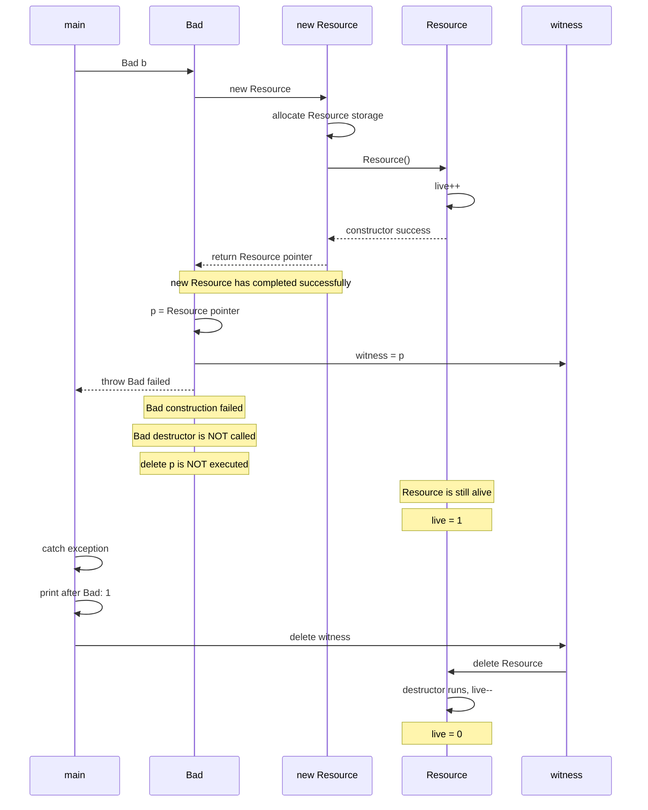
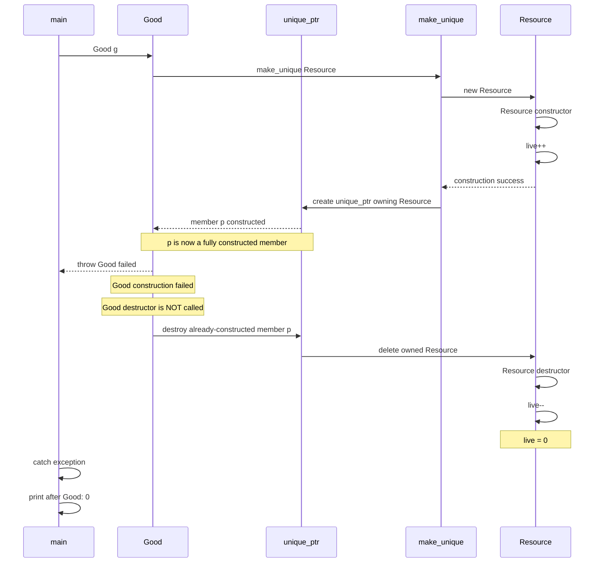

---
tags:
  - Cpp高级
  - 构造函数与析构函数
阅读次数: 0
---
# 7. 构造函数与析构函数

> [!tip] 六个实验：构造失败后怎么清理，析构异常会怎样
>
> | 实验 | 发生了什么 | 结果与注意事项 |
> |---|---|---|
> | [[#实验 1：成员构造到一半失败，谁会析构？\|实验 1：成员构造失败]] | 初始化某个成员时抛出异常 | 已构造完成的成员和基类按构造的逆序析构；失败的成员和本类不执行析构。本例中，`new` 会调用对应的 `operator delete` 回收对象内存，后面的 `delete p` 执行不到。 |
> | [[#实验 2：把 delete 写在析构里，为什么仍然可能泄漏？\|实验 2：构造期间资源泄漏]] | 构造函数体内先用裸指针接收分配的资源，随后抛出异常 | 本类析构不会执行，写在其中的 `delete` 也就无法释放资源。用 RAII 成员接管资源，构造失败时才能自动清理。 |
> | [[#实验 3：构造函数的 catch 能把失败“吞掉”吗？\|实验 3：构造函数的函数 try 块]] | 用函数 try 块（function-try-block）捕获初始化列表或构造函数体中的异常 | 进入 `catch` 前，已构造完成的成员和基类已被销毁，不能再访问它们。处理器正常执行到末尾会重新抛出原异常，也可以显式抛出其他异常；无法让对象恢复为构造成功的状态。函数体内的普通 `try` 捕获不到初始化列表中的异常。 |
> | [[#实验 4：析构异常的三个出口\|实验 4：析构异常]] | 异常从析构函数向外传播 | 异常逃出 `noexcept(true)` 析构函数，或逃出栈展开期间调用的析构函数，都会触发 `std::terminate()`。正常退出作用域时，`noexcept(false)` 析构函数抛出的异常可以被外层捕获。工程上应让析构不向外抛异常，将关闭、刷新等可能失败的操作交给普通成员函数报告。 |
> | [[#实验 5：委托构造失败，会不会调用本类析构？\|实验 5：委托构造失败]] | 目标构造函数已成功返回，随后委托构造函数体抛出异常 | 这时会调用本类析构函数。如果目标构造函数就已失败，则按普通构造失败的规则清理。 |
> | [[#实验 6：局部 static 初始化失败，下次还会尝试吗？\|实验 6：局部 static 初始化失败]] | 局部静态变量初始化时抛出异常 | 异常向外传播；下次执行到该声明时会重新尝试初始化。成功初始化后，正常退出程序时才会析构。失败尝试产生的外部副作用不会自动撤销。 |
>
> 判断清理行为时，先看哪些对象已构造完成，再看异常是否逃出析构函数，以及当时是否正在栈展开。
>
> 两处容易记错：析构函数的隐式异常说明通常是 `noexcept(true)`，但会受成员和基类析构函数的影响；局部 `static` 初始化失败可以重试，命名空间作用域变量的初始化若因异常退出，则会调用 `std::terminate()`。

## 知识点

1. **函数的初始化列表**
2. **自定义构造函数之后，类就不会再创建默认构造函数了**
3. **成员变量的初始化和它们定义的顺序有关，和构造函数初始化列表中出现的先后顺序无关**

---

## 构造函数

构造函数用于在创建对象时初始化成员变量。

```cpp
class Test
{
private:
    int ma;
    int mb;
public:
    Test(int data = 10) : mb(data), ma(mb) { }
    // 构造函数列表初始化是按照成员变量的顺序来的
    // 先初始化 ma，此时读取尚未初始化的 mb；C++17 下这是未定义行为
    void show() { cout << "ma:" << ma << " " << "mb:" << mb << endl; }
};
```

**注意**：构造函数列表初始化是按照成员变量的**定义顺序**来的，而不是初始化列表的顺序。

---

## 错误案例

### 问题代码

```cpp
class CDate
{
private:
    int _year;
    int _month;
    int _day;
public:
    // 自定义构造函数之后，类就不会再创建默认构造函数了
    CDate(int y, int m, int d)
    {
        _year = y;
        _month = m;
        _day = d;
    }
    void show()
    {
        cout << _year << "/" << _month << "/" << _day << endl;
    }
};

class CGoods
{
private:
    char _name[20];
    int _amount;
    double _price;
    CDate _date;    // 成员对象
public:
    // 报错：类 CDate 不存在默认构造函数
    CGoods(char* n, int a, double p)
    {
        strcpy(_name, n);
        _amount = a;
        _price = p;
    }
    void show()
    {
        cout << "name:" << _name << endl;
        cout << "amount:" << _amount << endl;
        cout << "price:" << _price << endl;
        _date.show();
    }
};
```

### 错误原因

1. 一旦你为某个类定义了任何一个构造函数，编译器就不会再自动为你生成默认构造函数
2. 当你创建 `CGoods` 对象时，`_date` 成员对象试图初始化，但 `CDate` 类没有默认构造函数
3. 对于 `_date` 成员，没有提供任何形式的初始化，编译器会尝试调用 `CDate` 类的默认构造函数来初始化它，从而导致 "class CDate has no default constructor" 的描述

### 正确案例

```cpp
class CDate
{
private:
    int _year;
    int _month;
    int _day;
public:
    CDate(int y, int m, int d)
    {
        _year = y;
        _month = m;
        _day = d;
    }
    void show() const
    {
        cout << _year << "/" << _month << "/" << _day << endl;
    }
};

class CGoods
{
private:
    char _name[20];
    int _amount;
    double _price;
    CDate _date;    // 成员对象
public:
    CGoods(const char* n, int a, double p, int y, int m, int d)
        : _date(y, m, d)  // CDate _date(y, m, d) 初始化成员对象
        , _amount(a)
        , _price(p)
    {
        strcpy(_name, n);
    }

    void show() const
    {
        cout << "name:" << _name << endl;
        cout << "amount:" << _amount << endl;
        cout << "price:" << _price << endl;
        _date.show();
    }
};
```

---

## 简介

1. 构造函数名与类名相同，析构函数名为 `~类名`，二者都没有返回类型。
2. 构造函数可以有参数和默认参数；析构函数不接受参数。
3. 析构函数通常由对象生命周期自动触发，也可以显式调用。显式析构不会释放对象占用的存储，普通局部对象显式析构后若未重建，离开作用域时再次析构会产生未定义行为。

### 引用

```cpp
using namespace std;

// 实现一个顺序栈
class SeqStack
{
private:
    int* _pstack;   // 动态开辟数据，存储顺序栈的元素
    int _top;       // 指向栈顶元素的位置
    int _size;      // 数组扩容的总大小

public:
    // 构造函数，代替了初始化操作
    SeqStack(int size = 10)
    {
        cout << this << " is SeqStack()" << endl;
        _pstack = new int[size];
        _top = -1;
        _size = size;
    }

    // 析构函数，代替了内存释放操作
    ~SeqStack()
    {
        cout << this << " is ~SeqStack()" << endl;
        delete[] _pstack;
        _pstack = nullptr;
    }

    // 入栈操作
    void push(int val)
    {
        if (full())
            // 扩容操作
            resize();
        _pstack[++_top] = val;
    }

    // 出栈操作
    void pop()
    {
        if (empty())
            return;
        --_top;
    }

    // 返回栈顶元素
    int top()
    {
        return _pstack[_top];
    }

    bool empty() { return _top == -1; }
    bool full() { return _top == _size - 1; }

private:
    // 顺序栈底层数组按2倍的方式进行扩容
    void resize()
    {
        int* ptmp = new int[_size * 2];
        for (int i = 0; i < _top; i++)
        {
            ptmp[i] = _pstack[i];
        }
        delete[] _pstack;
        _pstack = ptmp;
        _size *= 2;
    }
};

int main()
{
    // 默认是开辟10的内存空间
    // 也可以自己分配内存空间，SeqStack s(50);
    SeqStack s;

    for (int i = 0; i < 15; i++) {
        s.push(rand() % 100);
    }

    while (!s.empty())
    {
        cout << s.top() << " ";
        s.pop();
    }

    // 退出程序之后，自动调用析构函数
    return 0;
}
```

---

## 关键要点

1. **初始化列表顺序**：按成员变量定义顺序，不是列表顺序
2. **默认构造函数**：自定义构造函数后不再生成
3. **成员对象初始化**：必须在初始化列表中完成
4. **析构函数**：无参数，无返回值，自动调用

---

## 构造与析构的异常处理

以下按 C++17 讨论。构造函数可以抛异常：当对象无法满足自身约束时，让构造失败，调用者就不会拿到一个表面可用的对象。析构函数承担清理工作，应避免让异常逃出。

### 先区分几种失败位置

| 失败位置 | 清理行为 / 后果 |
|---|---|
| 普通构造函数的成员初始化或函数体抛异常 | 当前完整对象的析构函数不执行；已经构造完成的基类、成员按完成构造的逆序销毁 |
| 某个成员的构造函数抛异常 | 该成员自身析构不执行；它内部已经完成构造的子对象仍会清理 |
| `new T` 分配成功，随后 `T` 构造失败 | 通常调用匹配的释放函数回收这块对象存储；不会替裸指针成员释放其指向的独立资源 |
| 委托构造的目标构造函数已经完成，随后委托构造函数体抛异常 | 会调用完整对象的析构函数，见实验 5 |
| 异常逃出 `noexcept` 析构函数 | 调用 `std::terminate()`，外层 `catch` 接不到 |
| 栈展开期间，析构再次让异常逃出 | 即使声明 `noexcept(false)`，仍调用 `std::terminate()` |

构造失败的清理规则见标准草案 [except.ctor](https://eel.is/c++draft/except.ctor)。这里的“自动清理”依赖资源已经交给一个完成构造的对象管理，见 [[6.3 动态内存分配的风险]]。

> [!warning] 两句容易记错的话
> “构造失败一定不调用本类析构”漏掉了委托构造的情况；“析构抛异常一定终止”漏掉了 `noexcept(false)` 析构在普通退出时可以被捕获的情况。工程上仍应让析构不向外抛异常。

### 实验方式

验证记录：6 个原始实验已用 Apple Clang 21、C++17 编译运行，输出与下文一致；实验 4 的三个模式分别核对了退出码，实验 1、4、5 的改动版本也已运行。

下面 6 段代码各自保存成 `exp1.cpp` 至 `exp6.cpp`，每段都有独立的 `main`。先预测输出，再运行。macOS / Linux 可以这样编译；把文件名换成对应编号：

```bash
c++ -std=c++17 -Wall -Wextra -pedantic exp1.cpp -o exp1
./exp1
```

### 实验 1：成员构造到一半失败，谁会析构？

观察 `b` 抛异常后，是否出现 `~b`、`~Owner`，以及 `operator delete` 是否执行。

```cpp
#include <cstddef>
#include <iostream>
#include <new>
#include <stdexcept>

struct Part {
    const char* name;
    Part(const char* n, bool fail = false) : name(n) {
        std::cout << "+" << name << '\n';
        if (fail) throw std::runtime_error("b failed");
    }
    ~Part() { std::cout << "~" << name << '\n'; }
};

struct Owner {
    Part a{"a"};
    Part b{"b", true};
    Part c{"c"};
    Owner() { std::cout << "Owner body\n"; }
    ~Owner() { std::cout << "~Owner\n"; }
    static void* operator new(std::size_t n) {
        std::cout << "allocate Owner\n";
        return ::operator new(n);
    }
    static void operator delete(void* p) noexcept {
        std::cout << "free Owner storage\n";
        ::operator delete(p);
    }
};

int main() {
    try {
        auto p = new Owner;
	    // delete 是否注释都不影响，因为 delete 实际上是由 new-expression 自动执行的
        delete p;
    } catch (const std::exception& e) {
        std::cout << "caught: " << e.what() << '\n';
    }
}
```

预期输出：

```text
allocate Owner
+a
+b
~a
free Owner storage
caught: b failed
```

```
auto p = new Owner;
         │
         ├── 分配 raw storage
         │
         ├── 构造 a
         │      └── 成功
         │
         ├── 构造 b
         │      └── throw !!!
         │
         ├── 回滚 a
         │      └── ~a()
         │
         ├── 自动释放 raw storage
         │      └── Owner::operator delete()
         │
         └── 异常继续传播
                  │
                  ▼
                catch

delete p;  ← 根本走不到这里
```

`b` 没完成构造，`c` 还没开始，`Owner` 的函数体也没有进入。这里调用 `operator delete` 是失败的 `new` 表达式执行的清理；代码里的 `delete p` 根本没有走到。

改动实验：把 `b` 的 `true` 改成 `false`，在 `Owner()` 函数体内抛异常。此时会看到 `~c`、`~b`、`~a`，仍不会出现 `~Owner`。

### 实验 2：把 delete 写在析构里，为什么仍然可能泄漏？

`Bad` 和 `Good` 都在申请资源后抛异常。计数器用来观察资源是否还活着；`witness` 只用于实验结束时收拾 `Bad` 留下的资源，实际业务代码不应靠这种旁路指针补救。

```cpp
#include <iostream>
#include <memory>
#include <stdexcept>

struct Resource {
    inline static int live = 0;
    Resource() { ++live; }
    ~Resource() { --live; }
};
Resource* witness = nullptr;

struct Bad {
    Resource* p;
    // 这里 Resource 已经成功构造了，因为 Resource 的生命周期由一个普通的指针管理
    // 因此 Bad 构造失败的时候，后续的析构不会调用，因此 Resource 仍然存在。
    Bad() : p(new Resource) {
        witness = p;
        throw std::runtime_error("Bad failed");
    }
    ~Bad() { delete p; }
};

struct Good {
    std::unique_ptr<Resource> p = std::make_unique<Resource>();
    Good() { throw std::runtime_error("Good failed"); }
};

int main() {
    try { Bad b; } catch (const std::exception&) {}
    std::cout << "after Bad: " << Resource::live << '\n';
    delete witness;
    witness = nullptr;
    try { Good g; } catch (const std::exception&) {}
    std::cout << "after Good: " << Resource::live << '\n';
}
```

```text
after Bad: 1
after Good: 0
```

`~Bad()` 不执行，裸指针不会自动 `delete`；`Good` 的智能指针成员已经完成构造，因此会析构并释放资源。资源应在取得时就交给 RAII 对象，包括内存、文件描述符和锁。多个裸资源接连申请时，后一个失败也会暴露同样的问题。

普通指针管理


智能指针管理

---
### 实验 3：构造函数的 catch 能把失败“吞掉”吗？

写在函数体里的普通 `try` 接不到成员初始化阶段的异常。要覆盖初始化列表，需要函数 try 块（function-try-block）。

```cpp
#include <iostream>
#include <stdexcept>

struct Part {
    Part() { std::cout << "+Part\n"; }
    ~Part() { std::cout << "~Part\n"; }
};
int fail() { throw std::runtime_error("init failed"); }

struct Owner {
    Part part;
    int value;
    explicit Owner(int request_id) try : part(), value(fail()) {
        std::cout << "Owner body\n";
    } catch (const std::exception& e) {
        std::cout << "constructor catch " << request_id
                  << ": " << e.what() << '\n';
        // 不访问 part、value，也不调用本对象的成员函数。
        // 故意不写 throw，观察是否仍然传播。
    }
};

int main() {
    try {
        Owner x(7);
        std::cout << "constructed\n";
    } catch (const std::exception& e) {
        std::cout << "outer catch: " << e.what() << '\n';
    }
}
```

```text
+Part
~Part
constructor catch 7: init failed
outer catch: init failed
```

进入这个 `catch` 前，已经完成构造的子对象都已销毁。这里引用本对象的非静态成员或基类会产生未定义行为；可以使用仍有效的构造参数。执行到构造函数 handler 末尾会自动重新抛出，写 `return;` 则编译不通过。它适合补充错误上下文或转换异常，不能恢复出一个构造成功的对象。规则见 [except.handle](https://eel.is/c++draft/except.handle)。
```
       try 的保护范围
┌─────────────────────────┐
│                         │
│  成员初始化              │
│      +                  │
│  构造函数体              │
│                         │
└─────────────────────────┘
```

改动实验：删去 function-try-block，在构造函数体中放普通 `try/catch`。`fail()` 仍在进入函数体前抛出，因此只有外层捕获。

``` cpp
Owner(int request_id)
    : part(), value(fail())
{
    try {
        std::cout << "Owner body\n";
    }
    catch (...) {
        std::cout << "caught\n";
    }
}
```
在函数体内部使用 try-catch 是无法捕获到  value(fail()) 的错误的，因为 fail() 抛出了异常，不会进入到 Owner 函数体内。

```
Owner()
 │
 ├── part()
 │      └── 成功
 │
 ├── value(fail())
 │          │
 │          └── 💥 throw
 │
 │
 │       异常已经发生
 │
 └── Owner 函数体
       │
       └── try {...}    ❌ 根本还没进去
```
---
### 实验 4：析构异常的三个出口

一次只运行一个模式。实验安装了 terminate handler，用固定退出码 `42` 标记终止路径，避免默认中止信息掩盖观察结果。`std::_Exit` 不会继续清理局部对象。

```cpp
#include <cstdio>
#include <cstdlib>
#include <exception>
#include <stdexcept>
#include <string>

void fail() { throw std::runtime_error("cleanup failed"); }
struct DefaultDtor {
    ~DefaultDtor() { fail(); }  // 本例隐式 noexcept(true)
};
struct ThrowingDtor {
    ~ThrowingDtor() noexcept(false) { fail(); }
};

int main(int argc, char** argv) {
    std::set_terminate([] {
        std::puts("terminate");
        std::fflush(stdout);
        std::_Exit(42);
    });
    const std::string mode = argc > 1 ? argv[1] : "normal";
    try {
        if (mode == "default") {
            DefaultDtor x;
        } else if (mode == "normal") {
            ThrowingDtor x;
        } else if (mode == "unwind") {
            ThrowingDtor x;
            throw std::runtime_error("business failed");
        }
    } catch (const std::exception& e) {
        std::printf("caught: %s\n", e.what());
    }
}
```

| 运行命令 | 输出 | 退出码 | 原因 |
|---|---|---|---|
| `./exp4 default` | `terminate` | 42 | 异常越过 `noexcept` 边界 |
| `./exp4 normal` | `caught: cleanup failed` | 0 | 普通退出，析构允许抛异常，外层捕获 |
| `./exp4 unwind` | `terminate` | 42 | 处理业务异常的栈展开过程中，析构又抛出异常 |
```
main()
  │
  ▼
ThrowingDtor x
  │
  │ 构造成功
  ▼
throw "business failed"        ← 第一个异常 A
  │
  │
  │ 正常执行立即停止
  ▼
开始寻找 catch
  │
  ▼
stack unwinding
  │
  │ 发现局部对象 x
  ▼
~ThrowingDtor()
  │
  ▼
fail()
  │
  ▼
throw "cleanup failed"         ← 第二个异常 B
  │
  │
  │ 此时异常 A 还在传播！
  ▼
两个异常发生冲突
  │
  ▼
std::terminate()
  │
  ▼
你注册的 terminate handler
  │
  ├── puts("terminate")
  ├── fflush(stdout)
  │
  └── _Exit(42)
          │
          ▼
       程序结束


外面的 catch               ❌
"caught: business failed"   ❌
"caught: cleanup failed"    ❌
```

终止规则见 [except.terminate](https://eel.is/c++draft/except.terminate)。在终端执行后用 `echo $?` 查看退出码。

没有显式异常说明的析构函数通常是 `noexcept(true)`，但如果某个基类或成员的析构可能抛异常，外层析构的隐式异常说明也可能变成 `noexcept(false)`。即使是手写的 `~T() { ... }`，也不是根据函数体中的 `throw` 推导；见 [except.spec](https://eel.is/c++draft/except.spec)。

改动实验：在 `ThrowingDtor` 内部用 `try/catch` 接住 `fail()`，再运行 `unwind`。外层会捕获原来的 `business failed`。栈展开期间可以在析构内部抛出并处理异常，危险的是让新异常逃出析构。

### 实验 5：委托构造失败，会不会调用本类析构？

```cpp
#include <iostream>
#include <stdexcept>

struct X {
    explicit X(int) { std::cout << "target done\n"; }
    X() : X(1) {
        std::cout << "delegating body\n";
        throw std::runtime_error("later failed");
    }
    ~X() { std::cout << "~X\n"; }
};

int main() {
    try { X x; }
    catch (const std::exception& e) {
        std::cout << "caught: " << e.what() << '\n';
    }
}
```

```text
target done
delegating body
~X
caught: later failed
```

目标构造函数 `X(int)` 已完成，因此委托构造函数体失败时会执行 `~X()`。改成在 `X(int)` 中抛异常，就不会执行 `~X()`，委托构造函数体也不会进入。

```
main
 │
 │ X x;
 ▼
X()
 │
 │ 委托构造
 ▼
X(1)
 │
 ├── 初始化 X
 │
 ├── cout
 │ │
 │ └── "target done"
 │
 └── 正常完成
       │
       │ ★ 完整 X 生命周期已经开始
       ▼
回到 X() 的函数体
 │
 ├── cout
 │ │
 │ └── "delegating body"
 │
 └── throw "later failed" 💥
            │
            ▼
       X 已经构造完成过
            │
            ▼
          ~X()
            │
            └── "~X"
            │
            ▼
       异常继续传播
            │
            ▼
       main 的 catch
            │
            ▼
   "caught: later failed"
```

---
### 实验 6：局部 static 初始化失败，下次还会尝试吗？

```cpp
#include <iostream>
#include <stdexcept>

struct Service {
    Service() {
        static int attempts = 0;
        std::cout << "attempt " << ++attempts << '\n';
        if (attempts == 1) throw std::runtime_error("not ready");
    }
    ~Service() { std::cout << "~Service\n"; }
};
void use() {
    static Service s;
    std::cout << "use\n";
}
int main() {
    for (int i = 0; i < 3; ++i) {
        try { use(); }
        catch (const std::exception& e) {
            std::cout << "caught: " << e.what() << '\n';
        }
    }
}
```

```text
attempt 1
caught: not ready
attempt 2
use
use
~Service
```
第一次失败不算初始化完成，第二次进入声明会重试；成功后不再构造，正常退出时只析构一次。构造失败前修改的外部状态不会自动回滚，本例的 `attempts` 就保留了增量。规则见 [stmt.dcl](https://eel.is/c++draft/stmt.dcl)。

如果不是静态的 Service，输出的则是，每一次进入 use() 都会构造一次：
```
attempt 1
caught: not ready
attempt 2
use
~Service
attempt 3
use
~Service
```

```
第 1 次 use()
    │
    ▼
static Service s
    │
    ▼
Service()
    │
    ├── attempts = 1
    ├── print attempt 1
    └── throw
         │
         ▼
    初始化失败
         │
         ▼
    catch: not ready


第 2 次 use()
    │
    ▼
static Service s
    │
    ├── 上次初始化失败
    │
    └── 再次尝试构造
            │
            ▼
         Service()
            │
            ├── attempts = 2
            └── 成功
                 │
                 ▼
              print use


第 3 次 use()
    │
    ▼
static Service s
    │
    ├── 已经初始化成功
    │
    └── 不再构造
            │
            ▼
         print use


程序退出
    │
    ▼
~Service()
```
不要把这条规则套到命名空间作用域的全局对象：它的动态初始化若有异常逃出，会终止进程，不能指望 `main` 中的 `catch` 接住。初始化局部 static 时递归进入同一个声明，则是未定义行为。

### 写实际类时还要检查的坑

- 需要调用者处理的 `flush()`、`commit()`、`close()` 失败，应通过显式操作报告。析构执行不抛异常的兜底清理；如果内部捕获失败，记录错误的操作本身也不能再抛出。不要只为了消除终止现象就把业务错误全部吞掉。
- 给构造函数随手加 `noexcept`，会把本来可捕获的分配失败等错误变成终止。`new (std::nothrow) T` 也只改变分配失败的报告方式，不能吞掉 `T` 构造函数抛出的异常。
- placement new 构造失败不意味着调用者提供的缓冲区会被释放；缓冲区的生命周期仍由原来的所有者管理，见 [[12.1.8 对象放置构造]]。
- 析构中手动 `delete` 某个成员后，又让该资源的 RAII 包装器自动清理，会重复释放。构造函数的 function-try-block 也不要再手动清理已经自动销毁的成员。
- 析构函数的 function-try-block 执行到 handler 末尾同样会重新抛出。它与析构函数体内部的普通 `try/catch` 不同，也不能在 handler 中访问已销毁的成员。
- 构造期间先把 `this` 注册到外部容器，随后抛异常，外部登记不会自动撤销。应延后发布，或用作用域守卫回滚。资源没有泄漏，并不代表外部状态恢复到了调用前。
- 构造时启动 `std::thread` 后，后续成员或构造函数体又抛异常，已构造的线程成员会析构；只要它仍 `joinable()` 就会终止，线程已经运行结束也不例外。需要保证异常路径能等待或安全转移线程所有权。
- `std::uncaught_exceptions()` 可以帮助区分作用域退出路径，但不能让抛异常的析构变安全，也不能修复违反 `noexcept` 的行为。不要用它绕过清理错误的设计问题。

这些设计建议对应《Effective C++》第 8 条（不要让异常逃离析构函数）、第 13 条（用对象管理资源），以及 [C++ Core Guidelines C.36 / C.37](https://isocpp.github.io/CppCoreGuidelines/CppCoreGuidelines#Rc-dtor-fail)。

---

## 相关链接

- [[12.1.6 构造函数]] - 构造函数详解
- [[12.1.7 析构函数]] - 析构函数详解
- [[12.1.8 对象放置构造]] - placement new
- [[6. OOP]] - 面向对象基础
