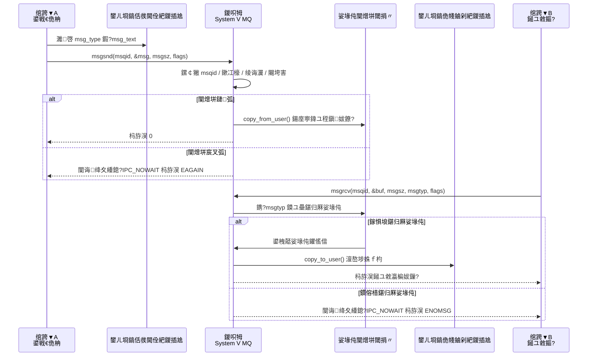

---
tags:
  - Linux
  - 杩涚▼
闃呰娆℃暟: 0
---

# 11.6 娑堟伅闃熷垪 (Message Queue)

> [!tip] 浜や簰鍔ㄧ敾
> 鏈瘒鏍稿績闅剧偣鐨勮繃绋嬪彲瑙嗗寲锛坄msgtyp` 0/姝?璐熶笁绉嶉€夋嫨瑙勫垯 路 涓€娆?`msgrcv` 鍙彇涓€涓畬鏁磋妭鐐逛笌 `E2BIG` 路 婊￠槦鍒楅樆濉炲鐓?`IPC_NOWAIT`/EAGAIN 路 鍚屼竴闃熷垪鎸夌被鍨嬪弻鍚戦€氫俊锛夛細
> [鈻?鍦ㄦ祻瑙堝櫒涓墦寮€鍔ㄧ敾](<../../鍥剧墖/HTML/3.Linux/11. 杩涚▼/11.6 娑堟伅闃熷垪鍔ㄧ敾.html>)銆€路銆€鏇村瑙?[[缃戠粶缂栫▼路鍔ㄧ敾鍚堥泦]]
> 涔熷彲鐩磋揪鍗曚釜鍦烘櫙锛歔鎸夌被鍨嬫帴鏀禲(<../../鍥剧墖/HTML/3.Linux/11. 杩涚▼/11.6 娑堟伅闃熷垪鍔ㄧ敾.html#scene=typed>) 路 [娑堟伅杈圭晫](<../../鍥剧墖/HTML/3.Linux/11. 杩涚▼/11.6 娑堟伅闃熷垪鍔ㄧ敾.html#scene=boundary>) 路 [婊￠槦鍒椾笌 NOWAIT](<../../鍥剧墖/HTML/3.Linux/11. 杩涚▼/11.6 娑堟伅闃熷垪鍔ㄧ敾.html#scene=capacity>) 路 [鍙屽悜閫氫俊](<../../鍥剧墖/HTML/3.Linux/11. 杩涚▼/11.6 娑堟伅闃熷垪鍔ㄧ敾.html#scene=duplex>)

## 1. 浠€涔堟槸娑堟伅闃熷垪

**娑堟伅闃熷垪 (Message Queue)** 鏄竴绉峓[11.2 杩涚▼闂撮€氫俊IPC|杩涚▼闂撮€氫俊]]鏈哄埗锛屽畠鍦ㄥ唴鏍镐腑缁存姢涓€涓?*娑堟伅閾捐〃**锛岃繘绋嬪彲浠ュ悜闃熷垪涓彂閫佹秷鎭紝涔熷彲浠ヤ粠闃熷垪涓帴鏀舵秷鎭€?

### 1.1 娑堟伅闃熷垪鐨勭壒鐐?

| 鐗圭偣 | 璇存槑 |
|------|------|
| **鏀跺彂瑙ｈ€?* | 鍙戦€佹柟涓嶅繀绛夋帴鏀舵柟**鍙栬蛋**娑堟伅灏辫兘杩斿洖 |
| **娑堟伅绫诲瀷** | 姣忔潯娑堟伅閮芥湁绫诲瀷锛屾帴鏀舵柟鍙互閫夋嫨鎬у湴鎺ユ敹鐗瑰畾绫诲瀷鐨勬秷鎭?|
| **娑堟伅杈圭晫** | 涓嶽[11.3 绠￠亾閫氳\|绠￠亾]]涓嶅悓锛屾秷鎭槦鍒椾繚鐣欐秷鎭竟鐣岋紝姣忔璇诲彇涓€鏉″畬鏁存秷鎭?|
| **鍏ㄥ弻宸?* | 鍚屼竴涓槦鍒楀彲浠ュ弻鍚戦€氫俊锛堥€氳繃涓嶅悓鐨勬秷鎭被鍨嬶級 |
| **闈炰翰缂樿繘绋?* | 涓嶇浉鍏崇殑杩涚▼鍙互閫氳繃鐩稿悓鐨?key 璁块棶鍚屼竴闃熷垪 |

> [!warning] 銆屽紓姝ャ€嶄笉绛変簬銆屼笉浼氶樆濉炪€?
> 鏀跺彂瑙ｈ€﹁鐨勬槸鍙戦€佹柟涓嶇敤绛夊鏂瑰鐞嗗畬銆備絾闃熷垪**婊?*鐨勬椂鍊?`msgsnd()` 鐓ф牱浼氱潯涓嬪幓锛岄槦鍒楅噷**娌℃湁鍖归厤绫诲瀷**鐨勬秷鎭椂 `msgrcv()` 涔熶細鐫′笅鍘汇€傝鐪熺殑涓嶉樆濉烇紝蹇呴』鏄惧紡鍔?`IPC_NOWAIT`锛屾鏃?`msgsnd` 澶辫触杩斿洖 `EAGAIN`锛宍msgrcv` 澶辫触杩斿洖 `ENOMSG`銆?

### 1.2 娑堟伅闃熷垪 vs 绠￠亾 vs 鍏变韩鍐呭瓨

| 鐗规€?| [[11.3 绠￠亾閫氳\|绠￠亾]] | 娑堟伅闃熷垪 | [[11.4 鍏变韩鍐呭瓨\|鍏变韩鍐呭瓨]] |
|------|--------|----------|------------|
| **鏁版嵁鏍煎紡** | 瀛楄妭娴?| 甯︾被鍨嬬殑娑堟伅 | 浠绘剰 |
| **閫氫俊鏂瑰悜** | 鍗曞悜 | 鍚屼竴闃熷垪鍙弻鍚?| 鍙屽悜 |
| **姣忔潯鏁版嵁鐨勬嫹璐濇鏁?* | 2 娆?| 2 娆?| 0 娆?|
| **鍚屾** | 鑷甫 | 鑷甫 | 闇€瑕乕[11.5 淇″彿閲廫|淇″彿閲廬] |
| **杩涚▼鍏崇郴** | 閫氬父闇€瑕佷翰缂?| 浠绘剰 | 浠绘剰 |
| **鑳借繘 epoll 鍚?* | 鑳?| **涓嶈兘** | 涓嶉€傜敤 |

绠￠亾鍜屾秷鎭槦鍒楅兘鏄€岀敤鎴锋€?鈫?鍐呮牳 鈫?鐢ㄦ埛鎬併€嶄袱娆℃嫹璐濓紝閫熷害鏄悓涓€閲忕骇锛涚湡姝ｆ媺寮€宸窛鐨勬槸鍏变韩鍐呭瓨鐨勯浂鎷疯礉銆傛墍浠ュ埆鎸夈€岃皝蹇€嶉€夛紝鎸変笂闈㈤偅涓よ鍔犵矖鐨勫樊寮傞€夛細瑕佹秷鎭竟鐣屽氨鐢ㄦ秷鎭槦鍒楋紝瑕佽繘浜嬩欢寰幆灏卞埆鐢ㄥ畠銆?

---

## 2. 娑堟伅闃熷垪鐨勫伐浣滃師鐞?

![[鍥剧墖/3.Linux/11. 杩涚▼/3_11_6_1.svg|1008]]

娑堟伅闃熷垪琛ㄩ潰涓婂儚涓€涓€滃彲浠ユ寜绫诲瀷鍙栨秷鎭殑閾捐〃鈥濓紝瀹為檯浼犻€掕繃绋嬪彲浠ユ媶鎴愪袱娆″鍒跺拰涓€娆￠槦鍒楃姸鎬佸彉鍖栵細

1. 鍙戦€佺嚎绋嬪厛鍦ㄨ嚜宸辩殑鐢ㄦ埛绌洪棿鍑嗗 `struct msg_buffer`锛屽叾涓?`msg_type` 鐢ㄦ潵鏍囪娑堟伅绫诲瀷锛宍msg_text` 鎴栧叾浠栧瓧娈典繚瀛樼湡姝ｈ浼犻€掔殑鏁版嵁銆?
2. 鍙戦€佺嚎绋嬭皟鐢?`msgsnd(msqid, &msg, msgsz, 0)` 鍚庤繘鍏ュ唴鏍告€侊紝鍐呮牳浼氭鏌?`msqid`銆佹潈闄愩€乣msg_type > 0`銆佹秷鎭暱搴﹀拰闃熷垪瀹归噺銆?
3. 濡傛灉闃熷垪娌℃湁婊★紝鍐呮牳鎶婄敤鎴风┖闂翠腑鐨勬秷鎭唴瀹瑰鍒跺埌鍐呮牳绌洪棿锛屽垱寤轰竴涓秷鎭妭鐐规寕鍒版秷鎭槦鍒楅摼琛ㄤ腑锛涘鏋滈槦鍒楀凡婊′笖娌℃湁璁剧疆 `IPC_NOWAIT`锛屽彂閫佺嚎绋嬩細闃诲绛夊緟闃熷垪鑵惧嚭绌洪棿銆?
4. 鎺ユ敹绾跨▼璋冪敤 `msgrcv()` 鍚庝篃浼氳繘鍏ュ唴鏍告€併€傚唴鏍告牴鎹?`msgtyp` 鏌ユ壘娑堟伅锛歚0` 琛ㄧず鍙栭槦棣栦换鎰忕被鍨嬶紝`> 0` 琛ㄧず鍙栨寚瀹氱被鍨嬶紝`< 0` 琛ㄧず鎸夌被鍨嬭寖鍥撮€夋嫨銆?
5. 鎵惧埌鍖归厤娑堟伅鍚庯紝鍐呮牳鎶婃秷鎭鏂囧鍒跺埌鎺ユ敹绾跨▼浼犲叆鐨勭敤鎴锋€佺紦鍐插尯锛屽苟鎶婅繖涓秷鎭妭鐐逛粠鍐呮牳闃熷垪涓垹闄ゃ€?
6. 濡傛灉娌℃湁鍖归厤娑堟伅涓旀病鏈夎缃?`IPC_NOWAIT`锛屾帴鏀剁嚎绋嬩細闃诲锛涘綋鏂扮殑鍖归厤娑堟伅琚?`msgsnd()` 鏀惧叆闃熷垪鍚庯紝鍐呮牳鍐嶅敜閱掔瓑寰呯殑鎺ユ敹绾跨▼銆?

> [!note] 杩涚▼鍜岀嚎绋嬬殑鍏崇郴
> System V 娑堟伅闃熷垪鏄?Linux 鎻愪緵鐨勮繘绋嬮棿閫氫俊鏈哄埗銆傜嚎绋嬫湰韬叡浜悓涓€杩涚▼鐨勫湴鍧€绌洪棿锛屾墍浠ュ悓涓€杩涚▼鍐呯殑绾跨▼閫氬父鐢ㄤ簰鏂ラ噺銆佹潯浠跺彉閲忔垨鏃犻攣闃熷垪鍗冲彲锛涘鏋滆鈥滅嚎绋?A 鍜岀嚎绋?B 閫氳繃娑堟伅闃熷垪閫氫俊鈥濓紝鏇村父瑙佺殑宸ョ▼鍦烘櫙鏄細涓や釜绾跨▼鍒嗗埆浣嶄簬涓嶅悓杩涚▼涓紝鐪熸璺ㄨ秺杈圭晫鐨勬槸瀹冧滑鎵€鍦ㄨ繘绋嬬殑鐢ㄦ埛绌洪棿鍜屽唴鏍告秷鎭槦鍒椼€?

### 2.1 鍑芥暟璋冪敤杩囩▼閾炬潯



---

## 3. 娑堟伅缁撴瀯浣?

娑堟伅闃熷垪涓殑姣忔潯娑堟伅蹇呴』鍖呭惈**娑堟伅绫诲瀷**锛岄€氬父瀹氫箟濡備笅缁撴瀯浣擄細

```c
// 鑷畾涔夋秷鎭粨鏋勪綋
struct msg_buffer {
    long msg_type;       // 娑堟伅绫诲瀷锛堝繀椤?> 0锛?
    char msg_text[256];  // 娑堟伅鍐呭锛堝彲浠ユ槸浠绘剰鏁版嵁锛?
};
```

> **閲嶈**锛歚msg_type` 蹇呴』鏄?`long` 绫诲瀷锛屼笖蹇呴』**澶т簬 0**銆傝繖鏄秷鎭槦鍒楃殑寮哄埗瑕佹眰銆?

---

## 4. 鐩稿叧鍑芥暟

### 4.1 msgget() - 鍒涘缓/鑾峰彇娑堟伅闃熷垪

```c
#include <sys/types.h>
#include <sys/ipc.h>
#include <sys/msg.h>

int msgget(key_t key, int msgflg);
```

| 鍙傛暟 | 璇存槑 |
|------|------|
| `key` | IPC 閿€硷紝浣跨敤 `ftok()` 鐢熸垚 |
| `msgflg` | 鏍囧織浣嶏紙`IPC_CREAT`銆佹潈闄愮瓑锛?|
| 杩斿洖鍊?| 鎴愬姛杩斿洖娑堟伅闃熷垪鏍囪瘑绗?(msqid)锛屽け璐ヨ繑鍥?-1 |

**绀轰緥**锛?

```c
// 鍒涘缓鎴栬幏鍙栨秷鎭槦鍒?
int msqid = msgget(key, IPC_CREAT | 0666);

// 鍒涘缓鏂伴槦鍒楋紙濡傛灉宸插瓨鍦ㄥ垯澶辫触锛?
int msqid = msgget(key, IPC_CREAT | IPC_EXCL | 0666);
```

### 4.2 msgsnd() - 鍙戦€佹秷鎭?

```c
int msgsnd(int msqid, const void *msgp, size_t msgsz, int msgflg);
```

| 鍙傛暟 | 璇存槑 |
|------|------|
| `msqid` | 娑堟伅闃熷垪鏍囪瘑绗?|
| `msgp` | 鎸囧悜娑堟伅缁撴瀯浣撶殑鎸囬拡 |
| `msgsz` | 娑堟伅**鍐呭**鐨勫ぇ灏忥紙涓嶅寘鎷?`msg_type`锛?|
| `msgflg` | 鏍囧織浣?|
| 杩斿洖鍊?| 鎴愬姛杩斿洖 0锛屽け璐ヨ繑鍥?-1 |

**鏍囧織浣?*锛?

| 鏍囧織 | 璇存槑 |
|------|------|
| `0` | 榛樿琛屼负锛岄槦鍒楁弧鏃堕樆濉?|
| `IPC_NOWAIT` | 闈為樆濉烇紝闃熷垪婊℃椂绔嬪嵆杩斿洖閿欒 |

**绀轰緥**锛?

```c
struct msg_buffer msg;
msg.msg_type = 1;
strcpy(msg.msg_text, "Hello, Message Queue!");

// 浼犲疄闄呴暱搴︼紝鍔?1 鏄负浜嗘妸缁撳熬鐨?'\0' 涓€璧峰甫杩囧幓
msgsnd(msqid, &msg, strlen(msg.msg_text) + 1, 0);
```

> [!warning] 杩欓噷鍐?`sizeof(msg.msg_text)` 鏄兘璺戯紝浣嗗緢娴垂
> `msgsz` 浼犲灏戯紝鍐呮牳灏卞湪闃熷垪閲岀粰杩欐潯娑堟伅鍗犲灏戝瓧鑺傘€傛鏂囧彧鏈?21 瀛楄妭鍗翠紶 `sizeof` 鐨?256锛岄槦鍒楀閲忓氨琚櫧鐧藉悆鎺夊崄鍊嶃€?
>
> 鍗曚釜闃熷垪鐨勬€诲瓧鑺傛暟涓婇檺 `MSGMNB` 榛樿鏄?16384锛氭寜 256 瀛楄妭绠楀彧鑳芥帓 64 鏉★紝鎸?22 瀛楄妭绠楄兘鎺?744 鏉°€傞槦鍒椾竴婊★紝`msgsnd()` 灏卞紑濮嬮樆濉烇紝鏁存潯閾捐矾鐨勫悶鍚愮洿鎺ュ涓嬫潵銆?
>
> 浼犲浐瀹氬ぇ灏忕殑缁撴瀯浣擄紙鑰屼笉鏄瓧绗︿覆锛夋椂鐢?`sizeof` 鏄鐨勶紱浼犲彉闀垮唴瀹瑰氨瑕佷紶瀹為檯闀垮害銆?

### 4.3 msgrcv() - 鎺ユ敹娑堟伅

```c
ssize_t msgrcv(int msqid, void *msgp, size_t msgsz, long msgtyp, int msgflg);
```

| 鍙傛暟 | 璇存槑 |
|------|------|
| `msqid` | 娑堟伅闃熷垪鏍囪瘑绗?|
| `msgp` | 鎺ユ敹娑堟伅鐨勭紦鍐插尯鎸囬拡 |
| `msgsz` | 缂撳啿鍖哄ぇ灏忥紙涓嶅寘鎷?`msg_type`锛?|
| `msgtyp` | 瑕佹帴鏀剁殑娑堟伅绫诲瀷 |
| `msgflg` | 鏍囧織浣?|
| 杩斿洖鍊?| 鎴愬姛杩斿洖瀹為檯鎺ユ敹鐨勫瓧鑺傛暟锛屽け璐ヨ繑鍥?-1 |

**msgtyp 鍙傛暟鐨勫惈涔?*锛?

| msgtyp 鍊?| 琛屼负 |
|-----------|------|
| `== 0` | 鎺ユ敹闃熷垪涓殑**绗竴鏉?*娑堟伅锛堜换鎰忕被鍨嬶級 |
| `> 0` | 鎺ユ敹绫诲瀷绛変簬 `msgtyp` 鐨?*绗竴鏉?*娑堟伅 |
| `< 0` | 鎺ユ敹绫诲瀷 鈮?\|msgtyp\| 鐨勬秷鎭腑**绫诲瀷鏈€灏?*鐨勪竴鏉?|

**甯哥敤鏍囧織浣?*锛?

| 鏍囧織 | 璇存槑 |
|------|------|
| `0` | 榛樿琛屼负锛屾病鏈夊尮閰嶆秷鎭椂闃诲 |
| `IPC_NOWAIT` | 闈為樆濉烇紝娌℃湁鍖归厤娑堟伅鏃剁珛鍗宠繑鍥?-1锛宍errno = ENOMSG` |
| `MSG_NOERROR` | 娑堟伅姣旂紦鍐插尯闀挎椂鎴柇锛岃€屼笉鏄姤閿?|

鎺ユ敹杩欎竴渚х殑 `msgsz` 鍚箟鍜屽彂閫佷晶涓嶅悓锛氬畠鏄?*浣犵殑缂撳啿鍖鸿兘瑁呭灏?*锛屾墍浠ヨ繖閲屼紶 `sizeof(msg.msg_text)` 鎵嶆槸瀵圭殑銆傝繑鍥炲€兼槸瀹為檯鏀跺埌鐨勫瓧鑺傛暟銆?

```c
struct msg_buffer msg;

// 鎺ユ敹绫诲瀷涓?1 鐨勬秷鎭?
ssize_t n = msgrcv(msqid, &msg, sizeof(msg.msg_text), 1, 0);
if (n == -1) { perror("msgrcv"); return 1; }
printf("Received %zd bytes: %s\n", n, msg.msg_text);

// 鎺ユ敹闃熷垪閲屾渶闈犲墠鐨勪竴鏉★紝涓嶆寫绫诲瀷
msgrcv(msqid, &msg, sizeof(msg.msg_text), 0, 0);
```

> [!warning] 缂撳啿鍖轰笉澶熷ぇ鏃讹紝娑堟伅涓嶄細琚?璇昏蛋涓€鍗?
> 闃熷垪閲屾湁涓€鏉?200 瀛楄妭鐨勬秷鎭紝鑰屼綘鍙粰浜?`msgsz = 100`锛?
>
> - **榛樿琛屼负**锛歚msgrcv` 杩斿洖 -1銆乣errno = E2BIG`锛屼竴涓瓧鑺傞兘涓嶇粰浣狅紝鑰屼笖**娑堟伅鍘熷皝涓嶅姩鐣欏湪闃熷垪閲?*銆備笉鎹㈡洿澶х殑缂撳啿鍖哄氨閲嶈瘯锛屼細鍙樻垚姝诲惊鐜€?
> - **甯?`MSG_NOERROR`**锛氭埅鏂垚 100 瀛楄妭杩斿洖锛屾秷鎭粠闃熷垪閲屽垹鎺夛紝瓒呭嚭鐨?100 瀛楄妭鐩存帴涓㈠純涓旀壘涓嶅洖鏉ャ€傝繑鍥炲€兼槸 100 鑰屼笉鏄?200锛屾墍浠ヤ綘鏍规湰涓嶇煡閬撲涪浜嗗灏戙€?
>
> 涓ょ閮戒笉鏄ソ缁撴灉銆傛纭仛娉曟槸璁╂敹鍙戜袱绔敤鍚屼竴涓粨鏋勪綋瀹氫箟锛岀紦鍐插尯鎸夋渶澶ф秷鎭暱搴﹀紑銆?

### 4.4 msgctl() - 鎺у埗娑堟伅闃熷垪

```c
int msgctl(int msqid, int cmd, struct msqid_ds *buf);
```

| 鍙傛暟 | 璇存槑 |
|------|------|
| `msqid` | 娑堟伅闃熷垪鏍囪瘑绗?|
| `cmd` | 鎺у埗鍛戒护 |
| `buf` | `msqid_ds` 缁撴瀯浣撴寚閽?|
| 杩斿洖鍊?| 鎴愬姛杩斿洖 0锛屽け璐ヨ繑鍥?-1 |

**甯哥敤鍛戒护**锛?

| 鍛戒护 | 璇存槑 |
|------|------|
| `IPC_STAT` | 鑾峰彇娑堟伅闃熷垪鐘舵€佷俊鎭?|
| `IPC_SET` | 璁剧疆娑堟伅闃熷垪灞炴€?|
| `IPC_RMID` | 鍒犻櫎娑堟伅闃熷垪 |

**绀轰緥**锛?

```c
// 鍒犻櫎娑堟伅闃熷垪
msgctl(msqid, IPC_RMID, NULL);
```

### 4.5 涓や釜闄烽槺鍥為【锛屼互鍙?POSIX 鐗堟湰

![[鍥剧墖/3.Linux/11. 杩涚▼/3_11_11_6_1.svg|1307]]

Linux 涓婅繕鏈夊彟涓€濂楁秷鎭槦鍒楋紝鏉ヨ嚜 POSIX锛?

```c
#include <mqueue.h>

struct mq_attr attr = { .mq_maxmsg = 10, .mq_msgsize = 256 };
mqd_t mq = mq_open("/myq", O_CREAT | O_RDWR, 0666, &attr);

mq_send(mq, buf, len, /* prio = */ 3);          // 浼樺厛绾ц秺澶ц秺鍏堣鍙栬蛋
ssize_t n = mq_receive(mq, buf, 256, &prio);    // 鑷姩鍙栦紭鍏堢骇鏈€楂樼殑閭ｆ潯

mq_close(mq);
mq_unlink("/myq");
```

瀵归€夊瀷褰卞搷鏈€澶х殑涓€鏉℃槸锛?*`mqd_t` 鍦?Linux 涓婂氨鏄竴涓枃浠舵弿杩扮**锛屽彲浠ョ洿鎺ユ墧杩?`epoll`銆係ystem V 鐨?`msqid` 鍙槸涓暣鏁帮紝娌℃湁浠讳綍鍔炴硶璁?`select` / `poll` / `epoll` 绛夊畠锛屾墍浠ヤ竴涓棦瑕佹敹缃戠粶鍖呭張瑕佹敹鏈満娑堟伅鐨勬湇鍔★紝鐢?System V 娑堟伅闃熷垪灏卞彧鑳借捣涓€涓笓闂ㄧ殑绾跨▼鍘婚樆濉?`msgrcv`銆傝繖鍩烘湰鍐冲畾浜嗗畠鍦ㄧ幇浠ｄ簨浠堕┍鍔ㄦ湇鍔￠噷娌℃湁浣嶇疆銆?

鍙嶈繃鏉ワ紝System V 淇濈暀鐨勪紭鍔挎槸 `msgtyp` 閭ｅ鎸夌被鍨嬫寫娑堟伅鐨勮鍒欙紝POSIX 鐗堟湰鍙湁浼樺厛绾с€佷笉鑳芥寜鏍囩杩囨护銆傚湪涓€鏉￠槦鍒椾笂鍋氳姹?搴旂瓟鍙屽悜閫氫俊鏃讹紝System V 鍐欒捣鏉ユ洿椤烘墜銆?

`mq_receive` 鐨?`msgsz` 蹇呴』 **澶т簬绛変簬** 闃熷垪鍒涘缓鏃剁殑 `mq_msgsize`锛屽惁鍒欑洿鎺?`EMSGSIZE`锛屾病鏈?`MSG_NOERROR` 閭ｇ鎴柇閫夐」銆傜紪璇戣閾?`-lrt`銆傞槦鍒楀湪 `/dev/mqueue` 涓嬪彲瑙侊紙闇€瑕佸厛 `mount -t mqueue none /dev/mqueue`锛夈€?

---

## 5. 浠ｇ爜绀轰緥

### 5.1 鍙戦€佽繘绋?(msg_send.c)

```c
#include <stdio.h>
#include <stdlib.h>
#include <string.h>
#include <sys/ipc.h>
#include <sys/msg.h>

// 娑堟伅缁撴瀯浣?
struct msg_buffer {
    long msg_type;
    char msg_text[256];
};

int main(void) {
    key_t key;
    int msqid;
    struct msg_buffer msg;

    // 1. 鐢熸垚 key
    key = ftok(".", 'm');
    if (key == -1) {
        perror("ftok failed");
        exit(1);
    }

    // 2. 鍒涘缓娑堟伅闃熷垪
    msqid = msgget(key, IPC_CREAT | 0666);
    if (msqid == -1) {
        perror("msgget failed");
        exit(1);
    }
    printf("Message queue created, msqid = %d\n", msqid);

    // 3. 鍙戦€佷笉鍚岀被鍨嬬殑娑堟伅
    // 娑堟伅绫诲瀷 1
    msg.msg_type = 1;
    strcpy(msg.msg_text, "Hello from Sender! This is the first message.");
    if (msgsnd(msqid, &msg, strlen(msg.msg_text) + 1, 0) == -1) {
        perror("msgsnd failed");
        exit(1);
    }
    printf("Sent: Type %ld, Content: %s\n", msg.msg_type, msg.msg_text);

    // 娑堟伅绫诲瀷 2
    msg.msg_type = 2;
    strcpy(msg.msg_text, "This is a message with a different type.");
    if (msgsnd(msqid, &msg, strlen(msg.msg_text) + 1, 0) == -1) {
        perror("msgsnd failed");
        exit(1);
    }
    printf("Sent: Type %ld, Content: %s\n", msg.msg_type, msg.msg_text);

    // 娑堟伅绫诲瀷 1锛堝啀鍙戜竴鏉★級
    msg.msg_type = 1;
    strcpy(msg.msg_text, "Another message of type 1.");
    if (msgsnd(msqid, &msg, strlen(msg.msg_text) + 1, 0) == -1) {
        perror("msgsnd failed");
        exit(1);
    }
    printf("Sent: Type %ld, Content: %s\n", msg.msg_type, msg.msg_text);

    printf("\nAll messages sent!\n");
    return 0;
}
```

### 5.2 鎺ユ敹杩涚▼ (msg_recv.c)

```c
#include <stdio.h>
#include <stdlib.h>
#include <errno.h>
#include <sys/ipc.h>
#include <sys/msg.h>

struct msg_buffer {
    long msg_type;
    char msg_text[256];
};

int main(void) {
    key_t key;
    int msqid;
    struct msg_buffer msg;

    // 1. 鐢熸垚鐩稿悓鐨?key锛堟敞鎰?ftok 璁ょ殑鏄?inode锛屼袱涓▼搴忚鍦ㄥ悓涓€鐩綍涓嬭窇锛?
    key = ftok(".", 'm');
    if (key == -1) {
        perror("ftok failed");
        exit(1);
    }

    // 2. 鑾峰彇娑堟伅闃熷垪
    msqid = msgget(key, 0666);
    if (msqid == -1) {
        perror("msgget failed");
        exit(1);
    }
    printf("Message queue obtained, msqid = %d\n\n", msqid);

    // 3. 鎶婄被鍨?1 鐨勬秷鎭叏閮ㄥ彇绌?
    printf("Receiving messages of type 1:\n");
    for (;;) {
        // 鎺ユ敹渚х殑 msgsz 鏄€屾垜鐨勭紦鍐插尯澶氬ぇ銆嶏紝杩欓噷鐢?sizeof 鏄鐨?
        ssize_t n = msgrcv(msqid, &msg, sizeof(msg.msg_text), 1, IPC_NOWAIT);
        if (n >= 0) {
            printf("  Received %zd bytes: %s\n", n, msg.msg_text);
            continue;
        }
        if (errno == ENOMSG) break;      // 鍙栫┖浜嗭紝杩欐槸姝ｅ父鐨勫惊鐜嚭鍙?
        perror("msgrcv");                // E2BIG銆丒IDRM 绛夐兘鏄湡閿欒
        break;
    }

    // 4. 鎺ユ敹绫诲瀷涓?2 鐨勬秷鎭?
    printf("\nReceiving messages of type 2:\n");
    if (msgrcv(msqid, &msg, sizeof(msg.msg_text), 2, IPC_NOWAIT) != -1) {
        printf("  Received: Type %ld, Content: %s\n", msg.msg_type, msg.msg_text);
    }

    // 5. 鍒犻櫎娑堟伅闃熷垪
    msgctl(msqid, IPC_RMID, NULL);
    printf("\nMessage queue removed.\n");

    return 0;
}
```

### 5.3 缂栬瘧鍜岃繍琛?

```bash
# 缂栬瘧
gcc -o msg_send msg_send.c
gcc -o msg_recv msg_recv.c

# 杩愯
./msg_send
./msg_recv
```

**棰勬湡杈撳嚭**锛?

```
# msg_send 杈撳嚭
Message queue created, msqid = 0
Sent: Type 1, Content: Hello from Sender! This is the first message.
Sent: Type 2, Content: This is a message with a different type.
Sent: Type 1, Content: Another message of type 1.

All messages sent!

# msg_recv 杈撳嚭
Message queue obtained, msqid = 0

Receiving messages of type 1:
  Received 45 bytes: Hello from Sender! This is the first message.
  Received 27 bytes: Another message of type 1.

Receiving messages of type 2:
  Received: Type 2, Content: This is a message with a different type.

Message queue removed.
```

---

## 6. 鍙屽悜閫氫俊绀轰緥

鍒╃敤娑堟伅绫诲瀷鍙互鍦?*涓€鏉￠槦鍒椾笂**瀹炵幇鍙屽悜閫氫俊锛氫竴涓繘绋嬪彂閫佺被鍨?1銆佹帴鏀剁被鍨?2锛屽彟涓€涓繘绋嬪弽杩囨潵銆傝繖鏄?System V 娑堟伅闃熷垪鐩稿鍏跺畠 IPC 鏈€椤烘墜鐨勫湴鏂癸紝璇锋眰鍜屽簲绛斿叡鐢ㄤ竴涓?`msqid`锛屼笉鐢ㄥ儚绠￠亾閭ｆ牱寮€涓ゆ潯銆?

### 6.1 杩涚▼ A

```c
#include <stdio.h>
#include <stdlib.h>
#include <string.h>
#include <sys/ipc.h>
#include <sys/msg.h>

struct msg_buffer {
    long msg_type;
    char msg_text[256];
};

int main(void) {
    key_t key = ftok(".", 'c');
    int msqid = msgget(key, IPC_CREAT | 0666);
    struct msg_buffer msg;

    // 鍙戦€佺被鍨?1 鐨勬秷鎭?
    msg.msg_type = 1;
    strcpy(msg.msg_text, "Message from Process A");
    msgsnd(msqid, &msg, strlen(msg.msg_text) + 1, 0);
    printf("Process A sent: %s\n", msg.msg_text);

    // 鎺ユ敹绫诲瀷 2 鐨勬秷鎭紙闃诲绛夊緟锛?
    msgrcv(msqid, &msg, sizeof(msg.msg_text), 2, 0);
    printf("Process A received: %s\n", msg.msg_text);

    return 0;
}
```

### 6.2 杩涚▼ B

```c
#include <stdio.h>
#include <stdlib.h>
#include <string.h>
#include <sys/ipc.h>
#include <sys/msg.h>

struct msg_buffer {
    long msg_type;
    char msg_text[256];
};

int main(void) {
    key_t key = ftok(".", 'c');
    int msqid = msgget(key, 0666);
    struct msg_buffer msg;

    // 鎺ユ敹绫诲瀷 1 鐨勬秷鎭紙闃诲绛夊緟锛?
    msgrcv(msqid, &msg, sizeof(msg.msg_text), 1, 0);
    printf("Process B received: %s\n", msg.msg_text);

    // 鍙戦€佺被鍨?2 鐨勬秷鎭?
    msg.msg_type = 2;
    strcpy(msg.msg_text, "Reply from Process B");
    msgsnd(msqid, &msg, strlen(msg.msg_text) + 1, 0);
    printf("Process B sent: %s\n", msg.msg_text);

    // 娓呯悊
    msgctl(msqid, IPC_RMID, NULL);

    return 0;
}
```

---

## 7. 鏌ョ湅鍜岀鐞嗘秷鎭槦鍒?

```bash
# 鏌ョ湅鎵€鏈?System V IPC 瀵硅薄
ipcs

# 鍙煡鐪嬫秷鎭槦鍒?
ipcs -q

# 鍒犻櫎鎸囧畾鐨勬秷鎭槦鍒?
ipcrm -q <msqid>
```

**ipcs -q 杈撳嚭绀轰緥**锛?

```
------ Message Queues --------
key        msqid      owner      perms      used-bytes   messages
0x6d012345 32768      user       666        512          2
```

| 瀛楁 | 璇存槑 |
|------|------|
| `key` | IPC 閿€?|
| `msqid` | 娑堟伅闃熷垪鏍囪瘑绗?|
| `used-bytes` | 闃熷垪涓秷鎭崰鐢ㄧ殑鎬诲瓧鑺傛暟 |
| `messages` | 闃熷垪涓殑娑堟伅鏁伴噺 |

---

## 8. 娑堟伅闃熷垪鐨勯檺鍒?

绯荤粺瀵规秷鎭槦鍒楁湁涓€浜涢檺鍒讹細

| 闄愬埗 | 璇存槑 | 鍏稿瀷榛樿鍊?| 鏌ョ湅鍛戒护 |
|------|------|-----------|----------|
| `MSGMAX` | 鍗曟潯娑堟伅姝ｆ枃鐨勬渶澶у瓧鑺傛暟 | 8192 | `cat /proc/sys/kernel/msgmax` |
| `MSGMNB` | **鍗曚釜闃熷垪**閲屾墍鏈夋秷鎭殑鎬诲瓧鑺傛暟涓婇檺 | 16384 | `cat /proc/sys/kernel/msgmnb` |
| `MSGMNI` | 鍏ㄧ郴缁熸秷鎭槦鍒楃殑鏈€澶ф暟閲?| 闅忓唴瀛樿妯¤€屽畾 | `cat /proc/sys/kernel/msgmni` |

`MSGMNB` 灏辨槸 4.2 鑺傞偅涓€屼紶 `sizeof` 杩樻槸 `strlen`銆嶇殑瀹為檯褰卞搷闈細榛樿 16384 瀛楄妭锛屾寜 256 瀛楄妭涓€鏉″彧鑳芥帓 64 鏉°€俙msgsnd()` 闃诲鐨勫垽瀹氭潯浠舵槸銆岄槦鍒楃幇鏈夊瓧鑺傛暟 + 鏈潯闀垮害 > `msg_qbytes`銆嶏紝`msg_qbytes` 鍒濆€煎彇鑷?`MSGMNB`锛岀壒鏉冭繘绋嬪彲浠ョ敤 `msgctl(IPC_SET)` 鍗曠嫭璋冨ぇ鏌愪釜闃熷垪銆?

**涓存椂淇敼锛堥噸鍚け鏁堬紝闇€瑕?root锛?*锛?

```bash
sysctl -w kernel.msgmax=65536      # 鍗曟潯娑堟伅涓婇檺
sysctl -w kernel.msgmnb=262144     # 鍗曚釜闃熷垪瀹归噺
```

鍐欒繘 `/etc/sysctl.d/` 涓嬬殑鏂囦欢鎵嶄細鎸佷箙鐢熸晥銆?

---

## 9. 娑堟伅闃熷垪涓殑 overlap 瀹炵幇杩囩▼

娑堟伅闃熷垪澶╃劧鏀寔鈥滃彂閫佹柟缁х画鎵ц銆佹帴鏀舵柟绋嶅悗澶勭悊鈥濈殑 overlap銆傚畠鍜岀閬撲笉鍚岋細绠￠亾鏄瓧鑺傛祦锛屾秷鎭槦鍒椾繚鐣欐瘡鏉℃秷鎭殑杈圭晫鍜岀被鍨嬨€?

鍏稿瀷杩囩▼锛?

1. 鍙戦€佽繘绋嬪噯澶?`struct msg_buffer`锛屾妸浠诲姟缂栧彿銆佹帶鍒跺懡浠ゆ垨灏忓潡鏁版嵁鏀惧叆 `msg_text`銆?
2. 鍙戦€佽繘绋嬭皟鐢?`msgsnd()`锛屽唴鏍告妸娑堟伅澶嶅埗鍒伴槦鍒楄妭鐐逛腑銆?
3. 鍙闃熷垪娌℃弧锛宍msgsnd()` 杩斿洖鍚庡彂閫佽繘绋嬪氨鍙互缁х画鍑嗗涓嬩竴鏉℃秷鎭紝涓嶅繀绛夊緟鎺ユ敹杩涚▼澶勭悊瀹屻€?
4. 鎺ユ敹杩涚▼璋冪敤 `msgrcv()`锛屽彲浠ユ寜 `msgtyp` 鍙彇鑷繁鍏冲績鐨勬秷鎭被鍨嬨€?
5. 濡傛灉鎺ユ敹杩涚▼鏆傛椂娌℃湁娑堟伅锛屽彲浠ラ樆濉炵瓑寰咃紝涔熷彲浠ヤ娇鐢?`IPC_NOWAIT` 杩斿洖鍚庡厛鍋氬叾浠栧伐浣溿€?
6. 澶氫釜娑堣垂鑰呭彲浠ユ寜娑堟伅绫诲瀷鍒嗗伐锛氫緥濡傜被鍨?1 琛ㄧず璁＄畻浠诲姟锛岀被鍨?2 琛ㄧず鏃ュ織浠诲姟锛岀被鍨?3 琛ㄧず閫€鍑哄懡浠ゃ€?

```c
// sender: 鎻愪氦浠诲姟鍚庣户缁噯澶囦笅涓€鎵?
if (msgsnd(msqid, &msg, strlen(msg.msg_text) + 1, IPC_NOWAIT) == -1) {
    if (errno == EAGAIN) handle_queue_full();   // 闃熷垪婊★紝涓嶆槸鑷村懡閿欒
    else perror("msgsnd");
}
prepare_next_batch();

// receiver: 娌℃湁娑堟伅鏃朵笉闃诲锛屽厛鍋氭湰鍦扮紦瀛樺鐞?
ssize_t n = msgrcv(msqid, &msg, sizeof(msg.msg_text), 1, IPC_NOWAIT);
if (n >= 0) {
    handle_message(&msg, n);          // n 鍙兘鏄?0锛岄偅鏄竴鏉＄┖姝ｆ枃鐨勬秷鎭?
} else if (errno == ENOMSG) {
    process_local_cache();            // 鍙槸鏆傛椂娌℃秷鎭?
} else {
    perror("msgrcv");                 // E2BIG / EIDRM 涔嬬被瑕佸崟鐙鐞?
}
```

```text
鍙戦€佽繘绋? msgsnd(task1) 鈹€鈹€ 鍑嗗 task2 鈹€鈹€ msgsnd(task2)
鍐呮牳闃熷垪:      task1 绛夊緟娑堣垂 鈹€鈹€ task1 琚彇璧?/ task2 鍏ラ槦
鎺ユ敹杩涚▼:                msgrcv(task1) 鈹€鈹€ 澶勭悊 task1
```

> [!tip] 娑堟伅闃熷垪閫傚悎鎺у埗闈?overlap
> 濡傛灉浼犵殑鏄ぇ鍧楁暟鎹紝鍏变韩鍐呭瓨鏇村悎閫傦紱濡傛灉浼犵殑鏄换鍔℃弿杩般€佺姸鎬侀€氱煡銆佹帶鍒跺懡浠わ紝娑堟伅闃熷垪鏇磋嚜鐒躲€?

---

## 10. 鍏抽敭瑕佺偣

1. **鏀跺彂瑙ｈ€︼紝浣嗕笉绛変簬涓嶉樆濉?*锛氶槦鍒楁弧鏃?`msgsnd` 鐓ф牱鐫★紝娌℃湁鍖归厤娑堟伅鏃?`msgrcv` 鐓ф牱鐫★紱瑕侀潪闃诲寰楀啓 `IPC_NOWAIT`锛屽搴?`EAGAIN` 鍜?`ENOMSG`
2. **娑堟伅鏈夌被鍨?*锛歚msgtyp` 涓?0 鍙栭槦棣栥€佹鏁板彇鎸囧畾绫诲瀷銆佽礋鏁板彇銆屸墹 |msgtyp| 涓被鍨嬫渶灏忕殑涓€鏉°€嶃€傝繖鏄?System V 鐩稿 POSIX 鍞竴淇濈暀鐨勪紭鍔?
3. **淇濈暀娑堟伅杈圭晫**锛氭瘡娆℃帴鏀朵竴鏉″畬鏁存秷鎭紝涓嶄細鍍廩[11.3 绠￠亾閫氳|绠￠亾]]閭ｆ牱绮樺湪涓€璧?
4. **鍙戦€佷晶鐨?`msgsz` 鏄€岃繖鏉″闀裤€嶏紝鎺ユ敹渚ф槸銆屾垜鐨勭紦鍐插尯澶氬ぇ銆?*銆傚彂鍙橀暱鍐呭鏃朵紶 `sizeof` 浼氱櫧鐧藉悆鎺夊崄鍊嶉槦鍒楀閲忥紙`MSGMNB` 榛樿鎵?16384 瀛楄妭锛?
5. **缂撳啿鍖轰笉澶熷ぇ涓嶄細璇昏蛋鍗婃潯**锛氶粯璁よ繑鍥?`E2BIG` 涓旀秷鎭暀鍦ㄩ槦鍒楅噷锛涘姞 `MSG_NOERROR` 鍒欐埅鏂涪寮冧笖涓嶅憡璇変綘涓簡澶氬皯
6. **`msg_type` 蹇呴』澶т簬 0**锛氳繖鏄己鍒惰姹?
7. **`msqid` 涓嶆槸鏂囦欢鎻忚堪绗︼紝杩涗笉浜?epoll**銆傝鍜岀綉缁滄斁杩涘悓涓€涓簨浠跺惊鐜紝鐢?POSIX 鐨?`mq_open`锛圠inux 涓?`mqd_t` 灏辨槸 fd锛夋垨 Unix 鍩熷鎺ュ瓧
8. **娑堟伅闃熷垪 overlap** 閫氳繃鍐呮牳闃熷垪瑙ｈ€﹀彂閫佸拰鎺ユ敹锛屽父閰嶅悎 `IPC_NOWAIT` 閬垮厤鏃犳剰涔夐樆濉?

---


