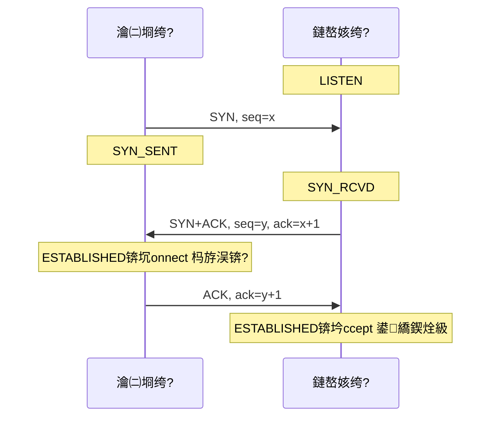
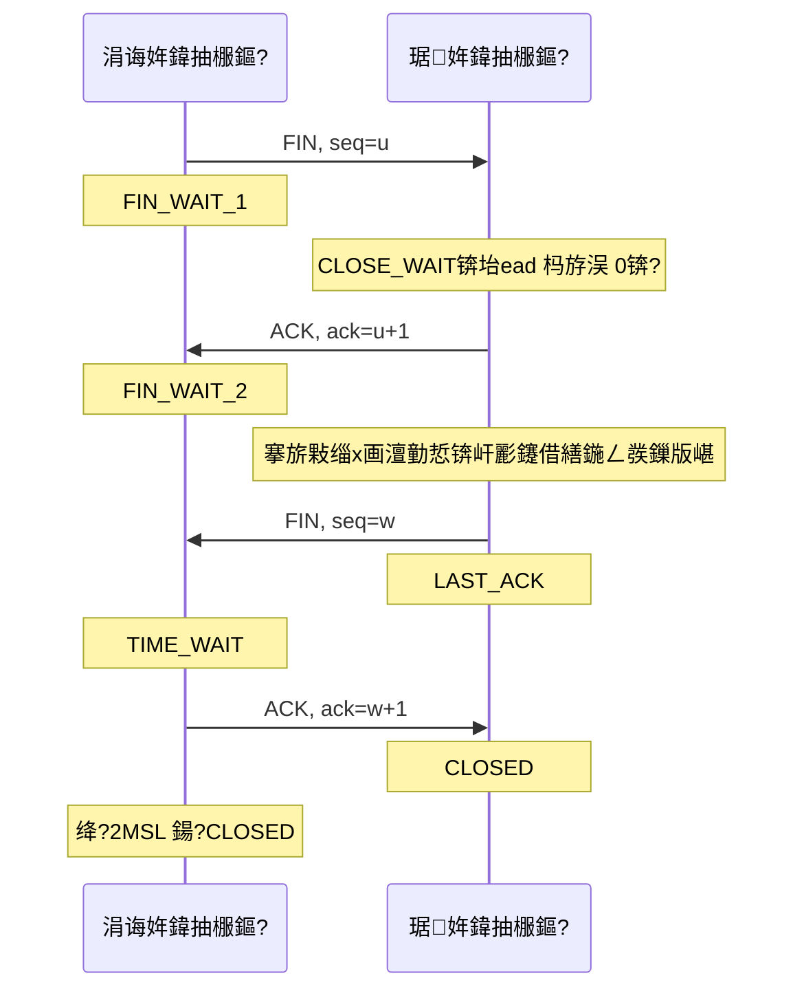
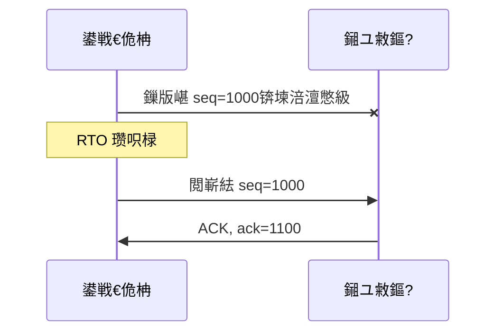

---
tags:
  - Linux
  - 缃戠粶缂栫▼鍩虹
闃呰娆℃暟: 0
---

# TCP 鍗忚鍩虹

## 姒傝堪

TCP锛圱ransmission Control Protocol锛屼紶杈撴帶鍒跺崗璁級鎻愪緵**闈㈠悜杩炴帴**鐨勩€?*鍙潬**鐨?*瀛楄妭娴?*浼犺緭鏈嶅姟銆傝繖涓変釜璇嶅悇鑷湁鏄庣‘鎵€鎸囷細

- **闈㈠悜杩炴帴**锛氶€氫俊鍓嶈鎻℃墜锛屽弻鏂瑰悇鑷湪鍐呮牳閲屽缓涓€涓帶鍒跺潡锛岃浣忓簭鍙枫€佺獥鍙ｃ€佸绔湴鍧€杩欎簺鐘舵€併€?
- **鍙潬**锛氫笉涓€佷笉閲嶃€佷笉涔卞簭銆傞潬搴忓彿銆佺‘璁ゅ彿銆佽秴鏃堕噸浼犱笁浠跺瀹炵幇銆?
- **瀛楄妭娴?*锛歍CP 鎶婁綘鍐欒繘鍘荤殑鏁版嵁鐪嬫垚涓€涓叉病鏈夌粨鏋勭殑瀛楄妭銆備綘 `write()` 涓夋锛屽鏂瑰彲鑳戒竴娆?`read()` 鍏ㄦ嬁鍒帮紝涔熷彲鑳藉垎浜旀鎷垮埌銆傝繖灏辨槸 [[8.9 TCP鐨勭矘鍖呭拰鎷嗗寘|绮樺寘]] 闂鐨勬潵婧愶紝涔熸槸姣忎釜 TCP 搴旂敤閮藉繀椤昏嚜宸卞畾娑堟伅杈圭晫鐨勫師鍥犮€?

> [!tip] 浜や簰鍔ㄧ敾
> 杩炴帴寤虹珛涓庨噴鏀剧殑杩囩▼鍙鍖栵紙涓夋鎻℃墜鍖呭簭涓庡弻绔姸鎬佸彉鍖?路 鍥涙鎸ユ墜鏃跺簭涓?TIME_WAIT 2MSL 路 瀹屾暣鐘舵€佽浆鎹㈠浘璺緞婕父锛夛細
> [鈻?鍦ㄦ祻瑙堝櫒涓墦寮€鍔ㄧ敾](<../../鍥剧墖/HTML/3.Linux/7. 缃戠粶缂栫▼鍩虹/7.5.1 TCP杩炴帴寤虹珛涓庨噴鏀惧姩鐢?html>)銆€路銆€鏇村瑙?[[缃戠粶缂栫▼路鍔ㄧ敾鍚堥泦]]
> 涔熷彲鐩磋揪鍗曚釜鍦烘櫙锛歔涓夋鎻℃墜](<../../鍥剧墖/HTML/3.Linux/7. 缃戠粶缂栫▼鍩虹/7.5.1 TCP杩炴帴寤虹珛涓庨噴鏀惧姩鐢?html#scene=handshake>) 路 [鍥涙鎸ユ墜](<../../鍥剧墖/HTML/3.Linux/7. 缃戠粶缂栫▼鍩虹/7.5.1 TCP杩炴帴寤虹珛涓庨噴鏀惧姩鐢?html#scene=wave>) 路 [鐘舵€佽浆鎹㈠浘](<../../鍥剧墖/HTML/3.Linux/7. 缃戠粶缂栫▼鍩虹/7.5.1 TCP杩炴帴寤虹珛涓庨噴鏀惧姩鐢?html#scene=state>)

---

## 鏍稿績鐗规€?

| 鐗规€?| 璇存槑 |
|:---|:---|
| **闈㈠悜杩炴帴** | 閫氫俊鍓嶅繀椤诲厛鎻℃墜锛屽唴鏍镐负姣忔潯杩炴帴缁存姢涓€涓帶鍒跺潡 |
| **鍙潬浼犺緭** | 搴忓彿 + 纭 + 閲嶄紶锛屼繚璇佷笉涓€佷笉閲嶃€佷笉涔卞簭 |
| **鍏ㄥ弻宸?* | 涓や釜鏂瑰悜鍚勮嚜鐙珛锛屽彲浠ュ悓鏃舵敹鍙戯紝涔熷彲浠ュ彧鍏充竴涓柟鍚?|
| **瀛楄妭娴?* | 涓嶄繚鐣欐秷鎭竟鐣岋紝娑堟伅鍒囧垎鏄簲鐢ㄨ嚜宸辩殑浜?|
| **娴侀噺鎺у埗** | 闈犵獥鍙ｅ瓧娈碉紝闃叉鍘嬪灝鎺ユ敹鏂?|
| **鎷ュ鎺у埗** | 闈?cwnd锛岄槻姝㈠帇鍨腑闂寸綉缁?|

---

## 浣犺皟鐨勫嚱鏁般€佸唴鏍哥殑鐘舵€併€佺綉绾夸笂鐨勬姤鏂?

鍏堢湅涓€寮犲叏鏅浘銆傚畠鎶婁笁浠朵簨瀵瑰湪涓€璧凤細搴旂敤璋冪敤浜嗗摢涓嚱鏁般€佸唴鏍稿浜庡摢涓姸鎬併€佺綉绾夸笂姝ゅ埢浼犵殑鏄粈涔堟姤鏂囥€傚悗闈㈡墍鏈夌粏鑺傞兘鍙互鍥炲埌杩欏紶鍥句笂瀹氫綅銆?

![[鍥剧墖/SVG/3_7_7_5_3.svg|900]]

鍥鹃噷鏈変釜瀹规槗蹇界暐鐨勭粏鑺傦細**`connect()` 鍜?`accept()` 杩斿洖鐨勬椂鍒讳笉涓€鏍?*銆傚鎴风鏀跺埌 SYN+ACK 灏辫涓鸿繛鎺ュ缓濂戒簡锛宍connect()` 绔嬪埢杩斿洖锛涙湇鍔＄瑕佺瓑绗笁娆?ACK 鍒拌揪銆佽繛鎺ヨ绉昏繘鍏ㄨ繛鎺ラ槦鍒楋紝`accept()` 鎵嶅彲鑳借繑鍥炪€傛墍浠ュ鎴风鍙戝嚭鐨勭涓€鎵规暟鎹紝鏈夊彲鑳芥瘮鏈嶅姟绔殑 `accept()` 鏇存棭鍒拌揪銆?

---

## 涓夋鎻℃墜

### 鎶ユ枃鏃跺簭



^21f29a

| 姝ラ | 鏂瑰悜 | 鎶ユ枃 | 杩欎竴姝ョ‘璁や簡浠€涔?|
|:---:|:---|:---|:---|
| 绗竴娆?| 瀹㈡埛绔?鈫?鏈嶅姟绔?| SYN=1, seq=x | 瀹㈡埛绔?*鑳藉彂** |
| 绗簩娆?| 鏈嶅姟绔?鈫?瀹㈡埛绔?| SYN=1, ACK=1, seq=y, ack=x+1 | 鏈嶅姟绔?*鑳芥敹**涔?*鑳藉彂** |
| 绗笁娆?| 瀹㈡埛绔?鈫?鏈嶅姟绔?| ACK=1, ack=y+1 | 瀹㈡埛绔?*鑳芥敹** |

### 涓轰粈涔堟槸涓夋锛屼笉鏄袱娆?

涓ゆ鎻℃墜鏃讹紝鏈嶅姟绔彂瀹?SYN+ACK 灏辫涓鸿繛鎺ュ缓绔嬶紝浣嗗畠娌℃湁浠讳綍璇佹嵁璇佹槑瀹㈡埛绔敹鍒颁簡杩欎釜鍖呫€傜敱姝ゅ紩鍑虹殑瀹為檯闂鏄細

涓€涓棭宸茶秴鏃躲€佽瀹㈡埛绔斁寮冪殑 SYN锛屽湪缃戠粶閲岀粫浜嗗緢涔呬箣鍚庢墠鍒拌揪鏈嶅姟绔€傛湇鍔＄鍥炰竴涓?SYN+ACK 灏辨妸杩炴帴寤鸿捣鏉ヤ簡锛屽苟涓哄畠鍒嗛厤缂撳啿鍖猴紝鑰屽鎴风鏃╁氨涓嶈杩欐潯杩炴帴锛屼笉浼氭湁浠讳綍鏁版嵁杩囨潵銆傝繖鏉¤繛鎺ヤ細涓€鐩村崰鐫€璧勬簮鐩村埌瓒呮椂銆備笁娆℃彙鎵嬩腑瀹㈡埛绔殑绗笁涓?ACK锛屾濂芥帓闄や簡杩欑鎯呭喌锛氬鎴风涓嶈鐨勮繛鎺ワ紝瀹冧笉浼氬彂 ACK銆?

### 涓轰粈涔堜笉鏄洓娆?

鎸夈€岀‘璁ゅ弻鍚戣兘鍔涖€嶇殑閫昏緫锛屾湰璇ユ槸鍥涙锛歋YN 鈫?ACK 鈫?SYN 鈫?ACK銆備絾鏈嶅姟绔殑 ACK 鍜?SYN 鍙互鏀惧湪鍚屼竴涓姤鏂囬噷鍙戝嚭鍘伙紝鍚堝苟涔嬪悗灏辨槸涓夋銆?

### 搴忓彿涓轰粈涔堣闅忔満

鍒濆搴忓彿 ISN 涓嶆槸浠?0 寮€濮嬶紝鑰屾槸鏍规嵁鍥涘厓缁勫拰涓€涓唴鏍稿瘑閽ョ畻鍑烘潵鐨勶紙RFC 6528锛夈€備袱涓師鍥狅細

- **闃叉鏃ц繛鎺ョ殑鎶ユ枃涓茶繘鏂拌繛鎺?*銆傚悓涓€涓洓鍏冪粍鐨勮繛鎺ュ叧闂悗鍙堥噸寤猴紝濡傛灉 ISN 鐩稿悓锛岀綉缁滈噷娈嬬暀鐨勬棫鎶ユ枃搴忓彿姝ｅソ钀藉湪鏂拌繛鎺ョ殑绐楀彛閲岋紝灏变細琚綋鎴愬悎娉曟暟鎹帴鏀躲€?
- **闃叉杩炴帴琚吉閫?*銆侷SN 鍙娴嬫椂锛屾敾鍑昏€呬笉闇€瑕佺湅鍒版彙鎵嬫姤鏂囧氨鑳芥嫾鍑哄悎娉曠殑 TCP 娈垫彃杩涜繛鎺ラ噷銆?

### SYN flood

鏀诲嚮鑰呬吉閫犳簮 IP 鐤媯鍙?SYN锛屽嵈浠庝笉鍥炵涓夋 ACK銆傛湇鍔＄涓烘瘡涓?SYN 鍦ㄥ崐杩炴帴闃熷垪閲岀暀涓€涓潯鐩苟鍥?SYN+ACK锛岄槦鍒楀緢蹇崰婊★紝姝ｅ父瀹㈡埛绔殑 SYN 琚涪寮冦€?

Linux 鐨勫簲瀵规槸 **SYN cookies**锛氶槦鍒楁孩鍑烘椂锛屼笉鍐嶄繚瀛樺崐杩炴帴鏉＄洰锛岃€屾槸鎶婅繛鎺ヤ俊鎭紪鐮佽繘 SYN+ACK 鐨?ISN 閲屽彂鍑哄幓銆傚鎴风鍥?ACK 鏃讹紝鍐呮牳浠?ack 鍙烽噷鎶婁俊鎭В鍥炴潵锛岀洿鎺ュ缓杩炴帴銆傝繖鏍峰崐杩炴帴闃熷垪涓嶅啀鏄摱棰堛€?

```bash
# 1 琛ㄧず銆屼粎鍦ㄥ崐杩炴帴闃熷垪婧㈠嚭鏃跺惎鐢ㄣ€嶏紝鏄鏁板彂琛岀増鐨勯粯璁ゅ€?
sysctl net.ipv4.tcp_syncookies
```

浠ｄ环鏄?SYN 閲屾惡甯︾殑閫夐」锛堢獥鍙ｆ墿澶с€丼ACK銆佹椂闂存埑锛夋病鍦版柟瀛橈紝鍙兘涓㈡帀涓€閮ㄥ垎锛屾墍浠ュ畠鏄簲鎬ユ墜娈佃€屼笉鏄父寮€浼樺寲銆傞槦鍒楅暱搴︾殑璋冩暣瑙?[[8.13 TCP鍐呮牳闃熷垪涓庡弬鏁拌皟浼榏]銆?

---

## 鍥涙鎸ユ墜

### 鎶ユ枃鏃跺簭



| 姝ラ | 鏂瑰悜 | 鎶ユ枃 | 瑙﹀彂鑰?|
|:---:|:---|:---|:---|
| 绗竴娆?| 涓诲姩鏂?鈫?琚姩鏂?| FIN, seq=u | 搴旂敤璋?`close()` |
| 绗簩娆?| 琚姩鏂?鈫?涓诲姩鏂?| ACK, ack=u+1 | **鍐呮牳鑷姩鍥?*锛屼笉闇€瑕佸簲鐢ㄥ弬涓?|
| 绗笁娆?| 琚姩鏂?鈫?涓诲姩鏂?| FIN, seq=w | 琚姩鏂圭殑搴旂敤璋?`close()` |
| 绗洓娆?| 涓诲姩鏂?鈫?琚姩鏂?| ACK, ack=w+1 | 鍐呮牳鑷姩鍥?|

### 涓轰粈涔堝叧闂鍥涙锛屾彙鎵嬪嵈鍙涓夋

鍏抽敭鍦ㄧ浜屽垪鐨勩€岃Е鍙戣€呫€嶏細鎻℃墜鏃舵湇鍔＄鐨?ACK 鍜?SYN 閮界敱鍐呮牳鑷姩鍙戝嚭锛屽彲浠ュ悎骞讹紱鎸ユ墜鏃惰鍔ㄦ柟鐨?ACK 鏄唴鏍哥珛鍒诲洖鐨勶紝鑰?FIN 瑕佺瓑瀹冪殑搴旂敤璋冪敤 `close()`銆傝繖涓や欢浜嬩箣闂撮殧鐫€涓嶇‘瀹氶暱搴︾殑涓氬姟澶勭悊鏃堕棿锛屾病娉曞悎骞躲€?

杩欐闂撮殧灏辨槸 **CLOSE_WAIT** 鐘舵€佸瓨鍦ㄧ殑鎰忎箟锛氬畠琛ㄧず銆屽鏂逛笉鍙戜簡锛屼絾鎴戣繖杈硅繕娌¤瀹屻€嶃€俆CP 鏄叏鍙屽伐鐨勶紝涓€鏂瑰彂 FIN 鍙剰鍛崇潃銆屾垜娌℃湁鏁版嵁瑕佸彂浜嗐€嶏紝瀹冧粛鐒跺彲浠ョ户缁帴鏀讹紝涔熷彲浠ョ户缁彂閫佸皻鏈彂瀹岀殑鏁版嵁銆?

> [!note] 鎸ユ墜涔熷彲鑳藉彧鏈変笁娆?
> 濡傛灉琚姩鏂圭殑搴旂敤鍦ㄦ敹鍒?FIN 鍚庣珛鍒?`close()`锛屽唴鏍镐細鎶?ACK 鍜?FIN 鍚堝苟鎴愪竴涓寘鍙戝嚭鍘伙紝鍥涙灏卞彉鎴愪簡涓夋銆傚欢杩熺‘璁ゆ満鍒剁粰浜嗗唴鏍歌繖涓悎骞剁獥鍙ｃ€傛姄鍖呯湅鍒颁笁娆℃尌鎵嬩笉鏄紓甯搞€?

### TIME_WAIT

涓诲姩鍏抽棴鏂瑰彂鍑烘渶鍚庝竴涓?ACK 鍚庤繘鍏?TIME_WAIT锛岀瓑寰?**2MSL**锛圡SL = Maximum Segment Lifetime锛屾姤鏂囨渶澶х敓瀛樻椂闂达級銆傚畠鍋氫袱浠朵簨锛?

1. **鍏滃簳鏈€鍚庨偅涓?ACK**銆傚鏋?ACK 涓簡锛岃鍔ㄦ柟浼氳秴鏃堕噸鍙?FIN銆傛鏃朵富鍔ㄦ柟濡傛灉宸茬粡 CLOSED锛屽彧鑳藉洖涓€涓?RST锛岃鍔ㄦ柟灏辨案杩滆蛋涓嶅埌 CLOSED銆傚仠鍦?TIME_WAIT 鎵嶈兘閲嶅彂 ACK銆?
2. **璁╂棫杩炴帴鐨勬畫鐣欐姤鏂囪嚜鐒舵秷浜?*銆傜瓑婊?2MSL 鍚庯紝杩欎釜鍥涘厓缁勪笂涓嶄細鍐嶆湁浠讳綍灞炰簬鏃ц繛鎺ョ殑鎶ユ枃锛屾柊杩炴帴鍙互瀹夊叏澶嶇敤銆?

> [!warning] Linux 鐨?TIME_WAIT 鏄啓姝荤殑 60 绉?
> 鍐呮牳閲?`TCP_TIMEWAIT_LEN` 瀹氫箟涓?60 绉掞紙瀵瑰簲 MSL 鍙?30 绉掞級锛?*娌℃湁 sysctl 鍙互璋冨畠**锛屾敼杩欎釜鍊奸渶瑕佹敼婧愮爜閲嶆柊缂栬瘧銆傜綉涓婃祦浼犵殑銆岃皟灏?TIME_WAIT 鏃堕棿銆嶅鍗婃寚鐨勬槸鍒殑鍙傛暟锛屾垨鑰呮槸 BSD 涓婄殑鍋氭硶銆?
>
> 鐪熸鑳界敤鐨勬墜娈垫槸 `SO_REUSEADDR`锛堝厑璁稿湪 TIME_WAIT 鏈熼棿閲嶆柊 bind锛夊拰鍑忓皯杩炴帴寤虹珛娆℃暟锛堟敼鐢ㄩ暱杩炴帴锛夈€傝瑙?[[10.2 TIME_WAIT鐘舵€乚]銆?

---

## 鐘舵€佹満鍏ㄥ浘

鍗佷竴涓姸鎬侊紝涓ゆ潯鍏抽棴璺緞銆傜湅鍥炬椂鍏堝垎娓呰嚜宸卞湪鍝竴鍒楋細**璋佸厛璋?`close()`锛岃皝灏辫蛋宸﹁竟**銆傝繖璺熷鎴风杩樻槸鏈嶅姟绔棤鍏筹紝鏈嶅姟绔富鍔ㄦ柇寮€鏃跺畠璧扮殑涔熸槸宸﹁竟銆?

![[鍥剧墖/SVG/3_7_7_5_1.svg|900]]

鍙充晶閭ｆ爮鏄繖寮犲浘鏈€瀹炵敤鐨勯儴鍒嗐€傜嚎涓婃帓闅滄椂锛屽厛鐢ㄤ竴鏉″懡浠ょ湅鐘舵€佸垎甯冿細

```bash
ss -tan | awk '{print $1}' | sort | uniq -c | sort -rn
```

- **TIME_WAIT 寰堝**锛氬嚭鐜板湪涓诲姩鍏抽棴鏂癸紝鐭繛鎺ラ珮棰戞椂灞炰簬姝ｅ父銆傛兂鏍规不灏辨敼闀胯繛鎺ワ紝鍒€ョ潃璋冨唴鏍稿弬鏁般€?
- **CLOSE_WAIT 寰堝**锛氬嚭鐜板湪琚姩鍏抽棴鏂癸紝**杩欎竴瀹氭槸浠ｇ爜 bug**銆傚畠琛ㄧず鍐呮牳宸茬粡鏀跺埌浜嗗绔殑 FIN锛坄read()` 杩斿洖 0锛夛紝浣嗕綘鐨勭▼搴忔病鏈夎皟 `close(fd)`銆傞€氬父钘忓湪鏌愪釜寮傚父鍒嗘敮閲岋細瑙ｆ瀽澶辫触鐩存帴 `continue`銆佹姏寮傚父鍚庢病鏈?RAII 鍏滃簳銆傜湅鍒板畠鍘绘煡浠ｇ爜锛屼笉瑕佸幓鏌ョ綉缁溿€?
- **SYN_RCVD 寰堝**锛氬崐杩炴帴闃熷垪绉帇锛屽鏂瑰彂浜?SYN 鍗翠笉鍥?ACK锛屾槸 SYN flood 鐨勫吀鍨嬬壒寰併€?
- **FIN_WAIT_2 寰堝**锛氳嚜宸辩殑 FIN 宸茶纭锛屼絾瀵圭杩熻繜涓嶅彂瀹冪殑 FIN銆傞棶棰樺湪瀵圭搴旂敤锛屽畠閭ｈ竟澶氬崐姝ｅ爢鐫€ CLOSE_WAIT銆?

---

## 鍙潬鎬ф満鍒?

### 搴忓彿涓庣‘璁ゅ彿

- **搴忓彿 seq**锛氭湰鎶ユ枃娈电涓€涓瓧鑺傚湪鏁存潯瀛楄妭娴佷腑鐨勪綅缃€?
- **纭鍙?ack**锛氭湡鏈涙敹鍒扮殑涓嬩竴涓瓧鑺傜殑搴忓彿銆俆CP 鐢ㄧ殑鏄?*绱Н纭**锛宎ck=1100 琛ㄧず 1099 **鍙婁箣鍓?*鐨勬墍鏈夊瓧鑺傞兘宸叉敹鍒般€?

```
鍙戦€佹柟锛歴eq=1000锛屾惡甯?100 瀛楄妭鏁版嵁锛堣鐩?1000 ~ 1099锛?
鎺ユ敹鏂癸細ack=1100  鈫?1099 鍙婁箣鍓嶅叏閮ㄦ敹濡ワ紝涓嬩竴涓浠?1100 寮€濮?
```

绱Н纭鏈変釜鍓綔鐢細涓棿涓簡涓€娈碉紝鍚庨潰鐨勬鍗充娇鍏ㄦ敹鍒颁簡锛宎ck 涔熷彧鑳藉仠鍦ㄧ己鍙ｅ銆?*SACK 閫夐」**锛堥€夋嫨鎬х‘璁わ級灏辨槸涓烘鍔犵殑锛屽畠鑳介澶栧憡璇夊彂閫佹柟銆屾垜杩樻敹鍒颁簡 1200~1300 杩欎竴娈点€嶏紝閬垮厤鎶婄己鍙ｄ箣鍚庣殑鏁版嵁鍏ㄩ儴閲嶄紶銆?

### 瓒呮椂閲嶄紶

鍙戦€佹柟鍙戝嚭鏁版嵁鍚庡惎鍔ㄨ鏃跺櫒锛岃秴鏃舵湭鏀跺埌纭灏遍噸浼狅細



瓒呮椂鏃堕棿 RTO 涓嶆槸鍥哄畾鍊硷紝鑰屾槸鏍规嵁瀹炴祴鐨勫線杩旀椂闂?RTT 鍔ㄦ€佺畻鍑烘潵鐨勩€傛瘡娆￠噸浼犲け璐ュ悗 RTO 缈诲€嶏紙鎸囨暟閫€閬匡級锛岄伩鍏嶅湪缃戠粶宸茬粡鎷ュ鏃堕洩涓婂姞闇溿€?

鍗曠函绛夎秴鏃跺お鎱紝鎵€浠ヨ繕鏈?*蹇€熼噸浼?*锛氭帴鏀舵柟姣忔敹鍒颁竴涓け搴忕殑娈靛氨绔嬪埢閲嶅彂涓€娆″綋鍓嶇殑 ack锛屽彂閫佹柟杩炵画鏀跺埌 3 涓噸澶?ack 灏变笉绛夎秴鏃讹紝鐩存帴閲嶄紶缂哄け鐨勯偅涓€娈点€?

### 婊戝姩绐楀彛涓庢祦閲忔帶鍒?

![[鍥剧墖/SVG/3_7_7_5_2.svg|900]]

绐楀彛鎶婂彂閫佹柟鐨勫瓧鑺傛祦鍒囨垚鍥涙銆傜湡姝ｉ渶瑕佽浣忕殑鏄偅鏉＄害鏉燂細

```
鍦ㄩ€旀湭纭瀛楄妭鏁?= SND.NXT 鈭?SND.UNA 鈮?win
```

`win` 鐢辨帴鏀舵柟鍦ㄦ瘡涓?ACK 閲岄€氬憡锛屽彂閫佹柟涓嶈兘鑷綔涓诲紶銆傛帴鏀舵柟鐨勫簲鐢ㄨ寰楁參锛宍win` 灏卞彉灏忥紱缂撳啿鍖鸿婊′簡锛宍win` 鍙樻垚 0锛屽彂閫佹柟绔嬪埢鍋滃彂锛岄潬**鎸佺画璁℃椂鍣?*瀹氭湡鍙戜竴涓?1 瀛楄妭鐨?window probe 璇曟帰锛岀洿鍒板鏂归€氬憡鍑洪潪闆剁獥鍙ｃ€?

> [!note] 娴侀噺鎺у埗涓嶆槸鎷ュ鎺у埗
> 涓よ€呴兘鍦ㄩ檺鍒跺彂閫侀€熺巼锛屼絾闃茬殑涓滆タ涓嶅悓锛氭祦閲忔帶鍒舵€曞帇鍨?*鎺ユ敹鏂圭殑缂撳啿鍖?*锛屼緷鎹槸瀵圭鏄庣‘鍐欏湪澶撮噷鐨?`win`锛涙嫢濉炴帶鍒舵€曞帇鍨?*涓棿璺敱鍣ㄧ殑闃熷垪**锛屼緷鎹槸鑷繁鏍规嵁涓㈠寘鍜屽欢杩熸帹娴嬪嚭鏉ョ殑 `cwnd`銆?
>
> 瀹為檯鑳藉彂澶氬皯鍙栧喅浜庝袱鑰呯殑鏈€灏忓€笺€傚悶鍚愪笂涓嶅幓鏃跺厛鍒嗘竻鏄摢涓崱浣忥細`win` 鎶撳寘鑳界洿鎺ヨ鍒帮紝`cwnd` 瑕佺敤 `ss -i` 瑙傚療銆?

16 浣嶇殑绐楀彛瀛楁鏈€澶у彧鑳借〃绀?65535 瀛楄妭锛屽湪楂樺甫瀹介暱寤惰繜鐨勯摼璺笂杩滆繙涓嶅锛屾墍浠ユ湁**绐楀彛鎵╁ぇ閫夐」**锛屽湪鎻℃墜鏃跺崗鍟嗕竴涓乏绉讳綅鏁帮紙鏈€澶?14 浣嶏級銆傝繖涓€夐」鍙湪 SYN 鎶ユ枃閲屽嚭鐜帮紝鎻℃墜鏃朵涪浜嗗氨鏁存潯杩炴帴閮界敤涓嶄笂銆?

---

## 涓?socket 缂栫▼鐨勫搴?

### 鏈嶅姟绔?

```c
int listenfd = socket(AF_INET, SOCK_STREAM, 0);
bind(listenfd, ...);        // 缁戝畾鍦板潃鍜岀鍙?
listen(listenfd, backlog);  // 杞负琚姩濂楁帴瀛楋紝寤轰袱涓槦鍒楋紝鐘舵€佽繘鍏?LISTEN
int connfd = accept(listenfd, ...);  // 浠庡叏杩炴帴闃熷垪鍙栦竴鏉″凡寤哄ソ鐨勮繛鎺?
read(connfd, ...); write(connfd, ...);
close(connfd);              // 鍙戝嚭 FIN锛岃繘鍏?FIN_WAIT_1
```

瑕佺暀鎰忕殑鏄?`accept()` **涓嶅弬涓?*涓夋鎻℃墜銆傛彙鎵嬪叏绋嬬敱鍐呮牳瀹屾垚锛宍accept()` 鍙槸鎶婂凡缁忓缓濂界殑杩炴帴浠庨槦鍒楅噷鍙栧嚭鏉ヤ氦缁欏簲鐢ㄣ€傛墍浠?`accept()` 鎱笉浼氬鑷存彙鎵嬪け璐ワ紝鍙細璁╁叏杩炴帴闃熷垪绉帇銆傜粏鑺傝 [[7.7 listen鍜宎ccept鍑芥暟]]銆?

### 瀹㈡埛绔?

```c
int fd = socket(AF_INET, SOCK_STREAM, 0);
connect(fd, ...);           // 鍙戝嚭 SYN锛屾敹鍒?SYN+ACK 鍚庤繑鍥?
write(fd, ...); read(fd, ...);
close(fd);
```

`connect()` 闃诲鏃堕暱鑷冲皯鏄竴涓?RTT銆傝繖涔熸槸鐭繛鎺ユ參鐨勬牴鏈師鍥狅細姣忔璇锋眰閮借澶氫粯涓€涓線杩旓紝鍔犱笂 TLS 杩樿鍐嶄粯涓€鍒颁袱涓€?

> [!warning] `write()` 杩斿洖涓嶄唬琛ㄥ鏂规敹鍒颁簡
> `write()` 鍙槸鎶婃暟鎹嫹杩涗簡鍐呮牳鐨勫彂閫佺紦鍐插尯灏辫繑鍥烇紝姝ゆ椂鏁版嵁鍙兘杩樻病鍙戝嚭鍘伙紝鏇存病鏈夎纭銆傚悓鐞嗭紝`close()` 杩斿洖涔熶笉浠ｈ〃鍥涙鎸ユ墜璧板畬浜嗐€傝纭瀵规柟鐪熺殑鏀跺埌锛屽彧鑳介潬搴旂敤灞傜殑鍝嶅簲銆?

---

## 鍏抽敭瑕佺偣

1. **瀛楄妭娴佹病鏈夋秷鎭竟鐣?*銆俆CP 淇濊瘉椤哄簭鍜屼笉涓紝浣嗘秷鎭€庝箞鍒囨槸搴旂敤鑷繁鐨勪簨銆?
2. **涓夋鎻℃墜鐨勭涓変釜 ACK 鐢ㄦ潵鎺掗櫎澶辨晥鐨勬棫杩炴帴璇锋眰**锛屼笉鏄负浜嗐€屽姘斻€嶃€?
3. **鎸ユ墜姣旀彙鎵嬪涓€娆★紝鏄洜涓鸿鍔ㄦ柟鐨?ACK 鍜?FIN 涔嬮棿闅旂潃搴旂敤鐨勫鐞嗘椂闂?*銆傝繖娈甸棿闅斿氨鏄?CLOSE_WAIT銆?
4. **TIME_WAIT 鍦?Linux 涓婂浐瀹?60 绉掞紝鏀逛笉浜?*銆傝兘璋冪殑鏄?`SO_REUSEADDR` 鍜岃繛鎺ュ鐢ㄧ瓥鐣ャ€?
5. **CLOSE_WAIT 鍫嗙Н涓€瀹氭槸浠ｇ爜娌¤皟 `close()`**锛岃窡鍐呮牳鍙傛暟鏃犲叧銆?
6. **绱Н纭瀵艰嚧涓竴娈靛氨瑕侀噸浼犲悗闈㈡墍鏈夋**锛孲ACK 閫夐」鐢ㄦ潵閬垮厤杩欑娴垂銆?
7. **鍦ㄩ€旀暟鎹噺鍙?`min(win, cwnd)` 绾︽潫**锛屽墠鑰呴槻鎺ユ敹鏂硅鍘嬪灝锛屽悗鑰呴槻缃戠粶琚帇鍨€?

---
