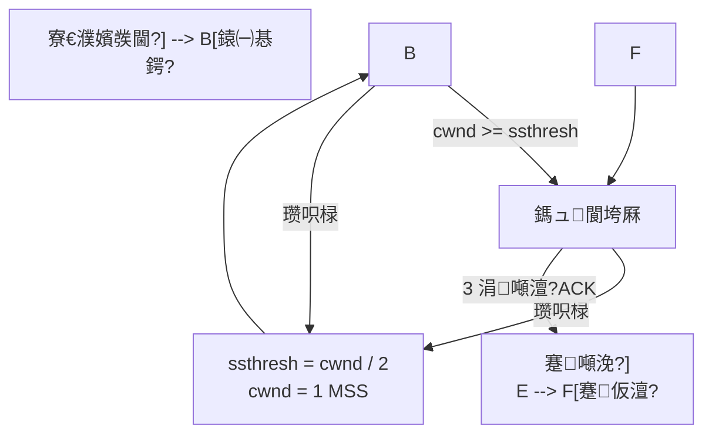

---
tags:
  - Linux
  - TCP-缂栫▼
---

# 鎷ュ鎺у埗

> [!note]
> 鏈枃浠ョ粡鍏?TCP 鎷ュ鎺у埗锛圱ahoe / Reno 鐨勬牳蹇冩€濊矾锛変负涓伙紝甯姪鐞嗚В `cwnd`銆乣ssthresh`銆佹參鍚姩銆佹嫢濉為伩鍏嶃€佸揩閲嶄紶鍜屽揩鎭㈠銆傜幇浠ｇ郴缁熶腑杩樺彲鑳戒娇鐢?CUBIC銆丅BR 绛夋洿澶嶆潅鐨勭畻娉曪紝浣嗗熀纭€鎬濇兂浠嶇劧鏄細**鏍规嵁缃戠粶鐘舵€佸姩鎬佽皟鏁村彂閫侀€熺巼锛岄伩鍏嶆妸缃戠粶鍘嬪灝**銆?

> [!tip] 浜や簰鍔ㄧ敾
> 鎷ュ鎺у埗鍥涢樁娈电殑杩囩▼鍙鍖栵紙鎱㈠惎鍔ㄦ寚鏁板闀?路 鎷ュ閬垮厤绾挎€у闀?路 3 dup ACK 蹇噸浼犲揩鎭㈠ vs 瓒呮椂 路 cwnd/ssthresh 鍏ㄧ▼閿娇鏇茬嚎锛夛細
> [鈻?鍦ㄦ祻瑙堝櫒涓墦寮€鍔ㄧ敾](<../../鍥剧墖/HTML/3.Linux/8. TCP 缂栫▼/8.10.1 鎷ュ鎺у埗鍔ㄧ敾.html>)銆€路銆€鏇村瑙?[[缃戠粶缂栫▼路鍔ㄧ敾鍚堥泦]]
> 涔熷彲鐩磋揪鍗曚釜鍦烘櫙锛歔鎱㈠惎鍔╙(<../../鍥剧墖/HTML/3.Linux/8. TCP 缂栫▼/8.10.1 鎷ュ鎺у埗鍔ㄧ敾.html#scene=slowstart>) 路 [鎷ュ閬垮厤](<../../鍥剧墖/HTML/3.Linux/8. TCP 缂栫▼/8.10.1 鎷ュ鎺у埗鍔ㄧ敾.html#scene=avoid>) 路 [蹇噸浼犅峰揩鎭㈠](<../../鍥剧墖/HTML/3.Linux/8. TCP 缂栫▼/8.10.1 鎷ュ鎺у埗鍔ㄧ敾.html#scene=recovery>) 路 [瀹屾暣鏇茬嚎](<../../鍥剧墖/HTML/3.Linux/8. TCP 缂栫▼/8.10.1 鎷ュ鎺у埗鍔ㄧ敾.html#scene=curve>)

## 绠€浠?

鎷ュ鎺у埗锛圕ongestion Control锛夋槸 TCP 涓潪甯告牳蹇冪殑涓€濂楁満鍒讹紝瀹冭В鍐崇殑涓嶆槸鈥滄帴鏀舵柟鏉ヤ笉鍙婃敹鈥濈殑闂锛岃€屾槸鈥?*缃戠粶涓棿鐨勮矾寰勬墰涓嶄綇浜?*鈥濈殑闂銆?

濡傛灉涓€鏉＄綉缁滆矾寰勪笂鐨勪富鏈洪兘鎷煎懡鍙戦€佹暟鎹紝璺敱鍣ㄥ拰浜ゆ崲鏈轰腑鐨勯槦鍒楀氨浼氳秺鏉ヨ秺闀匡紝鏈€缁堝嚭鐜帮細

- 鎺掗槦鏃跺欢鎬ュ墽澧炲姞
- 涓棿璁惧缂撳瓨婧㈠嚭
- 鎶ユ枃娈典涪澶?
- 閲嶄紶鍙樺锛岃繘涓€姝ュ姞鍓ф嫢濉?

杩欎細褰㈡垚涓€涓嚜鎴戝己鍖栫殑寰幆锛岃秺鍫佃秺鍙戙€佽秺鍙戣秺鍫碉細

```mermaid
flowchart LR
    A["鍙戦€佽繃蹇?] --> B["缃戠粶璁惧闃熷垪绉帇"]
    B --> C["鏃跺欢鍗囬珮 / 涓㈠寘澧炲姞"]
    C --> D["鍙戦€佹柟閲嶄紶鏇村鏁版嵁"]
    D --> A
```

鎵€浠?TCP 涓嶈兘鍙【鐫€鈥滆兘鍙戝氨鍙戔€濓紝鑰屽繀椤绘牴鎹綉缁滃弽棣堜富鍔ㄩ檷閫熴€佺紦鎱㈡帰娴嬪彲鐢ㄥ甫瀹斤紝鍐嶉€愭鎻愰珮鍙戦€侀€熺巼銆?

---

## 涓轰粈涔堥渶瑕佹嫢濉炴帶鍒?

鍙互鎶婄綉缁滄兂璞℃垚涓€鏉￠珮閫熷叕璺細

- **鎺ユ敹鏂圭獥鍙?`rwnd`** 鍍忊€滅粓鐐瑰仠杞﹀満杩樻湁澶氬皯绌轰綅鈥?
- **鎷ュ绐楀彛 `cwnd`** 鍍忊€滆繖鏉¤矾褰撳墠鏈€澶氳繕鑳芥壙鍙楀灏戣溅鈥?

鍗充娇鎺ユ敹鏂硅繕鏈夎兘鍔涙帴鏀讹紝濡傛灉涓棿鐨勨€滆矾鈥濆凡缁忓牭浜嗭紝鍙戦€佹柟涔熷繀椤绘參涓嬫潵銆?

濡傛灉娌℃湁鎷ュ鎺у埗锛屼細鍑虹幇浠ヤ笅闂锛?

| 闂 | 璇存槑 |
|:---|:---|
| **璺敱鍣ㄩ槦鍒楄啫鑳€** | 鏁版嵁鍖呬笉鏂爢绉紝鏃跺欢瓒婃潵瓒婂ぇ |
| **缂撳瓨婧㈠嚭涓㈠寘** | 闃熷垪婊′簡浠ュ悗锛屾柊鐨勬姤鏂囩洿鎺ヨ涓㈠純 |
| **鏃犳晥閲嶄紶** | 鍙戦€佹柟鎶婁涪鍖呭綋鎴愨€滈渶瑕佽ˉ鍙戔€濓紝鍙嶈€岃缃戠粶鏇村繖 |
| **鍚炲悙閲忎笅闄?* | 鐪嬭捣鏉ュ彂寰楀緢澶氾紝瀹為檯涓婃湁鏁堥€佽揪鐨勬暟鎹彉灏戜簡 |

TCP 鐨勬嫢濉炴帶鍒讹紝鏈川涓婃槸鍦ㄥ仛涓や欢浜嬶細

1. **鎺㈡祴缃戠粶杩樿兘鎵垮彈澶氬皯鍙戦€侀€熺巼**
2. **涓€鏃︽€€鐤戝嚭鐜版嫢濉烇紝绔嬪嵆鏀剁缉鍙戦€佺獥鍙?*

---

## 鎷ュ鎺у埗 vs 娴佹帶鍒?

[[8.8 娴佹帶鍒秥娴佹帶鍒禲] 鍜屾嫢濉炴帶鍒跺緢瀹规槗娣锋穯锛屼絾涓よ€呬笉鏄竴鍥炰簨锛?

| 鏈哄埗 | 瑙ｅ喅鐨勯棶棰?| 鍏虫敞瀵硅薄 | 璋佹潵鍐冲畾 |
|:---|:---|:---|:---|
| **娴佹帶鍒?* | 鎺ユ敹鏂瑰鐞嗕笉杩囨潵 | 鎺ユ敹鏂圭紦鍐插尯 | 鎺ユ敹鏂归€氬憡绐楀彛 `rwnd` |
| **鎷ュ鎺у埗** | 缃戠粶璺緞鎵涗笉浣?| 璺敱鍣ㄣ€佷氦鎹㈡満銆侀摼璺?| 鍙戦€佹柟缁存姢鎷ュ绐楀彛 `cwnd` |

TCP 鐪熸鑳藉彂閫佺殑鏁版嵁閲忓彈涓よ€呭叡鍚岀害鏉燂細**瀹為檯鍙戦€佺獥鍙?= `min(rwnd, cwnd)`**銆備篃灏辨槸璇达細

- `rwnd` 灏忥紝璇存槑鎺ユ敹鏂瑰悆涓嶄笅
- `cwnd` 灏忥紝璇存槑缃戠粶璺笂澶牭
- 鍙戦€佹柟鍙兘鎸夋洿灏忕殑閭ｄ釜绐楀彛鏉ュ彂

> [!tip]
> 涓€鍙ヨ瘽璁板繂锛?
> **娴佹帶鍒堕槻姝⑩€滄妸瀵规柟娣规病鈥濓紝鎷ュ鎺у埗闃叉鈥滄妸缃戠粶娣规病鈥濄€?*

---

## 鏍稿績姒傚康

### 1. 鎷ュ绐楀彛 `cwnd`

`cwnd`锛圕ongestion Window锛夋槸**鍙戦€佹柟鑷繁缁存姢鐨勭獥鍙?*锛岃〃绀哄綋鍓嶅畠璁や负鈥滅綉缁滆繕鑳芥壙鍙楀灏戞湭纭鏁版嵁鈥濄€?

瀹冧笉鏄?TCP 棣栭儴閲岀殑鍥哄畾瀛楁锛岃€屾槸 TCP 鍗忚鏍堝唴閮ㄦ牴鎹綉缁滃弽棣堝姩鎬佽皟鏁村嚭鏉ョ殑鍊笺€?

`cwnd` 鐨勫嚑涓叧閿壒鐐癸細

- 瀹冨弽鏄犵殑鏄彂閫佹柟瀵圭綉缁滄壙杞借兘鍔涚殑浼拌
- 缃戠粶瓒婇『鐣咃紝`cwnd` 瓒婂ぇ
- 涓€鏃︽€€鐤戝彂鐢熸嫢濉烇紝`cwnd` 浼氱珛鍒荤缉灏?

鍦ㄦ暀鏉愭垨闈㈣瘯棰橀噷锛宍cwnd` 甯哥敤 **MSS**锛圡aximum Segment Size锛変綔涓哄崟浣嶆潵鐞嗚В銆備緥濡傦細

- `cwnd = 1 MSS`锛氫竴娆″ぇ鑷村彧鑳藉彂涓€涓姤鏂囨
- `cwnd = 8 MSS`锛氫竴娆″ぇ鑷村彲浠ユ湁 8 涓?MSS 鐨勬暟鎹湪璺笂

---

### 2. 鎱㈠惎鍔ㄩ棬闄?`ssthresh`

`ssthresh`锛圫low Start Threshold锛屾參鍚姩闂ㄩ檺锛夌敤鏉ュ喅瀹氬綋鍓嶅簲璇ラ噰鐢ㄥ摢绉嶅闀挎柟寮忥細

- 褰?`cwnd < ssthresh` 鏃讹紝杩涘叆**鎱㈠惎鍔?*
- 褰?`cwnd >= ssthresh` 鏃讹紝杩涘叆**鎷ュ閬垮厤**

鍙互鎶婂畠鐞嗚В鎴愶細

- 鍦ㄨ緝灏忕獥鍙ｉ樁娈碉紝TCP 浼氬揩閫熻瘯鎺㈢綉缁滆兘鍔?
- 杈惧埌鏌愪釜闃堝€煎悗锛屽氨鏀规垚鏇翠繚瀹堢殑绾挎€у闀?

---

### 3. 鎺ユ敹绐楀彛 `rwnd`

`rwnd` 鏄帴鏀舵柟鍦?ACK 涓€氬憡鐨勭獥鍙ｅぇ灏忥紝琛ㄧず鎺ユ敹缂撳啿鍖鸿繕鑳芥帴绾冲灏戞暟鎹€傚畠灞炰簬 [[8.8 娴佹帶鍒秥娴佹帶鍒禲] 鐨勮寖鐣淬€?

鍥犳锛?

- `rwnd` 鍐冲畾鈥滄帴鏀舵柟鑳戒笉鑳藉悆涓嬧€?
- `cwnd` 鍐冲畾鈥滅綉缁滀腑闂磋兘涓嶈兘鎵涗綇鈥?

---

### 4. 瀹為檯鍙戦€佺獥鍙?

鍙戦€佹柟鐪熸鑳藉彂鍑哄幓鐨勬暟鎹噺骞朵笉鏄彧鐪?`cwnd`锛岃€屾槸 `min(rwnd, cwnd)`銆備緥濡傦細

| `rwnd` | `cwnd` | 瀹為檯鍙戦€佺獥鍙?| 鍚箟 |
|:---|:---|:---|:---|
| 16 KB | 8 KB | 8 KB | 缃戠粶鏇寸揣寮狅紝鍙楁嫢濉炴帶鍒堕檺鍒?|
| 4 KB | 10 KB | 4 KB | 鎺ユ敹鏂规洿鎱紝鍙楁祦鎺у埗闄愬埗 |

---

### 5. TCP 濡備綍鎰熺煡鈥滃彲鑳芥嫢濉炰簡鈥?

缁忓吀 TCP 閫氬父鏍规嵁浠ヤ笅淇″彿鏉ュ垽鏂綉缁滃彲鑳藉嚭浜嗛棶棰橈細

| 淇″彿 | 鍚箟 | TCP 鐨勫吀鍨嬪弽搴?|
|:---|:---|:---|
| **瓒呮椂锛圧TO锛?* | 闀挎椂闂寸瓑涓嶅埌 ACK锛屾€€鐤戠綉缁滄嫢濉炶緝涓ラ噸 | 澶у箙闄嶄綆 `cwnd`锛岄噸鏂拌繘鍏ユ參鍚姩 |
| **3 涓噸澶?ACK** | 鏌愪釜鎶ユ枃娈靛彲鑳戒涪浜嗭紝浣嗗悗闈㈢殑鎶ユ枃杩樺湪闄嗙画鍒拌揪 | 蹇噸浼?+ 蹇仮澶?|

杩欓噷瑕佹敞鎰忎竴鐐癸細

> **涓㈠寘涓嶄竴瀹?100% 绛変簬缃戠粶鎷ュ銆?*
> 鍦ㄦ棤绾跨綉缁滅瓑鍦烘櫙閲岋紝涔熷彲鑳芥槸璇爜鎴栭摼璺尝鍔ㄩ€犳垚涓㈠寘銆?
> 浣嗙粡鍏?TCP 鍦ㄨ璁′笂锛岄€氬父鎶娾€滀涪鍖呪€濆綋浣滄嫢濉炰俊鍙峰鐞嗐€?

---

## 鍥涘ぇ缁忓吀绠楁硶

TCP 缁忓吀鎷ュ鎺у埗閫氬父鍥寸粫鍥涗釜绠楁硶灞曞紑锛?

1. 鎱㈠惎鍔紙Slow Start锛?
2. 鎷ュ閬垮厤锛圕ongestion Avoidance锛?
3. 蹇噸浼狅紙Fast Retransmit锛?
4. 蹇仮澶嶏紙Fast Recovery锛?

瀹冧滑涔嬮棿鐨勫叧绯诲彲浠ュ厛鐢ㄨ繖寮犲浘鎶撴暣浣擄細



---

### 1. 鎱㈠惎鍔紙Slow Start锛?

鎱㈠惎鍔ㄨ繖涓悕瀛楀緢瀹规槗璁╀汉璇細锛屽畠鍏跺疄**涓€鐐逛篃涓嶆參**銆傚畠鐨勭壒鐐规槸锛?

- 鍒濆 `cwnd` 杈冨皬
- 姣忔敹鍒颁竴浜?ACK锛屽氨缁х画澧炲ぇ `cwnd`
- 浠庘€滄寜 RTT 鐪嬧€濈殑鏁堟灉涓婏紝瀹冩帴杩?*鎸囨暟澧為暱**

鏁欐潗閲岄€氬父杩欐牱鐞嗚В鎱㈠惎鍔細

| 杞锛圧TT锛?| `cwnd` 鍙樺寲 |
|:---|:---|
| 绗?1 杞?| 1 MSS |
| 绗?2 杞?| 2 MSS |
| 绗?3 杞?| 4 MSS |
| 绗?4 杞?| 8 MSS |

涔熷氨鏄锛宍cwnd` 澶ц嚧浼氭瘡杩囦竴涓?RTT 缈诲€嶃€傝繖涔堝仛鐨勭洰鐨勪笉鏄瞾鑾斤紝鑰屾槸锛?

- 鍒氬紑濮嬩笉鐭ラ亾缃戠粶瀹归噺
- 鍏堜粠灏忕獥鍙ｈ捣姝?
- 濡傛灉涓€璺兘鑳芥敹鍒?ACK锛岃鏄庣綉缁滆繕鎵涘緱浣忥紝鍙互杩呴€熸斁澶?

鎱㈠惎鍔ㄤ細鍦ㄤ互涓嬫儏鍐典笅缁撴潫锛?

- `cwnd` 澧為暱鍒?`ssthresh`
- 鍙戠敓瓒呮椂
- 鎴栨敹鍒?3 涓噸澶?ACK

---

### 2. 鎷ュ閬垮厤锛圕ongestion Avoidance锛?

褰?`cwnd` 杈惧埌 `ssthresh` 鍚庯紝TCP 涓嶅啀缁х画鈥滅炕鍊嶅紡鈥濆闀匡紝鑰屾槸杩涘叆鏇翠繚瀹堢殑**鎷ュ閬垮厤**闃舵銆?

杩欎竴闃舵鐨勬牳蹇冩€濇兂鏄?**AIMD** 涓殑鈥滃姞鎬у澶р€濓紙Additive Increase锛夛細

- 姣忕粡杩囦竴涓?RTT锛宍cwnd` 澶х害鍙鍔?**1 MSS**
- 涓嶅啀鎸囨暟鑶ㄨ儉锛岃€屾槸绾挎€у闀?

鍙互鎶婂畠鐞嗚В鎴愶細

- 鎱㈠惎鍔ㄥ儚鈥滃彂鐜拌矾鎸虹┖锛屽厛蹇€熷姞閫熲€?
- 鎷ュ閬垮厤鍍忊€滆溅宸茬粡澶氳捣鏉ヤ簡锛岀户缁姞閫燂紝浣嗚涓€鐐圭偣鍔犫€?

浠?ACK 绾у埆鏇寸粏涓€鐐圭湅锛屽緢澶氭暀鏉愪細鍐欐垚杩戜技瑙勫垯锛?

```text
姣忔敹鍒颁竴涓?ACK锛?
    cwnd += MSS * MSS / cwnd
```

杩欎釜鍏紡绱Н璧锋潵锛屾晥鏋滃ぇ鑷村氨鏄€滄瘡杩囦竴涓?RTT锛宍cwnd` 澧炲姞 1 MSS鈥濄€?

---

### 3. 蹇噸浼狅紙Fast Retransmit锛?

濡傛灉鍙戦€佹柟杩炵画鏀跺埌 **3 涓噸澶?ACK锛圖uplicate ACK锛?*锛岄€氬父璇存槑锛?

- 鏌愪釜杈冩棭鐨勬暟鎹鍙兘涓簡
- 浣嗗悗缁暟鎹宸茬粡鍒拌揪鎺ユ敹鏂?
- 鍥犳鎺ユ敹鏂逛笉鏂噸澶嶇‘璁も€滄垜杩樺湪绛夐偅涓己澶辩殑鏁版嵁娈碘€?

杩欐椂锛屽彂閫佹柟涓嶅繀鍌荤瓑瓒呮椂锛岃€屽彲浠?*绔嬪嵆閲嶄紶鍙枒涓㈠け鐨勬暟鎹**锛岃繖灏辨槸蹇噸浼犮€?

鏁伴噸澶?ACK 鐨勪釜鏁版渶瀹规槗鎼為敊锛屽叧閿槸**绗竴涓?ACK = 3 涓嶇畻閲嶅**锛屽畠鏄 1銆? 鐨勬甯哥‘璁わ細

| 鎺ユ敹鏂规敹鍒?| 鍥炲 | 绠楃鍑犱釜閲嶅 ACK |
|:---|:---|:---|
| 1銆? | ACK = 3 | 涓嶇畻锛岃繖鏄甯哥‘璁?|
| 3 | 鈥斺€?| 涓簡锛屾病鍒?|
| 4 | ACK = 3 | 閲嶅 鈶?|
| 5 | ACK = 3 | 閲嶅 鈶?|
| 6 | ACK = 3 | 閲嶅 鈶?鈫?瑙﹀彂蹇噸浼?|

鎵€浠ヨ鍑戦綈 3 涓噸澶?ACK锛屽緱鏈?**3 涓け搴忔姤鏂囨鎴愬姛鍒拌揪**銆傚彂閫佹柟涓€鐪嬪埌绗?3 涓噸澶?ACK 灏辩珛鍒婚噸浼犳姤鏂囨 3锛屼笉绛?RTO 鍒版湡銆?

> [!question] 涓轰粈涔堟槸 3 涓噸澶?ACK锛?
> 1 涓€? 涓噸澶?ACK 杩樺彲鑳藉彧鏄綉缁滄妸鍖呴€佷贡浜嗗簭鈥斺€斾贡搴忓湪鐪熷疄缃戠粶閲屽緢甯歌锛屼负瀹冭Е鍙戦噸浼犲お娴垂銆?
> 杩炵画 3 涓噸澶?ACK 灏辨洿鍍忊€滄煇涓姤鏂囨鐪熺殑涓簡鈥濈殑寮轰俊鍙凤紝杩欐槸鍦?*璇垽閲嶄紶**鍜?*鍙嶅簲澶參**涔嬮棿閫夌殑涓€涓粡楠屽€笺€?

---

### 4. 蹇仮澶嶏紙Fast Recovery锛?

蹇仮澶嶉€氬父鍜屽揩閲嶄紶閰嶅浣跨敤銆傚畠鐨勬牳蹇冪洰鏍囨槸锛?

> **鏃㈢劧杩樿兘鎸佺画鏀跺埌閲嶅 ACK锛岃鏄庣綉缁滃苟娌℃湁瀹屽叏鍫垫锛屽氨娌″繀瑕佸儚瓒呮椂閭ｆ牱鎶?`cwnd` 鐩存帴鎵撳洖璧风偣銆?*

缁忓吀鏁欐潗閲岀殑绠€鍖栫悊瑙ｉ€氬父鏄細

1. 鍑虹幇 3 涓噸澶?ACK
2. 绔嬪嵆閲嶄紶涓㈠け鎶ユ枃娈?
3. 璁剧疆 `ssthresh = cwnd / 2`
4. 灏?`cwnd` 缂╁皬鍒拌緝浣庢按骞?
5. 杩涘叆鎷ュ閬垮厤锛岀户缁嚎鎬у闀?

濡傛灉鎸?**TCP Reno** 鏇寸簿缁嗗湴璇达紝娴佺▼閫氬父鏄細

1. 鏀跺埌 3 涓噸澶?ACK
2. `ssthresh = max(cwnd / 2, 2 MSS)`
3. 绔嬪埢閲嶄紶涓㈠け鐨勬暟鎹
4. 鏆傛椂鎶?`cwnd` 璋冩暣鍒?`ssthresh + 3 MSS`
5. 姣忔敹鍒伴澶栫殑閲嶅 ACK锛屽啀鎶?`cwnd` 澧炲ぇ 1 MSS
6. 褰撴敹鍒伴拡瀵规柊鏁版嵁鐨?ACK 鍚庯紝鎶?`cwnd` 璁惧洖 `ssthresh`锛岃浆鍏ユ嫢濉為伩鍏?

鎵€浠ワ細

- **瓒呮椂**锛氳鏄庢嫢濉炴洿涓ラ噸锛屽弽搴旀洿婵€鐑?
- **3 涓噸澶?ACK**锛氳鏄庤繕鏈夋暟鎹湪娴佸姩锛屽弽搴斿彲浠ョ浉瀵规俯鍜?

---

## 瓒呮椂涓?3 涓噸澶?ACK 鐨勫尯鍒?

杩欎袱绉嶆儏鍐甸兘鍙兘鎰忓懗鐫€涓㈠寘锛屼絾 TCP 瀵瑰畠浠殑鍒ゆ柇涓ラ噸绋嬪害涓嶅悓锛?

| 浜嬩欢 | TCP 鐨勫垽鏂?| 鍏稿瀷澶勭悊 |
|:---|:---|:---|
| **瓒呮椂** | 缃戠粶鍙兘闈炲父鎷ュ牭锛孉CK 鍑犱箮鍥炰笉鏉?| `cwnd` 澶у箙涓嬮檷锛岄噸鏂版參鍚姩 |
| **3 涓噸澶?ACK** | 杩炴帴杩樺湪娴佸姩锛屾洿鍍忓眬閮ㄤ涪鍖?| 蹇噸浼?+ 蹇仮澶嶏紝閫氬父鍙噺鍗?|

鎶婁袱绉嶆儏鍐电殑鎶ユ枃寰€杩旂敾鍦ㄤ竴璧凤紝宸埆灏卞緢鐩磋浜嗭細

![[鍥剧墖/SVG/3_8_8_10_2.svg|900]]

鍒ゆ柇渚濇嵁鍏跺疄鏄€?*杩樻湁娌℃湁 ACK 鍦ㄥ洖鏉?*鈥濓細

- 鏈?ACK 鍥炴潵锛岃鏄庨摼璺粛鍦ㄥ伐浣滐紝鍙槸鎺変簡涓埆鍖咃紝鍑忓崐灏卞浜嗏€斺€斿儚鈥滃墠闈㈡帀浜嗕竴涓寘锛屼絾鍚庨潰鐨勮溅杩樺湪鍔ㄢ€?
- 涓€涓?ACK 閮芥敹涓嶅埌锛屽彂閫佹柟鐢氳嚦鍒嗕笉鍑烘槸鏁版嵁涓簡杩樻槸 ACK 涓簡锛屽彧鑳芥寜鏈€鍧忔儏鍐靛鐞嗏€斺€斿儚鈥滄暣鏉¤矾閮藉牭浣忎簡鈥?

---

## 涓€涓畬鏁寸殑绐楀彛鍙樺寲绀轰緥

鍋囪鍒濆 `cwnd = 1 MSS`銆乣ssthresh = 8 MSS`锛屾妸 14 涓?RTT 杞杩炶捣鏉ョ敾锛屽氨鏄嫢濉炴帶鍒舵渶缁忓吀鐨勯偅鏉￠敮榻挎洸绾匡細

![[鍥剧墖/SVG/3_8_8_10_1.svg|900]]

瀵瑰簲鐨勬暟鍊煎拰浜嬩欢锛?

| RTT 杞 | `cwnd` | 闃舵 | 鍙戠敓浜嗕粈涔?|
|:---|:---|:---|:---|
| 1 鈥?4 | 1 鈫?2 鈫?4 鈫?8 | 鎱㈠惎鍔?| 姣忚疆缈诲€嶏紝绗?4 杞挒涓?`ssthresh = 8` |
| 5 鈥?7 | 9 鈫?10 鈫?11 | 鎷ュ閬垮厤 | 姣忚疆 +1 |
| 鈥?| 鈥?| 鈥?| 鍑虹幇 3 涓噸澶?ACK锛歚ssthresh = 11 / 2 鈮?5` |
| 8 鈥?10 | 5 鈫?6 鈫?7 | 蹇仮澶嶅悗杞嫢濉為伩鍏?| 浠?5 寮€濮嬬洿鎺ョ嚎鎬х埇锛?*涓嶅洖鎱㈠惎鍔?* |
| 鈥?| 鈥?| 鈥?| 鍑虹幇瓒呮椂锛歚ssthresh = 7 / 2 鈮?3`锛宍cwnd = 1` |
| 11 鈥?13 | 1 鈫?2 鈫?3 | 鎱㈠惎鍔?| 浠庡ご鎸囨暟鐖紝绗?13 杞挒涓婃柊鐨?`ssthresh = 3` |
| 14 | 4 | 鎷ュ閬垮厤 | 鍙堝洖鍒扮嚎鎬?|

鍥句笂鏈変袱澶勫€煎緱澶氱湅涓€鐪硷細

- **涓ゆ涓嬭穼鐨勬繁搴﹀畬鍏ㄤ笉鍚屻€?* 绗竴娆′粠 11 鎺夊埌 5锛岀浜屾浠?7 鐩存帴鎺夊埌 1銆傚墠鑰呰繕鑳芥帴鐫€绾挎€х埇锛屽悗鑰呰浠庡ご鎸囨暟璇曟帰
- **`ssthresh` 鏄竴鏉′細寰€涓嬭蛋鐨勯樁姊€?* 姣忔鎷ュ浜嬩欢閮芥妸瀹冪爫鍗婏紝浜庢槸 TCP 瀵光€滆繖鏉¤矾鍒板簳鑳借窇澶氬揩鈥濈殑浼拌琚竴姝ユ涓嬭皟锛屼篃灏辫秺鏉ヨ秺淇濆畧

褰掔粨璧锋潵杩樻槸涓ゆ潯瑙勫緥锛氱綉缁滈『鐣呮椂閫愭澧炲ぇ `cwnd`锛屾€€鐤戞嫢濉炴椂杩呴€熷噺灏?`cwnd`鈥斺€旇€屼笖鍑忓鍑忓皯锛屽彇鍐充簬鏀跺埌鐨勬槸鍝淇″彿銆?

---

## 鏁欏鐗堣鍒欐€荤粨

濡傛灉鎶婄粡鍏?TCP 鎷ュ鎺у埗鍐欐垚鈥滄柟渚胯蹇嗙殑浼唬鐮佲€濓紝鍙互绠€鍖栦负锛?

```c
if (timeout) {
    ssthresh = max(cwnd / 2, 2 * MSS);
    cwnd = 1 * MSS;
    state = SLOW_START;
} else if (dup_ack == 3) {
    retransmit_lost_segment();
    ssthresh = max(cwnd / 2, 2 * MSS);
    cwnd = ssthresh;   // 鏁欏涓婄殑绠€鍖栫悊瑙?
    state = CONGESTION_AVOIDANCE;
} else if (state == SLOW_START) {
    // 鏁堟灉涓婄害绛変簬姣忎釜 RTT 缈诲€?
    grow_cwnd_exponentially();
} else if (state == CONGESTION_AVOIDANCE) {
    // 鏁堟灉涓婄害绛変簬姣忎釜 RTT 澧炲姞 1 MSS
    grow_cwnd_linearly();
}
```

> [!warning]
> 涓婇潰鐨勪吉浠ｇ爜鏄负浜嗗府鍔╃悊瑙ｄ富绾块€昏緫锛屼究浜庤蹇嗐€?
> 鐪熸鐨勫唴鏍稿疄鐜颁細鏇村鏉傦紝涓嶅悓鎷ュ鎺у埗绠楁硶锛圧eno銆丆UBIC銆丅BR 绛夛級鐨勭粏鑺備篃骞朵笉鐩稿悓銆?

---

## 涓庡疄闄呯紪绋嬬殑鍏崇郴

鐞嗚В鎷ュ鎺у埗鍚庯紝鍐嶇湅 [[8.2 TCP鏈嶅姟绔痌]銆乕[8.3 TCP瀹㈡埛绔痌]銆乕[8.7 IO缂撳啿]] 杩欎簺鍐呭锛屼細鏇村鏄撴槑鐧戒笅闈㈠嚑鐐癸細

### 1. `send()` 杩斿洖锛屼笉绛変簬鏁版嵁宸茬粡绔嬪埢鍒拌揪瀵规柟

搴旂敤灞傛妸鏁版嵁鍐欏叆鍙戦€佺紦鍐插尯鍚庯紝鐪熸浠€涔堟椂鍊欏彂銆佷竴娆″彂澶氬皯锛岃繕浼氬彈鍒帮細

- 鎺ユ敹鏂圭獥鍙?`rwnd`
- 鎷ュ绐楀彛 `cwnd`
- MSS銆佸欢杩熺‘璁ゃ€乕[10.3 Nagle绠楁硶|Nagle 绠楁硶]] 绛夊洜绱?

鐨勫叡鍚屽奖鍝嶃€?

---

### 2. 鍚炲悙閲忎笉鏄€滀唬鐮侀噷鎯冲彂澶氬揩灏辫兘鍙戝蹇€?

鍗充娇浣犵殑绋嬪簭涓嶆柇璋冪敤 `write()` / `send()`锛岀湡姝ｇ殑鍙戦€侀€熺巼涔熶細琚?TCP 鏍规嵁缃戠粶鐘舵€佸姩鎬佽皟鑺傘€?

鎵€浠ュ綋浣犲彂鐜帮細

- 璺ㄦ満鎴夸紶杈撻€熷害涓嶇ǔ瀹?
- 涓㈠寘鍚庡悶鍚愰噺绐佺劧涓嬮檷
- RTT 涓婂崌鏃朵紶杈撴槑鏄惧彉鎱?

鑳屽悗寰堝彲鑳介兘鍜屾嫢濉炴帶鍒舵湁鍏炽€?

---

### 3. 鎷ュ鎺у埗鍜?Nagle 绠楁硶涓嶆槸涓€鍥炰簨

瀹冧滑閮戒細褰卞搷鈥滄暟鎹€庝箞鍙戝嚭鍘烩€濓紝浣嗙洰鏍囦笉鍚岋細

| 鏈哄埗 | 涓昏鐩爣 |
|:---|:---|
| **鎷ュ鎺у埗** | 閬垮厤缃戠粶琚帇鍨?|
| **Nagle 绠楁硶** | 鍑忓皯灏忓寘鏁伴噺锛屾彁楂樺彂閫佹晥鐜?|

Nagle 鏇村叧娉ㄢ€滃皬鍖呭悎骞垛€濓紝鎷ュ鎺у埗鏇村叧娉ㄢ€滄暣浣撶綉缁滆礋杞解€濄€?

---

### 4. 鍦ㄧ嚎涓婃€庝箞鐪?cwnd

`cwnd` 鏄唴鏍搁噷鐨勫彉閲忥紝搴旂敤灞傜湅涓嶅埌锛屼絾 `ss -ti` 浼氭妸瀹冩墦鍑烘潵锛?

```bash
$ ss -ti state established '( dport = :8080 )'
     cubic wscale:7,7 rto:204 rtt:3.5/1.75 mss:1448 cwnd:10 ssthresh:7 ...
```

- 寮€澶寸殑 `cubic` 鏄繖鏉¤繛鎺ョ敤鐨勬嫢濉炴帶鍒剁畻娉曪紝`sysctl net.ipv4.tcp_congestion_control` 鑳界湅鍒扮郴缁熼粯璁ゅ€?
- `cwnd` 闀挎湡鍋滃湪涓綅鏁般€佸悓鏃?`ssthresh` 涔熷緢灏忥紝璇存槑杩欐潯璺笂涓€鐩村湪涓㈠寘锛宍cwnd` 鍙嶅琚爫
- 娌℃湁 `ssthresh` 瀛楁锛岄€氬父鎰忓懗鐫€杩欐潯杩炴帴杩樻病缁忓巻杩囨嫢濉炰簨浠讹紝`ssthresh` 浠嶆槸鍒濆鐨勬棤绌峰ぇ

鎺掗殰鎵嬫硶瑙?[[8.14 楂樻€ц兘鍙戦€佷笌绾夸笂鎺掗殰]]銆?

---

## 鍏抽敭瑕佺偣

1. **鎷ュ鎺у埗瑙ｅ喅鐨勬槸缃戠粶璺緞鎷ュ牭闂**锛屼笉鏄帴鏀舵柟澶勭悊鑳藉姏闂
2. **鍙戦€佹柟閫氳繃 `cwnd` 浼拌缃戠粶杩樿兘鎵垮彈澶氬皯鍦ㄩ€旀暟鎹?*
3. **`ssthresh` 鍐冲畾褰撳墠鏇撮€傚悎蹇€熸帰娴嬶紝杩樻槸淇濆畧澧為暱**
4. **鎱㈠惎鍔ㄦ槸鎸囨暟澧為暱锛屾嫢濉為伩鍏嶆槸绾挎€у闀?*
5. **3 涓噸澶?ACK 瑕侀潬 3 涓け搴忔姤鏂囨鍒拌揪鎵嶅噾寰楅綈**锛岀涓€涓?ACK 涓嶇畻閲嶅
6. **涓ょ淇″彿鍙嶅簲涓嶅悓**锛氶噸澶?ACK 鍑忓崐鍚庤浆鎷ュ閬垮厤锛岃秴鏃剁洿鎺ユ墦鍥?1 MSS 閲嶆柊鎱㈠惎鍔?
7. **鐪熸鍙彂閫佺殑鏁版嵁閲忕敱 `min(rwnd, cwnd)` 鍐冲畾**

---

## 鐩稿叧绗旇

- [[8.1 TCP鍘熺悊]] - TCP 鐨勬牳蹇冪壒鎬т笌鏁翠綋閫氫俊娴佺▼
- [[8.8 娴佹帶鍒禲] - 鍙︿竴鍗婏細鎺ユ敹鏂圭獥鍙?`rwnd` 涓庢粦鍔ㄧ獥鍙ｆ満鍒?
- [[8.7 IO缂撳啿]] - 鍙戦€佺紦鍐插尯銆佹帴鏀剁紦鍐插尯涓庢暟鎹敹鍙戣繃绋?
- [[8.14 楂樻€ц兘鍙戦€佷笌绾夸笂鎺掗殰]] - `ss -ti` 涓庣嚎涓婄幇璞＄殑瀵瑰簲
- [[7.5 TCP鍗忚鍩虹#婊戝姩绐楀彛涓庢祦閲忔帶鍒禲] - TCP 鍩虹涓殑绐楀彛姒傚康
- [[10.3 Nagle绠楁硶]] - 灏忓寘鍚堝苟涓庝紶杈撴晥鐜囦紭鍖?

---


