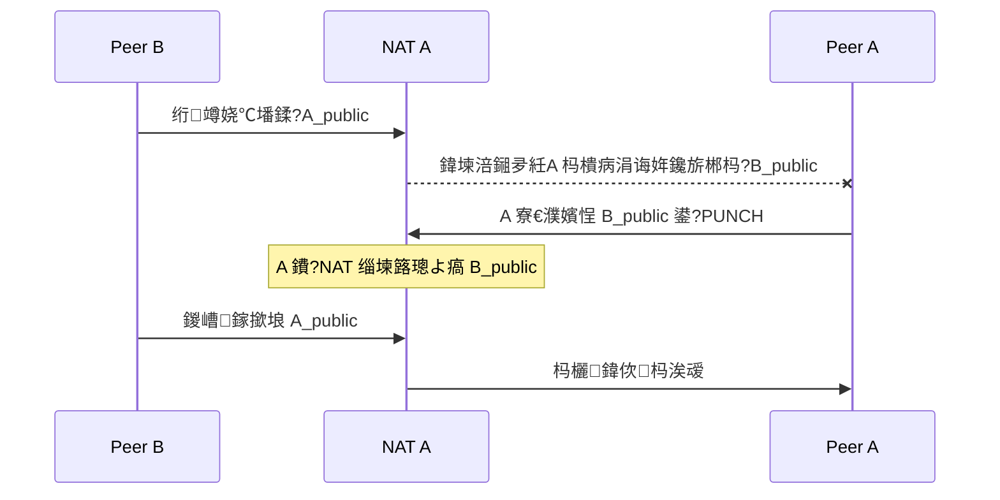

---
tags:
  - Linux
  - UDP-缂栫▼
date: 2026-04-19
rating: 5
闃呰娆℃暟: 0
---

# 9.4 UDP 绌块€?

> [!abstract] 涓€鍙ヨ瘽鍏堣浣?
> UDP 绌块€忎笉鏄€滃己琛屾墦寮€ NAT鈥濓紝鑰屾槸璁╅€氫俊鍙屾柟鍏堝悇鑷悜澶栧彂鍖咃紝鍦ㄥ悇鑷?NAT 涓婄暀涓嬪彲鍥炴祦鐨勭姸鎬侊紝鐒跺悗鍐嶄粠鍚屼竴涓?UDP socket 鍑犱箮鍚屾椂鏈濆鏂圭殑鍏綉鍦板潃鍙戝寘锛屾妸鐩磋繛璺緞鈥滅鈥濆嚭鏉ャ€?

> [!tip] 浜や簰鍔ㄧ敾
> 鏈瘒鏍稿績闅剧偣鐨勮繃绋嬪彲瑙嗗寲锛圢AT 鏄犲皠/杩囨护涓夋。琛屼负 路 鎹?socket 鎵撲笉閫氬弽渚?路 鍙岀 PUNCH 鏃跺簭 路 鏄犲皠瓒呮椂涓庝繚娲?路 TURN 鍥為€€锛夛細
> [鈻?鍦ㄦ祻瑙堝櫒涓墦寮€鍔ㄧ敾](<../../鍥剧墖/HTML/3.Linux/9. UDP 缂栫▼/9.4.1 UDP绌块€忓姩鐢?html>)銆€路銆€鏇村瑙?[[缃戠粶缂栫▼路鍔ㄧ敾鍚堥泦]]
> 涔熷彲鐩磋揪鍗曚釜鍦烘櫙锛歔NAT 鏄犲皠涓庤繃婊(<../../鍥剧墖/HTML/3.Linux/9. UDP 缂栫▼/9.4.1 UDP绌块€忓姩鐢?html#scene=nat>) 路 [鍚?socket 澶嶇敤](<../../鍥剧墖/HTML/3.Linux/9. UDP 缂栫▼/9.4.1 UDP绌块€忓姩鐢?html#scene=sock>) 路 [鍙岀 PUNCH](<../../鍥剧墖/HTML/3.Linux/9. UDP 缂栫▼/9.4.1 UDP绌块€忓姩鐢?html#scene=punch>) 路 [淇濇椿](<../../鍥剧墖/HTML/3.Linux/9. UDP 缂栫▼/9.4.1 UDP绌块€忓姩鐢?html#scene=keep>) 路 [STUN路ICE路TURN](<../../鍥剧墖/HTML/3.Linux/9. UDP 缂栫▼/9.4.1 UDP绌块€忓姩鐢?html#scene=ice>)

鏁寸瘒鐨勪富绾垮彧鏈夊洓鍙ワ細

- NAT 璁╁閮ㄤ笉鑳界洿鎺ヤ富鍔ㄦ墦杩涙潵銆?
- 寮曚粙鏈嶅姟鍣ㄨ礋璐ｄ氦鎹㈠弻鏂瑰綋鍓嶇殑鍏綉绔偣銆?
- 鍙屾柟蹇呴』澶嶇敤鍚屼竴涓湰鍦?UDP socket锛屽苟鍑犱箮鍚屾椂鍚戝鏂瑰彂鍖呫€?
- 鑳界洿杩炲氨鐩磋繛锛屾墦涓嶉€氬氨閫€鍥?TURN 涓户銆?

# 1. UDP 绌块€忓埌搴曞湪瑙ｅ喅浠€涔堥棶棰?

鍦ㄨ繙鎺у満鏅噷锛屾帶鍒剁鍜岃鎺х閫氬父閮藉湪鍚勮嚜璺敱鍣ㄥ悗闈€傝矾鐢卞櫒鍋氱殑鏄?**NAT锛堢綉缁滃湴鍧€杞崲锛?*锛?

- 鍐呯綉澶氬彴鏈哄櫒鍏辩敤涓€涓叕缃?IP銆?
- 鍐呯綉璁惧涓诲姩鍙戝嚭鐨勫寘鍙互鍑哄幓銆?
- 澶栭儴涓诲姩鎵撹繘鏉ョ殑鍖咃紝濡傛灉 NAT 娌℃湁鐜版垚鐨勬槧灏勮褰曪紝閫氬父浼氳鐩存帴涓㈠純銆?

鎵€浠ヤ袱绔兂缁曡繃鏈嶅姟鍣ㄧ洿鎺ラ€氫俊锛岄毦鐐逛笉鏄€滅煡涓嶇煡閬撳鏂?IP鈥濓紝鑰屾槸锛?

**瀵圭 NAT 鏄惁鎰挎剰鎶婅繖涓寘鏀捐繘鏉ャ€?*

![[鍥剧墖/3.Linux/9. UDP 缂栫▼/9_4_1.svg|1080]]

鍥鹃噷鐨勫叧閿槸閭ｄ袱鏉＄孩鑹茶櫄绾匡細鍙屾柟閮界煡閬撳鏂圭殑鍏綉鍦板潃锛屽寘涔熺‘瀹炲彂鍑哄幓浜嗭紝鍗撮兘姝诲湪瀵圭 NAT 闂ㄥ彛锛屽洜涓轰袱渚х殑鏄犲皠琛ㄨ繖鏃惰繕鏄┖鐨勩€?

浠庣粨鏋滀笂鐪嬶紝UDP 绌块€忓仛鐨勬槸涓€浠跺緢鏈寸礌鐨勪簨锛?*鍏堣鍙屾柟閮戒富鍔ㄥ悜澶栧彂閫佹暟鎹紝鍐嶅埄鐢?NAT 宸茬粡寤虹珛鐨勭姸鎬侊紝璁╁洖鍖呰兘澶熺┛鍥炴潵銆?*

# 2. 鍏ㄦ祦绋嬪厛鐪嬫噦锛氭墦娲炴椂瀹為檯鍙戠敓浜嗕粈涔?

鎶?UDP 绌块€忓厛绮楃湅鎴?4 姝ワ細

1. A 鍜?B 閮藉厛鐢ㄨ嚜宸辩殑 UDP socket 鍘昏仈绯讳竴涓叕缃戝紩浠嬫湇鍔″櫒銆?
2. 鏈嶅姟鍣ㄥ垎鍒湅鍒?A銆丅 褰撳墠鍦ㄥ叕缃戜晶瀵瑰簲鐨?`IP:port`锛岀劧鍚庢妸鍙屾柟鐨勫湴鍧€浜ゆ崲缁欏郊姝ゃ€?
3. A 鍜?B 鍐嶄粠 **鍚屼竴涓湰鍦?socket** 鍑犱箮鍚屾椂鏈濆鏂瑰叕缃戝湴鍧€鍙?`PUNCH` 鍖呫€?
4. 涓よ竟 NAT 閮借鈥滅寮€鈥濅互鍚庯紝鍚庣画鏁版嵁灏辩洿鎺?A `<->` B 璧帮紝涓嶅啀缁忚繃鏈嶅姟鍣ㄣ€?

![[鍥剧墖/3.Linux/9. UDP 缂栫▼/9_4_2.svg|1120]]

娉抽亾鍥鹃噷鏈変袱涓粏鑺傚€煎緱鍗曠嫭鐣欐剰銆備竴鏄?鈶?闃舵鏈嶅姟鍣ㄨ褰曠殑鍦板潃鏉ヨ嚜 `recvfrom()` 鐪嬪埌鐨勬簮鍦板潃锛岃€屼笉鏄鎴风鑷繁姹囨姤鐨勶紱浜屾槸 鈶?闃舵涓棿閭ｄ釜绾㈡鈥斺€斿ご鍑犱釜 PUNCH 浜掔浉琚涪锛屾槸娴佺▼鐨勬甯哥粍鎴愰儴鍒嗭紝涓嶆槸鍑洪敊銆?

浣犲彲浠ユ妸杩欎欢浜嬪帇缂╂垚涓€鍙ヨ瘽锛?

**鍏堜氦鎹㈠叕缃戝湴鍧€锛屽啀璁╁弻鏂瑰悓鏃朵富鍔ㄥ彂鍖咃紝璋佷篃鍒瓑璋佸厛鏉ユ壘鑷繁銆?*

# 3. 涓轰粈涔堜竴瀹氳澶嶇敤鍚屼竴涓?UDP socket

鐪熸鍐冲畾鑳戒笉鑳芥墦閫氱殑锛屼笉鍙槸鈥滄湁娌℃湁鍙戝寘鈥濓紝杩樺寘鎷綘鏄笉鏄竴鐩村湪澶嶇敤鍚屼竴涓湰鍦扮鐐广€?

褰撲綘鐨勭▼搴忕涓€娆″悜鍏綉鍙?UDP 鍖呮椂锛孨AT 浼氳褰曚竴鏉℃槧灏勶細

- 鍐呯綉鐪熷疄绔偣锛氫緥濡?`192.168.1.10:50000`
- NAT 鏄犲皠鍚庣殑鍏綉绔偣锛氫緥濡?`198.51.100.8:62000`

鏈嶅姟鍣ㄧ湅鍒板苟杞憡瀵圭鐨勶紝灏辨槸杩欎釜 `198.51.100.8:62000`銆備綘鍚庣画鍘绘墦娲炴椂锛屽繀椤荤户缁敤**鍚屼竴涓湰鍦?socket** 鍙戝寘锛岃繖鏍?NAT 鎵嶄細娌跨敤鍚屼竴鏉℃槧灏勩€?

![[鍥剧墖/3.Linux/9. UDP 缂栫▼/9_4_3.svg|1120]]

宸﹀彸涓ゆ爮鐨勫墠涓夋涓€妯′竴鏍凤紝鍙湁绗?鈶?姝ヤ笉鍚屻€傚彸鏍忎腑閫旀崲浜嗘湰鍦扮鍙ｏ紝NAT 灏卞綋鎴愬彟涓€鏉″叏鏂扮殑浼氳瘽锛屽彟鍒嗛厤浜?`:63000`锛涜€屽绔嬁鍒扮殑杩樻槸 `:62000`锛岄偅鏉℃槧灏勬鍒诲凡缁忔垚浜嗛粦娲炪€傝〃鐜板嚭鏉ュ氨鏄€滄祦绋嬩竴姝ヤ笉灏戯紝鎬庝箞鎵撻兘鎵撲笉閫氣€濄€?

鎵€浠ヨ繖閲屼笉鏄唬鐮侀鏍奸棶棰橈紝鑰屾槸鎵撴礊鎴愮珛鐨勫墠鎻愭潯浠躲€?

# 4. 寮曚粙鏈嶅姟鍣ㄥ湪閲岄潰鎵紨浠€涔堣鑹?

涓ょ鍦ㄦ渶寮€濮嬭繕涓嶈兘鐩存帴浜掔浉閫氫俊锛屾墍浠ラ渶瑕佷竴涓叕缃戝彲杈剧殑寮曚粙鏈嶅姟鍣紙rendezvous / signaling server锛夊仛涓変欢浜嬶細

1. 瑙傚療姣忎釜 peer 褰撳墠鏆撮湶鍦ㄥ叕缃戜晶鐨?`IP:port`
2. 鎶婂弻鏂圭殑鍏綉绔偣浜ゆ崲缁欏郊姝?
3. 閫氱煡鍙屾柟寮€濮嬫墦娲?

绗?2 鑺傛吵閬撳浘閲岀殑 鈶犫憽 涓ゆ灏辨槸瀹冪殑鍏ㄩ儴宸ヤ綔锛屽埌 鈶?闃舵瀹冨凡缁忛€€鍦恒€傝繖閲岀壒鍒鏄撹瑙ｇ殑涓€鐐规槸锛?

**寮曚粙鏈嶅姟鍣ㄥ彧鏄€滀粙缁嶄綘浠璇嗏€濓紝鐪熸鎶婅矾鎵撻€氱殑鏄弻鏂硅嚜宸卞悗缁彂鍑虹殑 UDP 鍖呫€?*

# 5. NAT 涓轰粈涔堟湁鏃惰兘鎵撻€氾紝鏈夋椂瀹屽叏鎵撲笉閫?

鍦板潃浜ゆ崲鎴愬姛锛屼笉绛変簬涓€瀹氳兘鐩磋繛銆傚洜涓?NAT 瀹為檯涓婃湁涓ゅ琛屼负锛?

- **鏄犲皠锛圡apping锛?*锛氭垜浠庡叕缃戠湅璧锋潵鏄皝锛?
- **杩囨护锛團iltering锛?*锛氳皝鏈夎祫鏍间粠鍏綉鍥炴潵鎵炬垜锛?

杩欎袱浠朵簨鍚勬湁涓夋。锛岃€屼笖浜掔浉鐙珛锛岃鍒嗗紑鍒ゆ柇銆?

![[鍥剧墖/3.Linux/9. UDP 缂栫▼/9_4_4.svg|1160]]

## 5.1 鏄犲皠锛氬叕缃戝彿鐮佺墝绋充笉绋冲畾

鍥剧殑涓婂崐閮ㄥ垎鐢ㄥ悓涓€涓?socket 渚濇鍙戝線涓変釜鐩爣锛岀湅 NAT 鍒嗛厤鐨勫叕缃戠鍙ｅ彉涓嶅彉锛?

- **Endpoint-Independent Mapping锛圗IM锛?*锛氱洰鏍囨€庝箞鎹紝鍏綉绔彛閮芥槸 `:62000`銆傛渶鍒╀簬鎵撴礊銆?
- **Address-Dependent Mapping锛圓DM锛?*锛氱洰鏍?IP 涓€鍙橈紝鍏綉绔彛灏辨崲銆?
- **Address and Port-Dependent Mapping锛圓PDM锛?*锛欼P 鎴栫鍙ｄ换涓€鍙樺寲锛屽叕缃戠鍙ｉ兘鍙樸€備篃灏辨槸甯歌鐨勫绉?NAT锛屾渶闅炬墦銆?

杩欒В閲婁簡涓轰粈涔堟湁浜?NAT 寰堝弸濂斤紝鏈変簺 NAT 鍒欓潪甯告姌纾ㄤ汉锛?

- 濡傛灉鏄犲皠绋冲畾锛屾湇鍔″櫒鍛婅瘔鍑哄幓鐨勫湴鍧€鍦ㄥ悗缁墦娲炴椂浠嶇劧鏈夋晥銆?
- 濡傛灉鏄犲皠涓嶇ǔ瀹氾紝浣犺仈绯绘湇鍔″櫒鏃剁殑鍏綉绔彛锛屽拰浣犵湡姝ｅ幓鎵惧绔椂鐨勫叕缃戠鍙ｏ紝鍙兘鏍规湰涓嶆槸鍚屼竴涓€?

## 5.2 杩囨护锛氳皝鑳戒粠鍏綉鎵撳洖鏉?

涓嬪崐閮ㄥ垎鎹簡涓墠鎻愶細A 鍙悜 `1.1.1.1:80` 鍙戣繃鍖咃紝姝ゅ埢浠庡叕缃戝洖鏉ヤ笁绉嶅寘锛岀湅 NAT 鏀句笉鏀捐锛?

- **Endpoint-Independent Filtering锛圗IF锛?*锛氬彧瑕佸悜澶栧彂杩囧寘锛岃皝閮借兘鍥炪€?
- **Address-Dependent Filtering锛圓DF锛?*锛氬彧璁よ仈绯昏繃鐨勯偅涓?IP锛岀鍙ｅ彲浠ヤ笉鍚屻€?
- **Address and Port-Dependent Filtering锛圓PDF锛?*锛氬彧璁や箣鍓嶈仈绯昏繃鐨勯偅涓簿纭?`IP:port`銆?

鎵€浠モ€滅煡閬撳鏂瑰湴鍧€鈥濆苟涓嶅锛孨AT 杩樿鍏堣鍙繖涓湴鍧€銆?

杩欎篃鏄负浠€涔堢湡姝ｇ殑鎵撴礊瀹炵幇閲岋紝甯稿父浼氱湅鍒帮細

- 鍙屾柟鎷垮埌鍦板潃鍚庣珛鍒诲紑鎵?
- 鑰屼笖涓嶆槸鍙戜竴鍖呭氨鍋滐紝鑰屾槸杩炵画鍙戝鍖?

鍥犱负鍓嶅嚑鍖呰瀵圭 NAT 涓㈡帀锛屾湰鏉ュ氨鏄甯哥幇璞°€?

鍥炬渶涓嬮潰鐨?C 鍖烘妸涓よ€呯粍鍚堣捣鏉ョ湅锛歚EIM + EIF/ADF` 涓€鎵撳氨閫氾紱`EIM + APDF` 闈犲弻鏂瑰悓鏃惰繛鍙戞拺寰楀紑锛涗换涓€渚ф槸 APDM 灏卞埆鎸囨湜瑁告墦娲烇紝鐩存帴瀹夋帓 TURN 鍏滃簳銆?

# 6. 涓轰粈涔堝弻鏂硅鍑犱箮鍚屾椂鍙?PUNCH

涓嬮潰杩欐鏃跺簭鍙互甯姪鐞嗚В鈥滃悓鏃垛€濈殑蹇呰鎬э細



鎶婂畠鎸夊抚鎽婂紑鐪嬩細鏇寸洿瑙傦細

![[鍥剧墖/3.Linux/9. UDP 缂栫▼/9_4_5.svg|1120]]

鍥涘抚閲屾渶璇ョ洴浣忕殑鏄?t鈧侊細A 鍙戝嚭鍘荤殑绗竴涓?PUNCH 涓€瀹氫細琚?NAT B 涓㈡帀锛屽洜涓鸿繖鏃?B 杩樻病鍚?A 鍙戣繃浠讳綍涓滆タ銆備絾杩欎竴鍖呭苟娌℃湁鐧藉彂鈥斺€斿畠鍦?NAT A 涓婄暀涓嬩簡鈥滄垜鑱旂郴杩?B_public鈥濈殑璁板綍锛屾墍浠?t鈧?鏃?B 鍙戞潵鐨勫寘鎵嶆湁璧勬牸杩涢棬銆?

**UDP 鎵撴礊涓嶆槸绛夊鏂规潵鎵句綘锛岃€屾槸鍙屾柟閮借涓诲姩鍏堟湞澶栧彂鍖咃紝璁╁悇鑷?NAT 鍏堜负瀵规柟寤虹珛鍙洖娴佺姸鎬併€?*

鎵€浠ュ伐绋嬪疄鐜伴噷閫氬父浼氳繖鏍峰仛锛?

- 鎷垮埌瀵圭鍏綉鍦板潃鍚庣珛鍗冲紑濮嬪彂 `PUNCH`
- 姣忛殧涓€灏忔鏃堕棿閲嶅彂涓€娆★紝鎸佺画鍑犵
- 涓€鏃︾湡姝ｆ敹鍒板绔殑鍖咃紝灏辨妸鈥滃疄闄呮敹鍒扮殑婧愬湴鍧€鈥濆綋鎴愬悗缁€氫俊鍦板潃

濡傛灉涓や釜 peer 鍒氬ソ鍦ㄥ悓涓€涓?NAT 鍚庨潰锛岃繕浼氶亣鍒颁竴涓澶栨蹇碉細**hairpinning锛堝洖鐜級**銆備篃灏辨槸 NAT 鏄惁鏀寔鎶娾€滃彂寰€鑷繁鍏綉鍦板潃鐨勫寘鈥濆啀缁曞洖鍒板唴缃戝彟涓€鍙版満鍣ㄣ€傛敮鎸佸緱濂斤紝鍚屼竴璺敱鍣ㄥ悗闈㈢殑涓や釜 peer 涔熻兘閫氳繃鍏綉鏄犲皠鍦板潃浜掗€氾紱涓嶆敮鎸佸氨鍙兘澶辫触銆?

# 7. Keepalive锛氭礊涓轰粈涔堟墦閫氬悗杩樹細鑷繁鍏充笂

鍗充究鐩磋繛宸茬粡寤虹珛锛孨AT 鏄犲皠涔熶笉鏄案涔呭瓨鍦ㄧ殑銆傚畠鏄竴鏉″甫绌洪棽璁℃椂鍣ㄧ殑杞姸鎬侊細澶氭暟瀹剁敤璺敱鍣ㄥ湪涓€娈垫椂闂翠笉瑙佹祦閲忓悗灏变細鍥炴敹 UDP 鏄犲皠锛屽父瑙佽秴鏃惰寖鍥村ぇ绾︽槸鍑犲崄绉掑埌鍑犲垎閽熴€?

![[鍥剧墖/3.Linux/9. UDP 缂栫▼/9_4_6.svg|1120]]

涓婁笅涓ゆ潯鏃堕棿杞寸殑宸埆鍙湁蹇冭烦銆傛病鏈変繚娲绘椂锛屽簲鐢ㄤ竴闈欓粯璁℃椂鍣ㄥ氨寮€濮嬭蛋锛岃秴鏃剁偣涓€鍒版槧灏勮鍥炴敹锛屼箣鍚庡绔彂鏉ョ殑鍖呭叏閮ㄨ涓紝鍙兘鍥炲埌寮曚粙鏈嶅姟鍣ㄩ噸鏂版墦涓€娆℃礊銆?

杩欏氨甯︽潵鍑犱釜宸ョ▼涓婄殑鍩烘湰鍔ㄤ綔锛?

- 鍙屾柟瑕佸畾鏈熷彂灏忓寘淇濇椿锛坘eepalive锛夛紝鍛ㄦ湡鎸夎杩囩殑鏈€鐭偅涓€妗ｈ秴鏃跺彇涓€鍗婏紝瀹炴垬閲屽父瑙佸崄鍑犵鍒颁簩鍗佸嚑绉?
- 蹇冭烦蹇呴』璧版墦閫氱殑閭ｄ釜 socket 鍜岄偅涓绔鐐癸紝鎹竴鏉″氨绛変簬娌′繚娲?
- 杩涚▼浼戠湢銆佸垏鎹㈢綉缁溿€佹柇缃戞姈鍔ㄩ兘浼氭墦鏂繖鏉＄姸鎬侊紝鎵€浠ラ噸鏂版墦娲炵殑璺緞瑕佷竴鐩寸暀鐫€

# 8. STUN銆両CE銆乀URN 鍒嗗埆鍋氫粈涔?

鍒拌繖閲屽彲浠ユ妸鐩稿叧鏈涓€娆＄悊娓咃細

![[鍥剧墖/3.Linux/9. UDP 缂栫▼/9_4_7.svg|1160]]

- **NAT**锛氬埗閫犻棶棰樼殑閭ｄ竴灞傘€傚畠璁╁唴缃戠鐐逛笉鑳藉ぉ鐒惰鍏綉鐩存帴璁块棶銆?
- **STUN**锛氬府浣犫€滅収闀滃瓙鈥濓紝鍛婅瘔浣犲綋鍓嶅澶栨毚闇插嚭鏉ョ殑鍏綉 `IP:port`銆?
- **ICE**锛氬仛鍊欓€夊湴鍧€绠＄悊鍜岃繛閫氭€ф鏌ワ紝璐熻矗灏濊瘯鍝潯閾捐矾鐪熸鑳介€氥€?
- **TURN**锛氱洿杩炲け璐ユ椂鐨勪腑缁у厹搴曪紝鎵€鏈夋暟鎹敼璧版湇鍔″櫒杞彂銆?

鍥剧殑鍙冲崐鏄?ICE 鐨勫€欓€夐樁姊€傚畠涓嶆槸鈥滃厛璇?A 涓嶈鍐嶈瘯 B鈥濈殑涓茶娴佺▼锛岃€屾槸鎶婁笁绾у€欓€夊苟琛岃瘯涓€閬嶏紝鍙栨垚鍔熶笖浼樺厛绾ф渶楂樼殑閭ｆ潯锛歚host` 鏄湰鏈虹綉鍗′笂鐨勫湴鍧€锛屽悓缃戞鎵嶇敤寰椾笂锛沗srflx` 鏄?STUN 鐓у嚭鏉ョ殑鍏綉绔偣锛屼篃灏辨槸鏈瘒璁茬殑鎵撴礊涓诲姏锛沗relay` 鏄?TURN 鍒嗛厤鐨勪腑缁у湴鍧€锛屼竴瀹氳兘閫氾紝浠ｄ环鏄欢杩熷拰鏈嶅姟鍣ㄥ甫瀹姐€?

涓€鍙ヨ瘽璁板繂锛?

**NAT 鍒堕€犻棶棰橈紝STUN 甯綘鐪嬫竻鑷繁锛孖CE 璐熻矗璇曡矾锛孴URN 璐熻矗鍏滃簳銆?*

杩欎篃椤烘墜婢勬竻涓や釜璇尯锛?

- **璇尯 1锛歋TUN 灏辩瓑浜?UDP 绌块€忋€?* 涓嶆槸銆係TUN 鍙槸鍙戠幇鍏綉鏄犲皠鍦板潃鐨勪竴閮ㄥ垎宸ュ叿銆?
- **璇尯 2锛氬湴鍧€浜ゆ崲瀹屽氨绠楃粨鏉熴€?* 涔熶笉鏄€傜湡姝ｉ毦鐨勬槸鏄犲皠绋冲畾鎬с€佽繃婊ょ瓥鐣ワ紝浠ュ強鎵撴礊鏃舵満鐨勯厤鍚堛€?

# 9. 浠€涔堟椂鍊?UDP 鎵撴礊浼氬け璐?

涓嬮潰杩欎簺鎯呭喌锛岄兘浼氳瑁告墦娲炵殑鎴愬姛鐜囨槑鏄句笅闄嶏紝鐢氳嚦鐩存帴澶辫触锛?

- **Symmetric NAT锛堝绉?NAT锛?*锛氶潰鍚戜笉鍚岀洰鏍囨椂鍒嗛厤涓嶅悓鍏綉绔彛锛屾湇鍔″櫒鐪嬪埌鐨勭鍙ｄ笉涓€瀹氶€傜敤浜?peer-to-peer 閫氫俊锛屽搴?5.1 閲岀殑 APDM銆?
- **鍙屽眰 NAT / CGNAT**锛氬鐢ㄨ矾鐢卞櫒澶栭潰杩樻湁杩愯惀鍟嗙骇 NAT锛屽啀澶氫竴灞備笉纭畾鎬с€?
- **杩囨护瑙勫垯杩囦弗**锛氬弻鏂瑰嵆渚块兘鐭ラ亾鍦板潃锛屼篃寰堥毦鍦ㄦ椂闂寸獥鍙ｅ唴浜掔浉鏀鹃€氥€?
- **淇濇椿涓柇**锛氫緥濡傚簲鐢ㄤ紤鐪犳垨缃戠粶鎶栧姩锛屽凡鏈夋槧灏勮秴鏃惰娓呮帀銆?

鎵€浠ョ湡瀹炵郴缁熼€氬父涓嶄細鍙祵涓€娆¤８鎵撴礊锛岃€屾槸閲囩敤锛?

- 鑳界洿杩炲氨鐩磋繛
- 鐩磋繛澶辫触灏辫嚜鍔ㄩ€€鍥?TURN

杩欎篃鏄?WebRTC銆佸疄鏃堕€氫俊銆丳2P 缁勭綉閲屾渶甯歌鐨勬€濊矾銆?

# 10. 鐪嬩唬鐮佸墠鍏堣浣忚繖 5 涓瀵熺偣

> [!tip]
> 涓嬮潰鐨勪唬鐮佹槸鈥滃涔犵増寮曚粙 + 瑁告墦娲炩€濋鏋讹紝涓嶆槸瀹屾暣鍟嗙敤鏂规銆傚厛鎶撲綇杩?5 涓瀵熺偣鍐嶅幓鐪嬩唬鐮併€?

1. **娉ㄥ唽銆佹墦娲炪€侀€氫俊蹇呴』鍏辩敤鍚屼竴涓湰鍦?UDP socket銆?*
2. **鎷垮埌瀵圭鍦板潃鍚庯紝涓嶈鍙彂涓€鍖咃紝瑕佽繛缁彂涓€涓?`PUNCH`銆?*
3. **涓€鏃︾湡姝ｆ敹鍒板绔殑鍖咃紝鍚庣画鏈€濂戒互瀹為檯鏀跺埌鐨勬簮鍦板潃涓哄噯銆?*
4. **鎵撻€氫互鍚庤鍋?keepalive锛屽惁鍒?NAT 鏄犲皠浼氳秴鏃躲€?*
5. **鐪熷疄宸ョ▼杩樿鑰冭檻閴存潈銆侀噸浼犮€佽秴鏃躲€佸け璐ュ洖閫€ TURN銆?*

# 11. 瀛︿範鐗堜唬鐮侀鏋?

## 11.1 寮曚粙鏈嶅姟鍣ㄥ仛浠€涔?

寮曚粙鏈嶅姟鍣ㄦ渶鏍稿績鐨勪竴浠朵簨锛?*鍙 `recvfrom()` 鐪嬪埌鐨勬簮鍦板潃鍜岀鍙ｏ紝涓嶉噰淇″鎴风鑷繁姹囨姤鐨勫叕缃戝湴鍧€銆?*

```cpp
// ===== 瀛︿範鐗?UDP 寮曚粙鏈嶅姟鍣?=====
// 鍗忚锛?
//   Peer -> Server : "REG <room> <peer_id>"
//   Server -> Peer : "PEER <ip> <port> <peer_id>"
//
// 璇存槑锛?
// 1) 杩欓噷鍙仛鈥滃紩浠?/ 浜ゆ崲鍏綉绔偣鈥濓紝涓嶆槸鏍囧噯 STUN 鏈嶅姟鍣ㄣ€?
// 2) 鐪熷疄绯荤粺杩樿鍋氶壌鏉冦€佽繃鏈熸竻鐞嗐€侀噸浼犮€乀URN fallback 绛夈€?

#include <arpa/inet.h>
#include <netinet/in.h>
#include <sys/socket.h>
#include <unistd.h>

#include <cstring>
#include <iostream>
#include <sstream>
#include <string>
#include <unordered_map>
#include <vector>

struct PeerInfo {
    std::string peer_id;
    sockaddr_in observed_addr{}; // 鏈嶅姟鍣ㄧ湅鍒扮殑鍏綉鍦板潃
};

static std::string to_ip(const sockaddr_in& addr) {
    char buf[INET_ADDRSTRLEN] = {0};
    inet_ntop(AF_INET, &addr.sin_addr, buf, sizeof(buf));
    return buf;
}

static void send_text(int sock, const sockaddr_in& to, const std::string& s) {
    sendto(sock, s.data(), s.size(), 0,
           reinterpret_cast<const sockaddr*>(&to), sizeof(to));
}

int main() {
    int sock = socket(AF_INET, SOCK_DGRAM, 0);
    if (sock < 0) {
        std::cerr << "socket() failed\n";
        return 1;
    }

    sockaddr_in bind_addr{};
    bind_addr.sin_family = AF_INET;
    bind_addr.sin_addr.s_addr = htonl(INADDR_ANY);
    bind_addr.sin_port = htons(40000);

    if (bind(sock, reinterpret_cast<sockaddr*>(&bind_addr), sizeof(bind_addr)) < 0) {
        std::cerr << "bind() failed\n";
        return 1;
    }

    std::unordered_map<std::string, std::vector<PeerInfo>> rooms;

    char buf[1024];
    while (true) {
        sockaddr_in from{};
        socklen_t from_len = sizeof(from);
        ssize_t n = recvfrom(sock, buf, sizeof(buf) - 1, 0,
                             reinterpret_cast<sockaddr*>(&from), &from_len);
        if (n <= 0) continue;
        buf[n] = '\0';

        std::istringstream iss(buf);
        std::string cmd, room, peer_id;
        iss >> cmd >> room >> peer_id;

        if (cmd != "REG" || room.empty() || peer_id.empty()) {
            continue;
        }

        auto& peers = rooms[room];
        bool updated = false;
        for (auto& p : peers) {
            if (p.peer_id == peer_id) {
                p.observed_addr = from;
                updated = true;
                break;
            }
        }
        if (!updated) {
            peers.push_back(PeerInfo{peer_id, from});
        }

        if (peers.size() == 2) {
            const auto& a = peers[0];
            const auto& b = peers[1];

            std::string msg_to_a = "PEER " + to_ip(b.observed_addr) + " " +
                                   std::to_string(ntohs(b.observed_addr.sin_port)) +
                                   " " + b.peer_id;

            std::string msg_to_b = "PEER " + to_ip(a.observed_addr) + " " +
                                   std::to_string(ntohs(a.observed_addr.sin_port)) +
                                   " " + a.peer_id;

            send_text(sock, a.observed_addr, msg_to_a);
            send_text(sock, b.observed_addr, msg_to_b);
        }
    }

    close(sock);
    return 0;
}
```

## 11.2 Peer 涓轰粈涔堝繀椤诲鐢ㄥ悓涓€涓?socket

杩欎釜瀛︿範鐗?peer 浠ｇ爜瀵瑰簲鐨勬槸鈥滃悓涓€涓?socket 鍏堟敞鍐岋紝鍐嶆墦娲烇紝鍐嶉€氫俊鈥濈殑鏈€灏忛棴鐜€?

```cpp
// ===== 瀛︿範鐗?UDP 鎵撴礊 Peer =====
// 鍗忚锛?
//   Peer -> Server : "REG <room> <my_id>"
//   Server -> Peer : "PEER <ip> <port> <peer_id>"
//   Peer <-> Peer  : "PUNCH <room> <my_id>"
//   Peer <-> Peer  : "PUNCH_ACK <room> <my_id>"
//   Peer <-> Peer  : "DATA <my_id> <text...>"
//
// 閲嶇偣锛氭暣涓祦绋嬮兘澶嶇敤鈥滃悓涓€涓湰鍦?UDP socket鈥濄€?

#include <arpa/inet.h>
#include <netinet/in.h>
#include <sys/socket.h>
#include <unistd.h>

#include <atomic>
#include <chrono>
#include <cstring>
#include <iostream>
#include <sstream>
#include <string>
#include <thread>

static void send_text(int sock, const sockaddr_in& to, const std::string& s) {
    sendto(sock, s.data(), s.size(), 0,
           reinterpret_cast<const sockaddr*>(&to), sizeof(to));
}

static std::string endpoint_to_string(const sockaddr_in& addr) {
    char ip[INET_ADDRSTRLEN] = {0};
    inet_ntop(AF_INET, &addr.sin_addr, ip, sizeof(ip));
    return std::string(ip) + ":" + std::to_string(ntohs(addr.sin_port));
}

int main() {
    std::string server_ip = "203.0.113.10";
    uint16_t server_port = 40000;
    std::string room = "room1";
    std::string my_id = "A";
    uint16_t local_port = 50000;

    int sock = socket(AF_INET, SOCK_DGRAM, 0);
    if (sock < 0) {
        std::cerr << "socket() failed\n";
        return 1;
    }

    sockaddr_in local{};
    local.sin_family = AF_INET;
    local.sin_addr.s_addr = htonl(INADDR_ANY);
    local.sin_port = htons(local_port);
    if (bind(sock, reinterpret_cast<sockaddr*>(&local), sizeof(local)) < 0) {
        std::cerr << "bind() failed\n";
        return 1;
    }

    sockaddr_in server{};
    server.sin_family = AF_INET;
    server.sin_port = htons(server_port);
    inet_pton(AF_INET, server_ip.c_str(), &server.sin_addr);

    send_text(sock, server, "REG " + room + " " + my_id);

    sockaddr_in peer_addr{};
    std::atomic<bool> connected{false};
    char buf[2048];
    std::thread punch_thread;

    while (true) {
        sockaddr_in from{};
        socklen_t from_len = sizeof(from);
        ssize_t n = recvfrom(sock, buf, sizeof(buf) - 1, 0,
                             reinterpret_cast<sockaddr*>(&from), &from_len);
        if (n <= 0) continue;
        buf[n] = '\0';

        std::string msg(buf);
        std::istringstream iss(msg);
        std::string cmd;
        iss >> cmd;

        if (cmd == "PEER") {
            std::string ip, peer_id;
            uint16_t port = 0;
            iss >> ip >> port >> peer_id;

            peer_addr = {};
            peer_addr.sin_family = AF_INET;
            peer_addr.sin_port = htons(port);
            inet_pton(AF_INET, ip.c_str(), &peer_addr.sin_addr);

            punch_thread = std::thread([&]() {
                for (int i = 0; i < 40 && !connected.load(); ++i) {
                    send_text(sock, peer_addr, "PUNCH " + room + " " + my_id);
                    std::this_thread::sleep_for(std::chrono::milliseconds(200));
                }
            });
        }
        else if (cmd == "PUNCH") {
            std::string recv_room, peer_id;
            iss >> recv_room >> peer_id;

            if (recv_room == room) {
                send_text(sock, from, "PUNCH_ACK " + room + " " + my_id);
                connected = true;
                peer_addr = from;
            }
        }
        else if (cmd == "PUNCH_ACK") {
            std::string recv_room, peer_id;
            iss >> recv_room >> peer_id;

            if (recv_room == room) {
                connected = true;
                peer_addr = from;
            }
        }
        else if (cmd == "DATA") {
            std::string peer_id;
            iss >> peer_id;
            std::string text;
            std::getline(iss, text);
            std::cout << "[" << peer_id << "]" << text << "\n";
        }

        if (connected.load()) {
            if (punch_thread.joinable()) {
                punch_thread.join();
            }
            break;
        }
    }

    close(sock);
    return 0;
}
```

璇讳唬鐮佹椂锛屽鐓х 10 鑺傚幓鐪嬶細

- 鏈嶅姟鍣ㄦ槸涓嶆槸鐩存帴浣跨敤 `recvfrom()` 瑙傚療鍒扮殑鍏綉绔偣锛?
- peer 鏈夋病鏈夊缁堝鐢ㄥ悓涓€涓湰鍦?socket锛?
- 涓轰粈涔?`PUNCH` 瑕佽繛缁彂锛岃€屼笉鏄彂涓€娆″氨绛夛紵
- 涓轰粈涔堣繛鎺ュ缓绔嬪悗瑕佹妸瀹為檯鏀跺埌鐨勬簮鍦板潃褰撴垚鏈€缁堥€氫俊鍦板潃锛?
- 涓轰粈涔堣繖濂椾唬鐮佷粛鐒朵笉鑳芥浛浠ｅ畬鏁寸殑 ICE / TURN 鏂规锛?

# 12. 瀹炴垬璁板繂鐐?

鏁寸瘒鍘嬬缉鎴愪竴缁勫垽鏂細

- **鍏堟敞鍐岋紝鍚庝氦鎹㈠湴鍧€锛屽啀鍚屾椂鍙戝寘銆?*
- **鍙煡閬撳鏂瑰叕缃戝湴鍧€锛屼笉绛変簬涓€瀹氳兘鐩磋繛銆?*
- **鍚屼竴涓湰鍦?socket 鏄墠鎻愶紝涓嶆槸缂栫爜椋庢牸銆?*
- **鍓嶅嚑鍖呰涓㈡帀寰堟甯革紝鎵€浠ヨ杩炵画鍙?`PUNCH`銆?*
- **鑳界洿杩炲氨鐩磋繛锛岀洿杩炰笉绋虫垨鎵撲笉閫氬氨閫€鍥?TURN銆?*

鍐嶅帇缂╂垚涓€鍙ュ伐绋嬪寲鐨勮瘽锛?

**鍚屼竴涓湰鍦?UDP socket 鍏堝悜澶栨敞鍐岋紝鎷垮埌褰兼鐨勫叕缃戠鐐癸紱鍙屾柟鍐嶅嚑涔庡悓鏃舵湞瀵规柟鍙戝寘锛岃 NAT 涓哄绔缓绔嬪彲鍥炴祦鐘舵€侊紱鑳界洿杩炲氨鐩磋繛锛屼笉琛屽氨 TURN 涓户銆?*

# 13. 鍏稿瀷搴旂敤鍦烘櫙

杩欏鈥滃敖閲忕洿杩炪€佸繀瑕佹椂鍥為€€鈥濈殑妯″紡鍦ㄤ笅闈㈠嚑澶勯兘鑳界湅鍒帮細

- **WebRTC**锛氭祻瑙堝櫒瀹炴椂闊宠棰戯紝搴曚笅灏辨槸 ICE / STUN / TURN 閭ｄ竴濂椼€?
- **P2P 杩滄帶鎴栫粍缃?*锛氳妭鐐圭洿杩烇紝寤虹珛浣庡欢杩熸帶鍒堕摼璺€?
- **澶氫汉鑱旀満娓告垙**锛氫负浜嗛檷浣庝腑缁у欢杩燂紝浼樺厛灏濊瘯 peer-to-peer 鐩磋繛銆?
- **VPN Mesh / 瑕嗙洊缃戠粶**锛氬崗璋冩湇鍔″櫒璐熻矗鍙戠幇璺緞锛屽け璐ユ椂鍐嶄腑缁у厹搴曘€?
