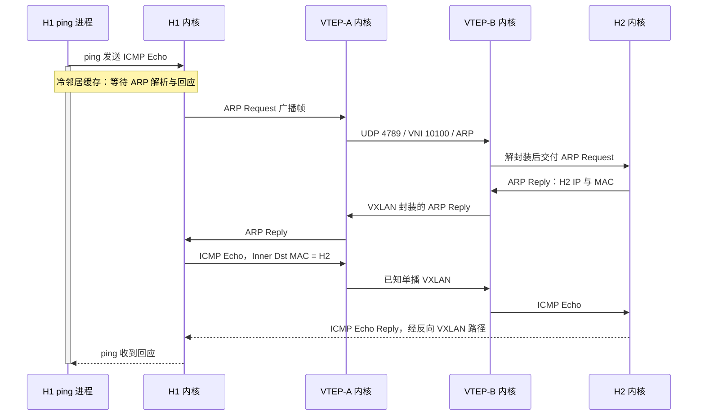

---
tags:
  - Linux
  - 网络编程基础
  - VXLAN
  - 数据中心网络
aliases:
  - VXLAN 数据平面
  - MAC-in-UDP
  - VXLAN MTU
优先级: P0
阅读次数: 0
---

# 7.10 VXLAN 数据平面：VTEP、VNI、MAC-in-UDP、ECMP、BUM 与 MTU

> [!abstract] 本篇定位
> VXLAN 的核心不是“在包外面加一个头”，而是把两个寻址问题分开：**租户网络用目的 MAC 决定交给哪个远端接入点；承载网络用远端 VTEP 的 IP 决定物理下一跳。**
>
> 本篇要求达到三个可验证目标：能够逐字段拆开一个 VXLAN 包，能够区分主机 ARP、租户 FDB 与 Underlay 路由，能够算清封装后的路径 MTU。最后用不依赖 BGP 的 Linux 小实验观察数据平面，再在配套的 [[3.Linux/7. 网络编程/07. 链路层与网络层深挖/7.11 BGP-EVPN：MAC-IP Advertisement、ARP Suppression 与基本 Route Type|7.11 BGP-EVPN]] 中解决“这些映射如何分发”。

> [!note] 范围与来源
> 教材基础来自 *Computer Networks* 第 6 版的桥接学习、ECMP，以及 *TCP/IP Illustrated, Volume 1* 第 2 版的 MTU 与隧道章节。VXLAN 专属行为以 RFC 7348 为基础，并用 RFC 8365 区分后来的 EVPN 控制平面。RFC 7348 是 **Informational** 文档，不应误写成 Standards Track。
>
> 默认讨论普通 VXLAN、单归属主机、同一桥接域内的二层转发，以及管理域内统一分配的 VNI；不默认开启 IRB、NAT、VXLAN-GPE、组播优化或特殊硬件卸载。Linux 命令为独立教学实验，不是生产 Fabric 配置模板。[^cn6][^tcpip2][^vxlan][^evpn-overlay]

## 1. 先把 Overlay、Underlay 与 VTEP 分清

**Underlay** 是让 VTEP IP 彼此可达的承载网络。它可以是 L3 Leaf-Spine Fabric，也可以是实验中的一根直连链路。**Overlay** 是构建在这个承载网络上的逻辑连接：租户看到的是同一逻辑二层网络，承载网络转发的却是 VTEP 之间的 IP 包。教材把 tunneling 概括为在另一层协议中承载原协议数据；“Ethernet 放进 UDP/IP”正是这种模型的一种实例。[^tcpip2]

**VTEP（VXLAN Tunnel Endpoint）** 是封装与解封装角色，不等于某一款交换机或某一个物理端口。它可以运行在软件交换机、宿主机、ToR 交换机或具备相关能力的硬件中。一个 VTEP 可以服务多个 VNI，端点还需要本地桥接域、转发表和接入策略配合，不能把它简化成“一个 UDP socket”。[^vxlan]

在本篇的同桥接域模型中，一次远端单播依次回答：

| 查找层次 | 已知什么 | 要得到什么 |
|---|---|---|
| 接入分类 | 入端口、VLAN 或其他配置 | 本地 Bridge Domain，以及对应的 VNI |
| 租户转发 | 桥接域与目的 MAC | 本地端口，或远端 VTEP |
| 承载路由 | 远端 VTEP IP | 出接口与 Underlay 下一跳 |
| 承载邻居解析 | 下一跳 IP | 当前物理链路上的目的 MAC |

**FDB 的逻辑查找键不能只写 MAC。** 不同租户可以使用相同 MAC，必须有桥接域或等效隔离上下文；常见系统再把该上下文与 VNI 关联起来。具体实现未必把四张表按上述方式独立存放，但这四个决策不能在解释中混成一个。

![[图片/SVG/3_7_7_7_10_1.svg|900]]

图中蓝色封装路径经过承载网络，绿色是租户原始寻址范围。注意两个 Spine 提供的是**到同一个远端 VTEP 的多条路径**，不是把一个租户包发给两个目的主机。

### 1.1 VLAN、VNI、租户并不是一一对应的同义词

VLAN 标识和 VXLAN 的 **24-bit VNI** 属于不同的标识空间。VNI 有 $2^{24}$ 种位模式，但这不等于设备能创建同样数量的桥接域、保存同样数量的 MAC，或支撑同样规模的流量。设备表项、软件内存和平台保留值仍然构成限制。[^vxlan]

常见设计是“一个 L2 VNI 对应一个广播域”，而一个租户可能拥有多个广播域以及一个或多个 VRF。本地 VLAN 100 与另一台设备的 VLAN 200，也可以在明确的映射配置下关联同一个逻辑网络；不能看到 VLAN 数字不同就认定 Overlay 不通。

本篇使用管理域内统一 VNI 的简单模型。RFC 8365 还讨论局部有效的 VNI，因此“全网所有 VTEP 的对应 VNI 必须永远相同”不是所有 EVPN 服务模型的普遍定理。[^evpn-overlay]

### 1.2 VXLAN 没有自动附赠的能力

VXLAN 封装本身不提供可靠重传、拥塞控制、加密、对端认证或完整的端点发现服务。VNI 是隔离上下文，不是秘密，也不是身份凭据。Underlay ACL、租户策略、控制平面保护和应用层安全机制仍需单独设计。[^vxlan]

## 2. 全篇统一的地址例子

| 对象 | 租户侧 | 承载侧 |
|---|---|---|
| 主机 H1 | IP `192.168.100.11/24`；MAC `02:00:00:00:00:11` | 不需要知道 VTEP 地址 |
| 主机 H2 | IP `192.168.100.22/24`；MAC `02:00:00:00:00:22` | 不需要知道 VTEP 地址 |
| VTEP-A | 本地桥接域 BD100，关联 VNI `10100` | IP `10.255.0.1` |
| VTEP-B | 同一个逻辑桥接域，关联 VNI `10100` | IP `10.255.0.2` |

假设 H1 已经知道 H2 的 MAC，VTEP-A 也已经知道 H2 位于 VTEP-B。此时 H1 发出的普通以太网帧是：

```text
Inner Ethernet: 02:00:00:00:00:11 → 02:00:00:00:00:22
Inner IPv4:     192.168.100.11   → 192.168.100.22
Inner payload:  TCP、UDP、ICMP 等
```

H1 的目的 MAC 是 H2，而不是 VTEP-A 的 Underlay MAC。因为在 H1 看来，H2 就位于同一个子网。下一跳判断与 ARP 的基础可回看 [[3.Linux/7. 网络编程/07. 链路层与网络层深挖/7.5 ARP地址解析|7.5 ARP 地址解析]]；这里新增的是**中间的 VTEP 要把这个帧搬到远端，而不是让主机自己认识隧道**。

## 3. MAC-in-UDP：线上到底是什么

普通 VXLAN over IPv4 的主要封装关系为：

```text
Outer Ethernet
└─ Outer IPv4：VTEP-A → VTEP-B
   └─ UDP：源端口提供熵，目的端口通常为 4789
      └─ VXLAN：VNI = 10100
         └─ Inner Ethernet：H1 → H2，不携带原始 Inner FCS
            └─ Inner IP / TCP / UDP / ICMP / 数据
```

这是 **MAC-in-UDP**，不是只把 IP 包塞进 UDP。ARP 本身不属于 IP 包，却同样可以作为内层 Ethernet 的载荷穿过 VXLAN。[^vxlan]

![[图片/SVG/3_7_7_7_10_2.svg|900]]

图的上部展示字段嵌套，中部单独放大 8 字节 VXLAN 头，下部切换到 MTU 口径。**报文布局示意的宽度不按字节比例，公式里的长度才是精确字节数。**

### 3.1 8 字节 VXLAN 头

| 字段 | 长度 | 普通 VXLAN 中的意义 |
|---|---:|---|
| Flags | 8 bit | I 位表示 VNI 有效，基本格式的 I 掩码为 `0x08` |
| Reserved | 24 bit | 基本格式发送时置零 |
| VNI | 24 bit | 虚拟网络标识 |
| Reserved | 8 bit | 基本格式发送时置零 |

基本格式下，接收方对保留字段按规范处理；不能把未来扩展的解释混入普通 VXLAN。本篇 VNI `10100 = 0x002774`，相应头部示意是：[^vxlan]

```text
08 00 00 00 00 27 74 00
│           └──────┘
I = 1       VNI = 10100
```

**VXLAN 基本头没有“这个包是 BUM”的标志。** BUM 是桥接转发语义；尤其是未知单播，它的内层目的 MAC 依旧是单播 MAC。不要在抓包时寻找一个不存在的 BUM bit。RFC 8365 也讨论了这一限制对特定多归属场景的影响。[^evpn-overlay]

### 3.2 两个 UDP 端口承担不同职责

**目的端口**标识接收侧 VXLAN 处理入口。RFC 7348 的默认目的端口是 `4789`；Linux 存在早于 IANA 分配的兼容历史，因此实验必须显式写 `dstport 4789`，不要靠两端各自的默认值碰运气。[^vxlan][^linux-vxlan]

**源端口**常用内层报文头的哈希生成，以便 Underlay 利用普通外层 UDP 五元组做负载分担。RFC 建议使用动态端口范围 `49152–65535`；具体选取哪些内层字段、是否支持解析更深层报文以及如何保持流稳定，属于实现细节。不能把“推荐用内层头哈希”改写成“所有设备必然使用同一个内层五元组公式”。[^vxlan]

### 3.3 FCS、VLAN 与 UDP Checksum 的边界

原始内层 Ethernet FCS 不作为普通 VXLAN 的内层帧尾携带。每条实际 Ethernet 链路仍有自己的链路校验；抓包一般也不会显示由网卡处理的外层 FCS。以太网帧头与帧尾的基础口径见 [[3.Linux/7. 网络编程/07. 链路层与网络层深挖/7.2 以太网|7.2 以太网]]。[^vxlan]

内层 VLAN 是否保留取决于服务模型和配置。RFC 7348 §6.1 的基本建议是封装时去除内层 VLAN，除非有相应配置；RFC 8365 的 VLAN-based 服务也有自己的归一化规则。因此既不能说“VXLAN 永远保留 VLAN tag”，也不能说“任何模式都绝不会携带”。[^vxlan][^evpn-overlay]

对于外层 UDP Checksum，应区分 IPv4 与 IPv6。**IPv6 默认要求 UDP 校验和；允许特定隧道端口使用零校验和的例外有明确的适用条件。** 不能把 IPv4 场景中的默认行为直接移植到 IPv6，或者把关闭校验和当成通用提速手段。[^ipv6][^udp6-zero]

## 4. 一次已知单播的逐跳变化

从 H1 到 H2 的同桥接域转发，可以拆成三个连续阶段。

**入口 VTEP。** 根据接入上下文确定 BD100/VNI 10100；查目的 MAC，得到远端 VTEP `10.255.0.2`；构建 VXLAN/UDP/IP 头；对这个外层目的 IP 做承载路由和邻居解析。

**Underlay 路由器。** 对外层 IP 进行普通三层转发，重写当前跳的 Ethernet 头并递减外层 TTL。它不需要为完成这次转发而学习租户 H1/H2 的 MAC。支持隧道解析的设备可以用内层字段做哈希、ACL 或观测，但这是额外能力，不改变普通承载路由的目标地址。[^vxlan]

**出口 VTEP。** 接收外层报文并校验封装上下文，解封装后以 VNI 等信息选择本地桥接域，再把内层帧交给 H2 的本地接入端口。

| 字段 | 在纯二层 Overlay、无 NAT 的承载路径中 |
|---|---|
| Inner 源/目的 MAC | 保持 H1/H2；不变成 Spine 或 VTEP 的 Underlay MAC |
| Inner 源/目的 IP | 保持 H1/H2 |
| Inner IP TTL | 不因中间承载路由器数量而递减 |
| VNI | 本篇统一 VNI 模型下保持 `10100` |
| Outer 源/目的 IP | 保持两个 VTEP 地址 |
| Outer IP TTL/Hop Limit | 在承载三层转发处递减 |
| Outer 源/目的 MAC | 每经过一次承载三层转发重新生成 |

这里最容易出错的是 **Outer Dst MAC**：它通常是当前 Underlay 下一跳的 MAC，**不是一开始就填远端 VTEP 的 MAC并穿越所有路由器**。只有两个 VTEP 在同一个直连二层网段等情形，远端 VTEP 才同时是当前下一跳。

> [!warning] 不要把同子网桥接结论套到 IRB
> 跨子网流量会经过租户三层网关，发生内层 TTL 递减和 MAC 重写。那是租户的路由行为，不是 VXLAN 解封装动作天然就会做的事。7.11 会解释 MAC-VRF/IP-VRF 与 Type-5 的基本边界，但不会把完整 IRB 设计挤进本篇。[^irb]

## 5. 三类映射与一份复制列表

### 5.1 主机邻居缓存：租户 IP → 租户 MAC

H1 需要知道 `192.168.100.22 → 02:00:00:00:00:22`，才能组装同子网 Ethernet 帧。这张表不回答 H2 位于哪个 VTEP。

### 5.2 租户转发表：桥接域 + MAC → 本地端口或远端 VTEP

普通学习桥从**源 MAC**学习可达位置，用**目的 MAC**决定转发；未知目的通常进入泛洪路径。教材中的 backward learning 在 VXLAN 中扩展成“内层源 MAC 对应哪个外层源 VTEP”。也可以不用远端数据平面学习，而由静态配置或 EVPN 安装远端表项。[^cn6][^vxlan]

Linux bridge 的端口选择与 VXLAN netdevice 的远端映射可以在 `bridge fdb` 中以不同层次的记录体现。`master` 与 `self` 不能机械地理解为完全重复的同一条记录；排障时要看表项属于 bridge 还是 VXLAN 设备，以及是否有 `dst <VTEP-IP>`。[^linux-vxlan]

### 5.3 Underlay 路由与邻居：VTEP IP → 下一跳 → 链路 MAC

这是另一层 IP 网络自己的寻址。H1 的租户 ARP 完全正确，仍可能因为 VTEP-B 的承载路由丢失而通信失败；反过来，两个 VTEP 可以互 ping，也不能证明租户 MAC 表和 VNI 映射正确。

### 5.4 BUM 成员集合：这个逻辑网络有哪些远端接收点

对于未知目的，入口还需要知道该向哪些远端 VTEP 发送副本。这份信息可以来自静态列表、组播树或 EVPN 的成员通告。**它不是“目的 MAC → 唯一 VTEP”的表。** 单播表和复制列表可以分别缺失，故障表现也不同。[^vxlan][^evpn-overlay]

## 6. BUM：三个类别，同一个扩散问题

BUM 是 **Broadcast、Unknown Unicast、Multicast**。判断前必须带上桥接域上下文，不能把“向所有端口”理解成跨租户、跨 VNI 的全网广播。

| 类别 | 触发条件 | 内层目的地址 | 基本处理方向 |
|---|---|---|---|
| Broadcast | 以太网广播，例如普通 ARP 请求 | `ff:ff:ff:ff:ff:ff` | 同一广播域内复制 |
| Unknown Unicast | 目的为单播 MAC，但本地 FDB 未知 | 原来的单播 MAC | 按未知单播策略复制或丢弃 |
| Multicast | 以太网组播 | 对应的组播 MAC | 泛洪或依据组成员状态选择复制 |

未知单播的“未知”是**相对于当前设备当前时刻的 FDB**。接收侧 VTEP 可能已经知道这个 MAC，所以一份在入口属于未知单播的帧，到了出口可以直接本地单播。[^cn6][^evpn-overlay]

![[图片/SVG/3_7_7_7_10_3.svg|900]]

### 6.1 Ingress Replication / Head-End Replication

入口 VTEP 为每个合格远端 VTEP 生成一个外层单播副本，各副本外层目的 IP 不同，内层帧相同。优点是不要求 Underlay 部署 IP 组播；代价是入口复制、发送带宽和复制列表规模随成员数增长。[^evpn-overlay]

下面是**教学算例，不是某款产品的性能结果**。设某 VNI 有 $N$ 个 VTEP，源端需要给另外 $N-1$ 个端点复制，每秒产生 $r$ 个需要复制的帧；每份内层 IP 长 $T$，无 VLAN tag、外层为无选项 IPv4，则外层 IP 长度是 $T+50$。

$$
R_{\text{入口外层IP字节}}=(N-1)r(T+50)
$$

若 $N=64$、$r=1000\ \text{frame/s}$、$T=1500\ \text{B}$：

$$
R=63\times1000\times1550=97\,650\,000\ \text{B/s}
  =781.2\ \text{Mbit/s}
$$

这里不包含外层 Ethernet、FCS、前导码和 IFG，也不包含在多跳网络中每条链路分别消耗的带宽。若所有 VTEP 都产生相同速率的流量，远端副本数是 $N(N-1)r$；这仍不是直接可套用的“每台 Spine 带宽公式”。

### 6.2 Underlay Multicast

入口发送一个指向组播组的外层包，由 Underlay 组播树在分叉处复制。它可以降低入口对同一帧的发送副本数，但仍然需要组成员、组播路由和复制资源，所有接收者也仍需处理收到的包。RFC 7348 的传统 flood-and-learn 描述主要采用这种模型；EVPN 后来提供了其他成员发现与复制组合。[^vxlan][^evpn-overlay]

因此，“使用 VXLAN 就必须部署 Underlay multicast”是错误的；“部署了 EVPN 就自动没有任何 BUM”同样错误。已知 MAC 的控制平面分发和有效 IP/MAC 绑定上的 ARP 抑制，可以减少一部分泛洪，但不会自动消灭 DHCP 广播、真正的组播或未登记端点带来的流量。

### 6.3 为什么仍然需要防环

入口复制列表不是防环算法。常规设计要避免把从 Overlay 收到的帧又无约束地重新泛洪回同一个 Overlay，并处理接入侧冗余与多归属。不要因 Underlay 是 L3 就忽视接入桥上的环路；基础二层环路问题可回看 [[3.Linux/7. 网络编程/07. 链路层与网络层深挖/7.7 生成树协议 STP与RSTP|7.7 STP/RSTP]]，而 EVPN 多归属的 split horizon/DF 是另一组机制。[^evpn-overlay]

## 7. ECMP：让许多内层流有机会走不同路径

ECMP 首先要求 Underlay 存在多个可用的等价下一跳。**VXLAN 不会凭空制造等价路由。** 教材中的 ECMP 描述的是路由层允许保留多条等价路径；封装中的 UDP 源端口则解决“多条内层流在外层看起来太像”的问题。[^cn6][^vxlan]

假设一对 VTEP 之间有许多租户 TCP 流，但所有外层包都使用完全相同的 UDP 源端口。只看外层五元组的设备可能把它们哈希到同一条路径。用内层字段生成源端口，可以把这些流表现成更多种外层哈希输入。

需要同时记住三个边界：

**流内稳定。** 普通常用的 per-flow 哈希倾向于让同一流保持同一路径，避免无必要的乱序。不能为了“平均”就声称每个包轮流走不同 Spine。

**单流与多流不同。** 四条 100G 链路不等于一个普通哈希固定的 TCP 流能达到 400G。单流带宽、总吞吐和负载分布均匀性应分别测量。

**实现会改变结果。** 是否解析内层、哈希字段、哈希种子、重哈希策略、flowlet 或自适应负载均衡等能力不能从“支持 VXLAN”推出。工程测试至少改变流数、内层端口和报文大小，并同时看每条成员链路的计数器，不能只看总吞吐。[上述测试方法为基于封装与 ECMP 机制的工程推论。]

## 8. MTU：最重要的是选对被比较的两个长度

### 8.1 用长度定义消除“到底加多少”的争论

定义：

| 符号 | 意义 |
|---|---|
| $T$ | 内层 IP 包总长度，含内层 IP 头 |
| $E_i$ | 隧道内部保留的 Ethernet 头长度，通常为 14 B |
| $H_o$ | 外层 IP 头长度，无选项 IPv4 为 20 B，无扩展头 IPv6 为 40 B |
| $U$ | Underlay 路径允许的最大外层 IP 包长度 |

普通 VXLAN 与 UDP 头各 8 B，因此：

$$
L_{\text{Outer IP}}=H_o+8+8+E_i+T
$$

$$
T_{\max}=U-(H_o+8+8+E_i)
$$

这个式子中**没有外层 Ethernet 头**，因为比较的是 IP MTU；但**有内层 Ethernet 头**，因为它现在是外层 IP 的载荷。对于无内层 VLAN、无外层 IP 选项/扩展头的情形：[^vxlan]

| 条件 | 外层 IP 长度 | 为内层 1500 B 所需的 Underlay IP MTU | Underlay IP MTU 1500 时的最大内层 IP |
|---|---:|---:|---:|
| VXLAN over IPv4 | $T+50$ | 1550 B | 1450 B |
| VXLAN over IPv6 | $T+70$ | 1570 B | 1430 B |

这些值是上述条件下的**直接推导**，不是普遍适用于所有隧道叠加方式的经验常数。

### 8.2 50 B 与 36 B 都可能出现，但分母不同

对于外层 IPv4：相对**内层 Ethernet 帧（不含 FCS）**，增加的外层 IP+UDP+VXLAN 是 $20+8+8=36$ B；相对**内层 IP 包**，还要带上内层 Ethernet 头，所以 Underlay IP MTU 需要多 $36+14=50$ B。

而常见的“线上比原来多 50 B”还可能按**外层 Ethernet+IPv4+UDP+VXLAN**计数，数值相同却采用另一个比较对象。只背数字会在 VLAN、IPv6 或带宽计算时出错，正确方法是先展开封装再求和。

以内层 IP 1500 B、外层 IPv4、内外均无 VLAN 为例：

```text
内层 IP                               1500 B
隧道内 Ethernet 帧，不含 Inner FCS      1514 B
外层 IPv4 包                           1550 B
外层 Ethernet 帧，不含 Outer FCS        1564 B
外层 Ethernet 帧，包含 Outer FCS        1568 B
```

前导码、SFD 与 IFG 没有纳入最后一行；IFG 本身也不是帧内字节。链路容量估算需要另设线上占用口径。

### 8.3 VLAN、Jumbo Frame 与 PMTU

如果**内层**保留一个 802.1Q tag，$E_i$ 增加 4 B，因此所需外层 IP MTU 也增加 4 B。若只在**外层链路**使用 VLAN，增加的是外层链路帧长，不是外层 IP 包长；设备“MTU”命令到底按 L2 frame 还是 L3 packet 计数，必须看平台文档。

“主机 MTU=9000，交换机 MTU=9000”不保证隧道能承载内层 9000 B IP 包。按本篇 IPv4 条件，需要 Underlay IP MTU 至少 9050 B；IPv6 条件需要至少 9070 B。承载路径上的端口、LAG 成员、隧道接口以及所有候选 ECMP 路径都应核对，而不能只检查两端。

路径 MTU 是实际路径上链路 MTU 的最小值，还可能随路由变化和方向变化。其基础见 [[3.Linux/7. 网络编程/07. 链路层与网络层深挖/7.6 ICMP与ICMPv6|7.6 ICMP 与 ICMPv6]] 和教材 §3.8。[^tcpip2]

### 8.4 不能把分片当作稳定兜底

RFC 7348 §4.3 明确要求 VTEP 不得主动对封装后的 VXLAN 包分片，并指出中间路由器可能分片、目的 VTEP 可能丢弃这些分片。IPv6 的中间路由器本来也不执行 IPv4 式分片。工程上应建立正确的 MTU，而不是依赖“反正 IP 会拆开”。[^vxlan][^ipv6]

外层收到 ICMP 错误，也不能想当然地认为内层租户一定立即得到正确的 PMTU 反馈；反馈转译、缓存和数据路径取决于实现。仅通过降低 TCP MSS，也不能解决同网段桥接中所有流量的问题，更不能解决大 UDP 或 ICMP 报文。

**典型反例：ARP 正常，小 ping 正常，传较大的文件或大包就卡住。** 这时优先对照封装后长度、两端与中间路径 MTU、外层 DF/PTB 以及丢包计数器，而不是先怀疑 MAC 学习。

## 9. Linux 最小实验：先验证 VXLAN，不引入 BGP

### 9.1 拓扑、前提与验证边界

实验使用 4 个 network namespace：两个租户主机、两个软件 VTEP。VTEP 之间是直连 Underlay，因此它验证封装、VNI、ARP 泛洪、FDB 和 MTU，**不验证多跳 ECMP、FRR、交换机 ASIC 或硬件吞吐**。

```text
vx710-h1:eth0 ── access:vx710-v1:u0 ══ u0:vx710-v2:access ── eth0:vx710-h2
192.168.100.11       10.255.0.1/30     10.255.0.2/30          192.168.100.22
                      br100 + vx10100   br100 + vx10100
                      <────── VNI 10100 ──────>
```

面向具备 VXLAN/bridge/network namespace 支持的 Linux；建议用一次性虚拟机，并记录 `uname -r` 与 `ip -V`。需要 root 或足够的 namespace/网络管理权限，以及 `ip`、`bridge`、`ping`、`sysctl`；抓包另外需要 `tcpdump`。下面未假定 FRR 存在。命令语义参照 Linux VXLAN 文档与 iproute2 手册。[^linux-vxlan][^iplink]

> [!warning] 使用方式与实际验证状态
> 将 9.2 的四段 Bash **按顺序合并为一个脚本**，例如 `vxlan-710-lab.sh`，再执行 `sudo bash vxlan-710-lab.sh`。不要把其中一段误当成完整脚本。脚本拒绝覆盖同名 namespace，失败时只回收本次已创建的对象，不修改默认 namespace 的路由、转发开关或防火墙。
>
> 本笔记交付时完成了 Bash 语法与配置逻辑检查；当前制作环境无法创建 network namespace，因此**没有宣称实验已实际连通或抓到真实报文**。下文的结果是验收条件，不是伪造的终端输出。

### 9.2 创建隔离拓扑

**第一段：先检查，后建立清理责任。** `created` 只记录本次成功创建的 namespace；预检查发生在安装回滚逻辑之前，避免误删除原来已经存在的实验。

```bash
#!/usr/bin/env bash
set -Eeuo pipefail
[[ $EUID -eq 0 ]] || { echo '请使用 sudo bash 执行' >&2; exit 1; }
for cmd in ip bridge ping sysctl; do command -v "$cmd" >/dev/null; done
names=(vx710-h1 vx710-h2 vx710-v1 vx710-v2)
for ns in "${names[@]}"; do
    if ip netns list | awk '{print $1}' | grep -Fxq "$ns"; then
        echo "拒绝覆盖已有 namespace: $ns" >&2; exit 1
    fi
done
created=()
rollback() {
    set +e
    for ns in "${created[@]}"; do ip netns del "$ns"; done
}
trap 'rc=$?; rollback; exit "$rc"' ERR
trap 'rollback; exit 130' INT
trap 'rollback; exit 143' TERM
for ns in "${names[@]}"; do
    ip netns add "$ns"; created+=("$ns")
    ip -n "$ns" link set lo up
    ip netns exec "$ns" sysctl -qw net.ipv6.conf.all.disable_ipv6=1
done
```

**第二段：只连接实验 namespace。** veth 对直接在目标 namespace 中创建，不占用默认 namespace 的物理网卡。关闭实验 namespace 的 IPv6 只是让 IPv4 抓包更容易观察，不是生产建议。

```bash
ip -n vx710-h1 link add eth0 type veth peer name access netns vx710-v1
ip -n vx710-h2 link add eth0 type veth peer name access netns vx710-v2
ip -n vx710-v1 link add u0 type veth peer name peer_u netns vx710-v2
ip -n vx710-v2 link set peer_u name u0
for i in 1 2; do
    ns="vx710-v$i"
    ip -n "$ns" addr add "10.255.0.$i/30" dev u0
    ip -n "$ns" link set u0 mtu 1600 up
    ip -n "$ns" link add br100 type bridge stp_state 0
    ip -n "$ns" link set br100 mtu 1500 up
    ip -n "$ns" link set access master br100
    ip -n "$ns" link set access mtu 1500 up
done
```

**第三段：把 VXLAN 设备作为 bridge 端口。** 显式设置目的端口和外层 IPv4 DF，避免端口默认值差异与分片干扰。这里保留远端源 MAC 数据平面学习，并用零 MAC 条目配置默认泛洪的远端目的；它不是声称有一台真实主机的 MAC 全为零。

```bash
for i in 1 2; do
    ns="vx710-v$i"; remote=$((3-i))
    ip -n "$ns" link add vx10100 type vxlan id 10100 \
        local "10.255.0.$i" dev u0 dstport 4789 ttl 64 df set
    ip -n "$ns" link set vx10100 mtu 1500 master br100
    ip -n "$ns" link set vx10100 up
    ip netns exec "$ns" bridge fdb append 00:00:00:00:00:00 \
        dev vx10100 dst "10.255.0.$remote" self permanent
done
```

**第四段：设置租户地址并保留拓扑。** bridge 本身没有租户 IP，因而没有 SVI 代替 H2 应答；后续看到的 H2 ARP 回应来自远端主机。成功后撤销脚本的错误/信号回滚处理，交由 9.5 显式回收。

```bash
for i in 1 2; do
    h="vx710-h$i"; suffix=$((11*i))
    ip -n "$h" link set eth0 address "02:00:00:00:00:$suffix"
    ip -n "$h" addr add "192.168.100.$suffix/24" dev eth0
    ip -n "$h" link set eth0 mtu 1500 up
done
trap - ERR INT TERM
printf '%s\n' '拓扑已建立；请执行下方验收命令；结束后显式清理。'
uname -r
ip -V
```

### 9.3 观察学习，而不只是看 ping 成功

在终端 A 抓 Underlay；这是一个阻塞的持续抓包命令，用 `Ctrl-C` 结束。务必先开始抓包，再在另一个终端生成流量。

```bash
sudo ip netns exec vx710-v1 tcpdump -ni u0 -e -vv -s 0 'udp port 4789'
```

在终端 B 依次测试 Underlay 与租户 Overlay。第一个大 ping 采用 IPv4：`1472 B` 数据 + `8 B` ICMP + `20 B` 内层 IPv4 = `1500 B`，外层 IP 预期为 `1550 B`。

```bash
sudo ip netns exec vx710-v1 ping -c 2 10.255.0.2
sudo ip netns exec vx710-h1 ping -c 3 192.168.100.22
sudo ip netns exec vx710-h1 ping -M do -s 1472 -c 3 192.168.100.22
```



这张时序图揭示的是**冷缓存时业务包前面还有地址解析与学习**，不是说每次 ping 都重新发 ARP；Underlay 下一跳自身的冷 ARP 在图中省略。

继续检查不同层的状态，避免只用一张表解释全部路径：

```bash
sudo ip -n vx710-h1 neigh show dev eth0
sudo ip netns exec vx710-v1 bridge fdb show br br100
sudo ip netns exec vx710-v1 bridge fdb show dev vx10100
sudo ip -n vx710-v1 route get 10.255.0.2
sudo ip -n vx710-v1 neigh show dev u0
sudo ip -n vx710-v1 -d link show vx10100
```

验收重点：H1 邻居表对应 H2 的**租户 MAC**；VTEP 的远端 FDB 可显示 H2 MAC 与 `dst 10.255.0.2`；Underlay 邻居表则描述 `u0` 链路的邻居。抓包中同时看到内外两组地址与 VNI，才能把状态和实际报文对应起来。

> [!tip] 抓包不是绝对的线上字节视图
> 在真实 NIC 上，GSO/GRO、隧道分段及 checksum offload 可能让发送侧抓包出现尚未完成的校验和或大于线上单帧的聚合数据。先记录抓包位置和 offload 配置，再用接收侧或外部镜像验证；不要直接把每个 `bad checksum` 判成链路损坏。Linux VXLAN 文档列出了相关 UDP tunnel offload 能力，但具体支持仍由驱动与硬件决定。[^linux-vxlan]

### 9.4 对照实验：小包正常，大包失败

把两个 Underlay veth 的 MTU 都降为 1500，然后重新测试。此时内层 1450 B IP 包仍满足公式；内层 1500 B 则需要外层 1550 B。`df set` 用于排除依赖外层 IPv4 分片的情况。由于 PMTU 缓存和实现反馈不同，失败可能表现为明确错误或超时，不能保证固定一条终端报错。

```bash
sudo ip -n vx710-v1 link set u0 mtu 1500
sudo ip -n vx710-v2 link set u0 mtu 1500
sudo ip netns exec vx710-h1 ping -M do -s 1422 -c 2 192.168.100.22
sudo ip netns exec vx710-h1 ping -M do -s 1472 -c 2 192.168.100.22
```

第一组 `1422+8+20=1450`，预期能通过；第二组 `1472+8+20=1500`，不满足外层路径 MTU，预期不能按原大小无分片通过。记录实际包长、错误和计数器；恢复基线时重新建立实验拓扑最容易排除旧 PMTU 状态的影响。

### 9.5 清理顺序

先停止两个终端中的抓包、ping 和其他长期运行进程，再执行以下显式清理。删除 namespace 名称时，仍持有该 namespace 的进程可能让内部对象继续存活，因此不要边抓包边认定“删名字就已全部释放”。

```bash
for ns in vx710-h1 vx710-h2 vx710-v1 vx710-v2; do
    sudo ip netns del "$ns"
done
```

此命令只针对本实验的四个名字；不要扩展成删除机器上所有 namespace。删除 namespace 后，里面的 bridge、VXLAN 与 veth 端点随资源释放而回收。

## 10. 从症状倒推哪一层状态出错

以下是基于前述模型整理的工程排障顺序，不是厂商承诺的故障诊断结论。

| 现象 | 优先核对的证据 | 不应立即下的结论 |
|---|---|---|
| 两 VTEP IP 都不通 | Underlay 路由、邻居、接口与 ACL | “EVPN Route Type 有问题” |
| VTEP 互 ping，但没有 UDP 4789 出口包 | 接入分类、bridge FDB、VNI、复制列表 | “对端网卡坏了” |
| 有出口封装，远端没有解封装交付 | 目的端口、VNI、隧道绑定、远端过滤 | “只要 VTEP IP 通就该通” |
| 第一次 ARP 一直超时，已知 MAC 静态测试可通 | BUM 复制成员、广播策略、接入端口 | “单播与广播共用全部状态” |
| 小包通、大包失败 | 完整封装长度与最小路径 MTU | “TCP 协议不可靠” |
| 很多内层流仍压在同一条成员链路 | 外层源端口熵、哈希键、ECMP 路由 | “VXLAN 一定不能 ECMP” |
| 源侧抓包显示大包或 checksum 异常 | 抓包点、GSO/GRO、offload、接收侧证据 | “一定在线上发送了坏包” |

实际排障应同时保留控制状态、转发表和双端抓包；只有控制平面日志，没有数据包证据，很容易把故障定位到错误层次。

## 11. 自检：能解释这些反例，才算学会

> [!question]- 1. 两端 VNI 都是 10100，为什么可能完全不通？
> 还需要正确的接入映射、端口状态、远端 MAC/复制成员、Underlay 路由、邻居、UDP 端口与 MTU。VNI 一致只满足其中一个上下文条件。

> [!question]- 2. 为什么 Spine 不需要学习租户所有 MAC？
> 普通承载转发根据外层 VTEP IP 路由。租户 MAC 的定位由 VTEP 及其控制平面完成；Spine 的隧道解析或策略能力是另一回事。

> [!question]- 3. 内层是 ARP，外层为什么也可能需要 ARP？
> 内层 ARP 解析租户 IP/MAC；外层 ARP 解析当前 Underlay 下一跳的 MAC。两个广播域、两套地址、两次独立的解析。

> [!question]- 4. VXLAN over IPv4 的 MTU 为什么不是只减 36？
> 若比较内层 IP 与外层 IP，内层 Ethernet 头也占外层载荷，须减 `20+8+8+14=50`。36 是相对内层 Ethernet 帧的外层 IP 增量。

> [!question]- 5. 从 Overlay 收到未知单播，目的 MAC 会被改成广播地址吗？
> 不会。未知单播表示当前 FDB 查不到该单播 MAC；复制决定不要求修改它。不同外层副本可以有不同 VTEP 目的 IP。

> [!question]- 6. 为什么给应用开更多连接有时能提高总吞吐，却不能证明单连接更快？
> 多个连接可能生成不同哈希输入并分散到不同 ECMP 路径，改变的是流集合的路径分布；普通单流仍可能固定在一条路径。需分别测单流、多流及链路分布。

## 12. 参考资料与使用边界

教材只支撑桥接、隧道、MTU 和 ECMP 基础；本次教材检索未获得可直接支撑 VXLAN/EVPN 专属字段的正文。协议细节由以下 RFC/官方文档补充。算例、表格组织和 namespace 拓扑为本笔记原创教学推演；没有把模拟输出冒充实测结果。

[^cn6]: Andrew S. Tanenbaum, Nick Feamster, David Wetherall. *Computer Networks*, 6th edition, Global Edition, Pearson, 2021。§4.7.2，印刷页 336–338（本项目 PDF 第 360–362 页；本篇实际使用 337–338 页的学习/泛洪正文）；§5.7.6，印刷页 481 的 ECMP 说明。使用的是第 6 版，不是根据其他版本目录推定正文。
[^tcpip2]: Kevin R. Fall, W. Richard Stevens. *TCP/IP Illustrated, Volume 1: The Protocols*, 2nd edition, Addison-Wesley, 2012。§3.8 “MTU and Path MTU”，印刷页 148；§3.9 “Tunneling Basics”，印刷页 149（本项目 PDF 第 187–188 页）。旧版书中的 IPv6 PMTUD 引用不作为当前规范版本声明。
[^vxlan]: RFC 7348, *Virtual eXtensible Local Area Network (VXLAN): A Framework for Overlaying Virtualized Layer 2 Networks over Layer 3 Networks*, 2014。重点 §4.1–4.3、§5、§6.1、§7；Informational。https://www.rfc-editor.org/rfc/rfc7348.html
[^evpn-overlay]: RFC 8365, *A Network Virtualization Overlay Solution Using Ethernet VPN (EVPN)*, 2018。重点 §5.1、§8.3、§9；用于区分 VXLAN 封装与 EVPN 成员/控制机制。https://www.rfc-editor.org/rfc/rfc8365.html
[^linux-vxlan]: Linux Kernel Documentation, *Virtual eXtensible Local Area Networking documentation*。VXLAN 设备、FDB 管理与 UDP tunnel offload；访问日期 2026-09-15，具体能力需对照运行内核和驱动。https://docs.kernel.org/networking/vxlan.html
[^iplink]: iproute2, `ip-link(8)`，VXLAN Type Support；用于 `id/local/dev/dstport/ttl/df` 参数语义，不意味着任意旧发行版都支持相同选项。https://man7.org/linux/man-pages/man8/ip-link.8.html ；访问日期 2026-09-15。
[^ipv6]: RFC 8200, *Internet Protocol, Version 6 (IPv6) Specification*, 2017，§4.5 与 §8.1。这里引用 IPv6 分片与上层校验和规则，而不是声称该 RFC 从未被更新。https://www.rfc-editor.org/rfc/rfc8200.html
[^udp6-zero]: RFC 6936, *Applicability Statement for the Use of IPv6 UDP Datagrams with Zero Checksums*, 2013。特定 IPv6 UDP 隧道零校验和的适用条件。https://www.rfc-editor.org/rfc/rfc6936.html
[^irb]: RFC 9135, *Integrated Routing and Bridging in Ethernet VPN (EVPN)*, 2021。用于区分同桥接域转发与 IRB 的三层处理。https://www.rfc-editor.org/rfc/rfc9135.html
