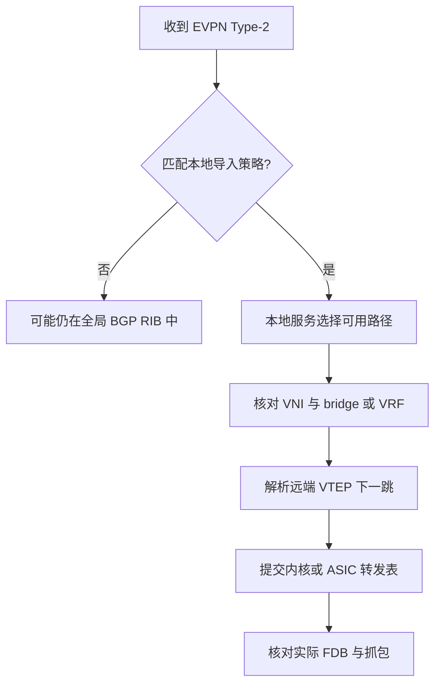
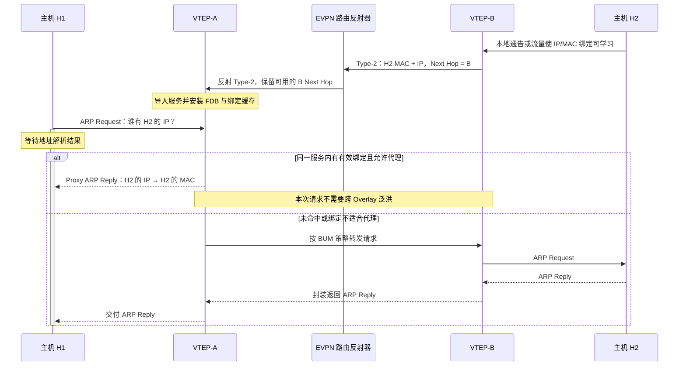

---
tags:
  - Linux
  - 网络编程基础
  - BGP
  - EVPN
  - VXLAN
aliases:
  - BGP-EVPN
  - EVPN Route Type
  - EVPN ARP Suppression
优先级: P1
阅读次数: 0
---

# 7.11 BGP-EVPN：MAC/IP Advertisement、ARP Suppression 与基本 Route Type

> [!abstract] 本篇定位
> [[3.Linux/7. 网络编程/07. 链路层与网络层深挖/7.10 VXLAN 数据平面：VTEP、VNI、MAC-in-UDP、ECMP、BUM 与 MTU|7.10 VXLAN 数据平面]] 解释了怎么搬运一个帧，但还留下三个问题：**远端 MAC 在哪里、一个广播域有哪些远端接收点、哪些 IP/MAC 绑定可以在本地代答？**
>
> BGP-EVPN 把这些信息变成可发布、选择、导入和撤销的路由。学习目标不是背五个编号，而是从一条路由推导出它能填哪张表，以及哪些表它根本没有提供足够信息去填。

> [!note] 范围与版本
> 本篇以单归属 VXLAN Fabric 为主，深入 Type-2、Type-3 与 ARP Suppression，对 Type-1、Type-4、Type-5 建立职责边界。基本路由类型来自 RFC 7432，VXLAN 的映射来自 RFC 8365，IP Prefix Route 来自 RFC 9136，Proxy ARP/ND 运维行为补充 RFC 9161。
>
> RFC 7432 的基础数据平面是 **MPLS EVPN**；不能把里面的 MPLS 字段名字原样理解成“VXLAN 包里也有 MPLS 头”。本篇涉及 CLI 时固定参照 **FRRouting 10.4 文档**，不声称它是最新版本，也不把命令当成所有厂商都通用。[^evpn][^overlay][^prefix][^proxy][^frr]

## 1. 从 flood-and-learn 到控制平面学习

传统学习桥看见源 MAC 后更新本地表，未知目的用泛洪寻找。教材中的 backward learning 说明了这种机制为什么能在没有手工 MAC 表时逐步工作；但是远端端点多、虚拟机移动频繁时，仅靠数据平面学习会带来较多泛洪与状态恢复问题。[^cn6]

EVPN 不是取消所有“学习”。一种典型流程仍然是：入口 PE/VTEP 从本地接入侧学习端点，然后通过 BGP 把远端设备需要的信息分发出去。**变化的是远端映射的获得渠道，不是凭空拥有所有端点的真相。** 若某台静默主机尚未发送任何可学习流量，又没有静态配置或其他端点登记机制，EVPN 不能凭协议名字自动知道它的位置。[^evpn]

| VXLAN 数据平面需要的状态 | EVPN 提供的主要信息 | 仍依赖什么 |
|---|---|---|
| 目的 MAC 在哪个远端 VTEP | Type-2 MAC/IP Advertisement | 本地发现、策略、最佳路径、下一跳解析与实际安装 |
| 同一逻辑广播域的远端复制成员 | 常见 EVPN Ingress Replication 使用 Type-3 IMET | 本地 VNI/服务配置、隧道属性及复制实现 |
| 目标租户 IP 对应哪个 MAC | 带 IP 的 Type-2，结合 Proxy ARP/ND 机制 | 绑定有效性、邻居状态、冲突与撤销处理 |
| 租户 IP 前缀往哪里走 | Type-5 IP Prefix Route | IP-VRF、路由与 IRB/Overlay Index 解析模型 |

**BGP-EVPN 是控制平面；VXLAN 是一种数据平面封装。** 两者不是不可拆分的同义词。VXLAN 可以不用 EVPN，EVPN 也可以服务于不采用 VXLAN 的数据平面。[^evpn][^overlay]

![[图片/SVG/3_7_7_7_11_1.svg|900]]

图中上方的虚线路径负责交换可达性信息，下方实线路径负责传送租户数据。一个 RR 可以只参与路由反射；它不必成为租户流量的隧道端点。

## 2. 学 EVPN 所需的最小 BGP 基础

### 2.1 BGP 会话承载的是路由，不是用户流量

BGP 对等体通过 TCP 会话交换控制信息。教材从 path vector、AS_PATH 与策略解释了 BGP 的基本工作方式；这并不意味着 BGP 只能发布公网 IP 前缀。MP-BGP 扩展通过不同的地址族承载不同形式的可达性信息。[^cn6][^mpbgp]

EVPN 使用 **AFI 25（L2VPN）与 SAFI 70（EVPN）**。在 MP_REACH_NLRI 中携带通告和下一跳，使用 MP_UNREACH_NLRI 撤销相应可达性。EVPN NLRI 的外壳包括 `Route Type`、`Length` 与该类型的载荷；不同 Route Type 的载荷结构和用途不同。[^evpn][^mpbgp]

```text
BGP UPDATE
├─ MP_REACH_NLRI
│  ├─ AFI = 25 / SAFI = 70
│  ├─ Next Hop：例如远端 VTEP IP
│  └─ EVPN NLRI：Route Type / Length / 类型对应的字段
└─ 其他路径属性
   └─ Extended Communities：Route Target 等
```

这是语义分层示意，不是完整 BGP UPDATE 字节格式。**NLRI 内的主机 IP 与 MP_REACH 的 Next Hop 是两个不同字段。**

### 2.2 Underlay BGP 与 Overlay BGP-EVPN 是不同任务

一个 Fabric 可以用 IPv4/IPv6 Unicast 地址族为 VTEP loopback 提供路由，再用 L2VPN EVPN 地址族发布租户端点。它们可以复用同一套设备甚至同一会话，也可以采用不同的会话拓扑。

因此，“BGP Established”只说明某个对等关系建立到了相应状态，不能独立证明：EVPN 地址族已经协商/激活、路由已经收到、Route Target 已匹配、VTEP 下一跳可达，或内核/ASIC 中已经有正确转发表。[^mpbgp][^frr]

### 2.3 Route Reflector 不等于数据面下一跳

在 iBGP 设计中，RR 用于减少直接全互联的会话关系。一个有 $n$ 个节点的完全会话网格具有 $n(n-1)/2$ 对连接；这是组合计数，不是“采用 RR 后系统开销一定降低某个百分比”的性能结论。

普通路由反射不应随意修改被反射路由的 NEXT_HOP。假设 VTEP-B 发布端点，VTEP-A 通过 RR 学到它，通常应继续把 VXLAN 数据发往 **VTEP-B**，而不是 RR。ORIGINATOR_ID 与 CLUSTER_LIST 解决的是反射路径中的控制平面环路，也不是租户二层的防环机制。[^rr]

是否让 Spine 同时担任 RR、是否使用 eBGP EVPN、是否启用 next-hop-self 或其他策略，属于架构选择。本篇不把“所有 EVPN 都有 RR”当成前提。

## 3. RD、Route Target、VNI、ESI：四个问题，四个标识

| 名称 | 在回答什么 | 常见误解 |
|---|---|---|
| RD，Route Distinguisher | 如何使原本可能重叠的路由通告在相应命名空间中可区分 | “RD 决定哪些租户互通” |
| RT，Route Target | 本地哪个服务/VRF应按导入策略接收这条路由 | “RT 就是 Route Type” |
| VNI，VXLAN Network Identifier | 数据包解封装后应进入哪个逻辑上下文 | “VNI 就是一名租户的永久唯一身份” |
| ESI，Ethernet Segment Identifier | 多个 PE 是否连接到同一个 Ethernet Segment | “多个 VTEP 同时通告一个 MAC 都是迁移” |

**Route Type 与 Route Target 都常被缩写成 RT，读文档时必须按上下文区分。** 本篇用“Type-2”表示类型，用“RT `65000:10100`”表示 Route Target。

RD 不承担导入策略；RT 也不是加密授权令牌。两个 PE 的 RD 可以不同，仍把同一个业务服务的路由导入各自的 MAC-VRF。反过来，VNI 相同但 RT 导入规则不一致，也可能没有期望的远端状态。自动推导 RT 的产品配置，只是把映射规则自动化，不是证明 RD、RT、VNI 在协议里等价。[^evpn][^overlay]

### 3.1 MAC-VRF、Bridge Domain 与 IP-VRF

**MAC-VRF** 承担 EVPN 二层服务的 MAC 可达性上下文；一个服务模型可以承载一个或多个 Bridge Domain。**IP-VRF** 承担租户三层路由上下文。L2 VNI 与 L3 VNI 的映射应根据具体服务模型理解，不能把所有 VNI 都想成“一个 VLAN 的放大版”。[^evpn][^overlay][^irb]

在本篇的简单 VLAN-based 二层模型里，可以把一个 BD 与一个 L2 VNI 关联，并让 Type-2/Type-3 服务于这个上下文。**Ethernet Tag ID 不必等于本地 VLAN ID，更不必等于 VNI**；在这里它采用 0，其他服务模型需要另查规则。[^overlay]

### 3.2 ESI 与多归属

非零 ESI 可用于标识共同的 Ethernet Segment；多个 PE 对同一个非零 ESI 的通告是多归属建模的重要部分。单归属端点常使用全零 ESI，但“两个通告都带全零 ESI”不代表它们连接到同一个物理 Segment。

这一区别在 MAC Mobility 中尤为重要：一个主机从单归属 VTEP-A 移到单归属 VTEP-B，前后 ESI 都可能是零，仍然可能是一次真实迁移。[^evpn]

## 4. Type-1 到 Type-5：先知道它们安装什么

这五类是学习主线，不是截至某日期所有 EVPN Route Type 的穷举。Type-1–4 来自 RFC 7432；Type-5 的 IP 前缀通告由 RFC 9136 定义。[^evpn][^prefix]

| 类型 | 正式名称 | 主要知识点 | 不提供什么 |
|---|---|---|---|
| Type-1 | Ethernet Auto-Discovery Route | Ethernet A-D per ES / per EVI；多归属快速撤销、别名等机制的输入 | 不能代替每个主机的 IP/MAC 绑定 |
| Type-2 | MAC/IP Advertisement Route | MAC 可达性，及可选的 IP/MAC 绑定；某些 IRB 模型也使用其主机信息 | 不能单独枚举完整 BUM 成员 |
| Type-3 | Inclusive Multicast Ethernet Tag Route（IMET） | 逻辑网络成员和隧道复制信息；常见 HER 的远端列表来源 | 不枚举全部主机，不等于每个 IP 组播组的订阅 |
| Type-4 | Ethernet Segment Route | 发现同一 ES 上的 PE，为 DF 选举提供候选信息 | 不直接表示“到某个主机 IP 的路由” |
| Type-5 | IP Prefix Route | 租户 IP 前缀可达性，与逐个 MAC 通告解耦 | 不自动提供目标主机 MAC，也不替代所有 Type-2 |

![[图片/SVG/3_7_7_7_11_3.svg|900]]

图把两种作用域区分开：左侧是多归属接入 Segment，右侧是单归属端点、广播域和 IP-VRF。**一个最小单归属 L2 EVPN-VXLAN 实验，以理解 Type-2 和 Type-3 为主；没有 Type-1/4 不应立即判错。** 但完整性仍取决于所选服务和复制方式，不能据此关闭生产设备上看不懂的路由类型。

## 5. 深入 Type-2：路由中的 IP 到底是谁

继续采用 7.10 的端点：H2 的租户 IP 是 `192.168.100.22`，MAC 是 `02:00:00:00:00:22`，所在 VTEP-B 的承载 IP 是 `10.255.0.2`，L2 VNI 是 `10100`。

下面是**人为构造的教学解码记录，不是 FRR 或交换机的真实输出**。字段以 RFC 的语义分组，故意把 NLRI 与路径属性分开：

```text
EVPN NLRI — Route Type 2
  RD                  10.255.0.2:100
  ESI                 全零，单归属例子
  Ethernet Tag ID     0，本文 VLAN-based 模型
  MAC Address Length  48 bits
  MAC Address         02:00:00:00:00:22
  IP Address Length   32 bits
  IP Address          192.168.100.22
  Label 1 字段         在本例 VXLAN 映射中编码 VNI 10100

MP_REACH 与其他路径属性
  BGP Next Hop        10.255.0.2
  Route Target        65000:10100
  Encapsulation       VXLAN
```

**主机 IP** 参与 IP/MAC 绑定，**BGP Next Hop** 指向远端可达位置，两者不可互换。把 Type-2 的 IP Address 写成 VTEP IP，会让读者误以为 ARP Suppression 是在应答承载网络地址。[^evpn][^overlay]

![[图片/SVG/3_7_7_7_11_2.svg|900]]

图中同一条 Type-2 的不同字段流向不同状态：MAC/位置用于远端 FDB；主机 IP+MAC 用于绑定缓存；RT 用于导入；VTEP Next Hop 还要交给 Underlay 路由解析。**有字段不等于已安装，箭头表示数据依赖。**

### 5.1 MAC-only 与 MAC+IP 是两种能力

Type-2 的 IP 字段是可选的，IP Address Length 可以为 0、32 或 128。MAC-only 通告可以让远端知道“该 MAC 在哪里”，但不能据此推导“某个 IP 属于该 MAC”。也就不能仅凭 MAC-only 路由完成该 IP 的 Proxy ARP。[^evpn]

一台主机可以有多个 IP。系统可以为同一个 MAC 发布不同的 IP/MAC 路由，必要时还保留 MAC-only 路由。因此，**某条 IP/MAC 通告撤销，不必然等于这个 MAC 的全部二层可达性都失效**。实际清理必须按路由键、绑定与服务上下文区分，不能把每次 IP 变化都当成整台主机消失。[^evpn]

### 5.2 为什么字段还叫 MPLS Label

RFC 7432 的 Type-2 结构包含 Label 1 与可选的 Label 2。对于 RFC 8365 的 VXLAN 映射，相应字段用于编码 VNI，按所选服务模型解释；**这不代表 VXLAN 数据包里额外存在一个 MPLS shim header**。还应避免把 VNI 按普通 MPLS 标签的 20-bit 语义错误截断。[^evpn][^overlay]

不要只看到抓包工具显示 `Label` 就判定“这不是 VXLAN EVPN”。应同时检查封装属性、路由类型、服务模型，以及最终的数据面封装。

### 5.3 一条 Type-2 何时才真正能转发

逻辑上至少需要这些条件同时成立：收到有效通告；本地服务匹配 RT 导入规则；路由选择/移动状态允许使用该位置；对应 VNI、bridge/VRF 已配置；下一跳 VTEP 可解析且可达；内核或 ASIC 成功安装相关转发表项。[^evpn][^frr]

这些步骤在实现中可能异步或交错执行，不能把逻辑依赖强行描述成所有平台都完全相同的同步调用栈。



这张图的关键不是箭头数量，而是**全局 BGP RIB、服务路由与实际转发表属于不同观察层**。“show bgp 里有”只是排障的中途证据。

## 6. 深入 Type-3：发现复制成员，不是发现每台主机

Type-3 的正式名字里有 Multicast，很容易让人误以为它只用于租户应用的 IP multicast。实际上，在常见 EVPN Ingress Replication 设计中，它用于让参与者建立同一逻辑网络的远端复制集合，承载广播、未知单播等需要扩散的流量。[^overlay]

Type-3 NLRI 包含 RD、Ethernet Tag ID、IP Address Length 与 Originating Router IP。**这个 Originating Router IP 不是 Type-2 中的租户主机 IP。** 与通告关联的 PMSI Tunnel Attribute 提供隧道类型和有关信息；其中 Tunnel Type 6 表示 Ingress Replication。这个属性不是“某台主机 ARP 缓存”的替代品。[^evpn][^overlay]

例如 VTEP-A 在 VNI 10100 对应服务中导入来自 B、C 的合格 IMET 信息后，可以建立 `{B, C}` 的复制成员集合。它仍然不知道 B、C 后面每一台主机的 MAC 和 IP；这些是 Type-2 或其他端点发现机制的职责。

### 6.1 Type-2 与 Type-3 可以分别失效

| 状态组合 | 可以出现的现象 | 解释 |
|---|---|---|
| Type-2 正常，Type-3/复制成员缺失 | 已知单播能走；未知端点首次 ARP 失败 | 有目的 MAC 的定位，没有所需 BUM 扩散路径 |
| Type-3 正常，Type-2 缺失 | BUM 可送达；单播退化为未知单播或受策略丢弃 | 有成员，但缺目的 MAC 的确定位置 |
| Type-2 MAC-only 正常，Type-3 正常 | 二层可通，但没有该 IP 的本地 Proxy ARP 命中 | 缺 IP/MAC 绑定，不是缺 MAC 位置 |
| Type-2/3 都正常，UDP 数据路径被阻断 | BGP 控制状态看似完整，租户仍不通 | 控制面与数据面的 ACL、路径和 MTU不同 |

上表是工程推演，前提是采用基于 IMET 的 HER 且没有额外静态成员、缓存或其他回退机制。真实设备可能暂时保留旧状态，不能用瞬时截图代替完整故障过程。

## 7. ARP Suppression：把可靠的远端绑定拿到本地使用

### 7.1 一次命中的完整前提

H2 先被 VTEP-B 发现，B 获得有效的 IP/MAC 绑定并发布带 IP 的 Type-2。A 按本地服务策略导入，建立对应的 Proxy ARP 表或等效邻居抑制状态。随后，H1 询问“谁有 `192.168.100.22`”，A 可以在本地用已知绑定处理，而不把这次请求扩散到远端广播域成员。[^proxy]

这不是 A 为每次 ARP 向 RR 发一个查询，也不是 BGP 变成按需 RPC。**BGP 预先传播绑定；数据平面或本地代理使用已安装的状态。**



未命中分支只画了 B；存在多个复制成员时，实际请求可能发送到多个远端。是否采取特定受控泛洪或丢弃策略，应对照 RFC 9161 与设备配置，不是让设备对未知地址编造绑定。

### 7.2 本地代答使用哪个 MAC

在本篇的**同广播域、远端主机代理**例子中，返回的是 H2 的租户 MAC `02:00:00:00:00:22`，不是 VTEP-B 的 Underlay MAC，不是 VTEP 的 IP，也不是自动改成 Anycast Gateway MAC。H1 随后仍构造一个发往 H2 MAC 的二层帧。[^proxy]

经典跨子网 Proxy ARP、EVPN 的同 BD 邻居代理以及 Anycast Gateway，是相关但不同的机制。网关自己的 IP/MAC 应答可以与 ARP Suppression 共存，但不能把任何本地 ARP 应答都归结为“远端主机还活着”。

### 7.3 ARP 回复成功，不是主机存活证明

假设 H2 已故障，但 A 的绑定暂时未撤销。A 可能仍能根据本地状态给出 ARP 回复，而真正的数据包到达远端后无人处理。同样，绑定缓存正确但 Underlay 路由或 FDB 安装错误，也可能出现“ARP 有结果，业务完全不通”。

因此，邻居代理的正确性需要发现、刷新、迁移、撤销和故障处理，而不是开关开启后就永久可信。RFC 9161 专门讨论 Proxy ARP/ND 表维护与重复地址等运维问题。[^proxy]

### 7.4 未知地址不应默认一刀切丢弃

“减少广播”与“完全没有广播”是两个不同目标。若端点绑定尚未完整登记，未知 ARP/NS 被直接丢弃可能造成静默主机永远无法被发现。

RFC 9161 在快速迁移的数据中心场景中，对抑制未知 ARP/NS、GARP 和 unsolicited NA 给出了谨慎建议。只有当运营模型能够保证端点绑定完整、及时并且正确时，才可能考虑更激进的抑制策略；不能把此类特殊前提写成所有 Fabric 的默认做法。[^proxy]

## 8. IPv6 ND 不能只把 ARP 三个字换掉

IPv6 使用 Neighbor Discovery。EVPN 可以分发 IPv6/MAC 绑定，但本地代理还必须处理 Neighbor Advertisement 的 Router/Override 等语义、Neighbor Unreachability Detection，以及 Duplicate Address Detection 的特殊流程。[^proxy]

RFC 9161 说明，不能仅因看到某个 NS 就当作已获得完整、可以安全代理的 IPv6 绑定信息；例如所需的 Router 标志并不在普通 NS 中。ND 的学习、代理与防重复地址行为需要按其规则实现。

本篇只建立边界：**“Type-2 可以携带 IPv6”不等于“ARP 抑制的所有细节原封不动适用于 ND”。** 完整的 IPv6 邻居状态机应结合 [[3.Linux/7. 网络编程/07. 链路层与网络层深挖/7.4 IPv6|7.4 IPv6]] 与 [[3.Linux/7. 网络编程/07. 链路层与网络层深挖/7.6 ICMP与ICMPv6|7.6 ICMPv6]] 学习。

## 9. MAC Mobility：端点的位置会变，不是永远写死

### 9.1 从一个 VTEP 移到另一个

以下是一个**普通迁移的教学状态序列**：最初 H2 在 B，后来转移到 C，MAC 保持不变。假设各节点能按协议发现旧位置且没有冲突/特殊策略，则新位置使用更高的 MAC Mobility Sequence，帮助接收端分辨较新的通告。[^evpn]

| 时刻 | B 的状态 | C 的状态 | A 应观察什么 |
|---|---|---|---|
| $t_0$ | 通告 H2，初始序号按 0 理解 | 没有 H2 | FDB 指向 B |
| $t_1$ | 旧状态可能暂时存在 | 本地发现 H2，并识别迁移 | 接收新的位置与 Mobility 信息 |
| $t_2$ | 撤销或清理旧通告 | 普通例子中通告更高序号 1 | 选定新位置并更新实际 FDB |
| $t_3$ | 旧数据/绑定完成清理 | 成为有效本地端点 | 核对 IP/MAC 缓存、业务包与实际到达位置 |

序号是协议状态，不是 wall-clock timestamp，也不是 Raft term。它不能保证全网同一时刻原子切换，更不能承诺某个固定毫秒数。收敛时间还取决于发现时机、BGP 传播、调度和数据平面安装。

### 9.2 迁移与合法多归属不能混淆

若 B、C 连接同一个非零 ESI 的 Ethernet Segment，它们同时通告同一 MAC 可以是合法多归属，而不是主机在两台设备之间反复搬迁。反之，单归属迁移前后 ESI 都是零，仍需要按 MAC Mobility 的相关规则判断。[^evpn]

反复位置震荡也可能来自真实迁移、二层环路、错误接线或重复 MAC。抑制、冻结或告警策略依赖实现与运营要求；不要一见序号上升就判定“这是正常虚拟机迁移”。

### 9.3 控制面失联不等于数据面立刻消失

BGP 失联后，故障检测、路由撤销、可能启用的 Graceful Restart、旧表项保留以及下一跳可达性会共同影响行为。有的已有数据流可能继续一段时间，新位置或新端点却无法正确传播。排障应记录控制面事件与实际转发表变化的时间线，而不是只观察 Established 的布尔状态。[^frr-bgp]

## 10. Type-1、Type-4 与 DF：只建立必要的多归属边界

Type-4 用于发现同一 Ethernet Segment 上的 PE，提供 DF 选举所需的信息。Type-1 的 per-ES 和 per-EVI 形式参与不同的多归属恢复/别名机制；例如通过 ES 粒度的撤销，不必为每一个 MAC 单独等待同样的故障传播过程。具体行为还取决于 Single-Active/All-Active、服务模型和相关扩展。[^evpn]

**DF（Designated Forwarder）不是整个 EVPN 网络的唯一领导者，也不是所有已知单播都必须经过的“主交换机”。** 在典型 All-Active 多归属中，DF 主要约束网络侧向该接入 Segment 的 BUM 交付；已知单播可以使用多归属转发机制。方向与业务类别不能省略。[^evpn][^overlay]

VXLAN 数据平面的 split horizon 不能照搬 MPLS ESI label 的处理，因为普通 VXLAN 没有这个 MPLS 标签栈。RFC 8365 给出相应的 Overlay 处理方法，也讨论了基本 VXLAN 缺少显式 BUM 标记时的限制。**不要把“有 DF + 有 ESI”描述成任何失效、收敛或接线条件下绝无重复包的数学保证。**[^overlay]

## 11. Type-5 与 IRB：为什么带 IP 的 Type-2 还不够

Type-2 的核心单位是 MAC 及可选 IP 绑定。Type-5 引入独立的 IP Prefix Route，能表达“这个租户前缀通过哪个出口可达”，不要求把前缀中的每个主机都先展开成逐 MAC 的通告。[^prefix]

比如租户后面挂着 `192.168.200.0/24`，可以按所选模型通告这个前缀；它不是把 256 个地址都建立成 Proxy ARP 缓存。Type-5 的下一跳与可能的 Overlay Index 解析，还必须结合 IP-VRF、网关和实际路由实现理解。

同时，**Type-2 也可以在某些 IRB 模型中提供主机路由所需的信息**。因此两句常见说法都不精确：“带 IP 的 Type-2 就等于任意前缀路由”；“只要做三层 EVPN 就完全不需要 Type-2”。[^prefix][^irb]

本篇到此只形成三层关联：L2 VNI/MAC-VRF 管桥接，IP-VRF 管租户路由，IRB 在二者间衔接。完整的 symmetric/asymmetric IRB、Anycast Gateway 与 L3 VNI 数据路径应另行展开，不混入本篇的同子网 ARP 示例。

## 12. Linux + FRR 10.4：从 BGP 路由查到实际转发表

### 12.1 先分清 FRR 与内核各自负责什么

FRR EVPN 文档强调，Linux 网络接口与 bridge/VXLAN/VRF 等对象需要预先正确配置；FRR 通过 Netlink 了解这些对象并参与控制与转发表管理，**不因一个 BGP 命令就替你创建所有接口**。[^frr]

7.10 的实验使用静态复制成员和数据平面远端学习。若把它改造为 EVPN 实验，需要重新设计远端学习策略、FRR/Zebra 与 bridge 的配合，不能只在旁边启动 BGP 后宣称“已切换为控制平面学习”。

> [!warning] 以下是只读核对与配置语义，不是完整部署实验
> 命令以已经正确部署的 FRR 10.4/Linux EVPN 环境为前提。当前笔记制作环境没有运行 FRR，也没有连接真实交换机；下文没有提供假造的 `show` 结果。不同 FRR 版本的显示字段和过滤语法可能不同，先查 `show version` 与命令帮助。

### 12.2 第一层：会话与全局 EVPN RIB

先确认 EVPN 地址族，再分别看 Type-2 与 Type-3。`sudo vtysh -c ...` 是只读查询；它不创建接口，也不修改策略。[^frr-bgp]

```bash
sudo vtysh -c 'show version'
sudo vtysh -c 'show bgp l2vpn evpn summary'
sudo vtysh -c 'show bgp l2vpn evpn route type 2'
sudo vtysh -c 'show bgp l2vpn evpn route type 3'
```

检查项不是“有没有一行”，而是：MAC/IP 值是否对应目标；RD 与 RT 是否符合规划；Next Hop 是远端 VTEP 还是错误地指向 RR；封装类型是什么；是否存在移动序号、重复通告或不同来源的候选位置。

### 12.3 第二层：本地 VNI 与服务导入

全局 RIB 有路由之后，还要看本地相关 VNI 的视图。`show evpn vni` 用于观察 FRR/Zebra 识别的 VNI 等状态；`show bgp vni 10100` 用于进一步检查指定 VNI 的 BGP EVPN 信息。[^frr][^frr-bgp]

```bash
sudo vtysh -c 'show evpn vni'
sudo vtysh -c 'show bgp vni 10100'
```

重点核对：VNI 是否存在并处于预期 L2/L3 角色；服务是否具有正确的 RT 导入规则；对应 bridge/VRF 是否存在。自动推导 RT 时，要特别核对两端 ASN 与推导规则是否生成了预期的共同导入集合。

### 12.4 第三层：Linux 里到底装了什么

把下面设备名替换成已经核对的实际名字。若 FRR 和接口运行在 network namespace 中，命令也必须进入对应 namespace，而不是在默认 namespace 查空表。

```bash
ip -d link show vx10100
bridge link show
bridge fdb show br br100
bridge fdb show dev vx10100
ip neigh show
ip route get 10.255.0.2
```

`bridge fdb` 关注桥接端口与远端 VTEP；`ip neigh` 关注相应设备/服务中的 IP/MAC 绑定；`ip route get` 关注承载下一跳。硬件交换机还需要对应的 ASIC/FIB 安装状态，Linux 表正确也不能替代对硬件卸载完成情况的验证。

对于 ARP Suppression，再核对 VXLAN bridge port 的邻居抑制设置与设备的代理表。不同 Linux bridge 模式、SVI/VRF 绑定和交换机平台会改变具体呈现；**全局 BGP RIB 的 Type-2 存在，不等于 proxy 表一定已经正确命中**。[^frr]

### 12.5 两个常见配置命令的语义陷阱

| FRR 配置项 | 实际关注点 | 不能由此推出 |
|---|---|---|
| `advertise-all-vni` | 启用相应 EVPN/VNI 通告行为；仍需正确地址族与本地 VNI 状态 | 自动创建所有 bridge、VXLAN 与 VRF |
| `advertise-svi-ip` | 通告本地 SVI 的 MAC/IP 信息 | 自动发现并发布每个 VM/容器的 IP/MAC |
| EVPN 地址族中的 `advertise ipv4 unicast` | 在适当 VRF/配置上下文中导出 IPv4 路由为 EVPN 前缀通告 | 自动为全网所有前缀补齐网关、L3 VNI 与访问策略 |

这里只解释语义，不给出缺少 Underlay、VRF 与端点学习前提的“几行万能配置”。具体拓扑应参照固定版本官方配置例子逐项验收。[^frr]

## 13. 故障注入与验收矩阵

以下建议只用于隔离实验或经过审批的测试环境。不要在生产环境随意删除路由、改变导入规则或关闭协议会话。每次只改一个变量，保留基线配置和恢复方法。

| 注入变量 | 控制面证据 | 数据面验收 | 主要学习点 |
|---|---|---|---|
| 目标服务的 RT 不匹配 | 全局 RIB 可有路由，服务未导入 | 目标远端 FDB/绑定缺失 | 收到 ≠ 导入 |
| 只保留 MAC-only Type-2 | 可见 MAC，无对应 IP 字段 | 已知二层转发可行，但代理该 IP 不应凭空命中 | MAC 位置 ≠ IP/MAC 绑定 |
| 在受控 HER 实验中移除 Type-3 来源 | 缺预期 IMET 成员 | 冷缓存 ARP/BUM 可能失败，已知单播仍可通 | 成员 ≠ 端点 |
| 删除 VTEP 下一跳承载路由 | EVPN 通告可能仍在 | 隧道报文无法按原路径到达 | Overlay 依赖 Underlay |
| 只阻断 UDP 4789，保留 BGP TCP | EVPN 会话与通告仍可正常 | VXLAN 数据无法通过 | 控制面 ≠ 数据面 |
| 移动同一 MAC 的单归属端点 | Mobility 序号与位置改变 | 旧 FDB/代理状态最终清理，流量到新位置 | 发布、选路、安装的收敛链 |
| 缩小一条候选 Underlay 路径 MTU | BGP/Type-2/3 不一定变化 | 大包或特定哈希路径失败 | 控制路由正确 ≠ 任意包长可用 |

验收记录至少包含时间、改变项、路由视图、服务视图、转发表和双端业务结果。不要用“BGP Up、ping 一下通了”替代冷启动、迁移、撤销以及不同大小流量的验证。

## 14. 自检题：把路由翻译成可执行的判断

> [!question]- 1. Type-2 的 `IP Address=192.168.100.22` 和 `Next Hop=10.255.0.2` 分别有什么用途？
> 前者是租户端点 IP，可与 MAC 构成绑定；后者是到远端位置的控制平面下一跳，在本例中用于选择 VTEP，并继续由 Underlay 解析。把两者互换会同时破坏代理与隧道转发的解释。

> [!question]- 2. 通过 RR 学到路由后，为什么租户数据通常不经过 RR？
> 路由反射传播通告，不要求改变数据下一跳。普通例子保留广告 VTEP 的可用 Next Hop，数据按 VXLAN 直接发往该 VTEP；RR 是否位于某条物理路径上，是另一个问题。

> [!question]- 3. Type-2 有了，为什么首次 ARP 还可能失败？
> 它可能是 MAC-only，无法本地代理；若所需 BUM 成员或广播路径缺失，请求也到不了远端。还要排除策略、绑定过时、服务导入与转发表安装问题。

> [!question]- 4. ARP Suppression 是不是每次收到 ARP 都发 BGP 查询？
> 不是。典型机制使用预先分发并安装的绑定。本地命中即可处理，未命中依照策略与发现机制转发，不凭空构造远端事实。

> [!question]- 5. 没有 Type-1/4 是不是 EVPN 部署错误？
> 不一定。单归属 L2 基础实验并不需要把多归属的所有状态都建出来；只有先明确服务模型、是否存在 ES 多归属，才知道应该出现哪些路由。

> [!question]- 6. DF 为什么不能类比为 Raft Leader？
> 典型 EVPN All-Active 中，DF 约束特定 ES 上特定方向的 BUM 交付，不负责把全网所有操作按统一日志排序，也不意味着所有已知单播只能走一个 PE。

> [!question]- 7. 发布了 Type-5 前缀，为什么不能替该前缀每个 IP 自动回答 ARP？
> 前缀可达性不包含每个主机的 IP/MAC 绑定。Type-5 的路由作用与 Type-2 的端点绑定不同，实际下一跳/网关处理需要另行解析。

> [!question]- 8. 为什么 RT 配错有时只影响某个 VNI，而 BGP 会话完全正常？
> 会话是控制传输关系，RT 是路由导入服务的策略条件。控制信息能收到，不代表它会进入目标 MAC-VRF 或 IP-VRF。

## 15. 参考资料与来源分工

*Computer Networks* 第 6 版支撑学习桥、BGP path vector、TCP 对等体和策略的基础。本次项目教材检索没有得到足以直接支持 EVPN Route Type、PMSI 与 Proxy ARP/ND 细节的正文；这些部分明确采用标准与官方实现文档。没有把已上传的 *Top-Down Approach* 第 7 版冒充 Skill 推荐的第 9 版。

字段示例、排障矩阵与状态迁移表为依据资料整理的原创教学案例。它们不是 RFC 原图，不是某台设备的真实输出，也不是已经跑过的收敛性能测试。

[^cn6]: Andrew S. Tanenbaum, Nick Feamster, David Wetherall. *Computer Networks*, 6th edition, Global Edition, Pearson, 2021。§4.7.2，印刷页 337–338；§5.7.7，印刷页 487（本项目 PDF 第 361–362、511 页）。后者支撑 BGP path vector/TCP 对等关系基础，不用书中概括替代 EVPN 或 Route Reflection 规范。
[^evpn]: RFC 7432, *BGP MPLS-Based Ethernet VPN*, 2015。重点 §7（NLRI 与字段）、§8（多归属）、§9–11（MAC/IP 学习与转发）、§15（MAC Mobility）。https://www.rfc-editor.org/rfc/rfc7432.html
[^overlay]: RFC 8365, *A Network Virtualization Overlay Solution Using Ethernet VPN (EVPN)*, 2018。重点 §5.1（服务/VNI 映射）、§8.3（Overlay 多归属）、§9（BUM）。https://www.rfc-editor.org/rfc/rfc8365.html
[^proxy]: RFC 9161, *Operational Aspects of Proxy ARP/ND in Ethernet Virtual Private Networks*, 2022；更新 RFC 7432 的相关运维说明。重点 §3 的学习、代答、维护和抑制边界。https://www.rfc-editor.org/rfc/rfc9161.html
[^prefix]: RFC 9136, *IP Prefix Advertisement in Ethernet VPN (EVPN)*, 2021。Type-5、IP Prefix 与 Overlay Index 等基本语义。https://www.rfc-editor.org/rfc/rfc9136.html
[^irb]: RFC 9135, *Integrated Routing and Bridging in Ethernet VPN (EVPN)*, 2021。MAC-VRF/IP-VRF、主机信息与 IRB 模型。https://www.rfc-editor.org/rfc/rfc9135.html
[^mpbgp]: RFC 4760, *Multiprotocol Extensions for BGP-4*, 2007。MP_REACH_NLRI、MP_UNREACH_NLRI、地址族与下一跳。https://www.rfc-editor.org/rfc/rfc4760.html
[^rr]: RFC 4456, *BGP Route Reflection: An Alternative to Full Mesh Internal BGP (IBGP)*, 2006。路由反射、NEXT_HOP、ORIGINATOR_ID 与 CLUSTER_LIST。https://www.rfc-editor.org/rfc/rfc4456.html
[^frr]: FRRouting 10.4 Documentation, *EVPN*。固定版本实现参考；Linux 接口前提、VNI/VRF、`advertise-all-vni`、`advertise-svi-ip` 与前缀通告。访问日期 2026-09-15。https://docs.frrouting.org/en/stable-10.4/evpn.html
[^frr-bgp]: FRRouting 10.4 Documentation, *BGP*，EVPN 显示命令与相关运行时行为。CLI 需要结合本机 `show version` 和帮助核对；访问日期 2026-09-15。https://docs.frrouting.org/en/stable-10.4/bgp.html
