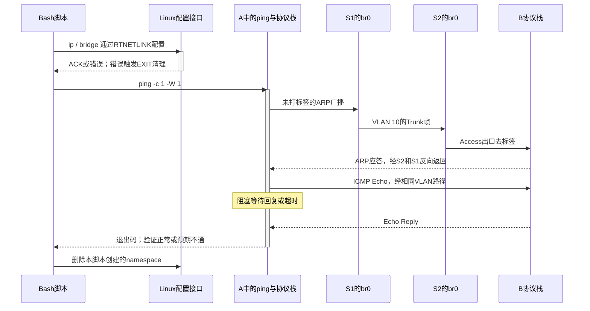

---
tags:
  - Linux
  - 网络编程基础
  - VLAN
  - 数据中心网络
aliases:
  - VLAN与802.1Q
  - Access、Trunk与PVID
  - QinQ与双层VLAN
priority: P0
阅读次数: 0
核查日期: 2026-09-15
---

# 7.8 VLAN 与 802.1Q：广播域、Access、Trunk、PVID 与 QinQ

> [!abstract] 先建立一个模型
> **VLAN 是交换机处理帧时使用的二层转发上下文；802.1Q Tag 是把这个上下文带过链路的一种表示。**
> 一帧属于哪个 VLAN、端口是否允许这个 VLAN、从端口发出去是否带标签，是三个不同的问题。PVID 主要回答入口分类，Allowed VLAN 回答成员资格，Tagged/Untagged 回答出口表示。

本篇接续 [[3.Linux/7. 网络编程/07. 链路层与网络层深挖/7.2 以太网|7.2 以太网]] 的 MAC 学习与帧格式，以及 [[3.Linux/7. 网络编程/07. 链路层与网络层深挖/7.7 生成树协议 STP与RSTP|7.7 STP/RSTP]] 的二层环路模型。不再重讲生成树选举，而是回答：**同一套交换设备，如何承载相互隔离的二层网络？**

**资料口径**：VLAN、广播范围与标签基础来自 *Computer Networks*, 6th Global Edition（2021）§4.7.5，以及 *TCP/IP Illustrated*, Vol. 1, 2nd ed.（2012）§3.2.3。PVID/出口规则、QinQ 与现代 Linux 命令由官方资料补充。IEEE 802.1Q-2022 作为具名标准基线；本篇没有把标准发布页冒充标准全文。厂商 Access/Trunk 命令不是统一的 IEEE API。[^cn6][^tcpip2][^ieee]

## 1. 为什么一台交换机还要拆成多个广播域

先假设 A、B、C 接在同一台 VLAN-aware 交换机上。A/B 属于 VLAN 10，C 属于 VLAN 20。A 发出一个普通 ARP 广播：交换机把它复制到 VLAN 10 中可转发的成员端口，不会仅因为 C 在同一台机箱上，就把这份广播交给 C。两组端口可以共用交换芯片和物理上联，但二层转发范围分开。教材以这种逻辑划分解释 VLAN，而不是要求为每个部门购买一台独立交换机。[^cn6]

| 概念 | 划分依据 | 不能直接等同于 |
| --- | --- | --- |
| 物理连接 | 网线、光模块、交换端口 | 同一个广播域 |
| VLAN / Bridge Domain | 二层成员与转发上下文 | 一个 IP 前缀 |
| IPv4 子网 | 地址与掩码决定的三层 on-link 判断 | 交换机端口的 VLAN 配置 |
| 冲突域 | 共享介质竞争范围；现代全双工链路不发生传统 CSMA/CD 冲突 | 广播域 |
| VRF | 独立三层路由表及其相关上下文 | VLAN Tag 中的某个字段 |

**“一个 VLAN 配一个 IP 子网”是常见设计，不是两个概念相等。** 把 `10.78.0.1/24` 和 `10.78.0.3/24` 放进不同 VLAN，主机会认为对方 on-link 并发送 ARP，但 ARP 不能穿过隔离边界，通信仍然失败。反过来，同一 VLAN 可承载不止一个 IP 前缀，但跨前缀通信仍由主机路由配置决定；这会增加排障复杂度。

广播隔离也不等于带宽隔离：不同 VLAN 的流可能争用同一个 Trunk、同一个出口队列和同一块交换缓存。VLAN 10 堵塞，VLAN 20 并不会自动拥有一条专用物理通道。

## 2. 一帧必须经过四道判断

![[图片/SVG/3_7_7_7_8_1.svg|900]]

**图的读法**：左边是入口上下文，中间是成员与转发表，右边是出口表示。同一个 VLAN 10，在 Access 链路上可没有标签，在 Trunk 链路上可有标签；这不是帧中途换了租户。

| 阶段 | 输入与动作 | 典型错误 |
| --- | --- | --- |
| ① 入口准入与分类 | 检查帧类型；解析有效 VID，或按端口 PVID 归类 | 把未打标签理解为“没有 VLAN” |
| ② 入口成员检查 | 分类出的 VLAN 是否允许从这个端口进入 | 认为带了合法 VID 就一定放行 |
| ③ 学习与转发 | 按二层学习上下文记录源 MAC；查目的 MAC；限制泛洪成员 | 只按 MAC 查全局表，忽略租户上下文 |
| ④ 出口成员与表示 | 候选出口是否为成员、处于转发状态；然后决定标签保留/生成/去除 | 把 `untagged` 当成入口 PVID |

这是便于排障的逻辑顺序，不是对所有 ASIC 流水线阶段的精确宣称。硬件可合并若干查找，端口模式也可能同时配置多个规则。Linux bridge 的 VLAN filtering、默认 PVID 与端口 VLAN 条目提供了可观察的实现模型。[^linux-bridge][^bridge-man]

> [!important] 交换机内部不必始终“真的插着那 4 个字节”
> 入口解析器可以把 VID 放进内部元数据，转发完成后再由出口重写报文。不要把“Access 入方向加标签”理解成所有实现都会立刻修改一块以太网帧内存。

## 3. 802.1Q 标签到底放在哪里

先采用 Ethernet II、一个 C-Tag 的常见情况：标签插在源 MAC 后、原始 EtherType 前。`0x8100` 告诉解析器接下来有 VLAN TCI；原来的 `0x0800`、`0x86DD` 或 `0x0806` 仍用于识别 IPv4、IPv6 或 ARP。[^cn6][^tcpip2]

![[图片/SVG/3_7_7_7_8_2.svg|900]]

图中上半按字段顺序画单标签与双标签，下半单独放大 16-bit TCI。**上半各格为可读性留出不同宽度，不代表实际字节比例；下半 TCI 的 3∶1∶12 位宽按比例表示。**

| 相对帧起点偏移 | 单标签字段 | 字节数 |
| --- | --- | ---: |
| 0–5 | Destination MAC | 6 |
| 6–11 | Source MAC | 6 |
| 12–13 | TPID：典型 C-Tag 为 `0x8100` | 2 |
| 14–15 | TCI：PCP、DEI、VID | 2 |
| 16–17 | 原 EtherType | 2 |
| 18 起 | 上层数据与必要填充 | 可变 |
| 帧末尾 | FCS | 4；普通主机抓包通常已被剥离 |

### 3.1 TCI 的三个字段

| 字段 | 位数 | 本篇中的解释 |
| --- | ---: | --- |
| PCP：Priority Code Point | 3 | 八种标记值；如何映射到业务类别与队列由策略/设备决定 |
| DEI：Drop Eligible Indicator | 1 | 丢弃资格标记；不是 CRC 错误位，也不是丢弃命令 |
| VID：VLAN Identifier | 12 | VLAN 标识字段；并非全部 4096 个值都可当普通 VLAN 使用 |

**版本差异必须保留**：CN6 这一节沿用了 CFI 的历史说明；本篇图使用现代工程资料中的 DEI 命名。旧抓包器或设备界面仍可能显示 `CFI`；Wireshark 官方字段参考同时保留 `vlan.cfi` 与 `vlan.dei`。不能把两个名称在所有历史版本里都当成相同语义。[^dei][^wireshark]

PCP 与 VLAN ID 是两个维度。`VID=10, PCP=3` 的含义不是“第三号 VLAN”。PCP 也不天然等于硬件 Queue 3，更不代表这个 VLAN 已开启 PFC；具体映射继续阅读 [[8.高性能存储/4. RDMA 与 RoCE/4.27 RoCE QoS 工程：PCP、DSCP、Priority Queue、PFC Priority 与 ECN Queue Mapping|4.27 RoCE QoS 工程]]，那里区分线上标记与设备内部资源。

### 3.2 VID 0、VID 4095 与普通 VLAN

`1–4094` 是普通 VID 的编码范围；设备可能额外预留若干值，或无法同时支持全部 VLAN。`VID=0` 表示 priority-tagged：帧有标签与优先级信息，但没有指定一个普通 VLAN。入口需要按适用规则获得 VLAN 上下文；Linux bridge 将这类帧与未打标签帧一起按 PVID 处理。`4095` 为保留值，不应配置为普通 VLAN。[^tcpip2][^linux-bridge]

因此，“禁止 untagged”与“禁止 VID 0”不应仅凭字面推定完全等价；应检查设备对 priority-tagged 的明确策略。

### 3.3 一个可以自己算的 TCI

下面是 Python 3.10+ 的纯计算示例，没有网络 I/O。只解析 TCI 位域，不决定一个端口是否应放行该帧；这样可以防止把“字段解析成功”与“策略许可”混在一起。

```python
from typing import NamedTuple

class Tci(NamedTuple):
    pcp: int
    dei: int
    vid: int

def decode_tci(raw: bytes) -> Tci:
    if len(raw) != 2:
        raise ValueError("TCI must contain exactly two bytes")
    value = int.from_bytes(raw, byteorder="big")
    return Tci((value >> 13) & 0x7, (value >> 12) & 0x1, value & 0xFFF)

assert decode_tci(bytes.fromhex("70 64")) == Tci(3, 1, 100)
assert decode_tci(bytes.fromhex("60 00")) == Tci(3, 0, 0)
assert decode_tci(bytes.fromhex("0f ff")).vid == 4095  # Reserved, not an admission decision.
```

`0x7064 = (3 << 13) | (1 << 12) | 100`。最后一个断言特意保留保留值：解析器可以告诉你“看到 4095”，策略层才能决定丢弃，而不是把它悄悄改成 PVID。

## 4. Access、Trunk 是规则组合，不是帧里的端口类型

| 常见端口配置 | 服务对象 | 普通未打标签帧的入口分类 | 出口常见表示 |
| --- | --- | --- | --- |
| Access VLAN 10 | 普通主机 | PVID 10 | VLAN 10 去标签 |
| Trunk，允许 10/20，无 untagged 业务 | 交换机、虚拟化主机 | 无默认业务 VLAN，按策略拒绝 | 10/20 带标签 |
| Trunk，Native VLAN 10，允许 10/20 | 需要兼容未打标签流量的链路 | 常按 Native/PVID 10 | 默认可使 10 去标签、20 带标签；可有显式 native-tagging 模式 |
| General / Hybrid | 同端口多种接入需求 | 由 PVID/其他分类规则决定 | 按各 VLAN 分别设置 |

Access 通常是“单业务 VLAN、主机侧不带标签”的管理抽象。但 **“任何 Access 口都拒绝任何带标签帧”不是可跨厂商套用的定理**：voice VLAN、匹配 VID 的 tagged 帧、priority-tagged 等可能有专门规则。Trunk 也可以连接服务器或虚拟交换机，不只连接两台物理交换机。[^cisco-trunk]

端口没有一个单独的“我是 Trunk”字段发给对端。两端的接入约定必须兼容；启用某些厂商的动态协商并不是 802.1Q 标签本身的功能。生产配置应明确模式、允许列表与未打标签策略，而不是依赖猜测。

## 5. PVID、Native VLAN、Allowed VLAN、Untagged 的边界

把这四个术语按**方向**记，比背定义更有效。

| 名称 | 主要问题 | 是否单凭它就决定出口标签？ |
| --- | --- | --- |
| PVID | 入方向没有普通有效 VID 时，归入哪个 VLAN？ | 否 |
| Native VLAN | 某端口上未打标签流量对应哪个 VLAN；常是厂商组合配置 | 不一定；取决于是否启用 native tagging |
| Allowed VLAN / VLAN membership | 这个端口能否承载某个 VLAN？ | 否，先过成员检查 |
| Egress Untagged | 这个 VLAN 从该端口发送时是否去掉标签？ | 是，作用于该出口 |

Linux 的 `bridge vlan add ... pvid untagged` 把两个独立标志写在一行：`pvid` 管入口缺省归类；`untagged` 管出口去标签。少写任何一个，都不是等价配置。[^bridge-man]

**两个极具迷惑性的配置**：

- 只配置 `vid 10 pvid`：未打标签帧可归入 VLAN 10，但出口仍可带标签。普通未配 VLAN 子接口的主机可能不能正确接收。
- 只配置 `vid 10 untagged`，又没有任何 PVID：出口 VLAN 10 可以去标签，但入口未打标签帧没有缺省归类，可能被丢弃。

这不是“网络玄学”，而是两个方向没有对称配置。

### 5.1 带 VID 的帧不能任意被 PVID 覆盖

以本篇基本端口模型为例：入口 PVID 是 10，收到带 `VID=20` 的帧，先按 VLAN 20 检查准入与成员。允许 20 才继续，不允许就丢弃。不能因为 PVID=10，就把所有来帧改成 VLAN 10。显式 VLAN translation、QinQ push 或其他重分类是另外的功能，要另列规则。

### 5.2 Native/PVID 不匹配会改变广播域边界

设链路左端把 VLAN 10 去标签发送，右端把未打标签帧归入 PVID 20。右端看到的上下文就成了 VLAN 20。这可能表现为通信失败，也可能错误地把两个原本分离的域连起来；**不应一概描述为“只是丢包”。**

对于不需要 untagged 业务的交换机间链路，教学实验采用“显式允许 10/20，出口带标签，不设默认 PVID”。这是一种容易验证的配置选择，不是所有设备的出厂行为。Linux 的 `vlan_default_pvid 0` 表示不自动分配默认 PVID，**不表示建立一个普通 VLAN 0**。[^linux-bridge]

## 6. A 发给 B：标签怎样跨越两台交换机

教学场景：A 接 S1 的 Access VLAN 10，B 接 S2 的 Access VLAN 10，C 接 S2 的 Access VLAN 20。S1–S2 Trunk 允许 10/20。

| 观察点 | 帧的表示 | 当前上下文 | 关键动作 |
| --- | --- | --- | --- |
| A → S1 | 无 802.1Q Tag | A 本身不必认识 VLAN | A 发送 ARP 广播 |
| S1 入方向 | 线上未打标签 | 由接入口 PVID 得到 10 | 检查成员；学习 A 的源 MAC |
| S1 → S2 | 带 `VID=10` | 10 | Trunk 成员许可；标签使对端可恢复上下文 |
| S2 入方向 | 解析 `VID=10` | 10，不用 Trunk PVID 覆盖 | 在 10 的转发范围内处理 |
| S2 → B | 不带标签 | 仍是 VLAN 10 | 按 B 接口 egress-untagged 发送 |
| S2 → C | 不应发送这份广播 | C 只有 VLAN 20 成员资格 | VLAN 10 广播不越界 |

B 回 ARP 后，两台交换机逐渐学到源 MAC 的位置。后续已知单播不必重复发给所有成员，但仍须检查相应上下文、出口成员与转发状态。ARP 的地址解析逻辑可以回看 [[3.Linux/7. 网络编程/07. 链路层与网络层深挖/7.5 ARP地址解析|7.5 ARP]]；这里新增的是它的传播范围。[^cn6][^tcpip2]

## 7. FDB 为什么不能只剩一张“MAC → Port”表

教材早期用 `MAC → port` 解释透明桥，是为先建立学习模型。启用 VLAN 后，二层学习上下文必须进入分析。对采用独立 VLAN 学习的基本模型，可以写成：

```text
(VLAN 10, MAC aa:...) → Port A
(VLAN 20, MAC aa:...) → Port C
```

这说明同一个 MAC 数值出现在隔离域中，不应直接造成相互覆盖。更一般的 IEEE 桥模型使用 **Filtering Identifier（FID）**：VID 与学习数据库的对应关系可能是一对一，也可能配置共享学习；不能把“每 VLAN 必定拥有完全独立物理 MAC 表”当成普遍结论。Linux bridge 命令中可查看/指定 FDB 的 VLAN 信息。[^bridge-man][^svl]

对未知单播与广播，候选出口还要与 VLAN 成员集合求交，并排除不应转发的端口。组播 snooping、端口隔离、ACL 等可以进一步缩小范围；并不是看到“组播”就无条件复制给所有成员。

**VLAN 不消除环路。** 同一个 VLAN 跨 Trunk 形成循环，依然需要适当的二层环路控制。不同设备可能使用共同生成树、MST 或厂商每 VLAN 实例；不能未经确认就说“VLAN 数量等于 STP 实例数量”。生成树部分沿用现有 7.7，不在本篇重复展开。

## 8. 跨 VLAN 通信需要三层功能，而不是换一个 Tag

A 在 VLAN 10，D 在 VLAN 20。常见设计在两个 VLAN 各提供三层网关接口：A 先把目的为 D 的 IP 数据报发给 VLAN 10 网关的 MAC；路由器或交换机的三层功能查路由和策略，再在 VLAN 20 重新构造二层头，把 IP 数据报交给 D。[^tcpip2]

这里发生了**路由**：三层 TTL/Hop Limit 随相应路由操作变化，二层源/目的 MAC 重写。它不是“交换机把 VID 10 涂成 20，就自然到达任意目标”。VLAN translation 是标签映射；inter-VLAN routing 是三层转发，不能混叫。

硬件支持三层转发，也不代表应该允许所有 VLAN 相互访问。隔离目标往往还需要 ACL、防火墙、VRF 或服务策略。网关存在与策略许可应分别验收。IP 转发边界见 [[3.Linux/7. 网络编程/07. 链路层与网络层深挖/7.3 IPv4|7.3 IPv4]]。

## 9. QinQ：把客户的 VLAN 放进运营方的服务上下文

客户甲与客户乙都使用 C-VLAN 10。运营方不希望要求所有客户重新规划内部 VID，于是在客户帧外增加服务标签：甲使用 S-VLAN 100，乙使用 S-VLAN 200。这里的“双层”指两个 VLAN Tag，**不是复制两份 MAC 头**。[^qinq][^ethertypes]

![[图片/SVG/3_7_7_7_8_3.svg|900]]

图中客户标签 C=10 在两条路径中都保留，运营方通过不同 S 上下文承载。右侧只弹出自己添加的 S-Tag，交还原来的 C-Tag。图展示一对一、无 VLAN translation 的教学场景，不代表所有厂商配置必须这样映射。

### 9.1 C-Tag 与 S-Tag

| 对象 | 典型 TPID | 标识管理者 | 本篇例子 |
| --- | --- | --- | --- |
| C-Tag | `0x8100` | Customer | C-VID=10 |
| S-Tag | `0x88A8` | Service Provider | S-VID=100 或 200 |

RFC 7042 的 EtherType 附录列出上述 C/S 类型。实际设备也可能使用可配置或历史 TPID，例如两个标签均为 `0x8100`；**看到两个 Tag 就断言外层必定为 `0x88A8` 也不严谨**。两端解析规则必须一致。[^ethertypes][^qinq]

### 9.2 一次 push、transport、pop

```text
客户甲：DA | SA | C=10 | EtherType | Payload
接入后：DA | SA | S=100 | C=10 | EtherType | Payload
运营网：在服务上下文中进行二层转发
交付时：DA | SA | C=10 | EtherType | Payload
```

这是报文布局，不是可以执行的代码。是否保留、翻译或按范围映射 C-VID，取决于运营服务定义。经典 S-bridge 传输并没有天然隐藏客户 MAC，因此 FDB 规模依旧值得检查。QinQ 也不会自动把中间的普通 IP 路由器变成二层隧道端点。

### 9.3 不能把两个 12-bit 直接当成统一的 24-bit VLAN

S 和 C 是有层次的管理空间，不是一个单层扩展 VID。如果把本应隔离的两个客户误映射到同一个服务广播域，不能仅靠“包内还有 C-Tag”断言客户仍被完整隔离；需要确认 provider forwarding、UNI 隔离和具体服务模型。同样，双层编码空间不代表交换机能安装一千多万条独立 VLAN/FDB/ACL 对象。

从这里转向 [[3.Linux/7. 网络编程/07. 链路层与网络层深挖/7.9 数据中心 Underlay 与 Overlay：L3 Fabric、VTEP 与网络虚拟化|7.9 Underlay/Overlay]]：QinQ 主要在以太网服务上下文上再套标签；VXLAN 则把内层以太网帧装进 UDP/IP，由三层网络把它送到远端 VTEP。两者都做解耦，但封装边界不同。

## 10. 标签、MTU 与 FCS：先说明计数口径

下面统一假设 Ethernet II、1500-byte 上层 IP 数据报、无额外其他封装；帧长从 DA 开始计到 FCS，不包含前导码、SFD 或帧间隙。

| 情况 | L3 IP 长度 | Ethernet 头与标签 | FCS | 帧总长 |
| --- | ---: | ---: | ---: | ---: |
| 不带 VLAN | 1500 | 14 | 4 | 1518 |
| 一个 VLAN Tag | 1500 | 18 | 4 | 1522 |
| 两个 VLAN Tag | 1500 | 22 | 4 | 1526 |

这是字段长度的教学算账，不是所有端口自动接受 1526-byte 帧的承诺。VLAN 常在保持 L3 MTU 的同时增加 L2 帧开销；设备若没有相应帧长余量，就要调整承载能力或内层 MTU。Juniper 文档也特别提醒 QinQ 新增标签的 MTU 影响，但其命令里的 MTU 口径应按平台解释，不能直接套用 Linux `ip link mtu` 的 L3 数字。[^qinq]

插入、去除或修改标签后，发出的帧需要相应的有效 FCS。普通主机抓包经常看不到 FCS；最小帧填充策略也可能保留额外字节。因此不要只凭 `tcpdump length` 与“64 字节”是否相等来判定 VLAN 配错。

## 11. 为什么抓不到 VLAN Tag，不代表线上没有 Tag

抓包位置不同，得到的是不同处理阶段的表示：物理口、VLAN 子接口、bridge、虚拟交换机端口以及硬件镜像口，不能当成同一个观察点。Linux `ip-link(8)` 解释了 VLAN header reordering 与 offload：标签可能在较晚的发送阶段插入，或接收后已转为元数据，因而子接口抓包未必显示原始标签。[^ip-link]

建议把证据分成三类：**配置**（VLAN 条目、PVID、出口标志）、**实际路径**（哪个接口收发、哪个计数器增加）、**报文字段**（同一包在不同观察点的 Tag/地址）。只有其中一类往往不足以下结论。

```bash
# 只读诊断；把 eth0 替换成实际接口，不要直接修改生产 offload。
ip -d link show
bridge vlan show
bridge fdb show
ethtool -k eth0
sudo tcpdump -eni eth0 -s 0 'ether proto 0x8100 or ether proto 0x88a8'
```

这组命令分别检查设备类型、VLAN/FDB 状态、卸载能力和线上标签。`ethtool`/`tcpdump` 是额外工具，不是下节连通性实验的必需依赖；本次环境未执行硬件抓包。抓包过滤器只检查最外层 EtherType，分析 QinQ 内层时应在 Wireshark 展开两层协议，不能把此过滤器当成完整标签栈解析器。[^wireshark]

## 12. Linux 实验：两台交换机、三个主机、一个 Trunk

**实验目的**：把端口上下文变成可观察证据，而非复现某厂商命令行。拓扑为 A—S1—S2—B，C 也连接 S2；S1/S2 是各自 namespace 中的 VLAN-aware bridge。A/B 在 VLAN 10，C 在 VLAN 20；主机 IP 故意使用同一 `/24`。

**适用环境**：Linux-only，Bash 4+、iproute2、iputils-ping；内核支持 network namespace、veth 与 bridge VLAN filtering；执行者有对应命名空间的网络管理权限。建议一次性虚拟机中运行。脚本不接入任何物理网卡，不改宿主默认路由，不改已有 bridge；先拒绝同名 namespace，再仅清理本次成功创建的资源。[^linux-bridge][^bridge-man]

> [!warning] 验证状态
> 下列完整脚本通过 `bash -n` 语法检查，但本次容器实际创建 bridge 时返回 `RTNETLINK answers: Operation not supported`，因此**没有运行完 6 项真实连通性断言**。不要把后文的预期输出当作已采集的数据面结果。离线字段解析与端口规则模型测试见交付校验报告。

### 12.1 资源建立与失败清理

将本节五段 Bash 代码按顺序拼接为一个脚本再执行；不要把每段分别放到独立 shell。第一段保留创建账本和 `EXIT` trap，使中途失败也只回收本脚本拥有的 namespace。删除 namespace 后，其中无人持有的 veth/bridge 随之销毁；脚本没有启动遗留后台进程。

```bash
#!/usr/bin/env bash
# Linux-only; Bash 4+; iproute2; iputils-ping; root / CAP_NET_ADMIN.
set -Eeuo pipefail
for cmd in ip bridge ping; do
    command -v "$cmd" >/dev/null || { echo "Missing: $cmd" >&2; exit 1; }
done
names=(n78-s1 n78-s2 n78-a n78-b n78-c)
# Refuse collisions: never delete somebody else's namespace.
for ns in "${names[@]}"; do
    if ip netns list | grep -qE "^${ns}( |$)"; then
        echo "Namespace already exists: $ns" >&2; exit 1
    fi
done
created=()
cleanup() {
    local i
    for ((i=${#created[@]}-1; i>=0; --i)); do
        ip netns del "${created[i]}" || true
    done
}
trap cleanup EXIT
trap 'exit 130' INT
trap 'exit 143' TERM
for ns in "${names[@]}"; do
    ip netns add "$ns"; created+=("$ns")
    ip -n "$ns" link set lo up
done
```

### 12.2 veth 与 bridge 的归属

每条 veth 是一条虚拟点到点链路，两端直接落在各自 namespace。S1/S2 的 bridge 启用 VLAN filtering 且关闭默认 PVID，避免无意继承 VLAN 1；这里只搭一条无环 Trunk，不测试 STP。

```bash
# Create each veth pair directly inside its two owning namespaces.
link_pair() {
    ip -n "$1" link add "$2" type veth peer name "$4" netns "$3"
    ip -n "$1" link set "$2" up
    ip -n "$3" link set "$4" up
}
link_pair n78-a eth0 n78-s1 pa
link_pair n78-b eth0 n78-s2 pb
link_pair n78-c eth0 n78-s2 pc
link_pair n78-s1 tr n78-s2 tr
for ns in n78-s1 n78-s2; do
    # No implicit VLAN 1 membership for subsequently enslaved ports.
    ip -n "$ns" link add br0 type bridge vlan_filtering 1 vlan_default_pvid 0
    ip -n "$ns" link set br0 up
    ip -n "$ns" link set tr master br0
done
ip -n n78-s1 link set pa master br0
ip -n n78-s2 link set pb master br0
ip -n n78-s2 link set pc master br0
```

### 12.3 入口分类、出口表示与主机 IP

三条 Access 链路同时配置 PVID 与出口去标签；Trunk 只添加 10/20 成员。A/B/C 使用相同 IPv4 前缀，是为了直接证明“相同子网文字”不能跨越二层隔离。

```bash
ip netns exec n78-s1 bridge vlan add dev pa vid 10 pvid untagged
ip netns exec n78-s2 bridge vlan add dev pb vid 10 pvid untagged
ip netns exec n78-s2 bridge vlan add dev pc vid 20 pvid untagged
for ns in n78-s1 n78-s2; do
    ip netns exec "$ns" bridge vlan add dev tr vid 10
    ip netns exec "$ns" bridge vlan add dev tr vid 20
done
# Same IPv4 prefix intentionally, but C has a different L2 context.
ip -n n78-a addr add 10.78.0.1/24 dev eth0
ip -n n78-b addr add 10.78.0.2/24 dev eth0
ip -n n78-c addr add 10.78.0.3/24 dev eth0
ip netns exec n78-s1 bridge vlan show
ip netns exec n78-s2 bridge vlan show
```

### 12.4 区分预期超时与运行错误

正常路径必须收到应答。预期隔离时只接受 iputils 的退出码 1；退出码 2 表示其他错误，不能被当作隔离测试通过。所有等待都有 `-W 1` 边界。

```bash
pass_ping() {
    ip netns exec n78-a ping -n -c 1 -W 1 "$1" >/dev/null
    echo "PASS: $2"
}
blocked_ping() {
    local rc=0
    ip netns exec n78-a ping -n -c 1 -W 1 "$1" >/dev/null 2>&1 || rc=$?
    # iputils: 1 means no replies; 2 is a local/runtime error, not proof of isolation.
    if [[ "$rc" -ne 1 ]]; then
        echo "Unexpected ping status $rc: $2" >&2; exit 1
    fi
    echo "PASS (expected no reply): $2"
}
```

### 12.5 故障注入并恢复

每次仅改变一种状态：Trunk VLAN 成员，或 A 的入口 PVID/成员。成功恢复是断言的一部分；最后即使失败，EXIT trap 仍回收本次实验资源。

```bash
pass_ping 10.78.0.2 'A-B, VLAN 10 across the trunk'
blocked_ping 10.78.0.3 'A-C, same IP prefix but different VLANs'
ip netns exec n78-s1 bridge vlan del dev tr vid 10
blocked_ping 10.78.0.2 'VLAN 10 removed from trunk allow-list'
ip netns exec n78-s1 bridge vlan add dev tr vid 10
pass_ping 10.78.0.2 'trunk membership restored'
ip netns exec n78-s1 bridge vlan del dev pa vid 10
ip netns exec n78-s1 bridge vlan add dev pa vid 20 pvid untagged
blocked_ping 10.78.0.2 'A ingress PVID changed to 20'
ip netns exec n78-s1 bridge vlan del dev pa vid 20
ip netns exec n78-s1 bridge vlan add dev pa vid 10 pvid untagged
pass_ping 10.78.0.2 'PVID 10 restored'
echo '6 VLAN assertions passed; cleanup runs on exit.'
```


### 12.6 调用、等待与帧路径

下图对应配置完成后的第一次 A→B 测试。`ping` 进程等候应答或 `-W 1` 超时；bridge/FDB 的建立与学习不是用户脚本后台“自动完成一个任务”的承诺。



### 12.7 读实验，而不是只看 PASS

预期有 6 项断言：A/B 通；A/C 不通；Trunk 删除 VLAN 10 后 A/B 不通；恢复后通；把 A 接入口改归 VLAN 20 后 A/B 不通；恢复 PVID/成员后通。脚本会把运行错误退出码与“没有应答”区分开，防止用 `ping` 命令本身出错来冒充隔离成功。

`bridge vlan show` 的关键预期是：Access 端口显示 `10 PVID Egress Untagged` 或 `20 PVID Egress Untagged`；Trunk 只显示 10/20 成员，不显示 PVID/去标签。S1/S2 bridge 自身未配 IP，所以实验不需要额外把 bridge 的 `self` 端口加入 VLAN；要让交换机本机参与某 VLAN 的三层通信时，必须另外配置本地端口/三层接口，不应据此推断普通从端口成员就等于本机成员。

脚本正常退出立即清理。需要交互观察时，在测试段最后临时增加 `read -r -p 'Press Enter to clean up'`，在另一个终端进入相应 namespace 查看状态；这会明确阻塞脚本，而不是留下无人管理的后台任务。

## 13. 常见故障：用哪个证据排除猜测

| 现象 | 优先假设 | 区分它的证据 |
| --- | --- | --- |
| 同交换机同 VLAN 通，跨交换机不通 | Trunk 成员缺失或 Tag 策略不一致 | 两端 allowed/membership、端口计数与抓包 |
| 一个方向有流量，另一个方向不通 | PVID 与出口去标签不成对 | 分别记录 ingress 与 egress 规则 |
| 未打标签流量进入错误业务域 | Native/PVID mismatch | 同一条链路两端的未打标签分类 |
| 配相同 IP 网段仍无法 ARP | 实际不在同一二层域 | 主机路由的 on-link 判断与交换机 VID 同时查看 |
| 小包通，QinQ 大包不通 | 标签后帧长超限 | 每一跳 MTU 口径、长度丢弃计数 |
| 配了 VLAN 仍发生广播风暴 | VLAN 内存在二层环路 | 拓扑、STP/MST 状态、重复帧与 MAC flapping |
| 抓包里没有 Tag | 抓包位置、offload 或子接口去标签 | 同一包在物理/逻辑接口的对照 |
| QoS 标记正确但业务仍互相拖慢 | 同出口拥塞或内部映射不同 | 队列、缓存、端口利用率，不只看 VID/PCP |

这些是排查入口，不是“看到现象就能唯一诊断”的规则。尤其要避免直接禁用 offload、放开所有 VLAN 或清空整台交换机 FDB 来碰运气；先保存配置与计数，再在明确范围做可回滚实验。

## 14. VLAN 隔离的安全边界

VLAN 标签不携带密码学认证，也不加密载荷。隔离依赖交换设备正确执行接入分类、成员和转发策略。接入口不应任由不可信主机选择任意 VLAN；Trunk 只放行需要的 VLAN，并明确未打标签与 priority-tagged 的处理。对管理平面与业务平面，还需要各自的访问控制和审计。[^cisco-trunk]

不要把所有“双层标签”都称为攻击。QinQ 是合法服务封装；所谓 double-tagging 风险需要结合 Native VLAN、去标签顺序与具体设备行为分析。防护的重点是可验证的接入边界，而不是简单禁止技术名词。

## 15. 自测：能解释这些问题，才算建立了模型

> [!question]- 1. A 发出的帧没有 Tag，是否表示它不属于任何 VLAN？
> 不是。接入交换机可根据 PVID 等规则给它二层上下文。帧的线上表示与内部归属不是一回事。

> [!question]- 2. PVID=10 的端口收到 VID=20 的帧，应该直接改成 10 吗？
> 基本模型下不应该。按 VID=20 检查准入与成员；除非明确配置了另外的重分类/翻译功能。

> [!question]- 3. `pvid` 与 `untagged` 能否互相代替？
> 不能。前者主要管入口缺省归类，后者管出口表示。单向正常、反向失败常由此产生。

> [!question]- 4. 同一 VLAN、不同 IP 子网，是否一定能够直接互访？
> 不一定。VLAN 提供二层可达范围；主机如何选择 on-link、网关和路由，还由三层配置决定。

> [!question]- 5. 两个客户都使用 C-VLAN 10，为何可以通过不同 S-VLAN 承载？
> 客户与服务标签是层次化上下文。服务端正确映射和隔离后，客户的编号可复用；不能因为有两个 Tag，就自动假设所有同 S-VLAN 的客户相互隔离。

> [!question]- 6. 所有层都配置“MTU 1500”，是否必定能承载双标签的 1500-byte IP 包？
> 不能。需要确认每个命令到底限制 L3 IP 长度还是包含标签的 L2 帧长，以及链路是否容纳 1526-byte 条件帧长。

## 16. 要点收束

把一帧写成“入口分类 → 成员检查 → 上下文内转发 → 出口表示”，PVID、Access、Trunk 和 Native VLAN 就各自有了位置。QinQ 再增加一层服务上下文，但仍是以太网承载；当需要让租户二层域跨过 IP Fabric，进入下一篇 7.9 的 VTEP 与双层地址模型。

## 17. 参考资料与版本说明

教材正文承担基础解释；下面的 Linux/厂商文档承担实现补充，教学拓扑、代码、故障矩阵与长度推导由本篇重新组织。在线资料核查日期为 **2026-09-15**。不把厂商当前网页当成跨型号、跨版本的统一配置规范。

[^cn6]: Andrew S. Tanenbaum, Nick Feamster, David Wetherall, *Computer Networks*, Sixth Edition, Global Edition, Pearson, 2021，§4.7.5 “Virtual LANs”，印刷页 345–351（项目 PDF 第 369–375 页）。其中 CFI 段落按历史说明对待。
[^tcpip2]: Kevin R. Fall, W. Richard Stevens, *TCP/IP Illustrated, Volume 1: The Protocols*, 2nd ed., Pearson, 2012，§3.2.3，印刷页 89–92（项目 PDF 第 128–131 页）。正文中的 `vconfig`/`ifconfig` 是旧工具示例，本篇实验改用官方 iproute2 接口。
[^ieee]: IEEE 802.1，IEEE 802.1Q-2022 标准发布项目页：[P802.1Q-Rev](https://1.ieee802.org/maintenance/p802-1q-rev/)。该页用于核实具名标准，不作为已阅读全文的证据。
[^linux-bridge]: Linux Kernel Documentation，[Ethernet Bridging](https://docs.kernel.org/networking/bridge.html)，重点参见 VLAN filtering 与 `IFLA_BR_VLAN_DEFAULT_PVID`。
[^bridge-man]: iproute2 manual，[bridge(8)](https://man7.org/linux/man-pages/man8/bridge.8.html)，`bridge vlan` 的 `pvid`、`untagged`、`self/master` 与 FDB VLAN 条目。
[^ip-link]: iproute2 manual，[ip-link(8)](https://man7.org/linux/man-pages/man8/ip-link.8.html)，VLAN Type Support、`reorder_hdr`、`protocol 802.1Q/802.1ad`。
[^cisco-trunk]: Cisco，[Configure VLAN Trunking — Cisco IOS XE 17](https://www.cisco.com/c/en/us/td/docs/switches/lan/c9000/lyr2-fwd/vlan/vlan-configuration-guide/configure-vlan-trunks.html)，用于核对 allowed VLAN 与 Native VLAN 的具名实现；不是 Linux 命令手册。
[^qinq]: Juniper，[Configuring Q-in-Q Tunneling and VLAN Translation](https://www.juniper.net/documentation/us/en/software/junos/multicast-l2/topics/topic-map/q-in-q.html)，C/S VLAN、tag push/pop、TPID 配置及 MTU 注意事项；各型号限制以对应章节为准。
[^ethertypes]: RFC 7042，*IANA Considerations and IETF Protocol and Documentation Usage for IEEE 802 Parameters*，2013，Appendix B.2：[C-Tag/S-Tag EtherTypes](https://www.rfc-editor.org/rfc/rfc7042.html)。
[^dei]: Cisco Crosswork Assurance，[Overview / Abbreviations](https://docs.crossworkassurance.cisco.com/docs/csv-file-description-overview)，C/S TPID 与 DEI/历史 CFI 命名。
[^wireshark]: Wireshark 官方，[Display Filter Reference: 802.1Q Virtual LAN](https://www.wireshark.org/docs/dfref/v/vlan.html)，`vlan.id`、`vlan.priority`、`vlan.dei` 和历史 `vlan.cfi`。
[^svl]: Extreme Networks，*ExtremeWireless V10.31.02*，[SVL glossary](https://documentation.extremenetworks.com/wireless/v10_31/ug/_Common/Glossary/g_svl.shtml)，共享学习、FID 与 IVL/SVL 差异；仅用作该术语的官方说明。
