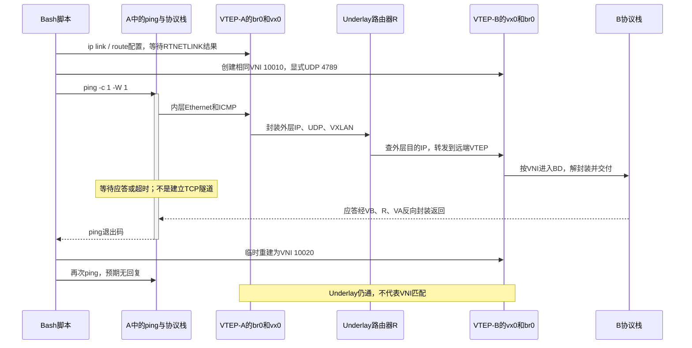

---
tags:
  - Linux
  - 数据中心网络
  - VXLAN
  - EVPN
  - 网络虚拟化
aliases:
  - Underlay与Overlay
  - L3 Fabric与VTEP
  - VXLAN网络虚拟化基础
priority: P0
阅读次数: 0
核查日期: 2026-09-15
---

# 7.9 数据中心 Underlay 与 Overlay：L3 Fabric、VTEP 与网络虚拟化

> [!abstract] 用两个问题切开整张网络
> **Underlay：如何把一个外层 IP 包送到目标隧道端点？**
> **Overlay：这个端点收到包后，应该把内层流量交给哪个租户、哪个二层域或三层路由上下文？**
> 前者解决承载路径，后者解决逻辑网络。它们可以共用交换机和网线，但不能共用一套含糊的地址、表项与故障判断。

先阅读同批笔记 [[3.Linux/7. 网络编程/07. 链路层与网络层深挖/7.8 VLAN 与 802.1Q：广播域、Access、Trunk、PVID 与 QinQ|7.8 VLAN 与 802.1Q]]：VLAN 已经把逻辑二层域与物理端口分开。本篇继续解决“逻辑网络跨越可路由 Fabric”这一步，而不把整座数据中心都拉成一张二层大网。

**范围与版本**：以 VXLAN 封装、三层 IP Leaf-Spine 承载和常见 EVPN 控制平面为主线。VXLAN 的协议基线是 RFC 7348（2014，Informational）；EVPN Overlay、IRB 与 IP Prefix 分别参考 RFC 8365、9135、9136。Linux 实验使用静态 VTEP 配置，不运行 BGP/EVPN，不声称支持任意 RNIC 的 RoCE 隧道卸载。[^vxlan][^evpn][^irb][^prefix]

**教材与补充资料分工**：项目 Sources 中 *Computer Networking: A Top-Down Approach* 是第 **7 版（2017）**，不是 Skill 推荐的第 9 版。本篇借用其 §6.4.4–6.6 的 VLAN、虚拟链路与数据中心路径思想；VTEP/VNI、EVPN 和现代内核命令采用官方补充，不把它们伪称为该教材的详细讲解。[^topdown7]

## 1. 为什么有 VLAN，还需要 Overlay

三个需求会同时出现：同一租户的 VM/容器分散在多个机架；不同租户希望使用相同私有地址；底层网络又希望通过 IP 路由与 ECMP 利用多条物理路径。如果把这些需求全塞进跨机架 VLAN，需要承担二层广播范围、学习表规模、环路控制和租户接入配置的耦合。

Overlay 的做法是先在边缘获得租户上下文，再封装给另一个边缘。租户看到逻辑网络，Underlay 看到隧道端点之间的包。教材中的“把一个网络看成一条逻辑链路”提供抽象入口；VXLAN 是这个抽象的一种具体实现，而不是 Overlay 一词的全部含义。[^topdown7][^vxlan]

**Overlay 不是免费性能层，也不是必选项。** 业务没有二层延伸或重叠地址需求时，原生三层路由可能更简单。是否采用封装，应由租户隔离、地址管理、移动性、控制平面规模和硬件能力决定。

## 2. 同一张图上必须画出两套地址空间

![[图片/SVG/3_7_7_7_9_1.svg|900]]

**图的读法**：上方虚线表示租户眼中的同一逻辑二层域，不是一根额外网线。下方实线是实际 L3 Fabric；蓝色标出一条选中的 Leaf—Spine—Leaf 路径，灰色是其他候选路径。VTEP 是边界功能，例子将它部署在 Leaf 上。

| 观察者 | 需要认识的对象 | 一般不需要认识的对象 |
| --- | --- | --- |
| 租户主机 | 自己的 IP/MAC、同域邻居、默认网关 | Spine 地址、远端 VTEP loopback |
| 接入 VTEP | 接入口所属 BD/VNI、租户 MAC/IP、远端 VTEP、Underlay 路由 | 每一个内层应用的业务状态 |
| 普通 Underlay transit 节点 | 外层目的 IP、下一跳、ECMP、MTU/QoS | 为每个租户安装完整 MAC 表 |
| 管理/控制系统 | 租户成员、地址绑定、策略、VTEP 与路径状态 | 不能用单一“网络正常”状态代替分层证据 |

“不需要租户表”不意味着硬件绝对不能解析内层：某些 ASIC 会做 tunnel-aware hashing、ACL 或可观测性，但那是额外能力，不是基础 IP 承载的前提。

例如：租户甲和乙都可以使用 `10.0.0.11`，但必须处于不同、配置正确的租户上下文；VTEP 的可路由外层地址在同一承载路由域中则不能随意冲突。重叠地址的意义是**上下文明确后可复用**，而不是允许把相同 IP 无差别塞进一张路由表。[^evpn]

## 3. L3 Fabric：提供端点可达性与物理多路径

典型两级 folded Clos 中，每个 Leaf 连接多个 Spine。跨 Leaf 转发可选择不同 Spine。三层路由负责发布可达前缀，FIB/ECMP 组给出候选下一跳；基础数据面通常按流哈希选择一条路径。RFC 7938 描述了用 BGP 构建这类大型数据中心网络的做法，**不意味着 BGP 是唯一合法 Underlay 协议**。静态路由、OSPF 或 IS-IS 也可提供 IP 可达性。[^fabric][^frr]

### 3.1 物理层数与包经过的交换阶段不是同一个数

Leaf 与 Spine 是两层设备；A 到 B 的典型跨机架包仍依次经过源 Leaf、中间 Spine、目的 Leaf。主机连接、超卖比与故障后剩余割集容量，在 [[8.高性能存储/4. RDMA 与 RoCE/4.20 RoCE Fabric 组网：Clos、Leaf-Spine、ECMP、LAG 与 Oversubscription|4.20 RoCE Fabric 组网]] 中详细计算，本篇只使用其路径模型。

### 3.2 “不用 STP”需要限定在哪些链路

Leaf—Spine 上联若作为独立三层链路使用，不靠 STP 阻塞这些路由链路来得到无环的二层树；IP 路由与其收敛机制管理路径。主机接入、双归属和逻辑二层延伸仍要避免桥接环路、重复转发与错误学习。不能把“Underlay 是 L3”推成“整个部署没有任何二层环路风险”。已有 [[3.Linux/7. 网络编程/07. 链路层与网络层深挖/7.7 生成树协议 STP与RSTP|7.7 STP/RSTP]] 解释的是后者的一类风险边界。

### 3.3 冗余并不自动等于单流带宽翻倍

四条候选路径不表示每个包复制四份，也不表示单条 TCP 流自动得到四倍带宽。路径均衡受哈希输入、流数量、流大小和共同瓶颈影响；拓扑拥有路径多样性，与当前业务实际利用这些路径，是两个验收项目。[^fabric]

## 4. VTEP：不是一台固定种类的设备

VTEP 全称 **VXLAN Tunnel Endpoint**，负责在租户帧与 VXLAN/IP 包之间转换。它可以是 hypervisor 中的软件、主机 Linux/虚拟交换机、物理 Leaf ASIC 或 DPU 上的功能。端点部署位置决定封装发生在主机之前还是之后，也决定 CPU、NIC offload 与交换机表项由谁承担。[^vxlan][^linux-vxlan]

| VTEP 放置位置 | 租户帧在哪里变成外层包 | 主要检查对象 |
| --- | --- | --- |
| 主机软件 VTEP | 虚拟接口/bridge 后，由主机网络栈封装 | CPU、内核 VXLAN、FDB、NIC tunnel offload |
| ToR / Leaf 硬件 VTEP | 租户帧进入 Leaf 后由 ASIC 封装 | VLAN→BD→VNI 映射、ASIC 表项、隧道计数器 |
| DPU / SmartNIC VTEP | 设备数据面中的边界 | 具体 representor、offload 能力与策略所有者 |

**UDP 隧道没有 TCP 式“已建立连接”这一普遍状态。** 本地显示 `vx0 UP` 只说明本地设备处于启用状态，不证明远端 VTEP 存在、不证明 UDP 4789 可达，也不证明远端接收相同 VNI。

## 5. VLAN、VNI、BD、MAC-VRF 与 IP-VRF 不要混成一个编号

| 名称 | 本质 | 本篇基本映射 |
| --- | --- | --- |
| VLAN ID | 接入链路上 12-bit 二层标识 | Leaf A 上本地 VLAN 10 |
| Bridge Domain（BD） | 二层转发域与成员上下文 | 租户一个二层段 |
| L2 VNI | VXLAN 封装中选择二层服务的 24-bit 标识 | VNI 10010 对应该段 |
| MAC-VRF | EVPN 中承载二层服务的上下文 | 可对应一个或多个 BD，依服务模型而定 |
| IP-VRF | 租户三层查路由上下文 | 连接该租户多个子网 |
| L3 VNI | 常见 VXLAN symmetric IRB 中的三层服务标识 | 用于跨 VTEP 的租户路由 |

一个易于理解的接入例子是：`Leaf A VLAN 10 → BD A → VNI 10010`，远端可以是 `VNI 10010 → BD B → Leaf B VLAN 110`。两侧本地 VID 不必数值相同，只要服务映射和交付约定正确。这与把相同 VLAN Tag 无变化地贯通整条 Trunk 不同。[^evpn][^frr]

24-bit VNI 给出约 1677 万种编码，不等于设备可同时建立这么多租户、隧道和 MAC 表项。一个租户通常也不只一个 VNI。这里采用单一 Overlay 管理域内一致分配 VNI 的常见模型；跨域互联或局部分配的其他模型必须显式说明，不能把 VNI 叫作“互联网全局唯一租户 ID”。[^evpn]

## 6. VXLAN 数据面、EVPN 控制面与 Underlay 路由

先问**谁查表**，再问**谁把表填好**。

| 工作 | 典型承担者 | 产物 |
| --- | --- | --- |
| 封装/解封装和转发 | 内核 VXLAN、OVS、ASIC 等数据面 | 具体包被发出、接收或丢弃 |
| 租户 MAC/IP/前缀可达性分发 | BGP EVPN、控制器，或小实验的静态配置 | 远端对象与服务上下文 |
| VTEP 外层地址可达性 | Underlay 路由协议或静态路由 | 外层 FIB、下一跳与 ECMP |

VXLAN 可以不用 EVPN，EVPN 也不只服务 VXLAN。本文采用“VXLAN 数据面 + EVPN 控制面”是具名组合，不是两个缩写同义。FRR 的 Linux 示例也体现这种分工：路由守护进程处理控制信息，内核网络对象承担实际转发。[^frr]

下面的依赖必须同时满足：控制平面知道远端 MAC 在 VTEP-B，并不保证底层能把 UDP 包送到 B；Underlay 能 ping 通 B，也不保证租户 VNI 的成员与 FDB 正确。

## 7. 同一个二层域跨 VTEP：完整走一次报文

教学例子：A 为 `10.79.0.1`，B 为 `10.79.0.2`，属于同一 BD/VNI 10010；VTEP-A/B 的外层地址为 `192.0.2.11/12`。先假设 B 的邻居与远端 MAC 映射已经存在，暂不展开首次 ARP。

| 步骤 | 当前设备检查什么 | 得到什么 |
| --- | --- | --- |
| ① A 构造内层帧 | B 是 on-link 目标，ARP/邻居表已有 B MAC | 内层 Ethernet：MAC A→MAC B；内层 IP：A→B |
| ② VTEP-A 接入分类 | 接入口、VLAN、BD 映射 | 服务 VNI=10010 |
| ③ Overlay 查找 | 该 BD 中目的 MAC B 的可达性 | 远端 VTEP `192.0.2.12` |
| ④ 封装并查 Underlay 路由 | 外层目的 IP 的 FIB/邻居 | UDP/VXLAN 包及下一跳外层 MAC |
| ⑤ Transit 路由 | 外层目的 IP、TTL、策略、MTU | 继续送往 VTEP-B |
| ⑥ VTEP-B 解封装 | 外层隧道类型、端口、VNI 与接收策略 | 恢复租户 BD 上下文和内层帧 |
| ⑦ 租户出口转发 | BD 内目的 MAC 与本地端口 | 按接入规则交付给 B |

以上是基于协议职责组织的教学执行路径，不表示每台 ASIC 都严格按七个硬件 stage 实现。边界行为与封装字段依据 RFC 7348/8365；内层和外层的实际布局见下一节。[^vxlan][^evpn]

### 7.1 哪些字段会变，哪些不会

| 字段 | 普通 Underlay 路由途中 | 在本节“纯 L2 Overlay”例子中 |
| --- | --- | --- |
| 外层源/目的 IP | 一般保持 VTEP-A/B 地址 | 不要用它识别租户主机 |
| 外层源/目的 MAC | 每条路由链路按下一跳重写 | 不是内层 A/B 的 MAC |
| 外层 TTL / Hop Limit | 每次相应三层转发递减 | 约束的是隧道承载包 |
| VNI | 本例同一 Overlay 域内保持 10010 | 不把它当出口端口号 |
| 内层源/目的 MAC | Transit 不需要重写 | L2 桥接路径保留，接入 Tag 可依规则调整 |
| 内层 IP TTL | 纯 L2 承载不因穿过 Spine 而递减 | 后续若执行 IRB/租户路由，才按相应路由操作变化 |

“内层 TTL 不变”必须带上纯 L2 条件，不能推广到跨子网路由。封装也不是 NAT；本例没有理由修改内层源 IP。

## 8. 双层包头与 MTU：50 字节从哪里来

![[图片/SVG/3_7_7_7_9_2.svg|900]]

**图的读法**：最外层 Ethernet 不计入 Underlay IP MTU，内层 Ethernet 却是外层 IP 的载荷，必须计入。`50` 来自外层 IPv4 20、UDP 8、VXLAN 8、内层 Ethernet 14，不是“把看得见的所有头加起来”。图内布局为字段顺序示意，不按包大小同比例。

基本 VXLAN 包含 8-byte VXLAN header、24-bit VNI；标准使用 UDP 目的端口 4789。原始内层 Ethernet FCS 不作为 VXLAN 载荷带过去；外层 Ethernet 有它自己的 FCS。Linux 保留过历史默认端口，所以示例**显式写 `dstport 4789`**，避免两端默认值不同。[^vxlan][^linux-vxlan]

### 8.1 从内层 IP MTU 推外层 IP 长度

令内层 IP 长度为 \(M\)，内层保留的 VLAN Tag 数量为 \(t\)，外层 IP 头长为 \(H\)。不考虑 IP options、IPv6 extension headers 或其他封装时：

\[
L_{outer\ IP}=H+8_{UDP}+8_{VXLAN}+14_{inner\ Ethernet}+4t+M
\]

这是根据字段长度推导的教学公式。注意 `t` 是**确实保留在隧道载荷里的**标签数量，不是接入端口配置的 VLAN 数。基础 VXLAN 实现通常把接入 VLAN 映射到 VNI，并不保证保留原始内层 Tag；保留/恢复行为必须核对具体服务模型。[^evpn]

| 外层与内层条件 | 内层 IP=1500 时所需外层 IP 长度 | Underlay IP MTU=1500 时内层 IP 上限 |
| --- | ---: | ---: |
| 外层 IPv4，无 options，内层无 VLAN Tag | 1550 | 1450 |
| 外层 IPv6，无 extension headers，内层无 VLAN Tag | 1570 | 1430 |
| 外层 IPv4，内层保留 1 个 VLAN Tag | 1554 | 1446 |
| 外层 IPv6，内层保留 1 个 VLAN Tag | 1574 | 1426 |

外层 Ethernet 若再有一个 VLAN Tag，增加的是该链路 **L2 帧长 4 字节**，不是外层 IP 长度 4 字节。若内层 Tag 被保留，它处于外层 IP 载荷中，才会增加外层 IP 长度。只说“VLAN 多 4 字节”而不说是哪一层，极易配错 MTU。

### 8.2 别用分片掩盖 MTU 设计错误

RFC 7348 规定 VTEP 不应自行把 VXLAN 包分片；中间 IPv4 网络可能产生分片，而接收 VTEP 可能丢弃这些片段。因此不能把“底层总能分片”当成通用保障。优先让整条承载路径拥有足够 MTU，或相应缩小租户 MTU；所有封装端点、交换端口与链路口径必须一起核对。[^vxlan]

小包 ping 通、1500-byte 内层 IP 不通，是典型分层线索，但仍需排除 ACL、拥塞等原因。PMTUD/ICMP 的作用可回看 [[3.Linux/7. 网络编程/07. 链路层与网络层深挖/7.6 ICMP与ICMPv6|7.6 ICMP/ICMPv6]]。不应通过屏蔽错误消息让问题“看起来安静”。

### 8.3 无需权限的长度计算

下面的 Python 3.10+ 只做几何/长度检查。参数限定基础 VXLAN，主动拒绝未知 IP 版本与负数，不把超出范围的输入默认为 IPv4。

```python
def outer_ip_length(inner_ip: int, outer_version: int = 4,
                    retained_inner_tags: int = 0) -> int:
    if inner_ip < 0 or retained_inner_tags < 0:
        raise ValueError("Lengths and tag counts must be nonnegative")
    if outer_version not in (4, 6):
        raise ValueError("Only IPv4/IPv6 basic headers are supported")
    outer_header = 20 if outer_version == 4 else 40
    return outer_header + 8 + 8 + 14 + 4 * retained_inner_tags + inner_ip

assert outer_ip_length(1500) == 1550
assert outer_ip_length(1500, 6) == 1570
assert outer_ip_length(1500, 4, 1) == 1554
assert outer_ip_length(1450) == 1500
assert outer_ip_length(1430, 6) == 1500
```

这组断言验证本文计数口径，不验证设备实际支持的 MTU，也不包含真实报文分片测试。

## 9. BUM：Overlay 不会让广播需求凭空消失

BUM 指 **Broadcast、Unknown Unicast、Multicast**。首次 ARP、某些邻居发现与组播业务仍需要把帧送往多个成员。对普通 IP 核心而言，这可能表现为带着内层广播帧的**外层单播副本**，而不是让核心直接泛洪租户 MAC 广播。[^vxlan][^evpn]

| 方式 | 复制主要发生在哪 | 主要代价 |
| --- | --- | --- |
| Underlay multicast | 支持组播的承载网络 | 组播状态、组管理与底层运维 |
| Ingress / Head-end replication | 源 VTEP，为远端成员分别封装 | 源出口带宽与复制开销 |
| 静态远端列表 | 人工指定复制目的地 | 适合小实验；成员变动依赖人工更新 |

例如一个段有 8 个 VTEP，源 VTEP 需要向另外 7 个复制一帧；若每份外层 IP 包为 \(L\) 字节，该次源端外发约为 \(7L\)，尚未计最外层 L2 开销。这是明确假设下的容量算账，不是所有网络统一的流量倍增系数。

EVPN 可以分发成员与地址信息，ARP/ND suppression 可利用有效绑定减少部分广播，但**EVPN 不等于零广播**。缓存缺失、真实组播业务和某些未知目的行为仍需处理；不要在没有验证邻居学习与更新机制时一刀切关闭 BUM。

## 10. EVPN 最先需要认识的是三个路由类型

![[图片/SVG/3_7_7_7_9_3.svg|900]]

图的上半表示控制信息进入本地表，下半表示数据包分别查 Overlay 与 Underlay 状态。路由通告不是给每个业务包多包一层 BGP 头；控制报文和用户数据是不同对象。

| EVPN Route Type | 主要承载什么 | 初学时的用途 |
| --- | --- | --- |
| Type 2：MAC/IP Advertisement | MAC 及可选关联 IP 等可达性信息 | 找远端 MAC/主机，支持相关邻居信息分发 |
| Type 3：Inclusive Multicast Ethernet Tag | 某二层服务的参与与复制相关信息 | 建立适当的 BUM 分发成员 |
| Type 5：IP Prefix | 租户 IP 前缀可达性 | 不只逐个 MAC 学习，还能分发路由前缀 |

Type 2/3 用法来自 EVPN/NVO 规范；Type 5 的独立角色由 RFC 9136 描述。多归属还涉及 Type 1/4 等机制，本篇不展开完整 DF 选举与 Ethernet Segment 状态机。[^evpn][^prefix]

**RD 和 RT 不在线上的 VXLAN header 里。** RD（Route Distinguisher）用于区分控制平面路由标识；Route Target 用于导入/导出策略。误配 RT 可以导致本应隔离的可达性被导入错误上下文，或应可见的路由根本不可见。VNI 则属于封装/服务选择一侧，不能把三者当成三个拼法不同的 tenant-id。[^evpn][^frr]

也不要把两种“BGP 正常”混为一谈：Underlay BGP 的 unicast 地址族提供端点 IP 路由，Overlay BGP EVPN 地址族提供租户相关控制信息。某个会话 Established 只回答部分控制面问题，尚未证明转发表编程、下一跳解析和流量转发正确。

## 11. 跨子网：Overlay 可以路由，不只能桥接

“同一 L2 VNI 才能桥接”不等于“不同 VNI 永远不能通信”。同一个租户可以在 IP-VRF 中把多个 BD 通过网关/IRB 接起来，再按路由与策略通信。**是否桥接、是否路由、是否许可，是三个不同判断。**[^irb]

| 常见设计 | 逻辑路径 | 需要注意 |
| --- | --- | --- |
| 集中式网关 | 先到指定网关，再跨子网 | 额外绕行与网关容量/故障域 |
| 分布式 Anycast Gateway | 多个边缘提供一致网关身份，靠近源端执行路由 | 同一虚拟网关身份与配置一致性 |
| Asymmetric IRB | 源边缘做路由，跨隧道后由目的边缘桥接 | 源端需要更多远端目的子网/邻居状态 |
| Symmetric IRB | 源/目的边缘都进入相应租户路由上下文 | 常用 L3 VNI；两端必须具备对应服务状态 |

上表是工程层的逻辑对照，不声称硬件必须逐次执行每张逻辑表。RFC 9135 明确允许数据面查找合并优化。它也区分两种 IRB 的内层 TTL 行为：本篇第 7 节的“只穿过 Underlay 不改内层 TTL”不适用于已经执行租户三层路由的路径。[^irb]

学习到这里的最低目标不是背几十条交换机配置，而是能画出：入 VLAN/BD → 租户网关与 IP-VRF → 远端服务/VTEP → 出 BD，并指出哪个步骤是三层路由。

## 12. 性能边界：封装不会凭空增加物理容量

外层 UDP source port 可根据内层流特征生成，从而为 ECMP 提供熵。若许多内层流被封装为完全相同的外层哈希输入，它们可能挤到同一路径。反过来，是否具备内层字段哈希、如何处理哈希变化和流重排，属于设备实现；不能把“VXLAN 用 UDP”解释成“同一个流可以任意逐包乱序喷洒”。[^vxlan][^fabric]

软件 VTEP 增加的解析、封装、查表与复制会消耗 CPU；硬件 offload 可以转移工作，却不自动消除表项、缓冲、队列与带宽限制。Linux VXLAN 文档区分 tunnel segmentation、checksum 与 UDP tunnel port recognition 等能力，验收时应看具体 NIC/驱动功能，而不只看“支持 VXLAN”四个字。[^linux-vxlan]

**QoS 要说明信任边界**：Underlay 通常依据外层 DSCP/ECN 或本地分类结果排队。内层标记是否拷贝、映射、重写，以及拥塞信号如何传回，必须核对隧道与设备策略；不能想当然地认为每层都自动继承。涉及 RoCE 时，继续接 [[8.高性能存储/4. RDMA 与 RoCE/4.27 RoCE QoS 工程：PCP、DSCP、Priority Queue、PFC Priority 与 ECN Queue Mapping|4.27 QoS 映射]]，并注意那篇基线不含隧道。

对于 GPU/RDMA 数据面，**本篇只能给出需要核查的边界，不能给出通用支持承诺**：RNIC、交换 ASIC 与固件是否支持该封装组合，ICRC/校验相关处理、MTU、拥塞标记、PFC 作用链路及卸载能力，都需要具体厂商支持矩阵或实测。普通 Linux VXLAN 能 ping 通，并不证明相同路径能保持 RDMA 零拷贝与预期性能。

## 13. 排障要分别证明四件事

| 层面 | 需要的证据 | 不能替代它的证据 |
| --- | --- | --- |
| Underlay | 到远端 VTEP 的路由、下一跳、返回路径、MTU | 只看到物理 link up |
| Tunnel transport | 外层源/目的、UDP 端口、接收策略、封装/解封装计数 | 单纯 ICMP ping 成功 |
| Overlay | VNI/BD 映射、FDB、EVPN 导入与下一跳 | 只看到 BGP Established |
| Tenant delivery | 内层邻居、网关/VRF、出口成员、ACL | 只看到远端 VTEP 收包 |

先区分“包没到端点”与“到了但没进入正确服务”，再继续追内层。外层/内层地址与二层下一跳的关系需要 [[3.Linux/7. 网络编程/07. 链路层与网络层深挖/7.2 以太网|7.2 以太网]] 和 [[3.Linux/7. 网络编程/07. 链路层与网络层深挖/7.3 IPv4|7.3 IPv4]] 的逐跳模型，不需要把所有故障都归为 VXLAN 问题。

典型观测命令如下。它们是只读探针，但输出字段与设备实现有关；FRR 的命令只有在实际部署 FRR/EVPN 时才有意义。

```bash
ip -d link show type vxlan
ip route get 192.0.2.12
bridge fdb show
ip neigh show
# 可选抓包：分别看外层接口与内层 bridge；本次未运行 tcpdump。
sudo tcpdump -eni u0 -s 0 'udp port 4789'
sudo tcpdump -eni br0 -s 0 'arp or icmp'
```

`ip route get` 查的是执行它的当前 namespace/VRF，不是自动遍历所有租户网络。`bridge fdb show` 中接入口 MAC 学习与 VXLAN 远端映射也可能分属于不同对象，要结合设备名和条目类型解读。[^ip-link][^bridge-man]

## 14. Linux 实验：让二层流量真正跨过一个三层路由器

拓扑是 `A—VTEP-A—R—VTEP-B—B`。R 的两侧是两个不同 `/30` 网段，不是用一台 bridge 假装三层 Fabric；VTEP 使用 loopback `/32` 作为外层端点地址。A/B 使用同一个 `/24`，没有跨子网网关需求。

**该实验验证的模型**：静态 VTEP、一个 VNI、一层基础 VXLAN、IPv4 Underlay、无 EVPN。它不能验证 Leaf-Spine ECMP、BGP 收敛、多租户 VRF、RDMA 或生产吞吐。

**环境要求**：Linux-only，Bash 4+、iproute2、iputils-ping、支持 bridge/VXLAN/veth/netns 的内核，以及 namespace 内网络管理和转发配置权限。使用一次性 VM，按顺序把以下各段拼成一个脚本；不要接入真实业务端口。[^linux-vxlan][^ip-link]

> [!warning] 验证状态
> 脚本通过 `bash -n`；本次容器虽然能在隔离 namespace 中建立 veth，但 bridge 创建不支持，设置实验路由器 `net.ipv4.ip_forward` 也被拒绝。因此**没有运行完下面 8 项真实数据面断言**，没有宣称抓到 VXLAN 包。字段长度计算与离线依赖模型已经独立执行，其结果不等于 Linux 集成测试。

### 14.1 创建拥有明确生命周期的实验节点

第一段拒绝已有同名资源，记录本次成功创建的 namespace，在正常退出、错误或中断时回收。后续只操作这些节点；`ip_forward` 仅在实验 R 的 namespace 设置，不更改宿主全局网络。

```bash
#!/usr/bin/env bash
# Linux-only; Bash 4+; iproute2; iputils-ping; root / CAP_NET_ADMIN.
set -Eeuo pipefail
for cmd in ip bridge ping sysctl; do
    command -v "$cmd" >/dev/null || { echo "Missing: $cmd" >&2; exit 1; }
done
names=(n79-a n79-va n79-r n79-vb n79-b)
for ns in "${names[@]}"; do
    if ip netns list | grep -qE "^${ns}( |$)"; then
        echo "Namespace already exists: $ns" >&2; exit 1
    fi
done
created=()
cleanup() {
    local i
    for ((i=${#created[@]}-1; i>=0; --i)); do
        ip netns del "${created[i]}" || true
    done
}
trap cleanup EXIT
trap 'exit 130' INT
trap 'exit 143' TERM
for ns in "${names[@]}"; do
    ip netns add "$ns"; created+=("$ns")
    ip -n "$ns" link set lo up
done
```

### 14.2 创建两条不同网段的 Underlay 链路

A/B 接入链路保持1500 MTU，Underlay veth 设1600；R 上两端不是同一个 bridge。只有 R 的 namespace 启用 IPv4 forwarding，因此物理传输模型确实包含路由。

```bash
link_pair() {
    ip -n "$1" link add "$2" type veth peer name "$4" netns "$3"
    ip -n "$1" link set "$2" mtu "$5" up
    ip -n "$3" link set "$4" mtu "$5" up
}
link_pair n79-a eth0 n79-va acc 1500
link_pair n79-b eth0 n79-vb acc 1500
link_pair n79-va u0 n79-r ra 1600
link_pair n79-vb u0 n79-r rb 1600
# Two routed /30 links; there is no bridge between VTEP underlay ports.
ip -n n79-va addr add 198.51.100.1/30 dev u0
ip -n n79-r addr add 198.51.100.2/30 dev ra
ip -n n79-vb addr add 203.0.113.1/30 dev u0
ip -n n79-r addr add 203.0.113.2/30 dev rb
ip -n n79-va addr add 192.0.2.11/32 dev lo
ip -n n79-vb addr add 192.0.2.12/32 dev lo
ip netns exec n79-r sysctl -qw net.ipv4.ip_forward=1
```

### 14.3 给 VTEP loopback 建立双向静态路由

路由只分发端点 `/32`。租户 `10.79.0.0/24` 不加入 R 的路由表；R 承载的是外层 IP，而非直接路由租户地址。每个 VTEP 的 bridge 只承载一个 BD，因此这里不启用 VLAN filtering。

```bash
ip -n n79-va route add 192.0.2.12/32 via 198.51.100.2
ip -n n79-vb route add 192.0.2.11/32 via 203.0.113.2
ip -n n79-r route add 192.0.2.11/32 via 198.51.100.1
ip -n n79-r route add 192.0.2.12/32 via 203.0.113.1
# Each bridge is one local bridge domain, hence vlan_filtering=0 here.
for ns in n79-va n79-vb; do
    ip -n "$ns" link add br0 type bridge
    ip -n "$ns" link set br0 mtu 1500 up
    ip -n "$ns" link set acc master br0
done
ip -n n79-a addr add 10.79.0.1/24 dev eth0
ip -n n79-b addr add 10.79.0.2/24 dev eth0
```

### 14.4 建立明确端口与 VNI 的 VXLAN 对象

`local/remote` 是外层端点，`id` 是服务 VNI。`vx0` 与接入口 `acc` 一起进入本地 `br0`，而 Underlay `u0` 绝不能作为同一 bridge 的成员。

```bash
make_vxlan() {
    local ns=$1 local_ip=$2 remote_ip=$3 vni=$4
    ip -n "$ns" link add vx0 type vxlan id "$vni" \
        local "$local_ip" remote "$remote_ip" dev u0 \
        dstport 4789 ttl 64 df inherit
    ip -n "$ns" link set vx0 mtu 1500 master br0
    ip -n "$ns" link set vx0 up
}
make_vxlan n79-va 192.0.2.11 192.0.2.12 10010
make_vxlan n79-vb 192.0.2.12 192.0.2.11 10010
ip -n n79-va -d link show vx0
ip netns exec n79-va bridge fdb show dev vx0
```

### 14.5 让检查同时覆盖成功与预期不通

两组 ping 数组分别探测内层主机和外层端点。外层探针指定源 loopback，以覆盖实际 VTEP 地址而不是仅测试传输链路地址。

```bash
expect_reply() {
    local label=$1; shift
    "$@" >/dev/null; echo "PASS: $label"
}
expect_timeout() {
    local label=$1 rc=0; shift
    "$@" >/dev/null 2>&1 || rc=$?
    [[ "$rc" -eq 1 ]] || { echo "Unexpected status $rc: $label" >&2; exit 1; }
    echo "PASS (expected no reply): $label"
}
inner_ping=(ip netns exec n79-a ping -n -c 1 -W 1)
outer_ping=(ip netns exec n79-va ping -n -c 1 -W 1 -I 192.0.2.11)
```

### 14.6 逐项改变 VNI 和 Underlay 路由

先建立基线，再把远端 VNI 改为10020，验证“Underlay正常、Overlay失败”的区别；随后恢复，再删除/恢复 Underlay 路由。此处是测试脚本逻辑，只有在支持完整内核功能的环境跑完后才能声称8项通过。

```bash
expect_reply 'VTEP loopback reachability via L3 router' "${outer_ping[@]}" 192.0.2.12
expect_reply 'tenant L2 reachability over VXLAN' "${inner_ping[@]}" 10.79.0.2
# 1472 ICMP data + 8 ICMP + 20 IPv4 = 1500 inner IP bytes.
expect_reply '1500-byte inner IPv4, DF set' "${inner_ping[@]}" -M do -s 1472 10.79.0.2
ip -n n79-vb link del vx0
make_vxlan n79-vb 192.0.2.12 192.0.2.11 10020
expect_reply 'underlay still works with wrong VNI' "${outer_ping[@]}" 192.0.2.12
expect_timeout 'wrong VNI blocks tenant traffic' "${inner_ping[@]}" 10.79.0.2
ip -n n79-vb link del vx0
make_vxlan n79-vb 192.0.2.12 192.0.2.11 10010
expect_reply 'VNI restored' "${inner_ping[@]}" 10.79.0.2
ip -n n79-r route del 192.0.2.12/32
expect_timeout 'missing underlay route blocks overlay' "${inner_ping[@]}" 10.79.0.2
ip -n n79-r route add 192.0.2.12/32 via 203.0.113.1
expect_reply 'underlay route restored' "${inner_ping[@]}" 10.79.0.2
echo '8 VXLAN assertions passed; cleanup runs on exit.'
```


### 14.7 从系统调用到封装，再到等待应答

下图对应脚本正常的单播测试。首次邻居未解析时，还会先有 ARP 与 BUM；图中按邻居已解析画主路径，避免把控制配置与数据包都画成同一种箭头。



### 14.8 应该观察到什么

脚本配置了 8 项断言：外层 VTEP loopback 可达；内层 A/B 可达；1500-byte 内层 IPv4、DF 置位可达；错误 VNI 时外层仍可达；内层失败；恢复 VNI 后内层恢复；删除 R 到 B 的外层路由后内层失败；恢复路由后恢复。

`1472` 是 ICMP data，不是 IP 包长：`1472 + 8 ICMP + 20 IPv4 = 1500`。实验 Underlay 接口采用 1600，给基础 IPv4 VXLAN 所需的 1550-byte 外层 IP 包留出余量。`df inherit` 显式控制实验外层 DF 来源，不把 IPv4 自动分片作为正确性的兜底。

VTEP 的 `remote` 参数为这个两端点实验提供默认远端，`bridge fdb show dev vx0` 可观察相应 VXLAN 表项；内层 bridge 的端口学习与 VXLAN 的远端映射是不同层次。这里没有 EVPN IMET 路由、Route Target 或 FRR 守护进程；不要把静态互通截图当作 EVPN 实验完成。[^ip-link][^linux-vxlan]

默认脚本退出即清理。临时在脚本末尾增加显式 `read` 可暂停观察，但不要把实验设备改接生产接口。若内核不支持 bridge/VXLAN 或权限不足，应修复实验环境，而不是删掉错误处理后继续制造“通过”输出。

## 15. 故障注入的价值在于建立分层因果

| 变化 | Underlay VTEP 可达性 | 租户连通性预期 | 解释 |
| --- | --- | --- | --- |
| 不同 VNI | 可以仍正常 | 基本单 VNI 桥接例子不通 | 包到了端点，但服务选择不匹配 |
| 缺失 Underlay 路由 | 相应路径失败 | 依赖它的 Overlay 失败 | 承载前提被破坏 |
| 错误 UDP 目的端口/接收策略 | ICMP 可正常 | 可失败 | IP 可达不等于隧道传输许可 |
| 内层邻居条目缺失但 BUM 正常 | 正常 | 可经发现恢复 | 不应把首次 ARP 当成故障 |
| 内层邻居未知且必要 BUM 被阻断 | 正常 | 新连接可失败 | 封装不是邻居发现的替代品 |
| Underlay MTU 不足 | 小包可以正常 | 较大包可失败 | 字节长度边界不同 |
| RT 导入错误 | 可正常 | EVPN 场景中可失败或错误泄露可达性 | 控制面上下文错误；本节静态实验未覆盖 |

这里的“预期”必须服从明确配置。例如有意配置的 VNI translation 或租户 IRB 可以使不同编号之间合法互通，因此错误 VNI 断言只对应本篇没有这些功能的基础实验，不是对所有 Overlay 的定理。

## 16. 隔离、加密与控制信任是三件事

VNI/VRF 用于选择隔离上下文；它们本身不是密钥，VXLAN 也不天然加密载荷或认证发送者。收到一个声称属于 VNI 10010 的包，不代表它被密码学证明来自正确租户。应限制可发起隧道流量的 Underlay 端点，并保护控制平面、Route Target 导入策略和管理接口。[^vxlan]

需要机密性/认证时，必须另外选择适用的链路或隧道安全机制，并重新计算 MTU、卸载与性能成本。也不要因为两个逻辑租户隔离，就忽略它们仍可能共享物理队列与出口拥塞。

## 17. 自测：画得出字段变化，才不只是背缩写

> [!question]- 1. 同一个租户子网跨过三台 Underlay 路由设备，内层 TTL 必须减三吗？
> 纯 L2 VXLAN 承载不会因为经过这些 transit 路由设备而递减内层 TTL；递减的是外层 TTL。若边缘执行租户三层路由，内层 TTL 按那部分路由操作变化。

> [!question]- 2. VTEP-A 能 ping 通 VTEP-B，为什么 A 主机仍可能 ping 不通 B 主机？
> UDP 端口/策略、VNI/BD、FDB、邻居、网关/VRF、出口成员与 ACL 任一环节都可能不满足。ICMP 探针只覆盖部分 Underlay 路径。

> [!question]- 3. VLAN 10 必须等于 VNI 10，远端本地 VLAN 也必须是 10 吗？
> 都不必。映射由服务模型和配置决定；本地接入 VID 与 Overlay 服务编号不是一个命名空间。

> [!question]- 4. Underlay IP MTU 1500，基础 IPv4 VXLAN 内能放 1500-byte IP 包吗？
> 不能直接保证。外层 IP 需要 1550；不增加承载 MTU时，基础无内层 Tag 场景内层 IP 上限是1450。还应排除额外封装与选项。

> [!question]- 5. EVPN Type 3 已学习，是否证明所有单播 MAC 都已学到？
> 不是。服务成员/BUM 复制相关状态和 Type 2 的 MAC/IP 可达性是不同对象；还需检查实际表项与下一跳。

> [!question]- 6. 不同 L2 VNI 的两个子网能否通信？
> 可在同租户 IP-VRF 中通过明确配置的网关/IRB 路由，并受策略控制。不能直接二层桥接，与不能合法三层通信，是两回事。

> [!question]- 7. 普通软件 VXLAN 通了，能否宣布 RoCE/GPU 通信路径也通过验收？
> 不能。实验未覆盖 RNIC/ASIC 隧道支持、硬件卸载、拥塞控制与具体 RDMA 数据路径；这些需独立验证。

## 18. 要点收束

学习链条可以压缩为：**本地 VLAN/BD 识别业务 → VTEP 选择远端与 VNI → VXLAN 封装 → Underlay IP 路由 → 远端解封装 → 租户桥接或路由**。EVPN 负责为其中一部分查找分发控制信息，而不是替 Underlay 传包，也不是替端点完成加密。

把两个地址空间、两类表和两个 MTU 口径画清楚，后续学习 RoCE Fabric、虚拟化网络、跨机架存储与 GPU 通信时，就能明确问题发生在承载路径、边缘封装还是租户服务，而不是把它们统一叫作“网络不通”。

## 19. 参考资料与版本说明

在线资料核查日期为 **2026-09-15**。RFC 使用具名发布版本；Linux 与 FRR 网页可能继续演进，`latest` 不是已测试版本号。本篇命令未在真实交换机、FRR/EVPN 或 RNIC 上执行。

[^topdown7]: James F. Kurose, Keith W. Ross, *Computer Networking: A Top-Down Approach*, 7th ed., Pearson, 2017，§6.4.4（VLAN，印刷页487–491）、§6.5（Link Virtualization，491–495）、§6.6（Data Center Networking，495–500）。项目资料实为第7版；本篇使用其抽象与拓扑思想，不沿用其中的历史价格或链路速率作为当前事实。
[^vxlan]: RFC 7348，*Virtual eXtensible Local Area Network (VXLAN): A Framework for Overlaying Virtualized Layer 2 Networks over Layer 3 Networks*，2014，§4–6、§9：[正文](https://www.rfc-editor.org/rfc/rfc7348.html)。该 RFC 为 Informational；本文长度公式是基于其封装字段的推导。
[^evpn]: RFC 8365，*A Network Virtualization Overlay Solution Using Ethernet VPN (EVPN)*，2018，§5.1–5.2：[正文](https://www.rfc-editor.org/rfc/rfc8365.html)。区分服务模型、VNI 范围与 EVPN 控制信息。
[^fabric]: RFC 7938，*Use of BGP for Routing in Large-Scale Data Centers*，2016，§3.2 与 ECMP/设计讨论：[正文](https://www.rfc-editor.org/rfc/rfc7938.html)。这是 BGP Underlay 的设计资料，不是规定所有数据中心都必须运行 BGP。
[^irb]: RFC 9135，*Integrated Routing and Bridging in Ethernet VPN (EVPN)*，2021，§4–6：[正文](https://www.rfc-editor.org/rfc/rfc9135.html)。对称/非对称 IRB 为逻辑数据面模型，硬件实现可合并查找。
[^prefix]: RFC 9136，*IP Prefix Advertisement in Ethernet VPN (EVPN)*，2021，§2.2–3：[正文](https://www.rfc-editor.org/rfc/rfc9136.html)。Type 5 与 MAC/IP 路由分离。
[^linux-vxlan]: Linux Kernel Documentation，[Virtual eXtensible Local Area Networking](https://docs.kernel.org/networking/vxlan.html)，Linux VXLAN 对象、端口历史、FDB 与 offload 能力。
[^frr]: FRRouting 官方，[EVPN](https://docs.frrouting.org/en/latest/evpn.html)，VTEP/Underlay 可达性、L2/L3 VNI、VRF、Linux 数据面与 EVPN 路由安装。用于实现模型，不把 `latest` 标为集成测试版本。
[^ip-link]: iproute2 manual，[ip-link(8)](https://man7.org/linux/man-pages/man8/ip-link.8.html)，VXLAN 参数，重点为 `local`、`remote`、`dstport`、`ttl`、`df`。
[^bridge-man]: iproute2 manual，[bridge(8)](https://man7.org/linux/man-pages/man8/bridge.8.html)，FDB、VXLAN 远端条目与 VLAN/bridge 观察对象。
