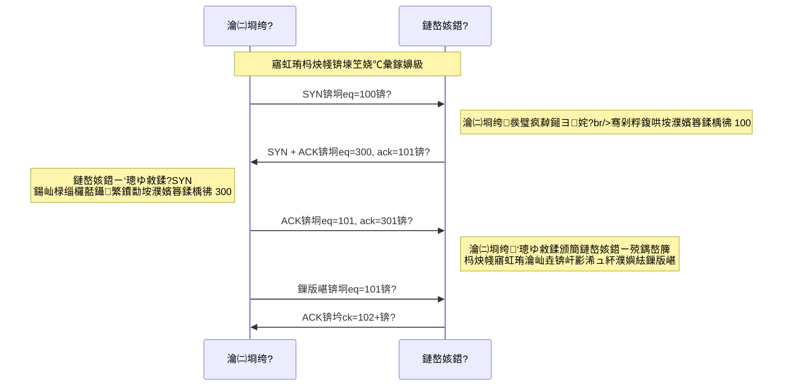
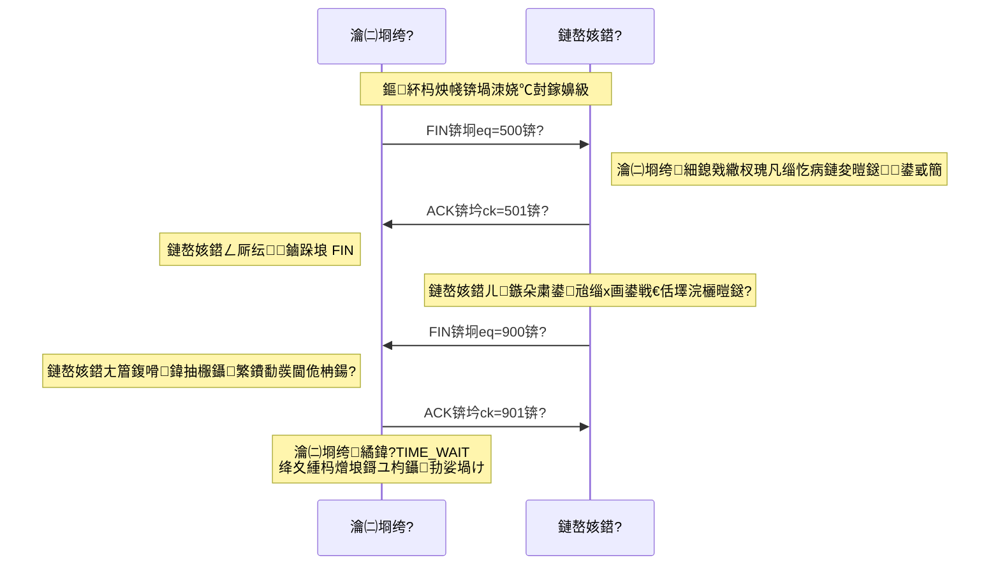

---
tags:
  - Linux
  - TCP-缂栫▼
闃呰娆℃暟: 0
---

# TCP 鍘熺悊

## 姒傝堪

TCP锛圱ransmission Control Protocol锛?*浼犺緭鎺у埗鍗忚**锛夋槸涓€绉?*闈㈠悜杩炴帴**鐨勩€?*鍙潬鐨?*銆佸熀浜?*瀛楄妭娴?*鐨勪紶杈撳眰閫氫俊鍗忚銆傚畠鏄簰鑱旂綉鍗忚鏍堜腑鏈€鏍稿績鐨勫崗璁箣涓€锛岃骞挎硾搴旂敤浜?HTTP銆丼MTP銆丗TP 绛変笂灞傚崗璁€?

> 鍏充簬 TCP 鍗忚鐨勮缁嗗師鐞嗭紙涓夋鎻℃墜銆佸洓娆℃尌鎵嬨€佺姸鎬佽浆鎹㈢瓑锛夛紝璇峰弬瑙?[[7.5 TCP鍗忚鍩虹]]銆?

> [!tip] 浜や簰鍔ㄧ敾
> 鏈瘒鏍稿績闅剧偣鐨勮繃绋嬪彲瑙嗗寲锛圫eq/Ack 鎸夊瓧鑺傛帹杩涗笌绱纭 路 SYN/FIN 鍚勫崰涓€涓簭鍙?路 寤鸿繛鈫掍紶鏁版嵁鈫掓柇杩炲叏鐢熷懡鍛ㄦ湡锛夛細
> [鈻?鍦ㄦ祻瑙堝櫒涓墦寮€鍔ㄧ敾](<../../鍥剧墖/HTML/3.Linux/8. TCP 缂栫▼/8.1.1 TCP鍘熺悊鍔ㄧ敾.html>)銆€路銆€鏇村瑙?[[缃戠粶缂栫▼路鍔ㄧ敾鍚堥泦]]
> 涔熷彲鐩磋揪鍗曚釜鍦烘櫙锛歔Seq/Ack 瀛楄妭鎺ㄨ繘](<../../鍥剧墖/HTML/3.Linux/8. TCP 缂栫▼/8.1.1 TCP鍘熺悊鍔ㄧ敾.html#scene=seqack>) 路 [SYN/FIN 鍗犲簭鍙穄(<../../鍥剧墖/HTML/3.Linux/8. TCP 缂栫▼/8.1.1 TCP鍘熺悊鍔ㄧ敾.html#scene=synfin>) 路 [鍏ㄧ敓鍛藉懆鏈焆(<../../鍥剧墖/HTML/3.Linux/8. TCP 缂栫▼/8.1.1 TCP鍘熺悊鍔ㄧ敾.html#scene=lifecycle>)

---

## TCP/IP 缃戠粶妯″瀷

TCP/IP 鍗忚鏍堥噰鐢ㄥ垎灞傝璁★紝姣忎竴灞傞兘鏈夊叾鐗瑰畾鐨勮亴璐ｏ細

![[鍥剧墖/3.Linux/8. TCP 缂栫▼/3_8_1_1.svg|900]]

| 灞傛 | 鍗忚绀轰緥 | 涓昏鍔熻兘 |
|:---|:---|:---|
| 搴旂敤灞?| HTTP銆丼MTP銆丗TP銆丏NS | 涓虹敤鎴锋彁渚涚綉缁滄湇鍔℃帴鍙?|
| 浼犺緭灞?| TCP銆乁DP | 鎻愪緵绔埌绔殑鏁版嵁浼犺緭鏈嶅姟 |
| 缃戠粶灞?| IP | 璐熻矗鏁版嵁鍖呯殑璺敱鍜岃浆鍙?|
| 閾捐矾灞?| 浠ュお缃戙€乄iFi | 鍦ㄧ浉閭昏妭鐐归棿浼犺緭鏁版嵁甯?|
| 鐗╃悊灞?| 鍙岀粸绾裤€佸厜绾?| 浼犺緭鍘熷姣旂壒娴?|

---

## TCP 涓?UDP 瀵规瘮

TCP 鍜?UDP 鏄紶杈撳眰鐨勪袱绉嶄富瑕佸崗璁紝鍚勬湁鐗圭偣锛?

| 鐗规€?| TCP | UDP |
|:---|:---|:---|
| **杩炴帴鎬?* | 闈㈠悜杩炴帴锛堥渶瑕佷笁娆℃彙鎵嬶級 | 鏃犺繛鎺?|
| **鍙潬鎬?* | 鍙潬浼犺緭锛堢‘璁ゃ€侀噸浼犮€佸簭鍙凤級 | 涓嶅彲闈狅紙灏芥渶澶у姫鍔涗氦浠橈級 |
| **浼犺緭鏂瑰紡** | 瀛楄妭娴?| 鏁版嵁鎶?|
| **鎷ュ鎺у埗** | 鏈?| 鏃?|
| **浼犺緭鏁堢巼** | 杈冧綆锛堝紑閿€澶э級 | 杈冮珮锛堝紑閿€灏忥級 |
| **閫傜敤鍦烘櫙** | 鏂囦欢浼犺緭銆佺綉椤点€侀偖浠?| 瀹炴椂闊宠棰戙€丏NS 鏌ヨ銆佹父鎴?|

### TCP 鐨勬牳蹇冪壒鎬?

1. **闈㈠悜杩炴帴**锛氶€氫俊鍓嶅繀椤诲厛寤虹珛杩炴帴锛圼[7.5 TCP鍗忚鍩虹#TCP 涓夋鎻℃墜锛堝缓绔嬭繛鎺ワ級|涓夋鎻℃墜]]锛?
2. **鍙潬浼犺緭**锛氶€氳繃纭鏈哄埗銆佸簭鍒楀彿銆佽秴鏃堕噸浼犵瓑淇濊瘉鏁版嵁涓嶄涪澶便€佷笉閲嶅銆佷笉涔卞簭
3. **鍏ㄥ弻宸ラ€氫俊**锛氳繛鎺ュ弻鏂瑰彲浠ュ悓鏃跺彂閫佸拰鎺ユ敹鏁版嵁
4. **娴侀噺鎺у埗**锛氶€氳繃婊戝姩绐楀彛鏈哄埗鎺у埗鍙戦€侀€熺巼
5. **鎷ュ鎺у埗**锛氭牴鎹綉缁滅姸鍐靛姩鎬佽皟鏁村彂閫侀€熺巼

---

## TCP 鎶ユ枃娈电粨鏋?

鍦ㄤ唬鐮侀噷锛屾垜浠洿甯哥湅鍒扮殑鏄?`read()`銆乣write()`銆乣connect()`銆乣accept()` 杩欎簺鎺ュ彛锛屼絾鐪熸鍦ㄧ嚎涓婁紶杈撶殑骞朵笉鏄€滃嚱鏁拌皟鐢ㄢ€濓紝鑰屾槸 **TCP 鎶ユ枃娈?*銆傚厛鎶撲綇鍥涗釜鏈€鍏抽敭鐨勫瓧娈靛嵆鍙細

- **搴忓垪鍙凤紙Seq锛?*锛氭爣璁版湰鎶ユ枃娈典腑绗竴涓瓧鑺傜殑浣嶇疆
- **纭鍙凤紙Ack锛?*锛氬憡璇夊鏂光€滄垜涓嬩竴姝ュ笇鏈涙敹鍒板摢涓瓧鑺傗€?
- **鏍囧織浣嶏紙SYN / ACK / FIN锛?*锛氶┍鍔ㄥ缓杩炪€佺‘璁ゅ拰鏂繛
- **绐楀彛澶у皬**锛氶檺鍒跺湪閫旀暟鎹噺锛岄伩鍏嶆帴鏀舵柟缂撳瓨琚帇鍨?

濡傛灉杩欓噷绗竴娆＄湅浼氭湁鐐圭粫锛屽彲浠ュ厛鎶撲綇涓€涓€诲師鍒欙細

> **TCP 绠＄殑涓嶆槸鈥滅鍑犱釜鍖呪€濓紝鑰屾槸鈥滀竴闀夸覆杩炵画瀛楄妭娴佲€濄€?*

涔熷氨鏄锛孴CP 蹇冮噷鎯崇殑涓嶆槸锛?

- 鈥滄垜鍙戠殑鏄 3 涓寘鈥?
- 鈥滄垜鏀跺埌浜嗙 5 涓寘鈥?

鑰屾槸锛?

- 鈥滄垜杩欐鍙戝嚭鍘荤殑鏁版嵁锛屾槸浠庣 100 涓瓧鑺傚紑濮嬬殑鈥?
- 鈥滄垜宸茬粡杩炵画鏀跺埌绗?1 鍒?299 涓瓧鑺備簡锛屼笅涓€姝ヨ浣犲彂绗?300 涓瓧鑺傗€?

### 1. 搴忓垪鍙?`Seq` 鍒板簳鍦ㄦ爣璁颁粈涔堬紵

`Seq` 鏍囪鐨勬槸锛?*杩欎釜鎶ユ枃娈甸噷鈥滅涓€涓暟鎹瓧鑺傗€濈殑缂栧彿**銆?

鍋囪瀹㈡埛绔幇鍦ㄨ鍙戦€佸瓧绗︿覆锛?

```text
Hello
```

濡傛灉 TCP 杩欐鍒嗛厤缁欏畠鐨勮捣濮嬪瓧鑺傚彿鏄?`1000`锛岄偅涔堝彲浠ヨ繖鏍风悊瑙ｏ細

| 瀛楄妭鍐呭 | 瀛楄妭缂栧彿 |
|:---|:---|
| `H` | 1000 |
| `e` | 1001 |
| `l` | 1002 |
| `l` | 1003 |
| `o` | 1004 |

閭ｄ箞杩欎釜鎶ユ枃娈电殑锛?

- `Seq = 1000`
- 鏁版嵁闀垮害 = 5

杩欏彞璇濈湡姝ｇ殑鍚箟涓嶆槸鈥滆繖鏄 1000 涓寘鈥濓紝鑰屾槸锛?

**鈥滄垜杩欐鍙戠殑鏁版嵁锛屼粠 1000 鍙峰瓧鑺傚紑濮嬶紝涓€鍏卞甫浜?5 涓瓧鑺傘€傗€?*

### 2. 纭鍙?`Ack` 涓轰粈涔堟€昏鈥滀笅涓€涓湡寰呮敹鍒扮殑瀛楄妭鈥濓紵

`Ack` 鐨勬剰鎬濇槸锛?

**鈥滃埌杩欎釜缂栧彿涔嬪墠鐨勫瓧鑺傦紝鎴戦兘宸茬粡杩炵画鏀跺埌浜嗭紱浣犱笅涓€娆″簲璇ヤ粠杩欎釜瀛楄妭寮€濮嬬户缁彂銆傗€?*

缁х画涓婇潰鐨勪緥瀛愶紝濡傛灉鎺ユ敹鏂瑰凡缁忛『鍒╂敹鍒颁簡锛?

```text
1000 1001 1002 1003 1004
 H    e    l    l    o
```

閭ｄ箞瀹冨洖缁欏彂閫佹柟鐨勭‘璁ゅ彿灏辨槸锛?

- `Ack = 1005`

杩欎笉鏄湪璇粹€滄垜鏀跺埌 1005 浜嗏€濓紝鑰屾槸鍦ㄨ锛?

**鈥?005 涔嬪墠鐨勫瓧鑺傛垜閮芥敹鍒颁簡锛屼笅涓€姝ヨ浠?1005 寮€濮嬪彂銆傗€?*

鎵€浠?`Ack` 鏈川涓婃槸**绱纭**锛?

- 濡傛灉鍓嶉潰鐨勫瓧鑺傞兘杩炵画鍒拌揪锛宍Ack` 灏变細寰€鍓嶆帹杩?
- 濡傛灉涓棿缂轰簡涓€娈碉紝`Ack` 灏卞崱鍦ㄧ己鍙ｉ偅閲岋紝涓嶄細缁х画寰€鍓嶈烦

### 3. 涓轰粈涔?`Seq` 鍜?`Ack` 璁捐鎴愨€滄寜瀛楄妭鈥濊€屼笉鏄€滄寜鍖呪€濓紵

鍥犱负 TCP 闈㈠悜鐨勬槸**瀛楄妭娴?*锛屼笉鏄姤鏂囨秷鎭€?

杩欎細甯︽潵涓や釜鐜板疄鎯呭喌锛?

- 鍚屼竴娈靛簲鐢ㄦ暟鎹紝鍙兘琚媶鎴愬涓?TCP 鎶ユ枃鍙戦€?
- 澶氫釜灏忓潡搴旂敤鏁版嵁锛屼篃鍙兘琚悎骞惰繘涓€涓?TCP 鎶ユ枃鍙戦€?

濡傛灉 TCP 鎸夆€滅鍑犱釜鍖呪€濈紪鍙凤紝涓€鏃︽媶鍖呫€佸悎鍖呫€侀噸浼犮€佷贡搴忥紝閫昏緫灏变細寰堟贩涔憋紱鎸夆€滃瓧鑺備綅缃€濈紪鍙凤紝灏辫兘濮嬬粓鐭ラ亾锛?

- 鍝簺瀛楄妭鍒颁簡
- 鍝簺瀛楄妭缂轰簡
- 鍝簺瀛楄妭闇€瑕侀噸浼?

### 4. `SYN / ACK / FIN` 杩欎簺鏍囧織浣嶅埌搴曞湪琛ㄨ揪浠€涔堬紵

鍙互鎶婂畠浠悊瑙ｆ垚 TCP 鍦ㄩ€氫俊杩囩▼涓鐨勫嚑鍙モ€滃浐瀹氬彴璇嶁€濓細

| 鏍囧織浣?| 鍙互绮楃暐鐞嗚В鎴?| 浣滅敤 |
|:---|:---|:---|
| `SYN` | 鈥滄垜鎯冲缓绔嬭繛鎺モ€?| 鍙戣捣杩炴帴锛屽苟鍚屾鍒濆搴忓垪鍙?|
| `ACK` | 鈥滀綘鐨勫唴瀹规垜纭鏀跺埌浜嗏€?| 瀵规敹鍒扮殑搴忓垪鍙峰仛纭 |
| `FIN` | 鈥滄垜杩欒竟鐨勬暟鎹彂瀹屼簡鈥?| 鍏抽棴鑷繁杩欎竴渚х殑鍙戦€佹柟鍚?|

杩欓噷灏ゅ叾瀹规槗璇В涓ょ偣锛?

- `SYN` 涓嶆惡甯︽寮忎笟鍔℃暟鎹紝瀹冩洿鍍忔槸鍦ㄨ鈥滃厛鎶婇€氫俊缂栧彿浣撶郴瀵归綈涓€涓嬧€?
- `FIN` 涓嶇瓑浜庘€滄暣涓繛鎺ョ灛闂存病浜嗏€濓紝瀹冩洿鍑嗙‘鐨勬剰鎬濇槸鈥?*鎴戣繖杈逛互鍚庝笉鍐嶅彂浜?*鈥濓紝浣嗘垜浠嶇劧杩樿兘鏀?

### 5. 涓轰粈涔?`SYN` 鍜?`FIN` 涔熶細鈥滃崰涓€涓簭鍙封€濓紵

杩欐槸涓壒鍒鏄撴嚨鐨勭偣銆?

铏界劧 `SYN` 鍜?`FIN` 鐪嬭捣鏉ヤ笉鍍忔櫘閫氭暟鎹紝浣嗗湪 TCP 鐨勫簭鍙风郴缁熼噷锛屽畠浠兘瑕?*鍚勮嚜娑堣€椾竴涓簭鍙?*銆備綘鍙互鍏堟妸瀹冪畝鍗曡鎴愶細

- 鍙戜竴涓?`SYN`锛屽鏂圭‘璁ゆ椂浼氭妸 `Ack` 鍔?1
- 鍙戜竴涓?`FIN`锛屽鏂圭‘璁ゆ椂涔熶細鎶?`Ack` 鍔?1

渚嬪锛?

- 瀹㈡埛绔厛鍙戯細`SYN(seq=100)`
- 鏈嶅姟鍣ㄥ洖锛歚SYN + ACK(seq=300, ack=101)`

杩欓噷鐨?`ack=101`锛屽氨鏄湪璇达細

**鈥滀綘鐨?SYN(seq=100) 鎴戞敹鍒颁簡锛屼笅涓€姝ヨ浠?101 寮€濮嬨€傗€?*

鍥涙鎸ユ墜閲屼篃鏄悓鐞嗭細

- 濡傛灉瀹㈡埛绔彂 `FIN(seq=500)`
- 鏈嶅姟鍣ㄥ洖 `ACK(ack=501)`

鎰忔€濆氨鏄細

**鈥滀綘杩欎釜 FIN 鎴戞敹鍒颁簡锛屼綘杩欒竟鐨勫彂閫佹祦鍒?500 涓烘锛屼笅涓€姝ョ紪鍙峰簲璇ユ槸 501銆傗€?*

### 6. 涓€鍙ユ渶瀹炵敤鐨勫垽鏂彛璇€

褰撲綘鐪嬪埌涓€涓?TCP 鎶ユ枃鏃讹紝鍙互杩欐牱璇伙細

- 鍏堢湅 `Seq`锛?*鎴戣繖娆¤繖娈垫暟鎹粠鍝釜瀛楄妭寮€濮?*
- 鍐嶇湅 `Ack`锛?*浣犱笅娆″簲璇ヤ粠鍝釜瀛楄妭缁х画鍙?*
- 鍐嶇湅鏍囧織浣嶏細**杩欐鎶ユ枃鏄湪寤鸿繛銆佺‘璁わ紝杩樻槸鏂繛**

![[鍥剧墖/3.Linux/8. TCP 缂栫▼/3_8_1_2.svg|900]]

---

## TCP 閫氫俊娴佺▼

TCP 閫氫俊娑夊強鏈嶅姟鍣ㄥ拰瀹㈡埛绔袱涓鑹诧紝瀹冧滑鐨勫吀鍨嬩氦浜掓祦绋嬪涓嬶細

### 涓夋鎻℃墜锛氳繛鎺ュ浣曞缓绔?

`connect()` 鍜?`accept()` 鑳屽悗锛屾湰璐ㄤ笂鏄湪瀹屾垚涓€娆♀€滃弻鍚戝彲杈炬€х‘璁も€濄€俆CP 涓嶄細鍥犱负浣犺皟鐢ㄤ簡 `connect()` 灏辩珛鍒昏涓鸿繛鎺ュ凡寤虹珛锛岃€屾槸瑕佸厛纭鍙屾柟閮藉叿澶囧彂閫佸拰鎺ユ敹鑳藉姏銆?



### 涓轰粈涔堝繀椤讳笁娆℃彙鎵?

涓€鍙ヨ瘽璇达紝瀹㈡埛绔涓€娆″彂 `SYN`锛屽彧鑳借瘉鏄庘€?*鎴戣兘鍙?*鈥濓紱鏈嶅姟鍣ㄥ洖 `SYN + ACK`锛岃瘉鏄庘€?*鎴戣兘鏀讹紝涔熻兘鍙?*鈥濓紱瀹㈡埛绔渶鍚庡洖 `ACK`锛屾墠鐪熸璇佹槑鈥?*鎴戜篃鑳芥敹鍒颁綘鐨勫搷搴?*鈥濄€? 
鎵€浠ヤ笁娆℃彙鎵嬩笉鏄噾鏁帮紝鑰屾槸鍦ㄨˉ榻愬弻鍚戦€氫俊鎴愮珛鎵€闇€鐨勬渶灏忕‘璁ら摼璺€?

![[鍥剧墖/3.Linux/8. TCP 缂栫▼/3_8_1_3.svg|900]]

### 鏁版嵁浼犺緭锛氬簭鍙蜂笌纭鍙峰浣曢厤鍚?

杩炴帴寤虹珛鍚庯紝TCP 浼氭妸搴旂敤灞傛暟鎹湅鎴愪竴鏉¤繛缁殑瀛楄妭娴併€傚畠涔嬫墍浠ヨ兘鍋氬埌鈥滀笉涓€佷笉涔便€佷笉閲嶁€濓紝闈犵殑灏辨槸 **瀛楄妭缂栧彿 + 纭 + 閲嶄紶 + 绐楀彛** 杩欏鏈哄埗銆?

![[鍥剧墖/3.Linux/8. TCP 缂栫▼/3_8_1_4.svg|900]]

鍙互鎶婁笂鍥剧悊瑙ｆ垚锛歍CP 閲岀殑 `seq` 涓嶆槸鈥滅鍑犱釜鍖呪€濓紝鑰屾槸鈥?*杩欐鏁版嵁浠庡摢涓瓧鑺傚紑濮?*鈥濄€備篃姝ｅ洜涓哄姝わ紝TCP 鎵嶈兘姝ｇ‘澶勭悊鎷嗗寘銆佺矘鍖呫€佷贡搴忓拰閲嶄紶銆?

![[鍥剧墖/3.Linux/8. TCP 缂栫▼/3_8_1_5.svg|900]]

纭鍙?`ack` 琛ㄧず鈥?*鎴戜笅涓€涓湡寰呮敹鍒扮殑瀛楄妭鍙?*鈥濓紝鍥犳瀹冩湰璐ㄤ笂鏄?*绱纭**锛屼笉鏄畝鍗曞湴璇粹€滄垜鏀跺埌浜嗕竴涓寘鈥濄€?

![[鍥剧墖/3.Linux/8. TCP 缂栫▼/3_8_1_6.svg|900]]

濡傛灉鏌愭鏁版嵁鍙戝嚭鍘诲悗杩熻繜绛変笉鍒板搴旂殑纭锛孴CP 灏变細璁や负瀹冨彲鑳戒涪澶憋紝骞跺湪瓒呮椂鍚庤嚜鍔ㄩ噸浼犮€傝繖姝ｆ槸 TCP 鍙潬鎬х殑鏍稿績鏉ユ簮涔嬩竴銆?

![[鍥剧墖/3.Linux/8. TCP 缂栫▼/3_8_1_7.svg|900]]

褰撴帴鏀舵柟澶勭悊涓嶈繃鏉ユ椂锛岃繕浼氶€氳繃绐楀彛澶у皬闄愬埗鈥滃湪璺笂鐨勬暟鎹噺鈥濄€傝繖灏辨槸娴侀噺鎺у埗鐨勫熀纭€锛屽畠瑙ｅ喅鐨勬槸鈥滃埆鎶婃帴鏀舵柟娣规病鈥濈殑闂銆?

### 鍥涙鎸ユ墜锛氳繛鎺ュ浣曟柇寮€

鏂紑杩炴帴姣斿缓绔嬭繛鎺ユ洿璋ㄦ厧锛屽洜涓?TCP 鏄?*鍏ㄥ弻宸?*鐨勩€傚弻鏂圭殑鍙戦€佹柟鍚戣鍒嗗埆鍏抽棴锛屾墍浠ュ父瑙佹儏鍐垫槸 `FIN -> ACK -> FIN -> ACK` 杩欏洓涓姩浣溿€?



涔嬫墍浠ラ€氬父鏄洓娆℃尌鎵嬶紝鑰屼笉鏄笁娆★紝鏄洜涓轰竴鏂硅鈥滄垜涓嶅彂浜嗏€濅互鍚庯紝鍙︿竴鏂瑰彲鑳借繕鏈夋暟鎹病鍙戝畬锛屼笉鑳芥妸鈥滅‘璁ゆ敹鍒?FIN鈥濆拰鈥滄垜涔熻鍏抽棴鍙戦€佲€濆己琛屽悎骞躲€?

![[鍥剧墖/3.Linux/8. TCP 缂栫▼/3_8_1_8.svg|900]]

### TCP 鐢熷懡鍛ㄦ湡鎬昏

涓€涓吀鍨嬬殑 TCP 杩炴帴锛屽彲浠ユ鎷负涓嬮潰杩欐潯涓荤嚎锛?

1. **涓夋鎻℃墜**锛氱‘璁ゅ弻鏂瑰叿澶囧弻鍚戞敹鍙戣兘鍔?
2. **鏁版嵁浼犺緭**锛氭寜瀛楄妭缂栧彿锛岄€氳繃 ACK 杩涜绱纭
3. **鍙潬鎬х淮鎶?*锛氫涪鍖呴噸浼犮€佹粦鍔ㄧ獥鍙ｃ€佹嫢濉炴帶鍒舵寔缁敓鏁?
4. **鍥涙鎸ユ墜**锛氫袱涓柟鍚戝垎鍒叧闂紝鏈€鍚庤繘鍏ュ畬鍏ㄦ柇寮€鐘舵€?

![[鍥剧墖/3.Linux/8. TCP 缂栫▼/3_8_1_14.svg|900]]

### 鏈嶅姟鍣ㄧ娴佺▼

鏈嶅姟鍣ㄧ闇€瑕佹墽琛屼互涓嬫楠ゆ潵寤虹珛 TCP 鏈嶅姟锛?

| 姝ラ | 鍑芥暟 | 璇存槑 |
|:---:|:---|:---|
| 1 | [[7.6 濂楁帴瀛?socket 鍑芥暟\|socket()]] | 鍒涘缓濂楁帴瀛?|
| 2 | [[7.6 濂楁帴瀛?bind 鍑芥暟\|bind()]] | 缁戝畾 [[7.2 IP鍦板潃\|IP鍦板潃]] 鍜?[[7.3 绔彛\|绔彛鍙穄] |
| 3 | [[7.7 listen鍜宎ccept鍑芥暟#listen 鍑芥暟\|listen()]] | 灏嗗鎺ュ瓧璁句负鐩戝惉鐘舵€?|
| 4 | [[7.7 listen鍜宎ccept鍑芥暟#accept 鍑芥暟\|accept()]] | 绛夊緟骞舵帴鍙楀鎴风杩炴帴 |
| 5 | read()/write() | 鏁版嵁鏀跺彂 |
| 6 | close() | 鍏抽棴杩炴帴 |

### 瀹㈡埛绔祦绋?

瀹㈡埛绔殑娴佺▼鐩稿绠€鍗曪細

| 姝ラ | 鍑芥暟 | 璇存槑 |
|:---:|:---|:---|
| 1 | [[7.6 濂楁帴瀛?socket 鍑芥暟\|socket()]] | 鍒涘缓濂楁帴瀛?|
| 2 | connect() | 杩炴帴鏈嶅姟鍣紙瑙﹀彂涓夋鎻℃墜锛?|
| 3 | write()/read() | 鏁版嵁鏀跺彂 |
| 4 | close() | 鍏抽棴杩炴帴 |

---

## TCP 鏈嶅姟鍣ㄧ紪绋嬭鐐?

### 1. 绔彛閫夋嫨

- 鏈嶅姟鍣ㄩ€氬父缁戝畾鍒?[[7.3 绔彛#1. 鐭ュ悕绔彛锛圵ell-known Ports锛夛細0-1023|鐭ュ悕绔彛]]锛?-1023锛夋垨娉ㄥ唽绔彛锛?024-49151锛?
- 閬垮厤浣跨敤鍔ㄦ€佺鍙ｏ紙49152-65535锛夛紝浠ラ槻姝笌瀹㈡埛绔复鏃剁鍙ｅ啿绐?

### 2. 鍦板潃澶嶇敤

```c
int opt = 1;
setsockopt(sockfd, SOL_SOCKET, SO_REUSEADDR, &opt, sizeof(opt));
```

璁剧疆鍦板潃澶嶇敤鍙互閬垮厤鏈嶅姟鍣ㄩ噸鍚椂鍑虹幇 "Address already in use" 閿欒銆?

### 3. 鐩戝惉闃熷垪

`listen()` 鐨?`backlog` 鍙傛暟鍐冲畾浜嗙瓑寰呰繛鎺ラ槦鍒楃殑闀垮害锛岄珮骞跺彂鍦烘櫙涓嬪簲璁剧疆杈冨ぇ鍊笺€?

---

## TCP 鍙潬鎬х殑鍏抽敭鏈哄埗

涓嬮潰杩欎簺鏈哄埗涓€璧峰伐浣滐紝鎵嶈 TCP 鍏峰浜嗏€滃彲闈犱紶杈撯€濈殑鑳藉姏锛岃€?UDP 鍒欐湁鎰忕渷鐣ヤ簡杩欎簺鎴愭湰鏇撮珮鐨勮兘鍔涳細

| 鏈哄埗 | 浣滅敤 |
|:---|:---|
| **搴忓垪鍙凤紙Sequence Number锛?* | 涓烘瘡涓瓧鑺傛爣鍙凤紝鐢ㄦ潵妫€娴嬩贡搴忎笌缂哄彛 |
| **纭鍙凤紙Acknowledgment锛?* | 鎺ユ敹鏂规寔缁憡璇夊彂閫佹柟鈥滄垜宸茬粡椤哄埄鏀跺埌鍝噷浜嗏€?|
| **瓒呮椂閲嶄紶锛圧etransmission锛?* | 闀挎椂闂存敹涓嶅埌纭锛屽氨鑷姩閲嶅彂鍙枒涓㈠け鐨勬暟鎹?|
| **娴侀噺鎺у埗锛團low Control锛?* | 鍒╃敤绐楀彛澶у皬闄愬埗鍦ㄩ€旀暟鎹噺锛岄槻姝㈡帴鏀舵柟琚帇鍨?|
| **鎷ュ鎺у埗锛圕ongestion Control锛?* | 鏍规嵁缃戠粶鎷ュ牭绋嬪害鍔ㄦ€侀檷閫燂紝渚嬪鎱㈠惎鍔ㄣ€丄IMD 绛?|

---

## 鍏抽敭瑕佺偣

1. **TCP 鏄彲闈犲崗璁?*锛氶€氳繃涓夋鎻℃墜寤虹珛杩炴帴锛屽洓娆℃尌鎵嬫柇寮€杩炴帴
2. **鍒嗗眰妯″瀷**锛歍CP 宸ヤ綔鍦ㄤ紶杈撳眰锛屼緷璧?IP 灞傝繘琛屾暟鎹寘璺敱
3. **Socket 鏄紪绋嬫帴鍙?*锛氬簲鐢ㄧ▼搴忛€氳繃 [[7.6 濂楁帴瀛梶Socket]] 鎺ュ彛浣跨敤 TCP 鍗忚
4. **鏈嶅姟鍣?瀹㈡埛绔ā寮?*锛氭湇鍔″櫒琚姩绛夊緟杩炴帴锛屽鎴风涓诲姩鍙戣捣杩炴帴
5. **ACK 涓嶆槸鈥滄敹鍒扮鍑犱釜鍖呪€?*锛氬畠琛ㄧず鈥滀笅涓€涓湡寰呮敹鍒扮殑瀛楄妭鍙封€?
6. **绐楀彛涓嶆槸鍙湁鍙棤鐨勫弬鏁?*锛氬畠鍐冲畾浜嗘渶澶氬厑璁稿灏戞暟鎹悓鏃跺湪璺笂

---


### 涓€鍙ヨ瘽鐞嗚В TCP

> **鍙互鎶?TCP 鎯虫垚涓€娆¤绌剁ぜ鑺傜殑鐢佃瘽閫氳瘽銆?* 鍏堥€氳繃涓夋鎻℃墜纭鍙屾柟閮借兘鍚€侀兘鑳借锛涗紶杈撹繃绋嬩腑鎸佺画纭鍝簺瀛楄妭宸茬粡鏀跺埌锛涙渶鍚庡啀閫氳繃鍥涙鎸ユ墜鍒嗗埆鍏抽棴涓や釜鏂瑰悜鐨勯€氫俊銆?

**鏈€鍊煎緱璁颁綇鐨勬暟瀛楋細**

- 寤虹珛杩炴帴閫氬父闇€瑕?**3** 涓姤鏂?
- 鏂紑杩炴帴閫氬父闇€瑕?**4** 涓姤鏂?
- `Seq` 鍜?`Ack` 璺熻釜鐨勬槸**瀛楄妭娴?*锛屼笉鏄€滅鍑犱釜鍖呪€?

## 鐩稿叧绗旇

- [[7.5 TCP鍗忚鍩虹]] - TCP 涓夋鎻℃墜銆佸洓娆℃尌鎵嬭瑙?
- [[7.6 濂楁帴瀛梋] - Socket 缂栫▼鎺ュ彛
- [[7.7 listen鍜宎ccept鍑芥暟]] - 鐩戝惉鍜屾帴鍙楄繛鎺?
- [[8.11 TCP杩炴帴鍏抽棴涓庡紓甯哥姸鎬乚] - close銆乻hutdown銆丷ST銆丆LOSE_WAIT銆丼IGPIPE
- [[8.12 闈為樆濉瀋onnect涓庡仴澹敹鍙慮] - 闈為樆濉?connect銆佺煭璇荤煭鍐欍€丒AGAIN銆佸弽鍘?
- [[8.13 TCP鍐呮牳闃熷垪涓庡弬鏁拌皟浼榏] - backlog銆佸崐杩炴帴闃熷垪銆佸叏杩炴帴闃熷垪銆丼YN flood
- [[8.14 楂樻€ц兘鍙戦€佷笌绾夸笂鎺掗殰]] - 闆舵嫹璐濄€亀ritev銆丮TU銆乻s銆乼cpdump

---

