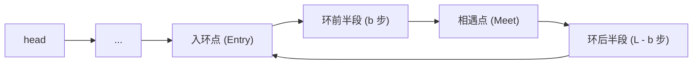

---
tags:
  - 算法
  - 力扣
  - 链表
  - 快慢指针
  - 双指针
  - 题解
aliases:
  - Linked List Cycle II
  - 环形链表入口
题号: "142"
难度: 中等
阅读次数: 0
---

# 142. 环形链表 II

> 给定一个链表的头节点 `head`，返回链表开始入环的第一个节点。如果链表无环，则返回 `null`。不允许修改链表。

---

## 1. 解题思路

### 1.1 两倍速追及
使用快慢指针 `slow` 和 `fast`，起点均在 `head`。
- `slow` 每次前进 1 步。
- `fast` 每次前进 2 步。

若链表无环，`fast` 会率先到达末尾（`fast == nullptr` 或 `fast->next == nullptr`），返回 `nullptr`。
若链表有环，`fast` 进入环后相对 `slow` 每轮拉近 1 步的距离，两者必在环内某点相遇。

### 1.2 相遇点到入环点的数学推导

设：
- 链表头节点到入环点的节点跨度（不含入环点）为 $a$。
- 入环点到首次相遇点的顺时针步数为 $b$。
- 环的周长为 $L$。

当快慢指针首次相遇时：
- `slow` 走的步数：$s = a + b$。
- `fast` 走的步数：$f = a + b + k \cdot L$（其中 $k \ge 1$ 表示 `fast` 在环内多绕了 $k$ 圈）。

由于快指针速度是慢指针的 2 倍（$f = 2s$）：

$$
2(a + b) = a + b + k \cdot L \implies a + b = k \cdot L \implies a = k \cdot L - b = (k - 1)L + (L - b)
$$

**结论**：
从链表头 `head` 出发走 $a$ 步到达入环点；而从相遇点继续顺着环走 $L - b$ 步，也恰好到达入环点（加上 $(k-1)$ 圈依然落在入环点）。

因此，相遇后只需将其中一个指针（如新指针 `entry`）重置到 `head`，另一个指针停在相遇点，两人每次均走 1 步同步前进，**相遇之处即为环的入口节点**。

---

## 2. 图解过程



从 `head` 到 `Entry` 距离为 $a$；从 `Meet` 沿环走到 `Entry` 距离为 $(L - b) + (k - 1)L$。两者步调一致（每次走 1 步）必然在 `Entry` 汇合。

---

## 3. 代码实现

```cpp
class Solution {
public:
    ListNode *detectCycle(ListNode *head) {
        ListNode* slow = head;
        ListNode* fast = head;

        // 阶段一：判断是否有环并寻找相遇点
        // 关键防护：推进两步前必须同时确保 fast 与 fast->next 有效
        while (fast != nullptr && fast->next != nullptr) {
            slow = slow->next;
            fast = fast->next->next;

            if (slow == fast) {
                // 阶段二：寻找环入口
                ListNode* entry = head;
                while (entry != slow) {
                    entry = entry->next;
                    slow = slow->next;
                }
                return entry;
            }
        }

        // fast 遇空，链表无环
        return nullptr;
    }
};
```

---

## 4. 复杂度分析

- **时间复杂度**：$O(n)$。
  - 无环时，`fast` 遍历到链尾耗时 $O(n/2)$。
  - 有环时，`slow` 进环前走 $a < n$ 步，在环内一圈内被 `fast` 追上走小于 $L$ 步；阶段二寻找入口最多走 $a$ 步。总体时间仍为 $O(n)$。
- **空间复杂度**：$O(1)$，仅使用若干指针变量，无额外内存分配。

---

## 5. 易错点与错题集

| 易错点 | 后果 / 修正 |
|--------|-------------|
| 循环内只判 `head` 或事后判空，缺少 `while (fast && fast->next)` | 在无环奇数长链表（如 `1 -> 2 -> 3 -> null`）中，`fast` 停在尾节点后执行 `fast->next->next` 触发对 `nullptr` 的成员访问崩溃。必须使用前置短路判断。 |
| 使用 `do-while` 结构 | `do-while` 强制先执行一次循环体，割裂了循环推进的安全检查边界，极易漏掉对 `fast->next` 的前置防护。统一推荐 `while (fast != nullptr && fast->next != nullptr)`。 |
| 误在相遇前将快指针速度设为 3 倍速或其它倍数 | 推导公式依赖 $f = 2s$，若改为 3 倍速，公式变为 $3s - s = 2s = kL$，不再能直接得出“从头出发走 $a$ 步等于相遇点走剩余圈数”的简捷重合关系。 |
| 找到相遇点后第二阶段快慢指针步长不一致 | 找到相遇点后，两指针都必须**单步（每次 1 步）**推进，否则无法抵消距离差。 |

### 5.1 典型崩溃案例剖析：为什么提前判断了 head->next 还会报错？

**错误代码现场**：

```cpp
ListNode *detectCycle(ListNode *head) {
    if (head == nullptr || head->next == nullptr)
        return nullptr;
    ListNode* fast = head;
    ListNode* slow = head;
    do {
        fast = fast->next->next; // 崩溃行：Line 17
        slow = slow->next;
        if (fast == nullptr)
            return nullptr;
    } while (fast != slow);
    // ...
}
```

**报错原因分析**：
1. **前置检查的局限**：
   `if (head == nullptr || head->next == nullptr)` 仅仅确保了**第 1 次**两步推进不会直接在空指针上取 `next`。
2. **中间迭代的空指针解引用**：
   链表若无环且长度大于等于 3（以 `1 -> 2 -> 3 -> nullptr` 为例）：
   - 第 1 轮循环：`fast` 从 `1` 跳到 `3`，`slow` 从 `1` 走到 `2`。此时 `fast != nullptr` 且 `fast != slow`。
   - 第 2 轮循环：`fast` 停在节点 `3`（无环链表尾部）。
   - 执行 `fast = fast->next->next`：
     - 先算 `fast->next`：节点 `3` 的 `next` 是 `nullptr`。
     - 再算 `(nullptr)->next`：试图解引用空指针访问 `next` 成员，直接触发 `member access within null pointer` 崩溃。
3. **事后判空毫无防护能力**：
   `if (fast == nullptr) return nullptr;` 位于崩溃语句的**后一行**，代码执行到上一行就已异常中止，根本没有机会执行该判断。

**核心准则**：
> 凡涉及两步跳跃（`fast->next->next`），循环条件**必须前置同时满足** `fast != nullptr && fast->next != nullptr`，利用 `&&` 短路求值阻断非法访问。

---

## 6. 关联笔记

- [[5.算法/5.2 算法/5.2.9 链表常见技巧#10.2 找入口：142|链表常见技巧：找入口]]
- [[5.算法/5.2 算法/5.2.9 链表常见技巧#17.2 快慢指针移动前缺少 fast && fast->next 双重保护|链表常见技巧：快慢指针双重保护避坑]]
- [[5.算法/5.3 力扣/5.3.9 链表/148. 排序链表|148. 排序链表]]
- [[5.算法/5.3 力扣/5.3.9 链表/143. 重排链表|143. 重排链表]]

题目链接：[LeetCode 142. 环形链表 II](https://leetcode.cn/problems/linked-list-cycle-ii/)
