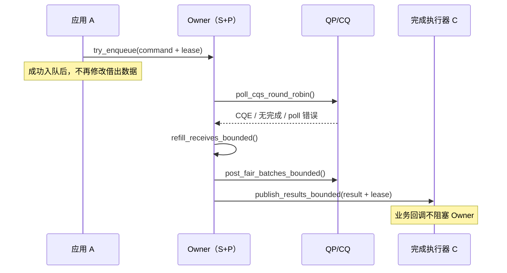

---
tags:
  - 高性能存储
  - RDMA与RoCE
  - 并发与所有权
  - Progress
status: 已完成
updated: 2026-09-19
revision: 所有权交接与轮询预算增强版
---

# 多线程下 QP 的使用模型

> 多线程 RDMA 的核心不是“哪一行需要加锁”，而是：**谁有权修改连接状态，谁正在借用 buffer，谁负责推进请求，谁能证明它已经可以回收。** 本篇把应用线程、提交线程、progress 线程、完成线程拆成四个逻辑角色，再把它们组合成可实施的线程模型。正常路径的所有权交接，也必须成为 [[4.19 RDMA 故障恢复与连接重建]] 中关闸、排水和重建的依据。

本文以 Linux 用户态 libibverbs、RC QP、普通注册的 Host Memory 为基线。GPU 显存、ODP、特定 provider 的直接接口和框架级 progress 另有条件；不要把基线直接推广成所有 RDMA 实现的保证。API 规则用脚注标明；本文的队列、租约、调度参数和状态名是**应用侧设计**，不是 verbs 自带接口。示例预算都是待测起点，不是实测性能。

先掌握 [[4.2 Verbs 编程模型]] 中的 PD/QP/CQ/MR，以及 [[4.3 QP WQE CQ 状态机]] 中 WR 的提交与完成，再读本篇。

## 1. 四种“所有权”必须分开

**对象所有权**回答谁负责最终销毁 QP、CQ、MR；**修改权**回答哪个线程可以改变 SQ 信用、连接状态、请求表；**使用权**回答 CPU 或 RNIC 何时仍可能访问 buffer；**业务决定权**回答谁可以向调用者报告成功、失败或取消。这四种权利并不总在同一时刻转移。

例如应用把一个 WRITE 请求交给提交线程：应用仍可能拥有业务请求对象，但不能继续修改已经借给 RNIC 的源数据；提交线程拥有 SQ 的修改权，却不能仅凭 `ibv_post_send()` 返回成功就把 buffer 还给应用。非 inline 数据需要等待相应工作完成；inline 的源数据可以在调用返回后复用，但请求表、信用和业务结果仍然需要结算。[^post]

| 对象或状态 | 建议的唯一修改者 | 可交给其他线程的内容 | 不能凭什么判断安全 |
| --- | --- | --- | --- |
| QP 的 SQ、提交序号、发送信用 | SQ owner | 不可变的提交命令 | 不能凭“provider 有锁”推断应用记账正确 |
| QP 的 RQ | RQ owner；基线与 SQ owner 合并 | 归还的接收 buffer token | 不能凭“收到完成”就覆盖仍被应用读取的数据 |
| CQ 消费游标、通知重置 | CQ owner / poller | 已复制的完成摘要 | 不能凭“CQ 当前为空”推断所有请求完成 |
| 连接状态、generation、销毁许可 | lifecycle owner | 带连接代际的控制消息 | 不能凭一次原子状态读取排除并发 post |
| 在途 WR 表、buffer/MR lease | 指定的 ledger owner | 稳定 token 与只读元数据 | 不能凭 `shared_ptr` 存活推断 DMA 已停止 |
| 业务回调与协程恢复 | completion executor | 拥有结果生命周期的完成消息 | 不能把本地 CQE 等同远端业务提交 |

这里的 lease 是显式“借用凭证”：在途期间禁止内存释放、注销 MR 或不兼容地复用；它不是要求每次 I/O 都进行一次内存注册。注册池与缓存的生命周期见 [[4.4 内存注册与零拷贝]] 和 [[4.12 rkey lkey 生命周期]]。

## 2. 四个角色，不等于必须开四条线程

![[图片/SVG/8_4_18_1.svg|900]]

**应用角色 A**构造业务请求，获取缓冲区、填写内容、发布命令。**提交角色 S**检查当前连接代际，分配 WR token、预留资源、组织 postlist 并调用 verbs。**Progress 角色 P**消费 CQ、补 RQ、归还信用、处理控制消息与超时，使协议状态继续前进。**完成角色 C**执行业务回调、恢复协程或者把结果送回应用的事件循环。

对于普通硬件 RC，已接受的 WQE 可以由 RNIC 在 CPU 没有持续调用 `poll_cq` 时执行。因此不要把 P 理解为“每个数据包都靠软件轮询才发送”。但应用不处理完成，就不能持续回收 SQ 信用、复用 buffer、补充接收队列或推进依赖下一步的协议。**硬件传输有进展，不代表应用协议有进展。**

建议先实现 **A → Owner Reactor（S+P+连接生命周期）→ C**。Owner 管理一组 QP/CQ，不是每条连接创建一条系统线程。这个形态以消息传递替代共享可变状态，与 SPDK 的单执行上下文、消息传递设计相通，但本文并不依赖 SPDK。[^spdk]

只有当测量证明提交、poll 或业务处理确实需要独立扩展时，再拆 S/P/C。每拆一处，就新增一条必须解释的队列、发布顺序、背压和关闭协议。

### 2.1 不能把“完成线程”混为一谈

有些代码把 CQ poller 称为 completion thread；另一些代码把执行用户回调的线程这样命名。本篇明确区分：**P 取硬件完成，C 执行业务完成**。两者可以合并，但合并后的回调必须有非阻塞契约。`future.get()`、同步日志、磁盘访问、等待另一条连接等都不应混入关键 poll 循环。

## 3. 线程安全不是生命周期安全，也不是业务顺序

默认 verbs 对象提供多线程访问支持；选择 Thread Domain 等优化后，应用承担相应的单线程使用约束。[^td] 但即使使用默认模式，下面几件事仍然由应用负责：请求序号与 WQE 的对应、buffer 生命周期、销毁与 post 的互斥、信用预留、跨 QP 顺序，以及回调的唯一结算。

原先容易写成“外部 mutex 与 provider 内锁等价”。准确的区分是：**provider 内锁保护它的内部数据结构；应用锁可以保护“检查状态 → 预留信用 → 登记请求 → post → 处理返回值”这一整个事务。** 两者覆盖范围不同，不能互相替代。

以 rdma-core **v56.0** 的 mlx5 provider 为一个固定实现例子，`_mlx5_post_send()` 涉及 SQ 锁、WQE 构造、`wrid` 记账和 `post_send_db()`。这说明共享资源可能引入内部同步成本，但不能据此宣称每一种 provider 都使用相同锁、相同门铃路径或相同开销。[^mlx5]

多线程同时 post 同一 SQ，硬件最终会看到某个提交顺序；这个顺序未必等于应用的业务序号，也未必等于函数调用开始的先后。业务需要“先更新 A，再通知 B”，就要在 owner 队列或协议中建立顺序，不能让多个生产者的竞争结果替代协议。

## 4. 三种 QP/CQ 布局，加一种集中提交模型

![[图片/SVG/8_4_18_2.svg|900]]

| 模型 | 提交与完成方式 | 优点 | 主要代价与适用条件 |
| --- | --- | --- | --- |
| A：多线程共享 QP | 默认 provider 同步；必要时外部锁覆盖记账 | QP 数量少，改造简单 | 争用、cache line 迁移、顺序与回调归属复杂；低频控制面可合理使用 |
| B：独立 QP，共享 CQ | 各 SQ 有 owner；单 CQ poller 按 token 分发 | 减少 CQ 数，集中处理稀疏完成 | 跨核转发；共享 CQ 的容量和故障影响范围扩大 |
| C：每个 owner 管一组 QP 与私有 CQ | S/P 在同一执行上下文 | 状态局部化，便于批量和生命周期推理 | owner 负载可能不均；QP、CQ、线程和 NUMA 需要联合规划 |
| D：应用共享服务，QP 不共享修改 | 多应用线程发命令，少量 owner 代提交 | 把应用并发与硬件队列数量解耦 | 提交邮箱的等待与背压；owner 的公平调度不可省略 |

C 与 D 通常可以组合：多个 owner 分片，每个 owner 处理多个应用、多个对端，而不是机械地“每应用线程 × 每对端”创建全部 QP。只有在确实采用全连接复制布局时，才近似有 `QP 数 = 本地 owner 数 × 对端数 × 每对端 rail 数`；这不是所有程序的恒等式。

多个 QP 可以关联一个 CQ。[^createqp] **共享 CQ 不等于多个线程必须同时 poll**；单 poller 按请求 token 路由，往往比多个 poller 竞争同一 CQ 更容易推理。QP 数、活跃工作集与缓存压力的拐点应通过 [[4.28 RDMA 大规模连接：QP 资源成本、SRQ、连接扩展与 RNIC Cache]] 的实验判断，不给出“几千 QP 必然掉速”这样的固定门槛。

## 5. 一次 WRITE 的五次交接

### 5.1 A → S：命令发布，不只是传一个裸指针

命令至少携带 `business_id`、目标连接、目标 generation、操作类型、长度、buffer lease 和完成路由。发布之前，A 完成数据写入；发布成功后，A 按契约停止修改这段数据。S 从队列取得命令时，应看到这些初始化结果。

正确实现的 mutex 队列，或具有相应 release/acquire 语义的并发队列，可以建立主机线程之间的发布关系。**这解决 CPU 线程间可见性，不是远端 CPU、GPU 或 RNIC 的通用 fence。** 设备和远端顺序仍按 [[4.13 RDMA 操作顺序性]] 与 [[4.14 Fence 与内存可见性]] 处理。

`try_push` 失败时必须明确“所有权未转移”。避免函数参数先 `std::move` 消耗 lease，队列失败后调用者却不知道请求是否还归自己。可以返回包含未接收请求的结果，也可以使用明确保证失败不消耗参数的队列接口。

### 5.2 S → RNIC：先准备账本，再允许产生完成

S 核对当前连接仍可提交、descriptor 属于当前远端实例和连接代际，再预留 SQ 信用、请求表槽位、完成投递容量与必要的 buffer/MR lease。`wr_id` 使用稳定 token，不直接使用可能立即销毁的业务对象地址。

建议将身份拆为：

| 身份 | 生命周期 | 解决的问题 |
| --- | --- | --- |
| `business_id` | 跨重试保持不变 | 远端去重与最终结果查询 |
| `connection_generation` | 每次逻辑重建变化 | 阻止旧连接命令进入新会话 |
| `attempt_id` / WR token | 每次真实提交变化 | 区分同一业务的不同传输尝试 |
| `slot_generation` | 请求表槽位每次复用变化 | 防止晚到完成命中复用后的新对象 |

`wr_id` 是 64 位用户字段，可以编码索引和槽代际，也可以查间接表；无论哪种方式，都必须考虑回绕和槽位隔离期。连接代际可以存于 token 指向的不可变记录，不要求全部硬塞进 64 位字段。

### 5.3 RNIC → P：CQE 是一次性消费的证据

P 取到 CQE 后，先检查 `status`。错误完成只有 `wr_id`、`status`、`qp_num`、`vendor_err` 保证有效，不能用错误 CQE 的 `opcode` 或 `byte_len` 决定回收哪一种资源；应根据 token 查原始 WR 记录。`ibv_poll_cq()` 负返回值也必须进入故障处理，不能被空循环静默忽略。[^poll]

同一个 CQE 被 poll 后就从 CQ 移除；应用可以把其摘要复制进内部消息，但不能“放回 CQ”。完成记录的操作类型、buffer 和归属来自请求表，不来自猜测。

### 5.4 P → C：传输资源退休，业务结果发布

当获得足够的本地完成证据，P 归还相应 SQ 信用并结束 RNIC 对本地 buffer 的这一段借用。READ 的结果还要交给 C 使用，因此“结束 DMA 借用”不等于“立即把内存扔回可覆盖的池”。应把结果对象和它的内存租约一起转交给 C。

业务是否完成取决于接口语义：READ 成功可能已经满足一次读操作；SEND/WRITE 的本地完成通常不能替代远端应用的处理回执、事务提交或持久化确认。框架应明确 API 返回的是 `LOCAL_TRANSPORT_DONE` 还是 `REMOTE_OPERATION_COMMITTED`。

### 5.5 C → 资源池：最后一个使用者归还

C 处理完结果后释放应用读者引用。最终回收条件是所有必要引用与设备借用都结束；应用超时或取消只结束调用者的等待，不自动撤销已经交给 RNIC 的访问。这个区分直接决定 [[4.19 RDMA 故障恢复与连接重建]] 能否安全排水。

## 6. 拆开提交与 progress：提前到达的完成

![[图片/SVG/8_4_18_3.svg|900]]

若 S 与 P 是不同线程，不能假定 `ibv_post_send()` 返回之后 P 才可能看到完成。一个安全设计必须容纳“调用尚未返回，CQE 已被另一个线程取到”的时间交错。

**推荐的提交发布协议**如下。S 先分配稳定记录并发布 `POSTING`，持有提交保护引用；P 若先看到 CQE，只记录完成证据，不释放该记录，也不执行最终回调。S 返回后发布 `PostResult`，说明接受前缀和未接受后缀；ledger owner 同时看到提交结果与完成证据后再做最终结算。

| 当前状态 | 收到事件 | 允许动作 | 禁止动作 |
| --- | --- | --- | --- |
| PREPARED | 开始调用 post | 发布 POSTING，固定记录地址与 lease | 提交后才第一次登记 token |
| POSTING | 提前 CQE | 保存完成证据，保持提交保护引用 | 直接析构请求或减少尚未提交的总计数 |
| POSTING | PostResult：接受 | 标记 ACCEPTED；合并提前证据 | 把本地接受当作业务成功 |
| POSTING | PostResult：未接受 | 标记 NOT_ACCEPTED，归还本次预留 | 与已接受前缀一起重发 |
| ACCEPTED | 合法终结证据 | 只结算该 attempt 一次 | 仅根据 `qp_num` 结算复用后的新连接 |

状态不能靠两个线程无保护地读写普通字段实现。可让 P 成为 ledger 的唯一修改者：S 经队列发送 prepare/post-result，P 负责所有转换；也可使用经过论证的原子状态机和引用协议。第一种方案可能需要一次 prepare 确认，增加开销；这正是先采用 S+P 合并模型的理由。

这里采用的**保守交接规则**是：POSTING 记录既不因提前 CQE 消失，也不因取消消失。只有 PostResult 的归属已确定，才允许退还本次预留或结束设备借用。

## 7. postlist 部分成功：不能把一批当成事务

`ibv_post_send(qp, head, &bad_wr)` 在遇到可立即检测的错误时停止；`bad_wr` 指向首个失败 WR。在经典 linked-list API 的此类失败中，它之前的前缀已经接受，失败 WR 与其后缀没有接受。批处理不是“整批全部成功或全部失败”。[^post]

下面的 C++17 辅助函数只解析这个**返回契约**，不负责 post 或生命周期管理。`nodes` 保存本批 WR 的借用指针，并且直到调用返回都有效；需要 `<algorithm>`、`<cstddef>`、`<iterator>`、`<optional>`、`<vector>` 与 `<infiniband/verbs.h>`。

```cpp
std::optional<std::size_t> accepted_prefix(
    const std::vector<ibv_send_wr*>& nodes,
    int rc, const ibv_send_wr* bad_wr) {
    if (rc == 0) {
        return nodes.size();
    }
    const auto it = std::find(nodes.begin(), nodes.end(), bad_wr);
    if (it == nodes.end()) {
        return std::nullopt;  // 返回契约异常，不能猜“接受了 0 个”
    }
    return static_cast<std::size_t>(std::distance(nodes.begin(), it));
}
```

其关键不是循环，而是 `nullopt`：一旦不能可靠确定接受前缀，就必须停止该提交路径并保留可能在途的资源，交给故障状态机处理，而不能随便回滚全部计数。实际使用时还要核对 provider 和所用 API 的契约；扩展 WR builder 接口不能机械套用 linked-list 的部分成功模型。

例如序号 100—105，计划仅 105 signaled，却在 103 失败：100—102 已经接受；103—105 没有接受。**原定的完成标记 105 根本不在 SQ 中。** 若此时把所有剩余槽位都消耗在 unsignaled 请求上，就可能没有空间提交新的完成见证。解决办法是保留明确的发送信用、设置可完成的 signaled 边界，并处理“边界自身未接受”的情况，而不是无限等待 105 的 CQE。

| 计数 | 正确增减点 |
| --- | --- |
| 预留信用 `reserved` | 准备本批时增加；PostResult 确定后释放未接受部分 |
| 已接受 WR `accepted` | 只按被接受的前缀增加 |
| 已退休 WR `retired` | 只按有效完成证据增加，重复证据不重复结算 |
| 未退休债务 | `accepted - retired`，与业务未完成数量不同 |

postlist 的描述符/SGE 元数据在 post 调用返回后通常可按 API 用法复用；**其描述的非 inline 数据不能随描述符一同提前复用**。改变数据所有权与回收请求元数据是两条不同的路径。

## 8. Signaled、unsignaled 与可证明的退休边界

建议第一版所有发送 WR 都 signaled，先完成关闭、错误与取消的记账，再引入 [[4.15 Signaled Unsignaled WR]] 的完成压缩。

优化时，维护同一 SQ、同一连接代际内的已接受序号与合法完成边界。对于已经证明顺序关系的操作序列，可用后续成功完成作为此前相关 WR 的退休见证；**不能跨 QP 使用这个结论，也不能不加分析地把 READ/Atomic/绑定与失效操作混在同一条“序号更大就全部完成”的规则里**。需要的顺序与 fence 由 [[4.13 RDMA 操作顺序性]]、[[4.14 Fence 与内存可见性]] 决定。

错误时更不能写成“收到一个 CQE 就 `--inflight`”：成功的 unsignaled WR 可能本来就没有独立 CQE；一个已结算前缀也不能再被错误路径二次扣减。应对每个 attempt 或可证明的区间记账。错误和 flush 路径不应按照成功路径的 signaled 比例预估容量；CQ 真正出错后，也不应假定还能取全所有完成。[^poll]

## 9. 批处理必须同时限制数量、字节和等待时间

批处理减少调用与提交路径的固定成本，但会引入等待和占用。[[4.16 Inline Batching 与 Doorbell 优化]] 解释提交机制，本节关注多租户调度。

每个批次至少有三个停止条件：`wr_count >= N_max`、`payload_bytes >= B_max`、`oldest_wait >= T_flush`。此外受 SQ 信用、对端接收信用、READ/Atomic 的在途能力、完成投递容量和当前时间片限制。

只限制 WR 数对大小混合流不公平：32 个 64 B 请求与 32 个 1 MiB 请求的链路占用不是一回事。只限制字节又可能让极小消息把 CPU 用在大量 WQE/CQE 上。因此应同时保留 **WR 数预算 + 字节预算 + CPU 时间预算**。

等待攒批不能阻塞 owner：记录最老请求时间，在正常轮询中检查是否到期。低负载下到期就发，不等凑满。控制消息可以采用更短的攒批窗口，但不能获得无限优先权，把普通业务永久饿死。

一个 API postlist 调用是否严格对应一次硬件 MMIO 门铃，取决于 provider、设备和提交路径；应用层调度不应把这个实现细节当成正确性前提。[^mlx5]

## 10. 公平性要在三个地方落实

![[图片/SVG/8_4_18_4.svg|900]]

### 10.1 入口公平：单个 MPSC FIFO 不保证租户公平

一个高频生产者可以占满共享 FIFO，使其他租户连队都进不来。解决入口问题通常需要每租户/每应用的有界队列与额度，或者在入口先分类，再由 owner 从活跃队列集合中选取。所有队列都需要总内存上限，不能用“每租户一个队列”制造无限总体容量。

### 10.2 提交公平：RR、DRR 与有界分块

Round Robin 每轮给活跃队列有限请求数；消息大小接近时简单有效。Deficit Round Robin 给租户累积字节额度，每个请求/分块消耗相应额度，未用完部分可保留，并限制额度上限。它改善字节服务的公平，但仍要加 CPU/WR 预算，避免小消息占满处理时间。

大请求超过单轮 quantum 时，应允许跨轮累积到足够额度，或按协议允许的粒度分块；不能每轮都判定“太大，跳过”，使大请求永久不执行。分块也不是完全免费：它增加 WQE、完成和状态数量，并必须保持业务所需顺序。

任何软件调度器都无法抢占已经投递给硬件的大量 WQE。因此要约束**每租户在途字节和每 QP 的前置排队深度**，而不仅是本轮 post 数。

### 10.3 完成公平：有限批量取 CQ，快速结算，业务回调外移

多个 CQ 分别设置 CQE 上限和时间上限；满额时保存轮转游标，下轮从后继继续，不能每轮都从最热 CQ 开始。单个共享 CQ 中不能选择性跳过前面的热租户完成，应快速取出并按归属路由；公平更多依赖上游 admission、独立 CQ 分组以及各业务执行器的额度。

CQ 轮询预算只是**单轮配额**。有积压时应尽快再服务，不能“本轮用完预算就固定睡眠”。若回调投递队列已满，先停止增加新工作并保留已完成记录；不要丢弃完成，也不要让 poller 同步执行任意慢回调作为兜底。

## 11. 一个有预算的 owner 循环

下面是结构伪代码，不是可直接编译的完整 RDMA 服务。所有 `*_bounded` 都必须同时限制工作量与占用时间；`publish_results_bounded` 只发布完成消息，不执行任意用户回调；控制邮箱必须有独立容量或保留容量，确保恢复命令不会被业务洪峰堵住。

```cpp
void Owner::tick(TimePoint now) {
    assert_owner();
    consume_control_bounded(now);     // 关闸、提交结果、恢复事件
    poll_cqs_round_robin(now);        // 回收信用；错误立即收口
    refill_receives_bounded(now);     // 使用真正空闲的接收 buffer
    expire_deadlines_bounded(now);    // 取消等待不等于释放 DMA lease
    if (state_ == State::Ready) {
        admit_fair_bounded(now);      // 分租户接收命令
        post_fair_batches_bounded(now);
    }
    publish_results_bounded(now);     // 队列满则保留结果并施加背压
    advance_recovery_bounded(now);    // 不在此 sleep / 等 future
}
```



这个循环修正“先把 inbox 全部清空，再 poll CQ”的饥饿问题：生产者持续入队时，清空条件可能永远不成立。定时器扫描也不能每轮遍历全部连接；可用到期堆、时间轮或分片游标，避免把 O(连接数) 的工作偷偷放进一个看似有预算的函数。

### 11.1 参数起点与背后的约束

以下只是**实验配置示例**：每批 16 WR、每 QP 每轮最多 32 WR、每 CQ 每次最多 64 CQE、一次 CQ 服务最多 4 μs、最老请求等待 5 μs 即触发提交。它们不能保证实际最坏延迟，因为单次 provider 调用、CPU 抢占和设备行为未必有硬实时上界。

若一轮服务 K 个 CQ，每 CQ 消耗不超过设计时间片 `T_cq`，其他阶段总预算为 `T_other`，则可用

\[
T_{cycle,design} \approx K T_{cq} + T_{other}
\]

检查配额是否明显超过目标 poll 间隔。它是设计估算，不是操作系统层面的时延证明。测量应记录 `max_inter_poll_gap`，而不只记录平均循环耗时。

CQ 容量的初步检查可以写成：

\[
C_{CQ} \ge \lambda_{CQE,peak} T_{no\_poll} + B_{burst} + H_{error}
\]

其中包含正常完成产生率、最长不服务窗口、突发余量和错误完成余量。例如假设 2,000,000 CQE/s、50 μs 的未服务窗口，仅持续输入就产生约 100 个 CQE；这还未计突发和故障。该算式不是硬件保证，也不能替代设备实际 CQ 容量限制与压力测试。CQ overrun 会触发 CQ 错误，不能把它当成可忽略的性能告警。[^poll]

## 12. RQ 补充与 buffer 归还：避免另一种隐形停顿

对于 SEND/RECV 类通信，RQ 补充属于 progress 的关键工作。RQ 完成后，buffer 可能进入应用处理阶段；只有应用释放它，或者将数据复制到其他具有明确所有权的存储，才可重新 post 同一 buffer。应区分 `FREE → POSTED_RECV → RECEIVED → APP_READING → FREE`，不能在 `RECEIVED` 后立即循环覆盖。[^recv]

SRQ 将接收资源汇聚，但并不自动解决应用 buffer 池、租户隔离、回调和关闭协议。多个 QP 共享 SRQ 时应指定 SRQ owner；一个 QP 失败不代表可以回收 SRQ 中所有 buffer。SRQ 的 last-WQE 与故障回收问题在 [[4.19 RDMA 故障恢复与连接重建]] 中单独处理。

RQ 低水位、接收 buffer 被应用长期占用、RNR 与 poll 饥饿容易互相放大。排障时把 `rq_posted`、`recv_buffers_in_app`、`refill_delay` 和 [[4.17 Retry RNR 与 Timeout]] 的 RNR 证据放在同一条时间线上。

## 13. Busy polling 与事件模式：睡眠也要交接

Busy polling 减少通知与唤醒步骤，但消耗 CPU；事件模式适合稀疏流量；混合模式则需要防止“判断空闲”和“开始等待”之间出现漏唤醒窗口。

对 CQ，基本协议是 **请求通知 → 再检查 CQ → 确认其他工作也无待处理项 → 等待**。收到 completion-channel 事件后要 ack 并重新安排下一次通知；事件不保证与某一张 CQE 一一对应，允许收到事件后 CQ 已空。每一次成功 `ibv_get_cq_event()` 都需要相应 ack，销毁 CQ 会等待未确认事件。[^cqevent]

更容易遗漏的是应用邮箱：**即使 CQ 唤醒完全正确，新的应用命令也未必产生 CQ 事件。** 等待集合应覆盖 completion channel、应用/控制邮箱的唤醒 fd、相关异步事件与定时器。邮箱从空变非空时通知 owner，并按所用队列/唤醒协议再次检查队列，不能在仅等待 CQ 的状态下把新请求搁置。

不要在数据面主循环里直接调用可能永久阻塞的 `ibv_get_async_event()` 或 `rdma_get_cm_event()`。使用非阻塞 fd 配合事件循环，或由专门的事件线程接收、复制必要数据并投递 owner。事件对象的 ack 与关闭等待规则见下一篇。

## 14. Thread Domain 与 NUMA：最后再做的优化

Thread Domain（TD）用于向 provider 表达可利用的单线程访问约束，从而减少内部同步。将 TD 加入 parent domain 后，用相应 parent domain 创建资源；CQ 需要通过扩展创建属性显式传入 parent domain，并设置对应的兼容性 mask，不能写成“QP 用了 parent domain，CQ 就自动获得相同属性”。[^td][^cqex]

**保守工程规则**：同一 TD 及其可能共享的 provider 资源保持单执行线程使用；需要 S/P 拆分时，先使用普通受保护对象，或按具体 provider 契约划分独立 domain。不要以“两个线程操作的是不同 QP”推断共享 TD 一定安全，也不要在热切换 owner 时让旧、新线程重叠访问。

NUMA 上应联合安排线程、应用数据池与 provider 资源。绑定 CPU、指定内存策略、触发首次分配，再核对实际内存与 NIC 拓扑；**仅 pin 核并不保证所有 QP/CQ 内存必然位于指定 NUMA node**。比较本地/远端 node 时，同时记录吞吐、P99、跨核队列等待、CPU 使用和迁移，而不是承诺平均值一定不变、尾延迟一定变坏。

## 15. 关闭、取消与 owner 迁移的交接屏障

![[图片/SVG/8_4_18_5.svg|900]]

`if (state.load() == READY) post()` 与另一线程的 `state = DRAINING; destroy_qp()` 之间存在检查—使用间隙。一个原子布尔开关不能证明先前通过检查的线程已经离开 post 临界区。

基线模型中，应用只排队、不持有 QP；owner 自己处理关闸命令，并在同一执行上下文中停止后续 post。**owner 执行关闸状态转换的时刻**是线性化边界，不能声称其他线程“发出关闸消息的时刻”就已经停止了发送。晚到 inbox 命令仍由 owner 按代际与状态拒绝或重新路由。

若 S/P 分离，生命周期 owner 必须等待 `SUBMISSION_QUIESCED(generation)`：所有针对旧代际的 post 调用已返回，PostResult 已发布，后续不会再提交，引用与队列中残留命令均有明确处理者。只有此后才能推进销毁等动作。等待采用消息状态机，不阻塞负责产生该确认的线程。

取消也必须拆分：未接受的请求可以移出软件队列；已经接受的请求只能先取消调用者等待、抑制最终业务回调，继续保留 DMA lease 到安全终结。不能假设任意 WR 都有可撤回的 cancel API。

owner 迁移是同样的协议：停止路由到旧 owner，旧 owner 到达静默点，移交账本、队列、定时器与资源使用权，新 owner 明确确认后恢复。新旧 owner 不得在同一段交接窗口并发访问单线程 domain。

## 16. 测量与故障注入：验证的是不变量

应同时记三段延迟：`enqueue → post`（软件排队）、`post → CQE observed`（包含传输与未及时 poll 的时间）、`CQE observed → callback`（业务分发）。只测最后的端到端 P99，无法判断优化批处理是在降低固定成本还是把时间搬到入口等待。

| 实验 | 控制变量 | 必须观察或断言 |
| --- | --- | --- |
| 持续灌入一个热生产者，另一个低频请求 | 总负载相同；全量 drain 对比有预算调度 | 低频队列是否得到服务；`max_inter_poll_gap` 是否受控 |
| 64 B 与 1 MiB 混合 | RR 对比字节 DRR + WR/时间配额 | 小消息 P99、大消息完成率、每租户在途字节 |
| 在 postlist 中间注入立即失败 | all-signaled 基线，再测试 unsignaled | 接受前缀不重发；未接受后缀不计入在途 |
| CQE 在 PostResult 之前到达 | 软件适配层可确定性调度 | POSTING 记录和 lease 不提前释放 |
| 停止消费业务完成队列 | 总容量有限 | 新提交受背压；完成不丢失；P 不执行慢回调 |
| 接收业务长期持有 buffer | 固定 RQ 和 pool 大小 | 同一 buffer 不同时处于 POSTED_RECV 与 APP_READING |
| 关闸与提交交错；重复关闭事件 | 控制所有时序排列 | quiesced 前不销毁；关闸边界后旧代际不再 post |
| 回收槽位后投递旧 token | 强制 slot generation 不匹配 | 旧完成不命中新请求，不二次回调 |

压测报告写清 rdma-core/provider、固件、CPU、NIC、NUMA、QP/CQ 容量和信号比例。soft-RoCE 可用于部分 API/状态测试，不代表硬件延迟、DMA 和 RNIC 内部资源特性；边界见 [[4.8 soft-RoCE 边界]]。系统化矩阵可沿用 [[4.30 RoCE Benchmark Matrix：Message Size、QP 数、Flow 数、Incast、NUMA、Multi-Rail、PFC、ECN 与 P99]]。

## 17. 代码评审时只问这八个问题

| 问题 | 合格答案应包含 |
| --- | --- |
| 谁可以调用这个 QP 的 post？ | 唯一 owner 或完整覆盖记账的同步协议 |
| buffer 何时不能再改，何时可以回池？ | 发布点、DMA lease、应用读者引用三个条件 |
| post 部分成功怎么办？ | 可核对的接受前缀、信用回滚和 signaled 边界修复 |
| CQE 早于 post 返回怎么办？ | 预发布稳定记录、POSTING、提交保护引用 |
| 一个生产者无限灌流怎么办？ | 入口额度、提交公平、CQ 预算与完成背压 |
| 用户回调阻塞怎么办？ | 独立完成执行器或严格非阻塞契约 |
| 如何证明不再有人使用旧 QP？ | owner 关闸与 submission-quiesced 确认，而非一次原子读 |
| 谁决定业务成功，谁决定内存安全？ | 分离的业务结果账本和传输资源账本 |

> [!summary] 本篇的落点
> 先把 S/P/生命周期合并成一个可推理的 owner，再用有界队列连接 A/C；优化需要拆线程时，为每一次交接补上发布关系、稳定身份、背压与关闭屏障。批处理优化固定成本，公平与轮询预算则决定其他连接会不会为它付出无界等待。

## 参考与阅读定位

以下为 API 文档与源码定位；正文的所有权协议、预算设计和试验矩阵为结合这些契约形成的工程方案。访问核对日期：2026-09-19。

[^post]: rdma-core，[`ibv_post_send(3)`](https://man7.org/linux/man-pages/man3/ibv_post_send.3.html)：linked-list 提交、`bad_wr`、返回值、inline 与 buffer 复用条件。
[^poll]: rdma-core，[`ibv_poll_cq(3)`](https://man7.org/linux/man-pages/man3/ibv_poll_cq.3.html)：负返回值、错误 WC 有效字段、一次性消费和 CQ overrun。
[^recv]: rdma-core，[`ibv_post_recv(3)`](https://man7.org/linux/man-pages/man3/ibv_post_recv.3.html)：接收 WR 和 buffer 生命周期；SRQ 使用专门接口。
[^td]: rdma-core，[`ibv_alloc_td(3)`](https://man7.org/linux/man-pages/man3/ibv_alloc_td.3.html) 与 [`ibv_alloc_parent_domain(3)`](https://man7.org/linux/man-pages/man3/ibv_alloc_parent_domain.3.html)：Thread Domain 与资源创建/销毁依赖。单 domain 单执行者是本文的保守应用约束。
[^cqex]: rdma-core，[`ibv_create_cq_ex(3)`](https://man7.org/linux/man-pages/man3/ibv_create_cq_ex.3.html)：`parent_domain`、`IBV_CQ_INIT_ATTR_MASK_PD` 等扩展属性。
[^cqevent]: rdma-core，[`ibv_get_cq_event(3)`](https://man7.org/linux/man-pages/man3/ibv_get_cq_event.3.html)：通知、ack、重新请求通知以及可能无对应 CQE 的额外事件。
[^createqp]: rdma-core，[`ibv_create_qp(3)`](https://man7.org/linux/man-pages/man3/ibv_create_qp.3.html)：send/recv CQ、SRQ、容量与 `sq_sig_all`。
[^mlx5]: linux-rdma/rdma-core，[v56.0 `providers/mlx5/qp.c`](https://github.com/linux-rdma/rdma-core/blob/v56.0/providers/mlx5/qp.c)：`_mlx5_post_send`、`mlx5_post_send`、`post_send_db`。这里只将其作为特定版本的实现实例，不推广为所有 provider 的保证。
[^spdk]: SPDK，[Message Passing and Concurrency](https://spdk.io/doc/concurrency.html)：单执行上下文与消息传递；其轻量 `spdk_thread` 不应简单等同系统线程。
