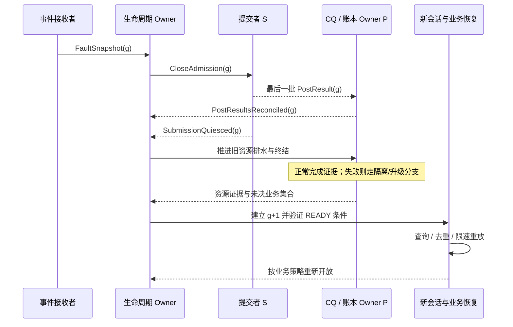

---
tags:
  - 高性能存储
  - RDMA与RoCE
  - 故障恢复
  - 连接生命周期
status: 已完成
updated: 2026-09-19
revision: 静默屏障与代际隔离增强版
---

# RDMA 故障恢复与连接重建

> RDMA 恢复不是“报错后再 connect 一次”，而是完成三件不同的事：**阻止旧执行上下文继续提交，证明旧资源何时不再被访问，在新连接上查清旧业务的结果。** 连接重建成功不能替代其中任何一项。尤其是一次 WRITE 报错，既不能证明远端没被修改，也不能自动允许重发或释放内存。

本篇以 Linux 用户态 libibverbs + librdmacm、RC QP 为基线。状态名、代际、账本、隔离池与重放策略是本文的**应用层设计**，不是内核或 RNIC 自动提供的恢复框架。API 规则附权威来源；实现差异需要按实际设备与 provider 验证。本文提供可检查的协议与测试方案，不声称已经在实体 RNIC 上完成演练。

先读 [[4.3 QP WQE CQ 状态机]]、[[4.11 RDMA CM 与连接建立]]、[[4.17 Retry RNR 与 Timeout]]。本篇的所有生命周期动作服从 [[4.18 多线程下 QP 使用模型]] 定义的 owner、提交交接和 buffer lease。

## 1. “恢复”至少有三条独立的完成线

**传输恢复**：新 QP、路径及 CM 会话就绪，能交换消息。**资源恢复**：旧 QP 的使用者静默，旧 DMA 与远端授权的访问边界得到处理，buffer 和 MR 可以按依赖安全保留或回收。**业务恢复**：未知结果被查询、去重或版本协议消解，调用者得到符合业务契约的结果。

一个存储 WRITE 的本地成功 CQE，可以满足本地传输资源的某些退休条件，却不能凭空证明远端数据库已提交或 SSD 已持久化。一个重建后的 `ESTABLISHED` 事件，也不能证明对端应用已经恢复去重表、交换新 descriptor、预备好接收缓冲或允许业务重放。[^cm]

| 容易混淆的状态 | 实际应回答的问题 |
| --- | --- |
| QP 可以通信 | 数据面路径是否建立？ |
| 旧 WR 已安全退休 | RNIC 是否还可能访问这次 WR 的本地 buffer？ |
| 本地 MR 仍可用 | context、PD、映射和内存生命周期是否仍有效？ |
| 远端 descriptor 可用 | 远端实例、连接代际、区域代际和权限是否匹配？ |
| 业务可继续 | 旧业务结果、写入顺序、去重状态与接收信用是否就绪？ |

设计时为三条线分别设置证据，避免用一个 `connected_` 布尔值承担所有含义。

## 2. 故障从哪里出现：三个外部通道，加一个软件检测器

![[图片/SVG/8_4_19_1.svg|900]]

| 信号通道 | 接收方式 | 提供的证据 | 不能据此断言 |
| --- | --- | --- | --- |
| CQ 工作完成 | `ibv_poll_cq` | 某个 WR 的成功、错误或冲刷结果 | 错误就意味着远端没有副作用 |
| verbs 异步事件 | `ibv_get_async_event` | QP、CQ、SRQ、端口、设备等资源事件 | 一个端口事件能解释所有在途业务结果 |
| CM 事件 | `rdma_get_cm_event` | 建连、拒绝、断连、地址/设备相关变化 | CM 替你完成数据面排水和业务重试 |
| 应用 deadline / heartbeat / progress watchdog | 应用定时器 | 请求等待超时、对端长期无响应、owner 长期没推进 | 远端一定死亡；旧请求一定未执行 |

空闲连接可能没有在途 WR，因此不能期待一定出现硬件重试耗尽。软件健康检测也可以主动关闭本地提交并发起恢复，不必等到 QP 已进入 ERR。它得到的是“怀疑或超时证据”，不是分布式环境中对对端死亡的绝对证明。

CQ 与 completion channel 要区分：前者承载工作完成，后者通知“某个 CQ 值得检查”。一个事件不对应一个业务请求，也不能代替 poll。[^poll][^cqevent]

### 2.1 事件接收者不应该任意销毁对象

事件线程把故障整理成 `FaultSnapshot`，附连接句柄、generation、接收时刻、事件来源、错误码和设备范围，再发送给对应生命周期 owner。事件结构中的数据需要在其有效期内复制；`rdma_ack_cm_event()` 会释放 CM 事件对象，不能把其 `private_data` 裸指针排入队列后再 ack。[^cm]

“先复制再 ack”也不等于“复制一个裸 QP 指针就安全了”。需要稳定对象注册表、引用/句柄代际，或者在 owner 确认接管前保持受控引用。否则 ack 解除销毁等待之后，该指针可能已经失效。

所有成功取得的 CQ 通知、verbs async 事件、CM 事件，都必须按各自 API 配对 ack；对象销毁可能等待未确认事件。设计 shutdown 时应让事件接收与 ack 继续运行，不能先停事件线程、再让销毁永远等待它。[^cqevent][^async][^cm]

## 3. 先分类影响范围，再处理具体请求

| 现象 | 优先检查 | 应用动作 |
| --- | --- | --- |
| `IBV_WC_RETRY_EXC_ERR` | 对端/路径是否失联，重试配置与进度 | 关闭相应连接提交，保留未知业务结果 |
| `IBV_WC_RNR_RETRY_EXC_ERR` | 远端 RQ 补充、接收 buffer 是否被应用长期占用 | 修复接收信用问题；不要只重连后继续同样过载 |
| `IBV_WC_REM_ACCESS_ERR` | 远端权限、范围、rkey、实例/区域代际 | 首先怀疑 descriptor 或权限错误，而非一律归因网络 |
| `IBV_WC_LOC_PROT_ERR` 等本地错误 | lkey、地址范围、lease 与 MR 生命周期 | 审查应用合法性；无效请求不能无条件重试 |
| `IBV_WC_WR_FLUSH_ERR` | 该 QP 的相关非 flush 错误和控制事件 | 作为旧尝试清算证据，不当作新的独立根因 |
| `IBV_EVENT_CQ_ERR` | CQ 容量、最长未 poll 窗口、所有关联 QP | 扩大到共享 CQ 的故障域，不再假定能取全完成 |
| `IBV_EVENT_DEVICE_FATAL` | 整个设备/context 的可用性 | 升级至设备/进程级恢复，不能继续假定 MR/CQ 可复用 |

CQ overrun 后 CQ 不再可正常使用；厂商文档明确提醒 CQ 错误时不能保证仍能取出完成，关联资源可能需要销毁重建。设备 fatal 更不能承诺所有资源销毁操作都会成功。[^poll][^events]

不要写“唯一的第一个真实错误”。跨线程、跨 CQ、异步与 CM 通道没有天然的全局因果顺序。正确日志字段是 **first_observed_fault**，并保留后续关联错误；第一条被本进程看到的错误未必就是物理根因。一个 fault episode 应有统一编号，避免同一次故障触发多个并行重建器。

## 4. ERR、RESET 与销毁：别把状态名当作资源屏障

QP 进入 ERR 后不能作为正常数据面继续使用；恢复通常需要按允许的状态转换重新配置，或者销毁并建立新 QP。`ibv_modify_qp()` 的状态转换有类型与属性要求，任何返回错误都要处理。[^modify]

但应用不应依赖“对 ERR QP 的 post 总会成功并立即 flush”来规避同步。post 仍可能受参数、容量、资源和 provider 行为影响；更重要的是，这会让排水期间不断产生新工作，无法建立静默边界。**一旦本地决定关闭旧代际，就阻止新提交，并等待已经进入 post 的调用退出。**

同样，ERR、SQD 和 RESET 是不同概念。正常 SQ drain 的事件不等价于错误恢复中的全部资源排水，更不能代表 RQ、共享 SRQ、应用队列、回调和远端权限都已处理。完整恢复必须有自己的状态机，而不是仅查询 QP 状态。

## 5. 两本账：传输资源债务与业务结果不确定性

![[图片/SVG/8_4_19_2.svg|900]]

**传输账本**以 `attempt_id / wr_id` 为键，记录实际接受了哪些 WR、buffer/MR lease、所属 SQ/RQ/CQ、连接代际及本地终结证据。**业务账本**以跨重试不变的 `business_id` 为键，记录调用者等待、远端回执、去重状态和最终结果。

业务已取消，传输债务仍可能存在；传输已退休，业务结果仍可能未知。两个计数不能相减，更不能用一个 `inflight_` 同时代表它们。

| 观察到的证据 | 对本次 attempt 的判断 | 对业务的判断与处理 |
| --- | --- | --- |
| 未进入 post；或确定属于失败后缀 | NOT_ACCEPTED | 这次尝试未执行；仍检查同一业务是否有其他已提交尝试 |
| 正在 post，返回值尚未交接 | POSTING | 不能猜接受数量，保持记录与 lease |
| 被 provider 接受，缺少所需终结证据 | ACCEPTED / UNKNOWN | 副作用可能发生；先隔离、查询或走去重协议 |
| 正常取得本地成功完成 | LOCAL_DONE | 按具体操作定义解释；不自动升级为远端业务提交 |
| 获得有效业务提交/持久化回执 | APP_COMMITTED | 在该协议承诺的故障模型内，返回记录的结果 |
| 调用者 deadline 到期 | CALLER_TIMED_OUT | 只说明不再继续等待，不说明设备访问停止 |

未知结果是保守分类，不代表所有错误都同样含糊。可以用立即拒绝、有效事务记录或特定协议证据缩小未知集合；但不能仅凭错误码的名字推断整个多 WR 业务绝无副作用。

### 5.1 不同操作的不确定性

WRITE 可能已修改远端部分或全部目标范围；READ 出错后目标 buffer 不应当作完整有效结果；SEND 可能已被远端应用处理，只是回执未到；Atomic 的副作用可能已发生但返回值丢失。恢复协议需要描述**这些可能性如何被消解**，而不是把所有操作统一写成“重发”。

操作与本地 buffer 规则可结合 [[4.5 Send Recv 与 RDMA Read Write]]、[[4.13 RDMA 操作顺序性]] 理解；对于“一个业务由多个 WR 构成”，还需要额外记录提交标记和有效版本，不能把单 WR 完成直接映射成整个业务原子性。

## 6. 完整状态机：每个箭头都带条件

![[图片/SVG/8_4_19_3.svg|900]]

| 状态 | 进入后做什么 | 可以离开的证据 |
| --- | --- | --- |
| READY(g) | 按预算处理业务，descriptor 必须匹配 g | 观察到故障、主动关闭或 owner 迁移 |
| QUIESCING(g) | owner 关闭旧代际；发停止提交命令；拒绝晚到请求 | 所有旧代际 post 调用退出，PostResult 交接完毕，submitter 确认静默 |
| DRAINING(g) | 必要时请求 QP 进入 ERR；继续服务可用 CQ 与事件 | 可用证据使旧 WR 债务结清，或进入受控销毁/隔离分支 |
| RETIRING(g) | 停止资源使用者；按依赖销毁或保留旧资源 | 所有待释放资源的访问边界明确，通知/引用已处理 |
| BACKOFF | 定时等待，并受全局/每对端重连额度控制 | 定时器与额度同时允许，且恢复总期限未过 |
| CONNECTING(g+1) | 建新 QP/CM 会话、路径与接收资源 | 对应新代际的建连事件成功 |
| NEGOTIATING(g+1) | 核对实例、协议、descriptor、信用与隔离条件 | 双方确认应用层 READY 条件 |
| RECONCILING(g+1) | 查询旧结果、去重重放、恢复业务顺序 | 满足业务策略；可分片逐步开放新请求 |
| READY(g+1) | 在新代际限速恢复正常流量 | 持续监控 |
| QUARANTINED / FAILED | 隔离无法证明安全的资源；向上层报告并升级 | 经过验证的设备恢复、访问撤销或进程级处置 |

上述状态是示范，不要求每个实现都具有九个 enum 值。但**静默、资源退休、传输建连、应用协商与结果对账**不能被同一个不可检查的“reconnect 函数”隐藏。

允许在确认故障隔离足够时并行建立新资源，以缩短恢复窗口；不允许为了并行恢复而把旧租约、旧 token 表或仍可被远端写入的内存直接复用给新代际。

## 7. 第一关：关闸必须得到停止提交的确认

错误写法是：提交线程先读到 `READY`，恢复线程随后设为 `DRAINING` 并销毁 QP，提交线程继续使用旧指针调用 post。原子状态只保证这次读写的同步性质，不自动保护后续整段操作。

在 [[4.18 多线程下 QP 使用模型]] 的合并 owner 模型下，只有 owner 能 post；它处理故障消息时建立本地关闸边界，此后不再对旧代际提交。已排队的新命令由 owner 拒绝、保留或重新路由；入队成功不等于硬件接受。

S/P 分离时需要显式确认：`SUBMISSION_QUIESCED(g)` 必须表示 S 已停止旧代际提交，所有 post 调用已经返回、所有 PostResult 已被指定账本处理者接收，且没有绕过 S 的隐藏路径。若多个 submitter 各有独立邮箱，就要收齐所有参与者的确认；一个普通 MPSC 队列中的“关闸消息”不天然是其他生产者的全局屏障。

**关闸之后仍然可能收到旧 CQE，这是预期情况。** 关闸阻止未来提交，不抹去过去已经接受的工作。

## 8. 第二关：排水不是“poll 到 0”或“每张 CQE 减 1”

### 8.1 先解决 PostResult，再确定在途集合

经典 `ibv_post_send()` 可能部分接受列表。[^post] 在 PostResult 未确定前，不能直接把整批计入或排除在途；CQE 提前到达时也不能提前销毁 POSTING 记录。先按 [[4.18 多线程下 QP 使用模型]] 的接受前缀规则固定账本，再推进排水。

对于正常可用 CQ，持续按 token 结算成功、错误与 flush 完成。必要时主动请求 QP 进入 ERR，停止其正常用途并促进未完成工作的错误收尾；该请求失败时记录并升级，不能假装 QP 已完成转换。

### 8.2 Unsignaled WR 不能要求各有一张 CQE

成功的 unsignaled WR 原本就可能没有独立完成。错误/冲刷路径不能按照成功 signaled 比例忽略这些 WR，但也不能承诺“所有曾经接受的 WR 必然逐个再出现 CQE”：有的已成功退休于有序前缀，有的完成证据属于其他 CQ，CQ 或设备故障还可能破坏正常交付。

应用应区分三种结算依据：正常单 WR 完成、已经证明成立的同 SQ 有序完成边界，以及经过验证的资源终止/销毁后本地访问终结。后两种依据都需要适用范围，不能随意跨 QP、跨代际或者跨 READ/Atomic 顺序要求使用。错误本身也不构成“之前所有 WR 业务成功”的见证。

一个简单可检查的初版选择是 all-signaled；它牺牲部分性能，却让请求级账本和注入测试更清楚。之后再引入 [[4.15 Signaled Unsignaled WR]]，同时扩展错误测试。

### 8.3 共享 CQ：恢复不能吞掉别人的完成

共享 CQ 的 poller 必须继续将每个完成按 token/归属路由。不能让连接 X 的恢复函数循环 poll 公共 CQ，却把所有取到的 WC 都从 X 的在途计数里扣除；也不能丢弃“不是 X 的完成”。同一 CQ 上健康连接也需要服务预算。

遇到 `IBV_EVENT_CQ_ERR` 时则不同：整个关联集合都进入相应故障处理，不再围绕这个坏 CQ 等待“最后几张 CQE”。[^poll][^events] 这正是选择共享 CQ 时必须同时评估容量与故障影响范围的原因。

### 8.4 SRQ：失败 QP 不拥有整个接收池

一个 QP 失败，并不代表共享 SRQ 中所有 WR 都属于它。需按 SRQ 的实际完成、对象依赖和 provider 的 last-WQE/资源终止语义处理；`IBV_EVENT_QP_LAST_WQE_REACHED` 等事件用于判断相应消费边界，但它不是所有业务 buffer 均可直接释放的万能确认。[^events]

接收 buffer 已交给应用读取的部分还受应用引用约束；不能因为 QP 已销毁就覆盖这部分数据。基线生产设计应将 SRQ owner 与连接 owner 的交接写成独立协议。

### 8.5 排水期限到了怎么办

设置 drain deadline 防止恢复永久挂起。但**时间到了不是内存安全证明**。超时后关闭相应提交，保留尚未证明安全的 buffer/MR/记录到隔离集合，发起经过验证的 provider 销毁、设备恢复或进程级处置。

如果旧对象成功销毁且对应访问终止契约得到满足，可以结束其本地借用；若设备 fatal、驱动返回错误或销毁结果不明确，不能再凭乐观猜测把隔离内存回池。隔离容量也要有上限，超过后进行受控 fail-stop/升级，而不是无限泄漏直到 OOM。[^events]

## 9. 资源销毁与保留：按依赖，而不是固定口号

常见依赖包括 QP 对 CQ/PD 的依赖、MR 对 PD 与内存映射的依赖，以及应用队列/回调对请求记录的引用。QP 销毁不能早于其使用者退出，CQ 不能在仍有关联使用者时销毁；事件 ack 是销毁等待的一部分。[^createqp][^async][^cqevent]

| 资源 | 可以保留的前提 | 需要额外处理的情况 |
| --- | --- | --- |
| 本地 MR 与数据池 | context/PD/映射仍有效；所有相关访问和租约得到管理 | 设备失效、更换设备/PD、内存释放或权限变更 |
| 共享 CQ | CQ 本身健康，其他 QP 仍需要使用 | CQ_ERR，或无法满足容量/通知生命周期 |
| 旧请求 token 表 | 仍用于旧完成、PostResult 或回调对账 | 槽位复用必须有 generation 防 ABA |
| CM id 与事件通道 | 按所选建连/复用流程管理，事件有明确归属 | 新旧事件混淆、未 ack 导致销毁阻塞 |
| 远端 descriptor 缓存 | 仅能在当前会话重新验证后使用 | 远端重启、区域变化、权限撤销或连接代际变化 |

“MR 与 QP 生命周期不同”是保留注册池的依据；**不是“所有故障中 MR 都必须保留”**。在相同且有效的 context/PD 上重建单个 QP，可以避免不必要的重新注册；发生设备级变化时则重新检查整个注册与映射关系。[^mr] 不在没有实测的情况下承诺注册一定耗时百毫秒、重连一定只需毫秒。

C++ RAII 仍然有价值，但异步网络对象应提供明确的 `close_async()`/完成屏障，再进入最终析构。不能把可能等待 owner 的关闭操作藏进任意线程运行的 `unique_ptr` deleter；也不能在 owner 线程同步等待一个必须由自己 poll 才能完成的 future。

## 10. 新连接的 READY 屏障：ESTABLISHED 只是中途

新连接可沿用 [[4.11 RDMA CM 与连接建立]] 的路径：解析地址/路由，建立 QP/CQ 关联，按协议准备接收资源，进行 connect/accept，处理成功或失败事件。每个异步步骤都带新 generation 与恢复 episode；旧定时器或旧 CM 事件不能推动新连接状态。

建立传输后，还要完成应用握手：

| 协商内容 | 需要检查什么 |
| --- | --- |
| 对端身份与 `boot_id` | 是否仍是同一进程实例；身份来源是否可信 |
| `session_id / connection_generation` | 两端是否针对同一个新逻辑会话 |
| 协议和能力 | 消息版本、最大长度、操作类型、流控和重试能力 |
| MR/MW descriptor | 区域 id/代际、地址、长度、权限、rkey 及有效期 |
| 接收与发送信用 | 对端是否真正准备好承接恢复流量 |
| 写入隔离条件 | 旧会话是否已被 fence，或新旧区域是否物理隔离 |
| 业务恢复条件 | 去重/提交记录是否恢复完成；允许查询哪些旧请求 |

通过必要的验证后双方确认应用 READY，才发布新 descriptor 给数据面。可以先开放状态查询，再受控开放重放和新业务；具体次序取决于是否必须先恢复某个键/日志流的顺序，不能仅按“新连接比旧请求更新”猜测。

## 11. generation 过滤不是硬件权限撤销

![[图片/SVG/8_4_19_4.svg|900]]

建议远端描述符在逻辑上包含如下内容；这是应用结构示意，不是网络 ABI。序列化时应显式规定字节序、长度与版本，不直接把 C++ 对象内存发出去。

```cpp
struct RemoteDescriptor {
    std::array<std::byte, 16> peer_boot_id;
    std::uint64_t session_id;
    std::uint64_t region_id;
    std::uint64_t region_generation;
    std::uint64_t remote_address;
    std::uint64_t length;
    std::uint32_t rkey;
    std::uint32_t permissions;
};
```

提交前检查身份、会话、区域代际、权限和范围。范围验证宜用 `offset <= length && bytes <= length - offset`，而不是可能溢出的 `offset + bytes <= length`；计算实际远端地址时也检查加法溢出。权限和租约同时服从当前应用状态。

但普通 RDMA WRITE 的 RNIC 不会替应用解释 descriptor 里的 `session_id` 或业务 payload 中的 generation。**仅在本地缓存里删除旧 descriptor，无法收回另一个客户端手里仍有效的 rkey。** 同样，发现 payload 的 epoch 错了，只能让应用拒绝使用它，不能撤销已经发生的覆盖。

因此旧代际隔离至少要有一种可验证的访问控制方案：在适用条件下撤销/失效旧 MR/MW 的远端访问能力，确认所有可能写入者的旧传输上下文都已终止，或者为新代际分配不与旧授权范围重叠的区域，并在旧能力终止前保留旧区。MR/MW 的实际机制、完成边界与 provider 支持须按接口验证。[^mr][^mw]

如果“旧 MR 覆盖整块池”，而“新代际区域”只是这个池里的另一个 offset，那么旧 rkey 可能仍能写新区域，这不构成权限隔离。逻辑分区必须与授权范围一致，或额外加入能真正限制远端访问的机制。

新 QPN、PSN 和传输层的重用保护帮助区分传输实例，但不能替代应用 `boot_id`、会话代际、区域权限与业务去重；它们也不是无限且永不重用的业务身份。**新 rkey 是否有效，不能只用“数值与旧值不相等”判断**；重新验证的是完整资源身份与授权生命周期。

## 12. 重试前按操作语义分类

| 操作/业务 | 直接重复的风险 | 合理的恢复前提 |
| --- | --- | --- |
| READ | 第二次可能读到不同版本；旧失败结果可能不完整 | 接受重新读取语义，或带版本/snapshot 验证；使用新的有效结果 buffer |
| 向固定地址 WRITE 同样字节 | 可能覆盖故障后已经写入的新版本 | 有独占 lease、版本/提交协议或不可变对象写入约束 |
| SEND 一个命令 | 命令可能已经被远端执行 | `business_id` 去重与原结果查询 |
| Fetch-and-Add | 重试可能再加一次 | 通过可去重的上层事务实现，不裸重放未知 Atomic |
| Compare-and-Swap | 成功但返回值丢失；并发修改/ABA 使状态查询也含糊 | 更高层版本、事务 id 与确定的重试协议 |
| “写 payload，再写提交标记” | 中途失败可能留下部分数据或孤立标记 | 明确同/跨 QP 顺序、校验、版本与提交条件 |

相同输入不等于重试幂等。例如旧写 `x=1` 超时，新连接先写 `x=2`，之后盲目重放旧写，会把新值覆盖回 1。即使旧请求的字节完全相同，也不安全。需要每键/每对象顺序、版本比较或隔离，而非一句“WRITE 是覆盖写，所以幂等”。

一个业务可能已有多个 attempt。即使当前 attempt 确定 NOT_ACCEPTED，也不能据此宣布整个业务从未执行；仍须查询其他 attempt 的结果。应把未知集保存在业务账本中，按已知证据逐步收敛。

## 13. 去重需要与副作用一起提交

![[图片/SVG/8_4_19_5.svg|900]]

接收端可以以 `(client_identity, business_id)` 为键记录 `IN_PROGRESS / COMMITTED(result)`。收到重复请求时，不重复制造副作用，而是等待原执行完成或返回已记录结果。这个方案成立需要写清**去重记录和副作用如何保持一致**。

下面两种分步写法都存在崩溃窗口：先执行副作用、后记录去重，可能在中间崩溃并重复执行；先记“已完成”、后执行副作用，可能返回成功但实际上没有执行。应通过同一事务、日志提交、可恢复状态机或适合业务的幂等对象布局把两者关联起来。

去重记录也需要明确保留时间与故障模型。如果客户端可以在一天后重试，服务端却一分钟后删除记录，就不能声称该业务在整个重试窗口内去重。服务端重启后是否仍有记录、主从切换是否包含该记录、是否与副作用一起复制，同样决定语义边界。

下面是传输与业务分离的**判定辅助函数**，适合做无设备单元测试。它有意保守：除了“整个业务从未有任何 accepted attempt”与“已知已提交”，其余情况先查询，不从 CQE 推导业务结果。

```cpp
enum class ReplayAction { SubmitFresh, ReturnRecorded, QueryOutcome };
struct BusinessEvidence {
    bool application_committed = false;
    bool any_attempt_accepted = false;
    bool posting_unresolved = false;
};
ReplayAction choose_replay(const BusinessEvidence& e) {
    if (e.application_committed) {
        return ReplayAction::ReturnRecorded;
    }
    if (!e.any_attempt_accepted && !e.posting_unresolved) {
        return ReplayAction::SubmitFresh;
    }
    return ReplayAction::QueryOutcome;
}
```

`SubmitFresh` 仍需要新会话 READY、descriptor 验证、顺序与额度通过；`QueryOutcome` 之后可能返回原结果，也可能经协议确认后重放，或者向调用者报告无法确定。这个函数不承诺传输层“恰好一次”；它要求业务明确自己能提供的语义。

## 14. 晚到完成、取消和失败清理

旧 generation 的 CQE 不能直接“丢掉”：它可能仍是归还旧 WR lease、关闭旧账本所需的证据。正确动作是找到旧 attempt，按旧代际结算资源；同时禁止它完成同槽位的新请求、改变新连接状态或重复触发已结束的业务回调。

推荐保留连接对象的稳定内部 id 与 generation，独立于可能复用的 `qp_num`。在共享 CQ 上尤其不要仅用 QPN 查“当前连接”，然后把晚到完成套入新对象。token 查表失败必须记录并按保护策略处理，不能解引用可能已失效的业务对象指针。

回调至少有一个显式终结状态：从 `WAITING` 转为 `SUCCEEDED / FAILED / CANCELLED / TIMED_OUT` 只能一次，后续事件可以补充资源账本与审计信息，不能重新唤醒已经结束的协程。单进程的“回调最多一次”仍不等于远端副作用跨崩溃恰好一次。

重连定时器与异步任务不要捕获无保护的 `this`。可使用稳定对象句柄、weak ownership 加 generation 校验，或者由寿命更长的 recovery manager 保存任务；任务执行前重新验证对象是否仍属于同一恢复 episode。

## 15. 将“可释放”条件编码为可审查的许可

与原先“`inflight == 0` 就重建”的简化写法相比，应把静默、证据、引用和通知分开。下面函数只组合上层已验证的事实，**不会自行建立任何硬件保证**。它对应准备释放的一组资源，不替代逐资源依赖图。

```cpp
struct ReleaseEvidence {
    bool submitters_quiesced = false;
    bool post_results_reconciled = false;
    bool local_access_terminated = false;
    bool remote_access_to_memory_terminated = false;
    bool application_readers_released = false;
    bool object_users_stopped = false;
    bool required_events_acked = false;
};
bool may_release(const ReleaseEvidence& e) {
    return e.submitters_quiesced && e.post_results_reconciled
        && e.local_access_terminated
        && e.remote_access_to_memory_terminated
        && e.application_readers_released && e.object_users_stopped
        && e.required_events_acked;
}
```

隔离旧区可以允许新代际使用不同区域，**不允许释放仍被旧授权覆盖的旧区**。因此这里要求终止对“待释放内存本身”的所有远端访问。对从未向远端开放访问的本地源 buffer，远端权限项可按“不适用且已证明”满足；对共享 MR，则必须把其他 QP 和应用使用者也计算在内。对“保留 MR 但销毁旧 QP”，应使用 QP 自己的依赖条件，而不是强制等待整个共享内存池的所有业务结束。

一次恢复的交接顺序如下；它说明控制流，不隐藏任何“调用这个函数就保证 DMA 停止”的虚构接口：



合并 owner 模型可减少跨线程消息，但不能省略消息原本表达的条件。若使用 RAII 包装最终资源析构，仍要让这些条件先在异步关闭流程中成立。

## 16. 重连与重放必须共用资源预算

重连退避采用上限与抖动，避免设备或交换机恢复后所有客户端同步冲击服务端。一个可测试的策略是 full jitter：

\[
D_k \sim U\left(0,\min(D_{max},D_0\cdot2^{\min(k,k_{cap})})\right)
\]

这只是应用策略，不是 RDMA 标准。指数应限幅以免移位/乘法溢出；同时设置恢复总期限、每对端最大并发重连、全局重连令牌和失败熔断条件。计时器调度不能在数据面线程里 `sleep_for`。

新连接建好之后还有第二轮冲击：大量客户端同时重放旧请求。应限制 replay WR/s、字节/s、每对象并发和内存占用，并为正常新业务与健康连接保留服务机会。反过来，不能无限优先新业务，让旧请求永远无法对账。

恢复应分阶段计时：

\[
T_{recover}=T_{detect}+T_{quiesce}+T_{retire}+T_{backoff}
+T_{connect}+T_{negotiate}+T_{reconcile}
\]

并行阶段可记录各自开始/结束，不应机械把重叠区间相加。报告至少同时给“传输重新建立时刻”“首个合法业务成功时刻”和“未知业务集合清空时刻”；它们可能相差很大。

## 17. 必须能通过的确定性测试

先用模拟 post/CQ/CM 的适配层把时序穷举，再到隔离环境验证实际 API 行为。模拟通过不代表硬件完成语义已被验证；实体设备通过一种故障，也不代表其他共享资源故障自动通过。

| 场景 | 注入顺序 | 关键验收条件 |
| --- | --- | --- |
| 关闸与 post 竞争 | A 通过入口检查；owner 关闸；A 继续 | 没有访问已销毁 QP；关闸线性化边界明确 |
| 提前 CQE | PREPARE → CQE → PostResult | POSTING 记录与 lease 不提前销毁 |
| postlist 中间失败 | 6 个 WR，仅前 3 个接受 | 在途账本为 3；不重放已接受前缀 |
| signaled 尾标记未接受 | 前缀 unsignaled 成功入队，尾标记失败 | 不等待不存在的标记；有信用/隔离策略 |
| 已执行、回执丢失 | 远端提交后丢掉回执 | 查询或重复请求返回记录结果，不重复副作用 |
| 旧 WRITE 晚于新 WRITE | 新版本发布后重放旧版本 | 版本/顺序/隔离阻止旧数据覆盖 |
| CQ_ERR | 多个 QP 共享 CQ；中途 CQ 不可用 | 扩大故障域，不永远等待完整 flush 数量 |
| 取消后晚到完成 | caller timeout → CQE | 归还旧资源，不重复回调 |
| 旧 token 命中复用槽位 | g 的完成晚于 g+1 建立 | slot/connection generation 拒绝错配 |
| 未 ack 事件 | 获取事件后发起关闭 | 关闭流程保持事件服务，准确 ack，不死锁 |
| drain 超时或 destroy 失败 | 禁止后续完成到达 | 资源隔离，不强行清零并释放 |
| 重连旧回调晚到 | 旧 connect 定时器在新会话 READY 后触发 | episode/generation 校验使旧任务无效 |

### 17.1 真实故障演练的边界

在独立网络命名空间或专用测试主机上进行进程退出、端口中断、接收队列不补充、流量丢失和设备恢复等实验。具体事件顺序取决于传输类型、驱动、设备和故障方式，不能承诺 `kill -9` 必然先产生某个 CM 事件。

`tc netem` 作用于它所在的数据路径。软件 RoCE 与硬件 RNIC 的 offload 路径不同，不能假定在任意以太网接口加 netem 都能拦截真实 RoCE 硬件数据流；须先验证注入确实影响目标路径。便宜的功能实验参考 [[4.8 soft-RoCE 边界]]，而不是把它的结果当作实体 RNIC 的性能或故障等价物。

不要用生产数据做“立即释放仍在 DMA 的 buffer”破坏性验证。可以在模拟适配层故意违例，并让 lease/generation 断言确定性报错；实体机只在隔离、可重置和有保护的环境下验证设备边界。

## 18. 排障时按证据顺序走

| 症状 | 先看什么 | 下一步 |
| --- | --- | --- |
| 只看到 flush，找不到原因 | first_observed_fault、async/CM 覆盖、共享 CQ 路由 | 关联完整 episode，而非把每个 flush 当独立故障 |
| drain 永远不结束 | submitter 是否静默；PostResult 是否缺失；CQ 是否坏 | 区分仍在提交、记账错误和证据通道失效 |
| destroy 卡住 | 未 ack 的 CQ/async/CM 事件、生命周期线程依赖 | 恢复事件服务与引用交接，不粗暴杀等待线程 |
| 重连后第一批 REM_ACCESS_ERR | boot/session/region generation、rkey/范围/权限 | 停止旧 descriptor 使用，重新验证整个授权关系 |
| 新连接正常但偶发旧数据覆盖 | 旧写者权限、旧业务重放顺序 | 检查真实 fence/区域隔离和版本提交协议 |
| 业务回调重复 | business 与 attempt 混用，晚到 CQE 命中新槽位 | 分离账本，检查终结状态与 token 代际 |
| 一条连接故障拖垮所有连接 | 共享 CQ/SRQ、无界排水循环、回调阻塞 | 划清故障域并限制恢复工作预算 |
| 重连成功后再次崩溃 | replay 洪峰、RQ 未准备、旧错误配置未修复 | 应用 READY 检查、限速重放和根因修复 |
| 内存持续增长 | 隔离资源数、未决业务、回调积压、去重保留 | 分类观测，设置上限与升级策略 |

观测字段至少包含 `connection_generation`、`attempt_id`、`business_id`、`fault_episode`、`accepted/retired`、`posting_unresolved`、`quarantined_bytes`、`unknown_business_count`、`event_ack_debt` 以及各阶段耗时。细粒度日志应采样或异步记录，避免恢复日志自己堵住 progress。

当证据指向网络拥塞或 PFC 传播，而不是应用生命周期错误时，再进入 [[4.24 RoCE Fabric 故障诊断：PFC Storm、Pause Propagation、ECN与CNP、丢包与拥塞定位]]；链路恢复和应用恢复是相邻但不同的工作。

## 19. 最终必须成立的不变量

| 不变量 | 可检查形式 |
| --- | --- |
| 旧代际不再新增提交 | quiesced 后 `accepted(g)` 不再增长 |
| 一次 attempt 只结算一次 | 重复/晚到证据不二次归还信用或 lease |
| 释放必须有访问终结依据 | 不以 deadline、CQ 空或业务取消替代证明 |
| 新代际不使用未验证 descriptor | 每次提交检查当前实例/会话/区域身份 |
| 旧完成不能影响新对象 | token 和 generation 校验先于状态修改 |
| 未知业务不盲目重放 | 查询、去重、版本或明确上报不确定 |
| 共享资源按真实故障范围处理 | CQ/SRQ/device 关联集合可枚举 |
| 恢复不饿死正常 progress | 重连、排水、查询、重放均有服务预算 |

> [!summary] 本篇的落点
> 先用 owner 与静默屏障停止旧世界继续增长，再根据证据清偿资源债务；建立新传输后，重新验证权限与代际，最后处理业务结果。**安全回收、成功重连与安全重试是三个不同的判定，不能互相代替。**

## 参考与阅读定位

访问核对日期：2026-09-19。手册来自 rdma-core 上游；NVIDIA 文档用于明确设备事件与故障影响范围。本文的状态机、重放分类、预算与隔离策略为应用层工程方案，不应误认为某个库已经自动实现。

[^post]: rdma-core，[`ibv_post_send(3)`](https://man7.org/linux/man-pages/man3/ibv_post_send.3.html)：接受前缀、`bad_wr`、返回值与 buffer 生命周期。
[^poll]: rdma-core，[`ibv_poll_cq(3)`](https://man7.org/linux/man-pages/man3/ibv_poll_cq.3.html)：错误 WC 有效字段、负返回值、CQ overrun 后不可使用。
[^cqevent]: rdma-core，[`ibv_get_cq_event(3)`](https://man7.org/linux/man-pages/man3/ibv_get_cq_event.3.html)：通知与 ack，CQ 销毁等待未确认事件。
[^async]: rdma-core，[`ibv_get_async_event(3)`](https://man7.org/linux/man-pages/man3/ibv_get_async_event.3.html)：资源事件类型、非阻塞处理以及事件 ack 与对象销毁关系。
[^cm]: rdma-core，[`rdma_get_cm_event(3)`](https://man7.org/linux/man-pages/man3/rdma_get_cm_event.3.html)：CM 事件数据、ack 后释放、id 销毁等待及建连事件。
[^events]: NVIDIA，[RDMA-aware Networks Programming Guide — Events](https://networking-docs.nvidia.com/doca/archive/3-5-0/rdma-aware-networks-programming-guide)：重点核对 `IBV_EVENT_CQ_ERR`、`IBV_EVENT_DEVICE_FATAL`、`IBV_EVENT_QP_LAST_WQE_REACHED` 的边界；实际平台以对应版本文档与验证结果为准。
[^modify]: rdma-core，[`ibv_modify_qp(3)`](https://man7.org/linux/man-pages/man3/ibv_modify_qp.3.html)：QP 状态与属性转换、错误处理。
[^createqp]: rdma-core，[`ibv_create_qp(3)`](https://man7.org/linux/man-pages/man3/ibv_create_qp.3.html)：QP 关联 CQ/SRQ/PD、创建与销毁接口。
[^mr]: rdma-core，[`ibv_reg_mr(3)`](https://man7.org/linux/man-pages/man3/ibv_reg_mr.3.html)：MR 与 PD、权限、lkey/rkey、注销接口。
[^mw]: rdma-core，[`ibv_alloc_mw(3)`](https://man7.org/linux/man-pages/man3/ibv_alloc_mw.3.html)：Memory Window 类型、授权范围和动态 rkey 管理；具体失效流程依类型与 provider 支持确定。
