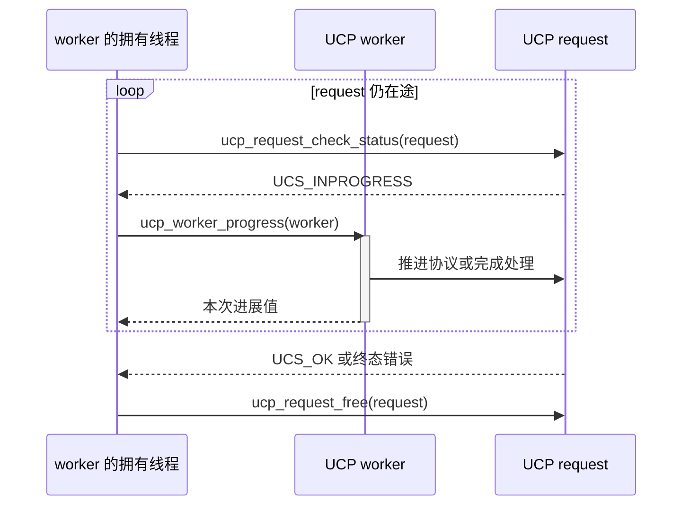
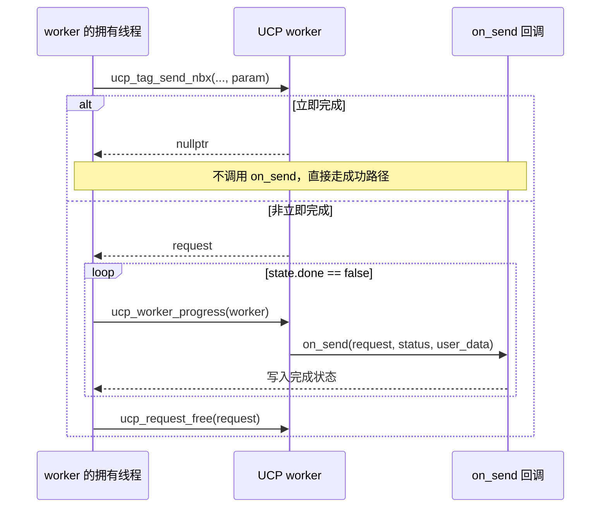
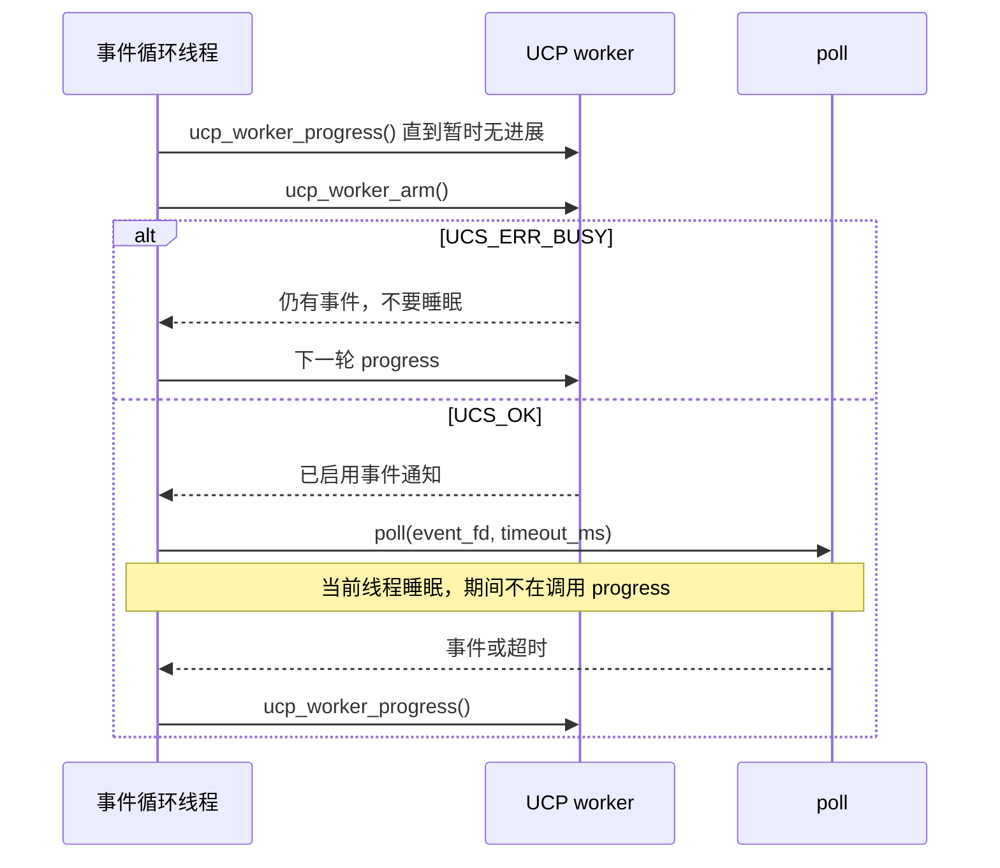
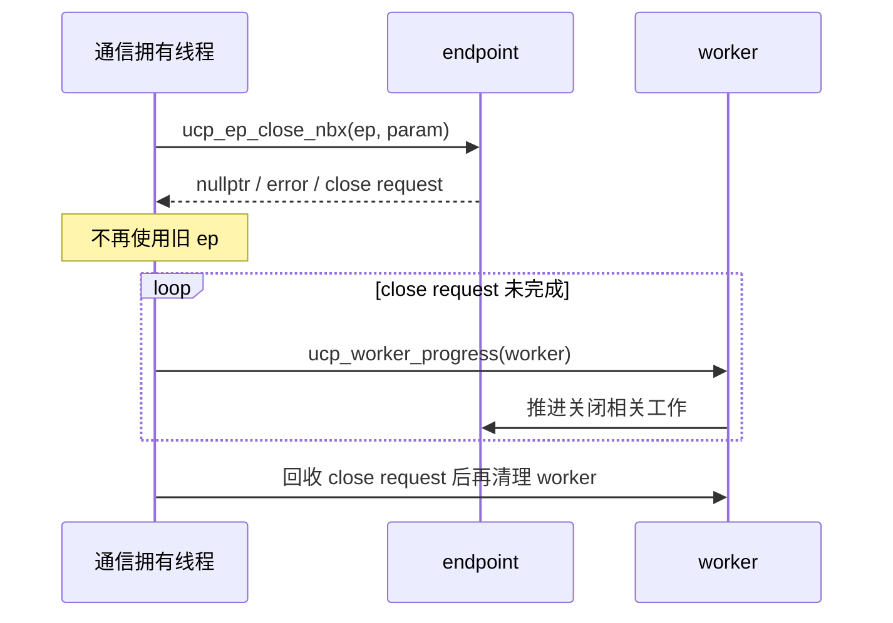

---
tags:
  - 高性能存储
  - RDMA
  - UCX
  - 异步编程
  - 源码阅读
aliases:
  - UCX UCP UCT 编程模型
  - UCX Worker Progress 与请求生命周期
priority: P0
阅读次数: 0
created: 2026-09-19
source_version: UCX v1.19.0
source_commit: e4636149592d5a435c2c911fe7727444a13bfa2e
---

# 4.31 UCX 编程模型与 Progress 机制

> UCX 的编程难点不是记住 `ucp_tag_send_nbx()`。真正要说清楚的是：**操作提交后由谁推动？回调在哪个线程执行？一个 request 何时结束？buffer、rkey、endpoint 又能在什么时候释放？**
>
> 本篇固定 UCX **v1.19.0**，commit `e4636149592d5a435c2c911fe7727444a13bfa2e`，不是宣称它是最新版本。示例以 CPU 内存、UCP NBX 接口、应用显式调用 progress 为基线。GPU 内存、transport 和运行时配置可能改变协议与性能；请求完成与资源回收仍须按 API 契约判断。[^U1]

[[4.2 Verbs 编程模型]] 直接面对 PD、MR、QP、CQ。UCX 把更高层的通信语义、协议选择和资源组合放在库中，但没有取消异步状态机与内存生命周期问题。与 [[8.23 Mooncake Transfer Engine：一次传输的完整路径]] 对照时尤其要留意：Mooncake 那条 classic RDMA 路径有自己的 WorkerPool；**UCP worker 不是一个承诺自动运行的后台线程。**[^U2][^U3]

## 1. UCP / UCT / UCS：先分清语义、传输原语和基础设施

| 层次 | 负责什么 | 应用理解到什么程度 |
|---|---|---|
| UCP：Unified Communication Protocols | tag、stream、active message、RMA/atomic 等上层操作；协议、分片、transport/lane 选择 | 主要编程入口；理解请求和完成语义 |
| UCT：Unified Communication Transport | 面向具体传输能力的接口，如 short、bcopy、zcopy、put/get、transport endpoint | 知道 UCP 的一次操作不必对应一个 verbs WR |
| UCS：Unified Communication Services | 数据结构、内存池、配置、线程/异步事件等基础服务 | 追 progress、锁、回调与资源成本时再深入 |

UCX 是通信库，不是替代内核驱动或 NIC firmware 的新驱动；UCT 可以面对 RDMA，也可以面对 TCP、共享内存等能力。一个 UCP endpoint 可以使用多个 lane，各自映射到合适的 transport 资源，不能机械等同为一个 TCP socket 或一个 RDMA QP。[^U2][^U4]

![[图片/SVG/8_4_4_31_1.svg|900]]

把 UCX 与 MPI/NCCL 也分开：UCP 提供构建通信系统的原语；使用 UCX 的上层库可能提供自己的 collective、rank、拓扑和线程机制。不能因为某个 MPI 实现配置了进度线程，就把那种线程保证写进普通 UCP 程序。

## 2. Context、Worker、Endpoint 分别活在哪个边界

### 2.1 Context：一组通信需求与共享资源

`ucp_init()` 根据 `ucp_params_t` 建立 context。`features` 声明程序会用到什么，例如 `UCP_FEATURE_TAG`、`UCP_FEATURE_RMA`、`UCP_FEATURE_WAKEUP`。只开启真正需要的能力，可以让库选择适合的资源；features 不是“初始化后自动做这些操作”的任务列表。[^U1]

context 可以被多个 workers 使用。`mt_workers_shared` 专门表达：这个 context 是否被**来自不同线程的多个 workers**共享。它与“一个 worker 被多个线程同时调用”不是同一个配置维度。

### 2.2 Worker：进度与资源归属，不是 OS thread

worker 管理通信资源及推进通信所需的状态。发送从 endpoint 进入其关联的 worker；接收、请求池、progress、wakeup 也围绕 worker 工作。

进程可以有多个 workers；线程与 worker 的映射由应用设计。创建 worker 不等于创建一个用户可依赖的消息处理线程；名字里的 worker 表示通信执行上下文。底层可能存在辅助异步事件机制，但它不构成“所有 UCP request 都会在应用不 progress 时自行完成”的通用保证。[^U3]

### 2.3 Endpoint：到某个远端通信对象的逻辑连接

一种最适合学习的启动方式是：两边各自建立 context/worker，调用 `ucp_worker_get_address()`，经应用的带外通道交换序列化地址，再用 `ucp_ep_create()` 建立 endpoint。也可以采用 listener、socket address、connection request 的连接管理方式；这属于另一套 bootstrap，不要把两种 API 组合成必需的固定顺序。[^U1]

worker address 不是“把一个本地指针发给另一进程”，更不是业务 payload 的远端地址。业务 RMA 地址、memory handle、packed rkey 是另一组概念。

创建 endpoint 返回成功也不应被用作“所有未来协议的 wireup 都已耗时为零”的证明。惰性连接、协议初始化和首次访问的成本仍可能出现在最初的通信中。

### 2.4 对象所有权速查

| 资源 | 创建/获取 | 配对释放 | 释放前应满足 |
|---|---|---|---|
| config | `ucp_config_read()` | `ucp_config_release()` | 已完成需要它的初始化 |
| context | `ucp_init()` | `ucp_cleanup()` | workers 与关联资源已正确清理 |
| worker | `ucp_worker_create()` | `ucp_worker_destroy()` | endpoint、请求等已完成退出 |
| 本地 worker address | `ucp_worker_get_address()` | `ucp_worker_release_address()` | 不再需要该序列化地址 |
| endpoint | `ucp_ep_create()` | `ucp_ep_close_nbx()` | 按 graceful/force 契约处理，close 本身可异步 |
| 通信 request | NBX 返回有效请求指针 | `ucp_request_free()` | 本篇采用先完成再 free 的易审计方式 |
| memory handle | `ucp_mem_map()` | `ucp_mem_unmap()` | 无在途本地/远端访问仍依赖该映射 |
| packed rkey buffer | `ucp_rkey_pack()` | `ucp_rkey_buffer_release()` | 序列化数据已交付、不再需要 |
| unpack 后的 rkey | `ucp_ep_rkey_unpack()` | `ucp_rkey_destroy()` | 相关操作已 flush，且在所属 endpoint 销毁之前 |

表中原始指针形式是 C API 的表示，不表示调用方可以用 `delete` 或 `free` 随意释放。每种对象有自己的配对函数。[^U1]

## 3. NBX 的返回值：三条分支必须全部写出来

`ucp_tag_send_nbx()`、`ucp_put_nbx()`、`ucp_ep_flush_nbx()` 等常见 NBX 操作使用 `ucs_status_ptr_t`。在本文不使用用户自分配 request 等额外模式的前提下，应按下面处理：

| 返回值 | 含义 | 调用方动作 |
|---|---|---|
| `nullptr` | 操作立即完成 | 走成功完成逻辑；不要等回调，不要 free 空指针 |
| `UCS_PTR_IS_ERR(ret)` | 编码在指针中的错误 | 用 `UCS_PTR_STATUS(ret)` 取状态；不是可释放 request |
| 其他有效指针 | 非立即完成的 request | 安排 progress，观察完成；之后按约定释放一次 |

**设置了 completion callback，也不表示每次提交都会调用它。**默认允许立即完成时，`nullptr` 分支不会再给你补一遍完成回调。忽略这一分支，会让最小消息测试永久等待一个根本不会出现的 callback。[^U1][^U4]

![[图片/SVG/8_4_4_31_2.svg|900]]

### 3.1 field mask 不是装饰

UCX 的参数结构通常包含 `field_mask` 或 `op_attr_mask`。把 `cb.send` 写进去却没设置 `UCP_OP_ATTR_FIELD_CALLBACK`，把 `user_data` 写进去却没设置 `UCP_OP_ATTR_FIELD_USER_DATA`，都不能要求库按你的意图使用那些字段。

初始化结构用 `{}`，再显式设置实际使用的 mask 和字段。它既减少未初始化数据，也尊重接口的版本扩展方式。`UCP_OP_ATTR_FLAG_NO_IMM_CMPL` 可以要求特定操作不走默认立即完成路径，但不是修复错误生命周期管理的万能开关，提交错误分支仍然存在。[^U1][^U4]

### 3.2 源码里能看到这三条路

固定版本的 `src/ucp/tag/tag_send.c` 中，`ucp_tag_send_nbx()` 检查 feature 和参数；满足条件时先尝试 inline 路径。不能立即完成时申请 request，再根据协议配置进入协议选择或对应发送实现。

其中源码显式区分 `proto_enable` 分支。于是“`ucp_tag_send_nbx` 永远经过同一个 eager 函数、再经过同一个 rendezvous 函数”的单线叙述是不准确的。**稳定的是 API 语义和调用方的生命周期责任；具体 transport/protocol 分支必须以当前配置和运行日志为准。**[^U4]

## 4. Progress 机制：查状态与推进状态不是一回事

固定版本的 `ucp_worker_progress()` 很适合拿来做第一处源码入口：它进入条件线程保护，检查不能递归 progress，调用 `uct_worker_progress(worker->uct)`，再处理辅助异步事件检查，最后返回进展值。[^U3]

```text
应用的事件循环 / 专用通信线程
    → ucp_worker_progress(worker)
        → 条件线程保护与非重入检查
        → uct_worker_progress(worker->uct)
        → 辅助异步事件检查
    → 请求状态可能变化，完成回调可能被调用
```

这是调用关系示意，不是所有后端都会执行的固定硬件数据路径。UCT 实际推进的是当前 worker 所关联的 transport/protocol 工作；可能包含收包、完成队列处理、挂起请求重试、控制消息等。

### 4.1 三个常见误读

**“返回 0，所以没有在途请求。”**不对。`ucp_worker_progress()` 返回 0 只说明这次调用没有报告进展。在途请求可能仍在等待远端、资源或下一次网络事件。

**“返回非零，所以我的 request 完成了。”**不对。同一个 worker 上的其他通信也可能取得进展。你要查询自己的 request，或检查自己的完成状态。

**“我不停调用 `ucp_request_check_status()`，等同于 progress。”**不对。此版本该函数只是读取 request 的完成标志和 status，没有调用 worker progress。只 test 不 progress，可能无限停留在 `UCS_INPROGRESS`。[^U3][^U5]

### 4.2 两端都要有可用的进度机会

为了编写不依赖具体 transport 偶然行为的程序，应让通信参与端持续获得 progress 机会。不能因为 READ/WRITE 是 one-sided，就推导“目标进程在所有 UCX 配置下都可以永远不 progress”。连接管理、rendezvous、资源回收、控制消息或软件实现可能仍需要软件推进。

对已经建立好的特定硬件 RMA 路径，某些数据移动可能不需要对端 CPU 逐条参与；这是具体路径的性质，不是整个 UCP 会话生命周期可以不管 progress 的理由。验证时要分别观察冷启动、稳态、关闭与故障，而不是仅测一次已热身的 put。

### 4.3 回调通常运行在推进它的线程里

本篇的单 worker、显式 progress 模型中，完成处理应按可能在调用 progress 的线程内执行来设计。不要假定 callback 会自动投递到另一个业务线程。AM receive callback 的官方契约明确要求运行短小，并禁止在其内部递归 `ucp_worker_progress()`；固定 worker 实现也有非重入断言。[^U3][^U1]

适合在回调中做的是写入完成状态、保存错误码、将轻量事件入队。不适合做的是等待同一个 worker 的另一个请求、执行长时间磁盘 I/O，或持有一把其他提交线程正在等待的业务锁。将复杂业务交回应用队列，可避免让整个通信进度被一个回调拖住。

## 5. 一个能审计的发送示例：先只用单线程拥有 worker

本节代码是独立函数/片段，假定已包含 UCX、C++ 标准头文件，endpoint 已由调用方建立，对端已安排匹配接收与 progress。它们不是包含双端 bootstrap 的完整程序；没有在本次交付环境运行 UCX。先约束为单个线程访问 worker，是为了把生命周期和线程安全分开学习。

### 5.1 一个通用的完成等待函数

这个函数支持本文使用的普通 NBX 返回值：立即完成、错误指针、普通 request。它没有业务截止时间，故意不演示“超时返回后丢掉 request”的危险写法。

```cpp
ucs_status_t finish_request(ucp_worker_h worker, ucs_status_ptr_t request) {
    if (request == nullptr) return UCS_OK;
    if (UCS_PTR_IS_ERR(request)) return UCS_PTR_STATUS(request);

    ucs_status_t status;
    while ((status = ucp_request_check_status(request)) == UCS_INPROGRESS) {
        ucp_worker_progress(worker);
    }
    ucp_request_free(request);
    return status;
}
```



等待者一直在推进通信而不是睡眠；它的正确性不意味着它的 CPU 使用率适合所有服务。

### 5.2 callback + user_data：谁持有完成状态

完成状态只由本例的拥有线程访问，因此用普通字段。这个结构不是跨线程安全通知器；需要跨线程发布时，要使用原子、锁或队列建立同步。

```cpp
struct SendDone {
    bool done = false;
    ucs_status_t status = UCS_INPROGRESS;
};

void on_send(void*, ucs_status_t status, void* user_data) noexcept {
    auto& state = *static_cast<SendDone*>(user_data);
    state.status = status;
    state.done = true;
}
```

回调只写状态，不在回调里释放 request，也不执行阻塞工作。释放统一由拥有线程负责，避免 callback 与等待路径重复 free。

```cpp
ucs_status_t send_one(ucp_worker_h worker, ucp_ep_h ep,
                      const std::vector<std::byte>& payload, ucp_tag_t tag) {
    SendDone state;
    ucp_request_param_t param{};
    param.op_attr_mask = UCP_OP_ATTR_FIELD_CALLBACK |
                         UCP_OP_ATTR_FIELD_USER_DATA;
    param.cb.send = on_send;
    param.user_data = &state;

    auto request = ucp_tag_send_nbx(ep, payload.data(), payload.size(), tag, &param);
    if (UCS_PTR_IS_ERR(request)) return UCS_PTR_STATUS(request);
    if (request == nullptr) return UCS_OK;  // 此分支没有后续回调

    while (!state.done) ucp_worker_progress(worker);
    ucp_request_free(request);
    return state.status;
}
```



`state` 和 `payload` 在等待过程中都存活；如果改成提交后立刻返回，就必须把这些状态迁移到寿命足够长的拥有者中。示例未设置 datatype 字段，按此接口默认连续字节类型使用 `payload.size()`；不能把这个 count 规则推广到任意用户 datatype。[^U1][^U4]

## 6. 三种 progress 调度方式与睡眠竞态

### 6.1 Busy polling：延迟直接，CPU 成本也直接

专用线程不断 progress，容易解释低延迟，但空闲时也可能持续消耗 CPU。线程被抢占、跨 NUMA、绑核冲突、回调过重，都可能扩大两次 progress 间隔，形成尾延迟。调优时应记录 progress 调用间隔和线程 CPU，而不仅是链路带宽。

### 6.2 协作式轮询：主循环每轮留出通信预算

业务循环每处理一小批任务，就给 worker 一个有限的 progress 预算。这能共享 CPU，但需要限制最长不调用 progress 的间隔。一次业务任务阻塞几十毫秒，可能同时饿死该 worker 下所有通信。批次与预算是工程策略，应通过延迟分位数实测，不是 UCX 固定保证。

### 6.3 事件驱动：事件就绪不等于请求完成

申请 `UCP_FEATURE_WAKEUP`，获取 worker event fd 后，可以将其纳入 poll/epoll。基本结构是：**推进现有工作 → 检查业务条件 → arm → 根据结果等待或继续推进 → 醒来后再次 progress。**

`ucp_worker_arm()` 返回 `UCS_ERR_BUSY`，意味着存在妨碍 arm 的未处理事件，应继续 progress，不能照样睡下。返回 `UCS_OK` 后才进入事件等待。这样才能覆盖“判断没进展”与“准备睡眠”之间到达事件的竞态。[^U3][^U6]

![[图片/SVG/8_4_4_31_3.svg|900]]

下面的函数展示一轮 drain/arm/poll。`done` 必须只由当前拥有线程访问；退出该函数不释放 request。`timeout_ms` 只限制 poll 的等待时长，不限制前面的 drain 循环，更不是传输取消语义。持续有进展时，drain 可能运行较久；生产事件循环可设置 progress 预算，预算耗尽就先返回调度器，而不是立即进入睡眠。

```cpp
ucs_status_t progress_or_sleep_once(ucp_worker_h worker, int event_fd,
                                    const bool& done, int timeout_ms) {
    while (!done && ucp_worker_progress(worker) != 0) {}
    if (done) return UCS_OK;

    const auto status = ucp_worker_arm(worker);
    if (status == UCS_ERR_BUSY) return UCS_OK;  // 外层继续 progress
    if (status != UCS_OK) return status;

    pollfd fd{event_fd, POLLIN, 0};
    const int rc = poll(&fd, 1, timeout_ms);
    if (rc < 0) {
        return errno == EINTR ? UCS_OK : UCS_ERR_IO_ERROR;
    }
    if (fd.revents & (POLLERR | POLLHUP | POLLNVAL))
        return UCS_ERR_IO_ERROR;
    ucp_worker_progress(worker);  // 被唤醒或计时到达后继续推进
    return UCS_OK;
}
```



示例需要 `<poll.h>`、`<cerrno>` 与 UCX 头文件。外层应检查完成状态、停止条件和错误，并持有 request 与 buffer；`UCS_OK` 只表示这个调度步骤没有报错，不代表通信成功。

`ucp_worker_wait()` 是库提供的另一种阻塞等待事件方式。它也要求正确处理已有进展；等待期间不会替代持续调用 progress。不要把 `wait()`、`arm()` 和自行 poll 的两个方案随意叠在一起，以为多等一次更可靠。[^U6]

## 7. 线程模型：SINGLE、SERIALIZED、MULTI 不是三个线程数

| 模式 | 谁负责避免并发访问 worker | 典型设计 | 常见误解 |
|---|---|---|---|
| `UCS_THREAD_MODE_SINGLE` | 一个固定拥有线程使用它 | 每个通信线程独占 worker | “只有 progress 单线程就行，其他线程可同时 send” |
| `UCS_THREAD_MODE_SERIALIZED` | 应用保证访问被串行化 | 多线程轮流使用，外部同步 | “库会替我自动加锁” |
| `UCS_THREAD_MODE_MULTI` | worker 提供相应多线程访问支持 | 多个线程可能同时调用 | “库自动产生 progress 线程，且无需应用同步” |

请求的模式与实际模式可能不同。建立 worker 后，用 `ucp_worker_query()` 查询 `UCP_WORKER_ATTR_FIELD_THREAD_MODE`，按实际支持决定是否允许共享。编译时能力、运行时实际模式与应用自己数据结构的同步要分别检查。[^U1][^U3]

![[图片/SVG/8_4_4_31_4.svg|900]]

### 7.1 一个专用 progress 线程的两种安全组织方式

**独占 owner：**业务线程把命令放入队列；通信线程拥有 worker，负责 submit、progress、callback 和 `ucp_request_free()`，再把完成事件发回业务线程。这样 worker 可采用适合单线程访问的模式，但跨线程队列与 buffer 租借仍要正确同步。

**共享 worker：**业务线程直接发起 UCX 调用，另一线程 progress。此时已发生多个线程访问同一个 worker，不能仍以 SINGLE 的约定运行。使用受支持的 MULTI，或在 SERIALIZED 设计中将相关访问串行化，并检查 callback 与锁是否会造成死锁。

`MULTI` 并不保证你自己写的 `bool done`、引用计数、完成队列、buffer 复用池自动线程安全。回调可能在持有通信内部状态的路径上执行，业务锁顺序要简单；最稳妥的回调仍然是发布一个轻量完成事件。

### 7.2 一个 context 多个 worker 与一个 worker 多线程不同

若线程 A 拥有 worker A、线程 B 拥有 worker B，两者共享一个 context，应在 context 初始化时正确设置 `mt_workers_shared` 及对应 field mask；这与每个 worker 自己的 `thread_mode` 是两级责任。`ucp_params_t` 的注释专门区分了这两种场景。[^U1]

性能上，独占 workers 可能减少共享争用，但增加 endpoint、连接和其他通信资源；共享 worker 节省部分资源，却引入同步成本。应结合 endpoint 数、消息率、NUMA、尾延迟测量，不把“一个线程一个 worker”写成所有业务的必选项。

## 8. RMA 的地址和 rkey：与 worker address 完全不同

tagged send/recv 的最小示例不要求应用手工交换 RMA key。需要 `ucp_put_nbx()` / `ucp_get_nbx()` 时，再加入 memory handle 与 rkey 流程。

目标进程先通过 `ucp_mem_map()` 建立/登记适当内存映射，再用 `ucp_rkey_pack()` 导出可交换的描述。它通过应用的控制通道传递**远端地址、长度、packed rkey，以及应用自己的有效性信息**。发起端用将要通信的 endpoint 调用 `ucp_ep_rkey_unpack()`，取得该 endpoint 使用的 rkey。packed rkey 是不透明序列化数据，不是将一个本地 `ucp_rkey_h` 数字直接传过去。[^U1]

这里有三类不同地址：worker address 描述通信资源；远端内存地址描述访问哪个字节范围；packed rkey 描述如何让相关传输访问该范围。`rkey` 也不能代替边界、对象版本和访问租约。

与 [[4.12 rkey lkey 生命周期]] 一样，目标端不能在 peer 仍可能访问时提前 unmap/free。发起端销毁自己的 rkey，不等于远端内存已被自动释放；目标端仅发了一条“我要释放”的通知，也不证明所有 peer 的在途访问已结束。

## 9. 完成、flush、fence：三个词解决三种问题

| 动作/完成事件 | 本篇应采用的理解 | 不能推出 |
|---|---|---|
| 普通 tag send 完成 | 发送方可按接口契约重用源 buffer | 对端业务已经处理消息 |
| tag receive 完成 | 接收 buffer 的消息已按接收契约完成 | 接收应用后续处理已完成 |
| put 完成 | 本地发送 buffer 可按其完成契约重用 | 一概等同于远端完成或应用消费 |
| get 完成 | 本地接收数据可按完成契约使用 | 远端数据曾是上层一致快照 |
| `ucp_ep_flush_nbx()` 完成 | 对此 endpoint 先前的 RMA/AMO 达到文档规定的本地与远端完成 | 数据已持久化、业务已提交 |
| `ucp_worker_fence()` | 对此前/此后的 RMA/AMO 建立规定的顺序约束 | 阻塞等待所有操作完成 |
| 应用 ACK | 对方应用声明完成某个协议步骤 | 自动等于磁盘持久化，除非协议如此定义 |

flush 是一个可能异步的操作，自己也要走 NBX 三分支并 progress 到完成。fence 更不是一个“更快的 flush”。不同 endpoint、内存类型与协议的顺序保证应以相应 API 契约为准，不要凭一次测试推导全局总序。[^U1]

这一节与 [[4.13 RDMA 操作顺序性]]、[[4.14 Fence 与内存可见性]] 对应：通信顺序、CPU/GPU 可见性、业务发布和持久化不能用一个笼统的“完成”替代。

## 10. 错误、取消和关闭：停止等待不等于停止传输

### 10.1 同步错误与异步错误要分别保存

提交时返回 error pointer，是立即失败的分支；返回普通 request 后，完成回调或查询仍可能返回错误。除此之外，endpoint 的错误处理模式和错误 callback 涉及连接级故障。需要对 peer failure 做处理时，应按接口要求配置 `UCP_ERR_HANDLING_MODE_PEER` 等字段，且验证实际操作/transport 支持边界，不能只在应用中加一个计时器就宣称具备故障恢复。[^U1]

出现 deadline 时，可以把结果标记为业务上不再需要，但仍要明确谁接管 request、callback user_data、源/目标 buffer 和 endpoint。特别是回调指向栈对象时，函数一返回就可能成为悬空指针。

### 10.2 `ucp_request_free()` 不是 cancel

本版 `ucp_request_free()` 调用内部 release 逻辑：如果 request 已完成，就归还资源；如果尚未完成，就标记 released 并清除回调标志，底层工作仍可能继续。**API 允许提前 relinquish request，并不意味着应用可以提前释放数据 buffer。**[^U5]

所以本文示例采用简单的所有权规则：完成前保留 request 可观察性；观察到终态后 free 一次。高级封装可以选择其他契约，但必须另外追踪数据生命期，不能把“我不再收到回调”误当成“库不再访问数据”。

### 10.3 不能把 `ucp_request_cancel()` 当成全能按钮

这里必须区分一般文档描述与所读实现。固定 v1.19.0 的 `src/ucp/core/ucp_request.c` 中，`ucp_request_cancel()` 对未完成请求主要处理 `UCP_REQUEST_FLAG_RECV_TAG`：尝试从 expected receive 队列移除，非 offload 的已移除请求可完成为 canceled；已 offload 到 transport 的接收仍需等对应完成。

因此，本篇**不提供“任意 send/put 超时后 cancel，再立刻 free buffer”的通用代码**。先确认当前版本、操作种类与支持的取消路径；即使发起取消，也要按相应完成契约观察、推进和清理。对于已经完成或正在完成的操作，取消竞争不应被解释为自动回滚远端副作用。[^U5]

### 10.4 `ucp_ep_close_nbx()` 自己也是异步操作

正常 graceful 退出应停止新提交，处理既有 requests，按需要完成 RMA flush 和应用层关闭握手，销毁该 endpoint 上已不再使用的 unpack rkey，再 close endpoint。`ucp_ep_close_nbx()` 同样可能返回立即完成、error pointer 或 close request；拿到 close request 后要在 worker 仍有效时推进并按契约回收。不能“发起 close，然后立即 destroy worker”。[^U1]

强制关闭 `UCP_EP_CLOSE_FLAG_FORCE` 有错误处理模式等使用前提，语义也不是保证所有数据可靠送达。它用于处理连接退出的特殊情形，不是把未知传输结果变成成功。双方关闭流程也应协调，不然 graceful 关闭所需的对端进度可能已经消失。

## 11. 资源释放顺序：先消除引用，再拆除容器

正常路径可以按下面的依赖关系审计，而不是死记一条不看条件的函数序列：

| 阶段 | 要满足的条件 | 之后才做 |
|---|---|---|
| 停止入口 | 不再向 endpoint/worker 投递新任务 | 收拢在途 requests |
| 排空操作 | 普通请求已终结；必要的 flush/应用 ACK 已完成 | 归还请求，停止使用相关 buffer/rkey |
| RMA 协调 | peer 已不可能再访问将被回收的内存 | 销毁本地不再使用的 rkey，解除相关映射 |
| 关闭连接 | close request 已按契约处理完 | 不再访问 endpoint |
| 拆除 worker | 其 endpoint、请求与引用关系已退出 | `ucp_worker_destroy()` |
| 拆除 context | 所有关联 workers/memory resources 已清理 | `ucp_cleanup()` |

buffer 与 memh 的清理要根据映射的所有权决定；rkey 还有明确约束：相关操作先 flush，再销毁 unpack 后的 rkey，且必须早于其所属 endpoint 的销毁。关键偏序是：**活跃操作不能引用已销毁的 buffer/endpoint/worker/context；远端注册区不能在 peer 仍能访问时被复用。**

一个方便理解的 graceful close 片段如下。它只关闭已停止新提交、完成必要业务同步的 endpoint；不负责替调用方完成所有应用协议。

```cpp
ucp_request_param_t close_param{};  // 默认 graceful close，不设置 FORCE
auto close_request = ucp_ep_close_nbx(ep, &close_param);
ep = nullptr;                     // 之后不再使用旧 endpoint 句柄
const auto close_status = finish_request(worker, close_request);
// 检查 close_status，并完成其余资源清理，再 destroy worker/context。
```



图中的 worker 活得比关闭操作更久；这是关闭接口常被遗漏的一层异步生命周期。

## 12. 源码阅读路线与实验产出

### 12.1 先沿稳定 API，后追配置分支

| 阅读入口 | 文件 | 要回答的问题 |
|---|---|---|
| 参数与契约 | `src/ucp/api/ucp.h` | 哪些 mask、返回值、完成与释放要求属于 API |
| 提交路径 | `src/ucp/tag/tag_send.c` | 立即完成、request 分配、协议选择在哪分叉 |
| 主动推进 | `src/ucp/core/ucp_worker.c` | 哪个线程进入 progress；如何保护非重入 |
| 请求观察/释放 | `src/ucp/core/ucp_request.c` | check 是否推进；free/cancel 到底做什么 |
| transport 原语 | `src/uct/api/uct.h` | UCP 怎样面对不同传输能力，而不是固定一条 verbs 调用 |

前三处最值得设置断点的是 `ucp_tag_send_nbx`、`ucp_worker_progress`、`ucp_request_free`。用你自己的完成回调作为第四个断点，记录执行线程。不要先盯着所有 mlx5 细节，否则容易失去“到底谁在驱动这个 request”的主线。[^U3][^U4][^U5]

固定源码与查看本机配置的命令：

```bash
git clone https://github.com/openucx/ucx.git
cd ucx
git checkout --detach e4636149592d5a435c2c911fe7727444a13bfa2e
rg -n 'ucp_worker_progress|ucp_worker_arm' src/ucp/core/ucp_worker.c
rg -n 'ucp_request_check_status|ucp_request_free|ucp_request_cancel' src/ucp/core/ucp_request.c
ucx_info -v
ucx_info -d
ucx_info -cf
pkg-config --cflags --libs ucx
```

源码 checkout 不会自动改变 PATH 中 `ucx_info` 对应的库。确认动态链接到的版本与阅读基线一致，才可把实测行为归因到这份代码。若本机装的是其他版本，记录差异，不要把命令输出当成本篇已经实测过的结果。[^U2]

### 12.2 四个最小实验

**实验 A：三分支。**双端发送小消息和较大消息，分别统计立即完成、普通 request、错误结果；检查立即完成不等 callback。不能保证某个长度在每台机器都走同一分支，应以观测为准。

**实验 B：只查状态与实际 progress。**有期限地暂停某一端 progress，记录 request 状态与恢复后的变化。不可故意无限死循环；用日志或外部控制结束试验。区分 eager、rendezvous、已热身 RMA 等配置，避免把一个传输的表现概括为整个 UCX。

**实验 C：busy 与 wakeup。**在相同负载下比较 busy progress 和正确的 drain/arm/wait 循环，记录吞吐、延迟分位数、线程 CPU、最长 progress 间隔。CPU 降低同时延迟增加，不一定是实现错误，可能是调度取舍。

**实验 D：所有权与退出。**在独占测试程序中覆盖正常完成、匹配接收取消、peer 退出、graceful close；检查回调 user_data 没有悬空、request 没有重复 free、worker 没有提前 destroy。通用 sanitizer 可帮助发现应用内存错误，但不能证明 RNIC 异步访问和跨机生命周期全部正确。

可先用共享内存或 TCP backend 学习 UCP 接口；验证 RDMA 与多 rail 行为时，仍要使用相应设备与配置。不要为使实验“能跑”而悄悄回退到 TCP，然后把结果命名为 RDMA 测试。

## 13. 故障定位清单

| 症状 | 优先排查 | 不是首选修复 |
|---|---|---|
| 小消息等不到 callback | 是否返回 nullptr，立即完成分支是否处理 | 盲目调大超时 |
| request 永远 INPROGRESS | 是否实际 progress；是否推进了正确 worker；对端是否有进度 | 只重复 check_status |
| wakeup 后还是没完成 | 是否再次 progress；事件是否属于其他通信 | 认为 fd 就绪即当前请求完成 |
| 空闲睡眠后偶发永久等待 | 是否 drain、arm；BUSY 是否错误进入 poll | 无限增加轮询 timeout |
| 多线程才崩溃 | 实际 thread mode、业务共享状态、callback 生命周期 | 把所有状态声明 volatile |
| 退出阶段卡住 | 对端是否先停止 progress；close request 是否仍在途 | 直接 destroy worker |
| 超时后偶发内存损坏 | 是否释放了仍被库/RNIC 引用的 buffer 或 user_data | 只重建 endpoint 不检查所有权 |
| 吞吐正常但 P99 差 | progress 间隔、CPU 抢占、callback 长度、NUMA | 只增加网卡带宽 |

## 14. 用五句话检查是否真正理解

**Worker 是线程吗？**不是；它是通信资源与进度的归属对象，线程模型由应用安排。

**Test 等于 progress 吗？**不是；固定版本的 `ucp_request_check_status()` 不推进网络状态。

**设置 callback 后，所有发送都会调用 callback 吗？**不是；默认立即完成的 nullptr 分支由调用者自己处理。

**free request 就能 free buffer 吗？**不是；提前 relinquish request 不会自动取消仍在进行的数据访问。

**MULTI 能免除应用的线程同步吗？**不能；它解决 worker 的相关并发访问支持，不会替用户的完成队列、状态标志和 buffer 池建立正确所有权。

## 15. 来源与版本边界

[^U1]: [v1.19.0 固定版 ucp.h](https://github.com/openucx/ucx/blob/e4636149592d5a435c2c911fe7727444a13bfa2e/src/ucp/api/ucp.h)。主要 API 契约：Context/Worker/Endpoint、field mask、NBX 参数、memory/rkey、flush/fence、close；其中 `ucp_params_t::mt_workers_shared` 明确区分 context 多 worker 与 worker 多线程。
[^U2]: [UCX 官方 FAQ](https://openucx.readthedocs.io/en/master/faq.html)。用于 UCP/UCT/UCS 分工与本机配置查看方法；该网页为滚动文档，版本相关默认值不作为本篇固定结论。
[^U3]: [v1.19.0 ucp_worker.c](https://github.com/openucx/ucx/blob/e4636149592d5a435c2c911fe7727444a13bfa2e/src/ucp/core/ucp_worker.c#L3005-L3200)。重点：worker_query、worker_progress、条件线程保护、非重入检查、get_efd 与 arm。
[^U4]: [v1.19.0 tag_send.c](https://github.com/openucx/ucx/blob/e4636149592d5a435c2c911fe7727444a13bfa2e/src/ucp/tag/tag_send.c#L100-L320)。重点：ucp_tag_send_nbx、inline、NO_IMM_CMPL、request 分配和协议分支。
[^U5]: [v1.19.0 ucp_request.c](https://github.com/openucx/ucx/blob/e4636149592d5a435c2c911fe7727444a13bfa2e/src/ucp/core/ucp_request.c#L159-L276)。重点：check_status 只读取状态、free 的 released/callback 标记、cancel 对 tagged receive 的具体处理。
[^U6]: [UCX 官方 API 文档](https://openucx.readthedocs.io/en/master/api.html)。用于交叉核对 progress、wakeup、arm/wait 的公开说明；具体取消行为优先看本篇固定版本实现，而不是从宽泛说明推断所有操作都能立即取消。

> 验证范围：本文完成固定版本的关键源码与接口核对，并对图文结构进行检查；示例没有在本次环境编译链接到 UCX，也未执行双机、RDMA 或 GPU 测试。给出的性能观察是实验项目，不是实测结果。
